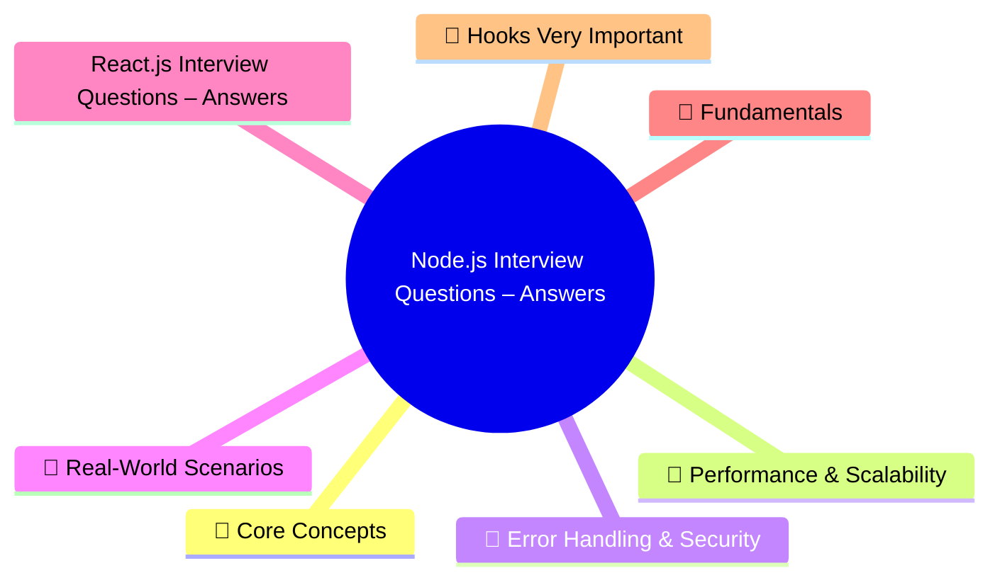

# Node.js Interview Questions – Answers



## 🔹 Core Concepts

### ✅ What is the Node.js event loop? Explain all phases.

The **event loop** allows Node.js to perform **non-blocking I/O** using a **single thread**. It continuously checks queues and executes callbacks.

**Phases of the event loop:**

1. **Timers**

   - Executes callbacks from `setTimeout` and `setInterval`.

2. **I/O Callbacks**

   - Executes callbacks for completed async I/O (except close, timers, setImmediate).

3. **Idle, Prepare**

   - Internal use (libuv).

4. **Poll**

   - Retrieves new I/O events.
   - Executes I/O callbacks.
   - If poll queue is empty:

     - Waits for I/O, or
     - Moves to `check` phase if `setImmediate` exists.

5. **Check**

   - Executes `setImmediate` callbacks.

6. **Close Callbacks**

   - Executes cleanup callbacks (e.g., `socket.on('close')`).

📌 **process.nextTick** runs **outside** the event loop and before all phases.

---

### ✅ Difference between `process.nextTick`, `setImmediate`, and `setTimeout`

| Function            | Execution Time                                       |
| ------------------- | ---------------------------------------------------- |
| `process.nextTick`  | Executes immediately **before** event loop continues |
| `setImmediate`      | Executes in **check phase**                          |
| `setTimeout(fn, 0)` | Executes in **timers phase**                         |

📌 `process.nextTick` can **starve the event loop** if abused.

---

### ✅ How does Node.js handle concurrency with a single thread?

Node.js uses:

- **Single-threaded event loop** for JavaScript execution
- **Non-blocking async I/O**
- **libuv thread pool** for:

  - File system
  - DNS
  - Crypto

Concurrency is achieved by:

- Delegating blocking work to background threads
- Handling callbacks when tasks complete

---

### ✅ What are streams? Types of streams with use cases.

Streams process data in **chunks**, not all at once (memory-efficient).

**Types:**

1. **Readable** – Read data (file read, HTTP request)
2. **Writable** – Write data (file write, HTTP response)
3. **Duplex** – Read + write (TCP sockets)
4. **Transform** – Modify data (gzip, encryption)

📌 Used for **large files, video streaming, piping data**.

---

### ✅ Difference between CommonJS vs ES Modules

| Feature        | CommonJS        | ES Modules                  |
| -------------- | --------------- | --------------------------- |
| Syntax         | `require()`     | `import`                    |
| Loading        | Synchronous     | Asynchronous                |
| Scope          | Function-scoped | Block-scoped                |
| File extension | `.js`           | `.mjs` or `"type":"module"` |

📌 Node.js supports both, but **ESM is future-preferred**.

---

## 🔹 Performance & Scalability

### ✅ How do you handle CPU-intensive tasks in Node.js?

Options:

- **Worker Threads** (preferred)
- **Child Processes**
- **Message queues** (SQS, RabbitMQ)
- **Microservices**

📌 Never run CPU-heavy logic on the main thread.

---

### ✅ What is clustering? When would you use it?

Clustering allows Node.js to:

- Fork multiple processes
- Utilize **all CPU cores**
- Share the same server port

Used when:

- High traffic
- CPU-bound APIs
- Traditional server deployments (less needed in serverless)

---

### ✅ How do you detect and fix memory leaks?

**Detection:**

- `process.memoryUsage()`
- Heap snapshots
- Chrome DevTools
- Tools: `clinic`, `heapdump`

**Common causes:**

- Global variables
- Unreleased event listeners
- Closures holding references
- Caching without limits

**Fix:**

- Proper cleanup
- WeakMaps
- Limit cache size

---

### ✅ How do you implement rate limiting in Node.js?

Approaches:

- **In-memory** (low scale)
- **Redis-based** (production)
- Libraries:

  - `express-rate-limit`
  - `rate-limiter-flexible`

📌 Usually implemented per **IP / user / token**.

---

## 🔹 Error Handling & Security

### ✅ Difference between throwing errors vs rejecting promises

- **throw error**

  - Used in synchronous code
  - Inside async → becomes rejected promise

- **reject**

  - Explicit promise rejection

📌 Always use `try/catch` with `async/await`.

---

### ✅ How do you handle unhandled promise rejections?

```js
process.on("unhandledRejection", (reason) => {
  logger.error(reason);
});
```

Best practices:

- Always `await` promises
- Use centralized error handling
- Fail fast in production

---

### ✅ How do you secure a Node.js API?

Security layers:

- **JWT / OAuth** for authentication
- **Helmet** for HTTP headers
- **CORS** restrictions
- **Input validation** (Joi, Zod)
- **Rate limiting**
- **HTTPS only**
- **Secrets via env vars / AWS Secrets Manager**

---

### ✅ What are prototype pollution and DOS attacks?

**Prototype Pollution**

- Attacker modifies `Object.prototype`
- Leads to app compromise
- Prevent by validating inputs & avoiding deep merge vulnerabilities

**DOS (Denial of Service)**

- Overloading server with requests
- Prevent via:

  - Rate limiting
  - Timeouts
  - Payload size limits

---

## 🔹 Real-World Scenarios

### ✅ How do you structure a production-grade Node.js app?

Typical structure:

```
src/
 ├── controllers
 ├── services
 ├── routes
 ├── middlewares
 ├── models
 ├── utils
 ├── config
 ├── validations
 └── app.ts
```

---

Best practices:

- Separation of concerns
- Centralized error handling
- Environment-based configs
- Logging (Winston)
- Tests (Jest)
- Linting & formatting

---

# React.js Interview Questions – Answers

## 🔹 Fundamentals

### ✅ Difference between **state and props**

| State                        | Props                       |
| ---------------------------- | --------------------------- |
| Managed inside the component | Passed from parent          |
| Mutable                      | Read-only                   |
| Changes cause re-render      | Cannot be modified by child |

📌 **State** is for component-owned data, **props** are for communication.

---

### 2. What is **reconciliation** in React?

Reconciliation is the process where React:

1. Creates a **Virtual DOM**
2. Compares it with the previous Virtual DOM (**diffing**)
3. Updates only the changed parts in the real DOM

📌 This makes React fast and efficient.

---

### ✅ Controlled vs Uncontrolled components

**Controlled Component**

- Form data controlled by React state
- Predictable and easy to validate

```jsx
<input value={name} onChange={(e) => setName(e.target.value)} />
```

**Uncontrolled Component**

- DOM manages state
- Uses `ref`

```jsx
<input ref={inputRef} />
```

📌 Controlled is preferred in production apps.

---

### ✅ What are **keys** and why are they important?

Keys help React:

- Identify list items uniquely
- Optimize re-renders
- Avoid UI bugs

❌ Using index as key causes rendering issues
✅ Use stable unique IDs

---

## 🔹 Hooks (Very Important)

### ✅ Explain **useEffect** lifecycle behavior

`useEffect` runs **after render**.

```js
useEffect(() => {
  // side effect
  return () => cleanup;
}, [deps]);
```

Behavior:

- No dependency array → runs on every render
- Empty array `[]` → runs once (mount)
- With dependencies → runsI reruns when deps change

---

### 6✅ Common mistakes with **useEffect dependencies**

- Missing dependencies
- Infinite loops
- Using objects/functions without memoization
- Updating state derived from dependencies incorrectly

📌 Always trust the ESLint `react-hooks` rule.

---

### ✅ Difference between **useCallback vs useMemo**

| Hook        | Purpose            |
| ----------- | ------------------ |
| useCallback | Memoizes functions |
| useMemo     | Memoizes values    |

📌 Use them to prevent unnecessary re-renders.

---

### ✅ How does **useRef** differ from state?

| useRef                  | useState           |
| ----------------------- | ------------------ |
| Mutable                 | Immutable          |
| No re-render            | Triggers re-render |
| Stores DOM refs, timers | UI-related data    |

📌 `useRef` is great for accessing DOM or storing mutable values.

---

### ✅ How to create **custom hooks**?

A custom hook is a reusable function that uses hooks.

```js
function useFetch(url) {
  const [data, setData] = useState(null);
  useEffect(() => {
    fetch(url)
      .then((res) => res.json())
      .then(setData);
  }, [url]);
  return data;
}
```

📌 Naming must start with `use`.

---

## 🔹 Performance

### ✅ What causes **unnecessary re-renders**?

- Parent re-renders
- Anonymous functions in JSX
- Changing object/array references
- Improper key usage
- Global state overuse

---

### ✅ How does **React.memo** work?

`React.memo` memoizes a component and prevents re-render if props haven’t changed.

```js
export default React.memo(Component);
```

📌 Useful for pure components.

---

### ✅ How do you optimize a large list? (virtualization)

Use **windowing**:

- `react-window`
- `react-virtualized`

Renders only visible items instead of entire list.

---

## 🔹 Architecture

### ✅ How do you manage **global state**?

Options:

- Context API (small apps)
- Redux Toolkit (complex apps)
- Zustand / Jotai (lightweight)
- Server state → React Query

📌 Choose based on scale and complexity.

---

### ✅ Redux vs Context API vs Zustand

| Feature     | Redux      | Context       | Zustand     |
| ----------- | ---------- | ------------- | ----------- |
| Boilerplate | High       | Low           | Very low    |
| Performance | Excellent  | Poor at scale | Excellent   |
| Use case    | Large apps | Small apps    | Medium apps |

---

### ✅ How do you handle **role-based access control** in React?

Approach:

- Store roles in auth context
- Create `ProtectedRoute`
- Conditionally render UI

```jsx
if (!roles.includes("ADMIN")) return null;
```

📌 Backend must always enforce RBAC.

---

## 🔹 Real-World

### ✅ How do you handle **API errors and loading states**?

Best practice:

- Loading → spinner
- Error → fallback UI
- Success → render data

Libraries:

- React Query
- Axios interceptors

📌 Improves UX and reliability.

---

### ✅ How do you implement **lazy loading & code splitting**?

```js
const Page = React.lazy(() => import("./Page"));
```

Wrap with:

```jsx
<Suspense fallback={<Loader />}>
  <Page />
</Suspense>
```

📌 Reduces initial bundle size.

---

### ✅ Explain a production issue you faced in React and how you fixed it

Example answer:

> We faced performance issues due to unnecessary re-renders in a large dashboard. I identified missing memoization, applied `React.memo`, optimized `useEffect` dependencies, and used list virtualization. This reduced render time by ~60%.

📌 Always show **impact**.

---

# ✅ TypeScript Interview Questions – Answers

## 🔹 Basics

### 1. Difference between **interface and type**

| interface                    | type                                |
| ---------------------------- | ----------------------------------- |
| Can be extended              | Can be extended using intersections |
| Supports declaration merging | No declaration merging              |
| Best for object shapes       | Best for unions & complex types     |

📌 **Use interface for public APIs**, `type` for advanced compositions.

---

### 2. What is **structural typing**?

TypeScript uses **structural typing**, meaning:

> Types are compatible if their **structure matches**, not their name.

```ts
type User = { name: string };
const u = { name: "Arjun" }; // valid
```

📌 This is also called **duck typing**.

---

### 3. What is `any` vs `unknown`?

| any                   | unknown         |
| --------------------- | --------------- |
| No type safety        | Type-safe       |
| Allows all operations | Requires checks |
| Dangerous             | Recommended     |

```ts
let x: unknown;
if (typeof x === "string") {
  x.toUpperCase();
}
```

📌 Prefer `unknown` over `any`.

---

### 4. What are **union and intersection types**?

**Union (`|`)**

```ts
type Status = "success" | "error";
```

**Intersection (`&`)**

```ts
type User = Admin & Employee;
```

📌 Union = OR, Intersection = AND.

---

## 🔹 Advanced

### 5. What are **generics**? Give a real example.

Generics allow **reusable and type-safe code**.

```ts
function identity<T>(value: T): T {
  return value;
}
```

Real-world:

- API responses
- Reusable components
- Utility functions

---

### 6. Explain **utility types**

- `Partial<T>` – Makes all properties optional
- `Pick<T, K>` – Select specific properties
- `Omit<T, K>` – Remove properties
- `Record<K, T>` – Key-value mapping

```ts
type UserPreview = Pick<User, "id" | "name">;
```

📌 Used heavily in real projects.

---

### 7. What are **mapped types**?

Mapped types transform existing types.

```ts
type Readonly<T> = {
  readonly [K in keyof T]: T[K];
};
```

📌 Used internally by many utility types.

---

### 8. What is **conditional typing**?

Types based on conditions.

```ts
type IsString<T> = T extends string ? true : false;
```

📌 Very powerful for advanced libraries.

---

### 9. How does **type narrowing** work?

TypeScript narrows types using:

- `typeof`
- `instanceof`
- Equality checks
- Control flow

```ts
if (typeof value === "string") {
  value.toUpperCase();
}
```

📌 Makes code safe without type assertions.

---

## 🔹 Real-World

### 10. How do you type **Express request & response**?

```ts
import { Request, Response } from "express";

interface Params {
  id: string;
}

interface Body {
  name: string;
}

const handler = (req: Request<Params, {}, Body>, res: Response) => {
  res.json({ success: true });
};
```

📌 Prevents runtime bugs.

---

### 11. How do you handle **third-party libraries without types**?

Options:

1. Install `@types/library`
2. Create a declaration file:

```ts
declare module "some-lib";
```

3. Write custom typings if needed

📌 Avoid using `any`.

---

### 12. How do you enforce **strict type safety** in a project?

Steps:

- Enable `strict: true`
- Avoid `any`
- Use ESLint + TypeScript rules
- Type API responses
- Validate runtime data (Zod / Joi)

📌 Strict typing reduces production bugs.

---

Below are **clear, senior-level, interview-ready answers** for **all AWS Serverless questions you listed**.
These are phrased so you can **say them confidently in interviews** and expand with examples if needed.

---

# ✅ AWS Serverless Interview Questions – Answers

---

## 🔹 Core AWS

### 1. What is **serverless architecture**?

Serverless is an architecture where:

- You **don’t manage servers**
- AWS handles **infrastructure, scaling, availability**
- You pay **only for execution time**

Common services:

- **Lambda** (compute)
- **API Gateway** (HTTP layer)
- **S3** (storage)
- **DynamoDB** (database)

📌 Focus is on **business logic**, not servers.

---

### 2. Lambda cold start – what it is and how to reduce it?

**Cold start** happens when AWS:

- Creates a new Lambda instance
- Initializes runtime and dependencies

**How to reduce it:**

- Smaller bundle size
- Avoid heavy imports
- Use **Provisioned Concurrency**
- Prefer Node.js over JVM runtimes
- Reuse connections outside handler

---

### 3. Difference between **API Gateway REST vs HTTP API**

| Feature  | REST API     | HTTP API             |
| -------- | ------------ | -------------------- |
| Cost     | Higher       | Lower                |
| Latency  | Higher       | Lower                |
| Features | Full         | Limited              |
| Use case | Complex APIs | Simple microservices |

📌 Use **HTTP API** unless you need advanced features.

---

### 4. What are **IAM roles and policies**?

- **Policy** → Defines permissions (JSON rules)
- **Role** → Assumed by AWS services (like Lambda)

Lambda uses IAM roles to:

- Access S3
- Access DynamoDB
- Write logs to CloudWatch

📌 Always follow **least privilege principle**.

---

## 🔹 Lambda

### 5. Lambda timeout, memory, and concurrency limits

- **Timeout**: Max 15 minutes
- **Memory**: 128 MB – 10 GB
- **Concurrency**:

  - Default: 1,000 per region
  - Can request increase

📌 Memory also increases CPU power.

---

### 6. How does Lambda scale automatically?

Lambda:

- Creates **one instance per concurrent request**
- Scales horizontally
- Handles spikes automatically

📌 Sudden spikes may cause cold starts.

---

### 7. How do you share code using **Lambda Layers**?

Lambda Layers allow:

- Sharing common code (utils, SDKs)
- Reducing deployment package size

Examples:

- Database connection logic
- Logging libraries

📌 Layers are versioned and reusable.

---

### 8. How do you handle **environment variables securely**?

Options:

- Lambda environment variables
- AWS Secrets Manager
- AWS Parameter Store (SSM)

Best practice:

- Store secrets in **Secrets Manager**
- Reference them securely in Lambda

---

## 🔹 API Gateway

### 9. Binary media types – why and when?

Used to handle **binary data** like:

- Excel files
- Images
- PDFs

Without binary support:

- Files get corrupted

📌 Required for file uploads/downloads.

---

### 10. How does **API Gateway authorization** work?

Authorization options:

- IAM authorization
- Lambda authorizer
- Cognito authorizer
- API keys

📌 Authorization happens **before** Lambda execution.

---

### 11. Difference between **Lambda authorizer and Cognito**

| Lambda Authorizer       | Cognito                 |
| ----------------------- | ----------------------- |
| Custom logic            | Managed auth            |
| Flexible                | Limited customization   |
| Manual token validation | Built-in JWT validation |

📌 Cognito is preferred for user authentication.

---

## 🔹 S3 & Events

### 12. How does **S3 trigger Lambda**?

When an event occurs:

- File upload
- File delete

S3 sends an event notification to Lambda.

Use cases:

- Image processing
- File validation
- Data ingestion

---

### 13. How do you upload large files to S3?

Best practice:

- Use **pre-signed URLs**
- Client uploads directly to S3
- Backend handles metadata only

📌 Avoid routing large files through Lambda.

---

### 14. What is **pre-signed URL**?

A temporary URL that:

- Allows upload/download
- Has expiration time
- Requires no AWS credentials

📌 Improves performance and scalability.

---

## 🔹 Databases

### 15. DynamoDB vs RDS – when to use which?

| DynamoDB      | RDS             |
| ------------- | --------------- |
| NoSQL         | SQL             |
| Serverless    | Server-based    |
| Massive scale | Relational data |
| Event-driven  | Complex joins   |

📌 DynamoDB is preferred in serverless apps.

---

### 16. What is **DynamoDB partition key & sort key**?

- **Partition key**: Determines data distribution
- **Sort key**: Sorts data within a partition

📌 Together they form a **composite primary key**.

---

### 17. How do you handle **transactions in DynamoDB**?

Use:

- `TransactWriteItems`
- `TransactGetItems`

Guarantees:

- Atomicity
- Consistency

📌 Comes with performance and cost trade-offs.

---

## 🔹 Monitoring & Reliability

### 18. How do you debug Lambda failures?

- CloudWatch Logs
- CloudWatch Metrics
- X-Ray tracing
- Structured logging

📌 Always log request IDs.

---

### 19. What is **CloudWatch Logs & Metrics**?

- **Logs** → Application logs
- **Metrics** → CPU, memory, invocation count, errors

Used for:

- Monitoring
- Alerts
- Debugging

---

### 20. How do you implement **retry and DLQ**?

Retries:

- Automatic retries for async invocations

DLQ:

- SQS or SNS
- Stores failed events

📌 Prevents data loss.

---

## 🔹 Real-World Design

### 21. Design a **file upload system (xlsx → S3 → DB)**

Flow:

1. Client requests pre-signed URL
2. Uploads file directly to S3
3. S3 triggers Lambda
4. Lambda validates file
5. Store metadata in DB

📌 Highly scalable and cost-effective.

---

### 22. How do you version APIs in serverless?

Methods:

- `/v1/users`
- Stage-based (`dev`, `prod`)
- Header-based versioning

📌 URL-based versioning is simplest.

---

### 23. How do you deploy safely (blue-green / canary)?

- **Blue-Green**: Switch traffic between versions
- **Canary**: Gradually shift traffic

AWS tools:

- Lambda aliases
- CodeDeploy

📌 Reduces production risk.

---

Below are **senior-level, system-design interview answers** you can **speak confidently**.
Each answer is structured as **Approach → Components → Key decisions → Trade-offs** (exactly what interviewers expect).

---

# ✅ System Design Interview – Answers

---

## 1️⃣ Design a **scalable REST API using Node.js**

### High-Level Approach

Design a **stateless, horizontally scalable API** with clear separation of concerns.

### Architecture

- **API Layer**: Node.js (Express / Fastify)
- **Load Balancer**: Nginx / ALB
- **Database**: PostgreSQL / MongoDB
- **Cache**: Redis
- **Auth**: JWT / OAuth
- **Logging**: Winston + centralized logs

### Key Design Decisions

- Stateless APIs → easy horizontal scaling
- Connection pooling for DB
- Pagination & filtering
- Rate limiting per IP/user
- Proper indexing

### Scalability

- Multiple Node instances behind LB
- Redis caching for hot data
- Async jobs for heavy tasks

📌 **Why this works**: Node’s async I/O + horizontal scaling.

---

## 2️⃣ Design a **serverless backend for millions of users**

### High-Level Approach

Use **event-driven, fully managed AWS services**.

### Architecture

- **API Gateway** → entry point
- **Lambda** → business logic
- **DynamoDB** → scalable DB
- **S3** → file storage
- **SQS/SNS** → async processing
- **CloudWatch** → monitoring

### Key Design Decisions

- Stateless Lambdas
- Pre-signed S3 uploads
- DynamoDB with proper partition keys
- Caching with API Gateway or DynamoDB DAX

### Scaling

- Auto-scaling by AWS
- No servers to manage

📌 **Why this works**: AWS handles scaling automatically.

---

## 3️⃣ How would you build **role-based permissions (RBAC)**?

### Approach

Implement **RBAC with separation between frontend and backend enforcement**.

### Backend

- Roles stored in DB (`ADMIN`, `USER`, `MANAGER`)
- Permissions mapped to roles
- Middleware checks access

```ts
if (!user.roles.includes("ADMIN")) throw 403;
```

### Frontend

- Hide UI elements based on roles
- Protected routes

### Best Practices

- Backend is the source of truth
- Use JWT claims for roles
- Avoid hardcoding permissions

📌 **Why this works**: Secure + scalable.

---

## 4️⃣ How would you handle **high-traffic spikes**?

### Strategies

- Horizontal scaling
- Rate limiting
- Caching
- Async processing

### Implementation

- Load balancer + auto-scaling
- Redis for caching
- Queue (SQS) for heavy jobs
- CDN for static content

### Serverless Case

- Lambda auto-scales
- Use throttling limits
- Apply backoff strategies

📌 **Goal**: Protect system while serving maximum users.

---

## 5️⃣ How would you reduce **AWS cost** in serverless apps?

### Cost Optimization Techniques

#### Lambda

- Reduce memory & execution time
- Avoid cold starts
- Use provisioned concurrency only where needed

#### API Gateway

- Prefer HTTP API over REST API
- Enable caching

#### DynamoDB

- Use on-demand wisely
- Design efficient partition keys
- Remove unused GSIs

#### S3

- Lifecycle policies
- Intelligent tiering

#### Monitoring

- Remove unused logs
- Set log retention

📌 **Rule**: Measure → Optimize → Repeat.

---
