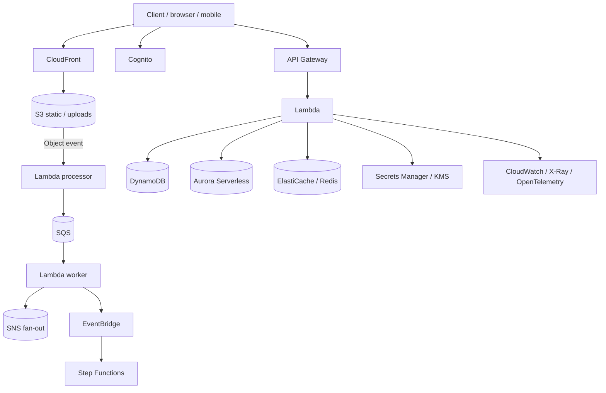
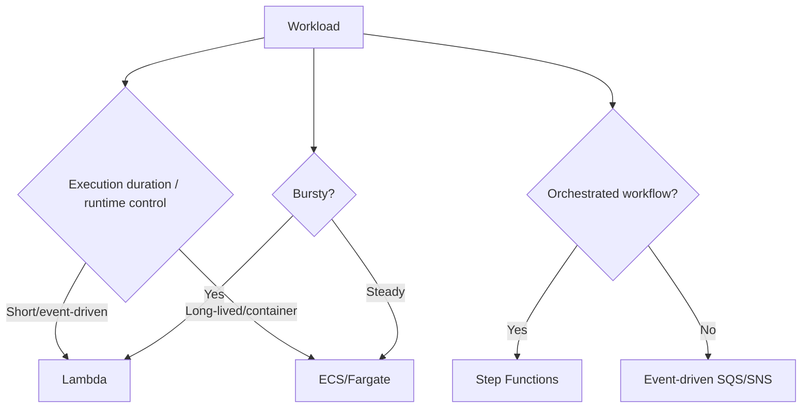
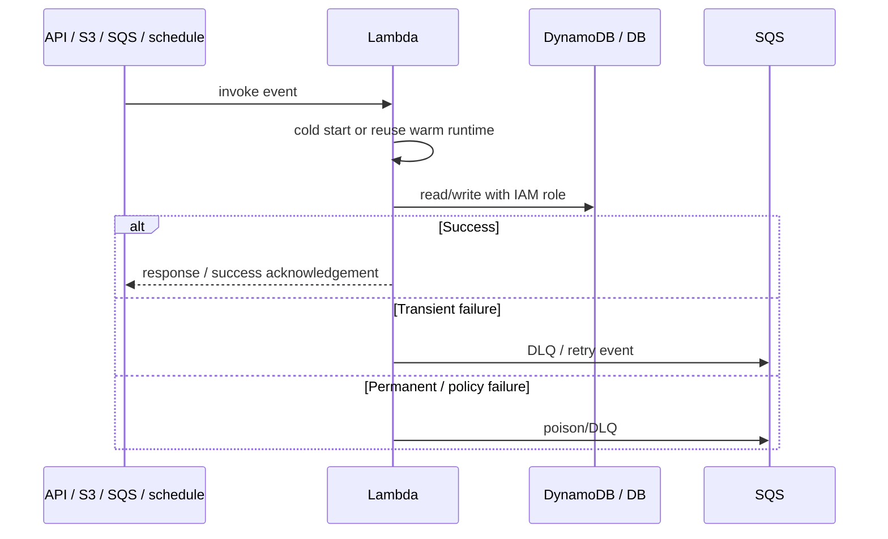
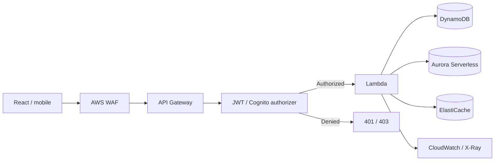
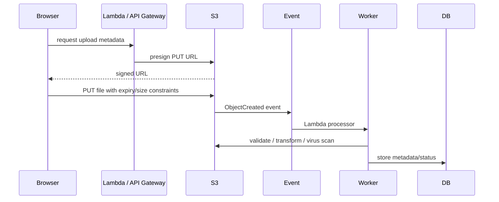
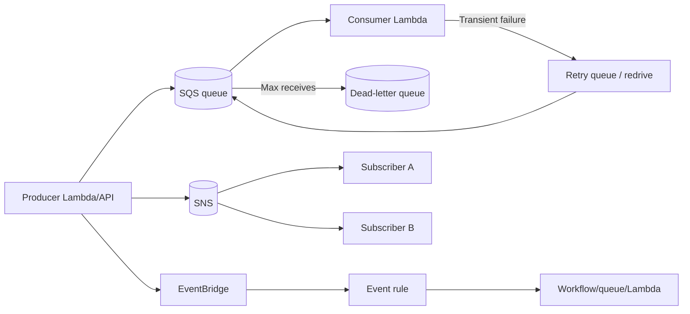
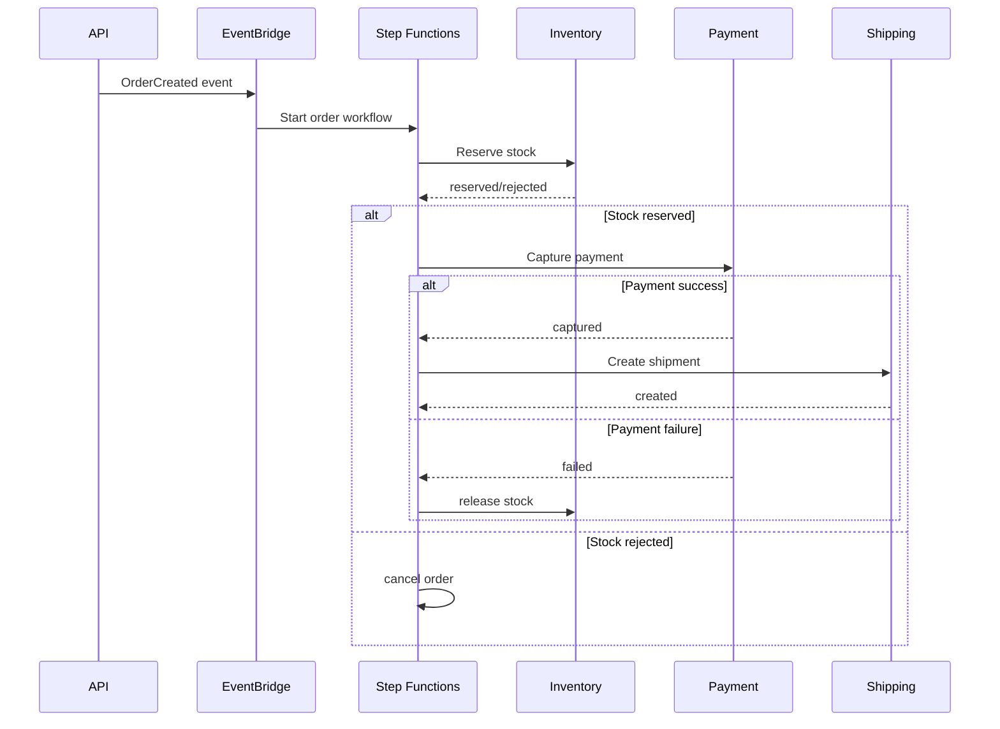
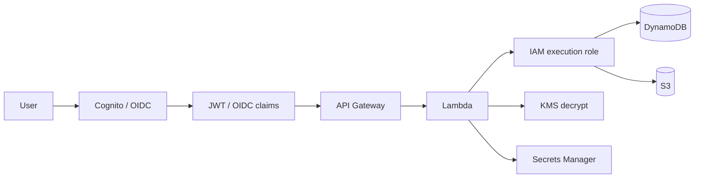
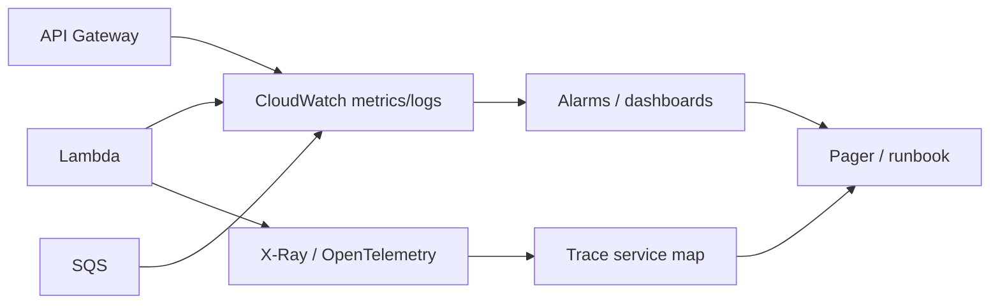
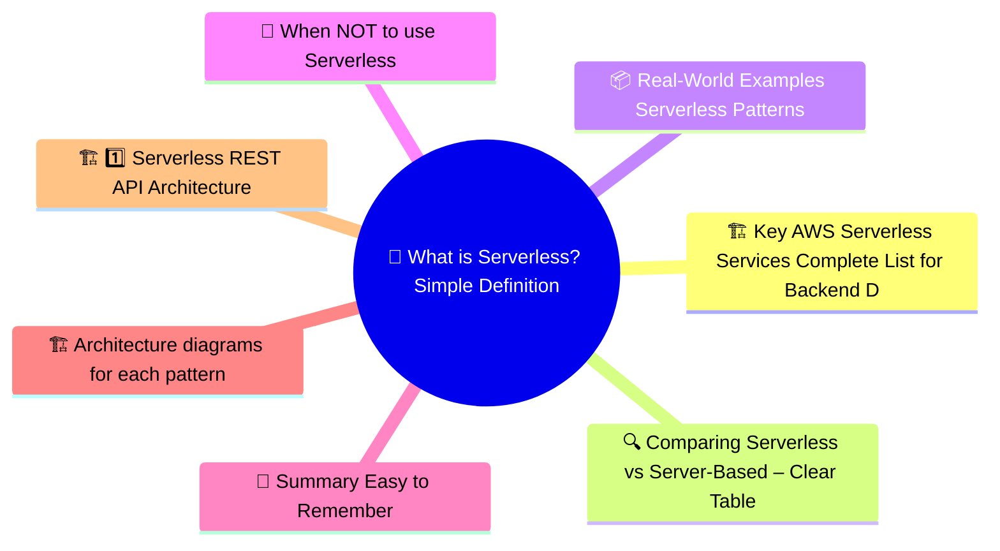

# AWS Serverless — Complete Architecture Guide

Serverless means AWS operates the underlying compute/runtime while the application owns code, data, identity, configuration and failure behavior. A serverless design can still contain servers; the team does not provision or manage them directly.

> **Selection rule:** Choose serverless for event-driven, bursty or operationally independent workloads. Choose containers/EC2 for long-lived connections, steady high utilization, specialized runtimes or control requirements that exceed managed limits.

## Serverless Service Map



## Serverless Compute Choices

| Service | Execution model | Best for | Key trade-offs |
|---|---|---|---|
| Lambda | Short-lived event/invocation runtime | APIs, jobs, file/event processing | Timeout, cold start, package size, concurrency |
| Fargate | Long-lived containers | Microservices, WebSockets, steady workloads | Less scale-to-zero but more runtime control |
| App Runner | Managed container HTTP app | Simple web APIs/services | Less flexibility than ECS/EKS |
| Step Functions | Workflow state machine | Saga, retry, wait, human approval | Additional workflow state/data limits |



## Lambda Execution Architecture



- Initialize SDK clients and connection pools outside the handler for execution-environment reuse.
- Keep Lambda packages small and use layers/monorepo bundling only for shared dependencies that improve cold start.
- Set memory/CPU, timeout, reserved/provisioned concurrency and batch-size intentionally.
- Validate event shape and reject malformed messages before side effects.
- Retriable errors should use exponential backoff, bounded retries and idempotency.

## API and Data Flow



- API Gateway HTTP API is lower overhead; REST API provides more policies/features.
- Cognito authorizers should be separate from application authorization/object-level checks.
- API keys and usage plans are not user authentication and should not replace IAM/JWT authorization.
- DynamoDB requires partition-key and access-pattern design before implementation.
- Aurora Serverless v2 is suitable for variable SQL workloads but still has pool/connection/latency considerations.

## File Upload and Processing



- Use presigned URLs for direct upload instead of proxying large files through Lambda/API Gateway.
- Enforce file size, content type, tenant prefix, malware/AV and storage lifecycle.
- S3 event processing can be duplicated/retried; workers must be idempotent.
- Processing jobs should write status and emit result events after commit.

## Async Messaging Architecture



| Service | Delivery | Use |
|---|---|---|
| SQS | Durable queue, at-least-once | Decouple/order jobs/work queues |
| SNS | Push fan-out | Broadcast notifications/events |
| EventBridge | Rule-based routing | Domain event routing across systems |
| Step Functions | State-machine orchestration | Saga/retry/parallel/human approval |

- SQS consumer functions require idempotency and partial-batch failure handling.
- DLQ growth is an incident signal, not a place to discard failed work indefinitely.
- SNS/SQS ordering and duplicate delivery differ by queue type and fan-out topology.

## Event-driven Order Saga



- Use event payload schemas and correlation IDs across workflow/state logs.
- Distinguish orchestration compensation from automatic database rollback.
- Retry externally idempotent operations with provider operation keys and backoff.
- Persist workflow state and outbox to survive Lambda/workflow failures.

## Security and Identity



- Cognito/JWT authentication does not replace object/tenant authorization.
- Lambda execution roles should be least privilege and resource/tenant constrained where possible.
- KMS, Secrets Manager and SSM Parameter Store separate encryption/key/secret concerns.
- Add WAF, API throttling, CORS, input validation and audit logging.

## Serverless Observability



Monitor:

- Invocation, duration, memory, cold start, concurrency and throttles.
- API 4xx/5xx, latency, integration failures and authorization denies.
- Queue age, redrive/DLQ depth, consumer concurrency and batch failure.
- DynamoDB throttles, RDS capacity/connections and downstream provider latency.
- Trace cost, correlation ID and deployment/version metadata.

## Serverless Cost and Scale

- Billed dimensions include Lambda duration/memory, requests, payload/DynamoDB/queue/storage and transfer.
- Right-size memory/timeout and remove accidental N+1/data transfer calls.
- DynamoDB partition-key and on-demand/provisioned choice determines cost and throttle behavior.
- Avoid synchronous fan-out; use queues and backpressure for burst.
- Reserved/provisioned concurrency is a performance/cost choice, not default architecture.
- Set budgets, tagging and unit cost metrics per environment/tenant/workload.

## When Not to Use Serverless

- Long-lived WebSocket/streaming or process-affinity workloads.
- High steady CPU utilization where containers/reserved EC2 may be cheaper.
- Extremely large package/runtime/deployment constraints.
- Low-latency consistently CPU-bound services or specialized OS/GPU requirements.
- Local disk/large dependency states that do not fit managed stateless execution.
- Vendor/latency/compliance constraints requiring alternative deployment isolation.

## Serverless Production Checklist

- Explicit async decoupling, idempotency and DLQ/replay behavior.
- Least-privilege execution roles and secret/key separation.
- Timeout, retry, circuit breaker and downstream batch controls.
- Presigned upload and malware/content validation.
- SQS/SNS/EventBridge delivery semantics and schema versioning.
- CloudWatch/X-Ray/OpenTelemetry dashboards and alarms.
- IAM, WAF, CORS, Cognito/object authorization and audit logging.
- Cost budgets, concurrency limits and load testing.

---

## 🚀 **What is Serverless? (Simple Definition)**

**Serverless ≠ No Servers**
It means _you don’t manage servers_ — AWS automatically handles:

- Provisioning servers
- Scaling up/down
- Patching
- High availability
- Billing only for actual usage (ms or request-based)

---

# 🏗️ **Key AWS Serverless Services (Complete List for Backend Developers)**



We will group them into categories:

---

### **1️⃣ Compute (Runs your code)**

#### **AWS Lambda**

Runs your code on demand without servers.

##### Example:

Server-based:

- Deploy Express.js app on EC2
- Pay for 24/7 server uptime
- Scale manually

Serverless:

```js
exports.handler = async (event) => {
  return {
    statusCode: 200,
    body: JSON.stringify({ message: "Hello from Lambda" }),
  };
};
```

- Runs only when invoked
- Auto-scales to 1000s of requests
- You pay only for milliseconds of execution

##### When to use:

- APIs
- Cron jobs
- File processing
- Database triggers

---

### **2️⃣ API Layer**

#### **API Gateway**

A fully-managed API service that routes and secures API calls.

##### Example:

Server-based:

- You expose endpoints through Nginx, Express server
- Maintain scaling and security

Serverless:

- API Gateway → triggers Lambda
- Supports throttling, rate limits, JWT auth, etc.

Flow:

```
Client → API Gateway → Lambda → DynamoDB
```

---

### **3️⃣ Database (Serverless Datastores)**

#### **DynamoDB**

NoSQL serverless database

- Auto-scaling
- Millisecond latency
- Pay-per-request

##### Example:

```js
import { DynamoDBClient, PutItemCommand } from "@aws-sdk/client-dynamodb";

await client.send(
  new PutItemCommand({
    TableName: "Users",
    Item: { userId: { S: "1" }, name: { S: "Arjun" } },
  })
);
```

Compare with server-based:

- You would install MongoDB/Postgres on EC2
- Manage backups, scaling, disk, replication

#### **Aurora Serverless v2**

Serverless relational DB

- MySQL / PostgreSQL compatible
- Auto-scales instantly

---

### **4️⃣ Storage**

#### **S3 (Simple Storage Service)**

Store files serverlessly
Examples: images, PDFs, logs, xlsx, backups

Server-based:

- You store files on your own server disk
- Must manage capacity

Serverless:

- No management, infinite storage
- Versioning, lifecycle rules

Example: Upload an XLSX file

```js
await s3.putObject({
  Bucket: "my-bucket",
  Key: "file.xlsx",
  Body: fileBuffer,
});
```

---

### **5️⃣ Event Orchestration**

#### **SQS (Queue)**

Store messages and process asynchronously.

Use case:

- Order creation → send message → process later

Server-based:

- Use RabbitMQ manually

Serverless:

- SQS + Lambda auto-parallel processing

---

#### **SNS (Pub/Sub)**

Publish one message → send to many subscribers (email, SMS, Lambda, SQS)

Example:
User signup → Send email + log event + notify admin

---

#### **EventBridge**

Serverless event bus
Use for:

- Microservices communication
- Cron jobs
- Event automation

Example rule:

- If file uploaded to S3 → trigger Lambda
- If EC2 starts → send Slack message

---

### **6️⃣ Authentication**

#### **Cognito**

Serverless authentication with:

- User pools
- Social logins
- JWT authentication

Compare with server-based:

- You would write your own auth code (sessions, tokens, hashing)

Serverless:

- Cognito handles everything with zero code

---

### **7️⃣ Deployment / Serverless Frameworks**

#### **SAM (Serverless Application Model)**

Write your infrastructure in YAML + deploy.

#### **Serverless Framework**

Developer-friendly, used widely in Node.js projects.

#### **AWS CDK**

Infrastructure in TypeScript.

---

## 🔍 **Comparing Serverless vs Server-Based – Clear Table**

| Feature     | Server-Based (EC2/Express)  | Serverless (Lambda/API-GW) |
| ----------- | --------------------------- | -------------------------- |
| Scaling     | Manual / Auto-scaling setup | Automatic, infinite        |
| Cost        | Pay 24/7 even if idle       | Pay only when invoked      |
| Management  | Patch OS, restart server    | No management              |
| Deployment  | CI/CD + server updates      | Upload function            |
| Performance | Warm server                 | Cold start sometimes       |
| Complexity  | High                        | Low                        |
| File Upload | Handle Nginx/Express config | S3 direct upload           |
| DB Scaling  | Manual                      | DynamoDB auto-scale        |

---

# 📦 **Real-World Examples (Serverless Patterns)**

---

### **✔ Example 1: File Upload System (like your S3 XLSX requirement)**

Serverless architecture:

```
Client → API Gateway → Lambda → S3 → DynamoDB
```

Steps:

1. User uploads file
2. Lambda validates size < 2MB
3. Uploads to S3
4. Writes S3 link in DynamoDB

---

### **✔ Example 2: Serverless API Backend**

Stack:

- API Gateway
- Lambda (Node.js)
- DynamoDB
- Cognito (for JWT auth)

Example route:

```
GET /users → Lambda → DynamoDB
POST /users → Lambda → DynamoDB
```

---

### **✔ Example 3: Async Processing (Thumbnails, XLSX parsing)**

```
S3 Upload → EventBridge → Lambda Parser → Save to DB
```

Serverless benefit:

- No server long-running code
- Automatically scales to thousands of files

---

### **✔ Example 4: Cron Jobs with Serverless**

Use EventBridge Scheduled Events.

Server-based:

- Use Linux CRON
- Server must run 24/7

Serverless:

```
Every 1 hour → EventBridge → Lambda → Cleanup DB
```

---

## 🧩 When NOT to use Serverless

Avoid serverless if:

- You need long-running processes (>15 minutes)
- You need very low latency (<10ms consistently)
- You need huge memory (>10GB)

---

## 🎯 Summary (Easy to Remember)

| Serverless Service    | Purpose               |
| --------------------- | --------------------- |
| **Lambda**            | Run code on demand    |
| **API Gateway**       | Build APIs            |
| **DynamoDB**          | Serverless NoSQL DB   |
| **Aurora Serverless** | Serverless SQL DB     |
| **S3**                | Store files           |
| **SQS**               | Queues                |
| **SNS**               | Notifications         |
| **EventBridge**       | Event workflow        |
| **Cognito**           | Authentication        |
| **Step Functions**    | Orchestration         |
| **CloudFront**        | CDN                   |
| **SAM/CDK**           | Deploy infrastructure |

---

# 🏗️ Architecture diagrams for each pattern

Here are **clean, easy-to-understand architecture diagrams** for each AWS serverless pattern you need as a backend developer using **ASCII diagrams**.

---

## 🏗️ **1️⃣ Serverless REST API Architecture**

**Use case:** Backend APIs (GET/POST), replacing Express + EC2.

```
      ┌──────────────┐       ┌───────────────┐
      │   Frontend   │──────▶│ API Gateway   │
      └──────────────┘       └────────┬──────┘
                                      │
                                      ▼
                             ┌────────────────┐
                             │  Lambda (Node) │
                             └────────────────┘
                                      │
                                      ▼
                            ┌──────────────────┐
                            │ DynamoDB / RDS   │ Any DB
                            └──────────────────┘
```

✔ Auto-scaling
✔ Pay-per-request
✔ No server maintenance

---

## 🏗️ **2️⃣ S3 File Upload → Process → Save to DB**

**Use case:** Your XLSX upload example.

```
      ┌─────────────┐
      │   Client    │
      └──────┬──────┘
             │
   Upload XLSX (<10MB)
             ▼
      ┌─────────────┐
      │     S3      │
      └──────┬──────┘
             │ S3 Put Object Event
             ▼
      ┌────────────────┐
      │ Lambda: Parser │
      │ - Validate     │
      │ - Insert DB    │
      └──────┬─────────┘
             ▼
      ┌───────────────┐
      │  DynamoDB     │
      └───────────────┘
```

✔ Great for ETL
✔ Serverless XLSX parsing
✔ Triggers automatically

---

## 🏗️ **3️⃣ Authentication With AWS Cognito**

**Use case:** Replace custom auth login logic.

```
      ┌───────────────┐
      │   Client App  │
      └──────┬────────┘
             │ Login/Signup
             ▼
      ┌───────────────┐
      │   Cognito     │
      └──────┬────────┘
             │ JWT Token
             ▼
      ┌───────────────┐     Authorization
      │ API Gateway   │◀────────────────────┐
      └──────┬────────┘                     │
             ▼                              │
      ┌────────────────┐                    │
      │ Lambda (Node)  │                    │
      └────────────────┘                    │
             ▼                              │
       ┌───────────────┐                    │
       │ DynamoDB / DB │                    │
       └───────────────┘                    │
```

✔ JWT-based
✔ Zero custom backend auth code
✔ Social login support

---

## 🏗️ **4️⃣ Async Processing With SQS + Lambda**

**Use case:** Heavy background jobs like PDF/XLSX conversion.

```
   API Request
       │
       ▼
┌──────────────┐
│  API Gateway │
└──────┬───────┘
       ▼
┌──────────────┐             ┌──────────────┐
│ Lambda (API) │────────────▶│     SQS      │
└──────┬───────┘   Send Msg  └──────┬───────┘
       ▼                            │
                            Trigger │
                                    ▼
                           ┌────────────────┐
                           │ Lambda Worker  │
                           │ - Process data │
                           └──────┬─────────┘
                                  ▼
                           ┌────────────────┐
                           │ DynamoDB / DB  │
                           └────────────────┘
```

✔ Buffers load
✔ Automatic retries
✔ No overload risk

---

## 🏗️ **5️⃣ Pub/Sub Eventing With SNS**

**Use case:** Send notifications to multiple systems.

```
                   ┌────────────┐
                   │ Publisher  │
                   └─────┬──────┘
                         ▼
                 ┌────────────┐
                 │    SNS     │
                 └─┬────┬─────┘
        ┌──────────┘    │
        ▼               ▼
┌──────────────┐  ┌─────────────┐
│ Email/SMS    │  │ Lambda      │
└──────────────┘  └─────────────┘
                     │
                     ▼
             ┌────────────────┐
             │ Another System │
             └────────────────┘
```

✔ Fan-out model
✔ Notify multiple subscribers
✔ Use for auditing, alerts

---

## 🏗️ **6️⃣ Event-Driven Architecture With EventBridge**

**Use case:** Microservice communication.

```
         ┌────────────────┐
         │ Service A      │
         │ (e.g., Orders) │
         └───────┬────────┘
                 │ emits event
                 ▼
        ┌────────────────────┐
        │   EventBridge Bus  │
        └───────┬────────────┘
      ┌─────────┴────────────┬─────────────┐
      ▼                       ▼             ▼
┌──────────┐        ┌──────────────┐   ┌────────────┐
│ Lambda   │        │ Service B DB │   │ Lambda     │
│ Handler  │        └──────────────┘   │ (Analytics)│
└──────────┘                           └────────────┘
```

✔ Decouples microservices
✔ Many consumers
✔ Automatic routing

---

## 🏗️ **7️⃣ Cron Jobs (Scheduled Lambdas)**

**Use case:** Cleanup jobs, email reminder, scheduled API calls.

```
┌───────────────────────┐
│ EventBridge Scheduler │ (Every 1 hour)
└───────────┬───────────┘
            ▼
   ┌────────────────┐
   │  Lambda Job    │
   │ - delete logs  │
   │ - check status │
   └───────┬────────┘
           ▼
   ┌───────────────┐
   │ DynamoDB / API│
   └───────────────┘
```

✔ Replace CRON in Linux
✔ No server needed

---

## 🏗️ **8️⃣ Step Functions (Serverless Workflow Orchestration)**

**Use case:** Complex multi-step flows (payments, approvals).

```
      ┌──────────────────────────┐
      │   Step Functions State   │
      │         Machine          │
      └───────────┬──────────────┘
                  ▼
      ┌────────────────────────────┐
      │ Lambda Step 1              │
      └───────────┬────────────────┘
                  ▼
      ┌────────────────────────────┐
      │ Lambda Step 2 (Parallel)   │
      └───────────┬────────────────┘
                  ▼
      ┌────────────────────────────┐
      │ Lambda Step 3 (Wait/Retry) │
      └───────────┬────────────────┘
                  ▼
         ┌─────────────────────┐
         │ DynamoDB / External │
         │       API           │
         └─────────────────────┘
```

✔ Human approval workflows
✔ Payment pipelines
✔ Retry logic built-in

---

## 🏗️ **9️⃣ CDN + Static Website Hosting (S3 + CloudFront)**

```
            ┌────────────────────┐
            │     Client         │
            └─────────┬──────────┘
                      │
                      ▼
             ┌──────────────────┐
             │   CloudFront     │ (CDN)
             └─────────┬────────┘
                       ▼
                 ┌─────────┐
                 │   S3    │ (Static Website)
                 └─────────┘
```

✔ React/Vue/Next static hosting
✔ Global caching
✔ Very fast

---

## 🏗️ **🔟 End-to-End Serverless SaaS Architecture**

This combines everything:

```
 Client App ──▶ CloudFront ──▶ API Gateway ──▶ Lambda ──▶ DynamoDB
      │                                  │
      └──▶ Cognito Auth                  └──▶ SQS Worker Queue
      │                                  │
      └──▶ S3 File Upload ──▶ Lambda Parser ──▶ DB Insert
      │
      └──▶ EventBridge ──▶ Analytics Pipeline (Lambdas)
```