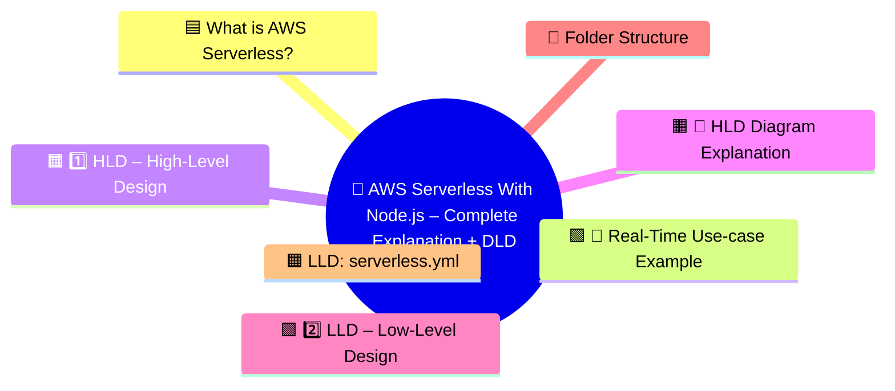
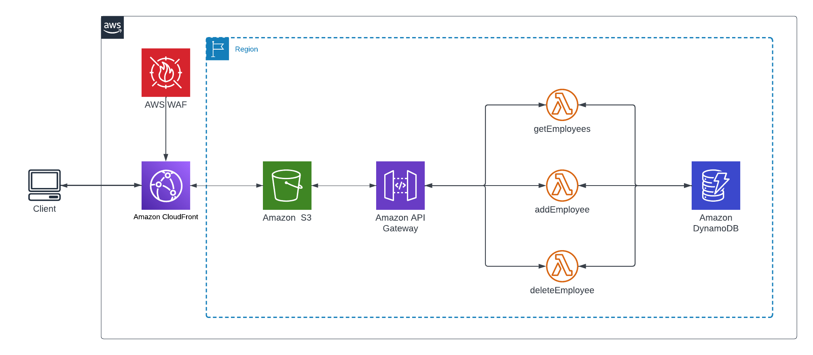
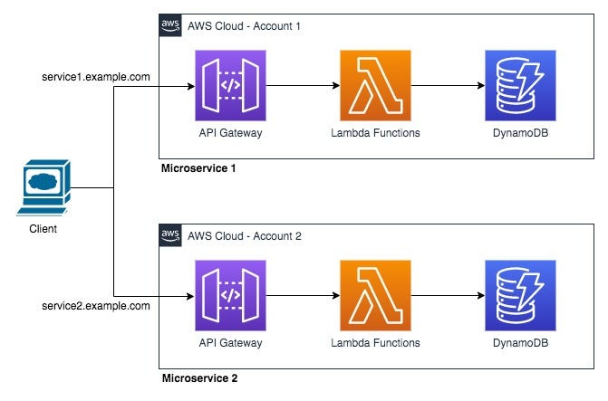

# 🚀 **AWS Serverless With Node.js – Complete Explanation + DLD + LLD**



## 🟦 **What is AWS Serverless?**

AWS Serverless allows you to build and run applications **without managing servers**. You deploy small, event-driven components like Lambda, API Gateway, DynamoDB, SQS, SNS, S3, etc.

You focus only on **code**; AWS handles:

- Scaling
- Infrastructure
- Availability
- OS patching
- Provisioning

Node.js is the **most commonly used runtime** for serverless because:

- Fast startup
- Good for event-driven workloads
- Easy JSON handling
- NPM ecosystem

---

# 🟩 **📌 Real-Time Use-case Example**

### **“File Upload & Processing System”**

A user uploads an XLSX file → Stored in S3 → Lambda validates the file → Saves metadata to DynamoDB → Returns response.

This example covers most real serverless components.

---

# 🟧 **1️⃣ HLD – High-Level Design**




### **📌 Components**

1. **API Gateway**

   - Exposes HTTP endpoints (`POST /upload`)

2. **Lambda Function (Node.js)**

   - Validates file
   - Checks size (<2MB)
   - Uploads to S3
   - Inserts metadata in DB

3. **S3 Bucket**

   - Stores XLSX files

4. **DynamoDB**

   - Stores file records:

     ```json
     {
       "fileId": "uuid",
       "fileName": "abc.xlsx",
       "s3Path": "s3://bucket/key",
       "uploadedAt": "timestamp"
     }
     ```

5. **CloudWatch**

   - Logs and metrics

6. **IAM Roles**

   - Lambda → S3 read/write
   - Lambda → DynamoDB write

---

## 🟧 **📘 HLD Diagram Explanation**

### **Workflow**

1. Client sends request → API Gateway
2. API Gateway triggers Lambda
3. Lambda:

   - Read file from form-data (using **Busboy**)
   - Validate file type & size
   - Upload to S3
   - Insert metadata into DynamoDB

4. API returns success response

---

# 🟩 **2️⃣ LLD – Low-Level Design**

## 📂 **Folder Structure**

```
root/
 ├─ functions/
 │    └─ uploadFile.yml
 ├─ src/
 │   ├─ handlers/
 │   │    └─ uploadFile.ts
 │   ├─ utils/
 │   │    └─ s3Client.ts
 │   │    └─ dbClient.ts
 │   └─ validations/
 │        └─ fileValidation.ts
 ├─ package.json
 ├─ tsconfig.json
 └─ serverless.yml
```

---

# 🟧 **LLD: serverless.yml**

```yaml
service: file-upload-service

provider:
  name: aws
  runtime: nodejs20.x
  region: ap-south-1
  stage: dev
  iam:
    role:
      statements:
        - Effect: Allow
          Action:
            - s3:PutObject
          Resource: "arn:aws:s3:::my-upload-bucket/*"
        - Effect: Allow
          Action:
            - dynamodb:PutItem
          Resource: "arn:aws:dynamodb:ap-south-1:xxxx:table/FileTable"

functions:
  uploadFile:
    handler: src/handlers/uploadFile.handler
    events:
      - http:
          path: /upload
          method: post
```

---

# 🟩 **LLD: Lambda Handler (Node.js Example)**

## 📌 **uploadFile.ts**

```ts
import { uploadToS3 } from "../utils/s3Client";
import { insertRecord } from "../utils/dbClient";
import Busboy from "busboy";
import { validateFile } from "../validations/fileValidation";
import { v4 as uuid } from "uuid";

export const handler = async (event: any) => {
  return await new Promise((resolve, reject) => {
    const busboy = Busboy({ headers: event.headers });
    let fileBuffer: Buffer;
    let fileName: string;

    busboy.on("file", (fieldname, file, filename) => {
      fileName = filename;
      let chunks: any[] = [];
      file.on("data", (data) => chunks.push(data));
      file.on("end", () => {
        fileBuffer = Buffer.concat(chunks);
      });
    });

    busboy.on("finish", async () => {
      try {
        validateFile(fileBuffer, fileName); // size < 2MB & type XLSX

        const fileId = uuid();

        const s3Path = await uploadToS3(fileId, fileBuffer);

        await insertRecord({
          fileId,
          fileName,
          s3Path,
          uploadedAt: new Date().toISOString(),
        });

        resolve({
          statusCode: 200,
          body: JSON.stringify({
            message: "File uploaded successfully",
            fileId,
            s3Path,
          }),
        });
      } catch (error) {
        resolve({
          statusCode: 500,
          body: JSON.stringify({ error: error.message }),
        });
      }
    });

    busboy.end(Buffer.from(event.body, "base64"));
  });
};
```

---

# 🟩 **File Validation**

```ts
export function validateFile(buffer: Buffer, name: string) {
  if (!name.endsWith(".xlsx")) {
    throw new Error("Invalid file type");
  }
  if (buffer.length > 2 * 1024 * 1024) {
    throw new Error("File size must be <2MB");
  }
}
```

---

# 🟩 **S3 Utility**

```ts
import { S3Client, PutObjectCommand } from "@aws-sdk/client-s3";

const client = new S3Client({ region: "ap-south-1" });

export async function uploadToS3(key: string, buffer: Buffer) {
  await client.send(
    new PutObjectCommand({
      Bucket: "my-upload-bucket",
      Key: `${key}.xlsx`,
      Body: buffer,
    })
  );
  return `s3://my-upload-bucket/${key}.xlsx`;
}
```

---

# 🟩 **DynamoDB Utility**

```ts
import { DynamoDBClient, PutItemCommand } from "@aws-sdk/client-dynamodb";

const db = new DynamoDBClient({ region: "ap-south-1" });

export async function insertRecord(item: any) {
  await db.send(
    new PutItemCommand({
      TableName: "FileTable",
      Item: {
        fileId: { S: item.fileId },
        fileName: { S: item.fileName },
        s3Path: { S: item.s3Path },
        uploadedAt: { S: item.uploadedAt },
      },
    })
  );
}
```

---

# 🎯 **Final Summary**

## ✅ **DLD (High Level)**

- API Gateway → Lambda → S3 + DynamoDB
- Event-driven, scalable, pay-per-use

## ✅ **LLD (Low Level)**

- Folder structure
- serverless.yml
- Lambda logic
- S3 + DB utilities
- Validation logic

---
