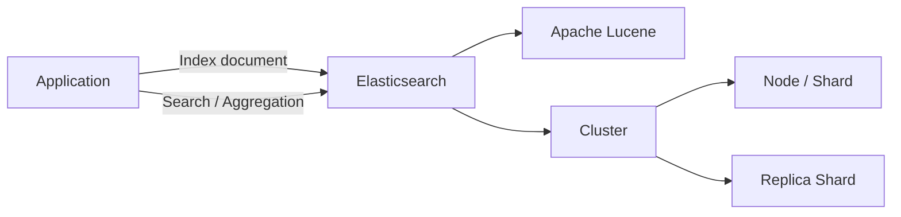
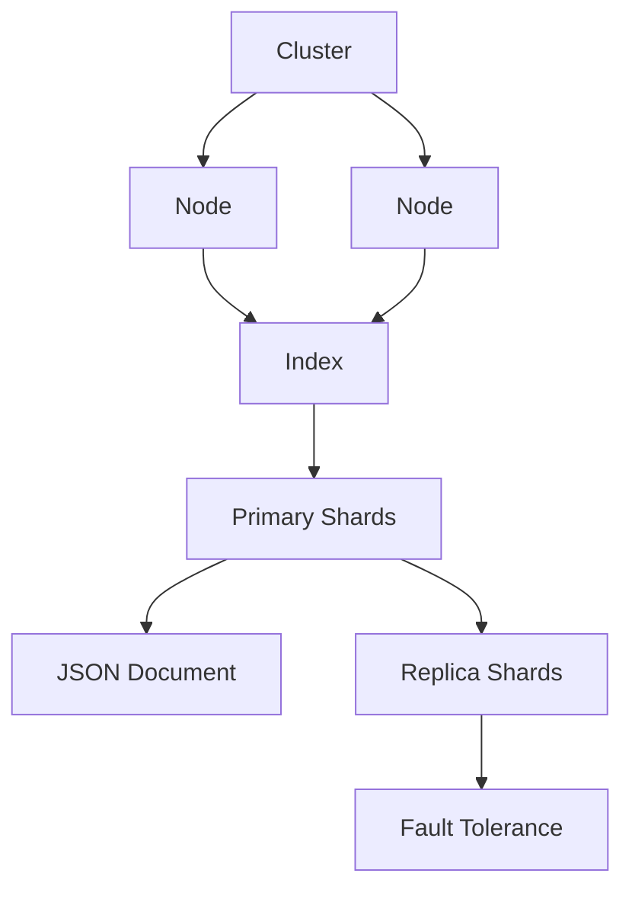
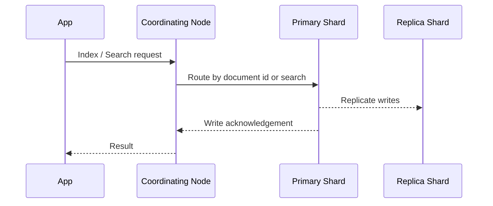
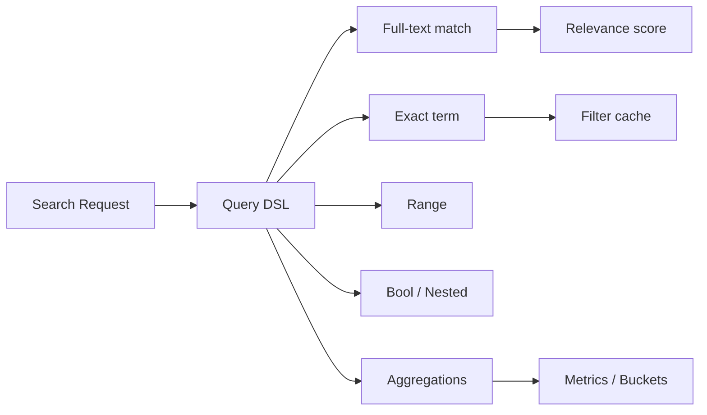
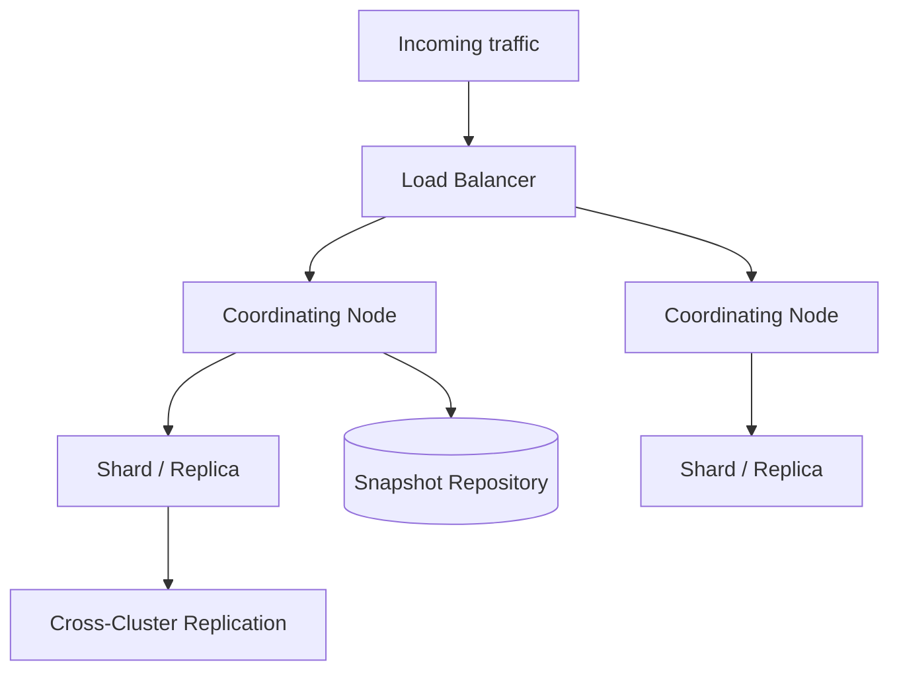
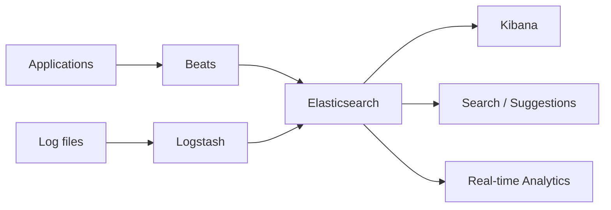

Elasticsearch is a powerful search and analytics engine built on top of Apache Lucene. Here are some key topics you should explore:

### **1. Basics of Elasticsearch**

- What is Elasticsearch?
- How Elasticsearch works
- Components: Nodes, Clusters, Indices, Shards, and Replicas
- Installation and setup

### **2. Core Concepts**

- **Documents**: JSON-based data storage
- **Indices**: Collections of documents
- **Mappings**: Defining schema for documents
- **Shards & Replicas**: Scaling and fault tolerance

### **3. Indexing & Searching**

- Creating and deleting indices
- Indexing, updating, and deleting documents
- Search APIs: Query DSL (match, term, range, bool, etc.)
- Aggregations: Bucket, Metric, and Pipeline aggregations
- Sorting and pagination

### **4. Advanced Querying**

- Full-text search
- Fuzzy search & synonyms
- Highlighting search results
- Nested queries and parent-child relationships
- Custom scoring & function score queries

### **5. Performance Optimization**

- Best practices for indexing
- Query performance tuning
- Caching and refresh intervals
- Using filters instead of queries for better performance
- Bulk indexing

### **6. Scaling & High Availability**

- Horizontal vs. vertical scaling
- Load balancing
- Cluster health monitoring
- Snapshot and restore
- Cross-cluster replication

### **7. Integrations & Use Cases**

- Using Elasticsearch with Logstash and Kibana (ELK stack)
- Integrating with Node.js, Python, or other languages
- Using Elasticsearch for real-time analytics
- Implementing autocomplete and suggestion features

### **8. Security & Authentication**

- Role-based access control (RBAC)
- TLS/SSL configuration
- Authentication and authorization (X-Pack, OpenSearch)
- Audit logging

### **9. Elasticsearch in Production**

- Monitoring and logging
- Backup strategies
- Troubleshooting common issues
- Upgrading Elasticsearch
