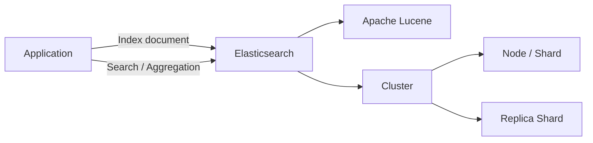
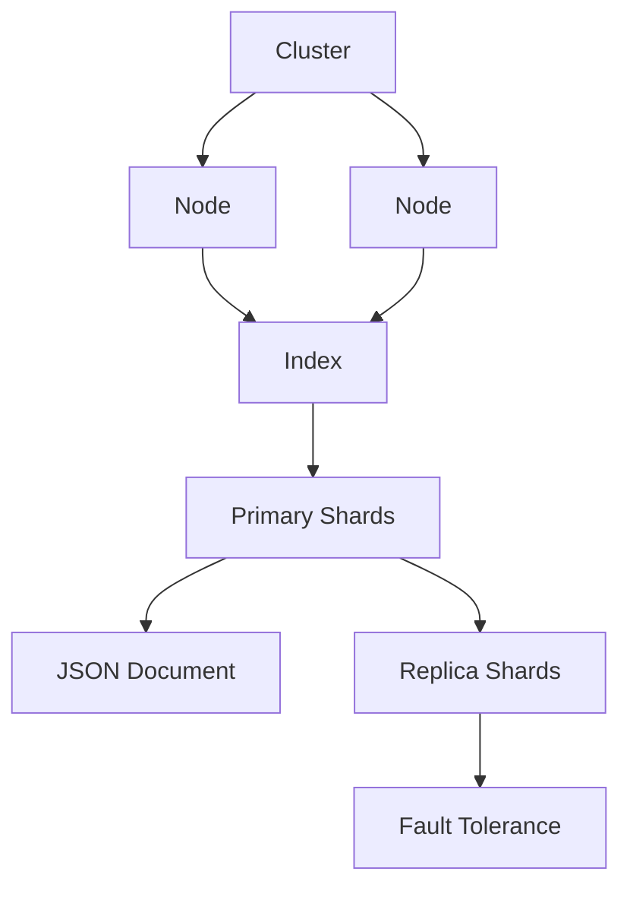
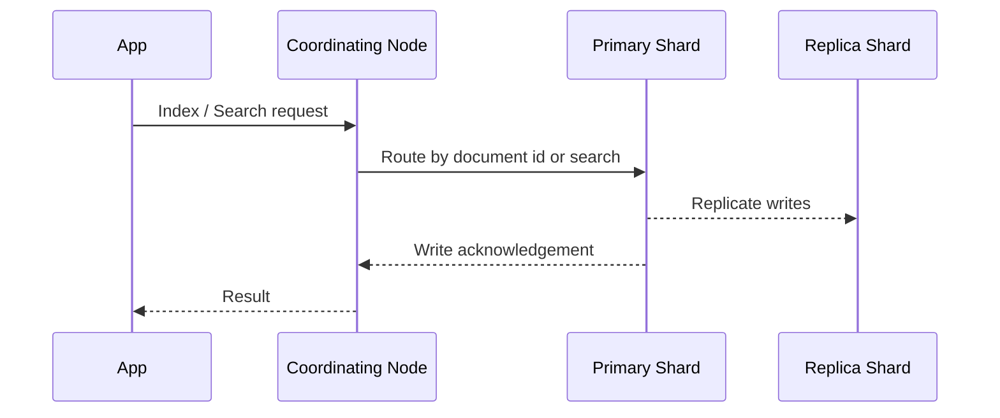
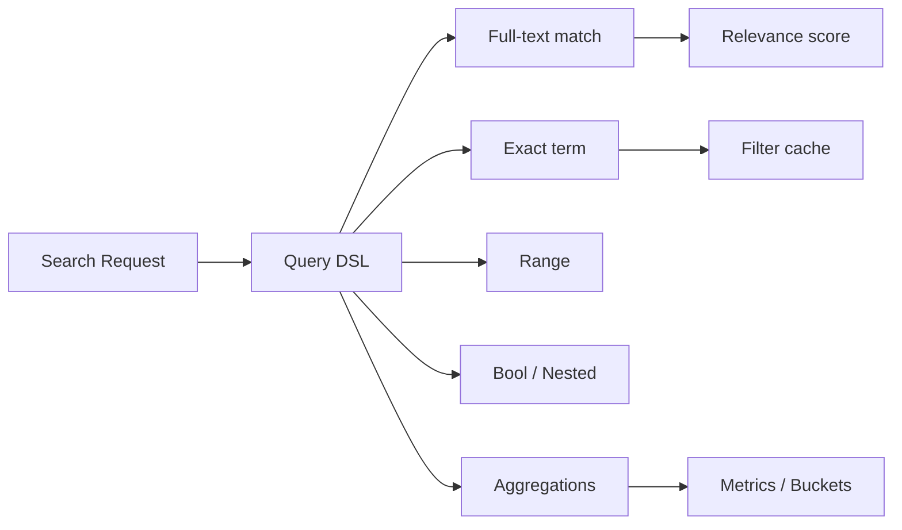
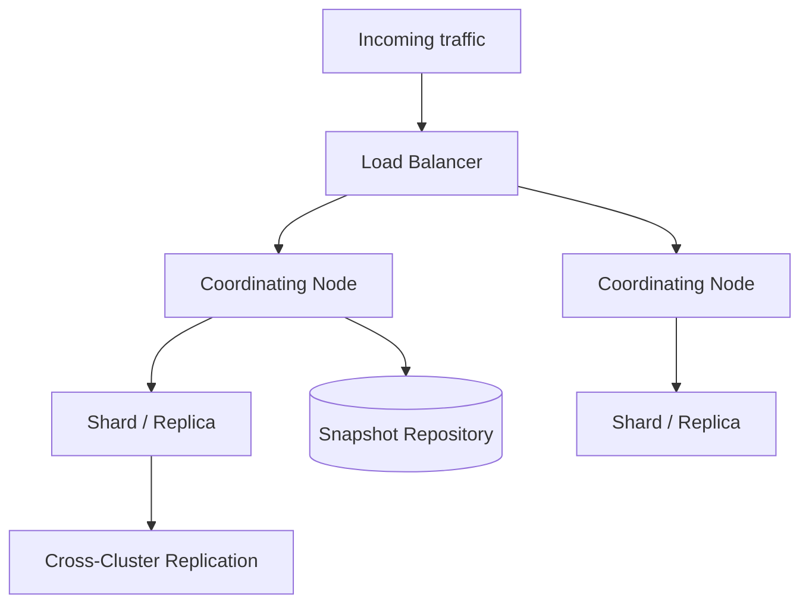
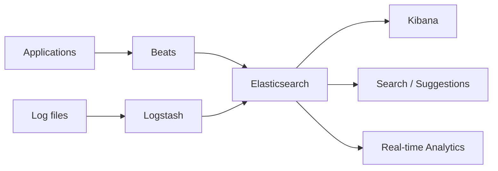
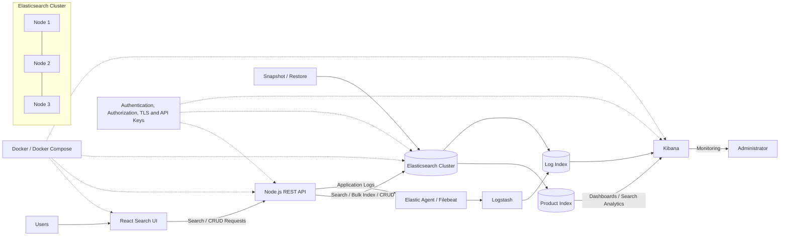

# Elasticsearch

Elasticsearch is a powerful search and analytics engine built on top of Apache Lucene. Here are some key topics you should explore:



### **Core Concepts**



- **Documents**: JSON-based data storage
- **Indices**: Collections of documents
- **Mappings**: Defining schema for documents
- **Shards & Replicas**: Scaling and fault tolerance

### **Indexing & Searching**



- Creating and deleting indices
- Indexing, updating, and deleting documents
- Search APIs: Query DSL (match, term, range, bool, etc.)
- Aggregations: Bucket, Metric, and Pipeline aggregations
- Sorting and pagination

### **Advanced Querying**



- Full-text search
- Fuzzy search & synonyms
- Highlighting search results
- Nested queries and parent-child relationships
- Custom scoring & function score queries

### **Scaling & High Availability**



- Horizontal vs. vertical scaling
- Load balancing
- Cluster health monitoring
- Snapshot and restore
- Cross-cluster replication

### **Integrations & Use Cases**



- Using Elasticsearch with Logstash and Kibana (ELK stack)
- Integrating with Node.js, Python, or other languages
- Using Elasticsearch for real-time analytics
- Implementing autocomplete and suggestion features

---

## [**1 – Elasticsearch Architecture & Fundamentals**](#1--elasticsearch-architecture--fundamentals-1)

**1. Elasticsearch Fundamentals**

- What is Elasticsearch?
- Elasticsearch features and use cases
- Elasticsearch vs SQL vs MongoDB
- Apache Lucene fundamentals
- Elasticsearch architecture
- Distributed search architecture

**2. Core Architecture**

- Cluster
- Nodes
- Index
- Documents
- Fields
- Primary shards
- Replica shards
- Node roles
- Master node election
- Cluster coordination
- Cluster discovery

**3. Internal Working**

- Inverted index
- Term dictionary
- Postings list
- Lucene segments
- Segment merging
- Translog
- Refresh
- Flush
- Commit
- Document indexing lifecycle
- Distributed search execution

**4. Cluster Management APIs**

- Cluster health API
- Nodes API
- Cat APIs
- Cluster stats API
- Node stats API
- Shard allocation APIs

## [**2 – Mapping, Indexing & Analyzers**](#2--mapping-indexing--analyzers-1)

**1. CRUD Operations**

- Index API
- Create API
- Get API
- Update API
- Delete API
- Update by query
- Delete by query
- Bulk API
- Reindex API

**2. Mapping**

- Dynamic mapping
- Explicit mapping
- Dynamic templates
- Index templates
- Component templates
- Mapping parameters

**3. Field Data Types**

- Text
- Keyword
- Numeric types
- Date
- Boolean
- Object
- Nested
- Flattened
- Geo-point
- IP
- Dense vector

**4. Advanced Mapping**

- Multi-fields
- Normalizers
- Runtime fields
- Field aliases
- Doc values
- Fielddata
- Copy_to
- Null values

**5. Analyzers**

- Character filters
- Tokenizers
- Token filters
- Standard analyzer
- Keyword analyzer
- Whitespace analyzer
- Custom analyzers
- Lowercase filter
- Stopword filter
- Stemmer
- Synonym filter
- N-gram
- Edge n-gram

**6. Index Management**

- Index aliases
- Custom routing
- Index sorting
- Refresh interval
- Rollover API
- Data streams
- ILM fundamentals

## [**3 – Query DSL & Advanced Search**](#3--query-dsl--advanced-search-1)

**1. Basic Queries**

- Match
- Match all
- Term
- Terms
- Range
- Exists
- Prefix
- Wildcard
- Fuzzy
- IDs

**2. Full-Text Queries**

- Match phrase
- Match phrase prefix
- Multi-match
- Query string
- Simple query string
- Combined fields
- Intervals

**3. Compound Queries**

- Bool
- Must
- Should
- Must not
- Filter
- Boosting
- Constant score
- Disjunction max
- Function score
- Nested query
- Parent-child queries

**4. Search Fundamentals**

- Query context
- Filter context
- Relevance scoring
- BM25 algorithm
- Sorting
- Pagination
- Search after
- Point in Time
- Highlighting
- Suggestions
- Autocomplete
- Search templates

**5. Advanced Search**

- Field boosting
- Function score
- Decay functions
- Script score
- Rescoring
- Collapse
- Search optimization

## [**4 – Aggregations & Kibana**](#4--aggregations--kibana-1)

**1. Aggregations**

- Bucket aggregations
- Metric aggregations
- Pipeline aggregations
- Terms aggregation
- Range aggregation
- Histogram aggregation
- Date histogram
- Filter aggregation
- Nested aggregation
- Reverse nested aggregation
- Cardinality
- Percentiles
- Composite aggregation
- Significant terms

**2. Advanced Analytics**

- Aggregation nesting
- Pipeline analytics
- Moving calculations
- Aggregation optimization
- Paginated aggregations

**3. Kibana**

- Kibana architecture
- Discover
- Data views
- KQL
- Lucene query syntax
- Dashboard creation
- Visualizations
- Kibana Lens
- Maps
- Canvas
- Alerts and rules
- Reporting
- Dashboard filters

## [**5 – Logstash, Beats & Data Ingestion**](#5--logstash-beats--data-ingestion-1)

**1. Logstash Fundamentals**

- Logstash architecture
- Input plugins
- Filter plugins
- Output plugins
- Pipeline configuration
- Pipeline execution

**2. Logstash Filters**

- Grok
- Dissect
- Mutate
- Date
- JSON
- CSV
- Aggregate
- Ruby
- GeoIP
- Drop
- Clone

**3. Advanced Logstash**

- Conditional processing
- Multiple pipelines
- Pipeline-to-pipeline communication
- Persistent queues
- Dead Letter Queue
- Pipeline workers
- Batch sizing
- Monitoring
- Performance optimization

**4. Beats**

- Beats architecture
- Filebeat
- Metricbeat
- Heartbeat
- Winlogbeat
- Auditbeat
- Packetbeat
- Filebeat multiline processing
- Filebeat modules
- Metricbeat modules

**5. Elastic Agent**

- Elastic Agent architecture
- Fleet
- Fleet Server
- Agent policies
- Integrations
- Agent monitoring

**6. Ingestion Architecture**

- Ingest pipelines
- Ingest processors
- Pipeline simulation
- Kafka integration
- Data transformation
- Error handling
- Backpressure
- Data streams

## [**6 – Node.js & Elasticsearch Integration**](#6--nodejs--elasticsearch-integration-1)

**1. Node.js Fundamentals**

- Node.js architecture
- Event loop
- Asynchronous programming
- Promises
- Async/await
- Streams
- Error handling
- Environment variables

**2. Elasticsearch JavaScript Client**

- Client installation
- Client configuration
- Authentication
- Connection management
- Connection pooling
- Timeouts
- Retries
- Error handling

**3. Elasticsearch Operations**

- Index documents
- Get documents
- Update documents
- Delete documents
- Search API
- Bulk API
- Reindex API
- Aggregations
- Index management

**4. Backend Development**

- Express.js
- REST API architecture
- Controllers
- Services
- Middleware
- Request validation
- Pagination
- Filtering
- Sorting
- Authentication
- Authorization
- Rate limiting
- Logging

**5. Advanced Backend Integration**

- Bulk data ingestion
- Streaming data
- Search optimization
- Caching
- Retry mechanisms
- Circuit breaker patterns
- Error handling
- API security

## [**7 – React, Cluster Administration & DevOps**](#7--react-cluster-administration--devops-1)

**1. React Integration**

- React fundamentals
- Components
- Props
- State
- Hooks
- Context API
- React Router
- API integration

**2. Search UI**

- Search input
- Autocomplete
- Debouncing
- Search suggestions
- Fuzzy search
- Highlighting
- Dynamic filters
- Sorting
- Pagination
- Infinite scrolling
- Search state management

**3. Cluster Administration**

- Cluster settings
- Node roles
- Cluster discovery
- Cluster coordination
- Shard allocation
- Shard rebalancing
- Allocation awareness
- Dedicated master nodes
- Data tiers
- High availability

**4. Backup & Recovery**

- Snapshot API
- Snapshot repositories
- Snapshot lifecycle management
- Restore operations
- Disaster recovery

**5. Docker & Linux**

- Docker fundamentals
- Docker images
- Docker volumes
- Docker networking
- Docker Compose
- Multi-container deployment
- Linux filesystem
- Process management
- Memory management
- Network troubleshooting

## [**8 – Performance, Security & Advanced Elasticsearch**](#8--performance-security--advanced-elasticsearch-1)

**1. Performance Tuning**

- JVM heap
- Garbage collection
- Memory pressure
- Filesystem cache
- Indexing buffer
- Refresh interval
- Bulk indexing optimization
- Search optimization
- Query profiling
- Slow logs
- Segment merging
- Shard sizing

**2. Troubleshooting**

- Red and yellow clusters
- Unassigned shards
- High CPU
- High memory usage
- Disk watermarks
- Circuit breaker exceptions
- Rejected requests
- Slow queries
- Indexing failures
- Thread pool monitoring

**3. Security**

- Authentication
- Authorization
- RBAC
- Users and roles
- API keys
- TLS/SSL
- Certificate management
- Document-level security
- Field-level security
- Audit logging
- Network security

**4. Monitoring**

- Elasticsearch monitoring
- Kibana monitoring
- Logstash monitoring
- JVM monitoring
- Cluster statistics
- Node statistics
- Alerting

**5. Advanced Search**

- Vector fundamentals
- Embeddings
- Dense vectors
- Sparse vectors
- kNN search
- Semantic search
- Hybrid search
- Reciprocal Rank Fusion
- RAG architecture
- LLM integration
- ES|QL
- Painless scripting
- Cross-cluster search
- Transform API

---

# 1 – Elasticsearch Architecture & Fundamentals

**System architecture**



---

## 1. Elasticsearch Fundamentals

### 1. What is Elasticsearch? (Elasticsearch అంటే ఏమిటి?)

**Elasticsearch** అనేది ఒక ఓపెన్-సోర్స్, **Distributed (పంపిణీ చేయబడిన)** Search మరియు Analytics Engine. ఇది **JSON** డాక్యుమెంట్ల రూపంలో డేటాను నిల్వ చేస్తుంది మరియు **RESTful API** ద్వారా వేగంగా సెర్చ్ మరియు విశ్లేషణ (analytics) సౌకర్యాన్ని అందిస్తుంది.

- **Near Real-Time:** మీరు డేటాను ఇండెక్స్ చేసిన సుమారు **1 సెకను** లోపే అది సెర్చ్ ఫలితాల్లో కనిపిస్తుంది.
- **Horizontally Scalable:** డేటా పెరిగే కొద్దీ కొత్త సర్వర్లను (Nodes) సులభంగా క్లస్టర్‌కు చేర్చవచ్చు.

---

### 2. Elasticsearch features and use cases (ఫీచర్లు మరియు ఉపయోగాలు)

#### ముఖ్య ఫీచర్లు:

- **Full-Text Search & Relevance Scoring:** తప్పు స్పెల్లింగ్‌లు (Fuzzy search), సినానిమ్స్, మరియు ప్రాధాన్యత (Relevance score / BM25) ఆధారంగా అత్యంత సరిపోయే ఫలితాలను ముందుగా చూపిస్తుంది.
- **Aggregations (అగ్రిగేషన్స్):** SQL లో `GROUP BY` లాగా, భారీ డేటాపై కౌంట్, సగటు, హిస్టోగ్రామ్ వంటి అనలిటిక్స్ లెక్కలను వేగంగా చేస్తుంది.
- **Schema-free / Dynamic Mapping:** JSON డేటా పంపినప్పుడు ఫీల్డ్ రకాలను (text, number, date) వాటంతట అవే గుర్తించగలదు (అవసరమైతే మనం Explicit Mapping కూడా సెట్ చేయవచ్చు).
- **Multi-tenancy & High Availability:** రెప్లికాల (Replicas) ద్వారా ఒక నోడ్ డౌన్ అయినా డేటా కోల్పోకుండా చూస్తుంది.

#### సాధారణ Use Cases:

1. **Site & E-Commerce Search:** ఉత్పత్తుల శీర్షికలు, వివరాలు, ఫిల్టర్లు మరియు సూచనల కోసం (ఉదా: ప్రోడక్ట్ క్యాటలాగ్ సెర్చ్).
2. **Logging & Observability:** అప్లికేషన్ లాగ్స్, సర్వర్ మెట్రిక్స్, మరియు ట్రేస్‌లను ఒకచోట చేర్చి ఎర్రర్లను త్వరగా కనుగొనడం.
3. **Security Analytics (SIEM):** లాగిన్ ప్రయత్నాలు, నెట్‌వర్క్ అసాధారణతలు వంటి సెక్యూరిటీ ఈవెంట్లను రియల్-టైమ్‌లో పర్యవేక్షించడం.
4. **Autocomplete & Search-as-you-type:** యూజర్ టైప్ చేస్తుండగానే తక్షణ సూచనలు ఇవ్వడం.

---

### 3. Elasticsearch vs SQL vs MongoDB

| అంశం                | Elasticsearch                                                                     | SQL (RDBMS)                              | MongoDB                                 |
| ------------------- | --------------------------------------------------------------------------------- | ---------------------------------------- | --------------------------------------- |
| **ప్రధాన ఉద్దేశం**  | Full-text search, log & metric analytics                                          | Transactional (ACID) structured data     | General-purpose document database       |
| **డేటా స్ట్రక్చర్** | JSON Documents → **Inverted Index**                                               | Tables, Rows, Columns                    | BSON / JSON Documents → **Collections** |
| **స్కీమా**          | Dynamic mapping (optional strict mapping)                                         | Strict relational schema                 | Flexible document schema                |
| **సెర్చ్ బలం**      | Relevance ranking, fuzzy/prefix/full-text                                         | Exact match, joins, complex aggregations | Indexed queries, range/array filters    |
| **అప్‌డేట్ విధానం** | Document immutable (అప్‌డేట్ అంటే కొత్త వెర్షన్ క్రియేట్ చేసి పాతది మార్క్ చేయడం) | In-place row updates with transactions   | In-place document updates               |

> **సారాంశం:** బ్యాంకింగ్ ట్రాన్సాక్షన్లు లేదా కఠినమైన రిలేషన్షిప్‌ల కోసం SQL వాడతారు; అప్లికేషన్ ప్రైమరీ డేటాబేస్ కోసం MongoDB వాడతారు; కానీ **వేగవంతమైన టెక్స్ట్ సెర్చ్ మరియు భారీ అనలిటిక్స్** కోసం Elasticsearch ఉత్తమం.

---

### 4. Apache Lucene fundamentals (Apache Lucene ప్రాథమికాలు)

Elasticsearch అనేది స్వంతంగా సెర్చ్ ఇంజిన్ కాదు—దాని గుండెకాయ **Apache Lucene** (Java ఆధారిత సెర్చ్ లైబ్రరీ). Elasticsearch అనేది Lucene చుట్టూ ఉన్న ఒక డిస్ట్రిబ్యూటెడ్, యూజర్-ఫ్రెండ్లీ లేయర్.

Lucene పనితీరులో కీలక భాగాలు:

- **Inverted Index:** సాధారణ డేటాబేస్‌లలో _Document → Words_ ఉంటుంది. కానీ **Inverted Index** లో _Unique Terms (పదాలు) → ఆ పదాలు ఉన్న Document IDs లిస్ట్_ ఉంటుంది. దీనివల్ల మిలియన్ల డాక్యుమెంట్లలోనూ సెకన్లలో పదాలను వెతకగలుగుతుంది.
- **Analysis (Analyzer):** టెక్స్ట్‌ను ఇండెక్స్ చేసే ముందు లేదా సెర్చ్ చేసే ముందు ప్రాసెస్ చేసే విధానం:

1. _Character Filters:_ అనవసరమైన HTML ట్యాగ్స్ లేదా ప్రత్యేక అక్షరాలను తొలగిస్తాయి.
2. _Tokenizer:_ వాక్యాన్ని చిన్న చిన్న పదాలుగా/టోకెన్లుగా విడదీస్తుంది (ఉదా: `"Hello Elastic"` → `["Hello", "Elastic"]`).
3. _Token Filters:_ లోయర్‌కేస్ మార్చడం (`"Hello"` → `"hello"`), stop words తొలగించడం, లేదా stemming (`"running"` → `"run"`).

- **Segments:** Lucene లో ప్రతి ఇండెక్స్ లోపల చిన్న చిన్న **Immutable Segments** ఉంటాయి. కొత్త డాక్యుమెంట్లు కొత్త సెగ్మెంట్‌లోకి వెళ్తాయి; బ్యాక్‌గ్రౌండ్‌లో చిన్న సెగ్మెంట్లు పెద్ద సెగ్మెంట్లుగా **Merge** అవుతాయి.

---

### 5. Elasticsearch architecture (Elasticsearch ఆర్కిటెక్చర్)

- **Cluster:** ఒకే **Cluster Name** తో కలిసి పనిచేసే ఒకటి లేదా అంతకంటే ఎక్కువ Nodes సమూహం.
- **Node:** క్లస్టర్‌లో భాగమైన ఒక సింగిల్ సర్వర్/ఇన్‌స్టాన్స్. డేటాను నిల్వ చేస్తుంది మరియు క్లస్టర్ కార్యకలాపాలలో పాల్గొంటుంది. ప్రత్యేక పాత్రల (Node Roles) కోసం **Master-eligible**, **Data**, **Ingest**, మరియు **Coordinating** నోడ్స్ ఉంటాయి.
- **Index:** ఒకే రకమైన లేదా సంబంధిత డాక్యుమెంట్ల కలెక్షన్ (SQL లోని Database/Table తో పోల్చవచ్చు).
- **Document:** ఇండెక్స్‌లో నిల్వ చేసే ఒక **JSON** ఆబ్జెక్ట్ (SQL లోని Row లాంటిది). ప్రతి డాక్యుమెంట్‌కు ఒక `_id` ఉంటుంది.
- **Field:** డాక్యుమెంట్‌లోని కీ-వాల్యూ జత (SQL లోని Column లాంటిది).

---

### 6. Distributed search architecture (డిస్ట్రిబ్యూటెడ్ సెర్చ్ ఆర్కిటెక్చర్)

ఒకే సర్వర్‌లో భారీ డేటాను ఉంచడం లేదా సెర్చ్ చేయడం కష్టం కాబట్టి Elasticsearch డేటాను విభజించి సమాంతరంగా (parallel) ప్రాసెస్ చేస్తుంది.

- **Shards (షార్డ్స్):** ఒక Index ను అనేక చిన్న భాగాలుగా విడదీస్తే, ఒక్కో భాగాన్ని ఒక **Shard** అంటారు. ప్రతి Shard వాస్తవానికి ఒక స్వతంత్ర **Lucene Index**. షార్డ్స్ వల్ల డేటాను వేర్వేరు నోడ్స్‌పై పంచి **Horizontal Scaling** మరియు **Parallel Search** సాధ్యమవుతుంది.
- **Primary Shard:** ఇండెక్స్ క్రియేట్ చేసినప్పుడు నిర్ణయించే అసలు షార్డ్ (డేటా ఇండెక్సింగ్ ముందుగా ఇక్కడికే వెళ్తుంది).
- **Replica Shard:** Primary Shard యొక్క పూర్తి కాపీ. ఇది డేటా సేఫ్టీ (**Failover**) కోసం మరియు **Read/Search throughput** పెంచడానికి ఉపయోగపడుతుంది. _(గమనిక: ఒక Primary Shard మరియు దాని Replica Shard ఎప్పుడూ ఒకే Node లో ఉండవు)._

- **Scatter-Gather Pattern:** మీరు ఒక సెర్చ్ క్వెరీ పంపినప్పుడు, Coordinating Node ఆ క్వెరీని సంబంధిత షార్డ్స్‌కు పంపుతుంది (**Scatter**). ప్రతి షార్డ్ తన వద్ద ఉన్న టాప్ ఫలితాలను పంపుతుంది; Coordinating Node వాటన్నింటినీ కలిపి, స్కోర్ ఆధారంగా సార్ట్ చేసి ఫైనల్ రిజల్ట్ ఇస్తుంది (**Gather**).

---

## 2. Core Architecture

### 1. Cluster (క్లస్టర్)

**Cluster** అనేది ఒకే **Cluster Name** (`cluster.name`) తో కనెక్ట్ అయ్యి, కలిసి డేటాను నిల్వ చేసే మరియు ఇండెక్సింగ్/సెర్చ్ పనులను పంచుకునే **Nodes** సమూహం.

- ఒక్క Node మాత్రమే ఉన్నా అది ఒక సింగిల్-నోడ్ Cluster.
- Cluster health మూడు స్థితులలో ఉంటుంది:
- **Green:** అన్ని Primary మరియు Replica షార్డ్స్ యాక్టివ్‌గా మరియు కేటాయించబడి (assigned) ఉన్నాయి.
- **Yellow:** అన్ని Primary షార్డ్స్ ఉన్నాయి, కానీ కనీసం ఒక Replica షార్డ్ ఇంకా assign కాలేదు (ఉదా: సింగిల్-నోడ్ క్లస్టర్‌లో replica count 1 పెట్టినప్పుడు).
- **Red:** కనీసం ఒక Primary షార్డ్ అయినా అందుబాటులో లేదు (డేటా నష్టం లేదా అసంపూర్ణ సెర్చ్ ప్రమాదం).

---

### 2. Nodes (నోడ్స్)

**Node** అనేది Elasticsearch రన్ అవుతున్న ఒక సింగిల్ సర్వర్ లేదా ఇన్‌స్టాన్స్. ప్రతి నోడ్‌కు ఒక ప్రత్యేకమైన `node.name` మరియు స్టార్ట్ అయినప్పుడు ఒక `node.id` ఉంటుంది.

- ఒకే మెషిన్‌లో multiple nodes రన్ చేయవచ్చు, కానీ ప్రొడక్షన్ కోసం **ఒక మెషిన్‌కు ఒక Node** ఉండటమే ఉత్తమం (CPU, RAM, Disk I/O పంచుకోకుండా).

---

### 3. Index (ఇండెక్స్)

**Index** అనేది ఒకే రకమైన లేదా సంబంధిత డాక్యుమెంట్లను నిల్వ చేసే లాజికల్ నిల్వ స్థలం (SQL లోని Table తో సమానం).

- ప్రతి Index పేరు **lowercase** లో ఉండాలి (`\`, `/`, `*`, `?`, `"`, `<`, `>`, `|`, స్పేస్‌లు, కామాలు ఉండకూడదు).
- ఉదాహరణకు: `products-v1`, `app-logs-2026.11`.

---

### 4. Documents (డాక్యుమెంట్లు)

**Document** అనేది Index లోపల నిల్వ చేసే ప్రాథమిక సమాచార యూనిట్—ఇది ఒక **JSON** ఆబ్జెక్ట్ (SQL లోని Row లాంటిది).

- ప్రతి Document కు ఒక **Index** (`_index`) మరియు ఒక ప్రత్యేక **ID** (`_id`) ఉంటుంది (మనం ఇవ్వవచ్చు లేదా Elasticsearch ఆటోమేటిక్‌గా జనరేట్ చేస్తుంది).
- Documents **Immutable** (మార్చలేనివి): ఒక డాక్యుమెంట్‌ను అప్‌డేట్ చేసినప్పుడు, పాత వెర్షన్‌ను delete గా మార్చి కొత్త డాక్యుమెంట్ వెర్షన్‌ను ఇండెక్స్ చేస్తారు (`_version` పెరుగుతుంది).

---

### 5. Fields (ఫీల్డ్స్)

**Field** అనేది Document లోపల ఉండే కీ-వాల్యూ జత (SQL లోని Column లాంటిది).

- JSON లో **Nested objects** లేదా **Arrays** కూడా ఉండవచ్చు.
- Elasticsearch లో ఒక ఫీల్డ్‌కు **ఒకే డేటా టైప్** (లేదా మ్యాపింగ్) ఆధారంగా ఇండెక్సింగ్ జరుగుతుంది; అదనంగా **Multi-fields** ద్వారా ఒకే ఫీల్డ్‌ను `text` (full-text search కోసం) మరియు `keyword` (exact match, sorting, aggregations కోసం) రెండు రకాలుగా ఇండెక్స్ చేయవచ్చు.

---

### 6. Primary Shards (ప్రైమరీ షార్డ్స్)

ఒక Index ను విభజించే చిన్న భాగాలే **Shards**. అందులో అసలైన డేటా యాజమాన్యం మరియు ఇండెక్సింగ్ ఎంట్రీ పాయింట్ **Primary Shard**.

- Index క్రియేట్ చేసిన తర్వాత `number_of_primary_shards` ను నేరుగా మార్చలేము (మార్చాలంటే Reindex లేదా Shrink/Split వంటి పద్ధతులు వాడాలి).
- ఇండెక్స్ చేసే డాక్యుమెంట్ ఏ Primary Shard కు వెళ్లాలో ఈ ఫార్ములా నిర్ణయిస్తుంది:

$$\text{shard} = \text{hash}(\text{\_routing}) \pmod{\text{number\_of\_primary\_shards}}$$

_(సాధారణంగా `_routing` విలువ డిఫాల్ట్‌గా `_id` ఉంటుంది)._

---

### 7. Replica Shards (రెప్లికా షార్డ్స్)

**Replica Shard** అనేది ప్రతి **Primary Shard** యొక్క పూర్తి ప్రతిరూపం (copy).

- **High Availability / Fault Tolerance:** Primary Shard ఉన్న Node డౌన్ అయితే, ఆ Primary కు చెందిన Replica Shard తక్షణమే Primary గా ప్రమోట్ అయ్యి సేవ కొనసాగిస్తుంది.
- **Read Scaling:** సెర్చ్ క్వెరీలను Primary మరియు Replica షార్డ్స్ రెండింటిపైనా పంచవచ్చు కాబట్టి రీడ్ కెపాసిటీ పెరుగుతుంది.
- **ముఖ్య నియమం:** ఒక Primary Shard మరియు దాని Replica Shard **ఎప్పుడూ ఒకే Node లో ఉండవు**.
- `number_of_replicas` ను క్లస్టర్ రన్ అవుతుండగానే ఎప్పుడైనా పెంచవచ్చు లేదా తగ్గించవచ్చు.

---

### 8. Node Roles (నోడ్ రోల్స్)

పెద్ద క్లస్టర్లలో ఒకే నోడ్ అన్ని పనులు చేస్తే లోడ్ పెరుగుతుంది. అందుకే ఒక్కో నోడ్‌కు నిర్దిష్ట **Roles** కేటాయిస్తారు:

| Node Role                                                            | ప్రధాన బాధ్యత                                                                                                                                                          |
| -------------------------------------------------------------------- | ---------------------------------------------------------------------------------------------------------------------------------------------------------------------- |
| **Master-eligible (`master`)**                                       | క్లస్టర్-వైడ్ మార్పులు (index creation/deletion, shard allocation, node join/leave) మరియు Cluster State నిర్వహణ.                                                       |
| **Data (`data`, `data_content`, `data_hot`/`warm`/`cold`/`frozen`)** | Shards నిల్వ చేయడం, CRUD ఆపరేషన్లు, Search మరియు Aggregations అమలు చేయడం.                                                                                              |
| **Ingest (`ingest`)**                                                | డాక్యుమెంట్లు ఇండెక్స్ అవ్వడానికి ముందు **Ingest Pipelines** (grok, rename, date parse, script processors) ద్వారా ప్రీ-ప్రాసెస్ చేయడం.                                 |
| **Coordinating (`coordinating_only`)**                               | క్లయింట్ రిక్వెస్ట్‌లను స్వీకరించి, సంబంధిత నోడ్స్‌కు పంపి (Scatter), ఫలితాలను క్రోడీకరించడం (**Gather**). _(అన్ని నోడ్స్ డిఫాల్ట్‌గా coordinating పాత్ర పోషిస్తాయి)._ |
| **Remote Cluster Client (`remote_cluster_client`)**                  | Cross-Cluster Search / Cross-Cluster Replication కోసం రిమోట్ క్లస్టర్లతో కనెక్ట్ అవ్వడం.                                                                               |

---

### 9. Master Node Election (మాస్టర్ నోడ్ ఎన్నిక)

క్లస్టర్‌లో `master`-eligible నోడ్స్‌లలో ఒకదానిని **Elected Master** గా ఎన్నుకునే ప్రక్రియనే **Master Node Election** అంటారు.

- **Cluster Coordination** మెకానిజం ఆధారంగా voting-eligible master nodes పరస్పరం కమ్యూనికేట్ చేసుకుని మెజారిటీ ఓట్లతో ఒక Active Master ను ఎంచుకుంటాయి.
- **Split-Brain నివారణ:** నెట్‌వర్క్ విడిపోయినప్పుడు రెండు వేర్వేరు "మాస్టర్లు" ఏర్పడి డేటా విభేదాలు రాకుండా, **quorum (మెజారిటీ voting configurations)** ఉన్న వైపు మాత్రమే క్లస్టర్ పనిచేస్తుంది. అందుకే కనీసం **3 master-eligible nodes** (లేదా odd number) ఉంచడం ప్రాక్టికల్‌గా శ్రేయస్కరం.

---

### 10. Cluster Coordination (క్లస్టర్ కోఆర్డినేషన్)

**Cluster Coordination** అనేది క్లస్టర్‌లోని అన్ని నోడ్స్‌కు ఒకే **Cluster State** (ప్రస్తుత నోడ్స్ జాబితా, ఇండెక్స్ సెట్టింగ్‌లు, షార్డ్ లొకేషన్లు, మ్యాపింగ్‌లు) ఉండేలా చూసే వ్యవస్థ.

- Master నోడ్ Cluster State ను అప్‌డేట్ చేసినప్పుడు, ఆ మార్పును మిగతా నోడ్స్‌కు పంపి **majority acknowledgement** వచ్చాకే కమిట్ చేస్తుంది.
- తద్వారా ఏ నోడ్ అయినా ఏ ఇండెక్స్/షార్డ్ ఎక్కడ ఉందో కచ్చితంగా తెలుసుకుని రిక్వెస్ట్‌లను సరిగ్గా రూట్ చేయగలదు.

---

### 11. Cluster Discovery (క్లస్టర్ డిస్కవరీ)

ఒక కొత్త Node స్టార్ట్ అయినప్పుడు లేదా నెట్‌వర్క్‌లో ఇతర నోడ్స్‌ను కనుగొని క్లస్టర్‌లో చేరడానికి (లేదా Master ను గుర్తించడానికి) ఉపయోగించే ప్రక్రియనే **Cluster Discovery** అంటారు.

- క్లౌడ్ / ప్రొడక్షన్ వాతావరణాలలో **Seed Hosts** (`discovery.seed_hosts`) జాబితా ద్వారా ఒక నోడ్ ప్రారంభంలో సంప్రదించాల్సిన ఇతర నోడ్స్ IP/హోస్ట్‌లను తెలుసుకుంటుంది.
- అలాగే `cluster.initial_master_nodes` క్లస్టర్ తొలిసారి బూట్‌స్ట్రాప్ అయినప్పుడు ప్రారంభ voting master నోడ్స్‌ను గుర్తించడానికి సహాయపడుతుంది.

---

## 3. Internal Working

### 1. Inverted Index (ఇన్వర్టెడ్ ఇండెక్స్)

సాధారణ డేటాబేస్‌లలో **Document → Words** (ఒక్కో రికార్డులో ఏ పదాలు ఉన్నాయి) ఉంటుంది. కానీ Full-Text Search వేగంగా జరగడానికి Elasticsearch (Apache Lucene ద్వారా) **Inverted Index** వాడుతుంది—ఇందులో **Term (పదం) → List of Documents** ఉంటుంది.

- ఉదాహరణకు:
- Doc 1: `"Elasticsearch is fast"`
- Doc 2: `"Elasticsearch scales easily"`

- Inverted Index లో `"elasticsearch"` అనే term కోసం `[Doc 1, Doc 2]` అని లిస్ట్ ఉంటుంది. లక్షల డాక్యుమెంట్లు ఉన్నా ఆ పదాన్ని నేరుగా వెతికి వేగంగా ఫలితం ఇవ్వగలదు.

---

### 2. Term Dictionary (టర్మ్ డిక్షనరీ)

ఒక ఇండెక్స్‌లోని అన్ని ప్రత్యేకమైన **Terms** (అనలైజర్ తర్వాత వచ్చిన పదాలు) జాబితాను **Term Dictionary** అంటారు.

- ఇది సార్ట్ చేసిన (sorted) రూపంలో ఉంటుంది, తద్వారా **Binary Search** లేదా **FST (Finite State Transducers)** వంటి డేటా స్ట్రక్చర్స్ ద్వారా ఏ term ఉందో చాలా తక్కువ మెమరీలో వేగంగా కనుగొనవచ్చు.
- ప్రతి term నుండి దాని **Postings List** ఎక్కడ ఉందో పాయింటర్ ఉంటుంది.

---

### 3. Postings List (పోస్టింగ్స్ లిస్ట్)

**Postings List** అనేది ఒక నిర్దిష్ట **Term** ఏయే డాక్యుమెంట్లలో కనిపిస్తుందో తెలిపే లిస్ట్. సాధారణంగా ఇందులో కేవలం Document ID మాత్రమే కాకుండా అదనపు సమాచారం కూడా ఉంటుంది:

- **Doc ID:** ఆ పదం ఉన్న డాక్యుమెంట్ ఐడీ.
- **Term Frequency (TF):** ఆ డాక్యుమెంట్‌లో ఆ పదం ఎన్నిసార్లు వచ్చింది (Relevance scoring లో కీలకం).
- **Positions:** ఆ డాక్యుమెంట్‌లో ఆ పదం ఏ స్థానాలలో ఉంది (Phrase queries / proximity search కోసం).
- **Offsets:** ఆ పదం ఒరిజినల్ టెక్స్ట్‌లో ఏ క్యారెక్టర్ స్థానాల్లో మొదలైంది, ఎక్కడ ముగిసింది (Highlighting కోసం).

---

### 4. Lucene Segments (లూసీన్ సెగ్మెంట్స్)

ఒక Shard లోపల డేటా మొత్తం ఒకే పెద్ద ఫైల్‌గా కాకుండా, చిన్న చిన్న **Immutable (మార్చలేని)** భాగాలుగా ఉంటుంది—వాటినే **Segments** అంటారు. ప్రతి Segment ఒక స్వతంత్ర చిన్న Lucene index లా పనిచేస్తుంది.

- **Immutable ఎందుకు?** సెగ్మెంట్‌ను మార్చాల్సిన అవసరం లేకపోవడంతో **OS Page Cache** లో సులభంగా క్యాష్ అవుతుంది, Locks అవసరం తగ్గుతుంది, మరియు Concurrent reads చాలా వేగంగా జరుగుతాయి.
- ఒక డాక్యుమెంట్‌ను Delete చేసినప్పుడు అది వెంటనే సెగ్మెంట్ నుండి తొలగిపోదు; బదులుగా `.del` (deleted docs) బిట్‌సెట్‌లో అది తొలగించబడినట్లు మార్క్ అవుతుంది.

---

### 5. Segment Merging (సెగ్మెంట్ మెర్జింగ్)

కొత్త డాక్యుమెంట్లు వచ్చిన కొద్దీ కొత్త సెగ్మెంట్లు పుడుతూ ఉంటాయి. వందలాది/వేలాది చిన్న సెగ్మెంట్లు పేరుకుపోతే సెర్చ్ చేసేటప్పుడు అన్ని సెగ్మెంట్లను వెతకాల్సి వచ్చి స్పీడ్ తగ్గుతుంది, ఫైల్ డిస్క్రిప్టర్స్/మెమరీ పెరుగుతుంది.

- అందుకే బ్యాక్‌గ్రౌండ్‌లో **Merge Policy** ఆధారంగా చిన్న సెగ్మెంట్లను కలిపి ఒక పెద్ద సెగ్మెంట్‌గా మారుస్తారు (**Segment Merging**).
- Merge అవుతున్నప్పుడు **delete-marked** డాక్యుమెంట్లు పూర్తిగా తొలగించబడి **డిస్క్ స్పేస్ ఫ్రీ** అవుతుంది.
- Merge సమయంలో Disk I/O మరియు CPU వాడకం పెరుగుతుంది (దీనిని `indices.store.throttle` లేదా merge settings ద్వారా నియంత్రించవచ్చు).

---

### 6. Translog (ట్రాన్స్‌లాగ్ / Transaction Log)

కొత్త డాక్యుమెంట్లను ఇండెక్స్ చేసినప్పుడు, అవి వెంటనే డిస్క్‌లోని శాశ్వత ఫైల్స్‌లోకి రాయబడవు (ఎందుకంటే Disk fsync చేయడం ఖరీదైన పని). మరి పవర్ కట్ లేదా నోడ్ క్రాష్ అయితే డేటా పోకుండా ఎలా? దానికి సమాధానమే **Translog**.

- ప్రతి Index/Update/Delete ఆపరేషన్ **In-memory buffer** తో పాటు **Translog** ఫైల్‌లో కూడా నమోదు అవుతుంది.
- నోడ్ ఆకస్మికంగా రీస్టార్ట్ అయితే, ఇంకా permanent commit కాని ఆపరేషన్లను Translog నుండి రీప్లే చేసి డేటాను రికవర్ చేస్తుంది.

---

### 7. Refresh (రిఫ్రెష్)

**Refresh** అంటే **In-memory indexing buffer** లో ఉన్న డాక్యుమెంట్లను తీసుకుని, ఒక కొత్త **Segment** క్రియేట్ చేసి, దానిని **Filesystem Cache (OS Page Cache)** లోకి పెట్టే ప్రక్రియ—ఇంకా Disk `fsync` చేయకుండానే!

- దీనివల్ల డాక్యుమెంట్లు సెర్చ్‌కు అందుబాటులోకి వస్తాయి. అందుకే Elasticsearch **Near Real-Time (NRT)**—డిఫాల్ట్‌గా ప్రతి **1 సెకనుకు** (`refresh_interval: "1s"`) ఒకసారి refresh జరుగుతుంది.
- భారీ bulk indexing చేస్తున్నప్పుడు తాత్కాలికంగా `refresh_interval` ను `-1` లేదా `30s` కు పెంచితే ఇండెక్సింగ్ వేగం పెరుగుతుంది.

---

### 8. Flush (ఫ్లష్)

**Flush** అనేది **In-memory buffer** ను క్లియర్ చేసి, పెండింగ్‌లో ఉన్న మార్పులను **Lucene Commit** ద్వారా డిస్క్‌పై శాశ్వతంగా రాసి, కొత్త **Translog** ఫైల్‌ను ప్రారంభించే ప్రక్రియ.

- Flush జరిగిన తర్వాత, పాత Translog లోని డేటా డిస్క్‌పై సురక్షితంగా సేవ్ అయింది కాబట్టి ఆ పాత Translog ను తొలగించవచ్చు (Translog పరిమాణం మరీ పెరగకుండా ఇది కాపాడుతుంది).

---

### 9. Commit (కమిట్)

**Commit** (Lucene commit point) అంటే ఒక సెగ్మెంట్ మరియు సంబంధిత metadata ను **Filesystem నుండి Disk పై `fsync` చేసి శాశ్వతంగా నిల్వ చేయడం**.

- Commit పూర్తయిన సెగ్మెంట్లు మరియు డాక్యుమెంట్లు సర్వర్ రీస్టార్ట్ అయినా పోవు. Flush ప్రక్రియలో అంతర్భాగంగా Commit జరుగుతుంది.

---

### 10. Document Indexing Lifecycle (డాక్యుమెంట్ ఇండెక్సింగ్ లైఫ్‌సైకిల్)

మీరు ఒక డాక్యుమెంట్‌ను ఇండెక్స్ చేయడానికి (`POST /index/_doc`) రిక్వెస్ట్ పంపినప్పుడు జరిగే దశల వరుస క్రమం:

1. **Coordinating Node:** రిక్వెస్ట్ అందుకుని, డాక్యుమెంట్ `_id` (లేదా `_routing`) ఆధారంగా ఏ **Primary Shard** కు వెళ్లాలో లెక్కిస్తుంది.
2. **Primary Shard:** డాక్యుమెంట్‌ను వాలిడేట్ చేసి, Ingest pipeline ఉంటే అమలు చేసి, **In-memory buffer** మరియు **Translog** లో రాస్తుంది.
3. **Replication:** Primary Shard తన మార్పులను సమాంతరంగా అన్ని **Replica Shards** కు పంపుతుంది. Replica షార్డ్స్ కూడా తమ buffer మరియు Translog లో రాస్తాయి.
4. **Acknowledgement:** Primary మరియు అవసరమైన Replicas (డిఫాల్ట్‌గా `wait_for_active_shards=1`) విజయవంతంగా రాశాక Coordinating Node కు సమాచారం ఇస్తాయి; అది క్లయింట్‌కు `201 Created` / `200 OK` రిటర్న్ చేస్తుంది.
5. **Refresh (~1s):** Buffer లోని డేటా కొత్త Segment గా మారి OS cache లోకి చేరి సెర్చ్‌కు కనిపిస్తుంది.
6. **Flush & Merge:** కాలక్రమేణా Flush ద్వారా Translog క్లియర్ అవుతూ, Merge ద్వారా చిన్న సెగ్మెంట్లు పెద్దవిగా మారుతుంటాయి.

---

### 11. Distributed Search Execution (డిస్ట్రిబ్యూటెడ్ సెర్చ్ ఎగ్జిక్యూషన్)

సెర్చ్ క్వెరీ (`GET /index/_search`) ప్రధానంగా **Query Phase** మరియు **Fetch Phase** అనే రెండు దశలలో జరుగుతుంది:

1. **Coordinating Node స్వీకరణ:** క్లయింట్ పంపిన క్వెరీని Coordinating Node తీసుకుని, ఏ షార్డ్స్‌కు (Primary లేదా Replica) పంపించాలో నిర్ణయిస్తుంది.
2. **Query Phase (Scatter):**

- Coordinating Node క్వెరీని ప్రతి సంబంధిత Shard కు పంపుతుంది (**Scatter**).
- ప్రతి Shard తన స్థానిక సెగ్మెంట్లలో క్వెరీని రన్ చేసి, సరిపోయే డాక్యుమెంట్ల **Doc IDs** మరియు **Relevance Scores** (లేదా sort/aggregation data) ను మాత్రమే లెక్కిస్తుంది.
- ప్రతి Shard తన టాప్ ఫలితాలను Coordinating Node కు పంపుతుంది (**Gather**).

3. **Global Ranking & Fetch Phase:**

- Coordinating Node అన్ని షార్డ్స్ నుండి వచ్చిన ఫలితాలను కలిపి గ్లోబల్‌గా సార్ట్ చేసి, అసలు కావాల్సిన టాప్ `from`–`size` డాక్యుమెంట్ల **Doc IDs** ను ఎంచుకుంటుంది.
- ఆ డాక్యుమెంట్లు ఉన్న నిర్దిష్ట షార్డ్స్ నుండి పూర్తి **JSON `_source` డాక్యుమెంట్లను** తెచ్చుకుంటుంది (**Fetch**), ఆపై ఫైనల్ రెస్పాన్స్‌ను క్లయింట్‌కు పంపుతుంది.

---

_(గమనిక: క్లస్టర్‌లో సెక్యూరిటీ ఎనేబుల్ చేసి ఉంటే `curl -u elastic:<password> -k https://localhost:9200/...` తరహాలో క్రెడెన్షియల్స్/HTTPS వాడాల్సి ఉంటుంది)._

---

## 4. Cluster Management APIs

### 1. Cluster Health API (క్లస్టర్ హెల్త్ API)

క్లస్టర్ మొత్తం ఆరోగ్యం, నోడ్స్ సంఖ్య, మరియు Primary/Replica షార్డ్స్ స్థితిని తక్షణమే తనిఖీ చేయడానికి ఈ API వాడతారు.

- **Endpoint:** `GET /_cluster/health`
- **ఉపయోగకరమైన Query Parameters:**
- `level=cluster` | `indices` | `shards` (ఏ స్థాయిలో వివరాలు కావాలో నిర్ణయించడానికి)
- `wait_for_status=green` (క్లస్టర్ `green` అయ్యే వరకు వెయిట్ చేయడానికి)

- **ఉదాహరణ:**

```bash
GET /_cluster/health?level=indices

```

- **ముఖ్య ఫీల్డ్స్:** `status` (`green`, `yellow`, `red`), `number_of_nodes`, `active_primary_shards`, `active_shards`, `unassigned_shards`.

---

### 2. Nodes API (నోడ్స్ API)

క్లస్టర్‌లోని ప్రతి Node యొక్క **కాన్ఫిగరేషన్, రోల్స్, JVM/OS వివరాలు, మరియు ప్లగిన్‌లు** తెలుసుకోవడానికి **Nodes Info API** వాడతారు.

- **Endpoint:** `GET /_nodes` (లేదా నిర్దిష్ట నోడ్ కోసం `GET /_nodes/<node_id_or_name>`)
- **ఫిల్టర్లు:** `GET /_nodes/master,data` (రోల్ ఆధారంగా) లేదా `GET /_nodes/jvm,os,roles` (నిర్దిష్ట సెక్షన్లు మాత్రమే చూడటానికి).
- **ఉదాహరణ:**

```bash
GET /_nodes/roles,jvm

```

- **ముఖ్యం:** ఇది live runtime metrics కాకుండా node సెటప్/కాన్ఫిగరేషన్ సమాచారాన్ని ఇస్తుంది (metrics కోసం క్రింద ఉన్న Node Stats API చూడండి).

---

### 3. Cat APIs (క్యాట్ APIs - Compact and Aligned Text)

JSON లాంటి పెద్ద అవుట్‌పుట్‌లు లేకుండా, టెర్మినల్ లేదా బ్రౌజర్‌లో **మానవులు సులభంగా చదివే టేబుల్ రూపంలో** క్లస్టర్ సమాచారాన్ని చూడటానికి **CAT APIs** చాలా ఉపయోగపడతాయి.

- **సాధారణ Endpoints:**
- `GET /_cat/health?v` — క్లస్టర్ హెల్త్ (`?v` అంటే verbose headers చూపిస్తుంది)
- `GET /_cat/nodes?v` — నోడ్స్ లిస్ట్, CPU, RAM, Heap, Disk వాడకం
- `GET /_cat/indices?v` — ఇండెక్స్‌లు, డాక్యుమెంట్ కౌంట్, షార్డ్స్, స్టోరేజ్ సైజు
- `GET /_cat/shards?v` — ప్రతి షార్డ్ ఎక్కడ ఉంది (`p` = primary, `r` = replica), స్టేటస్ (`STARTED`, `UNASSIGNED`, `RELOCATING`)
- `GET /_cat/allocation?v` — ప్రతి నోడ్‌పై ఎన్ని షార్డ్స్ మరియు ఎంత డిస్క్ స్పేస్ ఉంది

- **ఉదాహరణ:**

```bash
GET /_cat/shards?v&s=index,shard

```

_(ఇక్కడ `s` అంటే sort—`index` మరియు `shard` వారీగా సార్ట్ చేస్తుంది)._

---

### 4. Cluster Stats API (క్లస్టర్ స్టాట్స్ API)

క్లస్టర్ స్థాయిలో **మొత్తం కెపాసిటీ, స్టోరేజ్, ఇండెక్స్‌ల సంఖ్య, నోడ్స్ వారీగా ఉన్న రిసోర్సెస్** యొక్క సమగ్ర సారాంశాన్ని (aggregated metrics) అందిస్తుంది.

- **Endpoint:** `GET /_cluster/stats`
- **ఉదాహరణ:**

```bash
GET /_cluster/stats

```

- **ముఖ్యంగా ఎప్పుడు వాడతారు:** క్లస్టర్ మొత్తం డేటా సైజు ఎంత ఉంది, మొత్తం ఎన్ని షార్డ్స్ ఉన్నాయి, JVM heap మరియు filesystem total/free స్పేస్ ఎలా ఉందో ఒకేసారి అంచనా వేయడానికి (capacity planning / monitoring).

---

### 5. Node Stats API (నోడ్ స్టాట్స్ API)

ఒక్కో Node యొక్క **ప్రస్తుత పనితీరు (live runtime metrics)**—ఉదాహరణకు **JVM Heap usage, Garbage Collection (GC), Thread pools, File system I/O, Search & Indexing latency**—తెలుసుకోవడానికి వాడతారు.

- **Endpoint:** `GET /_nodes/stats` (లేదా `GET /_nodes/<node_id>/stats`)
- **నిర్దిష్ట మెట్రిక్స్ మాత్రమే పొందడానికి:**

```bash
GET /_nodes/stats/jvm,fs,indices

```

- **ముఖ్యం:** JVM Heap వినియోగం నిరంతరం ~75%–85% దాటి ఉంటే లేదా GC pauses ఎక్కువగా ఉంటే performance సమస్యలు రావచ్చు—దానిని ఇక్కడే గుర్తిస్తారు.

---

### 6. Shard Allocation APIs (షార్డ్ అలోకేషన్ APIs)

షార్డ్స్ ఏ నోడ్‌పై ఉండాలో నియంత్రించడానికి, లేదా **Unassigned Shards** ఎందుకు అలా ఉన్నాయో కారణం తెలుసుకోవడానికి (`Cluster Allocation Explain API`) మరియు అవసరమైతే షార్డ్స్‌ను తరలించడానికి (`Cluster Reroute API`) ఈ APIs వాడతారు.

1. **Cluster Allocation Explain API:**
   షార్డ్ ఎందుకు allocate కాలేదో లేదా ఏ నోడ్‌పై ఎందుకు ఉందో స్పష్టమైన కారణం చెబుతుంది.

```bash
GET /_cluster/allocation/explain

```

_(ఒక నిర్దిష్ట unassigned shard కోసం `index`, `shard`, `primary` విలువలను JSON బాడీలో పంపవచ్చు)._ 2. **Cluster Reroute API:**
షార్డ్ అలోకేషన్‌ను మాన్యువల్‌గా నియంత్రించడానికి (`move`, `cancel`, `allocate` commands) లేదా `explain: true` తో dry-run చేయడానికి వాడతారు.

```bash
POST /_cluster/reroute?explain=true
{
  "commands": [
    {
      "move": {
        "index": "my-index",
        "shard": 0,
        "from_node": "node-1",
        "to_node": "node-2"
      }
    }
  ]
}

```

3. **Allocation Filtering (Index / Cluster Settings):**
   నోడ్ డ్రైన్ చేయడానికి లేదా నిర్దిష్ట నోడ్స్‌పైనే షార్డ్స్ ఉంచడానికి `cluster.routing.allocation.exclude._name` లేదా index-level allocation settings కూడా ఉపయోగిస్తారు.

---

# 2 – Mapping, Indexing & Analyzers

## 1. CRUD Operations

---

### 1. Index API (ఇండెక్స్ API)

ఒక నిర్దిష్ట ఇండెక్స్‌లోకి **JSON డాక్యుమెంట్‌ను** చేర్చడానికి (`index` / upsert) Index API ఉపయోగిస్తారు.

- **ID ఇచ్చి చేర్చడానికి:** `PUT /<index>/_doc/<id>`
- ఆ `_id` తో డాక్యుమెంట్ లేకపోతే కొత్తగా **create** చేస్తుంది; ఇప్పటికే ఉంటే **overwrite (replace)** చేస్తుంది (`_version` పెరుగుతుంది).

- **ID లేకుండా (Auto-generated ID) చేర్చడానికి:** `POST /<index>/_doc`
- **ఉదాహరణ:**

```bash
PUT /products/_doc/101
{
  "name": "Wireless Mechanical Keyboard",
  "price": 3499,
  "in_stock": true
}

```

---

### 2. Create API (క్రియేట్ API)

ఆ `_id` తో డాక్యుమెంట్ **ఇప్పటికే లేకపోతే మాత్రమే కొత్తగా క్రియేట్ చేయడానికి** Create API వాడతారు. ఇప్పటికే ఉన్న డాక్యుమెంట్‌ను పొరపాటున overwrite చేయకుండా ఇది కాపాడుతుంది.

- **Endpoints:**
- `PUT /<index>/_create/<id>`
- లేదా `PUT /<index>/_doc/<id>?op_type=create`

- **ఉదాహరణ:**

```bash
PUT /products/_create/101
{
  "name": "Wireless Mechanical Keyboard",
  "price": 3499
}

```

- **ముఖ్యం:** `101` ఐడీతో డాక్యుమెంట్ ముందుగానే ఉంటే `409 Conflict` (`version_conflict_engine_exception`) ఎర్రర్ వస్తుంది.

---

### 3. Get API (గెట్ API)

ఒక నిర్దిష్ట `_id` ఆధారంగా **ఒకే డాక్యుమెంట్‌ను** (మరియు దాని `_source` JSON, `_version`, metadata) పొందడానికి Get API వాడతారు.

- **Endpoint:** `GET /<index>/_doc/<id>`
- **ఉపయోగకరమైన Parameters:**
- `_source=false` — JSON బాడీ కాకుండా మెటాడేటా మాత్రమే పొందడానికి.
- `_source_includes=name,price` / `_source_excludes=...` — నిర్దిష్ట ఫీల్డ్స్ మాత్రమే తీసుకోవడానికి.
- `GET /<index>/_source/<id>` — మెటాడేటా లేకుండా నేరుగా `_source` JSON మాత్రమే పొందడానికి.

- **ఉదాహరణ:**

```bash
GET /products/_doc/101?_source_includes=name,price

```

---

### 4. Update API (అప్‌డేట్ API)

ఇప్పటికే ఉన్న డాక్యుమెంట్‌ను పూర్తిగా రీప్లేస్ చేయకుండా, **పాక్షికంగా (partial update)** మార్చడానికి లేదా **Script** ద్వారా విలువలు అప్‌డేట్ చేయడానికి Update API ఉపయోగిస్తారు.

- **Endpoint:** `POST /<index>/_update/<id>`
- **ముఖ్య ఫీచర్లు:**
- `doc`: కొత్తగా చేర్చే లేదా మార్చే ఫీల్డ్స్.
- `script`: కౌంటర్ పెంచడం/తగ్గించడం (`ctx._source.price += 500`) వంటి లాజిక్ కోసం.
- `upsert`: ఆ `_id` తో డాక్యుమెంట్ లేకపోతే కొత్త డాక్యుమెంట్‌ను ఇన్సర్ట్ చేయడానికి (`doc_as_upsert: true` తో `doc` నే upsert గా వాడవచ్చు).

- **ఉదాహరణ:**

```bash
POST /products/_update/101
{
  "doc": {
    "price": 3299
  },
  "doc_as_upsert": true
}

```

- **గుర్తుంచుకోవాల్సింది:** లోపల Lucene లో డాక్యుమెంట్లు immutable కాబట్టి, పాత డాక్యుమెంట్‌ను delete గా మార్చి, అప్‌డేట్ చేసిన కొత్త డాక్యుమెంట్‌ను మళ్లీ ఇండెక్స్ చేస్తుంది.

---

### 5. Delete API (డిలీట్ API)

ఒక నిర్దిష్ట `_id` ఉన్న డాక్యుమెంట్‌ను తొలగించడానికి Delete API వాడతారు.

- **Endpoint:** `DELETE /<index>/_doc/<id>`
- **ఉదాహరణ:**

```bash
DELETE /products/_doc/101

```

- **గమనిక:** డాక్యుమెంట్ వెంటనే డిస్క్ నుండి మాయం కాదు; అది deleted గా మార్క్ అవుతుంది మరియు **Segment Merging** జరిగినప్పుడు భౌతికంగా తొలగించబడుతుంది.

---

### 6. Update by Query (అప్‌డేట్ బై క్వెరీ)

ఒకే డాక్యుమెంట్ కాకుండా, **ఒక Query కి సరిపోయే అనేక డాక్యుమెంట్లను** ఒకేసారి అప్‌డేట్ చేయడానికి Update by Query API ఉపయోగిస్తారు.

- **Endpoint:** `POST /<index>/_update_by_query`
- **ఉదాహరణ:**

```bash
POST /products/_update_by_query
{
  "query": {
    "term": {
      "in_stock": false
    }
  },
  "script": {
    "source": "ctx._source.status = 'out_of_stock'",
    "lang": "painless"
  }
}

```

- **ముఖ్య విషయాలు:**
- మధ్యలో ఎక్కడైనా **version conflict** వస్తే డిఫాల్ట్‌గా ఆగిపోతుంది; కొనసాగాలంటే `conflicts=proceed` పారామీటర్ వాడాలి.
- చాలా పెద్ద డేటాపై రన్ చేస్తున్నప్పుడు `wait_for_completion=false` ఇచ్చి **Tasks API** ద్వారా ప్రోగ్రెస్ ట్రాక్ చేయవచ్చు.

---

### 7. Delete by Query (డిలీట్ బై క్వెరీ)

ఒక నిర్దిష్ట **Query కి సరిపోయే డాక్యుమెంట్లన్నింటినీ** తొలగించడానికి Delete by Query API వాడతారు.

- **Endpoint:** `POST /<index>/_delete_by_query`
- **ఉదాహరణ:**

```bash
POST /app-logs/_delete_by_query
{
  "query": {
    "range": {
      "@timestamp": {
        "lt": "now-30d/d"
      }
    }
  }
}

```

- **ప్రాక్టికల్ టిప్:** టైమ్-బేస్డ్ లాగ్స్‌ను మొత్తంగా ఒక రోజు/పీరియడ్ డేటా తొలగించాల్సి వస్తే, వేల/లక్షల డాక్యుమెంట్లపై `_delete_by_query` చేయడం కంటే మొత్తం **Index ను Delete చేయడం** (`DELETE /app-logs-2026.10`) చాలా వేగవంతమైనది మరియు తక్కువ రిసోర్సెస్ వాడుతుంది.

---

### 8. Bulk API (బల్క్ API)

వందలు, వేలు, లేదా లక్షల `index`, `create`, `update`, `delete` ఆపరేషన్లను **ఒకే HTTP రిక్వెస్ట్‌లో** బ్యాచ్‌గా పంపడానికి Bulk API ఉపయోగిస్తారు. ఇది ఒక్కొక్క డాక్యుమెంట్‌కు విడివిడిగా నెట్‌వర్క్ కాల్స్ చేసే ఖర్చును బాగా తగ్గించి **Indexing Throughput** ను భారీగా పెంచుతుంది.

- **Endpoints:** `POST /_bulk` లేదా `POST /<index>/_bulk`
- **NDJSON (Newline Delimited JSON) ఫార్మాట్:** సాధారణ JSON array కాకుండా, ప్రతి ఆపరేషన్ **రెండు లైన్ల (లేదా `delete` కి ఒక లైన్)** ఫార్మాట్‌లో ఉంటుంది మరియు **ప్రతి లైన్ (చివరి లైన్ కూడా) `\n` (newline)** తో ముగియాలి.
- **ఉదాహరణ:**

```ndjson
POST /_bulk
{"index": {"_index": "products", "_id": "102"}}
{"name": "USB-C Hub", "price": 1499}
{"create": {"_index": "products", "_id": "103"}}
{"name": "Laptop Stand", "price": 1199}
{"update": {"_index": "products", "_id": "101"}}
{"doc": {"price": 3199}}
{"delete": {"_index": "products", "_id": "102"}}

```

- **గమనిక:** Bulk లోని ఒక ఐటమ్ ఫెయిల్ అయినా మిగతా ఐటమ్స్ ఆగవు—రెస్పాన్స్‌లోని `items` అరేలో ఒక్కో ఆపరేషన్ స్టేటస్ (`200`/`201` లేదా `error`) విడిగా కనిపిస్తుంది.

---

### 9. Reindex API (రీఇండెక్స్ API)

ఒక సోర్స్ ఇండెక్స్ (`source`) లోని డాక్యుమెంట్లను కొత్త లేదా వేరే డెస్టినేషన్ ఇండెక్స్ (`dest`) లోకి కాపీ చేయడానికి Reindex API ఉపయోగిస్తారు.

- **Endpoint:** `POST /_reindex`
- **ఎప్పుడు వాడతారు?**
- Existing field యొక్క Mapping type మార్చాల్సి వచ్చినప్పుడు (`text` నుండి `keyword` లేదా `integer` నుండి `long` వంటివి నేరుగా మార్చలేము కాబట్టి).
- `number_of_primary_shards` మార్చాల్సి వచ్చినప్పుడు.
- డాక్యుమెంట్లను కాపీ చేస్తూనే మధ్యలో `script` ద్వారా ఫీల్డ్స్ ట్రాన్స్‌ఫార్మ్ చేయడానికి లేదా `query` ద్వారా ఫిల్టర్ చేయడానికి.

- **ఉదాహరణ:**

```bash
POST /_reindex
{
  "source": {
    "index": "products-v1"
  },
  "dest": {
    "index": "products-v2"
  }
}

```

- **ముఖ్యం:** Reindex చేసే ముందు `products-v2` ఇండెక్స్‌కు కావాల్సిన **Mappings & Settings** ముందే సిద్ధం చేసుకోవడం ఉత్తమం (లేదా Dynamic Mapping ద్వారా ఆటోమేటిక్‌గా క్రియేట్ అవుతుంది).

---

## 2. Mapping

### 1. Dynamic Mapping (డైనమిక్ మ్యాపింగ్)

మనం ముందే ఫీల్డ్ డేటా టైప్‌లను డిఫైన్ చేయకపోయినా, JSON డాక్యుమెంట్‌ను ఇండెక్స్ చేసినప్పుడు Elasticsearch ఆ విలువలను చూసి **వాటంతట అవే Field Data Types ను గుర్తించి Mapping క్రియేట్ చేయడమే Dynamic Mapping**.

- **సాధారణ JSON టైప్స్ → Elasticsearch టైప్స్ మ్యాపింగ్:**
- JSON `true`/`false` → `boolean`
- JSON Integer (`100`) → `long`
- JSON Float (`99.5`) → `double`
- JSON String (`"2026-11-22"`) → `date` (date detection ఆన్ ఉంటే), లేదంటే `text` + `keyword` multi-field (`fields.keyword`).

- **Dynamic నియంత్రణ (`"dynamic"` సెట్టింగ్):**
- `"dynamic": true` (డిఫాల్ట్): కొత్త ఫీల్డ్స్ ఆటోమేటిక్‌గా మ్యాపింగ్‌లో చేరుతాయి.
- `"dynamic": false`: కొత్త ఫీల్డ్స్ మ్యాపింగ్‌లో చేరవు (సెర్చ్‌కు ఇండెక్స్ కావు), కానీ డాక్యుమెంట్‌లోని `_source` లో మాత్రం అలాగే ఉంటాయి.
- `"dynamic": "strict"`: కొత్త ఫీల్డ్ వస్తే డాక్యుమెంట్‌ను తిరస్కరించి (`400 Bad Request` / `strict_dynamic_mapping_exception`) ఎర్రర్ ఇస్తుంది.

---

### 2. Explicit Mapping (ఎక్స్‌ప్లిసిట్ మ్యాపింగ్)

ఇండెక్స్ క్రియేట్ చేసేటప్పుడే (`PUT /<index>`) లేదా `PUT /<index>/_mapping` API ద్వారా **మనమే స్పష్టంగా ప్రతి ఫీల్డ్ డేటా టైప్ మరియు సెట్టింగ్స్ నిర్ణయించడమే Explicit Mapping**.

- **ఎందుకు అవసరం?** డైనమిక్ మ్యాపింగ్ అన్నిసార్లు కచ్చితంగా ఊహించలేదు—ఉదాహరణకు ఒక SKU కోడ్ `"00123"` అని స్ట్రింగ్‌లా వచ్చినా, లేదా ఒక ఐడీని `keyword` గా ఉంచాలనుకున్నా (full-text `text` గా కాకుండా), లేదా నిర్దిష్ట `analyzer` వాడాలనుకున్నా Explicit Mapping ఉత్తమం.
- **ఉదాహరణ:**

```json
PUT /products
{
  "mappings": {
    "dynamic": "strict",
    "properties": {
      "title": {
        "type": "text",
        "fields": {
          "raw": {
            "type": "keyword"
          }
        }
      },
      "sku": {
        "type": "keyword"
      },
      "price": {
        "type": "integer"
      },
      "created_at": {
        "type": "date"
      }
    }
  }
}

```

---

### 3. Dynamic Templates (డైనమిక్ టెంప్లేట్స్)

కొత్త ఫీల్డ్స్ డైనమిక్‌గా వచ్చినప్పుడు, వాటి **పేరు (`match`, `unmatch`)** లేదా **డేటా టైప్ (`match_mapping_type`)** ఆధారంగా **ఏ మ్యాపింగ్ రూల్ అప్లై చేయాలో** చెప్పే నియమాలే **Dynamic Templates**.

- **ఉదాహరణ:** `*_id` తో ముగిసే స్ట్రింగ్ ఫీల్డ్స్ అన్నింటినీ `keyword` గా (multi-field `text` కాకుండా) మ్యాప్ చేయాలనుకుంటే:

```json
PUT /orders
{
  "mappings": {
    "dynamic_templates": [
      {
        "ids_as_keyword": {
          "match": "*_id",
          "match_mapping_type": "string",
          "mapping": {
            "type": "keyword"
          }
        }
      }
    ]
  }
}

```

---

### 4. Index Templates (ఇండెక్స్ టెంప్లేట్స్)

కొత్తగా క్రియేట్ అయ్యే ఇండెక్స్‌లకు (`index_patterns` కు సరిపోయే వాటికి—ఉదాహరణకు `logs-*`, `metrics-*`) **ఆటోమేటిక్‌గా Settings, Mappings, మరియు Aliases** వర్తింపజేయడానికి **Index Templates** వాడతారు.

- ముఖ్యంగా **Time-series indices** (రోజువారీ లేదా వారానికొకసారి కొత్త ఇండెక్స్ పుట్టే సందర్భాల్లో) ప్రతి ఇండెక్స్‌కు విడివిడిగా మ్యాపింగ్ రాయాల్సిన అవసరం లేకుండా ఇది చాలా ఉపయోగపడుతుంది.
- **Component Templates** తో కలిపి కూడా Index Templates ను కంపోజ్ చేయవచ్చు (`composed_of`).

---

### 5. Component Templates (కాంపోనెంట్ టెంప్లేట్స్)

**Component Template** అనేది ఒక రీయూజబుల్ (పునర్వినియోగ) **Settings, Mappings, లేదా Aliases బ్లాక్**. దీనిని స్వతంత్రంగా ఇండెక్స్‌లకు నేరుగా కాకుండా, ఒకటి లేదా అంతకంటే ఎక్కువ **Index Templates** లో కలిపి (`composed_of`) ఉపయోగిస్తారు.

- **ప్రయోజనం:** ఉదాహరణకు `common-base-settings` (shards/replicas), `timestamp-mapping` (`@timestamp` ఫీల్డ్), `audit-fields-mapping` వంటి చిన్న చిన్న మాడ్యులర్ బ్లాక్‌లుగా విడదీసి, వేర్వేరు Index Templates లో అవసరాన్ని బట్టి జత చేయవచ్చు. దీనివల్ల కోడ్ డూప్లికేషన్ తగ్గుతుంది మరియు నిర్వహణ సులభమవుతుంది.
- **ఉదాహరణ (Component Template క్రియేట్ చేసి Index Template లో వాడటం):**

```json
PUT /_component_template/audit_fields_mapping
{
  "template": {
    "mappings": {
      "properties": {
        "created_by": { "type": "keyword" },
        "updated_at": { "type": "date" }
      }
    }
  }
}

PUT /_index_template/events_template
{
  "index_patterns": ["events-*"],
  "composed_of": ["audit_fields_mapping"],
  "template": {
    "settings": {
      "number_of_shards": 2,
      "number_of_replicas": 1
    }
  }
}

```

---

### 6. Mapping Parameters (మ్యాపింగ్ పారామీటర్స్)

ఒక ఫీల్డ్‌ను ఎలా ఇండెక్స్ చేయాలి, ఎలా స్టోర్ చేయాలి, ఎలా సెర్చ్/సార్ట్ చేయాలి అనేదాన్ని నియంత్రించే ఆప్షన్లే **Mapping Parameters**.

ముఖ్యమైన Mapping Parameters:

- **`type`:** ఫీల్డ్ డేటా టైప్ (`text`, `keyword`, `long`, `integer`, `float`, `date`, `boolean`, `object`, `nested`, `ip` మొదలైనవి).
- **`analyzer` / `search_analyzer`:** `text` ఫీల్డ్‌కు ఇండెక్సింగ్ సమయంలో వాడే analyzer (`analyzer`) మరియు సెర్చ్ సమయంలో వాడే analyzer (`search_analyzer`).
- **`index` (`true` / `false`):** ఈ ఫీల్డ్‌ను inverted index / search కోసం ఇండెక్స్ చేయాలో వద్దా (`false` చేస్తే సెర్చ్/ఫిల్టర్ చేయలేము, కానీ `_source` లో ఉంటుంది—స్టోరేజ్/ఇండెక్సింగ్ ఖర్చు తగ్గుతుంది).
- **`store` (`true` / `false`):** డిఫాల్ట్‌గా `false`. ఒరిజినల్ JSON `_source` లో ఉన్నా, వేరుగా ప్రత్యేక ఫీల్డ్‌లా స్టోర్ చేయాలంటే `true` వాడతారు (సాధారణంగా అవసరం ఉండదు).
- **`doc_values` (`true` / `false`):** Sorting, Aggregations, మరియు Scripts కోసం column-oriented డేటా స్ట్రక్చర్. `text` ఫీల్డ్స్‌కు డిఫాల్ట్‌గా `false` (అందుకే `text` పై నేరుగా sort/aggregate చేయకుండా `.keyword` వాడతారు); మిగతా చాలా టైప్స్‌కు `true`.
- **`null_value`:** ఫీల్డ్ విలువ `null` గా ఉన్నప్పుడు లేదా మిస్ అయినప్పుడు దానికి బదులు సబ్‌స్టిట్యూట్ చేసే విలువ (ఉదాహరణకు `keyword` ఫీల్డ్‌లో `"null_value": "NONE"` ఇస్తే, `null` డాక్యుమెంట్లను కూడా `"NONE"` తో సెర్చ్/అగ్రిగేట్ చేయవచ్చు).
- **`copy_to`:** ఒక ఫీల్డ్ విలువను వేరొక ఫీల్డ్‌లోకి కాపీ చేయడం—ఉదాహరణకు `first_name` మరియు `last_name` రెండింటినీ కలిపి ఒక `full_name` ఫీల్డ్‌లో సెర్చ్ చేయడానికి చాలా ఉపయోగపడుతుంది.
- **`ignore_above`:** `keyword` ఫీల్డ్‌లో నిర్దిష్ట character length (ఉదా: `256`) మించిన స్ట్రింగ్స్‌ను ఇండెక్స్ చేయకుండా వదిలేయడానికి (భారీ స్ట్రింగ్స్ వల్ల Lucene term limit/మెమరీ సమస్యలు రాకుండా కాపాడుతుంది).

---

## 3. Field Data Types

### 1. Text (`text`)

పూర్తి వాక్యాలు లేదా పారాగ్రాఫ్‌ల వంటి **Full-Text Search** అవసరమయ్యే ఫీల్డ్స్ కోసం `text` వాడతారు (ఉదాహరణకు: ప్రోడక్ట్ డిస్క్రిప్షన్, బ్లాగ్ కంటెంట్, లాగ్ మెసేజ్).

- డేటాను ఇండెక్స్ చేసే ముందు **Analyzer** (డిఫాల్ట్‌గా `standard` analyzer) ద్వారా విడదీసి (tokenize), లోయర్‌కేస్ చేసి, inverted index లో నిల్వ చేస్తుంది.
- `doc_values` డిఫాల్ట్‌గా `false` కాబట్టి, `text` ఫీల్డ్‌పై నేరుగా sorting లేదా aggregations చేయరు (దాని కోసం `.keyword` sub-field వాడతారు).

---

### 2. Keyword (`keyword`)

ఐడీలు, స్టేటస్ కోడ్స్, ట్యాగ్స్, ఈమెయిల్‌లు, లేదా సార్టింగ్/అగ్రిగేషన్ కోసం వాడే స్ట్రక్చర్డ్ స్ట్రింగ్స్ కోసం `keyword` ఉపయోగిస్తారు.

- టెక్స్ట్‌ను ముక్కలుగా విడదీయకుండా **ఒకే term గా** (లేదా `normalizer` తో సాధారణ మార్పులు మాత్రమే చేసి) నిల్వ చేస్తుంది.
- **Exact match**, **term/terms queries**, **sorting**, మరియు **aggregations** కోసం చాలా అనుకూలమైనది.

---

### 3. Numeric Types (న్యూమరిక్ టైప్స్)

సంఖ్యా విలువల కోసం రేంజ్/సైజు ఆధారంగా వేర్వేరు న్యూమరిక్ టైప్స్ ఉంటాయి:

- **Integer / Signed types:** `byte` (8-bit), `short` (16-bit), `integer` (32-bit), `long` (64-bit).
- **Floating-point types:** `half_float` (16-bit), `float` (32-bit), `double` (64-bit).
- **Special numeric types:**
- `scaled_float`: ఫ్లోటింగ్ పాయింట్ సంఖ్యను ఒక `scaling_factor` తో గుణించి `long` గా నిల్వ చేస్తుంది (ఉదాహరణకు ధరలను పైసల్లో లేదా `100` తో గుణించి నిల్వ చేయడం—స్టోరేజ్/రేంజ్ క్వెరీలకు సమర్థవంతమైనది).
- `unsigned_long`: `0` నుండి చాలా పెద్ద positive integers (64-bit unsigned) కోసం.

---

### 4. Date (`date`)

తేదీ మరియు సమయ విలువల కోసం `date` టైప్ వాడతారు.

- JSON లో ISO 8601 స్ట్రింగ్స్ (ఉదా: `"2026-11-22T11:56:00Z"`), కస్టమ్ ఫార్మాట్ స్ట్రింగ్స్, లేదా epoch milliseconds/seconds (సంఖ్యలుగా) పంపవచ్చు.
- లోపల **epoch milliseconds** రూపంలో నిల్వ అవుతుంది కాబట్టి **Range queries** (`gte`, `lte`), **Date histograms**, మరియు **Sorting** సులభంగా చేయవచ్చు.

---

### 5. Boolean (`boolean`)

`true` లేదా `false` విలువల కోసం `boolean` వాడతారు (ఉదాహరణకు: `"is_active": true`).

- JSON లో `"true"` / `"false"` స్ట్రింగ్స్ వచ్చినా `boolean` ఫీల్డ్‌లోకి అనువదించబడతాయి. ఫిల్టర్లు (`term`) మరియు bucket aggregations లో బాగా ఉపయోగపడుతుంది.

---

### 6. Object (`object`)

ఒక JSON డాక్యుమెంట్‌లోపల ఉండే **nested JSON object** కోసం డిఫాల్ట్ టైప్ `object`.

- **ముఖ్య విషయం (Flattening in Lucene):** Lucene కు nested objects తెలియవు; లోపల ఇది `user.name`, `user.role` వంటి flat fields లాగా ఇండెక్స్ అవుతుంది.
- **Arrays of Objects లో సమస్య:** ఒక డాక్యుమెంట్‌లో `users` అనే అరేలో **రెండు ఆబ్జెక్టులు** ఉంటే (`[{"name": "Ravi", "age": 25}, {"name": "Anu", "age": 30}]`), `object` టైప్‌లో వాటి మధ్య సంబంధం విడిపోయి `name: "Ravi"` మరియు `age: 30` ఉన్న డాక్యుమెంట్‌కు కూడా మ్యాచ్ అయ్యే ప్రమాదం ఉంటుంది. ఆ సంబంధాన్ని కాపాడాలంటే కింద ఉన్న **Nested** టైప్ వాడాలి.

---

### 7. Nested (`nested`)

ఆబ్జెక్టుల అరే (array of objects) లోని ప్రతి ఆబ్జెక్ట్‌ను **ఒక స్వతంత్ర hidden Lucene document** లాగా విడివిడిగా ఇండెక్స్ చేయడానికి `nested` వాడతారు.

- దీనివల్ల ఒకే ఆబ్జెక్ట్‌లోని ఫీల్డ్స్ మధ్య కచ్చితమైన సంబంధం నిలుస్తుంది (ఉదాహరణకు: `line_items` అరేలో `product_id: "P1"` మరియు `qty: 2` ఉన్న ఐటమ్‌ను ఖచ్చితంగా కలిపి క్వెరీ చేయవచ్చు).
- `nested` ఫీల్డ్స్‌ను క్వెరీ చేయడానికి `nested` query మరియు అగ్రిగేట్ చేయడానికి `nested` aggregation వాడాలి.

---

### 8. Flattened (`flattened`)

ఒక JSON ఆబ్జెక్ట్ లోపల **చాలా ఎక్కువ సంఖ్యలో dynamic keys** ఉన్నప్పుడు (ఉదాహరణకు వేలకొద్దీ వేరియబుల్ లేబుల్స్/మెటాడేటా కీలు వస్తున్నప్పుడు), ప్రతి కీకి విడివిడిగా mapping క్రియేట్ చేస్తే **Mapping Explosion** (cluster state పెరగడం / మెమరీ లోడ్) రావచ్చు. దాన్ని నివారించడానికి `flattened` వాడతారు.

- ఆబ్జెక్ట్‌లోని అన్ని కీ-వాల్యూ జతలను ఒకే ఫ్లాటెన్డ్ స్ట్రక్చర్‌లా ఇండెక్స్ చేస్తుంది; `keyword` తరహా exact term/prefix/wildcard queries కోసం ఇది చాలా ఉపయోగకరం (అయితే full `text` analysis లేదా numeric range aggregations దీనికి సాధారణ ఫీల్డ్‌లా ఉండవు).

---

### 9. Geo-point (`geo_point`)

భౌగోళిక అక్షాంశం మరియు రేఖాంశం (**latitude** మరియు **longitude**) నిల్వ చేయడానికి `geo_point` ఉపయోగిస్తారు.

- మ్యాప్‌లో **Geo-bounding box**, **Geo-distance** (ఉదాహరణకు: 5 km పరిధిలోని రెస్టారెంట్లు/దుకాణాలు), మరియు **Geo-grid aggregations** కోసం వాడతారు.
- JSON లో `"lat": 17.3850, "lon": 78.4867`, `"17.3850,78.4867"` స్ట్రింగ్, లేదా GeoJSON `[lon, lat]` అరే రూపంలో పంపవచ్చు.

---

### 10. IP (`ip`)

IPv4 (`"192.168.1.10"`) మరియు IPv6 (`"2001:db8::1"`) అడ్రస్‌లను నిల్వ చేయడానికి, సెర్చ్ చేయడానికి, మరియు **CIDR subnet range** (ఉదాహరణకు `"192.168.1.0/24"`) ద్వారా ఫిల్టర్ చేయడానికి `ip` టైప్ వాడతారు.

- నెట్‌వర్క్ లాగ్స్ మరియు సెక్యూరిటీ అనలిటిక్స్‌లో చాలా ఉపయోగకరమైన ఫీల్డ్ టైప్.

---

### 11. Dense Vector (`dense_vector`)

ఆర్టిఫిషియల్ ఇంటెలిజెన్స్ (AI) / మెషిన్ లెర్నింగ్ మోడల్స్ ద్వారా రూపొందించిన **Embeddings (ఫ్లోటింగ్ పాయింట్ వెక్టర్ అరేలు)** ను నిల్వ చేయడానికి మరియు **Semantic / Similarity Search** (ఉదాహరణకు **kNN — k-Nearest Neighbors** తో cosine similarity లేదా dot_product ఆధారంగా పోలిక ఉన్న డాక్యుమెంట్లను వెతకడానికి) `dense_vector` వాడతారు.

- **ఉదాహరణ Mapping:**

```json
PUT /docs-semantic
{
  "mappings": {
    "properties": {
      "title": { "type": "text" },
      "category": { "type": "keyword" },
      "price": { "type": "scaled_float", "scaling_factor": 100 },
      "created_at": { "type": "date" },
      "is_featured": { "type": "boolean" },
      "metadata": { "type": "flattened" },
      "line_items": {
        "type": "nested",
        "properties": {
          "sku": { "type": "keyword" },
          "qty": { "type": "integer" }
        }
      },
      "location": { "type": "geo_point" },
      "client_ip": { "type": "ip" },
      "embedding": {
        "type": "dense_vector",
        "dims": 384,
        "index": true,
        "similarity": "cosine"
      }
    }
  }
}

```

---

## 4. Advanced Mapping

### 1. Multi-fields (మల్టీ-ఫీల్డ్స్)

ఒకే ఫీల్డ్‌ను **వేర్వేరు ప్రయోజనాల కోసం వేర్వేరు విధాలుగా ఇండెక్స్ చేయడానికి** `fields` పారామీటర్ ద్వారా **Multi-fields** ఉపయోగిస్తారు.

- సాధారణంగా ఒక ఫీల్డ్‌ను `text` (full-text search కోసం) గా ఉంచుతూనే, దాని లోపల `.keyword` సబ్-ఫీల్డ్‌ను `keyword` (exact match, sorting, aggregations కోసం) గా లేదా మరో `analyzer` తో మరొక `text` సబ్-ఫీల్డ్‌గా డిఫైన్ చేస్తారు.
- **ఉదాహరణ:** `product_name` అనేది full-text search కోసం `text` గా ఉంటూనే, `product_name.keyword` తో exact filter/sort/aggregation కూడా చేయవచ్చు.

---

### 2. Normalizers (నార్మలైజర్స్)

`text` ఫీల్డ్స్‌కు వాడే **Analyzer** టెక్స్ట్‌ను అనేక టోకెన్లుగా విడదీస్తుంది (tokenize). కానీ `keyword` ఫీల్డ్‌ను ముక్కలుగా విడదీయకుండా **ఒకే term గా ఉంచుతూనే** సాధారణ మార్పులు (ఉదాహరణకు `lowercase` చేయడం, accents తొలగించడం) చేయడానికి **Normalizer** వాడతారు.

- **Analyzer vs Normalizer:** Analyzer లో `tokenizer` + `char_filters` + `token_filters` ఉంటాయి; Normalizer లో `tokenizer` ఉండదు—కేవలం `char_filter` మరియు `filter` (token filters) మాత్రమే ఉంటాయి.
- Case-insensitive exact match లేదా sorting కోసం `keyword` ఫీల్డ్‌పై `lowercase` normalizer చాలా ఉపయోగపడుతుంది.

---

### 3. Runtime Fields (రన్‌టైమ్ ఫీల్డ్స్)

ఇండెక్స్ చేసేటప్పుడే ముందే ఇండెక్స్ చేయకుండా, **క్వెరీ రన్ అయ్యే సమయంలో (`search` time)** డాక్యుమెంట్‌లోని `_source` లేదా ఇతర ఫీల్డ్స్ నుండి డైనమిక్‌గా లెక్కించే ఫీల్డ్స్‌నే **Runtime Fields** అంటారు.

- **ఎందుకు వాడతారు?** అన్ని ఫీల్డ్స్‌ను ఇండెక్సింగ్ సమయంలోనే ఇండెక్స్ చేస్తే డిస్క్ స్పేస్ మరియు ఇండెక్సింగ్ CPU ఖర్చు పెరుగుతుంది. అరుదుగా వాడే ఫీల్డ్స్ లేదా డెరైవ్డ్ ఫీల్డ్స్ (ఉదాహరణకు `full_name` లేదా `day_of_week`) రన్‌టైమ్‌లో లెక్కిస్తే స్టోరేజ్/ఇండెక్సింగ్ ఖర్చు ఆదా అవుతుంది (అయితే రన్‌టైమ్‌లో లెక్కించడం వల్ల క్వెరీ టైమ్ కొద్దిగా ఎక్కువ పట్టవచ్చు).
- Mapping లోని `"runtime"` సెక్షన్ ద్వారా లేదా నేరుగా క్వెరీలోని `"runtime_mappings"` ద్వారా వీటిని నిర్వచించవచ్చు.

---

### 4. Field Aliases (`alias`)

ఇప్పటికే ఉన్న ఒక ఫీల్డ్‌కు **మరొక ప్రత్యామ్నాయ పేరు (alias)** ఇవ్వడానికి `type: "alias"` వాడతారు.

- **ఎందుకు వాడతారు?** Schema మార్పులు చేసినప్పుడు లేదా పాత క్వెరీలు/అప్లికేషన్లు ఆగకుండా కొత్త ఫీల్డ్ పేరుకు మారడానికి (ఉదాహరణకు `user.id` అనే ఫీల్డ్‌కు `customer_id` అనే alias ఇవ్వడం).
- Alias స్వంతంగా డేటాను నిల్వ చేయదు—అది కేవలం అసలు `path` ను సూచిస్తుంది.

---

### 5. Doc Values (`doc_values`)

**Sorting, Aggregations, మరియు Scripts** వేగంగా జరగడానికి ఉపయోగించే **Column-oriented data structure** నే **Doc Values**.

- Inverted index లో _Term → Doc IDs_ ఉంటుంది; కానీ ఒక నిర్దిష్ట డాక్యుమెంట్‌లో ఆ ఫీల్డ్ విలువ ఏమిటో లేదా అన్ని డాక్యుమెంట్ల విలువలను ఒకేసారి బకెట్లలో/సార్ట్‌లో పేర్చడానికి **Doc Values** (అంటే _Doc ID → Value_, column-wise) అవసరం.
- ఇది ఇండెక్సింగ్ సమయంలోనే డిస్క్‌పై నిర్మించబడుతుంది (OS page cache లోకి సులభంగా వెళ్తుంది). `text` ఫీల్డ్స్‌కు డిఫాల్ట్‌గా `false` ఉంటుంది; మిగతా చాలా ఫీల్డ్స్‌కు `true` ఉంటుంది (అవసరం లేని చోట `doc_values: false` పెడితే డిస్క్ ఆదా అవుతుంది).

---

### 6. Fielddata (`fielddata`)

`text` ఫీల్డ్స్‌కు డిఫాల్ట్‌గా `doc_values` ఉండవు. మరి ఏదైనా కారణంతో ఒక `text` ఫీల్డ్‌పై **Aggregation, Sorting, లేదా Script** రన్ చేయాల్సి వస్తే, Elasticsearch ఆ ఫీల్డ్‌లోని అన్ని terms ను **JVM Heap మెమరీలోకి** లోడ్ చేసుకుని నిర్మించే స్ట్రక్చర్‌నే **Fielddata** అంటారు.

- **ముఖ్య హెచ్చరిక:** Fielddata **JVM Heap** ను వాడుతుంది—high-cardinality `text` ఫీల్డ్స్‌పై fielddata ఎనేబుల్ చేస్తే **Circuit Breaking Exception** లేదా **OutOfMemoryError** వచ్చే ప్రమాదం ఉంది. అందుకే sorting/aggregations కోసం ఎల్లప్పుడూ `keyword` / `.keyword` వాడటం ఉత్తమం.

---

### 7. `copy_to`

ఒకటి లేదా అంతకంటే ఎక్కువ ఫీల్డ్స్ విలువలను **మరొక టార్గెట్ ఫీల్డ్‌లోకి కాపీ చేయడానికి** `copy_to` పారామీటర్ వాడతారు.

- **ఉదాహరణ:** `first_name` మరియు `last_name` రెండింటినీ `full_name` అనే ఫీల్డ్‌లోకి `copy_to` చేస్తే, యూజర్ `"Ravi Kumar"` అని సెర్చ్ చేసినప్పుడు `full_name` ఫీల్డ్ ద్వారా సులభంగా మ్యాచ్ అవుతుంది.
- `copy_to` తో కాపీ చేసిన విలువలు **target field యొక్క inverted index** లోకి వెళ్తాయి, కానీ ఒరిజినల్ డాక్యుమెంట్‌లోని `_source` JSON లో అవి కొత్తగా చేరవు.

---

### 8. Null Values (`null_value`)

JSON డాక్యుమెంట్‌లో ఒక ఫీల్డ్ విలువ `null` గా ఉన్నప్పుడు లేదా ఆ ఫీల్డ్ అసలు లేనప్పుడు, దానిని ఇండెక్స్ చేయకుండా వదిలేయకుండా **ఒక డిఫాల్ట్ విలువతో భర్తీ చేయడానికి** `null_value` పారామీటర్ వాడతారు.

- **ఉదాహరణ:** `status` అనే `keyword` ఫీల్డ్‌లో `"null_value": "UNASSIGNED"` సెట్ చేస్తే, `status: null` ఉన్న డాక్యుమెంట్లను కూడా `term` query లేదా `terms` aggregation లో `"UNASSIGNED"` ద్వారా కనుగొనవచ్చు.
- `null_value` యొక్క డేటా టైప్ తప్పనిసరిగా ఆ ఫీల్డ్ టైప్‌కు సరిపోయేలా ఉండాలి (ఉదాహరణకు `keyword` ఫీల్డ్‌కు స్ట్రింగ్ `"UNASSIGNED"`).

---

### ప్రాక్టికల్ Mapping ఉదాహరణ

```json
PUT /orders_advanced
{
  "mappings": {
    "properties": {
      "product_title": {
        "type": "text",
        "fields": {
          "keyword": {
            "type": "keyword",
            "normalizer": "lowercase_normalizer",
            "ignore_above": 256
          }
        }
      },
      "customer_email": {
        "type": "keyword",
        "copy_to": "search_contact"
      },
      "customer_phone": {
        "type": "keyword",
        "copy_to": "search_contact"
      },
      "search_contact": {
        "type": "text"
      },
      "coupon_code": {
        "type": "keyword",
        "null_value": "NO_COUPON"
      },
      "buyer_email": {
        "type": "alias",
        "path": "customer_email"
      },
      "unit_price": {
        "type": "integer"
      },
      "quantity": {
        "type": "integer"
      }
    },
    "runtime": {
      "total_amount": {
        "type": "long",
        "script": {
          "source": "emit(doc['unit_price'].value * doc['quantity'].value)"
        }
      }
    }
  },
  "settings": {
    "analysis": {
      "normalizer": {
        "lowercase_normalizer": {
          "type": "custom",
          "filter": ["lowercase"]
        }
      }
    }
  }
}

```

---

## 5. Analyzers

### Analysis Pipeline అంటే ఏమిటి?

ఒక `text` ఫీల్డ్‌ను ఇండెక్స్ చేసేటప్పుడు (లేదా సెర్చ్ క్వెరీని ప్రాసెస్ చేసేటప్పుడు) **Analyzer** టెక్స్ట్‌ను క్రింది వరుస క్రమంలో ప్రాసెస్ చేసి **Terms (Tokens)** గా మారుస్తుంది:

$$\text{Original Text} \longrightarrow \text{Character Filters} \longrightarrow \text{Tokenizer} \longrightarrow \text{Token Filters} \longrightarrow \text{Inverted Index Terms}$$

---

### 1. Character Filters (క్యారెక్టర్ ఫిల్టర్స్)

ఇవి టెక్స్ట్‌ను పదలుగా విడదీయడానికి **ముందే** (Tokenizer కంటే ముందు) మొత్తం స్ట్రింగ్‌పై పనిచేస్తాయి.

- అనవసరమైన క్యారెక్టర్లను తొలగించడం లేదా మార్చడం వీటి పని (ఉదాహరణకు: `html_strip` తో `<p>`, `<b>` వంటి HTML ట్యాగ్స్ తొలగించడం, లేదా `pattern_replace` తో హైఫన్/ప్రత్యేక గుర్తులను మార్చడం).
- ఒక Analyzer లో **జీరో (0) లేదా అంతకంటే ఎక్కువ** Character Filters ఉండవచ్చు.

---

### 2. Tokenizers (టోకనైజర్స్)

మొత్తం స్ట్రింగ్‌ను చిన్న చిన్న **Tokens** (సాధారణంగా పదాలు) గా విడదీసే ప్రధాన భాగం **Tokenizer**.

- ప్రతి టోకెన్‌కు ఒరిజినల్ టెక్స్ట్‌లో **start offset**, **end offset**, మరియు **position** ఉంటాయి.
- ఉదాహరణకు `standard` tokenizer పదాలను word boundaries వద్ద విడదీస్తుంది; `whitespace` tokenizer స్పేస్‌ల వద్ద విడదీస్తుంది.
- ప్రతి Analyzer లో **తప్పనిసరిగా ఒకే ఒక్క Tokenizer** ఉండాలి.

---

### 3. Token Filters (టోకెన్ ఫిల్టర్స్)

**Tokenizer** నుండి వచ్చిన ఒక్కో టోకెన్‌ను తీసుకుని, దానిని **మార్చడం, తొలగించడం, లేదా కొత్త టోకెన్లను జత చేయడం** **Token Filters** చేస్తాయి.

- ఉదాహరణలు: lowercase చేయడం, stop words తీసేయడం, stemming చేయడం, synonyms చేర్చడం.
- ఒక Analyzer లో **జీరో (0) లేదా అంతకంటే ఎక్కువ** Token Filters ఉండవచ్చు (అవి ఇచ్చిన వరుస క్రమంలో అమలవుతాయి).

---

### 4. Standard Analyzer (`standard`)

Elasticsearch లో `text` ఫీల్డ్స్‌కు ఇది **డిఫాల్ట్ Analyzer**.

- ఇందులో: `standard` tokenizer + `lowercase` token filter + (ఆప్షనల్‌గా `stop` filter—డిఫాల్ట్‌గా stop words తొలగించబడవు).
- ఇంగ్లీష్ మరియు చాలా సాధారణ టెక్స్ట్‌లకు ఇది మంచి ప్రారంభ ఎంపిక.

---

### 5. Keyword Analyzer (`keyword`)

ఇది ఒక **No-op Analyzer**—టెక్స్ట్‌ను అస్సలు విడదీయకుండా **మొత్తం ఇన్‌పుట్‌ను ఒకే ఒక్క Token గా** అలాగే ఉంచుతుంది.

- ఉదాహరణకు: `"Product-SKU-998"` ఇస్తే `"Product-SKU-998"` అనే ఒకే టోకెన్ వస్తుంది.

---

### 6. Whitespace Analyzer (`whitespace`)

ఇది **whitespace (స్పేస్, టాబ్, న్యూలైన్)** ఆధారంగా మాత్రమే టెక్స్ట్‌ను విడదీస్తుంది.

- **ముఖ్య తేడా:** `standard` analyzer లాగా ఇది **lowercase చేయదు** మరియు punctuation marks (కామా, డాట్ వంటివి) ను తీసేయదు. ఉదాహరణకు `"Hello, World!"` → `["Hello,", "World!"]`.

---

### 7. Custom Analyzers (కస్టమ్ అనలైజర్స్)

మన అప్లికేషన్ అవసరానికి తగ్గట్టుగా **మనమే సొంతంగా** `char_filter`, `tokenizer`, మరియు `filter` లను కలిపి రూపొందించే Analyzer ను **Custom Analyzer** అంటారు (`index.analysis.analyzer` సెట్టింగ్స్‌లో నిర్వచిస్తారు).

---

### 8. Lowercase Filter (`lowercase`)

అన్ని టోకెన్లను **చిన్న అక్షరాలుగా (lowercase)** మారుస్తుంది (ఉదాహరణకు `"ElasticSearch"` → `"elasticsearch"`).

- దీనివల్ల యూజర్ `"ELASTIC"` అని సెర్చ్ చేసినా `"elastic"` అని సెర్చ్ చేసినా సులభంగా మ్యాచ్ అవుతుంది.

---

### 9. Stopword Filter (`stop`)

భాషలో తరచుగా వచ్చే, సెర్చ్ అర్థానికి పెద్దగా విలువ ఇవ్వని పదాలను (**stop words**—ఉదాహరణకు ఇంగ్లీష్‌లో `the`, `is`, `and`, `in`) తొలగించడానికి `stop` token filter వాడతారు.

- **గమనిక:** ఇటీవలి వెర్షన్లలో `standard` analyzer డిఫాల్ట్‌గా stop words తొలగించదు (phrase queries వంటివి సరిగ్గా పనిచేయడానికి), కాబట్టి అవసరమైతే స్పష్టంగా `stop` filter చేర్చాలి.

---

### 10. Stemmer (స్టెమ్మర్)

ఒక పదం యొక్క వివిధ రూపాలను (**inflections**—ఉదాహరణకు `running`, `runs`, `runner`) వాటి **మూల పదం (root / stem—ఉదాహరణకు `run`)** గా మార్చడమే **Stemming**.

- దీనివల్ల యూజర్ `"running shoes"` అని వెతికినా `"run"` లేదా `"runs"` ఉన్న డాక్యుమెంట్లు కూడా మ్యాచ్ అవుతాయి.
- ఉదాహరణలు: `porter_stem`, `snowball`, `english` (భాషా ఆధారిత stemmers).

---

### 11. Synonym Filter (`synonym` / `synonym_graph`)

సమానార్థక పదాలను (synonyms) లేదా సమానంగా భావించే పదబంధాలను మ్యాచ్ చేయడానికి `synonym` (లేదా multi-word / phrase synonyms కోసం `synonym_graph`) token filter వాడతారు.

- ఉదాహరణకు: `laptop, notebook` అని నిర్వచిస్తే, ఒకదాని కోసం సెర్చ్ చేసినప్పుడు మరొకటి కూడా సరిపోయేలా చేయవచ్చు. (Synonyms మార్చినప్పుడు ఇండెక్స్‌ను reindex చేయడం మంచి ప్రాక్టీస్).

---

### 12. N-gram (`ngram`)

ఒక పదాన్ని లేదా స్ట్రింగ్‌ను నిర్దిష్ట పొడవు (`min_gram` నుండి `max_gram` వరకు) ఉన్న **అన్ని సబ్-స్ట్రింగ్స్ (substrings)** గా విడదీసే పద్ధతి **N-gram**.

- ఉదాహరణకు `"cat"` కి `2` నుండి `3` gram చేస్తే: `"ca"`, `"at"`, `"cat"`.
- పదం **మధ్యలో** ఉన్న భాగాలను కూడా వెతకడానికి (partial/substring matching) ఉపయోగపడుతుంది, కానీ టోకెన్ల సంఖ్య పెరిగి ఇండెక్స్ సైజు పెద్దది కావచ్చు.

---

### 13. Edge N-gram (`edge_ngram`)

N-gram లాగే కాకుండా, కేవలం **పదం ప్రారంభం (beginning / edge)** నుండే పెరిగే సబ్-స్ట్రింగ్స్‌ను మాత్రమే రూపొందించే పద్ధతి **Edge N-gram**.

- ఉదాహరణకు `"elastic"` కి `min_gram: 2`, `max_gram: 5` ఇస్తే: `"el"`, `"ela"`, `"elas"`, `"elast"`.
- **Autocomplete / Prefix search / Search-as-you-type** ఫీచర్లకు ఇది చాలా వేగవంతమైనది మరియు `ngram` కంటే తక్కువ టోకెన్లు ఉత్పత్తి చేస్తుంది.

---

### ప్రాక్టికల్ Custom Analyzer ఉదాహరణ

```json
PUT /articles_search
{
  "settings": {
    "analysis": {
      "char_filter": {
        "remove_dashes": {
          "type": "pattern_replace",
          "pattern": "-",
          "replacement": " "
        }
      },
      "tokenizer": {
        "edge_tokenizer": {
          "type": "edge_ngram",
          "min_gram": 2,
          "max_gram": 10,
          "token_chars": ["letter", "digit"]
        }
      },
      "filter": {
        "english_stop": {
          "type": "stop",
          "stopwords": "_english_"
        },
        "english_stemmer": {
          "type": "stemmer",
          "language": "english"
        },
        "product_synonyms": {
          "type": "synonym_graph",
          "synonyms": [
            "tv, television",
            "phone, smartphone, mobile"
          ]
        }
      },
      "analyzer": {
        "full_text_custom": {
          "type": "custom",
          "char_filter": ["html_strip", "remove_dashes"],
          "tokenizer": "standard",
          "filter": [
            "lowercase",
            "product_synonyms",
            "english_stop",
            "english_stemmer"
          ]
        },
        "autocomplete_index_analyzer": {
          "type": "custom",
          "char_filter": ["html_strip"],
          "tokenizer": "edge_tokenizer",
          "filter": ["lowercase"]
        }
      }
    }
  },
  "mappings": {
    "properties": {
      "title": {
        "type": "text",
        "analyzer": "full_text_custom",
        "search_analyzer": "full_text_custom",
        "fields": {
          "autocomplete": {
            "type": "text",
            "analyzer": "autocomplete_index_analyzer",
            "search_analyzer": "standard"
          }
        }
      }
    }
  }
}

```

_(గమనిక: `autocomplete` ఫీల్డ్‌కు ఇండెక్సింగ్‌లో `edge_ngram` వాడి, సెర్చ్‌లో `standard` వాడటం వల్ల ప్రతి సెర్చ్ క్వెరీని అనవసరంగా ముక్కలు చేయకుండా, ఇండెక్స్‌లోని prefix టోకెన్లతో నేరుగా మ్యాచ్ అవుతుంది)._

---

## 6. Index Management

### 1. Index Aliases (ఇండెక్స్ అలియాసెస్)

**Index Alias** అనేది ఒకటి లేదా అంతకంటే ఎక్కువ ఇండెక్స్‌లకు ఇచ్చే **సెకండరీ / లాజికల్ పేరు** (లినిక్స్ సిమ్‌లింక్ లేదా SQL వ్యూ లాంటిది).

- **Zero-Downtime Reindexing:** అప్లికేషన్లు నేరుగా `products` అనే ఇండెక్స్ పేరు కాకుండా `products_current` అనే **Alias** వాడితే, కొత్త మ్యాపింగ్/షార్డ్స్‌తో `products_v2` క్రియేట్ చేసి రీఇండెక్స్ అయ్యాక, **ఒకే అటామిక్ కాల్‌తో** (`POST /_aliases`) alias ను `products_v1` నుండి `products_v2` కు మార్చవచ్చు—అప్లికేషన్ డౌన్‌టైమ్ లేకుండా!
- **Filtered / Routing Aliases:** ఒక alias కి ప్రత్యేక `filter` (ఉదాహరణకు `tenant_id: "t1"` మాత్రమే కనిపించేలా) లేదా `routing` విలువను కూడా జోడించవచ్చు.
- **ఉదాహరణ:**

```json
POST /_aliases
{
  "actions": [
    { "remove": { "index": "products_v1", "alias": "products_current" } },
    { "add": { "index": "products_v2", "alias": "products_current" } }
  ]
}

```

---

### 2. Custom Routing (కస్టమ్ రూటింగ్)

డిఫాల్ట్‌గా డాక్యుమెంట్ ఏ Primary Shard కు వెళ్లాలో డాక్యుమెంట్ `_id` ఆధారంగా లెక్కిస్తారు. కానీ కొన్నిసార్లు **సంబంధిత డాక్యుమెంట్లు ఒకే Shard లో ఉండేలా** చేయడానికి (ఉదాహరణకు `customer_id` లేదా `tenant_id` ఆధారంగా) **Custom Routing** వాడతారు.

- **ప్రయోజనం:** ఒకే `customer_id` కి సంబంధించిన అన్ని డాక్యుమెంట్లు ఒకే షార్డ్‌లో ఉంటే, ఆ కస్టమర్ కోసం సెర్చ్ చేసేటప్పుడు క్లస్టర్‌లోని అన్ని షార్డ్స్‌కు వెళ్లకుండా **ఆ ఒక్క షార్డ్‌ను మాత్రమే** వెతకవచ్చు—దీనివల్ల సెర్చ్ వేగం మరియు రిసోర్స్ వినియోగం మెరుగుపడతాయి.
- **ముఖ్య హెచ్చరిక:** Custom routing వాడినప్పుడు **Read (Search/Get)** చేసేటప్పుడు కూడా అదే `_routing` విలువ ఇస్తేనే సరైన షార్డ్‌లోకి వెళ్తుంది; లేకపోతే అన్ని షార్డ్స్‌ను తనిఖీ చేయాల్సి వస్తుంది. అలాగే ఒకే కస్టమర్ డేటా ఎక్కువైతే **Hot-spot (Shard imbalance)** వచ్చే ప్రమాదం ఉంటుంది.
- **ఉదాహరణ:**

```bash
POST /orders/_doc/ord_901?routing=cust_42
{
  "customer_id": "cust_42",
  "total": 2499
}

GET /orders/_search?routing=cust_42
{
  "query": { "term": { "customer_id": "cust_42" } }
}

```

---

### 3. Index Sorting (ఇండెక్స్ సార్టింగ్)

ఇండెక్సింగ్ సమయంలోనే సెగ్మెంట్లలోని డాక్యుమెంట్లను నిర్దిష్ట ఫీల్డ్ లేదా ఫీల్డ్స్ ఆధారంగా **ముందే క్రమబద్ధీకరించి (pre-sort)** నిల్వ చేయడమే **Index Sorting**.

- **ప్రయోజనం:** మీ సెర్చ్ క్వెరీలు తరచుగా అదే ఫీల్డ్‌పై (ఉదాహరణకు `@timestamp` desc లేదా `price` asc) సార్ట్ చేస్తూ ఉంటే, క్వెరీ సమయంలో ప్రతిసారి సార్ట్ చేయాల్సిన పని తగ్గి **Early Termination** ద్వారా సెర్చ్ వేగం బాగా పెరుగుతుంది.
- **నష్టం:** డాక్యుమెంట్లను ఇండెక్స్ చేసేటప్పుడు అదనపు sorting పని జరుగుతుంది కాబట్టి **Indexing throughput కొద్దిగా తగ్గవచ్చు**. ఇండెక్స్ క్రియేట్ చేసేటప్పుడే `index.sort.*` సెట్టింగ్స్ ఇవ్వాలి.
- **ఉదాహరణ:**

```json
PUT /events_sorted
{
  "settings": {
    "index": {
      "sort.field": ["@timestamp", "event_id"],
      "sort.order": ["desc", "asc"]
    }
  },
  "mappings": {
    "properties": {
      "@timestamp": { "type": "date" },
      "event_id": { "type": "keyword" }
    }
  }
}

```

---

### 4. Refresh Interval (`index.refresh_interval`)

కొత్తగా ఇండెక్స్ చేసిన డాక్యుమెంట్లు సెర్చ్‌కు కనిపించేలా కొత్త Lucene segment క్రియేట్ చేసే వ్యవధిని నిర్ణయించే సెట్టింగ్ **Refresh Interval**.

- డిఫాల్ట్ విలువ `"1s"` (ప్రతి 1 సెకనుకు ఒకసారి refresh).
- **Tuning:**
- రియల్-టైమ్ సెర్చ్ తక్షణమే అవసరం లేని logs/analytics లో `"5s"` లేదా `"30s"` పెడితే segment creation తగ్గి ఇండెక్సింగ్ మరియు సెర్చ్ పనితీరు మెరుగుపడుతుంది.
- భారీ **Bulk Indexing** చేస్తున్నప్పుడు తాత్కాలికంగా `"-1"` గా సెట్ చేసి, పూర్తయ్యాక మళ్లీ `"1s"` లేదా `"30s"` కు మార్చవచ్చు.

- **ఉదాహరణ:**

```json
PUT /app_logs/_settings
{
  "index": {
    "refresh_interval": "30s"
  }
}

```

---

### 5. Rollover API (రోల్‌ఓవర్ API)

ఒక ఇండెక్స్ పరిమాణం (`max_primary_shard_size` / `max_size`), డాక్యుమెంట్ల సంఖ్య (`max_docs`), లేదా వయస్సు (`max_age`) నిర్దిష్ట పరిమితికి చేరినప్పుడు—**ఆటోమేటిక్‌గా ఒక కొత్త ఇండెక్స్ క్రియేట్ చేసి, Write Alias ను కొత్త ఇండెక్స్‌కు మార్చే ప్రక్రియ** Rollover.

- **ఎందుకు అవసరం?** ఒకే ఇండెక్స్ అపరిమితంగా పెరిగిపోకుండా (oversized shards నివారించడానికి) మరియు పాత డేటాను సులభంగా మేనేజ్ చేయడానికి ఇది తోడ్పడుతుంది.
- **ఉదాహరణ:**

```json
POST /logs_write/_rollover
{
  "conditions": {
    "max_age": "7d",
    "max_primary_shard_size": "50gb",
    "max_docs": 10000000
  }
}

```

---

### 6. Data Streams (డేటా స్ట్రీమ్స్)

**Append-only time-series data** (లాగ్స్, మెట్రిక్స్, ఈవెంట్స్, ట్రేసెస్—ఇక్కడ డేటా సాధారణంగా కొత్తగా యాడ్ అవుతుంది కానీ పాత డాక్యుమెంట్లు తరచుగా అప్‌డేట్ కావు) ను నిర్వహించడానికి రూపొందించిన నిర్మాణమే **Data Stream**.

- క్లయింట్లు ఒకే **Data Stream పేరు** (ఉదాహరణకు `logs-app-prod`) పై **Index / Create / Search** ఆపరేషన్లు చేస్తారు.
- దాని వెనుక **Backing Indices** (ఉదాహరణకు `.ds-logs-app-prod-2026.11.21-000001`, `-000002`...) వరుసగా ఉంటాయి:
- కొత్తగా వచ్చే డేటా ఎల్లప్పుడూ **తాజా Backing Index (write index)** లోకి వెళ్తుంది.
- సెర్చ్ క్వెరీలు డేటా స్ట్రీమ్‌పై పంపినప్పుడు, అది అన్ని సంబంధిత **Backing Indices** నుండి ఫలితాలను తెస్తుంది.

- Data Stream పనిచేయడానికి ఆ పేరుకు సరిపోయే **Index Template** లో `data_stream` ఆబ్జెక్ట్ ఉండటం తప్పనిసరి.

---

### 7. ILM Fundamentals (Index Lifecycle Management ప్రాథమికాలు)

**ILM (Index Lifecycle Management)** అనేది ఇండెక్స్‌లు లేదా Data Stream backing indices యొక్క జీవితచక్రం (lifecycle) పెరిగే కొద్దీ, వాటి వాడకం తగ్గే కొద్దీ **ఆటోమేటిక్‌గా వివిధ దశల (Phases) గుండా నడిపించి నిర్వహించే వ్యవస్థ**.

ILM లోని ప్రధాన **Phases**:

1. **Hot:** కొత్త డేటా యాక్టివ్‌గా ఇండెక్స్ మరియు సెర్చ్ అయ్యే దశ (వేగవంతమైన స్టోరేజ్/నోడ్స్, rollover ఇక్కడే జరుగుతుంది).
2. **Warm:** డేటా ఇంక కొత్తగా రాయబడదు, కానీ అప్పుడప్పుడు రీడ్/సెర్చ్ అవుతుంది (ఇక్కడ `forcemerge` చేసి segment count తగ్గించడం లేదా replica count తగ్గించడం వంటివి చేయవచ్చు).
3. **Cold:** అరుదుగా మాత్రమే యాక్సెస్ అయ్యే డేటా (తక్కువ ఖరీదైన స్టోరేజ్ లేదా searchable snapshots).
4. **Frozen:** చాలా అరుదుగా అవసరమయ్యే హిస్టారికల్ డేటా (ఉదాహరణకు searchable snapshots ఆధారంగా తక్కువ రిసోర్స్ వినియోగంతో).
5. **Delete:** రిటెన్షన్ గడువు ముగిసిన తర్వాత ఇండెక్స్‌ను పూర్తిగా తొలగించే దశ (ఉదాహరణకు 90 రోజుల తర్వాత ఆటోమేటిక్ delete).

- **ఉదాహరణ ILM Policy:**

```json
PUT /_ilm/policy/logs_retention_policy
{
  "policy": {
    "phases": {
      "hot": {
        "min_age": "0ms",
        "actions": {
          "rollover": {
            "max_primary_shard_size": "50gb",
            "max_age": "7d"
          }
        }
      },
      "warm": {
        "min_age": "7d",
        "actions": {
          "forcemerge": {
            "max_num_segments": 1
          }
        }
      },
      "delete": {
        "min_age": "90d",
        "actions": {
          "delete": {}
        }
      }
    }
  }
}

```

---

# 3 – Query DSL & Advanced Search

## 1. Basic Queries

### 1. Match Query (`match`)

ఇది ఒక ప్రాథమిక **Full-text search** క్వెరీ. మీరు ఇచ్చిన టెక్స్ట్‌ను ఆ ఫీల్డ్‌కు సంబంధించిన **Analyzer** ద్వారా విడదీసి (tokenize, lowercase, stem మొదలైనవి), ఆ తర్వాత వచ్చే టర్మ్స్‌తో ఇండెక్స్‌లోని డాక్యుమెంట్లను వెతుకుతుంది.

- డిఫాల్ట్‌గా `operator` విలువ `"or"` ఉంటుంది—అంటే ఇచ్చిన పదాలలో ఏ ఒక్కటి మ్యాచ్ అయినా డాక్యుమెంట్ వస్తుంది (`"operator": "and"` పెడితే అన్ని పదాలు తప్పనిసరిగా ఉండాలి).
- Relevance score ఆధారంగా ఫలితాలను క్రమబద్ధీకరిస్తుంది.

---

### 2. Match All Query (`match_all`)

ఇండెక్స్‌లోని **అన్ని డాక్యుమెంట్లను** (లేదా `match_none` వాడితే ఏ డాక్యుమెంట్‌నూ కాకుండా) రిటర్న్ చేయడానికి వాడే క్వెరీ.

- సాధారణంగా ప్రతి డాక్యుమెంట్‌కు డిఫాల్ట్‌గా `1.0` స్కోర్ ఇస్తుంది (లేదా `"boost"` ద్వారా స్కోర్ మార్చవచ్చు). ఫిల్టర్లు లేదా అగ్రిగేషన్స్‌తో కలిపి తరచుగా ఉపయోగిస్తారు.

---

### 3. Term Query (`term`)

ఇచ్చిన **ఖచ్చితమైన (exact) టర్మ్‌ను** inverted index లో వెతకడానికి `term` క్వెరీ వాడతారు.

- **ముఖ్య గమనిక:** `term` క్వెరీ తాను ఇచ్చిన విలువను **analyze చేయదు**. కాబట్టి `keyword`, `integer`, `boolean`, `date` వంటి ఫీల్డ్స్‌పై (లేదా `text.keyword` పై) వాడటం ఉత్తమం. `text` ఫీల్డ్‌పై వాడితే, ఆ `text` ఫీల్డ్‌ను ఇండెక్స్ చేసినప్పుడు ఏర్పడిన lowercased/analyzed టర్మ్‌తోనే పోలుస్తుంది (ఉదాహరణకు `"Laptop"` అని ఇండెక్స్ అయితే inverted index లో `"laptop"` ఉంటుంది—కాబట్టి `"Laptop"` తో `term` క్వెరీ చేస్తే మ్యాచ్ కాకపోవచ్చు).

---

### 4. Terms Query (`terms`)

ఒక ఫీల్డ్‌లో **ఇచ్చిన అనేక విలువలలో ఏ ఒక్కటి ఉన్నా** (SQL లో `IN (...)` లాగా) సరిపోయే డాక్యుమెంట్లను వెతకడానికి `terms` క్వెరీ వాడతారు.

- `term` లాగే ఇది కూడా విలువలను analyze చేయదు—`keyword` లేదా numeric ఫీల్డ్స్‌కు చాలా అనుకూలం.

---

### 5. Range Query (`range`)

**Numeric**, **Date**, లేదా కొన్ని సందర్భాలలో **String/IP** ఫీల్డ్స్‌పై **పరిధి (range)** ఆధారంగా ఫిల్టర్ చేయడానికి `range` క్వెరీ వాడతారు.

- వాడే ఆపరేటర్లు:
- `gt` — greater than (`>`)
- `gte` — greater than or equal to (`>=`)
- `lt` — less than (`<`)
- `lte` — less than or equal to (`<=`)

- తేదీలలో `now`, `now-7d/d` (7 రోజుల క్రితం రోజు ప్రారంభం) వంటి date math కూడా వాడవచ్చు.

---

### 6. Exists Query (`exists`)

ఒక నిర్దిష్ట ఫీల్డ్‌లో **ఏదైనా ఇండెక్స్ చేయబడిన విలువ ఉన్న డాక్యుమెంట్లను** మాత్రమే (అంటే ఆ ఫీల్డ్ మిస్ అయినవి, `null` ఉన్నవి, లేదా ఖాళీ అరే/స్ట్రింగ్ ఉన్నవి కాకుండా) వెతకడానికి `exists` క్వెరీ వాడతారు.

---

### 7. Prefix Query (`prefix`)

ఒక ఫీల్డ్‌లోని విలువ **నిర్దిష్ట అక్షరాలతో మొదలయ్యే** డాక్యుమెంట్లను వెతకడానికి `prefix` క్వెరీ వాడతారు.

- `keyword` ఫీల్డ్‌పై వాడితే విలువను analyze చేయకుండా prefix చూస్తుంది; `text` ఫీల్డ్‌పై వాడితే query term ను analyze చేసి టోకెన్ prefix తో పోలుస్తుంది.
- చాలా పెద్ద డేటాపై తరచుగా prefix సెర్చ్ చేయాల్సి వస్తే, క్వెరీ సమయంలో స్కాన్ చేసే బదులు ఇండెక్సింగ్‌లో **Edge N-gram** లేదా `index_prefixes` వాడటం వేగవంతమైనది.

---

### 8. Wildcard Query (`wildcard`)

`*` (జీరో లేదా అంతకంటే ఎక్కువ క్యారెక్టర్లు) మరియు `?` (ఏదైనా ఒకే ఒక్క క్యారెక్టర్) వంటి **వైల్డ్‌కార్డ్ ప్యాటర్న్‌లతో** డాక్యుమెంట్లను వెతకడానికి `wildcard` క్వెరీ వాడతారు.

- **పెర్ఫార్మెన్స్ హెచ్చరిక:** ప్రారంభంలోనే `*` పెట్టి క్వెరీ చేస్తే (`"*keyboard"`) term dictionary లోని చాలా టర్మ్‌లను స్కాన్ చేయాల్సి వచ్చి నెమ్మదిగా ఉంటుంది—అవసరమైతే జాగ్రత్తగా వాడాలి.

---

### 9. Fuzzy Query (`fuzzy`)

**స్పెల్లింగ్ తప్పులు (typos)** లేదా చిన్న చిన్న అక్షర మార్పులు ఉన్నా సరిపోయే డాక్యుమెంట్లను వెతకడానికి `fuzzy` క్వెరీ వాడతారు—ఇది **Damerau-Levenshtein edit distance** ఆధారంగా పనిచేస్తుంది.

- `"fuzziness"` ను `"AUTO"` (డిఫాల్ట్—పదం పొడవును బట్టి `0`, `1`, లేదా `2` ఎడిట్ దూరం అనుమతిస్తుంది), `"1"`, లేదా `"2"` గా సెట్ చేయవచ్చు.
- `"prefix_length"` (డిఫాల్ట్ `0`) ఇస్తే మొదటి కొన్ని అక్షరాలు కచ్చితంగా సరిపోవాలని నియమించవచ్చు (దీనివల్ల స్పీడ్ మరియు ఖచ్చితత్వం పెరుగుతాయి).

---

### 10. IDs Query (`ids`)

ఒక ఇండెక్స్ (లేదా బహుళ ఇండెక్స్‌లు) లో **నిర్దిష్ట `_id` విలువలు కలిగిన డాక్యుమెంట్లను** నేరుగా పొందడానికి `ids` క్వెరీ వాడతారు.

- ఉదాహరణకు `["101", "105", "210"]` వంటి ఐడీల లిస్ట్ ఇచ్చి ఒకే సెర్చ్ క్వెరీ ద్వారా ఆ డాక్యుమెంట్లను తెచ్చుకోవచ్చు.

---

### ప్రాక్టికల్ Query DSL ఉదాహరణలు

```json
GET /products/_search
{
  "query": {
    "match": {
      "description": {
        "query": "wireless mechanical keyboard",
        "operator": "and"
      }
    }
  }
}

```

```json
GET /products/_search
{
  "query": {
    "term": {
      "category.keyword": "Electronics"
    }
  }
}

```

```json
GET /products/_search
{
  "query": {
    "terms": {
      "category.keyword": ["Electronics", "Accessories"]
    }
  }
}

```

```json
GET /products/_search
{
  "query": {
    "range": {
      "price": {
        "gte": 1000,
        "lte": 5000
      }
    }
  }
}

```

```json
GET /products/_search
{
  "query": {
    "exists": {
      "field": "discount_percentage"
    }
  }
}

```

```json
GET /products/_search
{
  "query": {
    "prefix": {
      "sku": {
        "value": "KB-"
      }
    }
  }
}

```

```json
GET /products/_search
{
  "query": {
    "wildcard": {
      "sku": {
        "value": "KB-*-PRO"
      }
    }
  }
}

```

```json
GET /products/_search
{
  "query": {
    "fuzzy": {
      "title": {
        "value": "mechnical",
        "fuzziness": "AUTO",
        "prefix_length": 2
      }
    }
  }
}

```

```json
GET /products/_search
{
  "query": {
    "ids": {
      "values": ["101", "103", "109"]
    }
  }
}

```

```json
GET /products/_search
{
  "query": {
    "match_all": {}
  }
}

```

---

## 2. Full-Text Queries

### 1. Match Phrase Query (`match_phrase`)

ఇచ్చిన టెక్స్ట్‌ను analyze చేసి, ఆ టర్మ్స్ అన్నింటినీ **అదే వరుస క్రమంలో (order)** మరియు **దగ్గరగా (proximity)** కలిగి ఉన్న డాక్యుమెంట్లను మాత్రమే వెతకడానికి `match_phrase` వాడతారు.

- **`slop` పారామీటర్:** పదాల మధ్య ఎన్ని అదనపు పదాలు (లేదా position shifts) ఉండవచ్చో నిర్ణయిస్తుంది. డిఫాల్ట్‌గా `slop: 0` (పదాలు పక్కపక్కనే వరుసలో ఉండాలి). ఉదాహరణకు `"fast delivery"` కి `slop: 2` ఇస్తే `"fast same-day delivery"` వంటివి కూడా మ్యాచ్ అవుతాయి.

---

### 2. Match Phrase Prefix Query (`match_phrase_prefix`)

ఇది `match_phrase` లాగే పనిచేస్తుంది, కానీ **చివరి పదాన్ని Prefix గా** పరిగణిస్తుంది—అంటే చివరి పదం ఆ అక్షరాలతో మొదలయ్యే పదాలతో కూడా మ్యాచ్ చేస్తుంది.

- **ముఖ్య విషయాలు:** `max_expansions` ద్వారా చివరి పదం ఎన్ని prefix టర్మ్స్ వరకు విస్తరించాలో (ఉదాహరణకు `50`) పరిమితి పెట్టవచ్చు; లేకపోతే భారీ డేటాపై నెమ్మదిగా కావచ్చు. Autocomplete / phrase suggestions కోసం ఉపయోగపడుతుంది.

---

### 3. Multi-Match Query (`multi_match`)

ఒకే సెర్చ్ టెక్స్ట్‌ను **అనేక ఫీల్డ్స్‌పై** (`fields`) ఏకకాలంలో వెతకడానికి `multi_match` వాడతారు (ఉదాహరణకు `title`, `subtitle`, `description`).

- **ముఖ్య `type` ఎంపికలు:**
- `best_fields` (డిఫాల్ట్): ఏ ఒక్క ఫీల్డ్‌లో అత్యధిక relevance score వస్తే ఆ స్కోర్‌ను తీసుకుంటుంది (`dis_max` తరహాలో—ఉదాహరణకు `title` లో పదాలన్నీ దగ్గరగా ఉంటే మంచి స్కోర్).
- `most_fields`: అన్ని ఫీల్డ్స్‌లో వచ్చిన స్కోర్లను కలుపుతుంది (ఉదాహరణకు ఒకే ఫీల్డ్ యొక్క `standard` మరియు `english` stemmer సబ్-ఫీల్డ్స్‌పై సెర్చ్ చేసినప్పుడు).
- `phrase` / `phrase_prefix`: ప్రతి ఫీల్డ్‌పై phrase / phrase_prefix గా రన్ చేస్తుంది.
- `cross_fields`: వేర్వేరు ఫీల్డ్స్‌ను ఒకే పెద్ద ఫీల్డ్‌లా భావించి (ఉదాహరణకు `first_name` లో `"Ravi"` మరియు `last_name` లో `"Kumar"` ఉన్నా `"Ravi Kumar"` క్వెరీకి మ్యాచ్ అయ్యేలా) terms కలిపి స్కోర్ చేస్తుంది.

- ఫీల్డ్ పేరు చివర `^` వాడి **Boost** (ఉదాహరణకు `"title^3"`) ఇవ్వడం ద్వారా ప్రాధాన్యత పెంచవచ్చు.

---

### 4. Query String Query (`query_string`)

Lucene query syntax (`AND`, `OR`, `NOT`, `+`, `-`, `"exact phrase"`, `field:value`, wildcards `*`/`?`, fuzzy `~`, parentheses `(...)`) ను **ఒకే క్వెరీ స్ట్రింగ్‌లో** వాడటానికి `query_string` ఉపయోగిస్తారు.

- **గమనిక:** ఇది చాలా శక్తివంతమైనది కానీ సింటాక్స్ లోపం (ఉదాహరణకు తప్పుగా పెట్టిన బ్రాకెట్లు లేదా వైల్డ్‌కార్డ్స్) వస్తే `400 Bad Request` (`query_shard_exception`) ఎర్రర్ ఇస్తుంది. అందుకే end-user సెర్చ్ బాక్స్‌ల కోసం నేరుగా దీనికంటే `simple_query_string` లేదా `multi_match` వాడటం సురక్షితం.

---

### 5. Simple Query String Query (`simple_query_string`)

ఇది `query_string` కి ఒక **సరళమైన, సురక్షితమైన (fault-tolerant) ప్రత్యామ్నాయం**.

- సింటాక్స్ తప్పులు వచ్చినా క్వెరీని పడగొట్టకుండా **విఫలమైన భాగాలను విస్మరించి** పనిచేస్తుంది.
- `+` (AND), `|` (OR), `-` (NOT), `"..."` (phrase), `*` (prefix), `~` (fuzzy), `(...)` (grouping) వంటి సాధారణ ఆపరేటర్లకు మద్దతు ఇస్తుంది.

---

### 6. Combined Fields Query (`combined_fields`)

అనేక `text` ఫీల్డ్స్‌పై సెర్చ్ చేసేటప్పుడు, ఆ ఫీల్డ్స్‌ను **ఒకే కంబైన్డ్ ఫీల్డ్‌లా (BM25F / term-centric approach)** పరిగణించి relevance score లెక్కించడానికి `combined_fields` వాడతారు.

- **`cross_fields` vs `combined_fields`:** `cross_fields` లో కొన్ని పరిమితులు ఉంటాయి; `combined_fields` ఆధునిక విధానంలో వేర్వేరు ఫీల్డ్స్‌లోని టర్మ్ ఫ్రీక్వెన్సీలను (TF) కలిపి, ఫీల్డ్ weights (`^`) ఆధారంగా సమర్థవంతంగా స్కోర్ చేస్తుంది. _(గమనిక: ఇందులో పేర్కొన్న ఫీల్డ్స్ అన్నీ ఒకే analyzer లేదా compatible analysis కలిగి ఉండటం మంచిది)._

---

### 7. Intervals Query (`intervals`)

టెక్స్ట్‌లోని టర్మ్స్ యొక్క **ఖచ్చితమైన స్థానాలు (positions) మరియు వాటి మధ్య దూరాలు/సంబంధాల** ఆధారంగా సూక్ష్మమైన (fine-grained) matching చేయడానికి `intervals` క్వెరీ వాడతారు.

- `match_phrase` లోని `slop` కంటే ఇది మరింత కచ్చితమైనది—ఉదాహరణకు `"error"` మరియు `"timeout"` అనే రెండు పదాలు ఒకదానికొకటి `5` పదాల దూరంలో **ఏ క్రమంలోనైనా (`any_order: true`)** లేదా **నిర్దిష్ట క్రమంలో** రావాలని, లేదా ఒక పదం మరొక పదం **ముందు/తర్వాత** రావాలని (`before` / `after`) ఖచ్చితంగా నిర్వచించవచ్చు.

---

### ప్రాక్టికల్ Query DSL ఉదాహరణలు

```json
GET /articles/_search
{
  "query": {
    "match_phrase": {
      "body": {
        "query": "distributed search engine",
        "slop": 1
      }
    }
  }
}

```

```json
GET /articles/_search
{
  "query": {
    "match_phrase_prefix": {
      "title": {
        "query": "elastic search tuto",
        "max_expansions": 30
      }
    }
  }
}

```

```json
GET /articles/_search
{
  "query": {
    "multi_match": {
      "query": "elasticsearch scaling",
      "fields": ["title^3", "summary^1.5", "body"],
      "type": "best_fields"
    }
  }
}

```

```json
GET /articles/_search
{
  "query": {
    "query_string": {
      "query": "title:(elasticsearch AND lucene) -draft",
      "default_field": "body"
    }
  }
}

```

```json
GET /articles/_search
{
  "query": {
    "simple_query_string": {
      "query": "\"cluster health\" +shard -unassigned",
      "fields": ["title^2", "body"],
      "default_operator": "and"
    }
  }
}

```

```json
GET /articles/_search
{
  "query": {
    "combined_fields": {
      "query": "vector similarity search",
      "fields": ["title^2", "abstract", "body"]
    }
  }
}

```

```json
GET /logs/_search
{
  "query": {
    "intervals": {
      "message": {
        "all_of": {
          "ordered": false,
          "max_gaps": 4,
          "intervals": [
            { "match": { "query": "connection" } },
            { "match": { "query": "refused" } }
          ]
        }
      }
    }
  }
}

```

---

## 3. Compound Queries

### 1. Bool Query (`bool`)

బహుళ క్వెరీలను (`must`, `filter`, `should`, `must_not`) ఒకే లాజికల్ క్వెరీగా కలపడానికి **Compound Query** లో అత్యంత ముఖ్యమైనది `bool` క్వెరీ.

- ఒకే `bool` క్వెరీ లోపల ఈ నాలుగు క్లాజులను అవసరానికి తగ్గట్టుగా కలిపి వాడవచ్చు, ఇంకా nested `bool` క్వెరీలను కూడా రాయవచ్చు.

---

### 2. Must (`must`)

`must` లోని క్వెరీలు **తప్పనిసరిగా మ్యాచ్ అవ్వాలి** (SQL లో `AND` లాగా), మరియు అవి డాక్యుమెంట్ యొక్క **Relevance Score (`_score`)** ను లెక్కించడంలో పాల్గొంటాయి.

---

### 3. Should (`should`)

`should` లోని క్వెరీలు మ్యాచ్ అయితే డాక్యుమెంట్ యొక్క **Relevance Score పెరుగుతుంది** (బూస్ట్ అవుతుంది).

- `must` లేదా `filter` క్లాజులు కూడా ఉన్నప్పుడు `should` ఆప్షనల్‌గా పనిచేస్తుంది (మ్యాచ్ అయితే స్కోర్ పెరుగుతుంది).
- `must` మరియు `filter` ఏవీ లేకుండా **కేవలం `should` మాత్రమే** వాడితే, డిఫాల్ట్‌గా కనీసం **ఒక** `should` క్వెరీ అయినా మ్యాచ్ అవ్వాలి (లేదా `minimum_should_match` ద్వారా కనీసం ఎన్ని మ్యాచ్ అవ్వాలో సెట్ చేయవచ్చు).

---

### 4. Must Not (`must_not`)

`must_not` లోని క్వెరీలకు **సరిపోయే డాక్యుమెంట్లను ఫలితాల నుండి తొలగిస్తుంది** (SQL లో `NOT` లాగా).

- ఇది **Filter context** లో రన్ అవుతుంది—అంటే మ్యాచ్ అవ్వకపోతే ఎక్స్‌క్లూడ్ చేస్తుంది కానీ `_score` ను మార్చదు.

---

### 5. Filter (`filter`)

`filter` లోని క్వెరీలు **తప్పనిసరిగా మ్యాచ్ అవ్వాలి**, కానీ అవి **Relevance Score లెక్కించవు** (అన్ని మ్యాచ్ అయ్యే వాటికి `0` స్కోర్ ఇస్తుంది).

- **ఎందుకు చాలా వేగవంతమైనది?** స్కోర్ లెక్కలు ఉండవు మరియు Elasticsearch **Query Cache** లో ఫిల్టర్ ఫలితాలను క్యాష్ చేయగలదు కాబట్టి exact/range/status ఫిల్టర్ల కోసం ఎల్లప్పుడూ `filter` వాడటం ఉత్తమం.

---

### 6. Boosting Query (`boosting`)

సాధారణ ఫలితాలతో పాటు, **కొన్ని నిర్దిష్ట డాక్యుమెంట్ల స్కోర్‌ను తగ్గించడానికి (demote)** `boosting` క్వెరీ వాడతారు.

- `positive`: ప్రధానంగా మ్యాచ్ అవ్వాల్సిన క్వెరీ.
- `negative`: `positive` కి మ్యాచ్ అయినప్పటికీ, `negative` క్వెరీకి కూడా సరిపోయే డాక్యుమెంట్ల స్కోర్‌ను `negative_boost` (`0.0` నుండి `1.0` మధ్య విలువ—ఉదాహరణకు `0.2`) తో గుణించి తగ్గిస్తుంది.

---

### 7. Constant Score Query (`constant_score`)

ఒక `filter` (లేదా క్వెరీ) కు సరిపోయే అన్ని డాక్యుమెంట్లకు **ఒకే స్థిరమైన స్కోర్ (`boost`, డిఫాల్ట్ `1.0`)** ఇవ్వడానికి `constant_score` వాడతారు.

- TF/IDF లేదా BM25 స్కోరింగ్ అవసరం లేనప్పుడు, అన్ని సరిపోయే ఫలితాలకు సమాన ప్రాధాన్యత ఇవ్వడానికి ఇది ఉపయోగపడుతుంది.

---

### 8. Disjunction Max Query (`dis_max`)

బహుళ క్వెరీలలో (ఉదాహరణకు వేర్వేరు ఫీల్డ్స్‌పై సెర్చ్ చేసేటప్పుడు) **ఏ క్వెరీలో అత్యధిక స్కోర్ వస్తే ఆ గరిష్ట స్కోర్‌ను మాత్రమే** (అన్నింటినీ కలపకుండా) తీసుకునే క్వెరీ `dis_max`.

- `tie_breaker` (`0.0` నుండి `1.0` మధ్య—ఉదాహరణకు `0.3`) ఇస్తే, అత్యధిక స్కోర్ వచ్చిన క్వెరీతో పాటు మిగతా మ్యాచ్ అయిన క్వెరీల స్కోర్లను కూడా కొంత శాతంలో కలుపుతుంది (`max_score + tie_breaker * other_matching_scores`).

---

### 9. Function Score Query (`function_score`)

క్వెరీకి సరిపోయే డాక్యుమెంట్ల **Relevance Score ను కస్టమ్ ఫంక్షన్ల ద్వారా మార్చడానికి/రీ-ర్యాంక్ చేయడానికి** `function_score` వాడతారు.

- ఇందులో `field_value_factor` (ఉదాహరణకు popularity, rating, views ఆధారంగా స్కోర్ పెంచడం), `gauss` / `linear` / `exp` decay functions (ఉదాహరణకు తాజా తేదీలు లేదా దగ్గరి లొకేషన్లకు ఎక్కువ స్కోర్ ఇవ్వడం), `weight`, మరియు `script_score` వంటివి వాడవచ్చు.
- `score_mode` (ఫంక్షన్ల స్కోర్లను ఎలా కలపాలి—`multiply`, `sum`, `avg`, `max`) మరియు `boost_mode` (అసలు క్వెరీ స్కోర్‌తో ఫంక్షన్ స్కోర్‌ను ఎలా కలపాలి) కూడా సెట్ చేయవచ్చు.

---

### 10. Nested Query (`nested`)

`type: "nested"` గా డిఫైన్ చేసిన ఆబ్జెక్టుల అరే (array of objects) లోపల **ఒకే nested ఆబ్జెక్ట్‌లోని ఫీల్డ్స్ మధ్య ఖచ్చితమైన సంబంధంతో** క్వెరీ చేయడానికి `nested` క్వెరీ వాడతారు.

- ఇందులో `path` (nested ఫీల్డ్ పేరు) మరియు `query` (లోపల రన్ చేయాల్సిన క్వెరీ—ఉదాహరణకు `bool` తో రెండు ఫీల్డ్స్ ఒకే ఆబ్జెక్ట్‌లో ఉండాలని చెక్ చేయడం) ఉంటాయి.

---

### 11. Parent-Child Queries (`parent_id`, `has_child`, `has_parent`)

Elasticsearch లో సాధారణంగా data denormalize చేస్తారు, కానీ కొన్నిసార్లు **Join field** (`type: "join"`) ద్వారా ఒకే ఇండెక్స్‌లోని వేర్వేరు డాక్యుమెంట్ల మధ్య **Parent–Child సంబంధం** నిర్వచిస్తారు.

- `has_child`: నిర్దిష్ట క్వెరీకి సరిపోయే **child డాక్యుమెంట్లు ఉన్న parent డాక్యుమెంట్లను** వెతుకుతుంది.
- `has_parent`: నిర్దిష్ట క్వెరీకి సరిపోయే **parent డాక్యుమెంట్లకు చెందిన child డాక్యుమెంట్లను** వెతుకుతుంది.
- `parent_id`: ఒక నిర్దిష్ట `parent_type` మరియు `id` కి చెందిన **child డాక్యుమెంట్లను** నేరుగా వెతుకుతుంది.
- _(గమనిక: Parent-child joins cross-shard లేదా అదనపు మెమరీ/ఫెచ్ ఖర్చుతో కూడుకున్నవి కాబట్టి అవసరమైనప్పుడే, సాధ్యమైనంత వరకు nested లేదా denormalization తర్వాత పరిశీలించాలి)._

---

### ప్రాక్టికల్ Query DSL ఉదాహరణలు

```json
GET /products/_search
{
  "query": {
    "bool": {
      "must": [
        { "match": { "title": "wireless mouse" } }
      ],
      "filter": [
        { "term": { "in_stock": true } },
        { "range": { "price": { "lte": 2500 } } }
      ],
      "should": [
        { "term": { "brand.keyword": "Logitech" } }
      ],
      "must_not": [
        { "term": { "condition.keyword": "refurbished" } }
      ]
    }
  }
}

```

```json
GET /articles/_search
{
  "query": {
    "boosting": {
      "positive": { "match": { "body": "cloud architecture" } },
      "negative": { "term": { "status.keyword": "outdated" } },
      "negative_boost": 0.2
    }
  }
}

```

```json
GET /products/_search
{
  "query": {
    "constant_score": {
      "filter": { "term": { "featured": true } },
      "boost": 1.5
    }
  }
}

```

```json
GET /articles/_search
{
  "query": {
    "dis_max": {
      "queries": [
        { "match_phrase": { "title": { "query": "distributed search", "slop": 1 } } },
        { "match_phrase": { "body": { "query": "distributed search", "slop": 1 } } }
      ],
      "tie_breaker": 0.3
    }
  }
}

```

```json
GET /products/_search
{
  "query": {
    "function_score": {
      "query": { "match": { "title": "headphones" } },
      "boost_mode": "multiply",
      "score_mode": "avg",
      "functions": [
        {
          "field_value_factor": {
            "field": "rating",
            "factor": 1.2,
            "modifier": "sqrt",
            "missing": 1
          }
        },
        {
          "gauss": {
            "created_at": {
              "origin": "now",
              "scale": "30d",
              "decay": 0.5
            }
          }
        }
      ]
    }
  }
}

```

```json
GET /orders/_search
{
  "query": {
    "nested": {
      "path": "line_items",
      "query": {
        "bool": {
          "must": [
            { "term": { "line_items.sku": "SKU-101" } },
            { "range": { "line_items.qty": { "gte": 2 } } }
          ]
        }
      }
    }
  }
}

```

```json
GET /company_docs/_search
{
  "query": {
    "has_child": {
      "type": "review",
      "query": {
        "range": { "rating": { "gte": 4 } }
      }
    }
  }
}

```

---

## 4. Search Fundamentals

### 1. Query Context (క్వెరీ కాంటెక్స్ట్)

**Query Context** అనేది ఒక డాక్యుమెంట్ క్వెరీకి **ఎంత బాగా సరిపోతుందో (how well it matches)** అంచనా వేసి, ప్రతి డాక్యుమెంట్‌కు ఒక **Relevance Score (`_score`)** ను లెక్కించే విధానం.

- `must`, `should`, లేదా నేరుగా `query` లోపల రన్ చేసే full-text queries (`match`, `multi_match`) ఈ కాంటెక్స్ట్‌లో పనిచేస్తాయి.
- ఇందులో **Query Cache** ఉపయోగపడదు; ప్రతి డాక్యుమెంట్‌కు relevance score లెక్కించబడుతుంది.

---

### 2. Filter Context (ఫిల్టర్ కాంటెక్స్ట్)

**Filter Context** అనేది ఒక డాక్యుమెంట్ నిర్దిష్ట నిబంధనకు **సరిపోతుందా లేదా (Yes / No)** అని మాత్రమే తనిఖీ చేసే విధానం—ఇది **Relevance Score లెక్కించదు** (అన్ని మ్యాచ్ అయ్యే వాటికి `0` స్కోర్ ఇస్తుంది).

- `bool.filter`, `bool.must_not`, లేదా `constant_score.filter` లోపల రన్ అవుతుంది.
- **ప్రయోజనం:** స్కోర్ లెక్కలు ఉండవు మరియు ఫలితాలను **Query Cache** లో క్యాష్ చేయవచ్చు కాబట్టి exact/range/boolean/status కండిషన్ల కోసం Filter Context చాలా వేగవంతమైనది.

---

### 3. Relevance Scoring (రిలెవెన్స్ స్కోరింగ్)

సెర్చ్ క్వెరీకి ఏ డాక్యుమెంట్లు అత్యంత సంబంధితమైనవో (relevant) గుర్తించి, వాటిని ఉన్నత స్కోర్ నుండి తక్కువ స్కోర్ వరకు క్రమబద్ధీకరించడానికి Elasticsearch ఇచ్చే కొలమానమే **Relevance Score (`_score`)**.

- స్కోర్ ఎందుకు మారుతుందో తెలుసుకోవడానికి `GET /<index>/_search` లో `"explain": true` పెట్టి చూడవచ్చు (లేదా `GET /<index>/_explain/<doc_id>` API వాడవచ్చు).

---

### 4. BM25 Algorithm (BM25 అల్గారిథమ్)

Elasticsearch లో డిఫాల్ట్ **Similarity / Relevance Scoring** అల్గారిథమ్ **BM25 (Best Matching 25)**. ఇది ప్రధానంగా మూడు అంశాల ఆధారంగా స్కోర్ లెక్కిస్తుంది:

1. **Term Frequency (TF):** ఒక డాక్యుమెంట్‌లో సెర్చ్ పదం ఎన్నిసార్లు వస్తే స్కోర్ అంత పెరుగుతుంది—కానీ BM25 లో ఇది **saturation** (ఒక పరిమితి తర్వాత పెరుగుదల నెమ్మదిస్తుంది) కలిగి ఉంటుంది, తద్వారా ఒకే పదాన్ని వందసార్లు రిపీట్ చేసి స్కోర్‌ను కృత్రిమంగా పెంచలేరు.
2. **Inverse Document Frequency (IDF):** ఇండెక్స్ మొత్తంలో అరుదుగా వచ్చే పదాలకు (ఉదాహరణకు `"elasticsearch"`) ఎక్కువ వెయిటేజ్, అన్ని డాక్యుమెంట్లలో తరచుగా వచ్చే పదాలకు తక్కువ వెయిటేజ్ ఇస్తుంది.
3. **Field Length Normalization:** చిన్న డాక్యుమెంట్/ఫీల్డ్‌లో ఆ పదం కనిపిస్తే, చాలా పెద్ద డాక్యుమెంట్‌లో కనిపించిన దానికంటే ఎక్కువ ప్రాధాన్యత ఇస్తుంది (`b` పారామీటర్ ద్వారా నియంత్రించబడుతుంది).

- అవసరమైతే `k1` మరియు `b` పారామీటర్లతో mapping లో `bm25` ను ట్యూన్ చేయవచ్చు.

---

### 5. Sorting (సార్టింగ్)

డిఫాల్ట్‌గా ఫలితాలు `_score` descending లో వస్తాయి. కానీ మనం **ఒకటి లేదా అంతకంటే ఎక్కువ ఫీల్డ్స్** ఆధారంగా (`asc` లేదా `desc`) ఫలితాలను సార్ట్ చేయవచ్చు.

- `numeric`, `date`, `keyword` (లేదా `text.keyword`) ఫీల్డ్స్‌పై సులభంగా సార్ట్ చేయవచ్చు.
- `_score` ను కూడా సార్ట్ క్రైటీరియాలో ఒక భాగంగా (`"_score"`) చేర్చవచ్చు.

---

### 6. Pagination (`from` మరియు `size`)

సెర్చ్ ఫలితాలను పేజీల వారీగా విభజించి పొందడానికి `from` (ఎన్నో డాక్యుమెంట్ నుండి మొదలుపెట్టాలి—0-indexed) మరియు `size` (ఒక్కో పేజీలో ఎన్ని డాక్యుమెంట్లు కావాలి) ఉపయోగిస్తారు.

- **ముఖ్య పరిమితి (`index.max_result_window`, డిఫాల్ట్ `10000`):** `from + size` విలువ `10,000` దాటితే ప్రతి షార్డ్ నుండి అంతమంది డాక్యుమెంట్లను Coordinating Node తెచ్చి సార్ట్ చేయాల్సి వచ్చి **మెమరీ మరియు CPU ఖర్చు భారీగా పెరుగుతుంది**. Deep pagination కోసం కింద ఉన్న `search_after` వాడాలి.

---

### 7. Search After (`search_after`)

వేల/లక్షల పేజీల వరకు లోతుగా (**Deep Pagination**) సురక్షితంగా, తక్కువ మెమరీతో పేజీలను పొందడానికి **`search_after`** వాడతారు.

- ఇది `from` వాడకుండా, **మునుపటి పేజీలోని చివరి డాక్యుమెంట్ యొక్క `sort` విలువలను** తదుపరి రిక్వెస్ట్‌లోని `search_after` లో ఇస్తుంది.
- స్థిరమైన పేజీల కోసం సార్ట్ క్రైటీరియాలో **tie-breaker** గా ఒక unique ఫీల్డ్ (ఉదాహరణకు `_id` లేదా `event_id`) చేర్చడం మంచిది.

---

### 8. Point in Time (`PIT` — పాయింట్ ఇన్ టైమ్)

`search_after` తో పేజీల వారీగా డేటా చదువుతున్నప్పుడు మధ్యలో కొత్త డాక్యుమెంట్లు ఇండెక్స్ అవ్వడం లేదా సెగ్మెంట్లు మారడం వల్ల ఫలితాల్లో డాక్యుమెంట్లు జారిపోవడం/రిపీట్ అవ్వడం జరగకుండా, **ఒక నిర్దిష్ట సమయం (snapshot/point in time) వద్ద ఉన్న ఇండెక్స్ స్థితిని స్థిరంగా ఉంచడానికి** **PIT** వాడతారు.

- ముందుగా `POST /<index>/_pit?keep_alive=5m` తో ఒక `pit.id` తీసుకుని, ఆ తర్వాత ప్రతి `search_after` క్వెరీలో `"pit": { "id": "<pit_id>", "keep_alive": "5m" }` పంపాలి. పని పూర్తయ్యాక `DELETE /_pit` తో క్లోజ్ చేయాలి.

---

### 9. Highlighting (హైలైటింగ్)

సెర్చ్ క్వెరీకి సరిపోయే పదాలు/పదబంధాలు డాక్యుమెంట్‌లోని ఏ భాగంలో కనిపించాయో చూపిస్తూ, వాటి చుట్టూ **`<em>` (లేదా మనం ఇచ్చిన `pre_tags` / `post_tags`)** ట్యాగ్స్ చేర్చడానికి **`highlight`** వాడతారు.

- యూజర్ సెర్చ్ చేసిన పదం డాక్యుమెంట్‌లో ఎక్కడ మ్యాచ్ అయిందో UI లో హైలైట్ చేసి చూపించడానికి ఇది చాలా ఉపయోగపడుతుంది.

---

### 10. Suggestions (సజెషన్స్ — `suggest`)

యూజర్ టైప్ చేసిన పదంలో **స్పెల్లింగ్ తప్పులు ఉన్నా లేదా దగ్గరి పదాలు సూచించాల్సి వచ్చినా** ప్రత్యామ్నాయ పదాలను సూచించడానికి `suggest` వాడతారు.

- ప్రధానంగా మూడు రకాలు ఉంటాయి:
- `term`: ఒక్కో పదానికి విడివిడిగా దగ్గరి/సరైన టర్మ్స్ సూచిస్తుంది.
- `phrase`: మొత్తం పదబంధం (phrase) లేదా వాక్యానికి మెరుగైన సూచనలు ఇస్తుంది.
- `completion`: `completion` suggester mapping ఆధారంగా (FST డేటా స్ట్రక్చర్ ద్వారా) అత్యంత వేగవంతమైన autocomplete సూచనలు ఇస్తుంది.

---

### 11. Autocomplete (ఆటోకంప్లీట్)

యూజర్ సెర్చ్ బాక్స్‌లో **అక్షరాలు టైప్ చేస్తుండగానే** వెంటనే తగిన ఫలితాలు లేదా సూచనలు చూపించే ఫీచర్ **Autocomplete**.

దీనికి ప్రధాన పద్ధతులు:

- **Edge N-gram analyzer:** పదం ప్రారంభం నుండి పెరిగే prefix టోకెన్లతో full-text `match` లేదా `match_phrase_prefix` ద్వారా వేగంగా మ్యాచ్ చేయడం.
- **`search_as_you_type` field type:** prefix మరియు multi-word prefix queries కోసం ముందే సబ్-ఫీల్డ్స్/టోకెన్లను సిద్ధం చేసే ప్రత్యేక ఫీల్డ్ టైప్.
- **Completion suggester:** తక్కువ లేటెన్సీతో prefix suggestions ఇవ్వడానికి.

---

### 12. Search Templates (సెర్చ్ టెంప్లేట్స్)

క్వెరీ JSON స్ట్రక్చర్‌ను అప్లికేషన్ కోడ్‌లో హార్డ్‌కోడ్ చేయకుండా, **Mustache (`{{param}}`) పారామీటర్లతో** ఒక పునర్వినియోగ (reusable) క్వెరీ టెంప్లేట్‌ను సేవ్ చేసి (`_scripts`), ప్రతిసారీ విలువలు మాత్రమే పంపి క్వెరీ రన్ చేయడానికి **Search Templates** వాడతారు.

- **ప్రయోజనం:** క్వెరీ లాజిక్‌ను సెంట్రలైజ్డ్‌గా మార్చవచ్చు/ట్యూన్ చేయవచ్చు మరియు యూజర్ ఇన్‌పుట్‌లను సురక్షితంగా `toJson` వంటి ఫార్మాటర్లతో పారామీటరైజ్ చేయవచ్చు.

---

### ప్రాక్టికల్ Query DSL ఉదాహరణలు

```json
GET /products/_search
{
  "query": {
    "bool": {
      "must": [
        { "match": { "title": "mechanical keyboard" } }
      ],
      "filter": [
        { "term": { "in_stock": true } },
        { "range": { "price": { "lte": 4000 } } }
      ]
    }
  },
  "sort": [
    { "_score": "desc" },
    { "price": "asc" },
    { "_id": "asc" }
  ],
  "from": 0,
  "size": 10,
  "highlight": {
    "pre_tags": ["<mark>"],
    "post_tags": ["</mark>"],
    "fields": {
      "title": {},
      "description": { "fragment_size": 120, "number_of_fragments": 2 }
    }
  }
}

```

```bash
# 1. Point in Time (PIT) క్రియేట్ చేయడం
POST /events/_pit?keep_alive=5m

# 2. PIT + search_after తో పేజీలు పొందడం
GET /_search
{
  "size": 100,
  "query": { "match_all": {} },
  "pit": {
    "id": "<YOUR_PIT_ID>",
    "keep_alive": "5m"
  },
  "sort": [
    { "@timestamp": "asc" },
    { "_id": "asc" }
  ],
  "search_after": ["2026-11-22T00:00:00Z", "doc_500"]
}

```

```json
GET /products/_search
{
  "suggest": {
    "text": "wireles mechnical keybord",
    "title_phrase_suggestion": {
      "phrase": {
        "field": "title",
        "size": 3,
        "gram_size": 2,
        "direct_generator": [
          {
            "field": "title",
            "suggest_mode": "popular"
          }
        ]
      }
    }
  }
}

```

```bash
# Search Template సేవ్ చేయడం
PUT /_scripts/product_search_template
{
  "script": {
    "lang": "mustache",
    "source": {
      "query": {
        "bool": {
          "must": [
            { "match": { "title": "{{query_text}}" } }
          ],
          "filter": [
            { "range": { "price": { "lte": "{{max_price}}" } } }
          ]
        }
      },
      "from": "{{from}}",
      "size": "{{size}}"
    }
  }
}

# Search Template రన్ చేయడం
GET /products/_search/template
{
  "id": "product_search_template",
  "params": {
    "query_text": "wireless mouse",
    "max_price": 2000,
    "from": 0,
    "size": 20
  }
}

```

---

## 5. Advanced Search

### 1. Field Boosting (ఫీల్డ్ బూస్టింగ్)

ఒక క్వెరీలో కొన్ని ఫీల్డ్స్‌కు (ఉదాహరణకు `title` లేదా `tags`) ఇతర ఫీల్డ్స్ (`description` లేదా `body`) కంటే **ఎక్కువ ప్రాధాన్యత (weight)** ఇవ్వడానికి **Field Boosting** వాడతారు.

- `multi_match` లేదా `combined_fields` లో `"title^3"` అని రాస్తే, `title` లో పదం మ్యాచ్ అయినప్పుడు వచ్చే స్కోర్‌కు అదనపు బరువు లభిస్తుంది.
- అలాగే ఏ క్వెరీలోనైనా `"boost"` పారామీటర్ ద్వారా స్కోర్‌ను పెంచవచ్చు (0 నుండి 1 మధ్య ఉంటే స్కోర్ తగ్గుతుంది, 1 కంటే ఎక్కువ ఉంటే పెరుగుతుంది).

---

### 2. Function Score (`function_score`)

ప్రాథమిక క్వెరీకి సరిపోయే డాక్యుమెంట్ల **Relevance Score ను కస్టమ్ ఫంక్షన్ల ద్వారా మార్చడానికి** `function_score` వాడతారు (ఉదాహరణకు popularity, sales count, rating, లేదా తాజాదనం ఆధారంగా ర్యాంకింగ్ మార్చడం).

- ఇందులో `functions` అరే లోపల ఒక్కో ఫంక్షన్‌కు వేర్వేరు `filter` కూడా పెట్టవచ్చు—అంటే ఆ ఫిల్టర్‌కు సరిపోయే డాక్యుమెంట్లకు మాత్రమే ఆ ఫంక్షన్ స్కోర్ వర్తిస్తుంది.
- `score_mode` (`multiply`, `sum`, `avg`, `first`, `max`, `min`) మరియు `boost_mode` (`multiply`, `replace`, `sum`, `avg`, `max`, `min`) ద్వారా స్కోర్‌ను ఎలా కలపాలో నిర్ణయించవచ్చు.

---

### 3. Decay Functions (డికే ఫంక్షన్స్ — `gauss`, `linear`, `exp`)

ఒక నిర్దిష్ట **కేంద్ర బిందువు (`origin`)** నుండి దూరం పెరిగే కొద్దీ (తేదీ/సమయం, ధర, లేదా geo-location పరంగా) డాక్యుమెంట్ యొక్క **స్కోర్ క్రమంగా ఎలా తగ్గాలో** లెక్కించడానికి **Decay Functions** వాడతారు.

- **`gauss`:** గంటల గ్లాస్ ఆకారంలో smooth గా తగ్గుతుంది.
- **`linear`:** సరళ రేఖలాగా స్థిరమైన వేగంతో తగ్గి, `scale` + `offset` దాటిన తర్వాత `0` అవుతుంది.
- **`exp`:** మొదట వేగంగా తగ్గి, తర్వాత నెమ్మదిగా తగ్గుతుంది (exponential decay).
- **ముఖ్య పారామీటర్లు:** `origin` (ఆదర్శ విలువ—ఉదా: `"now"` లేదా నిర్దిష్ట ధర/లొకేషన్), `scale` (ఎంత దూరం/తేడా వద్ద స్కోర్ `decay` విలువకు పడిపోవాలి—ఉదా: `"14d"` లేదా `"5km"`), `offset` (ఈ పరిధిలో ఉన్నవాటికి పూర్తి `1.0` స్కోర్ ఉండేలా గ్యాప్), మరియు `decay` (డిఫాల్ట్ `0.5`).

---

### 4. Script Score (`script_score`)

ముందే ఉన్న ఫంక్షన్లు సరిపోనప్పుడు, **Painless స్క్రిప్ట్** రాసి ప్రతి డాక్యుమెంట్‌కు మీకు నచ్చిన **కస్టమ్ మ్యాథమెటికల్ ఫార్ములాతో** స్కోర్ లెక్కించడానికి `script_score` వాడతారు.

- **ముఖ్యం:** ఇది అన్ని మ్యాచ్ అయ్యే డాక్యుమెంట్లకు స్క్రిప్ట్‌ను రన్ చేస్తుంది కాబట్టి, భారీ సంఖ్యలో డాక్యుమెంట్లు మ్యాచ్ అవుతుంటే **CPU ఖర్చు** జాగ్రత్తగా గమనించాలి (అవసరమైతే ముందుగా `rescore` తో top N డాక్యుమెంట్లపైనే స్కోర్ చేయడం మంచిది).

---

### 5. Rescoring (`rescore`)

మొదట ప్రాథమిక క్వెరీ ద్వారా వచ్చిన **టాప్ `window_size` డాక్యుమెంట్లను మాత్రమే** తీసుకుని, వాటిపై **మరింత ఖరీదైన / సూక్ష్మమైన క్వెరీ (ఉదాహరణకు phrase proximity లేదా `script_score`)** తో మళ్లీ స్కోర్ లెక్కించి ర్యాంకింగ్ మార్చడమే **Rescoring**.

- **ప్రయోజనం:** మిలియన్ల డాక్యుమెంట్లన్నింటిపై ఖరీదైన phrase/script లెక్కలు చేయకుండా, కేవలం టాప్ `200` లేదా `500` డాక్యుమెంట్లపైనే rescore చేయడం వల్ల **సెర్చ్ లేటెన్సీ మరియు CPU వినియోగం బాగా తగ్గుతాయి**.
- `query_weight` మరియు `rescore_query_weight` ద్వారా అసలు స్కోర్ మరియు rescore స్కోర్‌ల బరువును సర్దుబాటు చేయవచ్చు.

---

### 6. Collapse (`collapse`)

సెర్చ్ ఫలితాలలో ఒకే ఫీల్డ్ విలువ (ఉదాహరణకు `brand.keyword`, `category.keyword`, లేదా `product_group_id`) కలిగిన అనేక డాక్యుమెంట్లు వరుసగా రాకుండా, **ఒకే విలువకు అత్యధిక స్కోర్ ఉన్న డాక్యుమెంట్‌ను మాత్రమే** (లేదా `inner_hits` ద్వారా ఆ గ్రూప్‌లోని ఇతర డాక్యుమెంట్లను కూడా కొంతవరకు) చూపించడానికి **`collapse`** వాడతారు.

- **ఉదాహరణ:** `"running shoes"` అని సెర్చ్ చేసినప్పుడు ఒకే షూ మోడల్‌కు సంబంధించిన 10 రంగుల/సైజుల వేరియంట్లు వేర్వేరు డాక్యుమెంట్లుగా ఉన్నా, ప్రతి మోడల్‌కు అత్యుత్తమ డాక్యుమెంట్ మాత్రమే పేజీలో కనిపించేలా చేయవచ్చు.

---

### 7. Search Optimization (సెర్చ్ ఆప్టిమైజేషన్)

సెర్చ్ క్వెరీలు వేగంగా, స్థిరంగా రన్ అవ్వడానికి పాటించాల్సిన ప్రధాన **Search Optimization** పద్ధతులు:

1. **`filter` Context వాడకం:** Relevance score అవసరం లేని షరతులన్నింటినీ `bool.filter` లో పెట్టండి—దీనివల్ల **Query Cache** ఉపయోగపడుతుంది మరియు స్కోరింగ్ ఓవర్‌హెడ్ తగ్గుతుంది.
2. **Shard Sizing & Count తగ్గించడం:** చాలా చిన్న షార్డ్స్ లేదా విపరీతంగా పెద్ద షార్డ్స్ లేకుండా, ప్రతి shard సుమారు **10GB–50GB** (లేదా use-case తగ్గట్టుగా) ఉండేలా మరియు అవసరమైన ఇండెక్స్‌లనే (`index` patterns) క్వెరీ చేసేలా చూసుకోండి.
3. **Wildcard / Leading-Wildcard & Regex నివారణ:** `"*abc"` లేదా సంక్లిష్ట regex క్వెరీలను తగ్గించి, అవసరమైన చోట `edge_ngram` లేదా `keyword` ఫీల్డ్స్ వాడండి.
4. **Pagination కోసం `search_after` + PIT:** పెద్ద `from` విలువలను నివారించి `search_after` వాడండి.
5. **సూచికల (`_source` / Stored Fields) నియంత్రణ:** పెద్ద JSON డాక్యుమెంట్లలో అవసరమైన ఫీల్డ్స్ మాత్రమే `_source_includes` ద్వారా తెచ్చుకోండి మరియు భారీ `highlight` / `script_score` లను `rescore` ద్వారా పరిమితం చేయండి.
6. **Warm-up / Cache & Replica Scaling:** రీడ్ ట్రాఫిక్ ఎక్కువగా ఉంటే `number_of_replicas` పెంచడం (నోడ్స్ ఉన్నంతవరకు) మరియు పాత/రీడ్-ఓన్లీ సెగ్మెంట్లను `forcemerge` చేయడం ఉపయోగపడుతుంది.

---

### ప్రాక్టికల్ Query DSL ఉదాహరణలు

```json
GET /products/_search
{
  "query": {
    "function_score": {
      "query": {
        "bool": {
          "must": [
            {
              "multi_match": {
                "query": "gaming laptop",
                "fields": ["title^3", "tags^2", "description"]
              }
            }
          ],
          "filter": [
            { "term": { "in_stock": true } },
            { "range": { "price": { "lte": 90000 } } }
          ]
        }
      },
      "score_mode": "multiply",
      "boost_mode": "multiply",
      "functions": [
        {
          "gauss": {
            "release_date": {
              "origin": "now",
              "scale": "60d",
              "decay": 0.5
            }
          }
        },
        {
          "script_score": {
            "script": {
              "source": "Math.log1p(doc['popularity_score'].value) + 1.0"
            }
          }
        }
      ]
    }
  },
  "rescore": {
    "window_size": 200,
    "query": {
      "rescore_query": {
        "match_phrase": {
          "description": {
            "query": "gaming laptop",
            "slop": 2
          }
        }
      },
      "query_weight": 1.0,
      "rescore_query_weight": 1.5
    }
  },
  "collapse": {
    "field": "model_id.keyword",
    "inner_hits": {
      "name": "other_variants",
      "size": 2,
      "sort": [{ "price": "asc" }]
    }
  }
}

```

---

# 4 – Aggregations & Kibana

---

## 1. Aggregations

### Aggregations అంటే ఏమిటి?

సెర్చ్ క్వెరీ కేవలం సరిపోయే డాక్యుమెంట్లను వెతికితే, **Aggregations (`aggs`)** ఆ డాక్యుమెంట్లపై **గ్రూపింగ్, కౌంట్, సగటు, రేంజ్, హిస్టోగ్రామ్, పర్సంటైల్స్** వంటి అనలిటిక్స్ లెక్కలను చేస్తాయి (SQL లో `GROUP BY`, `COUNT`, `AVG`, `SUM` తో పోల్చవచ్చు). ఇవి ప్రధానంగా **Doc Values** ఆధారంగా పనిచేస్తాయి.

---

### 1. Bucket Aggregations (బకెట్ అగ్రిగేషన్స్)

డాక్యుమెంట్లను నిర్దిష్ట నియమాల ఆధారంగా **గ్రూపులు (Buckets)** గా విభజిస్తాయి (ఉదాహరణకు కేటగిరీల వారీగా, ధర రేంజ్‌ల వారీగా, లేదా సమయం వారీగా). ప్రతి bucket లోపల మళ్లీ sub-aggregations (metric లేదా bucket) కూడా రన్ చేయవచ్చు.

---

### 2. Metric Aggregations (మెట్రిక్ అగ్రిగేషన్స్)

డాక్యుమెంట్ల సమితి లేదా ప్రతి bucket లోని విలువలపై **గణిత/సంఖ్యా గణనలు** చేస్తాయి—ఉదాహరణకు `avg`, `sum`, `min`, `max`, `value_count`, `stats` (పైవన్నీ ఒకేసారి).

---

### 3. Pipeline Aggregations (పైప్‌లైన్ అగ్రిగేషన్స్)

ఇతర aggregations నుండి వచ్చిన అవుట్‌పుట్‌లను ఇన్‌పుట్‌గా తీసుకుని, వాటిపై అదనపు లెక్కలు చేస్తాయి (ఉదాహరణకు ప్రతి నెల అమ్మకాల మొత్తాలపై **moving average** లేదా **cumulative sum** లేదా **derivative** లెక్కించడం). `buckets_path` ద్వారా మునుపటి aggregation ను సూచిస్తాయి.

---

### 4. Terms Aggregation (`terms`)

ఒక ఫీల్డ్‌లోని విలువల ఆధారంగా **డైనమిక్ బకెట్లు** క్రియేట్ చేసి, ప్రతి విలువ ఎన్ని డాక్యుమెంట్లలో వచ్చిందో లెక్కిస్తుంది (SQL లో `GROUP BY field` లాగా).

- సాధారణంగా `keyword` (లేదా `.keyword`) ఫీల్డ్స్‌పై వాడతారు. `size` ద్వారా టాప్ ఎన్ని బకెట్లు రావాలో నిర్ణయించవచ్చు.

---

### 5. Range Aggregation (`range`)

న్యూమరిక్ లేదా డేట్ ఫీల్డ్స్‌పై మనం నిర్వచించిన **కస్టమ్ రేంజ్ బకెట్లు** (`from`, `to`—ఇక్కడ `from` inclusive మరియు `to` exclusive) క్రియేట్ చేసి డాక్యుమెంట్లను వాటిలోకి విభజిస్తుంది.

---

### 6. Histogram Aggregation (`histogram`)

న్యూమరిక్ ఫీల్డ్‌పై **సమాన అంతరాలతో (fixed `interval`)** వరుస బకెట్లు క్రియేట్ చేస్తుంది (ఉదాహరణకు ధరలను `0–1000`, `1000–2000`, `2000–3000` గా విభజించడం).

---

### 7. Date Histogram (`date_histogram`)

`date` ఫీల్డ్‌పై **కాల వ్యవధి ఆధారంగా (`calendar_interval` లేదా `fixed_interval`)** బకెట్లు క్రియేట్ చేస్తుంది—టైమ్-సిరీస్ చార్ట్‌లు/ట్రెండ్స్ కోసం ఇది అత్యంత సాధారణం.

- `calendar_interval`: `"1d"`, `"1w"`, `"1M"`, `"1y"` (నెల రోజుల తేడా లేదా DST వంటి క్యాలెండర్ నియమాలను పాటిస్తుంది).
- `fixed_interval`: `"1h"`, `"30m"`, `"15s"` (స్థిరమైన సమయం—24 గంటలు, 60 నిమిషాలు).

---

### 8. Filter Aggregation (`filter`)

ప్రస్తుత డాక్యుమెంట్ సెట్‌లో ఒక నిర్దిష్ట **Query/Filter షరతుకు సరిపోయే డాక్యుమెంట్లను మాత్రమే ఒకే బకెట్‌లోకి** చేర్చి, వాటిపై sub-aggregations లెక్కించడానికి `filter` aggregation వాడతారు.

---

### 9. Nested Aggregation (`nested`)

`type: "nested"` గా డిఫైన్ చేసిన ఆబ్జెక్టుల అరే లోపల ఉన్న ఫీల్డ్స్‌పై అగ్రిగేట్ చేయడానికి `nested` aggregation వాడతారు (`"path"` తప్పనిసరి). దీని లోపల మళ్లీ normal `terms`, `avg`, `sum` వంటి aggregations పెట్టవచ్చు.

---

### 10. Reverse Nested Aggregation (`reverse_nested`)

ఒక `nested` aggregation లోపల ఉన్నప్పుడు, మళ్లీ **బయట ఉన్న Parent / Root డాక్యుమెంట్‌ స్థాయిలోకి** వెళ్లి ఆ పేరెంట్ డాక్యుమెంట్‌లోని ఫీల్డ్స్‌పై అగ్రిగేట్ చేయడానికి `reverse_nested` వాడతారు.

- **ఉదాహరణ:** `line_items` అనే nested ఆబ్జెక్టులలో అత్యధికంగా అమ్ముడైన `sku` బకెట్లు చేసి, ఆ ఉత్పత్తులు ఏ `customer_region` (parent field) నుండి వచ్చాయో తెలుసుకోవడానికి ఇది ఉపయోగపడుతుంది.

---

### 11. Cardinality (`cardinality`)

ఒక ఫీల్డ్‌లో **భిన్నమైన (unique / distinct) విలువలు ఎన్ని ఉన్నాయో** అంచనా వేస్తుంది (SQL లో `COUNT(DISTINCT field)` లాగా).

- భారీ డేటాపై వేగంగా, తక్కువ మెమరీతో పనిచేయడానికి ఇది **HyperLogLog++** అల్గారిథమ్ వాడుతుంది—అందుకే ఇది **approximate** కౌంట్ ఇస్తుంది. `precision_threshold` (డిఫాల్ట్ `3000`, గరిష్టంగా `40000`) పెంచితే ఖచ్చితత్వం పెరుగుతుంది కానీ మెమరీ వినియోగం కూడా పెరుగుతుంది.

---

### 12. Percentiles (`percentiles`)

విలువల పంపిణీ (distribution) లో నిర్దిష్ట **శాతాల వద్ద (ఉదాహరణకు p50 / median, p95, p99)** విలువలు ఎంత ఉన్నాయో లెక్కిస్తుంది—API latency, response time, లేదా salary/price distribution విశ్లేషణకు చాలా ఉపయోగకరం.

- **Percentile Ranks (`percentile_ranks`):** దీని రివర్స్—ఒక నిర్దిష్ట విలువ కంటే తక్కువ విలువలు **ఎన్ని శాతం** ఉన్నాయో చెబుతుంది (ఉదాహరణకు `500ms` కంటే తక్కువ లేటెన్సీ ఉన్న రిక్వెస్ట్‌లు ఎంత శాతం ఉన్నాయో).

---

### 13. Composite Aggregation (`composite`)

`terms` aggregation లో చాలా ఎక్కువ బకెట్లు ఉన్నప్పుడు (`size` పరిమితి వల్ల అన్నీ ఒకేసారి రావు), **అన్ని బకెట్లను `after` కీ ద్వారా పేజీల వారీగా (`pagination`)** పూర్తిగా చదవడానికి **Composite Aggregation** వాడతారు.

- బల్క్ ఎక్స్‌పోర్ట్ లేదా పూర్తి అనలిటిక్స్ స్కాన్ కోసం ఇది చాలా అనుకూలమైనది.

---

### 14. Significant Terms (`significant_terms`)

మొత్తం ఇండెక్స్ / నేపథ్యంతో (background) పోలిస్తే, **ప్రస్తుత ఫిల్టర్/క్వెరీ సెట్‌లో అసాధారణంగా ఎక్కువగా (unusually frequent / statistically significant)** కనిపిస్తున్న టర్మ్స్‌ను గుర్తించడానికి `significant_terms` వాడతారు.

- **ఉదాహరణ:** సాధారణ యూజర్లలో వచ్చే కామన్ ట్యాగ్స్ కాకుండా, ఒక నిర్దిష్ట సమస్య/ఎర్రర్ లేదా ఫ్రాడ్ కేటగిరీలో మాత్రమే విపరీతంగా కనిపించే కీలక పదాలను/కోడ్‌లను ఇట్టే పట్టుకోవచ్చు.

---

### ప్రాక్టికల్ Query DSL ఉదాహరణలు

```json
GET /sales/_search
{
  "size": 0,
  "query": {
    "term": { "status.keyword": "completed" }
  },
  "aggs": {
    "sales_by_category": {
      "terms": {
        "field": "category.keyword",
        "size": 5
      },
      "aggs": {
        "avg_price": { "avg": { "field": "price" } },
        "unique_buyers": {
          "cardinality": {
            "field": "buyer_id.keyword",
            "precision_threshold": 5000
          }
        },
        "latency_percentiles": {
          "percentiles": {
            "field": "checkout_ms",
            "percents": [50, 95, 99]
          }
        }
      }
    },
    "price_ranges": {
      "range": {
        "field": "price",
        "ranges": [
          { "to": 1000 },
          { "from": 1000, "to": 5000 },
          { "from": 5000 }
        ]
      }
    },
    "price_histogram": {
      "histogram": {
        "field": "price",
        "interval": 2000
      }
    },
    "daily_orders": {
      "date_histogram": {
        "field": "order_date",
        "calendar_interval": "1d"
      },
      "aggs": {
        "daily_revenue": { "sum": { "field": "amount" } },
        "moving_avg_7d": {
          "moving_fn": {
            "buckets_path": "daily_revenue",
            "window": 7,
            "script": "MovingFunctions.unweightedAvg(values)"
          }
        }
      }
    },
    "high_value_filter": {
      "filter": { "range": { "amount": { "gte": 10000 } } },
      "aggs": {
        "total_high_value": { "sum": { "field": "amount" } }
      }
    }
  }
}

```

```json
GET /orders/_search
{
  "size": 0,
  "aggs": {
    "items_nested": {
      "nested": { "path": "line_items" },
      "aggs": {
        "top_skus": {
          "terms": { "field": "line_items.sku.keyword", "size": 5 },
          "aggs": {
            "to_parent": {
              "reverse_nested": {},
              "aggs": {
                "regions": { "terms": { "field": "region.keyword", "size": 5 } }
              }
            }
          }
        }
      }
    }
  }
}

```

```json
GET /events/_search
{
  "size": 0,
  "aggs": {
    "paginated_buckets": {
      "composite": {
        "size": 100,
        "sources": [
          { "service": { "terms": { "field": "service.keyword" } } },
          { "day": { "date_histogram": { "field": "@timestamp", "calendar_interval": "1d" } } }
        ]
      }
    }
  }
}

```

```json
GET /support_tickets/_search
{
  "size": 0,
  "query": {
    "term": { "issue_type.keyword": "payment_failure" }
  },
  "aggs": {
    "unusual_error_codes": {
      "significant_terms": {
        "field": "error_code.keyword",
        "size": 5
      }
    }
  }
}

```

---

## 2. Advanced Analytics

### 1. Aggregation Nesting (అగ్రిగేషన్ నెస్టింగ్)

ఒక **Bucket Aggregation** లోపల మరొక **Bucket Aggregation** లేదా **Metric Aggregation** ను పేర్చడాన్నే **Aggregation Nesting** అంటారు (SQL లో బహుళ స్థాయి `GROUP BY` మరియు sub-summaries లాగా).

- **ఉదాహరణ:** ముందుగా `country.keyword` వారీగా బకెట్లు చేసి, ప్రతి దేశం లోపల మళ్లీ `city.keyword` వారీగా బకెట్లు చేసి, ప్రతి నగరంలో `avg(order_value)` లెక్కించవచ్చు.
- **గమనిక:** నెస్టింగ్ లోతు (depth) మరియు బకెట్ల సంఖ్య విపరీతంగా పెరిగితే (ఉదాహరణకు millions of buckets ఏర్పడితే) మెమరీ మరియు CPU వినియోగం పెరుగుతుంది—అందుకే అవసరమైన `size` మరియు ఫిల్టర్లతో జాగ్రత్తగా వాడాలి.

---

### 2. Pipeline Analytics (పైప్‌లైన్ అనలిటిక్స్)

**Pipeline Aggregations** అనేవి డాక్యుమెంట్లపై నేరుగా కాకుండా, **ఇప్పటికే లెక్కించిన ఇతర Aggregation అవుట్‌పుట్‌లపై** పనిచేస్తాయి.

ప్రధాన రకాలు:

- **Sibling Pipeline Aggregations:** తోటి బకెట్ల ఫలితాలను పోలుస్తాయి లేదా సారాంశం తీస్తాయి (ఉదాహరణకు అన్ని బకెట్లలో అత్యధిక `sum` విలువ ఎంత ఉందో `max_bucket` ద్వారా తెలుసుకోవడం, లేదా `stats_bucket` ద్వారా min/max/avg/sum).
- **Parent Pipeline Aggregations:** పేరెంట్ బకెట్/హిస్టోగ్రామ్ లోపల ఉంటూ, ప్రతి బకెట్ విలువపై కొత్త లెక్కలు చేస్తాయి (ఉదాహరణకు `cumulative_sum`, `derivative`—ప్రతి బకెట్ నుండి మునుపటి బకెట్‌కు ఉన్న మార్పు, లేదా `serial_diff`).

---

### 3. Moving Calculations (మూవింగ్ క్యాలిక్యులేషన్స్ — `moving_fn`, `moving_avg`)

టైమ్-సిరీస్ డేటాలో (ఉదాహరణకు రోజువారీ అమ్మకాలు, గంటవారీ ట్రాఫిక్ లేదా ఎర్రర్ రేటు) ఒక **కదిలే విండో (`window`)** పరిధిలో ట్రెండ్‌ను స్మూత్ చేయడానికి లేదా అంచనా వేయడానికి **Moving Calculations** వాడతారు.

- **`moving_fn`:** ఒక నిర్దిష్ట `window` (ఉదాహరణకు గత `7` బకెట్లు) లోని విలువలపై **Painless స్క్రిప్ట్** లేదా `MovingFunctions` (ఉదాహరణకు `MovingFunctions.unweightedAvg(values)`, `MovingFunctions.weightedAvg(values, weights)`, `MovingFunctions.ewma(values, alpha)`) ద్వారా కస్టమ్ మూవింగ్ లెక్కలు చేస్తుంది.
- (`moving_avg` అనేది పాత వెర్షన్లలో వాడినది; ఆధునిక వెర్షన్లలో `moving_fn` మరింత ఫ్లెక్సిబుల్‌గా, శక్తివంతంగా ఉంటుంది).

---

### 4. Aggregation Optimization (అగ్రిగేషన్ ఆప్టిమైజేషన్)

భారీ డేటాపై Aggregations వేగంగా, మెమరీ ఒత్తిడి లేకుండా రన్ అవ్వడానికి పాటించాల్సిన ముఖ్యమైన పద్ధతులు:

1. **ముందుగా `query` / `filter` తో డేటా తగ్గించడం:** మొత్తం ఇండెక్స్‌పై అగ్రిగేట్ చేయకుండా, `bool.filter` లో తేదీ (`range`), స్టేటస్ (`term`) వంటి ఫిల్టర్లు పెట్టి అవసరమైన డాక్యుమెంట్లనే బకెట్లలోకి పంపండి.
2. **`"size": 0` సెట్ చేయడం:** సెర్చ్ hits అవసరం లేనప్పుడు `"size": 0` ఇస్తే, Coordinating Node డాక్యుమెంట్లను ఫెచ్ చేసే పని తగ్గి వేగం పెరుగుతుంది.
3. **High-Cardinality `terms` జాగ్రత్త:** లక్షల/కోట్ల unique విలువలు ఉన్న ఫీల్డ్‌పై నేరుగా `terms` aggregation నెస్ట్ చేస్తే భారీ మెమరీ/టైమ్‌అవుట్ రావచ్చు—దానికి బదులు `composite` aggregation లేదా `cardinality` (approximate unique count) వాడండి.
4. **సరైన Field Types & `doc_values`:** Sorting/aggregations కోసం `text` బదులు `keyword` (లేదా `normalizer` ఉన్న `keyword`), న్యూమరిక్‌లకు తగిన integer/float/scaled_float టైప్స్ వాడండి; అనవసర ఫీల్డ్స్‌పై `doc_values: false` పెట్టండి.
5. **Shard Sizing & Time-based Pruning:** చిన్న షార్డ్స్ చాలా ఎక్కువగా ఉండకుండా చూసుకోండి; టైమ్-సిరీస్ డేటాలో అవసరం లేని పాత ఇండెక్స్‌లను లేదా data streams ను క్వెరీ పరిధి నుండి మినహాయించండి.

---

### 5. Paginated Aggregations (పేజీనేటెడ్ అగ్రిగేషన్స్ — `composite` తో `after`)

`terms` aggregation లో ఒకేసారి కొన్ని వేల కంటే ఎక్కువ బకెట్లు రావు; అలాగే deep bucket pagination కోసం `composite` aggregation ను **`after`** పారామీటర్‌తో కలిపి వాడతారు.

- మొదటి రిక్వెస్ట్‌లో `composite` (`size: 100`) పంపినప్పుడు, రెస్పాన్స్‌లోని `aggregations.<name>.after_key` లో తదుపరి పేజీ ఎక్కడ నుండి మొదలుపెట్టాలో ఒక కీ వస్తుంది.
- రెండో రిక్వెస్ట్‌లో ఆ `after_key` ను `"composite": { ..., "after": { ... } }` లో పంపితే తదుపరి `100` బకెట్లు వస్తాయి. `buckets` ఖాళీగా వచ్చే వరకు ఇలా కొనసాగించవచ్చు.

---

### ప్రాక్టికల్ Query DSL ఉదాహరణలు

```json
GET /sales/_search
{
  "size": 0,
  "query": {
    "bool": {
      "filter": [
        { "term": { "status.keyword": "paid" } },
        { "range": { "order_date": { "gte": "now-30d/d" } } }
      ]
    }
  },
  "aggs": {
    "by_country": {
      "terms": { "field": "country.keyword", "size": 5 },
      "aggs": {
        "by_city": {
          "terms": { "field": "city.keyword", "size": 5 },
          "aggs": {
            "avg_order": { "avg": { "field": "amount" } }
          }
        }
      }
    },
    "daily_sales": {
      "date_histogram": {
        "field": "order_date",
        "calendar_interval": "1d"
      },
      "aggs": {
        "day_total": { "sum": { "field": "amount" } },
        "running_total": {
          "cumulative_sum": { "buckets_path": "day_total" }
        },
        "day_over_day_change": {
          "derivative": { "buckets_path": "day_total" }
        },
        "moving_7d_avg": {
          "moving_fn": {
            "buckets_path": "day_total",
            "window": 7,
            "script": "MovingFunctions.unweightedAvg(values)"
          }
        }
      }
    },
    "peak_day_revenue": {
      "max_bucket": {
        "buckets_path": "daily_sales>day_total"
      }
    }
  }
}

```

```json
GET /events/_search
{
  "size": 0,
  "aggs": {
    "all_service_days": {
      "composite": {
        "size": 100,
        "sources": [
          { "service": { "terms": { "field": "service.keyword" } } },
          { "day": { "date_histogram": { "field": "@timestamp", "calendar_interval": "1d" } } }
        ],
        "after": {
          "service": "auth-service",
          "day": 1895328000000
        }
      }
    }
  }
}

```

---

## 3. Kibana

### 1. Kibana Architecture (కిబానా ఆర్కిటెక్చర్)

**Kibana** అనేది **Elasticsearch** కోసం రూపొందించిన **Web-based Visualization, Analytics, మరియు Management UI**. ఇది స్వంతంగా భారీ సెర్చ్ డేటాను నిల్వ చేయదు—డేటా మొత్తం Elasticsearch లోనే ఉంటుంది; Kibana ఆ డేటాను క్వెరీ చేసి చార్ట్‌లు, డాష్‌బోర్డ్‌లు మరియు మేనేజ్‌మెంట్ స్క్రీన్‌లుగా చూపిస్తుంది.

- **Kibana Server (Node.js / HTTP Backend):** బ్రౌజర్ నుండి వచ్చే రిక్వెస్ట్‌లను తీసుకుని Elasticsearch తో కమ్యూనికేట్ చేస్తుంది, సెషన్లు/సెక్యూరిటీ/ప్లగిన్‌లను నిర్వహిస్తుంది.
- **Kibana Index (`.kibana`):** డాష్‌బోర్డ్‌లు, సేవ్ చేసిన సెర్చ్‌లు, Data Views, అలర్ట్ రూల్స్ వంటి **Kibana కాన్ఫిగరేషన్ / Saved Objects** ను నిల్వ చేయడానికి Elasticsearch లో వాడే అంతర్గత ఇండెక్స్‌లు.
- **Plugins & Solutions:** Observability, Security, Search, Stack Management వంటి మాడ్యూల్స్ ప్లగిన్‌ల రూపంలో పనిచేస్తాయి.

---

### 2. Discover (డిస్కవర్)

లాగ్స్, ఈవెంట్స్, లేదా డాక్యుమెంట్లను **తక్షణమే (ad-hoc) శోధించడానికి, ఫిల్టర్ చేయడానికి, మరియు తనిఖీ చేయడానికి** Kibana లోని ప్రధాన టూల్ **Discover**.

- పైన ఉన్న **Time Picker** (ఉదాహరణకు `Last 15 minutes`, `Last 24 hours`) ద్వారా సమయ పరిధిని ఎంచుకోవచ్చు.
- డాక్యుమెంట్లలోని ఫీల్డ్స్‌ను ఎడమవైపు సెలెక్ట్ చేసి కాలమ్స్‌గా చూడవచ్చు, ప్రతి డాక్యుమెంట్ యొక్క పూర్తి JSON లేదా Table వ్యూ ఓపెన్ చేయవచ్చు, మరియు ఆ సెర్చ్‌ను సేవ్ చేయవచ్చు లేదా **Lens / Visualization** లోకి పంపవచ్చు.

---

### 3. Data Views (డేటా వ్యూస్ — గతంలో Index Patterns)

Elasticsearch లోని ఒకటి లేదా అంతకంటే ఎక్కువ ఇండెక్స్‌లు లేదా **Data Streams** ను (ఉదాహరణకు `logs-*` లేదా `metrics-app-*`) **Kibana లో ఎలా చదవాలి మరియు ఏ ఫీల్డ్‌ను Timestamp గా వాడాలి** అని నిర్వచించే లాజికల్ మ్యాపింగ్ లేయర్ **Data View**.

- **ముఖ్యం:** Data View డేటాను డూప్లికేట్ చేయదు—ఇండెక్స్/డేటా స్ట్రీమ్ వైపు చూపించే పాయింటర్ మాత్రమే. ఇందులో ఫీల్డ్ ఫార్మాట్లు లేదా **Kibana Runtime Fields** కూడా నిర్వచించవచ్చు.

---

### 4. KQL (Kibana Query Language)

Kibana సెర్చ్ బార్‌లో సహజంగా, సులభంగా ఫిల్టర్/సెర్చ్ క్వెరీలు రాయడానికి రూపొందించిన భాష **KQL**.

- **ముఖ్య లక్షణాలు:**
- `status: 500 AND service.keyword: "auth-api"`
- `response_time > 500`
- Nested fields కోసం dot notation (`user.name: "Ravi"`)
- Boolean operators (`and`, `or`, `not` — lowercase లేదా uppercase రెండింటినీ సపోర్ట్ చేస్తుంది) మరియు wildcards (`error*`).

- **ముఖ్య తేడా:** KQL లోని `NOT` లేదా ఫిల్టర్లు చాలావరకు **filter context** (లేదా Kibana ఫిల్టర్ బార్‌తో కలిపి) పనిచేస్తాయి మరియు రాయడానికి చాలా సులభంగా ఉంటుంది.

---

### 5. Lucene Query Syntax (లూసీన్ క్వెరీ సింటాక్స్)

KQL కి బదులుగా సెర్చ్ బార్‌లో ఎంచుకోగల మరొక సింటాక్స్ **Lucene Query Syntax**.

- **ముఖ్య లక్షణాలు:**
- `AND`, `OR`, `NOT` (సాధారణంగా uppercase లో రాయడం మంచిది)
- `+` (తప్పనిసరిగా ఉండాలి), `-` (ఉండకూడదు)—ఉదాహరణకు `+status:200 -cached:true`
- Phrase కోసం `"connection timeout"`, fuzzy కోసం `roam~1`, range కోసం `price:[100 TO 500]`, regex కోసం `/err.*/`.

- `query_string` లాగే ఇందులో సింటాక్స్ తప్పులు వస్తే ఎర్రర్ చూపించే అవకాశం ఉంటుంది.

---

### 6. Dashboard Creation (డాష్‌బోర్డ్ క్రియేషన్)

అనేక **Visualizations / Lens Panels, Controls, Markdown/Text notes** ను ఒకే స్క్రీన్‌పై పేర్చి, **Live / Interactive Analytics View** గా రూపొందించే ప్రక్రియ **Dashboard Creation**.

- డ్రాగ్-అండ్-డ్రాప్ ద్వారా ప్యానెల్స్ సైజు మరియు స్థానం మార్చవచ్చు, ఆటో-రిఫ్రెష్ (`Refresh interval`) సెట్ చేయవచ్చు, మరియు **Share** ద్వారా లింక్ లేదా embed ఇవ్వవచ్చు.

---

### 7. Visualizations (విజువలైజేషన్స్)

Elasticsearch లోని డేటాను **చార్ట్‌లు, గ్రాఫ్‌లు, మెట్రిక్ కార్డ్‌లు, మరియు టేబుల్స్** రూపంలో చూపించే దృశ్య ప్రాతినిధ్యాలు **Visualizations** (ఉదాహరణకు Line, Bar/Column, Pie/Donut, Area, Metric, Gauge, Data Table, Tag Cloud).

---

### 8. Kibana Lens (కిబానా లెన్స్)

విజువలైజేషన్లను వేగంగా, **drag-and-drop** ద్వారా సులభంగా రూపొందించడానికి Kibana లోని ఆధునిక, ప్రధాన విజువలైజేషన్ బిల్డర్ **Kibana Lens**.

- ఫీల్డ్స్‌ను నేరుగా డ్రాగ్ చేస్తేనే డేటా స్వభావాన్ని బట్టి సరైన చార్ట్ సూచిస్తుంది, తక్షణమే చార్ట్ టైప్ (Bar, Line, Pie, Treemap, Heatmap, Table మొదలైనవి) మార్చవచ్చు, మరియు సులభమైన ఫార్ములాలు/అగ్రిగేషన్లు వాడవచ్చు.

---

### 9. Maps (మ్యాప్స్)

`geo_point` లేదా `geo_shape` ఫీల్డ్స్ కలిగిన డేటాను **భౌగోళిక మ్యాప్‌పై (Geographical Map)** విజువలైజ్ చేయడానికి **Maps** వాడతారు.

- **Layers** ద్వారా Point/Cluster markers, Heatmap layer, Choropleth/Regions layer వంటివి వేర్వేరు పొరలుగా కలిపి, లొకేషన్ ఆధారిత ట్రెండ్స్/హాట్‌స్పాట్‌లను విశ్లేషించవచ్చు.

---

### 10. Canvas (కాన్వాస్)

సాధారణ డ్యాష్‌బోర్డ్‌లలా కాకుండా, **ప్రెజెంటేషన్ స్లైడ్‌లు / ఇన్ఫోగ్రాఫిక్స్ / ఎగ్జిక్యూటివ్ రిపోర్ట్‌లలా** పూర్తిగా కస్టమ్ డిజైన్ (కస్టమ్ బ్యాక్‌గ్రౌండ్‌లు, SVG/ఇమేజ్‌లు, టైపోగ్రఫీ, డేటా-డ్రివెన్ ఎలిమెంట్స్) తో పేజీలను రూపొందించడానికి **Canvas** ఉపయోగిస్తారు.

- `ESSQL` లేదా Elasticsearch డేటాతో కనెక్ట్ అయ్యి live డేటాను అందమైన డిజైన్ రూపంలో ప్రదర్శించవచ్చు.

---

### 11. Alerts and Rules (అలర్ట్స్ మరియు రూల్స్)

Elasticsearch లోని డేటా లేదా క్లస్టర్/లాగ్/మెట్రిక్ స్థితి నిర్దిష్ట నిబంధనలను దాటినప్పుడు **ఆటోమేటిక్‌గా అలర్ట్‌లు ట్రిగ్గర్ చేయడానికి** **Alerts and Rules** (Stack Management / Solution Rules) వాడతారు.

- ఉదాహరణకు: గత 5 నిమిషాల్లో `5xx` ఎర్రర్స్ 100 దాటినా లేదా CPU/Heap వాడకం 85% దాటినా రూల్ ట్రిగ్గర్ అవుతుంది.
- **Actions / Connectors** ద్వారా **Email, Slack, Webhook, Jira, PagerDuty** వంటి వాటికి నోటిఫికేషన్లు పంపవచ్చు.

---

### 12. Reporting (రిపోర్టింగ్)

Dashboard, Lens/Visualization, Discover, లేదా Canvas లోని వ్యూలను **PDF లేదా CSV ఫైల్స్‌గా ఎక్స్‌పోర్ట్ చేయడానికి** (మ్యాన్యువల్‌గా లేదా షెడ్యూల్ / అలర్ట్ యాక్షన్ ద్వారా) **Reporting** ఉపయోగిస్తారు.

- నివేదికలను టీమ్‌లకు లేదా మేనేజ్‌మెంట్‌కు పంచుకోవడానికి ఇది చాలా ఉపయోగపడుతుంది.

---

### 13. Dashboard Filters (డాష్‌బోర్డ్ ఫిల్టర్స్)

ఒక Dashboard లోని **అన్ని ప్యానెల్స్‌కు** (లేదా అవసరమైతే నిర్దిష్ట ప్యానెల్‌కు మాత్రమే) ఒకేసారి వర్తించేలా ఫిల్టర్లు పెట్టడానికి **Dashboard Filters** వాడతారు.

- **Filter Bar (`+ Add filter`):** ఫీల్డ్, ఆపరేటర్ (`is`, `is one of`, `is between`, `exists` మొదలైనవి), విలువతో ఫిల్టర్ యాడ్ చేయవచ్చు; ఫిల్టర్‌ను తాత్కాలికంగా disable/enable లేదా pin చేయవచ్చు.
- **Click-to-filter:** ఏదైనా చార్ట్‌లోని బార్ లేదా స్లైస్‌పై క్లిక్ చేసినప్పుడు ఆటోమేటిక్‌గా ఆ విలువతో డాష్‌బోర్డ్ ఫిల్టర్ అవుతుంది.
- **Dashboard Controls:** డ్రాప్‌డౌన్ లేదా ఆప్షన్ లిస్ట్ కంట్రోల్స్ ద్వారా యూజర్లు సులభంగా వేర్వేరు `environment`, `region`, లేదా `service` విలువలను ఎంచుకోవచ్చు.

---

# 5 – Logstash, Beats & Data Ingestion

---

## 1. Logstash Fundamentals

### 1. Logstash Architecture (లాగ్‌స్టాష్ ఆర్కిటెక్చర్)

**Logstash** అనేది డేటాను వివిధ సోర్సుల నుండి సేకరించి (**Collect**), మార్చి/శుభ్రపరిచి (**Transform / Enrich**), మరియు Elasticsearch వంటి గమ్యస్థానాలకు (**Send**) పంపే ఒక సర్వర్-సైడ్ **Data Processing Pipeline**.

- **Pipeline నిర్మాణం:** ప్రతి Logstash pipeline లో మూడు ప్రధాన దశలు ఉంటాయి:

$$\text{Inputs} \longrightarrow \text{Filters} \longrightarrow \text{Outputs}$$

- **Internal Buffers & Queues:**
- **In-Memory Queue** (డిఫాల్ట్): వేగవంతమైనది కానీ process ఆగిపోతే/క్రాష్ అయితే ఇంకా ప్రాసెస్ కాని ఈవెంట్స్ పోవచ్చు.
- **Persistent Queue (`queue.type: persisted`)**: ఈవెంట్లను డిస్క్‌పై నిల్వ చేస్తుంది కాబట్టి సర్వర్ రీస్టార్ట్ లేదా backpressure సమయంలో డేటా కోల్పోకుండా కాపాడుతుంది.

- **Dead Letter Queue (DLQ):** Output లోని mapping/type లోపాల వల్ల ఇండెక్స్ కాలేని డాక్యుమెంట్లను తిరస్కరించకుండా, వేరే చోట (`DLQ`) నిల్వ చేసి తర్వాత పరిశీలించడానికి/రీ-ప్రాసెస్ చేయడానికి ఉపయోగపడుతుంది.

---

### 2. Input Plugins (ఇన్‌పుట్ ప్లగిన్‌లు)

బాహ్య సోర్సుల నుండి ఈవెంట్స్/డేటాను లోపలికి చదివేవి **Input Plugins**.

- **సాధారణ ఉదాహరణలు:** `beats` (Filebeat/Metricbeat నుండి డేటా తీసుకోవడానికి), `kafka`, `jdbc` (RDBMS నుండి డేటా పుల్ చేయడానికి), `http` / `http_poller`, `s3`, `file`.
- ప్రతి Input plugin ఈవెంట్‌ను అంతర్గత **Logstash Event** ఆబ్జెక్ట్‌గా మారుస్తుంది.

---

### 3. Filter Plugins (ఫిల్టర్ ప్లగిన్‌లు)

Input నుండి వచ్చిన ఈవెంట్లను **పార్స్ చేయడం, మార్చడం, కొత్త ఫీల్డ్స్ చేర్చడం, అనవసరమైనవి తొలగించడం, లేదా డ్రాప్ చేయడం** **Filter Plugins** చేస్తాయి.

- **సాధారణ ఉదాహరణలు:**
- `grok`: unstructured log lines నుండి patterns (IP, timestamp, HTTP status, method మొదలైనవి) ఆధారంగా structured fields వేరు చేయడం.
- `date`: లాగ్‌లోని టైమ్‌స్టಾಂప్ స్ట్రింగ్‌ను పార్స్ చేసి `@timestamp` ఫీల్డ్‌గా సెట్ చేయడం.
- `mutate`: ఫీల్డ్స్ rename (`rename`), convert (`convert` — string ను integer/float గా మార్చడం), remove (`remove_field`), lowercase/strip చేయడం.
- `json`: స్ట్రింగ్‌గా ఉన్న JSON ను పార్స్ చేసి nested fields గా మార్చడం.
- `drop`: అవసరం లేని debug/healthcheck లాగ్స్‌ను వదిలేయడం.

---

### 4. Output Plugins (అవుట్‌పుట్ ప్లగిన్‌లు)

ఫిల్టర్‌ల ద్వారా ప్రాసెస్ అయిన ఈవెంట్లను **టార్గెట్ సిస్టమ్స్‌కు** పంపేవి **Output Plugins**.

- **సాధారణ ఉదాహరణలు:** `elasticsearch` (bulk API ద్వారా ఇండెక్సింగ్), `kafka`, `s3`, `file`, `stdout` (డీబగ్గింగ్ సమయంలో కన్సోల్‌లో చూడటానికి).

---

### 5. Pipeline Configuration (పైప్‌లైన్ కాన్ఫిగరేషన్)

Logstash pipeline కాన్ఫిగరేషన్ సాధారణంగా `input`, `filter`, `output` అనే మూడు బ్లాక్‌లతో ఉంటుంది (`.conf` ఫైల్స్‌లో లేదా `pipelines.yml` ద్వారా బహుళ pipelines నిర్వహించవచ్చు).

- Filter మరియు Output బ్లాక్‌లలో **Conditionals** (`if`, `else if`, `else`) వాడి, లాగ్ రకాన్ని బట్టి వేర్వేరు ప్రాసెసింగ్/ఇండెక్స్‌లకు రూట్ చేయవచ్చు.

---

### 6. Pipeline Execution (పైప్‌లైన్ ఎగ్జిక్యూషన్)

Logstash లోపల ఈవెంట్స్ ఎలా ప్రాసెస్ అవుతాయో అర్థం చేసుకోవడానికి రెండు ముఖ్య అంశాలు చూడాలి:

1. **Worker Threads & Batching:** Logstash `pipeline.workers` సంఖ్యలో సమాంతర **Worker Threads** ను వాడుతుంది. ప్రతి worker ఒకేసారి ఒక ఈవెంట్ కాకుండా, `pipeline.batch.size` (ఉదా: `125`) ఈవెంట్ల **Batch** ను తీసుకుని, `filter` మరియు `output` దశల గుండా (మరింత వేగం కోసం bulk batches గా) నడిపిస్తుంది.
2. **Backpressure & Flow Control:** Output (ఉదాహరణకు Elasticsearch) నెమ్మదిస్తే లేదా 429/busy రెస్పాన్స్ ఇస్తే, Queue నిండి Input కు **Backpressure** సిగ్నల్ వెళ్తుంది—తద్వారా Logstash తన శక్తికి మించిన డేటాను మింగేసి క్రాష్ అవ్వకుండా నియంత్రించుకుంటుంది.

---

### ప్రాక్టికల్ Pipeline Configuration ఉదాహరణ

```ruby
input {
  beats {
    port => 5044
  }
}

filter {
  if [service] == "auth-api" {
    grok {
      match => {
        "message" => "%{TIMESTAMP_ISO8601:log_time} %{LOGLEVEL:level} %{IP:client_ip} %{WORD:method} %{URIPATHPARAM:path} %{NUMBER:status_code:int} %{NUMBER:latency_ms:float}"
      }
    }

    date {
      match => [ "log_time", "ISO8601" ]
      target => "@timestamp"
    }

    mutate {
      remove_field => [ "log_time", "agent", "ecs" ]
    }

    if [level] == "DEBUG" {
      drop {}
    }
  }
}

output {
  elasticsearch {
    hosts => ["https://localhost:9200"]
    index => "logs-auth-%{+YYYY.MM.dd}"
    user => "elastic"
    password => "${ELASTIC_PASSWORD}"
    ssl_certificate_authorities => "/etc/logstash/certs/http_ca.crt"
  }

  # డీబగ్గింగ్ కోసం అవసరం అయితే మాత్రమే:
  # stdout { codec => rubydebug }
}

```

---

## 2. Logstash Filters

### 1. Grok (`grok`)

అన్‌స్ట్రక్చర్డ్ (unstructured) లాగ్ లైన్ల నుండి **Regular Expressions** మరియు ముందుగా నిర్వచించిన **Grok Patterns** (`%{IP:client_ip}`, `%{TIMESTAMP_ISO8601:ts}`, `%{NUMBER:bytes:int}` వంటివి) ఆధారంగా విలువలను వెలికితీసి **structured fields** గా మార్చడానికి `grok` వాడతారు.

- **ముఖ్యం:** Grok regex ఆధారితమైనది కాబట్టి చాలా సంక్లిష్టమైన లేదా backtracking ఎక్కువగా ఉండే patterns వాడితే **CPU వినియోగం** పెరుగుతుంది; లాగ్ ఫార్మాట్ స్థిరమైన delimiter ఆధారితమైతే కింద ఉన్న `dissect` వాడటం వేగవంతమైనది.

---

### 2. Dissect (`dissect`)

నిర్దిష్ట **delimiters (సెపరేటర్లు — ఉదాహరణకు స్పేస్, పైప్ `|`, హైఫన్ `-`)** ఆధారంగా స్ట్రింగ్‌ను విడదీసి వేగంగా ఫీల్డ్స్‌గా మార్చడానికి `dissect` ఉపయోగిస్తారు.

- **Grok vs Dissect:** Dissect **regex వాడదు**—కేవలం స్ట్రింగ్ స్ప్లిటింగ్/మ్యాచింగ్ మాత్రమే చేస్తుంది కాబట్టి **చాలా వేగవంతమైనది మరియు తక్కువ CPU** వాడుతుంది. కానీ డైనమిక్/అనియత ప్యాటర్న్‌లు ఉన్నప్పుడు Grok అవసరం అవుతుంది.

---

### 3. Mutate (`mutate`)

ఈవెంట్‌లోని ఫీల్డ్స్‌పై సాధారణ మార్పులు చేయడానికి (ఉదాహరణకు `rename`, `convert` — data type మార్చడం, `remove_field`, `add_field`, `gsub`, `lowercase`, `uppercase`, `strip`, `split`, `join`) `mutate` filter వాడతారు.

- **ముఖ్యం:** ఒకే `mutate` బ్లాక్‌లో వేర్వేరు ఆపరేషన్లు ఒక నిర్దిష్ట అంతర్గత క్రమంలో అమలవుతాయి—కాబట్టి ఖచ్చితమైన వరుస అవసరం ఉన్నప్పుడు (ఉదాహరణకు ముందు `gsub`/`strip` చేసి తర్వాత `convert` చేయడం) వేర్వేరు `mutate` బ్లాక్స్ వాడటం సురక్షితం.

---

### 4. Date (`date`)

లాగ్ మెసేజ్ లేదా మరొక ఫీల్డ్‌లో ఉన్న **తేదీ/సమయ స్ట్రింగ్‌ను** పార్స్ చేసి, దానిని Logstash ఈవెంట్ యొక్క ప్రామాణిక **`@timestamp`** ఫీల్డ్‌గా (లేదా `target` ద్వారా వేరే ఫీల్డ్‌గా) సెట్ చేయడానికి `date` filter వాడతారు.

- టైమ్‌జోన్ (`timezone`) మరియు బహుళ ఫార్మాట్లను (`match => ["ts_str", "ISO8601", "dd/MMM/yyyy:HH:mm:ss Z"]`) సపోర్ట్ చేస్తుంది.

---

### 5. JSON (`json`)

స్ట్రింగ్ రూపంలో ఉన్న **JSON కంటెంట్‌ను** పార్స్ చేసి, నిజమైన JSON ఆబ్జెక్ట్/ఫీల్డ్స్‌గా మార్చడానికి `json` filter వాడతారు (ఉదాహరణకు `source => "message"`).

- `target` ఇస్తే ఆ nested ఆబ్జెక్ట్ కింద చేరుతుంది; ఇవ్వకపోతే రూట్ లెవెల్ ఫీల్డ్స్‌గా చేరుతుంది.

---

### 6. CSV (`csv`)

**Comma-Separated Values** (లేదా కస్టమ్ separator like tab/pipe) ఉన్న లైన్లను పార్స్ చేసి, ఇచ్చిన `columns` జాబితా ఆధారంగా విడివిడి ఫీల్డ్స్‌గా మార్చడానికి `csv` filter వాడతారు.

---

### 7. Aggregate (`aggregate`)

వేర్వేరు ఈవెంట్లలో వచ్చే డేటాను (ఉదాహరణకు ఒకే `task_id` లేదా `request_id` తో వచ్చే `start` మరియు `end` లాగ్స్) **ఒక `task_id` ఆధారంగా కలిపి (correlate / aggregate)**, వాటి మధ్య **elapsed duration** లెక్కించడం లేదా మొత్తం/కౌంట్ కలపడం వంటి పనుల కోసం `aggregate` filter వాడతారు.

- **ముఖ్య నియమం:** ఒకే `task_id` కి సంబంధించిన ఈవెంట్లన్నీ ఒకే worker వద్దకు వెళ్లేలా Logstash లో **`pipeline.workers: 1`** సెట్ చేయాలి (లేదా అలాంటి డిజైన్‌తో జాగ్రత్తగా వాడాలి).

---

### 8. Ruby (`ruby`)

ముందే ఉన్న filters తో సాధ్యం కాని **కస్టమ్ లాజిక్** రాయడానికి **Ruby కోడ్** ను ఎగ్జిక్యూట్ చేయడానికి `ruby` filter ఉపయోగిస్తారు (`code` లేదా `path` ద్వారా).

- ఉదాహరణకు కస్టమ్ హ్యాషింగ్, సంక్లిష్టమైన string/array గణనలు, లేదా `event.set` / `event.get` / `event.cancel` ద్వారా ఈవెంట్‌ను మార్చడం.

---

### 9. GeoIP (`geoip`)

ఒక **IP అడ్రస్** (`source => "[client][ip]"`) ఆధారంగా భౌగోళిక సమాచారాన్ని (దేశం, నగరం, అక్షాంశం/రేఖాంశం `location` (`geo_point`), ASN మొదలైనవి) జోడించడానికి `geoip` filter వాడతారు.

- ఇది MaxMind / GeoIP డేటాబేస్ ఫైల్స్ ఆధారంగా పనిచేస్తుంది.

---

### 10. Drop (`drop`)

అనవసరమైన లేదా పనికిరాని ఈవెంట్లను (ఉదాహరణకు `DEBUG` లాగ్స్, health-check `/health` pings, లేదా నిర్దిష్ట షరతులకు సరిపోయే డేటా) పైప్‌లైన్ నుండి **పూర్తిగా తొలగించడానికి** `drop` filter వాడతారు.

---

### 11. Clone (`clone`)

ఒకే ఈవెంట్ యొక్క **నకలు (copy / clone)** ను సృష్టించి, ఒరిజినల్ ఈవెంట్‌తో పాటు మరొక ఈవెంట్‌ను కూడా పైప్‌లైన్ ద్వారా పంపడానికి `clone` filter వాడతారు (`clones => ["audit_copy"]`).

- ఉదాహరణకు ఒక ఈవెంట్‌ను సాధారణ లాగ్స్‌లోకి పంపిస్తూనే, దాని క్లోన్‌కు ప్రత్యేక ఫీల్డ్/ట్యాగ్ చేర్చి వేరే ఆడిట్/సెక్యూరిటీ ఇండెక్స్‌లోకి పంపడానికి ఉపయోగపడుతుంది.

---

### ప్రాక్టికల్ Logstash Filters ఉదాహరణ

```ruby
filter {
  # 1. Dissect: స్థిరమైన delimiter ఉన్న లాగ్‌ను వేగంగా విడదీయడం
  if [log_type] == "app_pipe" {
    dissect {
      mapping => {
        "message" => "%{timestamp}|%{level}|%{request_id}|%{client_ip}|%{raw_payload}"
      }
    }
  }

  # 2. Grok: అనియత HTTP access log నుండి ఫీల్డ్స్ తీయడం
  if [log_type] == "nginx_access" {
    grok {
      match => {
        "message" => "%{IPORHOST:client_ip} - %{DATA:user} \[%{HTTPDATE:http_ts}\] \"%{WORD:method} %{URIPATHPARAM:uri} HTTP/%{NUMBER:http_version}\" %{NUMBER:status:int} %{NUMBER:bytes:int}"
      }
    }
  }

  # 3. JSON: స్ట్రింగ్ JSON ను పార్స్ చేయడం
  if [raw_payload] {
    json {
      source => "raw_payload"
      target => "payload"
      skip_on_invalid_json => true
    }
  }

  # 4. CSV: CSV లైన్లను ఫీల్డ్స్‌గా మార్చడం
  if [log_type] == "csv_import" {
    csv {
      separator => ","
      columns => ["order_id", "customer_id", "amount", "currency"]
    }
  }

  # 5. Date: @timestamp అప్‌డేట్ చేయడం
  if [timestamp] {
    date {
      match => [ "timestamp", "ISO8601", "yyyy-MM-dd HH:mm:ss,SSS" ]
      target => "@timestamp"
    }
  }

  # 6. Mutate: టైప్ కన్వర్షన్, క్లీనింగ్, ఫీల్డ్ మార్పులు
  mutate {
    strip => [ "level", "request_id" ]
    lowercase => [ "level" ]
    convert => {
      "amount" => "float"
      "bytes" => "integer"
    }
    remove_field => [ "raw_payload", "timestamp" ]
  }

  # 7. GeoIP: IP నుండి లొకేషన్ సమాచారం చేర్చడం
  if [client_ip] {
    geoip {
      source => "client_ip"
      target => "geo"
    }
  }

  # 8. Aggregate: request_id ఆధారంగా start/end కలిపి duration లెక్కించడం
  if [request_id] and [stage] == "start" {
    aggregate {
      task_id => "%{request_id}"
      code => "map['start_time'] = event.get('@timestamp')"
      map_action => "create"
    }
  } else if [request_id] and [stage] == "end" {
    aggregate {
      task_id => "%{request_id}"
      code => "
        if map['start_time']
          event.set('duration_ms', ((event.get('@timestamp') - map['start_time']) * 1000).round(2))
        end
      "
      map_action => "update"
      end_of_task => true
    }
  }

  # 9. Ruby: కస్టమ్ లాజిక్ ఉదాహరణ
  ruby {
    code => "
      status = event.get('status')
      if status && status >= 500
        event.set('severity', 'critical')
      end
    "
  }

  # 10. Clone: ముఖ్యమైన ఈవెంట్‌కు కాపీ సృష్టించడం
  if [severity] == "critical" {
    clone {
      clones => ["critical_alert_clone"]
    }
  }

  if [type] == "critical_alert_clone" {
    mutate {
      add_tag => [ "alert_candidate" ]
    }
  }

  # 11. Drop: debug లాగ్స్ తొలగించడం
  if [level] == "debug" {
    drop {}
  }
}

```

---

## 3. Advanced Logstash

### 1. Conditional Processing (కండిషనల్ ప్రాసెసింగ్)

`filter` మరియు `output` బ్లాక్‌లలో **Conditionals (`if`, `else if`, `else`)** వాడి, ఈవెంట్‌లోని ఫీల్డ్స్, టాగ్స్, లేదా డేటా రకాన్ని బట్టి **నిర్దిష్ట ప్రాసెసింగ్ లేదా అవుట్‌పుట్‌ను మాత్రమే** అమలు చేయడాన్ని **Conditional Processing** అంటారు.

- **వాడే ఆపరేటర్లు:**
- Comparison: `==`, `!=`, `<`, `<=`, `>`, `>=`
- Regex / Pattern match: `=~` (మ్యాచ్ అయితే), `!~` (మ్యాచ్ కాకపోతే) — ఉదాహరణకు `[message] =~ /timeout|refused/`
- Inclusion / Membership: `in`, `not in` — ఉదాహరణకు `[env] in ["prod", "staging"]`
- Logical / Grouping: `and`, `or`, `nand`, `xor`, `!` మరియు `(...)` బ్రాకెట్లు.

---

### 2. Multiple Pipelines (మల్టిపుల్ పైప్‌లైన్స్)

ఒకే Logstash instance లో వేర్వేరు డేటా సోర్సులు, బిజినెస్ లాజిక్‌లు, లేదా అవుట్‌పుట్‌ల కోసం **అనేక స్వతంత్ర Pipelines** ను నడపడానికి `pipelines.yml` ద్వారా **Multiple Pipelines** కాన్ఫిగర్ చేస్తారు.

- **ఎందుకు అవసరం?** ఒకే పెద్ద `.conf` ఫైల్‌లో అన్ని లాజిక్‌లు కలిపితే, ఏదైనా ఒక సోర్స్/ఫిల్టర్ నెమ్మదిస్తే మిగతా వాటిపై కూడా ప్రభావం పడే అవకాశం ఉంటుంది. వేర్వేరు pipelines వాడితే ప్రతి పైప్‌లైన్‌కు విడిగా `pipeline.workers`, `pipeline.batch.size`, మరియు `queue.type` సెట్టింగ్స్ ఇవ్వవచ్చు.

---

### 3. Pipeline-to-Pipeline Communication (పైప్‌లైన్-టు-పైప్‌లైన్ కమ్యూనికేషన్)

ఒక Logstash పైప్‌లైన్ నుండి మరొక Logstash పైప్‌లైన్‌కు **బాహ్య broker (Kafka/Redis) అవసరం లేకుండా నేరుగా ఇన్-మెమరీ / డిస్క్ క్యూ ద్వారా** ఈవెంట్లను పంపడాన్ని **Pipeline-to-Pipeline Communication** అంటారు.

- పంపే పైప్‌లైన్ `output` లో **`pipeline { send_to => ["downstream_pipeline"] }`** వాడుతుంది; తీసుకునే పైప్‌లైన్ `input` లో **`pipeline { address => "downstream_pipeline" }`** వాడుతుంది.
- **ప్రధాన ప్యాటర్న్లు:**
- **Fan-out / Distributor:** ఒక ingestion పైప్‌లైన్ లాగ్ రకాన్ని బట్టి వేర్వేరు స్పెషలైజ్డ్ పైప్‌లైన్‌లకు పంపడం.
- **Collector / Fan-in:** వేర్వేరు ప్రాసెసింగ్ పైప్‌లైన్ల నుండి వచ్చిన ఈవెంట్లను ఒకే కామన్ Elasticsearch output పైప్‌లైన్‌కు పంపడం.

---

### 4. Persistent Queues (పర్సిస్టెంట్ క్యూస్)

డిఫాల్ట్‌గా Logstash ఈవెంట్లను **In-Memory Queue** లో ఉంచుతుంది; కానీ Logstash ఆగిపోయినా, క్రాష్ అయినా, లేదా అవుట్‌పుట్ (Elasticsearch) లో backpressure వచ్చినా **డేటా కోల్పోకుండా డిస్క్‌పై నిల్వ చేయడానికి** **`queue.type: persisted`** వాడతారు.

- **ముఖ్య సెట్టింగ్స్:** `queue.type: persisted`, `queue.max_bytes` (డిస్క్ క్యూ గరిష్ట పరిమితి—ఉదాహరణకు `10gb`), `queue.checkpoint.acks` / `writes`.
- Disk I/O పెరుగుతుంది కాబట్టి SSD/NVMe స్టోరేజ్ వాడటం మంచిది.

---

### 5. Dead Letter Queue (`DLQ` — డెడ్ లెటర్ క్యూ)

Elasticsearch output bulk రిక్వెస్ట్‌లో కొన్ని డాక్యుమెంట్లు **Mapping / Data Type లోపాల వల్ల** (ఉదాహరణకు `integer` ఫీల్డ్‌కు `"abc"` రావడం లేదా `date` ఫీల్డ్‌కు తప్పు ఫార్మాట్ రావడం) `400` / index rejection తో విఫలమైనప్పుడు, ఆ డాక్యుమెంట్లను పూర్తిగా కోల్పోకుండా **ప్రత్యేక ఫైల్స్‌లో (`DLQ`) భద్రపరచడానికి** **Dead Letter Queue** వాడతారు.

- `dead_letter_queue.enable: true` మరియు `dead_letter_queue.max_bytes` ద్వారా ఎనేబుల్ చేయవచ్చు.
- తర్వాత `dead_letter_queue` input plugin ద్వారా ఆ డాక్యుమెంట్లను చదివి, ఫీల్డ్స్ సరిచేసి మళ్లీ ఇండెక్స్ చేయవచ్చు.

---

### 6. Pipeline Workers (`pipeline.workers`)

ఒక పైప్‌లైన్‌లో **Filter మరియు Output దశలను సమాంతరంగా (concurrently) నడిపించే థ్రెడ్ల సంఖ్యను** నిర్ణయించే సెట్టింగ్ **`pipeline.workers`**.

- డిఫాల్ట్‌గా ఇది CPU cores సంఖ్యకు సమానంగా ఉంటుంది.
- CPU-heavy filters (`grok`, `ruby`, `geoip`) లేదా ఎక్కువ throughput అవసరమైనప్పుడు జాగ్రత్తగా ట్యూన్ చేస్తారు (అయితే `aggregate` filter వాడుతున్నప్పుడు ఆర్డర్/స్టేట్ కోసం `pipeline.workers: 1` పెట్టాల్సి రావచ్చు).

---

### 7. Batch Sizing (`pipeline.batch.size` మరియు `pipeline.batch.delay`)

ప్రతి worker thread ఒకేసారి ప్రాసెస్ చేసే ఈవెంట్ల గరిష్ట సంఖ్య **`pipeline.batch.size`** (డిఫాల్ట్ `125`), మరియు batch పూర్తి కాకపోయినా ఎంతసేపు వేచి ఉండి తర్వాత ప్రాసెస్ చేయాలో చెప్పే సమయం **`pipeline.batch.delay`** (డిఫాల్ట్ `50ms`).

- **Tuning:** `batch.size` పెంచితే (ఉదాహరణకు `250` లేదా `500`) bulk throughput పెరగవచ్చు, కానీ ప్రతి batch పూర్తయ్యే వరకు ఈవెంట్ల latency కొద్దిగా పెరగవచ్చు మరియు heap/memory ఒత్తిడి గమనించాలి.

---

### 8. Monitoring (మానిటరింగ్)

Logstash పైప్‌లైన్‌ల ఆరోగ్యం, throughput, latency, queue/DLQ స్థితి, మరియు JVM/CPU వాడకాన్ని గమనించడానికి **Monitoring** వాడతారు:

- **Logstash Monitoring APIs:** `GET /_node/stats`, `GET /_node/stats/pipelines`, `GET /_node/stats/jvm`, `GET /_node/hot_threads` (ఏ థ్రెడ్/ఫిల్టర్ ఎక్కువ CPU వాడుతోందో తెలుసుకోవడానికి).
- **Stack Monitoring / Metricbeat:** మానిటరింగ్ మెట్రిక్స్‌ను Elasticsearch/Kibana లోకి పంపి డాష్‌బోర్డ్‌లు మరియు అలర్ట్స్ ద్వారా ట్రాక్ చేయడం.

---

### 9. Performance Optimization (పెర్ఫార్మెన్స్ ఆప్టిమైజేషన్)

Logstash వేగం మరియు స్థిరత్వం పెంచడానికి ప్రధాన సిఫార్సులు:

1. **తేలికైన Parsing వాడకం:** స్థిరమైన ఫార్మాట్లలో భారీ `grok` regex ల కంటే `dissect` లేదా `json` వాడండి; అవసరమైనప్పుడే `ruby` / complex regex వాడండి.
2. **అనవసర డేటాను ముందుగానే వడకట్టడం:** `drop` లేదా conditionals ద్వారా పనికిరాని లాగ్స్ (`DEBUG`, healthchecks) ను వీలైనంత ముందుగానే తొలగించండి.
3. **Batch & Worker Tuning:** `pipeline.workers`, `pipeline.batch.size`, మరియు `pipeline.batch.delay` లను ట్రాఫిక్ మరియు Elasticsearch bulk capacity కి తగ్గట్టుగా సర్దుబాటు చేయండి.
4. **Persistent Queue & DLQ జాగ్రత్త:** డేటా భద్రత కోసం `queue.type: persisted` (SSD పై) మరియు mapping errors కోసం DLQ ఎనేబుల్ చేయండి; `queue.max_bytes` / `dead_letter_queue.max_bytes` తో డిస్క్ నిండకుండా పరిమితి పెట్టండి.
5. **Elasticsearch Bulk & Backpressure గమనించడం:** Elasticsearch shard limit/429 errors వస్తుంటే Logstash workers పెంచడం వల్ల సమస్య పరిష్కారం కాదు—ముందుగా Elasticsearch ఇండెక్సింగ్ సామర్థ్యాన్ని/షార్డ్‌లను/refresh interval ను సరిచేయాలి.

---

### ప్రాక్టికల్ Configuration ఉదాహరణలు

**`pipelines.yml`**

```yaml
- pipeline.id: ingest_beats
  path.config: "/etc/logstash/conf.d/01-ingest.conf"
  pipeline.workers: 4
  pipeline.batch.size: 250
  pipeline.batch.delay: 50
  queue.type: persisted
  queue.max_bytes: 10gb
  dead_letter_queue.enable: true
  dead_letter_queue.max_bytes: 5gb

- pipeline.id: es_shipper
  path.config: "/etc/logstash/conf.d/02-ship-es.conf"
  pipeline.workers: 2
  pipeline.batch.size: 500
  queue.type: persisted
```

**`01-ingest.conf` (Conditional Processing + Pipeline Output)**

```ruby
input {
  beats {
    port => 5044
  }
}

filter {
  if [message] =~ /^\s*$/ {
    drop {}
  }

  if [service] == "billing" and [env] in ["prod", "staging"] {
    dissect {
      mapping => {
        "message" => "%{ts} %{level} %{txn_id} %{msg}"
      }
    }
    mutate {
      uppercase => [ "level" ]
    }
  } else {
    mutate {
      add_tag => [ "general_log" ]
    }
  }
}

output {
  pipeline {
    send_to => ["es_shipper"]
  }
}

```

**`02-ship-es.conf` (Pipeline Input + Elasticsearch Output)**

```ruby
input {
  pipeline {
    address => "es_shipper"
  }
}

output {
  elasticsearch {
    hosts => ["https://localhost:9200"]
    index => "app-logs-%{+YYYY.MM.dd}"
    user => "elastic"
    password => "${ELASTIC_PASSWORD}"
    ssl_certificate_authorities => "/etc/logstash/certs/http_ca.crt"
  }
}

```

---

## 4. Beats

### 1. Beats Architecture (బీట్స్ ఆర్కిటెక్చర్)

**Beats** అనేవి **Go** భాషలో నిర్మించిన **తేలికైన (lightweight), single-purpose data shippers**—ఇవి వేలకొద్దీ సర్వర్లు, కంటైనర్లు, లేదా ఎడ్జ్ మెషీన్లపై ఇన్‌స్టాల్ చేసి, డేటాను నేరుగా **Elasticsearch** కు లేదా **Logstash / Kafka** ద్వారా పంపడానికి ఉపయోగిస్తారు.

- **ప్రధాన భాగాలు:**
- **Inputs:** ఫైల్స్, సిస్టమ్ మెట్రిక్స్, నెట్‌వర్క్ ప్యాకెట్లు, విండోస్ ఈవెంట్స్, లేదా HTTP/TCP ఎండ్‌పాయింట్స్ నుండి డేటా సేకరిస్తాయి.
- **Processors:** డేటాను పంపే ముందు తేలికైన మార్పులు చేస్తాయి (ఉదాహరణకు `add_fields`, `drop_fields`, `decode_json_fields`, `add_host_metadata`, `add_cloud_metadata`).
- **Queue (Memory / Disk spool):** అవుట్‌పుట్ (Elasticsearch/Logstash) లో backpressure లేదా తాత్కాలిక అంతరాయం వస్తే ఈవెంట్లను బఫర్ చేస్తుంది.
- **Outputs:** నేరుగా `output.elasticsearch` లేదా `output.logstash` (లేదా `output.kafka`) ద్వారా డేటాను పంపుతాయి.
- **Registry File:** ప్రతి ఫైల్‌లో లేదా స్ట్రీమ్‌లో ఇప్పటివరకు ఎక్కడ వరకు డేటా చదివామో (`offset` / state) గుర్తుంచుకుంటుంది—దీనివల్ల రీస్టార్ట్ అయినా డేటా రిపీట్ అవ్వదు లేదా మిస్ అవ్వదు.

---

### 2. Filebeat (ఫైల్‌బీట్)

సర్వర్లు, అప్లికేషన్లు, మరియు కంటైనర్లలోని **లాగ్ ఫైల్స్ (`*.log`)** ను నిరంతరం పర్యవేక్షించి (tailing), కొత్త లైన్లను సేకరించి పంపడానికి **Filebeat** వాడతారు.

- ఫైల్ రొటేషన్ (`logrotate`) జరిగినా, నెట్‌వర్క్ తాత్కాలికంగా ఆగినా Registry ఆధారంగా సురక్షితంగా కొనసాగుతుంది.

---

### 3. Metricbeat (మెట్రిక్‌బీట్)

హోస్ట్ OS మరియు అందులో నడిచే సర్వీసుల నుండి **మెట్రిక్స్ (CPU, Memory, Disk I/O, Network, Process, Database, Web Server metrics)** ను నిర్దిష్ట వ్యవధిలో (`period`) సేకరించడానికి **Metricbeat** వాడతారు.

- సిస్టమ్ మరియు అప్లికేషన్ ఆరోగ్యాన్ని (Observability / Monitoring) ట్రాక్ చేయడానికి ఇది చాలా ఉపయోగపడుతుంది.

---

### 4. Heartbeat (హార్ట్‌బీట్)

వెబ్‌సైట్లు, APIలు, మైక్రోసర్వీసులు, లేదా TCP/ICMP ఎండ్‌పాయింట్లు **లైవ్‌గా ఉన్నాయా లేదా (Uptime / Availability Monitoring)** అని నిర్దిష్ట అంతరాలలో (`schedule` / `interval`) చెక్ చేసి స్టేటస్/లేటెన్సీ డేటా పంపడానికి **Heartbeat** వాడతారు.

---

### 5. Winlogbeat (విన్‌లాగ్‌బీట్)

**Windows** సర్వర్లు/మెషీన్లలోని **Windows Event Logs** (Security, System, Application, PowerShell, Sysmon వంటివి) ను సేకరించి పంపడానికి **Winlogbeat** ఉపయోగిస్తారు.

- సెక్యూరిటీ ఆడిటింగ్, లాగిన్/అకౌంట్ ఈవెంట్స్, మరియు సిస్టమ్ ఎర్రర్ విశ్లేషణకు ఇది కీలకం.

---

### 6. Auditbeat (ఆడిట్‌బీట్)

Linux/Windows హోస్ట్‌లలో **సెక్యూరిటీ & ఆడిట్ ఈవెంట్స్** ను పర్యవేక్షించడానికి **Auditbeat** వాడతారు—ఉదాహరణకు:

- **Auditd:** సిస్టమ్ కాల్స్ / యూజర్ యాక్టివిటీ.
- **File Integrity (`file_integrity`):** ముఖ్యమైన కాన్ఫిగరేషన్/బైనరీ ఫైల్స్ ఎప్పుడు మారాయో (hashes/permissions) గుర్తించడం.
- **System (`socket` / `process` / `user`):** కొత్త ప్రాసెస్‌లు, నెట్‌వర్క్ కనెక్షన్లు, లేదా యూజర్ మార్పులను గమనించడం.

---

### 7. Packetbeat (ప్యాకెట్‌బీట్)

నెట్‌వర్క్ ఇంటర్‌ఫేస్‌ల ద్వారా వెళ్లే **నెట్‌వర్క్ ట్రాఫిక్ ప్యాకెట్లను** (libpcap / AF_PACKET ద్వారా) క్యాప్చర్ చేసి, **Application Layer Protocols** (HTTP, DNS, MySQL, PostgreSQL, Redis, TLS మొదలైనవి) ను పార్స్ చేసి **రిక్వెస్ట్/రెస్పాన్స్ ట్రాన్సాక్షన్లు, లేటెన్సీ, మరియు ఎర్రర్స్** ను రిపోర్ట్ చేయడానికి **Packetbeat** వాడతారు.

- ఏజెంట్ ఇన్‌స్టాల్ చేయలేని లేదా నెట్‌వర్క్ స్థాయిలో సర్వీసుల మధ్య కమ్యూనికేషన్/లేటెన్సీ చూడాలనుకున్నప్పుడు ఇది బాగా పనిచేస్తుంది.

---

### 8. Filebeat Multiline Processing (ఫైల్‌బీట్ మల్టీలైన్ ప్రాసెసింగ్)

Java/Python/Node.js **Stack Traces (Exception traces)** లేదా బహుళ లైన్లలో ఉండే లాగ్ ఎంట్రీలను విడివిడి డాక్యుమెంట్లుగా కాకుండా **ఒకే లాగ్ ఈవెంట్‌గా కలపడానికి** **Multiline** సెట్టింగ్ వాడతారు.

- `pattern`: ఒక కొత్త లాగ్ లైన్ ఎప్పుడు మొదలవుతుందో (లేదా కొనసాగింపు లైన్ ఎలా ఉంటుందో) చెప్పే regex.
- `negate: true` / `false`: pattern మ్యాచ్ కాని లైన్లను కలుపాలా లేదా మ్యాచ్ అయిన వాటిని కలుపాలా అని నిర్ణయిస్తుంది.
- `match: after` / `before`: ప్రస్తుత లైన్‌ను మునుపటి లైన్‌కు (`after`) కలపాలా లేదా తదుపరి లైన్‌కు (`before`) కలపాలా అని చెప్తుంది.

---

### 9. Filebeat Modules (ఫైల్‌బీట్ మాడ్యూల్స్)

సాధారణ లాగ్ ఫార్మాట్ల కోసం (ఉదాహరణకు `nginx`, `apache`, `mysql`, `postgresql`, `redis`, `system`) **ముందే సిద్ధంగా ఉన్న Harvester paths, Ingestion pipelines/parsers, Index templates/Mappings, మరియు Kibana Dashboards** ను ఒకే కమాండ్/కాన్ఫిగ్‌తో సులభంగా ఆన్ చేయడానికి **Filebeat Modules** వాడతారు.

- మాన్యువల్‌గా Grok/Dissect మరియు Mapping రాయాల్సిన శ్రమను ఇవి బాగా తగ్గిస్తాయి.

---

### 10. Metricbeat Modules (మెట్రిక్‌బీట్ మాడ్యూల్స్)

వివిధ టెక్నాలజీల నుండి మెట్రిక్స్ సేకరించడానికి సిద్ధంగా ఉన్న **Metricsets, Field Mappings, మరియు Kibana Dashboards** ప్యాకేజీలే **Metricbeat Modules** (ఉదాహరణకు `system`, `docker`, `kubernetes`, `mysql`, `redis`, `elasticsearch`, `kafka`).

- ప్రతి మాడ్యూల్‌లో `metricsets` (ఉదా: `cpu`, `memory`, `network`, `filesystem`) మరియు `period` (ఉదా: `10s`) కాన్ఫిగర్ చేయవచ్చు.

---

### ప్రాక్టికల్ YAML Configuration ఉదాహరణలు

**1. Filebeat (`filebeat.yml` — Multiline + Processors + Logstash Output)**

```yaml
filebeat.inputs:
  - type: filestream
    id: app-java-logs
    enabled: true
    paths:
      - /var/log/app/*.log
    parsers:
      - multiline:
          type: pattern
          pattern: "^[0-9]{4}-[0-9]{2}-[0-9]{2}[T ][0-9]{2}:[0-9]{2}:[0-9]{2}"
          negate: true
          match: after
    fields:
      service: billing-api
      env: prod
    fields_under_root: true

processors:
  - add_host_metadata:
      when.not.contains.tags: forwarded
  - drop_fields:
      fields: ["ecs.version"]

output.logstash:
  hosts: ["logstash-host:5044"]
```

**2. Filebeat Modules Enable & Configure**

```bash
filebeat modules enable nginx mysql

```

```yaml
# /etc/filebeat/modules.d/nginx.yml
- module: nginx
  access:
    enabled: true
    var.paths: ["/var/log/nginx/access.log*"]
  error:
    enabled: true
    var.paths: ["/var/log/nginx/error.log*"]
```

**3. Metricbeat (`metricbeat.yml` — System & Redis Modules)**

```yaml
metricbeat.modules:
  - module: system
    period: 10s
    metricsets:
      - cpu
      - memory
      - network
      - filesystem
      - load
    processors:
      - drop_fields.fields: ["system.process.cmdline"]

  - module: redis
    period: 15s
    metricsets:
      - info
      - keyspace
    hosts: ["127.0.0.1:6379"]

output.elasticsearch:
  hosts: ["https://localhost:9200"]
  username: "elastic"
  password: "${ELASTIC_PASSWORD}"
  ssl.certificate_authorities: ["/etc/metricbeat/certs/http_ca.crt"]
```

---

## 5. Elastic Agent

### 1. Elastic Agent Architecture (ఎలాస్టిక్ ఏజెంట్ ఆర్కిటెక్చర్)

**Elastic Agent** అనేది ఒకే **Unified Agent**—ఇది గతంలో వాడిన వేర్వేరు Beats (Filebeat, Metricbeat, Auditbeat, Heartbeat మొదలైనవి) పనులన్నింటినీ **ఒకే ఏజెంట్ ప్రక్రియ (single binary)** ద్వారా నిర్వహించడానికి రూపొందించబడింది.

- **ప్రధాన భాగాలు:**
- **Elastic Agent Daemon (Supervisor):** హోస్ట్‌పై నడిచే ప్రధాన ప్రక్రియ; కాన్ఫిగరేషన్ మార్పులను గమనించి, అవసరమైన sub-processes / inputs ను ప్రారంభిస్తుంది/ఆపుతుంది మరియు ఆరోగ్యాన్ని పర్యవేక్షిస్తుంది.
- **Beats / Inputs Sub-processes:** లాగ్స్, మెట్రిక్స్, సెక్యూరిటీ ఈవెంట్స్, లేదా అప్‌టైమ్ చెక్స్ కోసం అంతర్గతంగా తగిన inputs/beats ను నడిపిస్తాయి.
- **Outputs:** సేకరించిన డేటాను నేరుగా **Elasticsearch** కు లేదా **Logstash** కు పంపుతుంది.

---

### 2. Fleet (ఫ్లీట్)

**Fleet** అనేది Kibana లోని ఒక **సెంట్రలైజ్డ్ మేనేజ్‌మెంట్ కంట్రోల్ ప్లేన్**. వేలకొద్దీ సర్వర్లు/ఎండ్‌పాయింట్లపై ఉన్న **Elastic Agents** ను ఒక్కో సర్వర్‌లోకి వెళ్లి YAML ఫైల్స్ మార్చకుండా, **Kibana UI లేదా Fleet API ద్వారా కేంద్రీకృతంగా** మేనేజ్ చేయడానికి Fleet వాడతారు.

- ఏజెంట్లను enrollment చేయడం, upgrade చేయడం, policy మార్పులు పంపడం, మరియు వాటి స్థితిని చూడటం Fleet ద్వారా సులభమవుతుంది.

---

### 3. Fleet Server (ఫ్లీట్ సర్వర్)

**Fleet Server** అనేది Fleet మరియు Elastic Agents మధ్య వారధిలా పనిచేసే **ప్రత్యేక Elastic Agent** (దీనికి Fleet Server role/policy ఉంటుంది).

- **ఎందుకు అవసరం?** ప్రతి Elastic Agent నేరుగా Elasticsearch / Kibana తో కమ్యూనికేట్ చేసే బదులు, **Fleet Server** ద్వారా:
- తన తాజా కాన్ఫిగరేషన్ / Policy అప్‌డేట్లను పొందుతుంది,
- తన స్థితి / heartbeat మెట్రిక్స్‌ను పంపుతుంది,
- మరియు అవసరం మేరకు డేటాను Elasticsearch లేదా Logstash కు పంపుతుంది (ముఖ్యంగా పెద్ద సంఖ్యలో agents ఉన్నప్పుడు లేదా నెట్‌వర్క్/సెక్యూరిటీ సెగ్మెంటేషన్ ఉన్నప్పుడు ఇది చాలా ఉపయోగకరం).

---

### 4. Agent Policies (ఏజెంట్ పాలసీలు)

**Agent Policy** అనేది ఒకటి లేదా అంతకంటే ఎక్కువ **Integrations (డేటా కలెక్షన్ కాన్ఫిగరేషన్లు)** మరియు **Output సెట్టింగ్స్** (ఉదాహరణకు Elasticsearch లేదా Logstash output) కలిగిన ఒక **పునర్వినియోగ (reusable) కాన్ఫిగరేషన్ ప్రొఫైల్**.

- **ఉదాహరణ:** `linux-web-servers-policy` అనే policy క్రియేట్ చేసి, అందులో `System` మరియు `Nginx` integrations యాడ్ చేసి, ఆ policy ని 50 Linux సర్వర్లలోని Elastic Agents కు అప్లై చేయవచ్చు.
- Policy లో మార్పు చేస్తే, ఆ policy కి అనుసంధానమైన **అన్ని Agents కి ఆటోమేటిక్‌గా** కొత్త కాన్ఫిగరేషన్ అందుతుంది.

---

### 5. Integrations (ఇంటిగ్రేషన్స్)

**Integration** అనేది ఒక నిర్దిష్ట టెక్నాలజీ లేదా డేటా సోర్స్ (ఉదాహరణకు `System`, `Nginx`, `MySQL`, `PostgreSQL`, `Redis`, `AWS`, `Kubernetes`, `Elastic Defend`) కోసం **ముందే ప్యాకేజీ చేసిన కాన్ఫిగరేషన్ బండిల్**.

- ఇందులో సాధారణంగా:
- **Input / Collection settings** (లాగ్ paths, metricsets, polling intervals),
- **Ingest Pipelines** (డేటాను పార్స్/నార్మలైజ్ చేయడానికి),
- **Index Templates / Mappings & Component Templates**,
- **Kibana Dashboards & Visualizations** ఉంటాయి.

- దీనివల్ల ప్రతి సోర్స్‌కు విడివిడిగా mappings, pipelines, మరియు dashboards మాన్యువల్‌గా నిర్మించాల్సిన పని తగ్గుతుంది.

---

### 6. Agent Monitoring (ఏజెంట్ మానిటరింగ్)

ఏజెంట్లు సరిగ్గా పనిచేస్తున్నాయా లేదా, ఎక్కడైనా ఎర్రర్స్/లాగ్స్/డ్రాప్ అయిన ఈవెంట్స్ ఉన్నాయా అని తెలుసుకోవడానికి **Agent Monitoring** వాడతారు.

- **Kibana Fleet UI:** ప్రతి Agent యొక్క **Status** (`Healthy`, `Unhealthy`, `Offline`, `Updating`, `Enrolled`), last check-in సమయం, వర్షన్, మరియు దానికి అప్లై అయిన Policy వివరాలను చూపిస్తుంది.
- **Agent Logs & Diagnostics:** Agent లేదా దాని sub-processes లో వచ్చే ఎర్రర్ లాగ్స్‌ను (`elastic-agent` లాగ్స్ / diagnostics bundle) తనిఖీ చేసి, కనెక్టివిటీ, సర్టిఫికెట్స్ (TLS), లేదా parsing/permission సమస్యలను సులభంగా డీబగ్ చేయవచ్చు.

---

### ప్రాక్టికల్ CLI / API ఉదాహరణలు

**Linux లో Elastic Agent ను Fleet / Fleet Server ద్వారా Enroll చేయడం:**

```bash
sudo ./elastic-agent install \
  --url=https://fleet-server.example.internal:8220 \
  --enrollment-token="<YOUR_ENROLLMENT_TOKEN>" \
  --fleet-server-es-ca=/etc/elastic-agent/certs/http_ca.crt

```

**Agent స్టేటస్ మరియు Diagnostics తనిఖీ చేయడం:**

```bash
sudo elastic-agent status
sudo elastic-agent diagnostics collect

```

---

## 6. Ingestion Architecture

### 1. Ingest Pipelines (ఇంజెస్ట్ పైప్‌లైన్స్)

**Ingest Pipeline** అనేది డాక్యుమెంట్లు Elasticsearch లో ఇండెక్స్ అవ్వడానికి **ముందే (pre-indexing)**, క్లస్టర్‌లోని **Ingest Nodes** ద్వారా వరుసగా **Processors** ను నడిపించి డాక్యుమెంట్లను మార్చే/శుభ్రపరిచే వ్యవస్థ.

- Logstash లాగా వేరే సర్వర్ అవసరం లేకుండా, Elasticsearch లోపలే తేలికైన/నార్మలైజేషన్ మార్పులు చేయడానికి ఇది చాలా ఉపయోగపడుతుంది.
- Index settings లో `"index.default_pipeline"` ద్వారా లేదా ఇండెక్సింగ్ రిక్వెస్ట్‌లో `?pipeline=<name>` ద్వారా పైప్‌లైన్‌ను అనుసంధానించవచ్చు.

---

### 2. Ingest Processors (ఇంజెస్ట్ ప్రాసెసర్లు)

ఒక Ingest Pipeline లోని ఒక్కో **transformation step** ను **Ingest Processor** అంటారు—ఇవి డాక్యుమెంట్‌పై వరుస క్రమంలో అమలవుతాయి.

- **సాధారణ Processors:**
- `set`: కొత్త ఫీల్డ్ సెట్ చేయడం లేదా ఉన్న ఫీల్డ్ విలువ మార్చడం.
- `rename`: ఫీల్డ్ పేరు మార్చడం.
- `convert`: ఫీల్డ్ డేటా టైప్ మార్చడం (`integer`, `long`, `float`, `double`, `boolean`, `string`).
- `date`: టైమ్‌స్టಾಂప్ స్ట్రింగ్‌ను పార్స్ చేసి `@timestamp` (లేదా వేరే ఫీల్డ్) లోకి మార్చడం.
- `grok` / `dissect`: టెక్స్ట్/లాగ్ ఫీల్డ్స్ నుండి స్ట్రక్చర్డ్ ఫీల్డ్స్ వేరు చేయడం.
- `json`: స్ట్రింగ్ JSON ను పార్స్ చేసి ఆబ్జెక్ట్‌గా మార్చడం.
- `remove`: అవసరం లేని ఫీల్డ్స్ తొలగించడం.
- `script`: Painless స్క్రిప్ట్ ద్వారా కస్టమ్ లాజిక్ రాయడం.

- ప్రతి processor లో **`if`** కండిషన్ పెట్టి, నిర్దిష్ట డాక్యుమెంట్లకు మాత్రమే ఆ processor రన్ అయ్యేలా నియంత్రించవచ్చు.

---

### 3. Pipeline Simulation (`_simulate` API — పైప్‌లైన్ సిమ్యులేషన్)

నిజమైన ఇండెక్స్‌లో డాక్యుమెంట్లు రాయకుండానే, **మనం రాసిన Ingest Pipeline (లేదా కొత్తగా పరీక్షించే processors) శాంపిల్ డాక్యుమెంట్లపై ఎలా పనిచేస్తుందో పరీక్షించడానికి** **`POST /_ingest/pipeline/<id>/_simulate`** API వాడతారు.

- అవుట్‌పుట్‌లో మారిన `_source` డాక్యుమెంట్, కొత్త ఫీల్డ్స్, లేదా ఏదైనా processor వద్ద వచ్చిన లోపం స్పష్టంగా కనిపిస్తాయి—దీనివల్ల ప్రొడక్షన్ డేటా చెడిపోకుండా ముందుగానే తనిఖీ చేయవచ్చు.

---

### 4. Kafka Integration (కాఫ్కా ఇంటిగ్రేషన్)

**Apache Kafka** నుండి హై-throughput స్ట్రీమింగ్ డేటాను Elasticsearch లోకి పంపడానికి సాధారణంగా రెండు ప్రధాన మార్గాలు ఉపయోగిస్తారు:

1. **Logstash Kafka Input (`input { kafka { ... } }`):** Kafka topics నుండి consumer groups ద్వారా డేటా చదివి, complex filters/enrichment చేసి Elasticsearch కు పంపుతుంది.
2. **Kafka Connect (Elasticsearch Sink Connector):** Kafka topics నుండి నేరుగా Elasticsearch లోకి డేటాను స్కేలబుల్‌గా స్ట్రీమ్ చేయడానికి (అవసరమైతే SMTs — Single Message Transforms మరియు Elasticsearch Ingest Pipelines తో కలిపి) వాడతారు.

---

### 5. Data Transformation (డేటా ట్రాన్స్‌ఫర్మేషన్)

ముడి డేటాను (raw logs, JSON events, CSV/DB rows) సెర్చ్ మరియు అనలిటిక్స్‌కు అనుకూలమైన **క్లీన్, స్ట్రక్చర్డ్, స్టాండర్డైజ్డ్ ఫార్మాట్‌లోకి** మార్చడమే **Data Transformation**.

- **ముఖ్య దశలు:**
- Parsing (`grok`, `dissect`, `json`, `csv`),
- Normalization (ఫీల్డ్ పేర్లు/టైప్‌లు/టైమ్‌జోన్‌లు/ECS ఫార్మాట్‌కు సరిచేయడం),
- Enrichment (IP నుండి geo/metadata చేర్చడం, lookup/tags జోడించడం),
- Filtering / Dropping (అనవసరమైన లేదా duplicate/noise ఫీల్డ్స్ తొలగించడం).

- ఎక్కడ చేయాలి? తేలికైన parsing/normalization కోసం **Ingest Pipeline**, భారీ/సంక్లిష్టమైన transformations/lookups/buffering కోసం **Logstash** లేదా **Kafka stream processing** వాడటం మంచిది.

---

### 6. Error Handling (ఎర్రర్ హ్యాండ్లింగ్)

Ingestion సమయంలో వచ్చే **parsing errors, mapping/type mismatches, లేదా missing fields** వల్ల మొత్తం పైప్‌లైన్ లేదా బ్యాచ్ ఆగిపోకుండా నియంత్రించడమే **Error Handling**.

- **Ingest Pipeline లో:** ప్రతి processor లో **`on_failure`** అరే వాడి—ఉదాహరణకు `set` తో `error.message` / `tags: ["_ingest_error"]` చేర్చడం లేదా వేరే error/fallback pipeline కు పంపడం చేయవచ్చు; అలాగే పైప్‌లైన్ స్థాయిలో కూడా `on_failure` డిఫైన్ చేయవచ్చు.
- **Logstash / Beats / Kafka లో:** Mapping/indexing rejections కోసం **Dead Letter Queue (DLQ)**, `persistent queue`, మరియు retries/backpressure handling ద్వారా డేటా కోల్పోకుండా కాపాడతారు.

---

### 7. Backpressure (బ్యాక్‌ప్రెషర్)

డేటా వచ్చే వేగం (**Ingestion / Producer rate**), డేటాను నిల్వ చేసే/ప్రాసెస్ చేసే సిస్టమ్ (**Elasticsearch / Logstash / Shards**) సామర్థ్యం కంటే ఎక్కువైనప్పుడు—సిస్టమ్ క్రాష్ అవ్వకుండా లేదా మెమరీ/CPU ఓవర్‌లోడ్ కాకుండా **ఫ్లో ను నియంత్రించే యంత్రాంగమే Backpressure**.

- Elasticsearch లో indexing queues/threads నిండితే `429 Too Many Requests` (`EsRejectedExecutionException`) లేదా bulk rejections వస్తాయి.
- **సరైన ప్రతిస్పందన:** Logstash / Beats / Kafka consumers లో **exponential backoff + retry**, `persistent queue` buffering, `pipeline.batch.size` ట్యూనింగ్, మరియు Elasticsearch వైపు shard sizing / `refresh_interval` / bulk rate నియంత్రించడం ద్వారా backpressure ను సమర్థవంతంగా ఎదుర్కోవచ్చు.

---

### 8. Data Streams (డేటా స్ట్రీమ్స్)

**Append-only time-series data** (లాగ్స్, మెట్రిక్స్, ఈవెంట్స్, ట్రేసెస్) ను సులభంగా ఇండెక్స్ చేసి, సెర్చ్ చేసి, ILM తో నిర్వహించడానికి వాడే నిర్మాణమే **Data Stream**.

- **Ingestion లో పాత్ర:** క్లయింట్లు ఒకే Data Stream పేరు (`logs-payments-prod`) పై `POST /_doc` లేదా `_bulk` (`create` action) ద్వారా డేటా పంపుతారు; అది స్వయంచాలకంగా తాజా **Backing Index** లోకి వెళ్తుంది, మరియు rollover / retention (`ILM`) ద్వారా కొత్త backing indices క్రియేట్ అవుతూ పాతవి మేనేజ్ అవుతాయి.

---

### ప్రాక్టికల్ REST API / Pipeline ఉదాహరణలు

**1. Ingest Pipeline క్రియేట్ చేయడం (`on_failure` తో)**

```json
PUT /_ingest/pipeline/app_logs_pipeline
{
  "description": "Parse and normalize app log fields",
  "processors": [
    {
      "dissect": {
        "if": "ctx.message != null",
        "field": "message",
        "pattern": "%{ts_raw} %{level} %{service} %{payload_json}"
      }
    },
    {
      "date": {
        "if": "ctx.ts_raw != null",
        "field": "ts_raw",
        "target_field": "@timestamp",
        "formats": ["ISO8601", "yyyy-MM-dd HH:mm:ss,SSS"],
        "on_failure": [
          { "set": { "field": "ingest_error.date", "value": "failed to parse ts_raw" } }
        ]
      }
    },
    {
      "json": {
        "if": "ctx.payload_json != null",
        "field": "payload_json",
        "target_field": "payload",
        "ignore_failure": true
      }
    },
    {
      "remove": {
        "field": ["ts_raw", "payload_json"],
        "ignore_missing": true
      }
    }
  ],
  "on_failure": [
    {
      "set": {
        "field": "error_handled",
        "value": true
      }
    }
  ]
}

```

**2. Pipeline Simulation (`_simulate`)**

```json
POST /_ingest/pipeline/app_logs_pipeline/_simulate
{
  "docs": [
    {
      "_source": {
        "message": "2026-11-22T12:00:00Z ERROR checkout-api {\"order_id\":1045,\"retry\":2}"
      }
    },
    {
      "_source": {
        "message": "invalid-date INFO auth-api {\"user\":\"u1\"}"
      }
    }
  ]
}

```

**3. Logstash Kafka Input + Backpressure-friendly Elasticsearch Output**

```ruby
input {
  kafka {
    bootstrap_servers => "kafka-broker-1:9092,kafka-broker-2:9092"
    topics => ["app-events"]
    group_id => "logstash-es-consumer"
    consumer_threads => 4
    codec => "json"
  }
}

output {
  elasticsearch {
    hosts => ["https://es-node-1:9200"]
    data_stream => true
    data_stream_type => "logs"
    data_stream_dataset => "app"
    data_stream_namespace => "prod"
    user => "elastic"
    password => "${ELASTIC_PASSWORD}"
    ssl_certificate_authorities => "/etc/logstash/certs/http_ca.crt"
  }
}

```

---

# 6 – Node.js & Elasticsearch Integration

## 1. Node.js Fundamentals

---

### 1. Node.js Architecture (నోడ్.జెఎస్ ఆర్కిటెక్చర్)

**Node.js** అనేది సర్వర్-సైడ్ JavaScript runtime—ఇది JavaScript కోడ్‌ను ఎగ్జిక్యూట్ చేయడానికి **V8 Engine** ను, మరియు OS-level asynchronous I/O (నెట్‌వర్క్, ఫైల్ సిస్టమ్, DNS మొదలైనవి) ను నిర్వహించడానికి **libuv** లైబ్రరీని ఉపయోగిస్తుంది.

- **Single-Threaded Event Loop + Worker Pool:** JavaScript execution ప్రధానంగా single thread పై నడుస్తుంది, కానీ heavy/blocking లేదా OS-thread-backed పనుల కోసం **libuv Thread Pool** (డిఫాల్ట్‌గా `4` థ్రెడ్స్, `UV_THREADPOOL_SIZE` ద్వారా మార్చవచ్చు) ను వాడుతుంది.
- **Non-Blocking I/O:** DB/HTTP/Elasticsearch/File I/O జరుగుతున్నప్పుడు థ్రెడ్ ఖాళీగా వేచి ఉండకుండా, పూర్తయ్యాక callbacks/promises ద్వారా ఫలితాన్ని తీసుకుంటుంది కాబట్టి ఎక్కువ concurrent connections ను సమర్థవంతంగా హ్యాండిల్ చేయగలదు.

---

### 2. Event Loop (ఈవెంట్ లూప్)

**Event Loop** అనేది Node.js లోని non-blocking I/O మరియు timers/callbacks ను క్రమబద్ధంగా నడిపించే ప్రధాన యంత్రాంగం (`libuv` ఆధారంగా).

- **ప్రధాన Phases (సరళంగా):**
- **Timers:** `setTimeout`, `setInterval` callbacks.
- **Pending Callbacks:** కొన్ని deferred I/O callbacks.
- **Idle / Prepare:** అంతర్గత నిర్వహణ.
- **Poll:** కొత్త I/O events కోసం వేచి చూడటం మరియు ready అయిన I/O callbacks నడపడం.
- **Check:** `setImmediate` callbacks.
- **Close Callbacks:** `socket.on('close', ...)` వంటివి.

- **Microtask Queue (`process.nextTick` & Promises):** ప్రతి phase పూర్తయ్యాక (లేదా tick boundary వద్ద) `process.nextTick` queue మరియు Promise microtasks (`then`/`catch`/`finally`/`await` continuations) రన్ అవుతాయి.
- **ముఖ్య హెచ్చరిక:** Synchronous/CPU-heavy loops (ఉదాహరణకు పెద్ద JSON parsing లేదా భారీ loop) Event Loop ను బ్లాక్ చేస్తే, మిగతా రిక్వెస్ట్‌ల latency భారీగా పెరుగుతుంది.

---

### 3. Asynchronous Programming (అసింక్రోనస్ ప్రోగ్రామింగ్)

నెట్‌వర్క్ కాల్స్, ఫైల్ రీడ్/రైట్, లేదా డేటాబేస్/Elasticsearch క్వెరీలు పూర్తయ్యే వరకు మొత్తం ప్రోగ్రామ్‌ను ఆపివేయకుండా (**non-blocking** గా), ఫలితం సిద్ధమైనప్పుడు తదుపరి కోడ్‌ను అమలు చేసే విధానమే **Asynchronous Programming**.

- I/O-bound సర్వీసులలో ఇది throughput మరియు concurrency పెంచడానికి చాలా అవసరం.

---

### 4. Promises (ప్రామిసెస్)

Asynchronous ఆపరేషన్ యొక్క భవిష్యత్ ఫలితాన్ని (విజయం లేదా వైఫల్యం) సూచించే ఆబ్జెక్ట్ **Promise**. దీనికి మూడు స్థితులు ఉంటాయి:

1. **`pending`:** ఇంకా పూర్తవలేదు.
2. **`fulfilled`:** విజయవంతంగా పూర్తయింది (`value` తో).
3. **`rejected`:** ఏదో లోపంతో విఫలమైంది (`reason` / `Error` తో).

- `.then()`, `.catch()`, `.finally()` ద్వారా chain చేయవచ్చు, అలాగే `Promise.all()`, `Promise.allSettled()`, `Promise.race()` ద్వారా బహుళ async పనులను సమాంతరంగా నిర్వహించవచ్చు.

---

### 5. Async / Await (`async` / `await`)

Promises పై నిర్మించిన **syntactic sugar**—ఇది asynchronous కోడ్‌ను చూడటానికి synchronous కోడ్ లాగా స్పష్టంగా, చదవడానికి సులభంగా రాయడానికి వీలు కల్పిస్తుంది.

- `async` ఫంక్షన్ ఎల్లప్పుడూ ఒక **Promise** ను రిటర్న్ చేస్తుంది.
- `await` అనేది `async` ఫంక్షన్ లోపల Promise settle అయ్యే వరకు ఆ ఫంక్షన్ ఎగ్జిక్యూషన్‌ను ఆపుతుంది (కానీ మొత్తం Node.js Event Loop ను బ్లాక్ చేయదు).
- లోపాలను హ్యాండిల్ చేయడానికి సాధారణంగా `try / catch / finally` బ్లాక్స్ వాడతారు.

---

### 6. Streams (స్ట్రీమ్స్)

పెద్ద ఫైల్స్, భారీ JSON/NDJSON డేటా, లేదా Elasticsearch bulk/scroll డేటాను మొత్తం ఒకేసారి **RAM (Memory) లోకి లోడ్ చేయకుండా**, చిన్న చిన్న **chunks** రూపంలో వరుసగా చదవడానికి/రాయడానికి/మార్చడానికి **Streams** వాడతారు.

- **ప్రధాన రకాలు:**
- `Readable` (డేటా చదవడానికి—ఉదా: `fs.createReadStream`)
- `Writable` (డేటా రాయడానికి—ఉదా: `fs.createWriteStream`)
- `Duplex` (రెండు వైపులా చదవడానికి/రాయడానికి—ఉదా: TCP socket)
- `Transform` (చదివిన డేటాను మార్చి అవుట్‌పుట్‌గా ఇవ్వడానికి)

- **`stream.pipeline()`:** Streams ను సురక్షితంగా కలపడానికి, ఎర్రర్లను హ్యాండిల్ చేయడానికి, మరియు **Backpressure** (నెమ్మదిగా చదివే consumer వేగవంతమైన producer ను ఆపడం) ను సరిగ్గా నిర్వహించడానికి `stream.pipeline` వాడటం ఉత్తమం.

---

### 7. Error Handling (ఎర్రర్ హ్యాండ్లింగ్)

Node.js అప్లికేషన్ క్రాష్ అవ్వకుండా, స్పష్టమైన లాగ్స్ మరియు సరైన HTTP/API రెస్పాన్స్‌లతో లోపాలను నిర్వహించడం చాలా ముఖ్యం:

- **`async/await` లో `try / catch`:** ఊహించని నెట్‌వర్క్/పార్సింగ్/DB లోపాలను పట్టుకుని, అర్థవంతమైన context తో రీ-త్రో చేయడం లేదా హ్యాండిల్ చేయడం.
- **Custom Error Classes:** Domain/operational errors (ఉదాహరణకు `ValidationError`, `SearchServiceError`) ను వేరుగా గుర్తించడానికి.
- **Process-level Safety Nets:** `unhandledRejection` మరియు `uncaughtException` లకు listeners పెట్టి లాగ్ చేసి, graceful shutdown (ఉదాహరణకు `SIGTERM` / `SIGINT` పై HTTP server మరియు connections క్లోజ్ చేయడం) చేయడం.

---

### 8. Environment Variables (ఎన్విరాన్‌మెంట్ వేరియబుల్స్)

కోడ్‌లో రహస్యాలు లేదా ఎన్విరాన్‌మెంట్ ఆధారిత విలువలు (Elasticsearch URL, API keys / passwords, port, log level, timeout values) హార్డ్‌కోడ్ చేయకుండా, **OS / Deployment environment** ద్వారా **Runtime configuration** అందించడానికి **Environment Variables (`process.env`)** వాడతారు.

- అప్లికేషన్ స్టార్ట్ అయ్యేటప్పుడే కావాల్సిన env vars ఉన్నాయా లేదా, సరైన టైప్/ఫార్మాట్‌లో ఉన్నాయా అని **validate** చేయడం (fail-fast) మంచి ప్రాక్టీస్.

---

### ప్రాక్టికల్ Node.js / TypeScript ఉదాహరణలు

**1. Config Validation + Async/Await + Error Handling + Promises**

```ts
import { setTimeout as sleep } from "node:timers/promises";

interface AppConfig {
  nodeEnv: string;
  esNodeUrl: string;
  esUsername: string;
  esPassword: string;
  requestTimeoutMs: number;
}

function loadConfig(): AppConfig {
  const esNodeUrl = process.env.ELASTICSEARCH_URL?.trim();
  const esUsername = process.env.ELASTICSEARCH_USERNAME?.trim();
  const esPassword = process.env.ELASTICSEARCH_PASSWORD?.trim();

  if (!esNodeUrl || !esUsername || !esPassword) {
    throw new Error(
      "Missing required environment variables: ELASTICSEARCH_URL, ELASTICSEARCH_USERNAME, ELASTICSEARCH_PASSWORD",
    );
  }

  const requestTimeoutMs = Number(process.env.ES_TIMEOUT_MS ?? "5000");
  if (Number.isNaN(requestTimeoutMs) || requestTimeoutMs <= 0) {
    throw new Error("Invalid ES_TIMEOUT_MS environment variable");
  }

  return {
    nodeEnv: process.env.NODE_ENV ?? "development",
    esNodeUrl,
    esUsername,
    esPassword,
    requestTimeoutMs,
  };
}

async function fetchWithRetry<T>(
  fn: () => Promise<T>,
  retries = 3,
  baseDelayMs = 200,
): Promise<T> {
  let lastError: unknown;

  for (let attempt = 1; attempt <= retries; attempt++) {
    try {
      return await fn();
    } catch (err) {
      lastError = err;
      if (attempt < retries) {
        await sleep(baseDelayMs * attempt);
      }
    }
  }

  throw lastError;
}

process.on("unhandledRejection", (reason) => {
  console.error("Unhandled Rejection:", reason);
});

process.on("uncaughtException", (err) => {
  console.error("Uncaught Exception:", err);
  process.exit(1);
});

async function run() {
  const config = loadConfig();
  console.log(`Starting service in ${config.nodeEnv} mode...`);

  const result = await fetchWithRetry(async () => {
    // ఉదాహరణ async పని
    return { status: "ok", timeoutMs: config.requestTimeoutMs };
  });

  console.log("Result:", result);
}

run().catch((err) => {
  console.error("Startup failure:", err);
  process.exitCode = 1;
});
```

**2. Streams + Backpressure (`pipeline`) ఉదాహరణ**

```ts
import fs from "node:fs";
import readline from "node:readline";
import { Transform } from "node:stream";
import { pipeline } from "node:stream/promises";

async function processLargeNdjsonFile(inputPath: string, outputPath: string) {
  const readStream = fs.createReadStream(inputPath, { encoding: "utf8" });
  const rl = readline.createInterface({
    input: readStream,
    crlfDelay: Infinity,
  });

  const transformLines = new Transform({
    writableObjectMode: true,
    readableObjectMode: true,
    transform(line: string, _encoding, callback) {
      try {
        const trimmed = line.trim();
        if (!trimmed) return callback();

        const parsed = JSON.parse(trimmed) as Record<string, unknown>;
        const normalized = JSON.stringify({
          ...parsed,
          processedAt: new Date().toISOString(),
        });

        callback(null, normalized + "\n");
      } catch (err) {
        callback(err instanceof Error ? err : new Error(String(err)));
      }
    },
  });

  const writeStream = fs.createWriteStream(outputPath, { encoding: "utf8" });

  // readline async iterator నుండి Transform కు ఫీడ్ చేసి output stream కు పైప్ చేయడం
  async function* linesGenerator() {
    for await (const line of rl) {
      yield line;
    }
  }

  await pipeline(linesGenerator(), transformLines, writeStream);
}
```

---

## 2. Elasticsearch JavaScript Client

### 1. Client Installation (క్లయింట్ ఇన్‌స్టాలేషన్)

Node.js / TypeScript అప్లికేషన్లలో అధికారిక Elasticsearch క్లయింట్ కోసం **`@elastic/elasticsearch`** ప్యాకేజీని ఇన్‌స్టాల్ చేస్తారు.

```bash
npm install @elastic/elasticsearch

```

- TypeScript ప్రాజెక్టులలో ఈ ప్యాకేజీతో పాటే TypeScript types కూడా వస్తాయి—కాబట్టి `search`, `index`, `bulk`, `ResponseError` వంటి వాటికి స్పష్టమైన టైప్ సపోర్ట్ లభిస్తుంది.

---

### 2. Client Configuration (క్లయింట్ కాన్ఫిగరేషన్)

క్లయింట్‌ను క్రియేట్ చేసేటప్పుడు `new Client({ ... })` ద్వారా క్లస్టర్ నోడ్స్ (`node` లేదా `nodes`), TLS/CA సర్టిఫికెట్స్, `requestTimeout`, `maxRetries`, మరియు sniff/connection settings ను కాన్ఫిగర్ చేయవచ్చు.

- ఒక్క నోడ్ ఉంటే `node: "https://localhost:9200"` లేదా బహుళ నోడ్స్/Elastic Cloud ఉంటే `node` / `nodes` అరే ఇవ్వవచ్చు.

---

### 3. Authentication (అథెంటికేషన్)

సెక్యూరిటీ ఎనేబుల్ చేసిన Elasticsearch క్లస్టర్‌కు కనెక్ట్ అవ్వడానికి ప్రధానంగా రెండు పద్ధతులు వాడతారు:

1. **API Key (`auth: { apiKey: "..." }`):** ప్రొడక్షన్ సర్వీసులకు ఇది చాలా సురక్షితమైన, సిఫార్సు చేయబడిన పద్ధతి (base64 encoded API key లేదా `{ id, api_key }` ఆబ్జెక్ట్ కూడా వాడవచ్చు).
2. **Username & Password (`auth: { username: "...", password: "..." }`):** Basic authentication కోసం వాడతారు.

---

### 4. Connection Management (కనెక్షన్ మేనేజ్‌మెంట్)

క్లయింట్ బహుళ నోడ్స్ లేదా క్లస్టర్‌తో కమ్యూనికేట్ చేస్తున్నప్పుడు, ఏ నోడ్ అందుబాటులో ఉంది, ఏ నోడ్ డౌన్ అయింది, లేదా కొత్త నోడ్స్ ఉన్నాయా అని గమనించడం **Connection Management** లో భాగం.

- ఏదైనా నోడ్ fail అయితే క్లయింట్ దానిని తాత్కాలికంగా **unhealthy / dead** గా గుర్తించి (resurrect strategy తో కొంత సమయం తర్వాత మళ్లీ చెక్ చేస్తూ), మిగతా ఆరోగ్యకరమైన నోడ్స్‌కు రిక్వెస్ట్‌లను రూట్ చేస్తుంది.
- అప్లికేషన్ మూసేటప్పుడు లేదా graceful shutdown సమయంలో `await client.close()` కాల్ చేసి ఓపెన్ కనెక్షన్లు/రిసోర్సులను శుభ్రంగా క్లోజ్ చేయాలి.

---

### 5. Connection Pooling (కనెక్షన్ పూలింగ్)

ప్రతి రిక్వెస్ట్‌కు కొత్త TCP/TLS కనెక్షన్ క్రియేట్ చేసి క్లోజ్ చేయకుండా (**HTTP Keep-Alive** ద్వారా), ముందే తెరిచిన కనెక్షన్లను **Connection Pool** లో పునర్వినియోగించుకోవడాన్ని **Connection Pooling** అంటారు.

- దీనివల్ల TLS handshake మరియు TCP connection overhead తగ్గి **latency తగ్గుతుంది మరియు throughput పెరుగుతుంది**.

---

### 6. Timeouts (టైమ్‌అవుట్స్)

నెట్‌వర్క్ సమస్యలు లేదా క్లస్టర్ ఓవర్‌లోడ్ వల్ల ఒక రిక్వెస్ట్ అనంతకాలం వేచి ఉండి అప్లికేషన్ థ్రెడ్స్/రిక్వెస్ట్‌లను బ్లాక్ చేయకుండా నిరోధించడానికి **Timeouts** వాడతారు:

- **`requestTimeout`:** మొత్తం రిక్వెస్ట్ పూర్తి కావడానికి గరిష్ట సమయం (డిఫాల్ట్‌గా సుమారు `30000ms` / 30s—కానీ API రకాన్ని బట్టి search కి తక్కువ, bulk/reindex కి ఎక్కువగా సెట్ చేయవచ్చు).
- **`pingTimeout`:** నోడ్ ఆరోగ్యం/కనెక్షన్ చెక్ చేసేటప్పుడు వాడే టైమ్‌అవుట్.

---

### 7. Retries (రీట్రైస్)

తాత్కాలిక నెట్‌వర్క్ లోపాలు, `502`/`503`/`504` వంటి gateway/availability లోపాలు, లేదా `429` వంటి transient సమస్యలు వచ్చినప్పుడు రిక్వెస్ట్‌ను మళ్లీ ప్రయత్నించే నియమమే **Retries**.

- **`maxRetries`:** డిఫాల్ట్‌గా క్లయింట్ కొన్ని retries చేస్తుంది (ఉదాహరణకు `maxRetries: 3`, లేదా `0` పెడితే retry చేయదు).
- **Idempotency జాగ్రత్త:** `GET` / `HEAD` / `_search` లాంటి read/idempotent ఆపరేషన్లను retry చేయడం సురక్షితం; కానీ `POST /_doc` (auto-generated ID తో కొత్త డాక్యుమెంట్ క్రియేట్ చేయడం) లాంటి వాటిలో network drop తర్వాత retry చేస్తే డూప్లికేట్ డాక్యుమెంట్ పడే అవకాశం ఉంటుంది—అందుకే సాధ్యమైన చోట explicit `_id` లేదా `op_type: "create"` వాడటం మంచిది.

---

### 8. Error Handling (ఎర్రర్ హ్యాండ్లింగ్)

Elasticsearch JS Client వాడేటప్పుడు వివిధ రకాల ఎర్రర్లను వేరుగా గుర్తించి హ్యాండిల్ చేయడం చాలా ముఖ్యం:

- **`ResponseError` (`@elastic/elasticsearch/errors`):** Elasticsearch సర్వర్ నుండి `4xx` లేదా `5xx` HTTP రెస్పాన్స్ వచ్చినప్పుడు ఈ ఎర్రర్ వస్తుంది (`err.statusCode`, `err.meta.body.error` లో వివరాలు ఉంటాయి—ఉదాహరణకు `404` document/index not found, `400` bad query/mapping, `429` too many requests).
- **`ConnectionError`:** క్లస్టర్ నోడ్‌కు అసలు కనెక్ట్ కాలేకపోయినప్పుడు లేదా నెట్‌వర్క్/TLS ఫెయిల్ అయినప్పుడు వస్తుంది.
- **`TimeoutError`:** నిర్దేశించిన `requestTimeout` లోపు రెస్పాన్స్ రానప్పుడు వస్తుంది.

---

### ప్రాక్టికల్ Node.js / TypeScript ఉదాహరణ

```ts
import { Client } from "@elastic/elasticsearch";
import {
  ConnectionError,
  ResponseError,
  TimeoutError,
} from "@elastic/elasticsearch/errors";
import fs from "node:fs";

function createEsClient(): Client {
  const node = process.env.ELASTICSEARCH_URL ?? "https://localhost:9200";
  const apiKey = process.env.ELASTICSEARCH_API_KEY;
  const username = process.env.ELASTICSEARCH_USERNAME;
  const password = process.env.ELASTICSEARCH_PASSWORD;
  const caPath = process.env.ELASTICSEARCH_CA_PATH;

  const auth = apiKey
    ? { apiKey }
    : username && password
      ? { username, password }
      : undefined;

  return new Client({
    node,
    auth,
    tls: caPath
      ? {
          ca: fs.readFileSync(caPath, "utf8"),
          rejectUnauthorized: true,
        }
      : undefined,
    requestTimeout: Number(process.env.ES_REQUEST_TIMEOUT_MS ?? "10000"),
    pingTimeout: 3000,
    maxRetries: Number(process.env.ES_MAX_RETRIES ?? "3"),
  });
}

async function searchProducts(client: Client, keyword: string) {
  try {
    const response = await client.search({
      index: "products",
      query: {
        match: {
          title: {
            query: keyword,
            operator: "and",
          },
        },
      },
      size: 10,
    });

    return response.hits.hits.map((hit) => ({
      id: hit._id,
      score: hit._score,
      source: hit._source,
    }));
  } catch (err) {
    if (err instanceof ResponseError) {
      console.error("Elasticsearch ResponseError:", {
        statusCode: err.statusCode,
        type: err.meta.body?.error?.type,
        reason: err.meta.body?.error?.reason,
      });
    } else if (err instanceof TimeoutError) {
      console.error("Elasticsearch request timed out:", err.message);
    } else if (err instanceof ConnectionError) {
      console.error("Elasticsearch connection failed:", err.message);
    } else {
      console.error("Unexpected error while querying Elasticsearch:", err);
    }
    throw err;
  }
}

async function main() {
  const client = createEsClient();

  try {
    const health = await client.cluster.health();
    console.log("Cluster status:", health.status);

    const results = await searchProducts(client, "mechanical keyboard");
    console.log("Search results:", results);
  } finally {
    // Graceful shutdown లో తప్పనిసరిగా క్లోజ్ చేయండి
    await client.close();
  }
}

main().catch((err) => {
  console.error("Fatal error:", err);
  process.exitCode = 1;
});
```

---

## 3. Elasticsearch Operations

### 1. Index Documents (`client.index`)

ఒక డాక్యుమెంట్‌ను ఇండెక్స్‌లో చేర్చడానికి (లేదా అదే `_id` తో కొత్త/మారిన డాక్యుమెంట్‌ను రాయడానికి) `client.index()` వాడతారు.

- **`id` ఇస్తే:** అదే `id` గల డాక్యుమెంట్ కొత్తగా క్రియేట్ అవుతుంది లేదా ఉంటే overwrite అవుతుంది.
- **`id` ఇవ్వకపోతే:** Elasticsearch ఆటోమేటిక్‌గా ఒక unique `_id` జనరేట్ చేస్తుంది (`op_type: "create"` వాడితే ఆ `id` గల డాక్యుమెంట్ ఇప్పటికే ఉంటే overwrite చేయకుండా error ఇస్తుంది).

---

### 2. Get Documents (`client.get` / `client.mget`)

నిర్దిష్ట `_id` (లేదా బహుళ IDs కోసం `client.mget()`) ఆధారంగా డాక్యుమెంట్‌ను నేరుగా పొందడానికి `client.get()` వాడతారు.

- ఇది real-time (refresh interval కోసం వేచి ఉండకుండా) డాక్యుమెంట్‌ను తెస్తుంది; `_source_includes` లేదా `_source_excludes` ద్వారా కావాల్సిన ఫీల్డ్స్ మాత్రమే ఎంచుకోవచ్చు.

---

### 3. Update Documents (`client.update` / `client.updateByQuery`)

ఉన్న డాక్యుమెంట్‌ను పూర్తిగా రీప్లేస్ చేయకుండా, **`doc` (partial update)** ద్వారా కొన్ని ఫీల్డ్స్‌ను మాత్రమే అప్‌డేట్ చేయడానికి లేదా **`script` (Painless)** ద్వారా విలువను పెంచడం/మార్చడం చేయడానికి `client.update()` వాడతారు.

- **ముఖ్యం:** Elasticsearch లో డాక్యుమెంట్లు immutable—అప్‌డేట్ చేసినప్పుడు అంతర్గతంగా కొత్త డాక్యుమెంట్ ఇండెక్స్ చేసి, పాతదాన్ని delete గా మార్క్ చేస్తారు. క్వెరీకి సరిపోయే అనేక డాక్యుమెంట్లను ఒకేసారి అప్‌డేట్ చేయడానికి `client.updateByQuery()` వాడవచ్చు.

---

### 4. Delete Documents (`client.delete` / `client.deleteByQuery`)

నిర్దిష్ట `_id` తో ఒక డాక్యుమెంట్‌ను తొలగించడానికి `client.delete()`, మరియు ఒక క్వెరీకి సరిపోయే డాక్యుమెంట్లను తొలగించడానికి `client.deleteByQuery()` వాడతారు.

- **గమనిక:** `deleteByQuery` భారీ సంఖ్యలో డాక్యుమెంట్లపై రన్ చేస్తే cluster/shard పై లోడ్ పడవచ్చు—అవసరమైతే `max_docs` లేదా `slices` వాడాలి; టైమ్-సిరీస్ లాగ్స్‌కు డేటా డిలీట్ చేయడానికి `deleteByQuery` కంటే ILM / index delete చాలా వేగవంతమైనది, సురక్షితమైనది.

---

### 5. Search API (`client.search`)

ఇండెక్స్ లేదా Data Stream / Alias పై **Query DSL, Sorting, Pagination (`from`/`size` లేదా `search_after` + `pit`), Highlighting, మరియు Aggregations** తో డాక్యుమెంట్లను వెతకడానికి `client.search()` ప్రధాన API.

---

### 6. Bulk API (`client.bulk` / `client.helpers.bulk`)

వేలకొద్దీ **Index, Create, Update, Delete** ఆపరేషన్లను ఒక్కొక్క HTTP రిక్వెస్ట్‌గా కాకుండా **ఒకే Bulk రిక్వెస్ట్‌లో** పంపడానికి `client.bulk()` వాడతారు—దీనివల్ల నెట్‌వర్క్ ఓవర్‌హెడ్ తగ్గి ఇండెక్సింగ్ వేగం గణనీయంగా పెరుగుతుంది.

- **ముఖ్యం:** Bulk రెస్పాన్స్ `200 OK` వచ్చినంత మాత్రాన లోపల ఉన్న ప్రతి ఐటెమ్ విజయవంతమైనట్టు కాదు—`response.errors === true` ఉన్నప్పుడు `response.items` ను లూప్ చేసి ఏ ఐటెమ్ వద్ద (`index` / `error`) లోపం వచ్చిందో విడిగా తనిఖీ చేయాలి (లేదా `@elastic/elasticsearch` లోని `client.helpers.bulk` helper వాడి retries/errors ను సులభంగా నిర్వహించవచ్చు).

---

### 7. Reindex API (`client.reindex`)

ఒక సోర్స్ ఇండెక్స్/డేటా స్ట్రీమ్ నుండి డాక్యుమెంట్లను చదివి, కొత్త mappings/settings/shards లేదా **Ingest Pipeline** తో మరొక **టార్గెట్ ఇండెక్స్** లోకి కాపీ చేయడానికి `client.reindex()` వాడతారు.

- Zero-downtime schema/shard మార్పులకు ఇది చాలా ముఖ్యమైనది; పెద్ద డేటాసెట్ల కోసం `wait_for_completion: false` పెట్టి Task API ద్వారా ప్రోగ్రెస్ ట్రాక్ చేయవచ్చు.

---

### 8. Aggregations (`client.search` లో `aggs`)

`client.search()` లోపల `aggs` ఆబ్జెక్ట్ పంపడం ద్వారా **Bucket, Metric, మరియు Pipeline Aggregations** రన్ చేసి, ఫలితాలను `response.aggregations` నుండి పొందవచ్చు.

---

### 9. Index Management (`client.indices.*`)

కోడ్ నుండే ఇండెక్స్‌ల జీవితచక్రాన్ని నిర్వహించడానికి `client.indices` కింద అనేక మెథడ్స్ ఉంటాయి:

- `client.indices.create()` / `client.indices.exists()` / `client.indices.delete()`
- `client.indices.putMapping()` / `client.indices.putSettings()`
- `client.indices.putAlias()` / `client.indices.rollover()`

---

### ప్రాక్టికల్ TypeScript ఉదాహరణలు (`@elastic/elasticsearch`)

```ts
import { Client } from "@elastic/elasticsearch";

interface ProductDoc {
  title: string;
  category: string;
  price: number;
  stock: number;
}

async function runOperations(client: Client) {
  const indexName = "products_v1";

  // 1. Index Management: ఇండెక్స్ క్రియేట్ చేయడం & Alias సెట్ చేయడం
  const exists = await client.indices.exists({ index: indexName });
  if (!exists) {
    await client.indices.create({
      index: indexName,
      settings: {
        number_of_shards: 1,
        number_of_replicas: 1,
      },
      mappings: {
        properties: {
          title: { type: "text" },
          category: { type: "keyword" },
          price: { type: "float" },
          stock: { type: "integer" },
        },
      },
    });
  }

  await client.indices.putAlias({
    index: indexName,
    name: "products_current",
  });

  // 2. Index Document
  await client.index<ProductDoc>({
    index: "products_current",
    id: "prod_101",
    document: {
      title: "Wireless Mechanical Keyboard",
      category: "Electronics",
      price: 3499,
      stock: 25,
    },
    refresh: "wait_for",
  });

  // 3. Get Document
  const doc = await client.get<ProductDoc>({
    index: "products_current",
    id: "prod_101",
  });
  console.log("Fetched doc:", doc._source);

  // 4. Update Document (Partial update + Script increment)
  await client.update<ProductDoc>({
    index: "products_current",
    id: "prod_101",
    doc: { price: 3299 },
    script: {
      source: "ctx._source.stock += params.delta",
      params: { delta: 5 },
    },
  });

  // 5. Bulk API (ఇండెక్స్ & అప్‌డేట్ బ్యాచ్)
  const bulkResp = await client.bulk({
    refresh: true,
    operations: [
      { index: { _index: "products_current", _id: "prod_102" } },
      {
        title: "Ergonomic Wireless Mouse",
        category: "Electronics",
        price: 1499,
        stock: 40,
      },
      { update: { _index: "products_current", _id: "prod_102" } },
      { doc: { stock: 35 } },
    ],
  });

  if (bulkResp.errors) {
    for (const item of bulkResp.items) {
      const action = item.index ?? item.update ?? item.delete;
      if (action?.error) {
        console.error("Bulk item failed:", action._id, action.error);
      }
    }
  }

  // 6. Search API + Aggregations
  const searchResp = await client.search<ProductDoc>({
    index: "products_current",
    query: {
      bool: {
        must: [{ match: { title: "wireless" } }],
        filter: [{ range: { price: { lte: 4000 } } }],
      },
    },
    aggs: {
      by_category: {
        terms: { field: "category" },
        aggs: {
          avg_price: { avg: { field: "price" } },
        },
      },
    },
  });
  console.log("Search hits:", searchResp.hits.hits.length);
  console.log("Aggregations:", searchResp.aggregations);

  // 7. Reindex API (కొత్త ఇండెక్స్‌లోకి కాపీ చేయడం)
  await client.reindex({
    source: { index: "products_current" },
    dest: { index: "products_v2" },
  });

  // 8. Delete Document
  await client.delete({
    index: "products_current",
    id: "prod_102",
  });
}
```

---

## 4. Backend Development

### 1. Express.js (ఎక్స్‌ప్రెస్.జెఎస్)

**Express.js** అనేది Node.js కోసం అత్యంత ప్రజాదరణ పొందిన, తేలికైన (minimal) **Web & REST API Framework**.

- Routing (`GET`, `POST`, `PUT`, `PATCH`, `DELETE`), Middleware chaining, Request/Response wrappers (`req`, `res`), మరియు Error handling కోసం సులభమైన నిర్మాణాన్ని ఇస్తుంది.

---

### 2. REST API Architecture (రెస్ట్ ఏపీఐ ఆర్కిటెక్చర్)

**REST (Representational State Transfer)** అనేది HTTP ప్రోటోకాల్ సూత్రాలపై ఆధారపడిన API డిజైన్ శైలి.

- **Resource-Oriented URLs:** క్రియలు కాకుండా వనరుల పేర్లు వాడటం (ఉదాహరణకు `/api/v1/products`, `/api/v1/products/:id`).
- **HTTP Methods & Status Codes:** సరైన methods (`GET`, `POST`, `PATCH`, `DELETE`) మరియు status codes (`200 OK`, `201 Created`, `204 No Content`, `400 Bad Request`, `401 Unauthorized`, `403 Forbidden`, `404 Not Found`, `429 Too Many Requests`, `500 Internal Server Error`) వాడటం.
- **Statelessness:** ప్రతి రిక్వెస్ట్ తనకు కావాల్సిన auth/context సమాచారాన్ని కలిగి ఉండటం (సర్వర్‌లో సెషన్ స్టేట్‌పై ఆధారపడకుండా).

---

### 3. Controllers (కంట్రోలర్స్)

**Controllers** అనేవి HTTP రిక్వెస్ట్ (`req`) మరియు రెస్పాన్స్ (`res`) పొరను నిర్వహిస్తాయి.

- ఇన్‌పుట్ (validated params/query/body) ను తీసుకోవడం, **Service** లేయర్‌ను కాల్ చేయడం, మరియు ఫలితాన్ని సరైన HTTP status code + JSON response రూపంలో క్లయింట్‌కు పంపడం వీటి బాధ్యత. బిజినెస్ లాజిక్ లేదా నేరుగా Elasticsearch/DB క్వెరీలు కంట్రోలర్‌లో ఉంచకపోవడం మంచి ప్రాక్టీస్.

---

### 4. Services (సర్వీసెస్)

**Services** అనేవి అప్లికేషన్ యొక్క **Business Logic మరియు Data Access / Search Orchestration** పొర.

- Query DSL / aggregations తయారు చేయడం, Elasticsearch client (`@elastic/elasticsearch`) ద్వారా డేటా చదవడం/రాయడం, డొమైన్ రూల్స్ పాటించడం, మరియు అవసరమైనప్పుడు డొమైన్ ఎర్రర్లను త్రో చేయడం Services లో జరుగుతుంది.
- దీనివల్ల HTTP framework (Express) నుండి బిజినెస్ లాజిక్ విడిగా ఉండి, కోడ్ పునర్వినియోగానికి మరియు టెస్టింగ్‌కు సులభంగా ఉంటుంది.

---

### 5. Middleware (మిడిల్‌వేర్)

రిక్వెస్ట్ Controller చేరే ముందు లేదా రెస్పాన్స్ వెళ్లే మధ్యలో **వరుసగా (`next()`) పనిచేసే ఫంక్షన్లే Middleware**.

- ఉదాహరణలు: JSON body parser (`express.json()`), Request ID / correlation ID జోడించడం, Logging, Authentication/Authorization, Validation, మరియు **Centralized Error-Handling Middleware** `(err, req, res, next) => ...`.

---

### 6. Request Validation (రిక్వెస్ట్ వాలిడేషన్)

క్లయింట్ నుండి వచ్చే `req.body`, `req.query`, మరియు `req.params` విలువలు ఆశించిన టైప్, రేంజ్, మరియు ఫార్మాట్‌లో ఉన్నాయో లేదో **ముందుగానే (fail-fast)** తనిఖీ చేయడమే **Request Validation** (ఉదాహరణకు `zod` లేదా `joi` వంటి స్కీమా లైబ్రరీలతో).

- చెల్లని `page`, `size`, `price`, లేదా `sort` విలువలు నేరుగా Elasticsearch Query DSL లోకి వెళ్లకుండా ఆపడం వల్ల `400 Bad Request` లోపాలను సురక్షితంగా, స్పష్టంగా ఇవ్వవచ్చు.

---

### 7. Pagination (పేజీనేషన్)

పెద్ద ఫలితాలను పేజీల వారీగా విభజించి ఇవ్వడం **Pagination**.

- సాధారణ API పేజీలకు `page` మరియు `limit` / `size` (`from = (page - 1) * limit`) వాడతారు.
- Deep pagination / large datasets కోసం **`search_after` + `pit` (Point in Time)** లేదా cursor/token విధానం వాడటం ద్వారా `from + size` పరిమితులు మరియు మెమరీ ఓవర్‌హెడ్‌ను నివారించవచ్చు.

---

### 8. Filtering (ఫిల్టరింగ్)

యూజర్ ఇచ్చిన షరతుల (ఉదాహరణకు `category`, `brand`, `inStock`, `minPrice`, `maxPrice`) ఆధారంగా ఫలితాలను పరిమితం చేయడమే **Filtering**.

- Elasticsearch లో వీటిని సాధ్యమైనంతవరకు **`bool.filter`** క్లాజులలో ఉంచడం వల్ల relevance scoring ఓవర్‌హెడ్ తగ్గి **Query Cache** ద్వారా వేగవంతమైన ఫలితాలు వస్తాయి.

---

### 9. Sorting (సార్టింగ్)

యూజర్ అడిగిన ఫీల్డ్ మరియు క్రమం (`asc` లేదా `desc`) ఆధారంగా సెర్చ్ ఫలితాలను క్రమబద్ధీకరించడమే **Sorting**.

- **Safety:** క్లయింట్ ఇచ్చిన raw ఫీల్డ్ పేరును నేరుగా `sort` లో పెట్టకుండా, ముందుగా అనుమతించిన **allowlist** (`price`, `createdAt`, `_score`) లో ఉందో లేదో చెక్ చేసి, తగిన Elasticsearch ఫీల్డ్‌కు (`price`, `created_at`, `category.keyword`) మ్యాప్ చేయాలి.

---

### 10. Authentication (అథెంటికేషన్)

రిక్వెస్ట్ పంపే **యూజర్ లేదా సర్వీస్ ఎవరో గుర్తించే (identity verification)** ప్రక్రియ **Authentication** (ఉదాహరణకు Bearer JWT tokens, API keys, లేదా session/OAuth2).

- గుర్తింపు విఫలమైతే `401 Unauthorized` రిటర్న్ చేస్తారు.

---

### 11. Authorization (ఆథరైజేషన్)

గుర్తించబడిన యూజర్ లేదా సర్వీస్‌కు **నిర్దిష్ట చర్య లేదా రిసోర్స్‌ను యాక్సెస్ చేసే అనుమతి (permissions / roles / RBAC / tenant access)** ఉందో లేదో తనిఖీ చేసే ప్రక్రియ **Authorization**.

- అనుమతి లేకపోతే `403 Forbidden` రిటర్న్ చేస్తారు.

---

### 12. Rate Limiting (రేట్ లిమిటింగ్)

ఒక IP, యూజర్, లేదా API key నుండి నిర్దిష్ట సమయంలో (ఉదాహరణకు నిమిషానికి `100` రిక్వెస్ట్‌లు) వచ్చే రిక్వెస్ట్‌ల సంఖ్యను పరిమితం చేసి, **abuse / DDoS / accidental loops** నుండి API మరియు Elasticsearch క్లస్టర్‌ను కాపాడే విధానమే **Rate Limiting**.

- పరిమితి మించితే `429 Too Many Requests` (`Retry-After` హెడర్‌తో) రిటర్న్ చేస్తారు; multi-instance deployments కోసం **Redis** ఆధారిత rate limiter బాగా పనిచేస్తుంది.

---

### 13. Logging (లాగింగ్)

రిక్వెస్ట్‌లు, ఎర్రర్స్, పెర్ఫార్మెన్స్ (response time / ES query time), మరియు ఆడిట్/సెక్యూరిటీ ఈవెంట్లను **స్ట్రక్చర్డ్ JSON లాగ్స్** (ఉదాహరణకు `pino` లేదా `winston` తో) రూపంలో రికార్డ్ చేయడమే **Logging**.

- ప్రతి రిక్వెస్ట్‌కు ఒక **Correlation / Request ID** (`x-request-id`) ఇచ్చి లాగ్స్‌లో చేరిస్తే, ఒక రిక్వెస్ట్ API నుండి Elasticsearch వరకు ఎలా వెళ్లిందో సులభంగా ట్రేస్ చేయవచ్చు.

---

### ప్రాక్టికల్ TypeScript (Express + Validation + Service + Middleware) ఉదాహరణ

```ts
import express, { NextFunction, Request, Response } from "express";
import { Client } from "@elastic/elasticsearch";
import { z } from "zod";
import crypto from "node:crypto";

// 1. Validation Schema (Filtering, Sorting, Pagination)
const searchQuerySchema = z.object({
  q: z.string().trim().min(1).max(120).optional(),
  category: z.string().trim().min(1).max(60).optional(),
  minPrice: z.coerce.number().nonnegative().optional(),
  maxPrice: z.coerce.number().nonnegative().optional(),
  sortBy: z.enum(["relevance", "price", "createdAt"]).default("relevance"),
  sortOrder: z.enum(["asc", "desc"]).default("desc"),
  page: z.coerce.number().int().min(1).default(1),
  limit: z.coerce.number().int().min(1).max(100).default(20),
});

type SearchQueryInput = z.infer<typeof searchQuerySchema>;

// 2. Service Layer (Elasticsearch Query & Business Logic)
export class ProductSearchService {
  constructor(private readonly es: Client) {}

  private buildSort(
    sortBy: SearchQueryInput["sortBy"],
    sortOrder: SearchQueryInput["sortOrder"],
  ) {
    switch (sortBy) {
      case "price":
        return [{ price: sortOrder }, { _id: "asc" as const }];
      case "createdAt":
        return [{ created_at: sortOrder }, { _id: "asc" as const }];
      case "relevance":
      default:
        return [{ _score: "desc" as const }, { _id: "asc" as const }];
    }
  }

  async searchProducts(params: SearchQueryInput) {
    const must: Record<string, unknown>[] = [];
    const filter: Record<string, unknown>[] = [{ term: { active: true } }];

    if (params.q) {
      must.push({
        multi_match: {
          query: params.q,
          fields: ["title^3", "description"],
        },
      });
    }

    if (params.category) {
      filter.push({ term: { "category.keyword": params.category } });
    }

    if (params.minPrice !== undefined || params.maxPrice !== undefined) {
      const range: Record<string, number> = {};
      if (params.minPrice !== undefined) range.gte = params.minPrice;
      if (params.maxPrice !== undefined) range.lte = params.maxPrice;
      filter.push({ range: { price: range } });
    }

    const from = (params.page - 1) * params.limit;

    const resp = await this.es.search({
      index: "products_current",
      from,
      size: params.limit,
      query: {
        bool: {
          must: must.length > 0 ? must : [{ match_all: {} }],
          filter,
        },
      },
      sort: this.buildSort(params.sortBy, params.sortOrder),
    });

    const total =
      typeof resp.hits.total === "number"
        ? resp.hits.total
        : (resp.hits.total?.value ?? 0);

    return {
      items: resp.hits.hits.map((h) => ({
        id: h._id,
        score: h._score,
        ...((h._source as object) ?? {}),
      })),
      pagination: {
        page: params.page,
        limit: params.limit,
        total,
        totalPages: Math.ceil(total / params.limit),
      },
    };
  }
}

// 3. Middleware: Request ID + Auth + Rate Limit + Controller
function requestContextMiddleware(
  req: Request,
  res: Response,
  next: NextFunction,
) {
  const reqId = (req.header("x-request-id") ?? crypto.randomUUID()).trim();
  res.locals.requestId = reqId;
  res.setHeader("x-request-id", reqId);
  console.log(
    JSON.stringify({
      level: "info",
      reqId,
      method: req.method,
      path: req.path,
    }),
  );
  next();
}

function requireAuth(req: Request, res: Response, next: NextFunction) {
  const authHeader = req.header("authorization");
  if (!authHeader?.startsWith("Bearer ")) {
    return res.status(401).json({ error: "Unauthorized" });
  }
  // Demo placeholder: నిజమైన ప్రాజెక్ట్‌లో JWT signature/claims verify చేయండి
  res.locals.user = { id: "u_123", role: "reader" };
  next();
}

function requireRole(allowedRoles: string[]) {
  return (_req: Request, res: Response, next: NextFunction) => {
    const role = res.locals.user?.role;
    if (!role || !allowedRoles.includes(role)) {
      return res.status(403).json({ error: "Forbidden" });
    }
    next();
  };
}

function createSimpleRateLimiter(maxPerMinute: number) {
  const hits = new Map<string, { count: number; resetAt: number }>();
  return (req: Request, res: Response, next: NextFunction) => {
    const key = req.ip ?? "unknown";
    const now = Date.now();
    const entry = hits.get(key);

    if (!entry || now > entry.resetAt) {
      hits.set(key, { count: 1, resetAt: now + 60_000 });
      return next();
    }

    if (entry.count >= maxPerMinute) {
      res.setHeader("Retry-After", "60");
      return res.status(429).json({ error: "Too many requests" });
    }

    entry.count += 1;
    next();
  };
}

export function createProductsRouter(service: ProductSearchService) {
  const router = express.Router();

  router.get(
    "/",
    requireAuth,
    requireRole(["reader", "admin"]),
    async (req: Request, res: Response, next: NextFunction) => {
      try {
        const parsed = searchQuerySchema.safeParse(req.query);
        if (!parsed.success) {
          return res.status(400).json({
            error: "Invalid query parameters",
            details: parsed.error.flatten(),
          });
        }

        const data = await service.searchProducts(parsed.data);
        return res.status(200).json({
          requestId: res.locals.requestId,
          ...data,
        });
      } catch (err) {
        next(err);
      }
    },
  );

  return router;
}

export function buildApp(esClient: Client) {
  const app = express();
  app.use(express.json({ limit: "1mb" }));
  app.use(requestContextMiddleware);
  app.use(createSimpleRateLimiter(120));

  const service = new ProductSearchService(esClient);
  app.use("/api/v1/products", createProductsRouter(service));

  // Centralized Error Handler
  app.use((err: unknown, _req: Request, res: Response, _next: NextFunction) => {
    console.error(
      JSON.stringify({
        level: "error",
        reqId: res.locals.requestId,
        message: err instanceof Error ? err.message : String(err),
      }),
    );
    res.status(500).json({
      error: "Internal Server Error",
      requestId: res.locals.requestId,
    });
  });

  return app;
}
```

---

## 5. Advanced Backend Integration

### 1. Bulk Data Ingestion (బల్క్ డేటా ఇంజెక్షన్)

లక్షల/కోట్ల రికార్డులను డేటాబేస్, ఫైల్స్, లేదా external APIs నుండి Elasticsearch లోకి పంపేటప్పుడు ఒక్కో డాక్యుమెంట్‌కు విడివిడిగా `client.index()` కాల్ చేయకుండా, **నిర్దిష్ట బ్యాచ్ సైజులలో (`500–5,000` docs లేదా `5–15 MB` పరిధిలో డేటా/షార్డ్‌లకు తగ్గట్టుగా)** **`_bulk`** API ద్వారా పంపడమే **Bulk Data Ingestion**.

- **ముఖ్యం:** బ్యాచ్ చాలా పెద్దగా ఉంటే memory/timeout పెరుగుతుంది; చాలా చిన్నగా ఉంటే HTTP overhead పెరుగుతుంది. అలాగే `errors: true` వచ్చినప్పుడు fail అయిన ఐటెమ్స్‌ను వేరు చేసి retry/DLQ చేయాలి.

---

### 2. Streaming Data (స్ట్రీమింగ్ డేటా)

భారీ డేటాసెట్లను (ఉదాహరణకు పెద్ద DB query result లేదా NDJSON/CSV ఫైల్) మొత్తం RAM లోకి లోడ్ చేయకుండా, **Node.js Streams / Async Iterators** ద్వారా chunks/batches రూపంలో చదువుతూ **backpressure** పాటిస్తూ Elasticsearch లోకి పంపడం లేదా సెర్చ్ ఫలితాలను (`search_after` + `pit` లేదా `scroll` ద్వారా) page-by-page స్ట్రీమ్ చేయడం **Streaming Data**.

- Concurrency limit (ఉదాహరణకు ఒకేసారి `2–4` bulk batches మాత్రమే flight లో ఉండేలా) ఉంచితే Elasticsearch క్లస్టర్‌పై అకస్మాత్తుగా లోడ్ పడకుండా నియంత్రించవచ్చు.

---

### 3. Search Optimization (సెర్చ్ ఆప్టిమైజేషన్)

బ్యాకెండ్ నుండి Elasticsearch కు వెళ్లే సెర్చ్ క్వెరీలను వేగంగా, తక్కువ ఖర్చుతో మార్చడానికి ప్రధాన పద్ధతులు:

1. **అవసరమైన ఫీల్డ్స్ మాత్రమే ఎంచుకోవడం:** `_source_includes` (లేదా `fields` / `stored_fields`) వాడి, UI/API కి అవసరం లేని పెద్ద JSON ఫీల్డ్స్‌ను నెట్‌వర్క్/కోఆర్డినేటింగ్ నోడ్ ద్వారా లాగకుండా చూడండి.
2. **Filter vs Must:** Exact match, range, status, geo వంటి షరతులను `bool.filter` లో పెట్టండి.
3. **Deep Pagination నివారణ:** పెద్ద `from` విలువలకు బదులు **`search_after` + `pit**` వాడండి.
4. **సంక్లిష్ట క్వెరీలు/స్క్రిప్ట్‌లు:** భారీ `wildcard` / `script_score` లను పరిమితం చేయండి, `rescore` తో top N డాక్యుమెంట్లపైనే స్కోరింగ్ చేయండి.

---

### 4. Caching (క్యాషింగ్)

తరచుగా వచ్చే ఒకే రకమైన సెర్చ్/అగ్రిగేషన్ రిక్వెస్ట్‌ల ఫలితాలను **Redis** (లేదా short-TTL application cache) లో నిల్వ చేసి, Elasticsearch పై పడే రీడ్ లోడ్ మరియు latency తగ్గించడమే **Caching**.

- **Cache Key డిజైన్:** Index/alias/version, normalized query params (`q`, `filters`, `sort`, `page`, `limit`), మరియు user/tenant scope ఆధారంగా స్థిరమైన key (ఉదాహరణకు SHA-256 hash) రూపొందించాలి.
- **TTL & Invalidation:** డేటా ఎంత తాజాగా ఉండాలో బట్టి చిన్న **TTL** (ఉదాహరణకు `15s–60s` లేదా write/reindex తర్వాత key invalidation/version bump) వాడాలి—లేకపోతే stale data కనిపించే అవకాశం ఉంటుంది.

---

### 5. Retry Mechanisms (రీట్రై మెకానిజమ్స్)

తాత్కాలిక నెట్‌వర్క్ అంతరాయాలు, `429 Too Many Requests` (`EsRejectedExecutionException`), లేదా `502`/`503`/`504` వంటి లోపాల వల్ల విఫలమైన రిక్వెస్ట్‌లను **మళ్లీ ప్రయత్నించే పద్ధతి Retry Mechanism**.

- **Exponential Backoff + Jitter:** వరుసగా ఒకేసారి retry చేయకుండా `baseDelay * 2^attempt` + కొంత random jitter కలిపి వేచి చూస్తే, క్లస్టర్ ఓవర్‌లోడ్ సమయంలో retry storm రాకుండా ఉంటుంది.
- **Max Attempts & Idempotency:** గరిష్ట retry సంఖ్యను పరిమితం చేయాలి; non-idempotent writes లో duplicate risk లేకుండా `_id` లేదా `op_type: "create"` వాడాలి.

---

### 6. Circuit Breaker Patterns (సర్క్యూట్ బ్రేకర్ ప్యాటర్న్స్)

Elasticsearch (లేదా dependency service) వరుసగా ఫెయిల్ అవుతున్నప్పుడు లేదా విపరీతంగా స్లో అయినప్పుడు, ప్రతి రిక్వెస్ట్‌ను దానిపైకి పంపి timeout/thread pool వృథా చేయకుండా **సర్క్యూట్‌ను తెరిచి (`OPEN`) తక్షణమే fail-fast లేదా fallback** ఇవ్వడమే **Circuit Breaker Pattern**.

- **మూడు స్థితులు:**

1. **`CLOSED` (సాధారణం):** రిక్వెస్ట్‌లు యథావిధిగా వెళ్తాయి; వైఫల్యాలు/latency లెక్కించబడతాయి.
2. **`OPEN`:** Error rate/threshold దాటితే సర్క్యూట్ ఓపెన్ అవుతుంది; `openTimeout` అయ్యే వరకు కొత్త రిక్వెస్ట్‌లు వెంటనే reject/fallback అవుతాయి.
3. **`HALF-OPEN`:** కూల్‌డౌన్ తర్వాత కొన్ని ప్రయోగాత్మక (probe) రిక్వెస్ట్‌లను అనుమతిస్తుంది—అవి సక్సెస్ అయితే `CLOSED` అవుతుంది, ఫెయిల్ అయితే మళ్లీ `OPEN` అవుతుంది.

---

### 7. Error Handling (ఎర్రర్ హ్యాండ్లింగ్)

అడ్వాన్స్‌డ్ ఇంటిగ్రేషన్‌లో ఎర్రర్లను **Operational / Transient** (`429`, timeout, connection error, circuit open) మరియు **Client / Mapping / Logic** (`400` bad query/mapping, `404`, validation error) గా వేరు చేసి:

- అర్థవంతమైన HTTP status codes మరియు `requestId` తో రెస్పాన్స్ ఇవ్వడం,
- Partial failures (ఉదాహరణకు `_bulk` లోని కొన్ని ఐటెమ్స్ లేదా `Promise.allSettled`) ను విడిగా లాగ్ చేసి హ్యాండిల్ చేయడం,
- Unhandled errors వల్ల ప్రాసెస్ అస్థిరంగా మారకుండా రక్షించడం ముఖ్యం.

---

### 8. API Security (ఏపీఐ సెక్యూరిటీ)

బ్యాకెండ్ API మరియు Elasticsearch మధ్య కమ్యూనికేషన్‌ను సురక్షితంగా ఉంచడానికి ప్రధాన నియమాలు:

1. **TLS / HTTPS Everywhere:** API క్లయింట్ ↔ Backend ↔ Elasticsearch మధ్య అన్ని కనెక్షన్లలో TLS (`https`) వాడటం, సర్టిఫికెట్ వెరిఫికేషన్ (`rejectUnauthorized: true`) ఎనేబుల్ చేయడం.
2. **Least-Privilege Credentials:** Backend సర్వీస్‌కు `superuser` ఇవ్వకుండా, అవసరమైన indices/actions కి మాత్రమే పరిమితమైన **API Key / Role** ఇవ్వడం; సీక్రెట్లను env/secret manager లో ఉంచడం.
3. **Query & Input Hardening:** Raw/untrusted query strings లేదా arbitrary script inputs ను నేరుగా Elasticsearch కు పంపకుండా schema validation, query depth/size limits, మరియు field allowlists వాడటం.
4. **Access Control, Rate Limiting & Headers:** Authentication/Authorization, Rate limiting, CORS allowlist, మరియు `helmet` వంటి security headers వాడటం; ఎర్రర్ రెస్పాన్స్‌లలో stack traces / internal topology వివరాలు బయటపెట్టకపోవడం.

---

### ప్రాక్టికల్ TypeScript ఉదాహరణ (Bulk Streaming + Retry + Circuit Breaker + Caching)

```ts
import { Client } from "@elastic/elasticsearch";
import { setTimeout as sleep } from "node:timers/promises";

// 1. Exponential Backoff + Jitter Retry Helper
export async function retryWithBackoff<T>(
  operation: () => Promise<T>,
  options?: { maxAttempts?: number; baseDelayMs?: number },
): Promise<T> {
  const maxAttempts = options?.maxAttempts ?? 4;
  const baseDelayMs = options?.baseDelayMs ?? 150;

  let lastError: unknown;
  for (let attempt = 1; attempt <= maxAttempts; attempt++) {
    try {
      return await operation();
    } catch (err) {
      lastError = err;
      if (attempt === maxAttempts) break;
      const exponential = baseDelayMs * Math.pow(2, attempt - 1);
      const jitter = Math.floor(Math.random() * 100);
      await sleep(exponential + jitter);
    }
  }
  throw lastError;
}

// 2. Simple Circuit Breaker (CLOSED -> OPEN -> HALF-OPEN)
export class CircuitBreaker {
  private state: "CLOSED" | "OPEN" | "HALF_OPEN" = "CLOSED";
  private failures = 0;
  private openedAt = 0;

  constructor(
    private readonly failureThreshold = 5,
    private readonly cooldownMs = 15_000,
  ) {}

  async execute<T>(
    fn: () => Promise<T>,
    fallback?: () => Promise<T> | T,
  ): Promise<T> {
    if (this.state === "OPEN") {
      if (Date.now() - this.openedAt >= this.cooldownMs) {
        this.state = "HALF_OPEN";
      } else if (fallback) {
        return await fallback();
      } else {
        throw new Error("Circuit breaker is OPEN");
      }
    }

    try {
      const result = await fn();
      this.failures = 0;
      this.state = "CLOSED";
      return result;
    } catch (err) {
      this.failures += 1;
      if (this.failures >= this.failureThreshold) {
        this.state = "OPEN";
        this.openedAt = Date.now();
      }
      if (fallback && this.state === "OPEN") {
        return await fallback();
      }
      throw err;
    }
  }
}

// 3. Batch Bulk Ingestion (Async Iterable / Stream source నుండి)
export async function ingestInBatches<T extends { id: string }>(
  es: Client,
  indexName: string,
  records: AsyncIterable<T>,
  batchSize = 500,
) {
  let batch: T[] = [];
  let totalIndexed = 0;
  let totalFailed = 0;

  const flush = async (items: T[]) => {
    if (items.length === 0) return;

    const operations: Record<string, unknown>[] = [];
    for (const item of items) {
      operations.push({ index: { _index: indexName, _id: item.id } });
      operations.push(item);
    }

    const resp = await retryWithBackoff(() =>
      es.bulk({
        operations,
        refresh: false, // Ingestion సమయంలో refresh interval పై ఆధారపడటం మంచిది
      }),
    );

    if (resp.errors) {
      resp.items.forEach((entry, idx) => {
        const res = entry.index;
        if (res?.error) {
          totalFailed += 1;
          console.error("Bulk item error:", {
            id: items[idx]?.id,
            status: res.status,
            error: res.error,
          });
        } else {
          totalIndexed += 1;
        }
      });
    } else {
      totalIndexed += items.length;
    }
  };

  for await (const record of records) {
    batch.push(record);
    if (batch.length >= batchSize) {
      await flush(batch);
      batch = [];
    }
  }

  await flush(batch);
  return { totalIndexed, totalFailed };
}

// 4. Short-TTL Cache + Circuit Breaker around Search
interface CacheEntry<T> {
  value: T;
  expiresAt: number;
}

export class CachedSearchWrapper {
  private readonly cache = new Map<string, CacheEntry<unknown>>();
  private readonly breaker = new CircuitBreaker(5, 10_000);

  constructor(
    private readonly es: Client,
    private readonly ttlMs = 30_000,
  ) {}

  async searchWithCache<T>(
    cacheKey: string,
    queryBody: Parameters<Client["search"]>[0],
  ): Promise<T> {
    const now = Date.now();
    const cached = this.cache.get(cacheKey) as CacheEntry<T> | undefined;
    if (cached && cached.expiresAt > now) {
      return cached.value;
    }

    const data = await this.breaker.execute(async () => {
      const resp = await this.es.search(queryBody);
      return resp as unknown as T;
    });

    this.cache.set(cacheKey, { value: data, expiresAt: now + this.ttlMs });
    return data;
  }
}
```

---

# 7 – React, Cluster Administration & DevOps

---

## 1. React Integration

### 1. React Fundamentals (రియాక్ట్ ఫండమెంటల్స్)

**React** అనేది యూజర్ ఇంటర్‌ఫేస్‌లను (UI) నిర్మించడానికి ఉపయోగించే ఒక **Component-based, Declarative** JavaScript లైబ్రరీ.

- **Declarative UI:** DOM ను నేరుగా మాన్యువల్‌గా (`document.getElementById...`) మార్చే బదులు, **State** ఆధారంగా UI ఎలా ఉండాలో మనం ప్రకటిస్తాము; State మారినప్పుడు React **Virtual DOM / Reconciliation** ద్వారా అవసరమైన భాగాలను మాత్రమే సమర్థవంతంగా అప్‌డేట్ చేస్తుంది.
- **JSX / TSX:** HTML లాంటి సింటాక్స్‌తో JavaScript/TypeScript లో UI రాయడానికి ఉపయోగపడుతుంది.

---

### 2. Components (కాంపోనెంట్స్)

UI ని చిన్న చిన్న, పునర్వినియోగించదగిన (reusable), స్వతంత్ర భాగాలుగా విభజించే యూనిట్లే **Components** (ఉదాహరణకు `SearchBar`, `FilterSidebar`, `ProductCard`, `PaginationBar`).

- ఆధునిక React లో **Function Components** ప్రామాణికం—ఇవి props తీసుకొని JSX ని రిటర్న్ చేస్తాయి.

---

### 3. Props (ప్రాప్స్ — Properties)

Parent component నుండి Child component కు డేటా లేదా ఫంక్షన్లను (event handlers) పాస్ చేయడానికి ఉపయోగించే **Read-only (immutable)** ఇన్‌పుట్లే **Props**.

- **One-way data flow:** డేటా పై నుండి క్రిందికి (Parent → Child) ప్రవహిస్తుంది; Child తనకు వచ్చిన props ను నేరుగా మార్చకూడదు.

---

### 4. State (స్టేట్)

ఒక component లోపల కాలక్రమేణా మారగల డేటానే **State** (ఉదాహరణకు సెర్చ్ క్వెరీ టెక్స్ట్, ఎంచుకున్న ఫిల్టర్లు, ప్రస్తుత పేజీ నంబర్, loading/error స్థితి).

- State మారినప్పుడు React ఆ component ను **re-render** చేసి తాజా UI ని చూపిస్తుంది.

---

### 5. Hooks (హుక్స్)

Function components లో State, Lifecycle/Side-effects, Refs, మరియు Memoization వంటి ఫీచర్లను ఉపయోగించడానికి React ఇచ్చే ఫంక్షన్లే **Hooks**.

- **`useState`:** Component లోపల local state నిర్వహించడానికి.
- **`useEffect`:** API calls, subscriptions, timers, లేదా DOM sync వంటి **side effects** ను render తర్వాత నడపడానికి (dependency array `[...]` జాగ్రత్తగా వాడాలి).
- **`useRef`:** Re-render trigger చేయకుండా mutable విలువలను (ఉదాహరణకు debounce timer లేదా abort controller) లేదా DOM element ను నిల్వ చేయడానికి.
- **`useMemo` / `useCallback`:** ఖరీదైన calculations లేదా child components కు పంపే callback functions ను unnecessary re-creation/re-computation కాకుండా memoize చేయడానికి.
- **Custom Hooks (`use...`):** తరచుగా వాడే stateful logic ను (ఉదాహరణకు `useDebouncedValue`, `useProductSearch`) వేరుగా తీసి ఇతర components లో పునర్వినియోగించడానికి.

---

### 6. Context API (కాంటెక్స్ట్ ఏపీఐ)

అనేక nested components గుండా ప్రతి స్థాయిలోనూ **prop drilling** (ఒకే prop ను మధ్యలో ఉన్న components ద్వారా కిందకు పాస్ చేయడం) లేకుండా, **Theme, Auth User, Locale, లేదా Global Search/Filter Context** వంటి డేటాను పంచుకోవడానికి **Context API** (`createContext`, `<Context.Provider>`, `useContext`) వాడతారు.

- **గమనిక:** తరచుగా వేగంగా మారే high-frequency state ను ఒకే పెద్ద Context లో పెడితే దాన్ని వాడే components అనవసరంగా re-render కావచ్చు—అందుకే అవసరాన్ని బట్టి context లను విభజించాలి.

---

### 7. React Router (రియాక్ట్ రౌటర్)

Single-Page Application (SPA) లో URL మార్పుల ఆధారంగా (**Client-side Routing** — పేజీని పూర్తిగా reload చేయకుండా) వేర్వేరు పేజీలు/views ను చూపించడానికి **React Router** వాడతారు.

- `<BrowserRouter>`, `<Routes>`, `<Route>`, `<Link>` / `useNavigate()`, `useParams()`, మరియు `useSearchParams()` ద్వారా `/products`, `/products/:id`, లేదా URL query params (`?q=laptop&page=1`) ను సులభంగా నిర్వహించవచ్చు.

---

### 8. API Integration (ఏపీఐ ఇంటిగ్రేషన్)

React నుండి బ్యాకెండ్ REST API (ఉదాహరణకు మన Express + Elasticsearch API `/api/v1/products`) తో కమ్యూనికేట్ చేసేటప్పుడు ఈ అంశాలు చాలా ముఖ్యం:

1. **Loading, Error & Empty States:** డేటా వచ్చేటప్పుడు `isLoading`, లోపం వస్తే `error`, ఫలితాలు లేనప్పుడు empty state చూపించాలి.
2. **Debouncing & Request Cancellation:** సెర్చ్ ఇన్‌పుట్ టైప్ చేస్తున్నప్పుడు ప్రతి అక్షరానికి కాకుండా కొంత delay (ఉదాహరణకు `300ms`) తర్వాత API కాల్ చేయడం, మరియు కొత్త రిక్వెస్ట్ వచ్చినప్పుడు పాత రిక్వెస్ట్‌ను **`AbortController`** ద్వారా cancel చేయడం వల్ల race conditions మరియు అనవసర API/Elasticsearch లోడ్ తగ్గుతాయి.
3. **Environment Variables:** API base URL వంటివి Vite (`import.meta.env.VITE_API_BASE_URL`) లేదా CRA/bundler env vars ద్వారా కాన్ఫిగర్ చేయాలి.

---

### ప్రాక్టికల్ TypeScript (React + Hooks + Context + API Integration) ఉదాహరణ

```tsx
import React, {
  createContext,
  useCallback,
  useContext,
  useEffect,
  useMemo,
  useRef,
  useState,
} from "react";

// 1. Types
export interface ProductItem {
  id: string;
  title: string;
  category?: string;
  price?: number;
}

export interface SearchState {
  q: string;
  category: string;
  page: number;
  limit: number;
}

interface SearchContextValue {
  state: SearchState;
  setQuery: (q: string) => void;
  setCategory: (category: string) => void;
  setPage: (page: number) => void;
}

// 2. Context API
const SearchContext = createContext<SearchContextValue | null>(null);

export const SearchProvider: React.FC<{ children: React.ReactNode }> = ({
  children,
}) => {
  const [state, setState] = useState<SearchState>({
    q: "",
    category: "",
    page: 1,
    limit: 10,
  });

  const setQuery = useCallback((q: string) => {
    setState((prev) => ({ ...prev, q, page: 1 }));
  }, []);

  const setCategory = useCallback((category: string) => {
    setState((prev) => ({ ...prev, category, page: 1 }));
  }, []);

  const setPage = useCallback((page: number) => {
    setState((prev) => ({ ...prev, page }));
  }, []);

  const value = useMemo(
    () => ({ state, setQuery, setCategory, setPage }),
    [state, setQuery, setCategory, setPage],
  );

  return (
    <SearchContext.Provider value={value}>{children}</SearchContext.Provider>
  );
};

export function useSearchContext(): SearchContextValue {
  const ctx = useContext(SearchContext);
  if (!ctx) {
    throw new Error("useSearchContext must be used inside SearchProvider");
  }
  return ctx;
}

// 3. Custom Hook: Debounce + Abortable API Fetch
function useDebouncedValue<T>(value: T, delayMs = 300): T {
  const [debounced, setDebounced] = useState<T>(value);

  useEffect(() => {
    const timer = window.setTimeout(() => setDebounced(value), delayMs);
    return () => window.clearTimeout(timer);
  }, [value, delayMs]);

  return debounced;
}

function useProductsSearch(searchState: SearchState, apiBaseUrl: string) {
  const debouncedState = useDebouncedValue(searchState, 300);
  const [items, setItems] = useState<ProductItem[]>([]);
  const [total, setTotal] = useState<number>(0);
  const [loading, setLoading] = useState<boolean>(false);
  const [error, setError] = useState<string | null>(null);
  const abortRef = useRef<AbortController | null>(null);

  useEffect(() => {
    abortRef.current?.abort();
    const controller = new AbortController();
    abortRef.current = controller;

    async function fetchResults() {
      setLoading(true);
      setError(null);

      try {
        const params = new URLSearchParams();
        if (debouncedState.q.trim()) params.set("q", debouncedState.q.trim());
        if (debouncedState.category)
          params.set("category", debouncedState.category);
        params.set("page", String(debouncedState.page));
        params.set("limit", String(debouncedState.limit));

        const res = await fetch(
          `${apiBaseUrl}/api/v1/products?${params.toString()}`,
          {
            signal: controller.signal,
            headers: { Accept: "application/json" },
          },
        );

        if (!res.ok) {
          throw new Error(`Search failed with status ${res.status}`);
        }

        const payload = (await res.json()) as {
          items?: ProductItem[];
          pagination?: { total?: number };
        };

        setItems(payload.items ?? []);
        setTotal(payload.pagination?.total ?? 0);
      } catch (err) {
        if ((err as Error).name === "AbortError") return;
        setError(err instanceof Error ? err.message : "Unexpected error");
      } finally {
        if (!controller.signal.aborted) {
          setLoading(false);
        }
      }
    }

    void fetchResults();

    return () => controller.abort();
  }, [
    debouncedState.q,
    debouncedState.category,
    debouncedState.page,
    debouncedState.limit,
    apiBaseUrl,
  ]);

  return { items, total, loading, error };
}

// 4. Child Components (Props + State + Context)
interface ProductCardProps {
  product: ProductItem;
  onSelect?: (product: ProductItem) => void;
}

const ProductCard: React.FC<ProductCardProps> = React.memo(
  ({ product, onSelect }) => {
    return (
      <div
        onClick={() => onSelect?.(product)}
        style={{
          border: "1px solid #ddd",
          padding: "12px",
          borderRadius: "8px",
          cursor: "pointer",
        }}
      >
        <h4>{product.title}</h4>
        {product.category && <span>Category: {product.category}</span>}
        {product.price !== undefined && <div>₹{product.price}</div>}
      </div>
    );
  },
);

export const ProductSearchView: React.FC<{ apiBaseUrl?: string }> = ({
  apiBaseUrl = "",
}) => {
  const { state, setQuery, setCategory, setPage } = useSearchContext();
  const { items, total, loading, error } = useProductsSearch(state, apiBaseUrl);
  const [selected, setSelected] = useState<ProductItem | null>(null);

  const totalPages = Math.max(1, Math.ceil(total / state.limit));

  return (
    <div>
      <div style={{ display: "flex", gap: "8px", marginBottom: "16px" }}>
        <input
          type="text"
          value={state.q}
          onChange={(e) => setQuery(e.target.value)}
          placeholder="Search products..."
        />
        <select
          value={state.category}
          onChange={(e) => setCategory(e.target.value)}
        >
          <option value="">All Categories</option>
          <option value="Electronics">Electronics</option>
          <option value="Audio">Audio</option>
        </select>
      </div>

      {loading && <p>Loading results...</p>}
      {error && <p style={{ color: "red" }}>Error: {error}</p>}
      {!loading && !error && items.length === 0 && (
        <p>No matching products found.</p>
      )}

      <div style={{ display: "grid", gap: "12px" }}>
        {items.map((item) => (
          <ProductCard key={item.id} product={item} onSelect={setSelected} />
        ))}
      </div>

      <div
        style={{
          marginTop: "16px",
          display: "flex",
          gap: "8px",
          alignItems: "center",
        }}
      >
        <button
          disabled={state.page <= 1}
          onClick={() => setPage(state.page - 1)}
        >
          Previous
        </button>
        <span>
          Page {state.page} of {totalPages} ({total} total)
        </span>
        <button
          disabled={state.page >= totalPages}
          onClick={() => setPage(state.page + 1)}
        >
          Next
        </button>
      </div>

      {selected && (
        <div
          style={{ marginTop: "16px", padding: "12px", background: "#f5f5f5" }}
        >
          <strong>Selected:</strong> {selected.title} (ID: {selected.id})
        </div>
      )}
    </div>
  );
};
```

---

## 2. Search UI

### 1. Search Input (సెర్చ్ ఇన్‌పుట్)

యూజర్ సెర్చ్ పదాలను టైప్ చేసే ప్రధాన UI ఎలిమెంట్ **Search Input** (`<input type="search">` / `<input type="text">`).

- **ముఖ్య UX అంశాలు:** Clear (`✕`) బటన్, keyboard shortcuts/navigation (`Enter` తో submit, `Escape` తో dropdown మూయడం, `ArrowUp` / `ArrowDown` తో suggestion ఎంచుకోవడం), `aria-label` / `role="combobox"` వంటి accessibility attributes, మరియు loading indicator.

---

### 2. Autocomplete (ఆటోకంప్లీట్)

యూజర్ సెర్చ్ బాక్స్‌లో **టైప్ చేస్తున్నప్పుడే (`onChange`)**, ఇప్పటివరకు టైప్ చేసిన అక్షరాలు/పదాలకు సరిపోయే **సంభావ్య ఫలితాలు లేదా పదాల జాబితాను డ్రాప్‌డౌన్‌లో చూపించడం** **Autocomplete**.

- Backend లో ఇది వేగంగా పనిచేయడానికి `search_as_you_type`, `completion` suggester, లేదా `edge_ngram` analyzer వాడవచ్చు.

---

### 3. Debouncing (డీబౌన్సింగ్)

యూజర్ ప్రతి అక్షరం టైప్ చేసినప్పుడల్లా వెంటనే API రిక్వెస్ట్ పంపకుండా, టైపింగ్ ఆగిన తర్వాత **నిర్దిష్ట సమయం (`delayMs`, ఉదాహరణకు `250ms–350ms`)** వేచి ఉండి, ఆ తర్వాత మాత్రమే API కాల్ చేసే పద్ధతి **Debouncing**.

- దీనివల్ల ప్రతి కీస్ట్రోక్‌కు వచ్చే అనవసరమైన API/Elasticsearch రిక్వెస్ట్‌లు తగ్గి **నెట్‌వర్క్ మరియు సర్వర్ లోడ్ బాగా తగ్గుతాయి**.

---

### 4. Search Suggestions (సెర్చ్ సజెషన్స్)

సెర్చ్ చేసేటప్పుడు యూజర్‌కు సహాయపడే **సూచనలు**—ఉదాహరణకు:

- **Popular / Trending queries** లేదా **Recent searches** (యూజర్ ఇటీవల సెర్చ్ చేసినవి),
- **"Did you mean..."** (spelling correction suggestions),
- లేదా autocomplete suggestions.

---

### 5. Fuzzy Search (ఫజీ సెర్చ్ — Typo Tolerance)

యూజర్ సెర్చ్ టర్మ్‌లో **చిన్న చిన్న స్పెల్లింగ్ తప్పులు (typos)** ఉన్నా (ఉదాహరణకు `"wirless keybord"` అని టైప్ చేసినా `"wireless keyboard"` మ్యాచ్ అవ్వడం), **Levenshtein edit distance (`fuzziness: "AUTO"`)** ఆధారంగా దగ్గరగా ఉన్న పదాలను కూడా సెర్చ్ ఫలితాలలో చూపించడానికి **Fuzzy Search** సహాయపడుతుంది.

- UI లో సాధారణంగా సెర్చ్ క్వెరీ/బ్యాకెండ్ ఆప్షన్ ద్వారా ఎనేబుల్ అవుతుంది; చాలా చిన్న పదాలపై లేదా అధిక fuzziness వల్ల అనవసర noisy ఫలితాలు రాకుండా జాగ్రత్తగా వాడాలి.

---

### 6. Highlighting (హైలైటింగ్)

సెర్చ్ ఫలితాలలోని **టైటిల్ లేదా వివరణలో యూజర్ వెతికిన పదాలు ఎక్కడ మ్యాచ్ అయ్యాయో** (Elasticsearch `highlight` నుండి వచ్చే `<mark>` / `<em>` tags లేదా matched snippets ద్వారా) UI లో **వేరుగా హైలైట్ చేసి చూపించడం** **Highlighting**.

- **భద్రతా నియమం:** Elasticsearch నుండి వచ్చే highlight text లో `<em>` లేదా `<mark>` వంటి ట్యాగ్స్ ఉన్నప్పుడు **XSS** రాకుండా, untrusted HTML ను నేరుగా raw `dangerouslySetInnerHTML` లో పెట్టకుండా సురక్షితంగా parse/render చేయాలి.

---

### 7. Dynamic Filters (డైనమిక్ ఫిల్టర్స్ — Faceted Search)

సెర్చ్ ఫలితాలకు అనుగుణంగా—ముఖ్యంగా Elasticsearch **Aggregations (`terms`, `range`, `date_histogram`)** నుండి వచ్చే **facet counts** ఆధారంగా—UI లో **Categories, Brands, Price Ranges, Ratings** వంటి ఫిల్టర్లను డైనమిక్‌గా చూపించడం **Dynamic Filters**.

- ఉదాహరణకు ఒక ఫిల్టర్ ఎంచుకున్నప్పుడు మిగతా ఫిల్టర్ల కౌంట్‌లు ఎలా మారాలి (లేదా multi-select లో స్వంత ఫిల్టర్ కౌంట్ ఎలా ఉండాలి) అనేది UX/aggregation డిజైన్‌పై ఆధారపడి ఉంటుంది.

---

### 8. Sorting (సార్టింగ్)

సెర్చ్ ఫలితాలను యూజర్ ఎంచుకున్న క్రమంలో పేర్చడం **Sorting**—ఉదాహరణకు **Relevance (`_score`)**, **Price: Low to High**, **Price: High to Low**, లేదా **Newest First**.

---

### 9. Pagination (పేజీనేషన్)

సెర్చ్ ఫలితాలను **పేజీల వారీగా (`Page 1, 2, 3...`, Previous / Next, page size selector)** విభజించి చూపించడం **Pagination**.

- స్పష్టమైన పేజీ నంబర్ల ద్వారా నిర్దిష్ట పేజీకి వెళ్లడానికి ఇది అనుకూలమైనది.

---

### 10. Infinite Scrolling (ఇన్ఫినిట్ స్క్రోలింగ్)

పేజీ బటన్లు నొక్కకుండా, యూజర్ లిస్ట్ చివరికి స్క్రోల్ చేసినప్పుడు **`IntersectionObserver`** ద్వారా తదుపరి బ్యాచ్ ఫలితాలను **ఆటోమేటిక్‌గా లోడ్ చేసి** ఇప్పటికే ఉన్న లిస్ట్‌కు జోడించే విధానం **Infinite Scrolling**.

- **గమనిక:** Infinite scroll లో footer కి వెళ్లడం కష్టమవడం లేదా యూజర్ తన పాత scroll position కోల్పోవడం వంటి UX లోపాలు ఉండవచ్చు—అందుకే అవసరాన్ని బట్టి "Load more" బటన్ లేదా pagination తో పోల్చి ఎంచుకోవాలి.

---

### 11. Search State Management (సెర్చ్ స్టేట్ మేనేజ్‌మెంట్)

`q` (query), `filters`, `sort`, `page` వంటి మొత్తం **Search State** ను ఒకే స్పష్టమైన నిర్మాణంలో నిర్వహించడం **Search State Management**.

- **URL Query Params తో Sync (`useSearchParams`):** సెర్చ్ క్వెరీ, ఫిల్టర్లు, సార్ట్, పేజీలను URL లో (`?q=audio&category=Headphones&sort=price_asc&page=2`) ఉంచితే, పేజీ **refresh చేసినా, browser Back/Forward నొక్కినా, లేదా URL ని మరొకరికి share చేసినా** అదే సెర్చ్ స్థితి నిలుస్తుంది.

---

### ప్రాక్టికల్ TypeScript (React Search UI: Debounce + Highlight + Facets + Infinite/Page State) ఉదాహరణ

```tsx
import React, { useEffect, useMemo, useRef, useState } from "react";

export interface FacetBucket {
  key: string;
  count: number;
}

export interface SearchResultDoc {
  id: string;
  title: string;
  category: string;
  price: number;
  highlightSnippet?: string; // ఉదా: "High-precision <mark>wireless</mark> mouse"
}

export interface SearchApiResponse {
  items: SearchResultDoc[];
  total: number;
  facets?: {
    categories?: FacetBucket[];
  };
  suggestions?: string[];
}

// సురక్షితంగా <mark> లేదా <em> ను మాత్రమే హైలైట్‌గా మార్చే helper (XSS నివారణ కోసం)
function renderSafeHighlight(snippet: string): React.ReactNode {
  const parts = snippet.split(/(<\/?(?:mark|em)>)/gi);
  let isHighlighted = false;

  return parts.map((part, index) => {
    const lower = part.toLowerCase();
    if (lower === "<mark>" || lower === "<em>") {
      isHighlighted = true;
      return null;
    }
    if (lower === "</mark>" || lower === "</em>") {
      isHighlighted = false;
      return null;
    }
    if (!part) return null;

    return isHighlighted ? (
      <mark
        key={index}
        style={{ backgroundColor: "#fff176", padding: "0 2px" }}
      >
        {part}
      </mark>
    ) : (
      <React.Fragment key={index}>{part}</React.Fragment>
    );
  });
}

export const AdvancedSearchUI: React.FC<{ apiBaseUrl?: string }> = ({
  apiBaseUrl = "",
}) => {
  // Search State
  const [queryInput, setQueryInput] = useState("");
  const [debouncedQuery, setDebouncedQuery] = useState("");
  const [selectedCategory, setSelectedCategory] = useState("");
  const [sortBy, setSortBy] = useState<
    "relevance" | "price_asc" | "price_desc"
  >("relevance");
  const [page, setPage] = useState(1);
  const [infiniteMode, setInfiniteMode] = useState(false);

  // Results & Autocomplete State
  const [results, setResults] = useState<SearchResultDoc[]>([]);
  const [total, setTotal] = useState(0);
  const [categoryFacets, setCategoryFacets] = useState<FacetBucket[]>([]);
  const [suggestions, setSuggestions] = useState<string[]>([]);
  const [showDropdown, setShowDropdown] = useState(false);
  const [loading, setLoading] = useState(false);
  const [error, setError] = useState<string | null>(null);

  const loadMoreRef = useRef<HTMLDivElement | null>(null);
  const limit = 10;

  // 1. Debouncing search input
  useEffect(() => {
    const timer = window.setTimeout(() => {
      setDebouncedQuery(queryInput.trim());
      setPage(1);
    }, 300);

    return () => window.clearTimeout(timer);
  }, [queryInput]);

  // 2. Autocomplete / Suggestions fetch
  useEffect(() => {
    if (!queryInput.trim()) {
      setSuggestions([]);
      return;
    }

    const controller = new AbortController();
    const timer = window.setTimeout(async () => {
      try {
        const res = await fetch(
          `${apiBaseUrl}/api/v1/products/suggest?q=${encodeURIComponent(queryInput.trim())}`,
          { signal: controller.signal },
        );
        if (!res.ok) return;
        const data = (await res.json()) as { suggestions?: string[] };
        setSuggestions(data.suggestions ?? []);
      } catch (err) {
        if ((err as Error).name !== "AbortError") {
          // Suggestions failure search ను ఆపకూడదు
        }
      }
    }, 200);

    return () => {
      window.clearTimeout(timer);
      controller.abort();
    };
  }, [queryInput, apiBaseUrl]);

  // 3. Main Search Fetch (Query + Fuzzy/Backend + Filters + Sort + Page)
  useEffect(() => {
    const controller = new AbortController();

    async function runSearch() {
      setLoading(true);
      setError(null);

      try {
        const params = new URLSearchParams({
          page: String(page),
          limit: String(limit),
          sort: sortBy,
        });
        if (debouncedQuery) params.set("q", debouncedQuery);
        if (selectedCategory) params.set("category", selectedCategory);

        const res = await fetch(
          `${apiBaseUrl}/api/v1/products/search?${params.toString()}`,
          {
            signal: controller.signal,
          },
        );

        if (!res.ok) {
          throw new Error(`Request failed (${res.status})`);
        }

        const data = (await res.json()) as SearchApiResponse;
        setTotal(data.total ?? 0);
        if (data.facets?.categories) {
          setCategoryFacets(data.facets.categories);
        }

        setResults((prev) =>
          infiniteMode && page > 1
            ? [...prev, ...(data.items ?? [])]
            : (data.items ?? []),
        );
      } catch (err) {
        if ((err as Error).name === "AbortError") return;
        setError(
          err instanceof Error ? err.message : "Failed to load search results",
        );
      } finally {
        if (!controller.signal.aborted) {
          setLoading(false);
        }
      }
    }

    void runSearch();
    return () => controller.abort();
  }, [
    debouncedQuery,
    selectedCategory,
    sortBy,
    page,
    infiniteMode,
    apiBaseUrl,
  ]);

  const totalPages = useMemo(
    () => Math.max(1, Math.ceil(total / limit)),
    [total, limit],
  );

  // 4. Infinite Scrolling Observer
  useEffect(() => {
    if (!infiniteMode || !loadMoreRef.current) return;

    const observer = new IntersectionObserver(
      (entries) => {
        const first = entries[0];
        if (first?.isIntersecting && !loading && page < totalPages) {
          setPage((prev) => prev + 1);
        }
      },
      { rootMargin: "120px" },
    );

    observer.observe(loadMoreRef.current);
    return () => observer.disconnect();
  }, [infiniteMode, loading, page, totalPages]);

  const handleSelectSuggestion = (suggestion: string) => {
    setQueryInput(suggestion);
    setDebouncedQuery(suggestion);
    setPage(1);
    setShowDropdown(false);
  };

  const handleClearSearch = () => {
    setQueryInput("");
    setDebouncedQuery("");
    setPage(1);
    setSuggestions([]);
  };

  return (
    <div style={{ maxWidth: 900, margin: "0 auto", padding: 16 }}>
      {/* Search Input + Autocomplete + Clear */}
      <div style={{ position: "relative", marginBottom: 16 }}>
        <div style={{ display: "flex", gap: 8 }}>
          <input
            type="search"
            value={queryInput}
            placeholder="Search (supports typo tolerance / fuzzy search)..."
            aria-label="Search products"
            onFocus={() => setShowDropdown(true)}
            onBlur={() => window.setTimeout(() => setShowDropdown(false), 150)}
            onKeyDown={(e) => {
              if (e.key === "Escape") setShowDropdown(false);
              if (e.key === "Enter") {
                setDebouncedQuery(queryInput.trim());
                setPage(1);
                setShowDropdown(false);
              }
            }}
            onChange={(e) => {
              setQueryInput(e.target.value);
              setShowDropdown(true);
            }}
            style={{ flex: 1, padding: "8px 12px" }}
          />
          {queryInput && (
            <button type="button" onClick={handleClearSearch}>
              Clear
            </button>
          )}
        </div>

        {showDropdown && suggestions.length > 0 && (
          <ul
            role="listbox"
            style={{
              position: "absolute",
              top: "100%",
              left: 0,
              right: 0,
              background: "#fff",
              border: "1px solid #ccc",
              listStyle: "none",
              margin: 0,
              padding: 0,
              zIndex: 10,
            }}
          >
            {suggestions.map((s) => (
              <li
                key={s}
                role="option"
                aria-selected={false}
                onMouseDown={() => handleSelectSuggestion(s)}
                style={{ padding: "8px 12px", cursor: "pointer" }}
              >
                {s}
              </li>
            ))}
          </ul>
        )}
      </div>

      {/* Controls: Sorting & Pagination Mode */}
      <div
        style={{
          display: "flex",
          justifyContent: "space-between",
          alignItems: "center",
          marginBottom: 16,
          gap: 12,
          flexWrap: "wrap",
        }}
      >
        <span>
          <strong>{total}</strong> results{" "}
          {debouncedQuery ? `for "${debouncedQuery}"` : ""}
        </span>

        <div style={{ display: "flex", gap: 12, alignItems: "center" }}>
          <label>
            Sort:{" "}
            <select
              value={sortBy}
              onChange={(e) => {
                setSortBy(
                  e.target.value as "relevance" | "price_asc" | "price_desc",
                );
                setPage(1);
              }}
            >
              <option value="relevance">Relevance</option>
              <option value="price_asc">Price: Low to High</option>
              <option value="price_desc">Price: High to Low</option>
            </select>
          </label>

          <label>
            <input
              type="checkbox"
              checked={infiniteMode}
              onChange={(e) => {
                setInfiniteMode(e.target.checked);
                setPage(1);
              }}
            />{" "}
            Infinite Scroll
          </label>
        </div>
      </div>

      {/* Main Layout: Dynamic Facets + Results */}
      <div
        style={{ display: "grid", gridTemplateColumns: "220px 1fr", gap: 16 }}
      >
        <aside>
          <h4>Categories</h4>
          <button
            type="button"
            onClick={() => {
              setSelectedCategory("");
              setPage(1);
            }}
            style={{
              fontWeight: selectedCategory === "" ? "bold" : "normal",
              display: "block",
              marginBottom: 6,
            }}
          >
            All
          </button>
          {categoryFacets.map((facet) => (
            <button
              key={facet.key}
              type="button"
              onClick={() => {
                setSelectedCategory(
                  facet.key === selectedCategory ? "" : facet.key,
                );
                setPage(1);
              }}
              style={{
                fontWeight: selectedCategory === facet.key ? "bold" : "normal",
                display: "block",
                marginBottom: 6,
              }}
            >
              {facet.key} ({facet.count})
            </button>
          ))}
        </aside>

        <section>
          {error && <p style={{ color: "red" }}>{error}</p>}
          {!loading && !error && results.length === 0 && (
            <p>No results found.</p>
          )}

          <div style={{ display: "grid", gap: 10 }}>
            {results.map((doc) => (
              <article
                key={doc.id}
                style={{
                  border: "1px solid #e0e0e0",
                  borderRadius: 6,
                  padding: 12,
                }}
              >
                <h4 style={{ margin: "0 0 6px" }}>{doc.title}</h4>
                <div style={{ fontSize: 13, color: "#555" }}>
                  {doc.category} • ₹{doc.price}
                </div>
                {doc.highlightSnippet && (
                  <p style={{ margin: "6px 0 0", fontSize: 14 }}>
                    {renderSafeHighlight(doc.highlightSnippet)}
                  </p>
                )}
              </article>
            ))}
          </div>

          {loading && <p>Searching...</p>}

          {infiniteMode ? (
            <div ref={loadMoreRef} style={{ height: 24, marginTop: 12 }} />
          ) : (
            <div
              style={{
                display: "flex",
                gap: 8,
                alignItems: "center",
                marginTop: 16,
              }}
            >
              <button
                type="button"
                disabled={page <= 1 || loading}
                onClick={() => setPage((p) => Math.max(1, p - 1))}
              >
                Prev
              </button>
              <span>
                Page {page} of {totalPages}
              </span>
              <button
                type="button"
                disabled={page >= totalPages || loading}
                onClick={() => setPage((p) => Math.min(totalPages, p + 1))}
              >
                Next
              </button>
            </div>
          )}
        </section>
      </div>
    </div>
  );
};
```

---

## 3. Cluster Administration

### 1. Cluster Settings (క్లస్టర్ సెట్టింగ్స్)

Elasticsearch క్లస్టర్ ప్రవర్తనను (ఉదాహరణకు shard allocation, recovery/throttling, routing, లేదా circuit breakers) నియంత్రించే కాన్ఫిగరేషన్లు **Cluster Settings** (`GET /_cluster/settings`, `PUT /_cluster/settings`).

- **`persistent`:** క్లస్టర్‌లోని అన్ని నోడ్స్ రీస్టార్ట్ అయినా అలాగే నిలిచి ఉండే సెట్టింగ్స్.
- **`transient`:** ప్రస్తుత క్లస్టర్ రన్‌టైమ్‌లో మాత్రమే ఉండి, **క్లస్టర్ పూర్తిగా రీస్టార్ట్ అయితే** రీసెట్ అయ్యే తాత్కాలిక సెట్టింగ్స్.

---

### 2. Node Roles (నోడ్ రోల్స్)

పెద్ద క్లస్టర్లలో ఒక్కో నోడ్‌కు నిర్దిష్ట బాధ్యతలను కేటాయించడానికి **Node Roles** (`node.roles` in `elasticsearch.yml`) వాడతారు:

- **`master` (Master-eligible):** క్లస్టర్ స్టేట్ మార్పులు, ఇండెక్స్ క్రియేషన్/డిలీషన్, షార్డ్ కేటాయింపు వంటి కంట్రోల్ పనుల్లో పాల్గొంటుంది.
- **`data` (Data roles like `data_hot`, `data_warm`, `data_cold`, `data_frozen`, `data_content`):** షార్డ్ డేటా నిల్వ, ఇండెక్సింగ్, సెర్చ్ మరియు aggregations చేస్తాయి.
- **`ingest`:** ఇండెక్సింగ్‌కు ముందు `ingest pipelines` processors నడిపిస్తుంది.
- **`coordinating` (`node.roles: []`):** క్లయింట్ రిక్వెస్ట్‌లను తీసుకుని, scatter-gather సెర్చ్/అగ్రిగేషన్ ఫలితాలను కలిపి పంపుతుంది.

---

### 3. Cluster Discovery (క్లస్టర్ డిస్కవరీ)

ఒక కొత్త నోడ్ స్టార్ట్ అయినప్పుడు లేదా క్లస్టర్ ఏర్పడేటప్పుడు, **ఇతర నోడ్స్ ఎక్కడ ఉన్నాయో కనుగొని (discover) కనెక్ట్ అయ్యే ప్రక్రియ** **Cluster Discovery**.

- ప్రధాన సెట్టింగ్స్: **`cluster.initial_master_nodes`** (మొదటిసారి క్లస్టర్ బూట్‌స్ట్రాప్ చేసేటప్పుడు మాత్రమే) మరియు **`discovery.seed_hosts`** (కనెక్ట్ అవ్వడానికి సీడ్ హోస్ట్‌ల జాబితా).

---

### 4. Cluster Coordination (క్లస్టర్ కోఆర్డినేషన్)

క్లస్టర్‌లో **ఎవరు Elected Master** అనేది నిర్ణయించడం, **Cluster State** మార్పులను అన్ని నోడ్స్‌కు సమన్వయంతో పంపడం, మరియు **Split-Brain (ఇద్దరు masters ఏర్పడటం)** ను నివారించే యంత్రాంగమే **Cluster Coordination**.

- ఇది **Quorum / Voting configuration** ఆధారంగా పనిచేస్తుంది—సాధారణంగా **3 dedicated master-eligible nodes** (బేసి సంఖ్య / odd count) ఉంచడం వల్ల నెట్‌వర్క్ విడిపోయినా సురక్షితంగా మెజారిటీ quorum నిలుస్తుంది.

---

### 5. Shard Allocation (షార్డ్ అలకేషన్)

ప్రైమరీ మరియు రెప్లికా షార్డ్స్‌ను క్లస్టర్‌లోని **ఏ Data Node పై ఉంచాలో** నిర్ణయించే ప్రక్రియ **Shard Allocation**.

- Disk space (`cluster.routing.allocation.disk.threshold_enabled`, watermark limits), node roles/tiers, మరియు `index.number_of_replicas` వంటి అంశాల ఆధారంగా షార్డ్స్ కేటాయించబడతాయి.

---

### 6. Shard Rebalancing (షార్డ్ రీబ్యాలెన్సింగ్)

కొత్త నోడ్ చేరినప్పుడు లేదా కొన్ని నోడ్స్‌పై షార్డ్‌ల సంఖ్య / డిస్క్ లోడ్ అసమానంగా ఉన్నప్పుడు, క్లస్టర్ సమతుల్యత కోసం **ఇప్పటికే ఉన్న షార్డ్స్‌ను ఒక Data Node నుండి మరొక Data Node కు ఆటోమేటిక్‌గా తరలించడమే Shard Rebalancing**.

- `cluster.routing.rebalance.enable` (`all`, `primaries`, `replicas`, `none`) ద్వారా దీనిని నియంత్రించవచ్చు.

---

### 7. Allocation Awareness (అలకేషన్ అవేర్‌నెస్)

భౌతిక సర్వర్ రాక్‌లు (`rack`), అవైలబిలిటీ జోన్లు (`zone`), లేదా హోస్ట్‌ల ఆధారంగా **షార్డ్స్‌ను తెలివిగా విభజించి**, ఒక జోన్/రాక్ డౌన్ అయినా **ప్రైమరీ మరియు దాని రెప్లికా ఒకే జోన్‌లో ఉండి డేటా నష్టం జరగకుండా** కాపాడే విధానమే **Allocation Awareness** (`cluster.routing.allocation.awareness.attributes`).

- **Forced Awareness:** ఒక జోన్‌లో తగినంత కెపాసిటీ లేకపోతే, వేరే జోన్‌లోకి షార్డ్‌ను బలవంతంగా పంపకుండా ఆపే నియమం (`cluster.routing.allocation.awareness.force.<attr>.values`).

---

### 8. Dedicated Master Nodes (డెడికేటెడ్ మాస్టర్ నోడ్స్)

డేటా ఇండెక్సింగ్, భారీ సెర్చ్‌లు లేదా aggregations చేయకుండా—**కేవలం క్లస్టర్ మేనేజ్‌మెంట్ మరియు Cluster State నిర్వహణ కోసం మాత్రమే** ఉపయోగించే నోడ్లే **Dedicated Master Nodes** (`node.roles: ["master"]`).

- ప్రొడక్షన్ క్లస్టర్లలో వీటిని డేటా/ఇంజెస్ట్/కోఆర్డినేటింగ్ పనుల నుండి వేరు చేయడం వల్ల భారీ సెర్చ్/ఇండెక్సింగ్ లోడ్ వచ్చినా క్లస్టర్ స్టెబిలిటీ దెబ్బతినదు.

---

### 9. Data Tiers (డేటా టైర్స్)

డేటా వయస్సు మరియు యాక్సెస్ ఫ్రీక్వెన్సీని బట్టి **ఖరీదైన/వేగవంతమైన హార్డ్‌వేర్ నుండి తక్కువ ఖర్చు/ఆర్కైవ్ హార్డ్‌వేర్ వరకు** డేటాను దశలవారీగా తరలించే నిర్మాణమే **Data Tiers** (**Hot → Warm → Cold → Frozen**):

- **Hot (`data_hot`):** తాజా డేటా; ఎక్కువ write/read & fast NVMe/SSD.
- **Warm (`data_warm`):** తక్కువ write, occasional read; read-only/force-merged segments ఉండవచ్చు.
- **Cold (`data_cold`):** అరుదుగా యాక్సెస్ అయ్యే డేటా; searchable snapshots కూడా వాడవచ్చు.
- **Frozen (`data_frozen`):** ఆర్కైవ్/చాలా అరుదైన డేటా; object storage (S3/GCS) ఆధారిత searchable snapshots ద్వారా తక్కువ లోకల్ డిస్క్‌తో నిర్వహించవచ్చు.

---

### 10. High Availability (హై అవైలబిలిటీ — HA)

ఒకటి లేదా అంతకంటే ఎక్కువ నోడ్స్, డిస్క్‌లు, లేదా జోన్లు ఫెయిల్ అయినా **క్లస్టర్ డౌన్ అవ్వకుండా (zero/minimal downtime) మరియు డేటా కోల్పోకుండా** నిరంతరం పనిచేసేలా రూపొందించడమే **High Availability**.

- **ముఖ్య నియమాలు:**
- కనీసం **3 master-eligible nodes** (quorum కోసం),
- కనీసం **2 data nodes** (మరియు `number_of_replicas >= 1`),
- **Allocation awareness** (వేర్వేరు zones/racks లో replicas),
- నిరంతర **Snapshots** (backup & disaster recovery).

---

### ప్రాక్టికల్ REST API & Config ఉదాహరణలు

**1. Cluster Health, Allocation & Settings తనిఖీ / మార్పు**

```json
GET /_cluster/health?level=shards

```

```json
GET /_cat/allocation?v

```

```json
PUT /_cluster/settings
{
  "persistent": {
    "cluster.routing.allocation.awareness.attributes": "zone",
    "cluster.routing.rebalance.enable": "all"
  },
  "transient": {
    "indices.recovery.max_bytes_per_sec": "80mb"
  }
}

```

**2. `elasticsearch.yml` లో Node Roles & Discovery ఉదాహరణ**

```yaml
cluster.name: prod-search-cluster
node.name: es-master-1
node.roles: ["master"]

# క్లస్టర్ మొదటిసారి బూట్‌స్ట్రాప్ చేసేటప్పుడు మాత్రమే:
# cluster.initial_master_nodes: ["es-master-1", "es-master-2", "es-master-3"]

discovery.seed_hosts:
  - "es-master-1.internal:9300"
  - "es-master-2.internal:9300"
  - "es-master-3.internal:9300"

node.attr.zone: zone-a
```

---

## 4. Backup & Recovery

### 1. Snapshot API (`_snapshot` — స్నాప్‌షాట్ ఏపీఐ)

Elasticsearch క్లస్టర్‌లోని ఇండెక్స్‌లు, డేటా స్ట్రీమ్స్, మరియు క్లస్టర్ స్టేట్ యొక్క **బ్యాకప్‌లను (Snapshots)** క్రియేట్ చేయడానికి, తనిఖీ చేయడానికి, మరియు తొలగించడానికి ఉపయోగించే API **Snapshot API**.

- **Incremental Backups:** స్నాప్‌షాట్‌లు **incremental** గా పనిచేస్తాయి—మొదటి స్నాప్‌షాట్ పూర్తి సెగ్మెంట్లను సేవ్ చేస్తుంది, ఆ తర్వాత స్నాప్‌షాట్‌లలో **కొత్తగా మారిన/జోడించిన Lucene segments మాత్రమే** కాపీ అవుతాయి కాబట్టి సమయం మరియు స్టోరేజ్ ఖర్చు ఆదా అవుతాయి.

---

### 2. Snapshot Repositories (స్నాప్‌షాట్ రిపోజిటరీస్)

స్నాప్‌షాట్ ఫైళ్లను ఎక్కడ నిల్వ చేయాలో నిర్వచించే స్టోరేజ్ కాన్ఫిగరేషన్ **Snapshot Repository** (`PUT /_snapshot/<repo_name>`).

- **ప్రధాన రకాలు:**
- **`s3`:** Amazon S3 లేదా S3-compatible object storage (దీనికి `repository-s3` ప్లగిన్ మరియు keystore లో access/secret keys అవసరం).
- **`gcs`:** Google Cloud Storage (`repository-gcs` ప్లగిన్).
- **`azure`:** Azure Blob Storage (`repository-azure` ప్లగిన్).
- **`fs` (Shared File System):** అన్ని నోడ్స్‌కు ఒకే `path.repo` కింద అందుబాటులో ఉండే shared filesystem (NFS/EFS లాంటిది—చిన్న/టెస్ట్ లేదా single-node setups కు మాత్రమే; multi-node production లో shared POSIX filesystem లేకపోతే object storage like S3/GCS/Azure వాడాలి).

- రిపోజిటరీ క్రియేట్ చేసిన తర్వాత `POST /_snapshot/<repo_name>/_verify` తో అన్ని నోడ్స్ నుండి యాక్సెస్ ఉందో లేదో తనిఖీ చేయాలి.

---

### 3. Snapshot Lifecycle Management (`SLM` — స్నాప్‌షాట్ లైఫ్‌సైకిల్ మేనేజ్‌మెంట్)

స్నాప్‌షాట్‌లను మాన్యువల్‌గా కాకుండా, **నిర్దిష్ట షెడ్యూల్ (`schedule` cron)** ప్రకారం ఆటోమేటిక్‌గా తీసుకోవడానికి మరియు పాత స్నాప్‌షాట్‌లను **రిటెన్షన్ నియమాల** (`expire_after`, `min_count`, `max_count`) ఆధారంగా ఆటోమేటిక్‌గా తొలగించడానికి **SLM** వాడతారు.

- దీనివల్ల బ్యాకప్‌లు మిస్ అవ్వకుండా ఉంటాయి మరియు స్టోరేజ్ నిరంతరం నిండిపోకుండా నియంత్రణలో ఉంటుంది.

---

### 4. Restore Operations (`_restore` — రీస్టోర్ ఆపరేషన్స్)

ఒక స్నాప్‌షాట్ నుండి ఇండెక్స్‌లు, డేటా స్ట్రీమ్స్, లేదా క్లస్టర్ సెట్టింగ్స్‌ను **తిరిగి క్లస్టర్‌లోకి పునరుద్ధరించే ప్రక్రియ** **Restore Operations** (`POST /_snapshot/<repo>/<snapshot>/_restore`).

- **ముఖ్య జాగ్రత్తలు:**
- రీస్టోర్ చేసేటప్పుడు క్లస్టర్‌లో **ఇప్పటికే open అయి ఉన్న అదే పేరుతో ఇండెక్స్ ఉంటే** restore fail అవుతుంది—అందుకే రీస్టోర్ చేయడానికి ముందు ఆ ఇండెక్స్‌ను **close/delete** చేయాలి లేదా `rename_pattern` / `rename_replacement` ద్వారా కొత్త పేరుతో రీస్టోర్ చేయాలి.
- `include_global_state: false` పెట్టడం ద్వారా అనవసరంగా cluster-wide global state (templates/pipelines/settings) overwrite కాకుండా జాగ్రత్త పడవచ్చు.

---

### 5. Disaster Recovery (`DR` — డిజాస్టర్ రికవరీ)

ఒక మొత్తం Availability Zone, Region, లేదా క్లస్టర్ డౌన్ అయినా లేదా డేటా కరప్ట్/డిలీట్ అయినా, **వ్యాపార కార్యకలాపాలను తక్కువ డౌన్‌టైమ్ (`RTO` — Recovery Time Objective) మరియు తక్కువ డేటా నష్టంతో (`RPO` — Recovery Point Objective)** తిరిగి ప్రారంభించే ప్రణాళికే **Disaster Recovery**.

- **ప్రధాన వ్యూహాలు:**
- **Cross-Region / Object Storage Snapshots:** వేరే రీజియన్ లేదా ఆబ్జెక్ట్ స్టోరేజ్‌లో నిరంతర **SLM snapshots** ఉంచి, కొత్త/standby క్లస్టర్‌లో restore చేయడం.
- **Cross-Cluster Replication (`CCR`):** ప్రైమరీ క్లస్టర్ నుండి సెకండరీ/DR క్లస్టర్‌లోని ఇండెక్స్‌లు/డేటా స్ట్రీమ్‌లకు నిరంతరం డేటాను రెప్లికేట్ చేయడం (తక్కువ RPO/RTO అవసరమైనప్పుడు).
- **Regular Restore Drills:** బ్యాకప్‌లు ఉన్నంత మాత్రాన సరిపోదు—అవి నిజంగా విజయవంతంగా restore అవుతున్నాయా లేదా అని క్రమం తప్పకుండా పరీక్షించాలి.

---

### ప్రాక్టికల్ REST API ఉదాహరణలు

**1. S3 Snapshot Repository క్రియేట్ చేయడం & Verify చేయడం**

```json
PUT /_snapshot/prod_s3_repo
{
  "type": "s3",
  "settings": {
    "bucket": "my-es-snapshots-bucket",
    "base_path": "clusters/prod-search",
    "region": "ap-south-1"
  }
}

```

```json
POST /_snapshot/prod_s3_repo/_verify

```

**2. SLM Policy క్రియేట్ చేయడం (రోజువారీ బ్యాకప్ + 30 రోజుల రిటెన్షన్)**

```json
PUT /_slm/policy/daily_critical_snapshots
{
  "schedule": "0 30 1 * * ?",
  "name": "<daily-snap-{now/d}>",
  "repository": "prod_s3_repo",
  "config": {
    "indices": ["products_*", "logs-*"],
    "include_global_state": false
  },
  "retention": {
    "expire_after": "30d",
    "min_count": 5,
    "max_count": 60
  }
}

```

**3. Manual Snapshot & Restore Operation**

```json
PUT /_snapshot/prod_s3_repo/manual_backup_2026_11_22?wait_for_completion=false
{
  "indices": ["products_v1"],
  "include_global_state": false
}

```

```json
POST /_snapshot/prod_s3_repo/manual_backup_2026_11_22/_restore
{
  "indices": ["products_v1"],
  "include_global_state": false,
  "rename_pattern": "products_v1",
  "rename_replacement": "products_v1_restored"
}

```

---

## 5. Docker & Linux

### 1. Docker Fundamentals (డాకర్ ఫండమెంటల్స్)

**Docker** అనేది అప్లికేషన్లను మరియు వాటి dependencies ను **Containers** అనే తేలికైన, పోర్టబుల్ యూనిట్లలో ప్యాకేజీ చేసి రన్ చేయడానికి ఉపయోగించే ప్లాట్‌ఫామ్.

- **Containers vs VMs:** Containerలు హోస్ట్ OS kernel ను పంచుకుంటూ Linux namespaces (`pid`, `net`, `mnt`, `ipc`, `uts`) మరియు `cgroups` (CPU/Memory/IO limits) ద్వారా isolate అవుతాయి—దీనివల్ల VM ల కంటే వేగంగా స్టార్ట్ అవుతాయి మరియు తక్కువ ఓవర్‌హెడ్ ఉంటాయి.

---

### 2. Docker Images (డాకర్ ఇమేజెస్)

**Docker Image** అనేది ఒక అప్లికేషన్ రన్ కావడానికి కావాల్సిన కోడ్, runtime, libraries, మరియు environment defaults కలిగిన **read-only, layered template** (`Dockerfile` ద్వారా నిర్మిస్తారు).

- ప్రతి `RUN`, `COPY`, `ADD` ఇన్‌స్ట్రక్షన్ ఒక layer ను క్రియేట్ చేస్తుంది; cache ను సమర్థవంతంగా వాడటానికి మరియు ఇమేజ్ సైజ్ తగ్గించడానికి **multi-stage builds** మరియు `.dockerignore` వాడటం మంచి ప్రాక్టీస్.

---

### 3. Docker Volumes (డాకర్ వాల్యూమ్స్)

కంటైనర్ లోపలి writable layer తాత్కాలికమైనది—కంటైనర్ తొలగిస్తే అందులోని మార్పులు పోతాయి. **Persistent Data** ను నిల్వ చేయడానికి మరియు కంటైనర్ల మధ్య డేటా పంచుకోవడానికి **Docker Volumes** (`docker volume create` / `-v vol_name:/path`) వాడతారు.

- Elasticsearch data, database files, లేదా Logstash persistent queue వంటి వాటికి **Named Volumes** (లేదా host bind mounts) వాడటం ద్వారా కంటైనర్ రీక్రియేట్ అయినా డేటా సురక్షితంగా ఉంటుంది.

---

### 4. Docker Networking (డాకర్ నెట్‌వర్కింగ్)

కంటైనర్లు ఒకదానితో ఒకటి మరియు బయటి ప్రపంచంతో/హోస్ట్‌తో కమ్యూనికేట్ చేయడానికి **Docker Networking** వాడతారు:

- **`bridge` (Custom bridge networks):** ఒకే హోస్ట్‌లోని కంటైనర్ల మధ్య **internal DNS resolution** (service/container name ద్వారా కనెక్ట్ అవ్వడం) మరియు isolation కోసం ఉత్తమం.
- **`host`:** కంటైనర్ తన సొంత network namespace కాకుండా హోస్ట్ నెట్‌వర్క్‌ను నేరుగా వాడుకుంటుంది (Linux లో).
- **`none`:** నెట్‌వర్క్ ఇంటర్‌ఫేస్ లేకుండా పూర్తిగా isolate చేయడానికి.

---

### 5. Docker Compose (డాకర్ కంపోజ్)

ఒకటి లేదా అంతకంటే ఎక్కువ కంటైనర్లు కలిగిన అప్లికేషన్ స్టాక్‌ను (ఉదాహరణకు Elasticsearch, Kibana, Node.js API, Redis) ఒకే YAML ఫైల్ (`compose.yaml` / `docker-compose.yml`) ద్వారా నిర్వచించి, స్టార్ట్/స్టాప్/లాగ్స్/నెట్‌వర్క్స్/వాల్యూమ్స్‌ను సులభంగా నిర్వహించడానికి **Docker Compose** వాడతారు.

---

### 6. Multi-Container Deployment (మల్టీ-కంటైనర్ డిప్లాయ్‌మెంట్)

ఒకే మోనోలిత్ కంటైనర్ కాకుండా—ప్రత్యేక బాధ్యతలతో కూడిన అనేక కంటైనర్లను (Frontend/UI, Backend API, Worker/Ingestion, Search/Database, Reverse Proxy) **health checks, restart policies, resource limits, secrets/env vars, మరియు zero-downtime / rolling updates** తో ప్రొడక్షన్‌లో నడిపించడమే **Multi-Container Deployment**.

---

### 7. Linux Filesystem (లినక్స్ ఫైల్‌సిస్టమ్)

Linux లో **"Everything is a file"** అనే భావన ప్రాథమికం; ఫైల్‌లు, డివైస్‌లు, మరియు ప్రాసెస్ సమాచారం నిర్దిష్ట డైరెక్టరీ నిర్మాణంలో ఉంటాయి:

- **`/` (Root):** ఫైల్‌సిస్టమ్ మూలం.
- **`/etc`:** సిస్టమ్ మరియు సర్వీస్ కాన్ఫిగరేషన్ ఫైల్స్.
- **`/var/log` & `/var/lib`:** లాగ్స్ మరియు persistent application/database డేటా.
- **`/tmp` & `/dev` & `/proc`:** తాత్కాలిక ఫైల్స్, డివైస్ నోడ్స్, మరియు kernel/process pseudo-filesystem (`/proc/<pid>/status`, `/proc/meminfo`).
- **Disk & Inode తనిఖీ:** `df -h` (డిస్క్ స్పేస్), `df -i` (inodes), `du -sh *` (డైరెక్టరీ సైజ్) తరచుగా వాడతారు.

---

### 8. Process Management (ప్రాసెస్ మేనేజ్‌మెంట్)

Linux లో నడిచే ప్రోగ్రామ్‌లను **Processes** అంటారు—ప్రతిదానికి ఒక **PID (Process ID)** మరియు **PPID (Parent PID)** ఉంటాయి.

- **ముఖ్య కమాండ్లు & సిగ్నల్స్:**
- `ps aux`, `top` / `htop` ద్వారా CPU/Memory వాడే ప్రాసెస్‌లను చూడవచ్చు.
- `systemctl status/start/stop/restart <service>` మరియు `journalctl -u <service> -f` ద్వారా `systemd` సర్వీసులను మరియు లాగ్స్‌ను నిర్వహిస్తారు.
- `kill -TERM <pid>` (`15` — graceful shutdown కు) మరియు అత్యవసరమైతే `kill -KILL <pid>` (`9` — force kill) వాడతారు.

---

### 9. Memory Management (మెమరీ మేనేజ్‌మెంట్)

Linux లో **RAM మరియు Swap** ఎలా వినియోగించబడుతున్నాయో అర్థం చేసుకోవడం చాలా ముఖ్యం:

- **`free -h` / `vmstat`:** Linux ఖాళీగా ఉన్న RAM ను **Page Cache / Buffers** (ఫైల్/డిస్క్ రీడ్-రైట్ వేగం పెంచడానికి) గా వాడుకుంటుంది—అది అవసరం వచ్చినప్పుడు అప్లికేషన్లకు వెంటనే అందుబాటులో ఉంటుంది.
- **Swap (`swapon --show`, `sysctl vm.swappiness`):** RAM సరిపోనప్పుడు లేదా swap tune చేసినప్పుడు pages డిస్క్ swapspace లోకి వెళ్తాయి—కానీ Elasticsearch JVM heap వంటి latency-sensitive workloads లో swap వాడకం పెరిగితే performance బాగా తగ్గుతుంది (అందుకే `bootstrap.memory_lock: true` / `mlockall` మరియు proper heap sizing పాటిస్తారు).
- **OOM Killer (`dmesg -T | grep -i oom`):** సిస్టమ్‌కు మెమరీ పూర్తిగా అయిపోయినప్పుడు Linux **Out-Of-Memory Killer** అత్యధిక మెమరీ వాడే ప్రాసెస్‌ను (`SIGKILL`) టెర్మినేట్ చేస్తుంది.

---

### 10. Network Troubleshooting (నెట్‌వర్క్ ట్రబుల్‌షూటింగ్)

సర్వీసుల మధ్య కనెక్టివిటీ, DNS, పోర్ట్‌లు, లేదా ఫైర్‌వాల్/TLS సమస్యలను వేగంగా గుర్తించడానికి ఉపయోగపడే ప్రధాన Linux కమాండ్లు:

- **`ip addr`, `ip route`:** IP అడ్రసులు మరియు రూటింగ్ టేబుల్ తనిఖీ చేయడానికి.
- **`ss -tulnp`:** ఏ పోర్ట్‌లపై ఏ ప్రాసెస్ listening/connected లో ఉందో చూడటానికి.
- **`ping <host>` & `curl -v <url>`:** రీచబిలిటీ, HTTP status, మరియు TLS handshake వివరాలను చూడటానికి.
- **`dig <domain>` / `nslookup <domain>` & `/etc/hosts`:** DNS resolution సమస్యలను గుర్తించడానికి.
- **`nc -zv <host> <port>`:** నిర్దిష్ట TCP పోర్ట్ ఓపెన్‌గా ఉందో లేదో పరీక్షించడానికి.

---

### ప్రాక్టికల్ `compose.yaml` & Linux/Docker Diagnostics ఉదాహరణలు

**Multi-Container `compose.yaml` (Elasticsearch + Node.js API + Named Volumes + Custom Network)**

```yaml
services:
  es-node:
    image: docker.elastic.co/elasticsearch/elasticsearch:8.15.0
    container_name: es-single-node
    environment:
      - discovery.type=single-node
      - xpack.security.enabled=true
      - ELASTIC_PASSWORD=${ELASTIC_PASSWORD}
      - "ES_JAVA_OPTS=-Xms1g -Xmx1g"
    ulimits:
      memlock:
        soft: -1
        hard: -1
    volumes:
      - es_data:/usr/share/elasticsearch/data
    ports:
      - "9200:9200"
    healthcheck:
      test:
        [
          "CMD-SHELL",
          "curl -kfsS https://localhost:9200/_cluster/health -u elastic:${ELASTIC_PASSWORD} > /dev/null",
        ]
      interval: 15s
      timeout: 10s
      retries: 10
    networks:
      - app_net
    restart: unless-stopped

  search-api:
    build:
      context: ./backend
      dockerfile: Dockerfile
    container_name: search-api
    environment:
      - NODE_ENV=production
      - PORT=3000
      - ELASTICSEARCH_URL=https://es-node:9200
      - ELASTICSEARCH_USERNAME=elastic
      - ELASTICSEARCH_PASSWORD=${ELASTIC_PASSWORD}
    depends_on:
      es-node:
        condition: service_healthy
    ports:
      - "3000:3000"
    networks:
      - app_net
    restart: unless-stopped

volumes:
  es_data:

networks:
  app_net:
    driver: bridge
```

**Linux & Docker Troubleshooting Commands**

```bash
# 1. Disk, Memory & Process diagnostics
df -h && df -i
free -h
ps aux --sort=-%mem | head -n 10

# 2. Listening ports & HTTP/TLS connectivity check
ss -tulnp
curl -k -I https://localhost:9200

# 3. Docker Compose status, logs & container stats
docker compose ps
docker compose logs -f --tail=100 search-api
docker stats --no-stream

```

---

# 8 – Performance, Security & Advanced Elasticsearch

## 1. Performance Tuning

### 1. JVM Heap (`-Xms` / `-Xmx`)

Elasticsearch Java Virtual Machine (JVM) పై నడుస్తుంది కాబట్టి, క్లస్టర్ స్టేట్, field data/caches, segment metadata, మరియు running queries/aggregations కోసం కేటాయించే మెమరీని **JVM Heap** అంటారు.

- **ముఖ్య నియమం:** సిస్టమ్‌లోని మొత్తం RAM లో **50% కంటే ఎక్కువ** heap ఇవ్వకూడదు (మిగిలిన 50% OS & Lucene **Filesystem Cache** కోసం ఉంచాలి), మరియు **Compressed OOPs** సరిగ్గా పనిచేయడానికి **~30–32 GB (లేదా `~26–30g` ప్రాక్టికల్ threshold)** మించకుండా ఉంచాలి; `Xms` మరియు `Xmx` విలువలను ఎప్పుడూ **సమానంగా** సెట్ చేయాలి.

---

### 2. Garbage Collection (`GC`)

JVM Heap లో ఇకపై అవసరం లేని ఆబ్జెక్ట్‌లను తొలగించి మెమరీని ఖాళీ చేసే ప్రక్రియ **Garbage Collection** (ఆధునిక Elasticsearch లో **G1GC** వాడతారు).

- **GC Pauses:** Heap చాలా పెద్దగా ఉంటే లేదా అనవసరమైన భారీ aggregations/fielddata తో heap నిండితే **GC pause time** పెరిగి, నోడ్ తాత్కాలికంగా రెస్పాండ్ అవ్వకపోవడం లేదా cluster/node instability రావచ్చు.

---

### 3. Memory Pressure (`heap.percent` / మెమరీ ప్రెషర్)

JVM Heap వినియోగ శాతం (**`heap.percent`**) ప్రమాదకర స్థాయికి (సాధారణంగా **`75%–85%`** పైకి) పెరగడాన్ని **Memory Pressure** అంటారు.

- **ప్రభావం:** Heap pressure ఎక్కువైనప్పుడు circuit breakers (`parent` / `request` / `fielddata`) ట్రిగ్గర్ అవ్వడం, GC ఎక్కువగా రన్ అవ్వడం, లేదా `OutOfMemoryError` వచ్చే ప్రమాదం ఉంటుంది—అందుకే `GET /_nodes/stats/jvm` ద్వారా `heap.percent` ను నిరంతరం గమనించాలి.

---

### 4. Filesystem Cache (ఫైల్‌సిస్టమ్ క్యాష్)

Elasticsearch లోపలి **Lucene segments** ను డిస్క్ నుండి కాకుండా **OS Page Cache (Filesystem Cache)** లో ఉంచుకుని వేగంగా చదవడానికి/సెర్చ్ చేయడానికి ఉపయోగపడే RAM భాగం **Filesystem Cache**.

- **ముఖ్యం:** Search వేగానికి **Filesystem Cache** అత్యంత కీలకం—దీనికి కనీసం **మొత్తం RAM లో సగం (లేదా active segments/doc_values/terms index పట్టేంత)** స్థలం మిగిలేలా చూడాలి.

---

### 5. Indexing Buffer (`indices.memory.index_buffer_size`)

కొత్తగా వచ్చే డాక్యుమెంట్లను తాత్కాలికంగా బఫర్ చేసి, అవి నిర్దిష్ట పరిమితికి చేరినప్పుడు **కొత్త Lucene segment ఫైల్‌లుగా** ఫ్లష్ చేయడానికి వాడే JVM Heap వాటానే **Indexing Buffer** (`indices.memory.index_buffer_size`, డిఫాల్ట్‌గా `10%` of heap).

- Heavy bulk indexing జరుగుతున్నప్పుడు buffer నిండితే segment flushes ఎక్కువ అవుతాయి; అవసరాన్ని బట్టి జాగ్రత్తగా ట్యూన్ చేయాలి (మొత్తం heap నిండా తినకుండా).

---

### 6. Refresh Interval (`index.refresh_interval`)

ఇండెక్స్ చేసిన డాక్యుమెంట్లు **సెర్చ్‌కు కనిపించేలా (searchable)** కొత్త Lucene segment క్రియేట్ చేసి refresh చేసే వ్యవధిని నిర్ణయించే సెట్టింగ్ **`index.refresh_interval`** (డిఫాల్ట్‌గా **`1s`**).

- **Bulk Indexing ట్యూనింగ్:** ప్రతి సెకనుకు refresh చేస్తే చిన్న సెగ్మెంట్‌లు ఎక్కువై merge & I/O పెరుగుతాయి. భారీ bulk loads చేసేటప్పుడు తాత్కాలికంగా `refresh_interval: "30s"` లేదా `"-1"` పెట్టి, లోడ్ పూర్తయ్యాక మళ్లీ `"1s"` కు మార్చి `POST /_refresh` కాల్ చేయవచ్చు (కానీ near-real-time search అవసరమైనప్పుడు `1s` లేదా తగిన విలువ ఉంచాలి).

---

### 7. Bulk Indexing Optimization (బల్క్ ఇండెక్సింగ్ ఆప్టిమైజేషన్)

వేగవంతమైన, స్థిరమైన bulk ingestion కోసం ప్రధాన పద్ధతులు:

1. **సరైన Batch Size:** ఒక్కో bulk రిక్వెస్ట్‌లో డాక్యుమెంట్ల సంఖ్యను (`~500–5,000` docs) మరియు payload size ను (`~5–15 MB` పరిధిలో) పరీక్షించి ట్యూన్ చేయండి.
2. **Parallel Bulk Workers & Backpressure:** క్లయింట్/Logstash నుండి తగినన్ని concurrent bulk threads పంపండి; `429` rejections వస్తే exponential backoff + retry చేయండి.
3. **Replica / Refresh Tuning:** భారీ initial bulk loads లో `number_of_replicas: 0` మరియు `refresh_interval: "-1"` వాడి, పూర్తయ్యాక replicas (`1`) మరియు `refresh_interval` (`1s`) తిరిగి సెట్ చేయండి.
4. **Mapping & IDs:** అనవసరమైన `keyword`/`text` fields లేదా heavy `script` / complex ingest pipelines తగ్గించండి; sequential/hash IDs కంటే auto-ID లేదా distributed IDs వల్ల BKD/segment overhead కొంత తగ్గుతుంది.

---

### 8. Search Optimization (సెర్చ్ ఆప్టిమైజేషన్)

సెర్చ్ latency మరియు CPU/RAM వినియోగం తగ్గించడానికి:

- Exact/range/status షరతులను **`bool.filter`** లో పెట్టండి (scoring లేకుండా cache అవుతాయి).
- అవసరం లేని fields ను `_source_includes` ద్వారా ఫిల్టర్ చేయండి.
- Leading wildcard (`*abc`), heavy `script_score`, లేదా deep `from + size` pagination ను నివారించండి (`search_after` + `pit` వాడండి).
- High-cardinality fields పై అనవసరమైన `terms` aggregations తగ్గించండి; `keyword` (`doc_values: true`) ను sorting/aggregations కు వాడండి.

---

### 9. Query Profiling (`profile: true` — క్వెరీ ప్రొఫైలింగ్)

ఒక సెర్చ్ క్వెరీ లోపల **ఏ shard, ఏ query clause, మరియు ఏ collector/aggregation ఎంత సమయం (`time_in_nanos`) మరియు పని తీసుకుందో** ఖచ్చితంగా తెలుసుకోవడానికి సెర్చ్ బాడీలో **`"profile": true`** పంపడాన్ని **Query Profiling** అంటారు.

- ఏ ఫిల్టర్ లేదా క్వెరీ బాగా నెమ్మదిగా ఉందో గుర్తించడానికి ఇది అత్యుత్తమ డయాగ్నోస్టిక్ టూల్ (ప్రొడక్షన్‌లో నిరంతరం కాకుండా debug/tuning సమయంలో మాత్రమే వాడాలి).

---

### 10. Slow Logs (స్లో లాగ్స్)

నిర్దేశించిన threshold సమయం కంటే ఎక్కువ సమయం తీసుకునే **Search మరియు Indexing** ఆపరేషన్లను ప్రత్యేక లాగ్ ఫైల్‌లో రికార్డ్ చేసే వ్యవస్థ **Slow Logs** (`index.search.slowlog.*` మరియు `index.indexing.slowlog.*`).

- ఏ క్వెరీలు లేదా డాక్యుమెంట్ ఇండెక్సింగ్ ఆపరేషన్లు latency పెంచుతున్నాయో రియల్-టైమ్/ప్రొడక్షన్ ట్రాఫిక్‌లో పట్టుకోవడానికి ఇది చాలా ఉపయోగపడుతుంది.

---

### 11. Segment Merging (సెగ్మెంట్ మెర్జింగ్)

ప్రతి refresh తో కొత్త **Lucene segments** ఏర్పడతాయి—అనేక చిన్న సెగ్మెంట్‌లు ఉంటే సెర్చ్ వేగం తగ్గి file descriptors/memory పెరుగుతాయి. కాబట్టి నేపథ్యంలో (background thread లో) చిన్న సెగ్మెంట్‌లను కలిపి **కొన్ని పెద్ద సెగ్మెంట్‌లుగా మార్చే ప్రక్రియ Segment Merging**.

- Delete చేసిన డాక్యుమెంట్ల స్పేస్ కూడా merge సమయంలోనే పూర్తిగా క్లెయిమ్ అవుతుంది; `indices.store.throttle.max_bytes_per_sec` ద్వారా disk I/O నియంత్రించవచ్చు.

---

### 12. Shard Sizing (షార్డ్ సైజింగ్)

ప్రతి **Primary Shard** తనకు తానుగా ఒక పూర్తి Lucene index instance—చాలా చిన్న షార్డ్‌లు (ఉదాహరణకు కొన్ని MBs మాత్రమే) ఉంటే cluster state & heap overhead పెరుగుతుంది; చాలా పెద్ద షార్డ్‌లు (ఉదాహరణకు `100+ GB` కంటే ఎక్కువ) ఉంటే recovery, relocation, మరియు search latency పెరుగుతాయి.

- **సాధారణ ప్రాక్టికల్ మార్గదర్శకం:** సాధారణంగా ఒక్కో shard సైజ్ **~10 GB నుండి 50 GB** మధ్య (workload/SLA బట్టి) ఉండేలా మరియు క్లస్టర్‌లోని మొత్తం shard count ను **GB of heap కు ~20–25 shards లోపు** (లేదా ఇంకా తక్కువగా) ఉండేలా ప్లాన్ చేయడం మంచిది.

---

### ప్రాక్టికల్ Configuration & REST API ఉదాహరణలు

**1. `jvm.options` Heap Sizing ఉదాహరణ**

```text
# 64 GB RAM ఉన్న నోడ్‌లో ~30 GB heap (31g కంటే తక్కువగా, 50% లోపు):
-Xms30g
-Xmx30g

```

**2. Index Settings లో Refresh Interval, Slow Logs & Shard/Replica Tuning**

```json
PUT /products_perf_test
{
  "settings": {
    "number_of_shards": 2,
    "number_of_replicas": 1,
    "refresh_interval": "5s",
    "index.search.slowlog.threshold.query.warn": "1s",
    "index.search.slowlog.threshold.query.info": "500ms",
    "index.search.slowlog.threshold.fetch.warn": "500ms",
    "index.indexing.slowlog.threshold.index.warn": "1s"
  },
  "mappings": {
    "properties": {
      "title": { "type": "text" },
      "category": { "type": "keyword" },
      "price": { "type": "float" }
    }
  }
}

```

**3. Query Profiling & JVM/Nodes Stats తనిఖీ**

```json
GET /products_perf_test/_search
{
  "profile": true,
  "_source": ["title", "price"],
  "query": {
    "bool": {
      "must": [{ "match": { "title": "keyboard" } }],
      "filter": [{ "term": { "category": "Electronics" } }]
    }
  }
}

```

```json
GET /_nodes/stats/jvm,indices/search,indices/indexing,thread_pool

```

---

## 2. Troubleshooting

### 1. Red and Yellow Clusters (రెడ్ మరియు ఎల్లో క్లస్టర్లు)

Elasticsearch క్లస్టర్ ఆరోగ్యం షార్డ్ కేటాయింపు (shard allocation) పై ఆధారపడి ఉంటుంది:

- **Yellow Cluster:** అన్ని **Primary shards** కేటాయించబడ్డాయి (`assigned`), కానీ **ఒకటి లేదా అంతకంటే ఎక్కువ Replica shards unassigned** గా ఉన్నాయి. డేటా సురక్షితంగా ఉంటుంది కానీ ఒక నోడ్ డౌన్ అయితే redundancy/HA తగ్గుతుంది (single-node dev/test క్లస్టర్‌లో `number_of_replicas: 1` ఉంటే normal గా yellow కనిపిస్తుంది).
- **Red Cluster:** **ఒకటి లేదా అంతకంటే ఎక్కువ Primary shards unassigned** గా ఉన్నాయి. ఆ షార్డ్‌లకు సంబంధించిన డేటా అందుబాటులో ఉండదు—వెంటనే కారణం (`/_cluster/allocation/explain`) కనుగొని పరిష్కరించాలి.

---

### 2. Unassigned Shards (అన్‌అసైన్డ్ షార్డ్స్)

ఒక shard ఏ data node లోనూ కేటాయించబడకుండా ఉన్న స్థితి **Unassigned Shard**.

- **సాధారణ కారణాలు:** నోడ్ డౌన్ అవ్వడం/డిస్‌కనెక్ట్ అవ్వడం, disk watermark దాటడం, allocation awareness/filter rules సరిపోకపోవడం, లేదా `number_of_replicas` కు తగినన్ని వేరే data nodes లేకపోవడం.
- **నిర్ధారణ:** `GET /_cluster/allocation/explain` ద్వారా ఖచ్చితమైన `reason` మరియు `decisions` చూడవచ్చు.

---

### 3. High CPU (అధిక CPU వినియోగం)

నోడ్‌లలో CPU వినియోగం నిరంతరం చాలా ఎక్కువగా ఉండటానికి ప్రధాన కారణాలు:

- **సెర్చ్ & అగ్రిగేషన్స్:** భారీ `wildcard` / regex queries, complex `script` / `script_score`, high-cardinality `terms` aggregations, లేదా unoptimized mappings/queries.
- **ఇండెక్సింగ్ & మెర్జింగ్:** భారీ `grok`/ingest pipelines, frequent refreshes, లేదా heavy background segment merges.
- **నిర్ధారణ:** `GET /_nodes/hot_threads` (ఏ థ్రెడ్/పని CPU లాగుతోందో చూడటానికి) మరియు `top`/`htop` (OS level).

---

### 4. High Memory Usage (అధిక మెమరీ వినియోగం)

మెమరీ సమస్యలను **JVM Heap** మరియు **OS / Filesystem Cache** రెండింటిలోనూ గమనించాలి:

- **JVM Heap ఎక్కువైతే:** Large aggregations/fielddata, excessive shard count (`cluster state` & segment overhead), లేదా heavy bulk/search concurrency కారణంగా heap pressure (`heap.percent`) పెరిగి GC/circuit breaker సమస్యలు వస్తాయి.
- **OS Memory / OOM:** Heap + page cache + ఇతర processes కలిపి RAM ను మించిపోతే Linux OOM killer రంగంలోకి దిగుతుంది (`dmesg -T | grep -i oom` తో చెక్ చేయవచ్చు).

---

### 5. Disk Watermarks (డిస్క్ వాటర్‌మార్క్స్)

డిస్క్ నిండిపోయి నోడ్ క్రాష్ అవ్వకుండా కాపాడటానికి Elasticsearch **Disk Watermarks** వాడుతుంది:

- **Low Watermark (డిఫాల్ట్ `85%`):** ఈ పరిమితి దాటిన నోడ్‌పై **కొత్త షార్డ్‌లను allocate చేయదు**.
- **High Watermark (డిఫాల్ట్ `90%`):** ఈ పరిమితి దాటిన నోడ్ నుండి **ఇప్పటికే ఉన్న షార్డ్‌లను వేరే నోడ్‌లకు relocate** చేయడానికి ప్రయత్నిస్తుంది.
- **Flood Stage Watermark (డిఫాల్ట్ `95%`):** ఈ పరిమితి దాటితే ఆ నోడ్‌లోని ఇండెక్స్‌లపై **`index.blocks.read_only_allow_delete: true`** block పెట్టి డేటా రాయడాన్ని ఆపేస్తుంది (డిస్క్ ఖాళీ/సరిచేసిన తర్వాత block ను తొలగించాలి).

---

### 6. Circuit Breaker Exceptions (`CircuitBreakingException`)

JVM Heap నిండిపోయి `OutOfMemoryError` రాకుండా నిరోధించడానికి Elasticsearch కు **Circuit Breakers** (`parent`, `request`, `fielddata`, `in_flight_requests` మొదలైనవి) ఉంటాయి.

- ఒక రిక్వెస్ట్ లేదా aggregation ఆశించిన మెమరీ పరిమితిని మించిపోతుందని గుర్తిస్తే **CircuitBreakingException** తో రిక్వెస్ట్‌ను ఆపేస్తుంది.
- **పరిష్కారం:** క్వెరీ/aggregation ను ఆప్టిమైజ్ చేయడం (cardinality/size తగ్గించడం), shard count తగ్గించడం, లేదా heap/node sizing ను సరిగ్గా ట్యూన్ చేయడం.

---

### 7. Rejected Requests (`429 Too Many Requests` / `EsRejectedExecutionException`)

ఒక **Thread Pool యొక్క queue** పూర్తిగా నిండిపోయినప్పుడు, కొత్తగా వచ్చే రిక్వెస్ట్‌లను (`bulk`, `search`, `write` మొదలైనవి) నోడ్ **reject** చేస్తుంది (`429 Too Many Requests`).

- **అర్థం:** ఇది తరచుగా backend/storage bottlenecks కు సంకేతం—thread pool queue సైజ్‌ను గుడ్డిగా పెంచే బదులు, **slow indexing/search కారణాన్ని** (disk I/O, shard count, hot threads, batch size, client retry/backoff) పరిష్కరించాలి.

---

### 8. Slow Queries (నెమ్మదైన క్వెరీలు)

సెర్చ్ క్వెరీలు ఎక్కువ సమయం తీసుకోవడానికి కారణాలు:

- `bool.filter` బదులు `bool.must` లో filter clauses పెట్టడం,
- Large `from + size` deep pagination,
- High-cardinality aggregations లేదా heavy `script_score` / unmapped/expensive fields,
- Too many shards hit per query లేదా insufficient filesystem cache.
- **పరిష్కారం:** `profile: true` మరియు **Search Slow Logs** ద్వారా నెమ్మదిగా ఉన్న క్వెరీ/ఫేజ్‌ను గుర్తించి ఆప్టిమైజ్ చేయాలి.

---

### 9. Indexing Failures (ఇండెక్సింగ్ వైఫల్యాలు)

డాక్యుమెంట్లు ఇండెక్స్ అవ్వకపోవడానికి ప్రధాన కారణాలు:

- **Mapping / Data Type Mismatch:** ఉదాహరణకు `integer` లేదా `date` ఫీల్డ్‌కు తప్పు ఫార్మాట్ విలువ రావడం (`mapper_parsing_exception`), strict mapping లో కొత్త ఫీల్డ్ రావడం.
- **Ingest Pipeline లోపం:** `grok`/`date`/`json` processor విఫలమవడం.
- **Disk Flood Stage (`95%`) లేదా Cluster/Shard Blocks / `429` rejections.**
- **నిర్ధారణ & పరిష్కారం:** `_bulk` రెస్పాన్స్‌లో `items[*].index.error` ను తనిఖీ చేయడం, Ingest Pipeline లో `on_failure` వాడటం, మరియు Logstash/ingestion లో **Dead Letter Queue (DLQ)** ద్వారా rejected/failed డాక్యుమెంట్లను భద్రపరచడం మంచిది.

---

### 10. Thread Pool Monitoring (థ్రెడ్ పూల్ మానిటరింగ్)

Elasticsearch లో ప్రతి రకమైన పని (`write`, `search`, `get`, `management`, `warmer` మొదలైనవి) వేర్వేరు **Thread Pools** ద్వారా జరుగుతుంది.

- `GET /_cat/thread_pool?v` లేదా `GET /_nodes/stats/thread_pool` ద్వారా **`active`**, **`queue`**, మరియు **`rejected`** కౌంట్లను గమనించవచ్చు.
- `rejected` లేదా `queue` పెరుగుతుంటే ఆ నిర్దిష్ట వర్క్‌లోడ్ (write/indexing లేదా search) క్లస్టర్ సామర్థ్యాన్ని మించిపోతోందని అర్థం.

---

### ప్రాక్టికల్ REST API Troubleshooting ఉదాహరణలు

**1. Cluster Health, Unassigned Shard Explanation & Disk/Allocation Check**

```json
GET /_cluster/health

```

```json
GET /_cluster/allocation/explain

```

```json
GET /_cat/allocation?v

```

**2. Thread Pools, JVM Memory & Hot Threads Check**

```json
GET /_cat/thread_pool/write,search?v

```

```json
GET /_nodes/stats/jvm,thread_pool

```

```json
GET /_nodes/hot_threads

```

**3. Flood-Stage Read-Only Block క్లియర్ చేయడం (డిస్క్ స్పేస్ సరిచేసిన తర్వాత)**

```json
PUT /_all/_settings
{
  "index.blocks.read_only_allow_delete": null
}

```

---

## 3. Security

### 1. Authentication (అథెంటికేషన్)

Elasticsearch క్లస్టర్ లేదా Kibana తో కనెక్ట్ అవుతున్న **యూజర్, సర్వీస్, లేదా అప్లికేషన్ ఎవరో గుర్తించే (identity verification)** ప్రక్రియ **Authentication**.

- **సాధారణ పద్ధతులు:** Username & Password (Basic auth), **API Keys**, JWT / OIDC / SAML / PKI (client certificates) లేదా external realms (LDAP/Active Directory).

---

### 2. Authorization (ఆథరైజేషన్)

గుర్తించబడిన యూజర్ లేదా సర్వీస్‌కు **ఏ ఇండెక్స్‌లు/డేటా స్ట్రీమ్స్/క్లస్టర్ ఫీచర్లపై, ఏ చర్యలు (`read`, `write`, `index`, `create_index`, `manage` మొదలైనవి)** చేసే అనుమతి ఉందో నిర్ధారించే ప్రక్రియ **Authorization**.

- అనుమతి లేని చర్య చేస్తే `403 Forbidden` (`security_exception`) వస్తుంది.

---

### 3. RBAC (`Role-Based Access Control` — రోల్-బేస్డ్ యాక్సెస్ కంట్రోల్)

యూజర్లకు నేరుగా ఒక్కొక్క పర్మిషన్ ఇవ్వకుండా, **Roles (భూమికలు — ఉదాహరణకు `log_reader`, `ingest_writer`, `kibana_viewer`)** ద్వారా **Cluster privileges, Index privileges, మరియు Document/Field permissions** నిర్వచించి, ఆ roles ను **Users** కు కేటాయించే పద్ధతే **RBAC**.

- దీనివల్ల యాక్సెస్ నిర్వహణ స్పష్టంగా, స్కేలబుల్‌గా ఉంటుంది—మరియు **Least Privilege** సూత్రం పాటించడం సులభమవుతుంది.

---

### 4. Users and Roles (యూజర్లు మరియు రోల్స్)

Elasticsearch లో **Roles** ఏమి చేయవచ్చో (cluster/index/document/field privileges) నిర్వచిస్తాయి; **Users** (లేదా service accounts/realms) తమకు కేటాయించబడిన ఒకటి లేదా అంతకంటే ఎక్కువ roles ద్వారా ఆ అనుమతులను పొందుతాయి.

- Built-in roles (`superuser`, `kibana_admin`, `viewer` మొదలైనవి) లేదా custom roles ను Security API / Kibana Stack Management ద్వారా క్రియేట్ చేయవచ్చు.

---

### 5. API Keys (ఏపీఐ కీస్)

బ్యాకెండ్ సర్వీసులు, Beats/Logstash, లేదా ఇంటిగ్రేషన్ల కోసం **పాస్‌వర్డ్‌లకు బదులుగా సురక్షితంగా వాడగలిగే టోకెన్ ఆధారిత credentials** **API Keys** (`POST /_security/api_key`).

- **ముఖ్య ప్రయోజనాలు:**
- API key క్రియేట్ చేసేటప్పుడే **role descriptors** ద్వారా దానికి కావాల్సిన కనీస పర్మిషన్లను (`least privilege`) పరిమితం చేయవచ్చు.
- **Expiration (`expiration`)** సెట్ చేయవచ్చు మరియు అవసరం లేనప్పుడు `POST /_security/api_key/<id>/_invalidate` ద్వారా **తక్షణమే revoke** చేయవచ్చు.

---

### 6. TLS / SSL (`Transport Layer Security` — టీఎల్ఎస్ / ఎస్ఎస్ఎల్)

నెట్‌వర్క్ ద్వారా వెళ్లే డేటాను **encrypt** చేయడానికి, **man-in-the-middle attacks** ను నివారించడానికి, మరియు సర్వర్/క్లయింట్ గుర్తింపును నిర్ధారించడానికి **TLS/SSL** వాడతారు:

- **HTTP Layer (`xpack.security.http.ssl.*`):** Client / App / Kibana / Beats / Logstash ↔ Elasticsearch REST API (`9200`) మధ్య encryption.
- **Transport Layer (`xpack.security.transport.ssl.*`):** Elasticsearch క్లస్టర్‌లోని **నోడ్స్ మధ్య** (`9300`) జరిగే అంతర్గత కమ్యూనికేషన్‌కు encryption (multi-node production clusters లో transport TLS తప్పనిసరి).

---

### 7. Certificate Management (సర్టిఫికెట్ మేనేజ్‌మెంట్)

TLS పనిచేయడానికి కావాల్సిన **Certificate Authority (CA)**, **Node Certificates**, **Private Keys**, మరియు **Keystore/Truststore** ఫైళ్లను (`elasticsearch-certutil` లేదా internal/enterprise PKI ద్వారా) రూపొందించడం, సురక్షితంగా నిల్వ చేయడం, మరియు **గడువు ముగిసేలోపే (`expiration` ముందు) rotate/renew** చేయడం **Certificate Management**.

- సర్టిఫికెట్ ఎక్స్‌పైర్ అయితే నోడ్స్/క్లయింట్లు కనెక్ట్ కాలేకపోతాయి—అందుకే expiry dates మానిటర్ చేయడం మరియు rolling renewal ప్లాన్ చేయడం చాలా ముఖ్యం.

---

### 8. Document-Level Security (`DLS` — డాక్యుమెంట్-లెవల్ సెక్యూరిటీ)

ఒక ఇండెక్స్‌లోని **అన్ని డాక్యుమెంట్లకు కాకుండా, నిర్దిష్ట Query DSL షరతుకు సరిపోయే డాక్యుమెంట్లను మాత్రమే** యూజర్ చదవగలిగేలా (లేదా కొన్నింటిని దాచేలా) పరిమితం చేసే ఫీచర్ **DLS** (Role లో `indices.names` కింద `query` ద్వారా నిర్వచిస్తారు).

- **ఉదాహరణ:** Multi-tenant లేదా department లాగ్స్ ఇండెక్స్‌లో, ఒక టీమ్‌కు `{"term": {"department": "payments"}}` కు సరిపోయే డాక్యుమెంట్లు మాత్రమే కనిపించేలా చేయవచ్చు.

---

### 9. Field-Level Security (`FLS` — ఫీల్డ్-లెవల్ సెక్యూరిటీ)

డాక్యుమెంట్లలోని **సున్నితమైన ఫీల్డ్స్ (ఉదాహరణకు `ssn`, `card_last4`, `salary`, `email` వంటి PII/secret fields)** ను యూజర్ చూడకుండా **దాచడానికి (`except`)** లేదా **అనుమతించిన ఫీల్డ్స్ మాత్రమే (`fields`)** చూపించడానికి **FLS** వాడతారు.

- FLS వర్తించే ఫీల్డ్స్‌ను సెర్చ్ ఫలితాలలో (`_source`) మాత్రమే కాకుండా aggregations/queries ద్వారా కూడా బయటకు రాకుండా రక్షిస్తుంది.

---

### 10. Audit Logging (ఆడిట్ లాగింగ్)

క్లస్టర్‌లో జరిగే **సెక్యూరిటీ మరియు పరిపాలనా కార్యకలాపాలను** (login/authentication failures, authorization denials, role/user/API key మార్పులు, index/cluster config మార్పులు, లేదా configured read/search events) ప్రత్యేక **audit log** ఫైళ్లలో రికార్డ్ చేసే వ్యవస్థ **Audit Logging** (`xpack.security.audit.enabled: true`).

- Compliance, forensic investigation, మరియు అనధికార యాక్సెస్ ప్రయత్నాలను గుర్తించడానికి ఇది ఎంతో ఉపయోగపడుతుంది.

---

### 11. Network Security (నెట్‌వర్క్ సెక్యూరిటీ)

Elasticsearch నోడ్స్ మరియు మేనేజ్‌మెంట్ పోర్ట్‌లను అనధికార నెట్‌వర్క్ యాక్సెస్ నుండి కాపాడటానికి ప్రధాన నియమాలు:

1. **Public Exposure నివారణ:** `9200` (HTTP) మరియు `9300` (Transport) పోర్ట్‌లను నేరుగా పబ్లిక్ ఇంటర్నెట్‌కు ఎప్పుడూ ఓపెన్ చేయకూడదు—Private VPC/subnets, firewall rules / security groups, మరియు reverse proxy/bastion ద్వారా మాత్రమే అనుమతించాలి.
2. **Network Binding & Host Firewall:** `network.host` ను అవసరమైన ఇంటర్‌ఫేస్/IP కే పరిమితం చేయాలి; `ufw` / `iptables` / cloud security groups ద్వారా అనుమతించిన IP/CIDR ల నుండి మాత్రమే ట్రాఫిక్ రానివ్వాలి.
3. **TLS Everywhere:** HTTP మరియు Transport లేయర్లలో TLS ఎనేబుల్ చేసి, plain-text credentials/traffic ను నివారించాలి.

---

### ప్రాక్టికల్ Security REST API & Config ఉదాహరణలు

**1. Role క్రియేట్ చేయడం (RBAC + DLS + FLS)**

```json
PUT /_security/role/payments_readonly_role
{
  "cluster": ["monitor"],
  "indices": [
    {
      "names": ["payments-logs-*"],
      "privileges": ["read", "view_index_metadata"],
      "query": {
        "term": {
          "tenant_id": "tenant_a"
        }
      },
      "field_security": {
        "grant": ["@timestamp", "tenant_id", "amount", "currency", "status"],
        "except": ["card_number", "customer_secret"]
      }
    }
  ]
}

```

**2. User క్రియేట్ చేయడం & Role కేటాయించడం**

```json
PUT /_security/user/tenant_a_auditor
{
  "password": "ChangeMe_StrongPassword_123!",
  "roles": ["payments_readonly_role"],
  "full_name": "Tenant A Auditor"
}

```

**3. Scoped API Key క్రియేట్ చేయడం**

```json
POST /_security/api_key
{
  "name": "backend-payments-reader-key",
  "expiration": "30d",
  "role_descriptors": {
    "payments_reader": {
      "indices": [
        {
          "names": ["payments-logs-*"],
          "privileges": ["read"]
        }
      ]
    }
  }
}

```

**4. `elasticsearch.yml` లో TLS & Audit Logging ఉదాహరణ**

```yaml
xpack.security.enabled: true

xpack.security.http.ssl:
  enabled: true
  keystore.path: certs/http.p12
  truststore.path: certs/http.p12

xpack.security.transport.ssl:
  enabled: true
  verification_mode: certificate
  keystore.path: certs/transport.p12
  truststore.path: certs/transport.p12

xpack.security.audit.enabled: true
```

---

## 4. Monitoring

### 1. Elasticsearch Monitoring (ఎలాస్టిక్‌సెర్చ్ మానిటరింగ్)

Elasticsearch క్లస్టర్ ఆరోగ్యం (`green`, `yellow`, `red`), షార్డ్ కేటాయింపు, ఇండెక్సింగ్/సెర్చ్ throughput మరియు latency, డిస్క్ వినియోగం, మరియు నోడ్/JVM స్థితిని నిరంతరం గమనించడమే **Elasticsearch Monitoring**.

- Metricbeat (`elasticsearch` module) లేదా Stack Monitoring / Observability ద్వారా మెట్రిక్స్ సేకరించి, Kibana లో డాష్‌బోర్డ్‌ల ద్వారా చూడవచ్చు లేదా నేరుగా Monitoring/Stats APIs ద్వారా తనిఖీ చేయవచ్చు.

---

### 2. Kibana Monitoring (కిబానా మానిటరింగ్)

Kibana సర్వర్ యొక్క ఆరోగ్యం, availability, memory/CPU వినియోగం, active connections, మరియు response times ను పర్యవేక్షించడమే **Kibana Monitoring**.

- Kibana డౌన్ అయితే లేదా నెమ్మదిగా ఉంటే డాష్‌బోర్డ్‌లు/విజువలైజేషన్లు/అలర్ట్స్ ప్రభావితమవుతాయి—కాబట్టి Kibana మెట్రిక్స్ మరియు లాగ్స్‌ను మానిటర్ చేయడం చాలా ముఖ్యం.

---

### 3. Logstash Monitoring (లాగ్‌స్టాష్ మానిటరింగ్)

Logstash పైప్‌లైన్ల **events in / events out**, **queue / persistent queue / DLQ** స్థితి, **worker threads / hot threads**, మరియు **JVM / CPU** వినియోగాన్ని ట్రాక్ చేయడమే **Logstash Monitoring**.

- దీనివల్ల ఏ పైప్‌లైన్ నెమ్మదిస్తోందో, ఎక్కడ backpressure వస్తోందో, లేదా ఏదైనా ఫిల్టర్/అవుట్‌పుట్ ఎర్రర్స్ ఇస్తోందో త్వరగా తెలుస్తుంది.

---

### 4. JVM Monitoring (`JVM` — జావా వర్చువల్ మెషీన్ మానిటరింగ్)

Elasticsearch మరియు Logstash రెండూ **JVM** పై నడుస్తాయి కాబట్టి, **Heap memory (`heap.used`, `heap.max`, `heap.percent`)**, **Garbage Collection (`GC count`, `GC time` — Young/Old GC pauses)**, మరియు **JVM threads** ను మానిటర్ చేయడం అత్యంత అవసరం.

- Heap వినియోగం నిరంతరం ఎక్కువగా ఉన్నా (`75%–85%+`) లేదా GC pauses పెరిగినా, అది query/aggregation/indexing ఒత్తిడికి లేదా తక్కువ heap/excessive shard count కు సంకేతం.

---

### 5. Cluster Statistics (`_cluster/stats` & `_cluster/health` — క్లస్టర్ స్టాటిస్టిక్స్)

మొత్తం క్లస్టర్ యొక్క సమగ్ర స్థితిని (indices సంఖ్య, shards సంఖ్య, data nodes సంఖ్య, data tiers/disk capacity, JVM/OS మొత్తం కెపాసిటీ, మరియు installed plugins/features) చూడటానికి **`GET /_cluster/stats`** మరియు **`GET /_cluster/health`** వాడతారు.

---

### 6. Node Statistics (`_nodes/stats` — నోడ్ స్టాటిస్టిక్స్)

క్లస్టర్‌లోని **ప్రతి నోడ్ యొక్క విడివిడి మెట్రిక్స్**—ఉదాహరణకు `jvm`, `os` (CPU/load/mem), `fs` (disk space/I/O), `indices` (indexing/search/merges/segments/fielddata), `thread_pool`, మరియు `http`/`transport`—పొందడానికి **`GET /_nodes/stats`** వాడతారు.

- ఏదైనా ఒక నిర్దిష్ట నోడ్ మాత్రమే overload అవుతోందా లేదా disk/memory సమస్య ఎదుర్కొంటోందా అని గుర్తించడానికి ఇది చాలా ఉపయోగకరం.

---

### 7. Alerting (అలర్టింగ్)

నిర్దేశించిన మెట్రిక్స్, లాగ్స్, లేదా క్లస్టర్/క్వెరీ షరతులు పరిమితిని దాటినప్పుడు—ఉదాహరణకు cluster `red`/`yellow`, `heap.percent` ఎక్కువ అవ్వడం, disk watermark దాటడం, లేదా error/latency spike రావడం—**ఆటోమేటిక్‌గా నోటిఫికేషన్లు (Email, Slack, Webhook/PagerDuty/Incident tool)** పంపే వ్యవస్థే **Alerting** (Kibana Alerting / Watcher).

- **Good Alerting Practices:** ప్రతి చిన్న హెచ్చరికకు noisy alert కాకుండా, **actionable** thresholds (ఉదాహరణకు కొంతసేపు నిలకడగా ఉన్న సమస్యలపై), స్పష్టమైన runbook/context తో alerts సెట్ చేయడం మంచిది.

---

### ప్రాక్టికల్ Monitoring REST API ఉదాహరణలు

**1. Cluster Health & Cluster Stats**

```json
GET /_cluster/health

```

```json
GET /_cluster/stats

```

**2. Node Stats (JVM, OS, FS, Thread Pool)**

```json
GET /_nodes/stats/jvm,os,fs,thread_pool

```

**3. Cat APIs (త్వరితగతిన క్లస్టర్ & నోడ్ స్థితి తనిఖీ కోసం)**

```json
GET /_cat/nodes?v&h=name,ip,node.role,heap.percent,ram.percent,cpu,load_1m,disk.used_percent,shards

```

```json
GET /_cat/indices?v&s=store.size:desc

```

---

## 5. Advanced Search

### 1. Vector Fundamentals (వెక్టర్ ఫండమెంటల్స్)

టెక్స్ట్, ఇమేజ్ లేదా ఆడియో వంటి unstructured డేటాను సంఖ్యల అరే (**Vector**) గా మార్చి, ఆ అరేల మధ్య **గణిత దూరం లేదా సారూప్యత (Distance / Similarity—ఉదాహరణకు `cosine`, `dot_product`, `l2_norm`)** ఆధారంగా అర్థపరంగా దగ్గరగా ఉన్న ఐటెమ్‌లను కనుగొనే విధానమే **Vector Search** యొక్క ప్రాథమిక సూత్రం.

---

### 2. Embeddings (ఎంబెడ్డింగ్స్)

ఒక వాక్యం, పారాగ్రాఫ్, ప్రొడక్ట్ వివరణ, లేదా డాక్యుమెంట్ యొక్క **అర్థం (semantics / context)** ను ప్రతిబింబించేలా embedding model ద్వారా రూపొందించబడిన సంఖ్యాత్మక ప్రాతినిధ్యమే **Embedding**.

- సారూప్య అర్థం ఉన్న పదబంధాలు/వాక్యాలు (ఉదాహరణకు `"wireless headphones"` మరియు `"bluetooth over-ear music headset"`) వెక్టర్ స్పేస్‌లో దగ్గరగా ఉంటాయి.

---

### 3. Dense Vectors (డెన్స్ వెక్టర్స్)

దాదాపు అన్ని (లేదా చాలావరకు non-zero) dimensions లో **floating-point సంఖ్యలు** కలిగి ఉండే స్థిర-పరిమాణ వెక్టర్లే **Dense Vectors** (ఉదాహరణకు `384`, `768`, లేదా `1536` dimensions).

- Elasticsearch లో వీటిని **`dense_vector`** mapping type ద్వారా నిల్వ చేస్తారు (`element_type: float` లేదా memory పొదుపు కోసం `byte` / `int8` / `bit` quantization తో).

---

### 4. Sparse Vectors (స్పార్స్ వెక్టర్స్)

వేలాది vocabulary dimensions ఉన్నప్పటికీ, ఒక్కో టెక్స్ట్‌లో **కొన్ని నిర్దిష్ట టర్మ్‌లకు మాత్రమే non-zero weights** ఉండి మిగతావన్నీ సున్నా (`0`) ఉండే వెక్టర్లే **Sparse Vectors** (ఉదాహరణకు ELSER / learned sparse representations).

- Exact lexical terms ను కూడా semantic/context weights తో కలపడానికి ఇవి ఉపయోగపడతాయి; Elasticsearch లో వీటిని **`sparse_vector`** mapping type ద్వారా నిల్వ చేస్తారు.

---

### 5. kNN Search (`k-Nearest Neighbors` — కేఎన్ఎన్ సెర్చ్)

ఇచ్చిన query vector కు **అత్యంత దగ్గరగా ఉన్న `k` వెక్టర్లను (`k` nearest neighbors)** కనుగొనే ప్రక్రియ **kNN Search**.

- భారీ డేటాసెట్లలో ప్రతి వెక్టర్‌ను వరుసగా పోల్చకుండా వేగంగా ఫలితాలు ఇవ్వడానికి **Approximate kNN (`ANN` — HNSW graph ఆధారంగా)** వాడతారు (`index: true` మరియు `similarity` సెట్టింగ్‌లతో).

---

### 6. Semantic Search (సిమాంటిక్ సెర్చ్)

యూజర్ టైప్ చేసిన **ఖచ్చితమైన పదాలు (exact keywords) డాక్యుమెంట్‌లో లేకపోయినా**, ప్రశ్న/సెర్చ్ యొక్క **అర్థాన్ని (intent/meaning)** గ్రహించి సంబంధిత ఫలితాలను ఇచ్చే సెర్చ్ విధానమే **Semantic Search** (సాధారణంగా dense/sparse embeddings ద్వారా పనిచేస్తుంది).

---

### 7. Hybrid Search (హైబ్రిడ్ సెర్చ్)

**Lexical / Keyword Search (`BM25` — `match` / `multi_match`)** మరియు **Vector / Semantic Search (`knn` / `sparse_vector`)** రెండింటి ఫలితాలను కలిపి ఇచ్చే విధానమే **Hybrid Search**.

- **ఎందుకు అవసరం:** Exact product codes, model numbers, names, లేదా technical terms కోసం BM25 చాలా బలంగా ఉంటుంది; synonyms, conceptual queries, మరియు natural language ప్రశ్నల కోసం Vector/Semantic search బలంగా ఉంటుంది—రెండూ కలిస్తే accuracy గణనీయంగా పెరుగుతుంది.

---

### 8. Reciprocal Rank Fusion (`RRF` — రెసిప్రోకల్ ర్యాంక్ ఫ్యూజన్)

BM25 సెర్చ్ మరియు kNN/Semantic సెర్చ్ నుండి వచ్చే **వేర్వేరు స్కోర్ స్కేల్‌లను** (ఒకదాని స్కోర్ `12.4`, మరొకదాని cosine similarity `0.86`) నేరుగా కలపకుండా, **ప్రతి ఫలితం యొక్క ర్యాంక్ (`rank`) ఆధారంగా** ఏకీకృత ర్యాంకింగ్ ఇవ్వడానికి వాడే ఫార్ములానే **RRF**:

$$\text{RRF}(d) = \sum_{r \in R} \frac{1}{k + \text{rank}_r(d)}$$

- ఇందులో $\text{rank}_r(d)$ అనేది $r$ ర్యాంకర్‌లో డాక్యుమెంట్ $d$ స్థానం, మరియు $k$ అనేది smoothing constant (సాధారణంగా `60` వంటి విలువ). Elasticsearch లో `rank` / `rrf` ద్వారా hybrid results ను కలపవచ్చు.

---

### 9. RAG Architecture (`Retrieval-Augmented Generation` — రాగ్ ఆర్కిటెక్చర్)

LLM సమాధానం జనరేట్ చేసే ముందు, **మీ సొంత/తాజా నాలెడ్జ్ బేస్ నుండి (Elasticsearch ద్వారా) అత్యంత సంబంధిత డాక్యుమెంట్లు/chunks ను retrieve చేసి**, వాటిని **context** గా LLM prompt కు అందించి—**hallucinations తగ్గించి, ఆధారాలతో కూడిన (grounded) సమాధానాలు** ఇచ్చే ఆర్కిటెక్చరే **RAG**.

- **ప్రధాన దశలు:** Document Chunking → Embedding & Indexing in Elasticsearch → Query Embedding & Hybrid/Semantic Retrieval → Prompt Construction → LLM Response Generation (మరియు citations/guardrails).

---

### 10. LLM Integration (ఎల్ఎల్ఎం ఇంటిగ్రేషన్)

Elasticsearch + Node.js/Backend ద్వారా **Large Language Models (LLMs)** ను అనుసంధానించడం—ఉదాహరణకు:

- External/hosted LLM APIs లేదా inference endpoints నుండి embeddings/completions పొందడం,
- Retrieve చేసిన top chunks ను token budget లోపల అమర్చి, system instructions తో LLM కు పంపడం,
- Response streaming, latency/token tracking, మరియు access control (యూజర్‌కు ఏ డాక్యుమెంట్లు చదివే అనుమతి ఉందో వాటినే retrieve చేయడం—DLS/RBAC పాటించడం) నిర్వహించడం.

---

### 11. ES|QL (`Elasticsearch Query Language` — ఈఎస్|క్యూఎల్)

Elasticsearch లో డేటాను **pipe (`|`) ఆధారిత స్ట్రీమ్‌గా** ఫిల్టర్ చేయడానికి, మార్చడానికి (`EVAL`), సమూహపరచడానికి (`STATS`), మరియు విశ్లేషించడానికి (`SORT`, `LIMIT`) ఉపయోగించే ఆధునిక క్వెరీ భాష **ES|QL** (`POST /_query`).

- Log exploration, aggregations, మరియు ad-hoc analytics కు ఇది చాలా స్పష్టంగా, చదవడానికి సులభంగా ఉంటుంది.

---

### 12. Painless Scripting (పెయిన్‌లెస్ స్క్రిప్టింగ్)

Elasticsearch లోపల సురక్షితంగా, వేగంగా నడిచే **sandboxed scripting language** **Painless**.

- `ctx._source` ద్వారా డాక్యుమెంట్ ఫీల్డ్స్ అప్‌డేట్ చేయడానికి (`update` / `update_by_query`), `script_score` ద్వారా కస్టమ్ scoring చేయడానికి, లేదా `runtime_mappings` ద్వారా ఇండెక్స్ చేయకుండానే runtime లో కొత్త ఫీల్డ్‌ను లెక్కించడానికి వాడతారు.

---

### 13. Cross-Cluster Search (`CCS` — క్రాస్-క్లస్టర్ సెర్చ్)

వేర్వేరు **Elasticsearch clusters** లో ఉన్న ఇండెక్స్‌లు లేదా డేటా స్ట్రీమ్‌లపై **ఒకే సెర్చ్ రిక్వెస్ట్ ద్వారా** క్వెరీలు నడిపే ఫీచర్ **Cross-Cluster Search** (రిమోట్ క్లస్టర్‌ను `cluster_alias:index_pattern` రూపంలో పేర్కొంటారు).

- వేర్వేరు regions/domains లో విడిగా ఉన్న క్లస్టర్ల డేటాను ఏకీకృతంగా సెర్చ్ చేయడానికి ఇది ఉపయోగపడుతుంది.

---

### 14. Transform API (`_transform` — ట్రాన్స్‌ఫార్మ్ ఏపీఐ)

ఒకటి లేదా అంతకంటే ఎక్కువ సోర్స్ ఇండెక్స్‌లు/డేటా స్ట్రీమ్‌ల నుండి డేటాను **pivot / group (`groupby`) మరియు aggregate** చేసి, **entity-centric summary index** (ఉదాహరణకు ప్రతి `customer_id` లేదా `host.name` కు ఒక సారాంశ డాక్యుమెంట్) గా కొత్త డెస్టినేషన్ ఇండెక్స్‌లో నిరంతరం లేదా batch గా రూపొందించే ఫీచర్ **Transform API**.

- Raw event/transaction logs ను కస్టమర్/యూజర్/సెషన్ లెవల్ ప్రొఫైల్స్‌గా మార్చడానికి ఇది చాలా ఉపయోగపడుతుంది.

---

### ప్రాక్టికల్ REST API / ES|QL / Painless / TypeScript ఉదాహరణలు

**1. Dense Vector Mapping + kNN & Hybrid (`rrf`) Search**

```json
PUT /docs_semantic_v1
{
  "mappings": {
    "properties": {
      "title": { "type": "text" },
      "content": { "type": "text" },
      "category": { "type": "keyword" },
      "embedding": {
        "type": "dense_vector",
        "dims": 384,
        "index": true,
        "similarity": "cosine"
      }
    }
  }
}

```

```json
GET /docs_semantic_v1/_search
{
  "query": {
    "match": {
      "content": "low latency search tuning"
    }
  },
  "knn": {
    "field": "embedding",
    "query_vector": [0.012, -0.045, 0.089],
    "k": 10,
    "num_candidates": 50,
    "filter": {
      "term": { "category": "engineering" }
    }
  },
  "rank": {
    "rrf": {
      "window_size": 50,
      "rank_constant": 60
    }
  },
  "_source": ["title", "content", "category"]
}

```

**2. ES|QL (`/_query`) ఉదాహరణ**

```json
POST /_query
{
  "query": """
    FROM logs-*
    | WHERE status >= 500
    | STATS error_count = COUNT(*), avg_latency_ms = AVG(latency_ms) BY service.name
    | SORT error_count DESC
    | LIMIT 10
  """
}

```

**3. Painless Script (`update` / `script_score`) ఉదాహరణ**

```json
POST /products_current/_update/prod_101
{
  "script": {
    "source": """
      if (ctx._source.stock == null) { ctx._source.stock = 0; }
      ctx._source.stock += params.delta;
    """,
    "lang": "painless",
    "params": { "delta": -2 }
  }
}

```

**4. Transform API ఉదాహరణ (Customer Summary Index)**

```json
PUT /_transform/customer_order_summary
{
  "source": {
    "index": ["orders-*"]
  },
  "dest": {
    "index": "customer_order_summary_v1"
  },
  "pivot": {
    "group_by": {
      "customer_id": { "terms": { "field": "customer_id" } }
    },
    "aggregations": {
      "total_orders": { "value_count": { "field": "order_id" } },
      "total_spend": { "sum": { "field": "amount" } },
      "last_order_date": { "max": { "field": "@timestamp" } }
    }
  }
}

```

**5. Node.js / TypeScript లో RAG Retrieval Helper**

```ts
import { Client } from "@elastic/elasticsearch";

export async function retrieveRagContext(
  es: Client,
  queryText: string,
  queryVector: number[],
  topK = 5,
): Promise<string> {
  const resp = await es.search<{ title?: string; content?: string }>({
    index: "docs_semantic_v1",
    size: topK,
    _source: ["title", "content"],
    query: {
      multi_match: {
        query: queryText,
        fields: ["title^2", "content"],
      },
    },
    knn: {
      field: "embedding",
      query_vector: queryVector,
      k: topK,
      num_candidates: topK * 6,
    },
    rank: {
      rrf: {
        window_size: 30,
        rank_constant: 60,
      },
    },
  });

  return resp.hits.hits
    .map((hit, idx) => {
      const title = hit._source?.title ?? `Document ${idx + 1}`;
      const content = hit._source?.content ?? "";
      return `[Source ${idx + 1} - ${title}]: ${content}`;
    })
    .join("\n\n");
}
```

---
