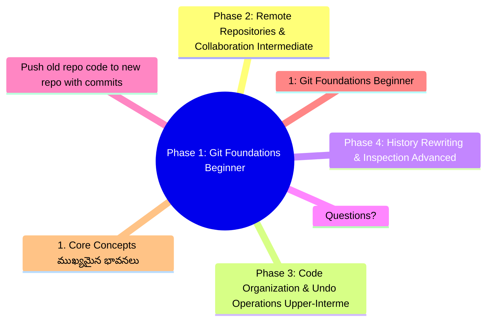

Here is a structured, step-by-step roadmap to take you from Git basics to advanced version control concepts.

---

# [**Phase 1: Git Foundations (Beginner)**](#1-git-foundations-beginner)



Learn the core concepts of local version control and basic terminology.

- **Core Concepts**
- What is Version Control & why Git exists
- How Git works locally (Working Directory, Staging Area, Repository/Commit History)
- Installing Git & basic configuration (`git config --global user.name`, `user.email`)

- **Essential Commands**
- `git init` — Initialize a new local repository
- `git status` — Check the state of files
- `git add` — Move files to the staging area
- `git commit -m` — Save a snapshot of staged changes with a message
- `git log` / `git log --oneline` — View commit history
- `git diff` — View file changes before staging or committing

---

# [**Phase 2: Remote Repositories & Collaboration (Intermediate)**](#2-remote-repositories--collaboration-intermediate)

Connect local projects to cloud hosting (GitHub, GitLab, Bitbucket) and work with branches.

- **Working with Remotes**
- `git remote add origin <url>` — Link local repo to a remote server
- `git push` — Upload local commits to remote
- `git clone` — Download an existing remote repository
- `git fetch` vs. `git pull` — Downloader vs. downloader + merger

- **Branching & Merging Strategies**
- `git branch` — Create, list, and delete branches
- `git switch` / `git checkout` — Switch between branches
- `git merge` — Combine changes from one branch into another
- Resolving Merge Conflicts — How to read conflict markers (`<<<<<<<`, `=======`, `>>>>>>>`) and manually resolve them
- **Pull Requests / Merge Requests** — Understanding GitHub PR workflows, code reviews, and protection rules

---

# [**Phase 3: Code Organization & Undo Operations (Upper-Intermediate)**](#3-code-organization--undo-operations-upper-intermediate)

Learn tools for managing messy commit histories and undoing mistakes safely.

- **Undoing & Fixing Things**
- `git restore` — Discard uncommitted changes in working directory
- `git reset` (`--soft`, `--mixed`, `--hard`) — Move branch HEAD backward
- `git revert` — Create a new commit that safely reverses a previous commit

- **Advanced Local Workflows**
- `git stash` / `git stash pop` — Temporarily save uncommitted work
- `git commit --amend` — Update the most recent commit message or add missed files
- `.gitignore` files — Exclude sensitive files, logs, and `node_modules`

---

# [**Phase 4: History Rewriting & Inspection (Advanced)**](#4-history-rewriting--inspection-advanced)

Master non-linear Git history, debugging, and advanced repository cleanup.

- **Rebasing vs. Merging**
- `git rebase` — Reapply commits on top of another base branch for a linear history
- `git rebase -i` (Interactive Rebase) — Squash, edit, reorder, or drop older commits

- **Advanced Git Utilities**
- `git cherry-pick` — Apply specific commits from another branch onto your current branch
- `git bisect` — Perform binary search across commit history to find which commit introduced a bug
- `git reflog` — View a record of all HEAD updates (your safety net to recover lost commits/branches)
- `git blame` — See line-by-line commit authorship for any file

- **Git Architecture & Submodules**
- Understanding Git objects (`blob`, `tree`, `commit`, `tag`)
- `git submodule` — Manage external repositories inside your main repo

---

# Questions?

## [Push old repo code to new repo with commits](#push-old-repo-code-to-new-repo-with-commits-1)

# 1: Git Foundations (Beginner)

చాలా మంచి లిస్ట్! మనం **Phase 1: Git Foundations (Beginner)** లోని ప్రతి అంశాన్ని చాలా సులభమైన తెలుగులో, ఉదాహరణలతో నేర్చుకుందాం.

---

## 1. Core Concepts (ముఖ్యమైన భావనలు)

### What is Version Control & why Git exists? (వర్షన్ కంట్రోల్ అంటే ఏమిటి? Git ఎందుకు అవసరం?)

- **Version Control System (VCS):** మనం రాసే కోడ్ లేదా డాక్యుమెంట్స్‌లో చేసే మార్పులను (versions) ట్రాక్ చేయడానికి, భద్రపరచడానికి ఉపయోగించే సాఫ్ట్‌వేర్‌ను Version Control అంటారు.
- **Git ఎందుకు?**
- మనం ఒక ప్రాజెక్ట్ చేసేటప్పుడు `project_v1.txt`, `project_final.txt`, `project_final_really.txt` అని చాలా ఫైల్స్ సేవ్ చేస్తూ ఉంటాం. కన్ఫ్యూజన్ పెరుగుతుంది.
- Git ఉంటే, ఒకే ఫైల్‌లో చేసిన అన్ని మార్పులను అది గుర్తుపెట్టుకుంటుంది. ఎప్పుడైనా పాత వెర్షన్‌కి వెళ్లొచ్చు.
- వేరే వాళ్లతో కలిసి (team work) పనిచేసేటప్పుడు కోడ్ కలవకుండా (merge conflicts లేకుండా) చూసుకోవడానికి ఇది చాలా ముఖ్యం.

### How Git works locally? (Git లోపల ఎలా పనిచేస్తుంది?)

Git లోపల ప్రధానంగా **మూడు భాగాలు** ఉంటాయి:

1. **Working Directory:** మీరు ప్రస్తుతం మీ కంప్యూటర్‌లో కోడ్ రాస్తున్న, ఎడిట్ చేస్తున్న ఫోల్డర్.
2. **Staging Area (Index):** మీరు కమిట్ (commit) చేయాలనుకుంటున్న ఫైళ్లను తాత్కాలికంగా పక్కన పెట్టే స్థలం.
3. **Repository (.git directory):** మీ ప్రాజెక్ట్ యొక్క పర్మనెంట్ హిస్టరీ మరియు కమిట్స్ అన్నీ సేవ్ అయ్యే ప్రదేశం.

### Installing Git & Basic Configuration (ఇన్‌స్టాలేషన్ మరియు సెట్టింగ్స్)

Git ని మీ కంప్యూటర్‌లో ఇన్‌స్టాల్ చేసుకున్న తర్వాత, మీరు ఎవరో Git కి చెప్పాలి (దీనివల్ల మీరు రాసిన కోడ్ మీదే అని రికార్డ్ అవుతుంది).

- కాన్ఫిగర్ చేయడానికి ఈ కమాండ్స్ వాడాలి:
- `git config --global user.name "మీ పేరు"`
- `git config --global user.email "మీ ఈమెయిల్"`

---

## 2. Essential Commands (అత్యవసర కమాండ్లు)

ఇప్పుడు మనం రోజూ వాడే బేసిక్ Git కమాండ్స్ గురించి చూద్దాం:

- **`git init`**
- **పని:** ఒక కొత్త లోకల్ రిపాజిటరీని (Repository) క్రియేట్ చేయడానికి దీన్ని వాడతాం.
- **ఉదాహరణ:** మీ ప్రాజెక్ట్ ఫోల్డర్‌లోకి వెళ్లి `git init` అని టైప్ చేస్తే, ఆ ఫోల్డర్ లోపల `.git` అనే హిడెన్ ఫోల్డర్ ఏర్పడుతుంది. అప్పట్నుంచి Git ఆ ప్రాజెక్ట్‌ను ట్రాక్ చేయడం మొదలుపెడుతుంది.

- **`git status`**
- **పని:** మీ ప్రాజెక్ట్‌లో ఏ ఫైల్స్ మారాయి? ఏవి స్టేజ్ అయ్యాయి? అని ప్రస్తుత పరిస్థితిని తెలుసుకోవడానికి.
- **ఉదాహరణ:** `git status`

- **`git add`**
- **పని:** Working Directory లో ఉన్న ఫైళ్లను Staging Area కి మూవ్ చేయడానికి.
- **ఉదాహరణ:** `git add index.html` (ఒక নির্দিষ্ট ఫైల్ కోసం) లేదా అన్ని ఫైల్స్‌కి `git add .`

- **`git commit -m "message"`**
- **పని:** Staging Area లో ఉన్న మార్పులను ఒక ఫోటోలాగా (Snapshot) పర్మనెంట్ రిపాజిటరీలో సేవ్ చేయడానికి. ఇక్కడ `-m` అంటే మెసేజ్, మీరు ఏం మార్పులు చేశారో రాయాలి.
- **ఉదాహరణ:** `git commit -m "added login page UI"`

- **`git log` / `git log --oneline**`
- **పని:** ఇంతకుముందు చేసిన కమిట్స్ (history) అన్నీ చూడటానికి.
- **ఉదాహరణ:** `git log --oneline` టైప్ చేస్తే ప్రతీ కమిట్ ఒక చిన్న లైన్‌లో క్లియర్ గా కనిపిస్తుంది.

- **`git diff`**
- **పని:** మీరు ఫైల్‌లో చేసిన మార్పులు ఏమిటో (స్టేజ్ లేదా కమిట్ చేయకముందు) చూడటానికి.
- **ఉదాహరణ:** `git diff`

---

# 2: Remote Repositories & Collaboration (Intermediate)

అద్భుతం! ఇప్పుడు మనం **Phase 2: Remote Repositories & Collaboration (Intermediate)** లోకి అడుగుపెట్టాము. దీన్ని కూడా చాలా స్పష్టమైన తెలుగులో విడమర్చి తెలుసుకుందాం.

---

## 1. Working With Remotes (క్లౌడ్ మరియు రిమోట్ కనెక్షన్స్)

మన లోకల్ కంప్యూటర్‌లో ఉన్న కోడ్‌ని GitHub, GitLab లేదా Bitbucket లాంటి క్లౌడ్ ప్లాట్‌ఫారమ్‌లకు కనెక్ట్ చేయడానికి ఇవి వాడతాం.

- **`git remote add origin <url>`**
- **పని:** మీ లోకల్ రిపాజిటరీని క్లౌడ్ (GitHub) లోని రిమోట్ రిపాజిటరీకి లింక్ చేయడానికి.
- **ఉదాహరణ:** `git remote add origin [https://github.com/username/my-project.git](https://github.com/username/my-project.git)`

- **`git push`**
- **పని:** మీ లోకల్ కంప్యూటర్‌లో చేసిన కమిట్స్‌ని (changes) క్లౌడ్ రిమోట్ సర్వర్‌కి అప్‌లోడ్ చేయడానికి.
- **ఉదాహరణ:** `git push origin main` (మెయిన్ బ్రాంచ్ కోడ్‌ని క్లౌడ్‌కి పంపడం).

- **`git clone`**
- **పని:** ఆల్రెడీ క్లౌడ్‌లో (GitHub) ఉన్న వేరే ప్రాజెక్ట్‌ని మీ లోకల్ కంప్యూటర్‌లోకి డౌన్‌లోడ్ చేసుకోవడానికి.
- **ఉదాహరణ:** `git clone [https://github.com/username/project.git](https://github.com/username/project.git)`

- **`git fetch` vs `git pull**`
- **`git fetch`:** రిమోట్ సర్వర్ నుంచి లేటెస్ట్ డీటెయిల్స్/కోడ్‌ని మీ లోకల్ రిపాజిటరీకి తెచ్చుకుంటుంది, కానీ మీ ప్రస్తుత వర్కింగ్ ఫైల్స్‌లో కలపదు (డౌన్‌లోడ్ మాత్రమే చేస్తుంది).
- **`git pull`:** ఇది `git fetch` + `git merge` రెండూ కలిపి పనిచేస్తుంది. రిమోట్ సర్వర్ నుంచి లేటెస్ట్ కోడ్‌ని తెచ్చి, మీ లోకల్ కోడ్‌తో ఆటోమేటిక్‌గా కలిపేస్తుంది (ডவுన్‌లోడ్ + మర్జ్).

---

## 2. Branching & Merging Strategies (బ్రాంచ్‌లు మరియు కలపడం)

ఒకే ప్రాజెక్ట్‌లో వేర్వేరు ఫీచర్లు వేర్వేరుగా డెవలప్ చేయడానికి బ్రాంచ్‌లు చాలా ముఖ్యం.

- **`git branch`**
- **పని:** కొత్త బ్రాంచ్‌ని క్రియేట్ చేయడానికి, ఉన్న బ్రాంచ్‌లను చూడటానికి, లేదా డిలీట్ చేయడానికి.
- **ఉదాహరణ:**
- బ్రాంచ్‌ల జాబితా చూడటానికి: `git branch`
- కొత్త బ్రాంచ్ చేయალంటే: `git branch login-page`

- **`git switch` / `git checkout**`
- **పని:** ఒక బ్రాంచ్ నుంచి వేరే బ్రాంచ్‌కి మారడానికి.
- **ఉదాహరణ:** `git switch login-page` (కొత్త వెర్షన్ కమాండ్) లేదా `git checkout login-page` (పాత వెర్షన్ కమాండ్).

- **`git merge`**
- **పని:** ఒక బ్రాంచ్‌లోని మార్పులను మరో బ్రాంచ్‌లోకి కలపడానికి.
- **ఉదాహరణ:** మీరు `login-page` బ్రాంచ్‌లో రాసిన కోడ్‌ని మెయిన్ బ్రాంచ్‌లోకి తేవడానికి `main` బ్రాంచ్‌లోకి వెళ్లి `git merge login-page` అనాలి.

---

## 3. Resolving Merge Conflicts & PRs (కాన్ఫ్లిక్ట్‌లు మరియు పుల్ రిక్వెస్ట్‌లు)

- **Resolving Merge Conflicts (విభేదాలను పరిష్కరించడం):**
- ఇద్దరు వ్యక్తులు ఒకే ఫైల్‌లో, ఒకే లైన్‌లో వేర్వేరు మార్పులు చేసినప్పుడు Git కి ఏది ఉంచాలో అర్థం కాదు. అప్పుడు **Merge Conflict** వస్తుంది.
- Git ఆ ఫైల్‌లో ఇలా మార్కర్లు పెడుతుంది:

```text
<<<<<<< HEAD
మీరు లోకల్ రాసిన కోడ్
=======
వేరే వాళ్ళు పంపిన కోడ్
>>>>>>> branch-name

```

- దీన్ని మనం మ్యానువల్‌గా ఏ కోడ్ ఉంచాలో డిసైడ్ చేసి ఎడిట్ చేసి, ఆ తర్వాత మళ్లీ `git add` మరియు `git commit` చేయాలి.

- **Pull Requests / Merge Requests (PRs):**
- GitHub లాంటి ప్లాట్‌ఫారమ్‌లలో నేరుగా మెయిన్ బ్రాంచ్‌లో కోడ్ మార్చకుండా, ఒక కొత్త బ్రాంచ్ క్రియేట్ చేసి పుష్ చేశాక... "నేను ఈ మార్పులు చేశాను, మీ ప్రాజెక్ట్‌లో కలపండి" అని అడగడాన్ని **Pull Request (PR)** అంటారు.
- టీమ్ లీడర్ లేదా సీనియర్ ఆ కోడ్‌ని రివ్యూ చేసి (Code Review), అన్నీ కరెక్ట్ గా ఉంటే మెయిన్ బ్రాంచ్‌లోకి మర్జ్ (Merge) చేస్తారు.

---

# 3: Code Organization & Undo Operations (Upper-Intermediate)

అద్భుతం! మనం ఇప్పుడు **Phase 3: Code Organization & Undo Operations (Upper-Intermediate)** లోకి వచ్చాము. రియల్ టైమ్ ప్రాజెక్ట్స్‌లో పొరపాట్లు జరిగినప్పుడు లేదా కోడ్‌ని మేనేజ్ చేసేటప్పుడు ఈ కమాండ్స్ చాలా బాగా ఉపయోగపడతాయి. వీటిని చాలా సులభంగా తెలుసుకుందాం!

---

## 1. Undoing & Fixing Things (తప్పులను సరిదిద్దడం & వెనక్కి వెళ్లడం)

- **`git restore`**
- **పని:** మీరు వర్కింగ్ డైరెక్టరీలో చేసిన అన్-కమిటెడ్ (uncommitted) మార్పులను క్యాన్సిల్ చేసి, పాత ఒరిజినల్ స్టేజ్‌కి ఫైల్‌ని తీసుకురావడానికి ఇది వాడతారు.
- **ఉదాహరణ:** `git restore app.js` (app.js లో చేసిన తాజా మార్పులు వద్దు అనుకుంటే).

- **`git reset` (`--soft`, `--mixed`, `--hard`)**
- **పని:** బ్రాంచ్ యొక్క `HEAD` (ప్రస్తుత పొజిషన్) ని వెనక్కి జరపడానికి ఇది ఉపయోగిస్తారు. ఇందులో 3 రకాలు ఉన్నాయి:
- **`--soft`:** కేవలం కమిట్ హిస్టరీ మాత్రమే వెనక్కి వెళ్తుంది, మీ కోడ్ మరియు స్టేజింగ్ ఏరియా అలాగే ఉంటాయి.
- **`--mixed` (డిఫాల్ట్):** కమిట్ హిస్టరీ మరియు స్టేజింగ్ ఏరియా క్లియర్ అవుతాయి, కానీ మీ కోడ్ ఫైల్స్‌లో మార్పులు అలాగే ఉంటాయి.
- **`--hard`:** చాలా జాగ్రత్తగా వాడాలి! కమిట్ హిస్టరీ, స్టేజింగ్ ఏరియా, మరియు మీరు రాసిన కోడ్ అన్నీ పూర్తిగా డిలీట్ అయిపోయి, పాత వెర్షన్‌కి వచ్చేస్తుంది.

- **`git revert`**
- **పని:** ఇది పాత కమిట్స్‌ని పబ్లిక్ రిమోట్ సర్వర్‌లో సేఫ్‌గా రివర్స్ చేయడానికి వాడతారు. ఇది పాత కమిట్‌ని డిలీట్ చేయదు, బదులుగా దానికి వ్యతిరేకమైన మార్పులతో **కొత్త కమిట్‌ని** సృష్టిస్తుంది.
- **ఉదాహరణ:** `git revert <commit-id>`

---

## 2. Advanced Local Workflows (అడ్వాన్స్‌డ్ లోకల్ వర్క్‌ఫ్లోస్)

- **`git stash` / `git stash pop**`
- **పని:** మీరు ఒక ఫీచర్‌ మీద కోడ్ రాస్తుంటారు, ఇంతలో అర్జెంట్‌గా వేరే బ్రాంచ్‌కి వెళ్లాల్సి వస్తుంది. ప్రస్తుత కోడ్ ఇంకా పూర్తి కాలేదు కాబట్టి కమిట్ చేయలేరు. అప్పుడు `git stash` వాడితే మీ అన్‌ఫినిష్డ్ కోడ్ తాత్కాలికంగా ఒక సేఫ్ బాక్స్‌లో దాచబడుతుంది (Stash).
- అవసరం తీరాక **`git stash pop`** కొడితే, ఆ దాచిన కోడ్ మళ్ళీ మీ ముందుకు వస్తుంది.

- **`git commit --amend`**
- **పని:** మీరు ఇప్పుడే ఒక కమిట్ చేశారు, కానీ అందులో ఒక ఫైల్ మార్చడం మర్చిపోయారు లేదా కమిట్ మెసేజ్ తప్పుగా రాశారు. అప్పుడు కొత్త కమిట్ చేయకుండా, లాస్ట్ కమిట్‌నే మోడిఫై చేయడానికి ఇది వాడతారు.
- **ఉదాహరణ:** `git commit --amend -m "correct message here"`

- **`.gitignore` files**
- **పని:** పాస్‌వర్డ్‌లు, డేటాబేస్ కాన్ఫిగరేషన్స్, లాగ్ ఫైల్స్, లేదా పెద్ద `node_modules` ఫోల్డర్‌లను GitHub కి వెళ్లకుండా బ్లాక్ చేయడానికి ఒక స్పెషల్ ఫైల్ క్రియేట్ చేస్తాం. దాన్నే `.gitignore` అంటారు.
- ఇందులో ఏ ఫైల్స్ పేర్లు రాస్తామో, వాటిని Git పట్టించుకోదు (ట్రాక్ చేయదు).

---

# 4: History Rewriting & Inspection (Advanced)

ఇది చాలా ముఖ్యమైన మరియు అడ్వాన్స్‌డ్ టాపిక్! మనం ఇప్పుడు **Phase 4: History Rewriting & Inspection (Advanced)** లోకి వచ్చాము. రియల్ టైమ్‌లో సీనియర్ డెవలపర్లు వాడే పవర్‌ఫుల్ Git ట్రిక్స్ ఇవి. వీటిని చాలా సులభంగా అర్థం చేసుకుందాం!

---

## 1. Rebasing vs. Merging (హిస్టరీని క్లీన్‌గా ఉంచడం)

- **`git rebase`**
- **పని:** మనం ఇంతకు ముందు చూసిన `git merge` లో హిస్టరీ కొంచెం క్రాస్‌గా మారుతుంది. కానీ `git rebase` మీ కమిట్స్ అన్నీ తీసుకొచ్చి వేరే బ్రాంచ్ పైన వరుసగా (linear history) అమర్చుతుంది. దీనివల్ల ప్రాజెక్ట్ హిస్టరీ చాలా నీట్‌గా కనిపిస్తుంది.
- **ఉదాహరణ:** `git rebase main`

- **`git rebase -i` (Interactive Rebase)**
- **పని:** గతంలో చేసిన కొన్ని కమిట్స్‌ని కలిపేయడానికి (Squash), మెసేజ్‌లు మార్చడానికి, లేదా కొన్ని కమిట్స్‌ని తొలగించడానికి (Drop) ఇది ఒక మ్యాజిక్ టూల్ లాంటిది.
- **ఉదాహరణ:** `git rebase -i HEAD~3` (గత 3 కమిట్స్‌ని ఎడిట్ చేయడానికి).

---

## 2. Advanced Git Utilities (అడ్వాన్స్‌డ్ టూల్స్)

- **`git cherry-pick`**
- **పని:** వేరే బ్రాంచ్‌లో చేసిన మొత్తం కోడ్ కాకుండా, కేవలం **ఒక নির্দিষ্ট కమిట్** లోని మార్పులు மட்டும் మన ప్రస్తుత బ్రాంచ్‌లోకి తెచ్చుకోవడానికి ఇది వాడతారు.
- **ఉదాహరణ:** `git cherry-pick <commit-hash>`

- **`git bisect`**
- **పని:** పెద్ద ప్రాజెక్ట్‌లో ఎప్పుడో ఒక బగ్ (Bug) వచ్చింది. ఏ కమిట్ వల్ల ఆ బగ్ వచ్చిందో వెతకడానికి ఇది బైసర్చీ (Binary search) పద్ధతిని వాడి ఆటోమేటిక్‌గా పట్టుకుంటుంది.

- **`git reflog`**
- **పని:** ఇది మీ **సేఫ్టీ నెట్ (Safety Net)** లాంటిది! మీరు పొరపాటున `git reset --hard` చేసి కోడ్ పోగొట్టుకున్నా, డిలీట్ చేసిన బ్రాంచ్‌లను వెనక్కి తెచ్చుకోవాలన్నా `git reflog` వాడి ప్రతి చిన్న యాక్షన్ హిస్టరీని చూసి మళ్ళీ రికవర్ చేసుకోవచ్చు.

- **`git blame`**
- **పని:** ఒక ఫైల్‌లోని ప్రతీ లైన్ కోడ్‌ని ఎవరు రాశారు? ఏ కమిట్‌లో రాశారు? అని తెలుసుకోవడానికి ఇది వాడతారు (ఎవరిని తప్పుపట్టాలో చూడటానికి కాదు, ఎవరిని సంప్రదించాలో తెలుసుకోవడానికి!).
- **ఉదాహరణ:** `git blame index.html`

---

## 3. Git Architecture & Submodules (ఆర్కిటెక్చర్ మరియు సబ్‌మోడ్యూల్స్)

- **Git Objects (గిట్ ఆబ్జెక్ట్స్):**
  Git లోపల ప్రతిదీ నాలుగు ప్రధాన ఆబ్జెక్ట్స్‌గా స్టోర్ అవుతుంది:

1. **Blob:** కేవలం ఫైల్ లోపల ఉన్న డేటా (Content).
2. **Tree:** ఫోల్డర్ స్ట్రక్చర్ మరియు ఫైల్ పేర్లు.
3. **Commit:** ఈ ట్రీ మరియు బ్లోబ్స్‌ని పాయింట్ చేస్తూ రాసే మెసేజ్, ఆథర్ వివరాలు.
4. **Tag:** ఒక పర్టికులర్ కమిట్‌కి (ఉదాహరణకి v1.0) ఇంపార్టెంట్ లేబుల్ ఇవ్వడం.

- **`git submodule`**
- **పని:** మీ మెయిన్ ప్రాజెక్ట్ లోపలే మరో వేరే ఎక్స్‌టర్నల్ రిపాజిటరీని (వేరే ప్రాజెక్ట్‌ని) ఒక సబ్‌ఫోల్డర్‌లా మెయింటైన్ చేయడానికి ఇది వాడతారు.

---

# push old repo code to new repo with commits

మీరు కొత్తగా ఒక రిపాజిటరీని క్రియేట్ చేశారు (migration కోసం), ఇప్పుడు పాత రిపాజిటరీలో ఉన్న కోడ్ మరియు దాని **పూర్తి కమిట్ హిస్టరీ (Commit details)** అన్నీ కొత్త రిపాజిటరీలోకి ఎలా తెచ్చుకోవాలో చూద్దాం.

దీన్ని చేయడానికి రెండు సులభమైన పద్ధతులు ఉన్నాయి. వాటిలో మొదటి పద్ధతి చాలా మంది వాడే రెగ్యులర్ విధానం.

---

### పద్ధతి: `git remote` మరియు `git push` ద్వారా (Mirror / Branch Push)

మీరు పాత రిపాజిటరీ కోడ్‌ని మీ లోకల్ కంప్యూటర్‌లోకి క్లోన్ చేసుకొని, దాన్ని కొత్త రిపాజిటరీకి లింక్ చేసి పుష్ చేయవచ్చు. దీనివల్ల కమిట్ హిస్టరీ ఏమాత్రం పోకుండా అన్నీ వస్తాయి.

దీనికి సంబంధించిన స్టెప్స్ కింద ఉన్నాయి:

#### Step 1: పాత రిపాజిటరీని లోకల్ సిస్టమ్‌లోకి క్లోన్ చేసుకోండి

ముందుగా పాత రిపాజిటరీని మీ కంప్యూటర్‌లోకి డౌన్‌లోడ్ చేసుకోండి (`--clone` లేదా `--mirror` వాడొచ్చు, బట్ సింపుల్‌గా క్లోన్ చేద్దాం):

```bash
git clone <old-repo-url>
cd <project-folder-name>

```

#### Step 2: పాత రిమోట్ లింక్‌ని తీసేసి, కొత్త రిమోట్ లింక్‌ని సెట్ చేయండి

ఇప్పుడు ఈ ఫోల్డర్ పాత రిపాజిటరీకి కనెక్ట్ అయి ఉంటుంది. దాన్ని మార్చి కొత్త రిపాజిటరీకి కనెక్ట్ చేయాలి.

- ముందు పాత లింక్ తొలగించండి:

```bash
git remote remove origin

```

- ఇప్పుడు మీ **కొత్త రిపాజిటరీ URL** ని దీనికి యాడ్ చేయండి:

```bash
git remote add origin <new-repo-url>

```

#### Step 3: కోడ్ మరియు కమిట్ హిస్టరీని కొత్త రిపాజిటరీకి పంపండి (Push)

ఇప్పుడు మీ లోకల్ బ్రాంచ్‌ని (ఉదాహరణకి `main` లేదా `master`) కొత్త రిపాజిటరీకి పుష్ చేయండి. అన్ని బ్రాంచ్‌లు మరియు ట్యాగ్స్‌తో సహా పంపడానికి ఈ కమాండ్ వాడొచ్చు:

```bash
git push -u origin --all
git push origin --tags

```

_(ఇక్కడ `--all` వాడటం వల్ల పాత రిపాజిటరీలో ఉన్న అన్ని బ్రాంచ్‌లు మరియు కమిట్ హిస్టరీ కొత్త రిపాజిటరీకి కాపీ అవుతాయి)._

---

### ఒక చిన్న ఉదాహరణ (Example):

ఉదాహరణకి:

- మీ **పాత రిపాజిటరీ URL**: `[https://github.com/myname/old-project.git](https://github.com/myname/old-project.git)`
- మీ **కొత్త రిపాజిటరీ URL**: `[https://github.com/myname/new-project.git](https://github.com/myname/new-project.git)`

మీరు టెర్మినల్ (Terminal) లేదా కమాండ్ ప్రాంప్ట్ ఓపెన్ చేసి ఈ క్రింది కమాండ్స్ వరుసగా టైప్ చేయాలి:

1. `git clone [https://github.com/myname/old-project.git](https://github.com/myname/old-project.git)` (పాతది డౌన్‌లోడ్ అవుతుంది)
2. `cd old-project` (ఆ ఫోల్డర్లోకి వెళ్తాం)
3. `git remote remove origin` (పాత లింక్ కట్ అవుతుంది)
4. `git remote add origin [https://github.com/myname/new-project.git](https://github.com/myname/new-project.git)` (కొత్త లింక్ యాడ్ అవుతుంది)
5. `git push -u origin --all` (కమిట్ హిస్టరీతో సహా కొత్త దానికి కోడ్ వెళ్ళిపోతుంది)

ఇలా చేస్తే, మీ పాత కోడ్ మరియు ప్రతీ ఒక్క కమిట్ హిస్టరీ కొత్త రిపాజిటరీలోకి విజయవంతంగా వచ్చేస్తాయి!

ఇందులో మీకు ఏ స్టేప్‌లోనైనా డౌట్ వస్తోందా?
