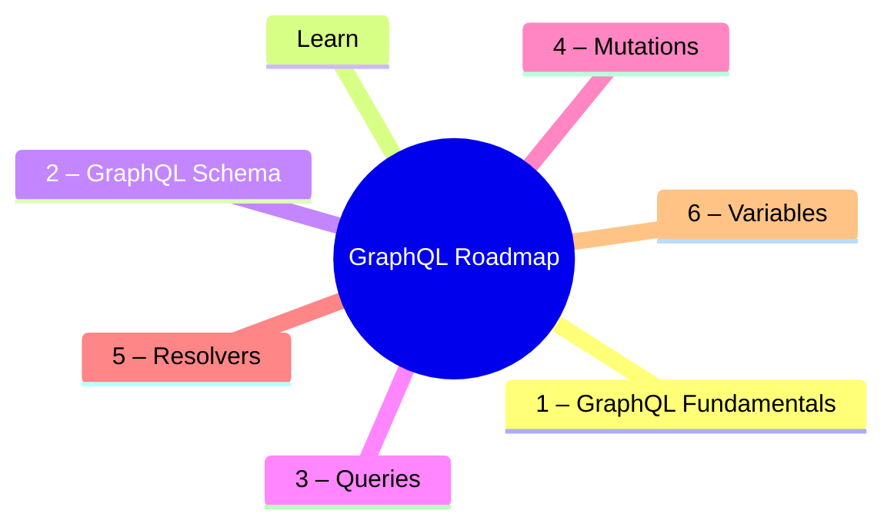

Since you're learning **Node.js, React, Next.js, AWS, Microservices, and AI**, learning **GraphQL** is a great next step. Many companies use GraphQL with **Apollo Server, NestJS, Prisma, PostgreSQL, React, and AWS AppSync**.

Here's a **complete GraphQL Roadmap (2026)** from beginner to advanced.

---

# GraphQL Roadmap



```
1. GraphQL Basics
        ↓
2. Schema & Types
        ↓
3. Queries
        ↓
4. Mutations
        ↓
5. Resolvers
        ↓
6. Variables & Arguments
        ↓
7. Fragments
        ↓
8. Aliases
        ↓
9. Interfaces & Unions
        ↓
10. Directives
        ↓
11. Error Handling
        ↓
12. Apollo Server
        ↓
13. Prisma + GraphQL
        ↓
14. Authentication
        ↓
15. Authorization
        ↓
16. DataLoader
        ↓
17. Subscriptions
        ↓
18. Federation
        ↓
19. Caching
        ↓
20. Production Deployment
```

---

# [1 – GraphQL Fundamentals](#1--graphql-fundamentals-1)

## Learn

- What is GraphQL?
- Why GraphQL?
- REST vs GraphQL
- GraphQL Architecture
- GraphQL Request Flow

### Understand

```
Client

↓

GraphQL Server

↓

Resolver

↓

Database
```

Know the difference between

- REST endpoint

```
GET /users
GET /users/10
GET /users/10/books
```

vs

GraphQL

```graphql
query {
  user(id: 10) {
    id
    name
    books {
      title
    }
  }
}
```

---

# [2 – GraphQL Schema](#2--graphql-schema-1)

Learn Schema Definition Language (SDL).

Example

```graphql
type User {
  id: ID!
  name: String!
  age: Int
}
```

Learn

- Scalars

```
String

Int

Float

Boolean

ID
```

Non-null

```
String!
```

Lists

```
[User]
```

Nested Types

Enums

Input Types

---

# [3 – Queries](#3--queries-1)

Example

```graphql
query {
  users {
    id
    name
  }
}
```

With Arguments

```graphql
query {
  user(id: 1) {
    name
  }
}
```

Nested Queries

```graphql
query {
  users {
    books {
      title
    }
  }
}
```

Understand

- Selection Set
- Nested Objects
- Field Resolution

---

# [4 – Mutations](#4--mutations-1)

Create

```graphql
mutation {
  createUser(name: "John") {
    id
    name
  }
}
```

Update

Delete

Bulk Updates

---

# [5 – Resolvers](#5--resolvers-1)

Understand how GraphQL executes every field.

Example

```ts
const resolvers = {
  Query: {
    users: () => getUsers(),
  },

  Mutation: {
    createUser: (_, args) => createUser(args),
  },
};
```

Learn

Execution Order

Parent

Args

Context

Info

Resolver chaining

---

# [6 – Variables](#6--variables-1)

Instead of

```graphql
query{
 user(id:1){}
}
```

Use

```graphql
query GetUser($id: ID!) {
  user(id: $id) {
    name
  }
}
```

Variables

```json
{
  "id": 1
}
```

---

# [7 – Fragments](#7--fragments-1)

Without Fragment

```graphql
user{
 id
 name
 age
}

admin{
 id
 name
 age
}
```

With Fragment

```graphql
fragment UserInfo on User {
  id
  name
  age
}
```

---

# [8 – Aliases](#8--aliases-1)

```graphql
query {
  user1: user(id: 1) {
    name
  }

  user2: user(id: 2) {
    name
  }
}
```

---

# [9 – Interfaces & Unions](#9--interfaces--unions-1)

Interface

```graphql
interface Animal {
  id: ID!
  name: String!
}
```

Union

```graphql
union SearchResult = User | Book
```

---

# [10 – Directives](#10--directives-1)

Built-in

```
@include

@skip

@deprecated
```

Custom Directives

---

# [11 – Error Handling](#11--error-handling-1)

Learn

GraphQL Errors

Validation Errors

Resolver Errors

Authentication Errors

Partial Success

---

# [12 – Apollo Server](#12--apollo-server-1)

Install

```bash
npm install @apollo/server graphql
```

Learn

Apollo Context

Plugins

Middleware

Apollo Studio

Schema Loading

---

# [13 – Prisma + GraphQL](#13--prisma--graphql-1)

This is extremely common.

Architecture

```
React

↓

Apollo Client

↓

Apollo Server

↓

Prisma

↓

PostgreSQL
```

Example Resolver

```ts
const users = prisma.user.findMany();
```

Learn

CRUD

Relations

Transactions

Pagination

Filtering

---

# [14 – Authentication](#14--authentication-1)

JWT

Login

Signup

Refresh Token

Context

```ts
context: {
  user;
}
```

---

# [15 – Authorization](#15--authorization-1)

Role Based

Permission Based

Admin Only

Field Level Authorization

---

# [16 – DataLoader](#16--dataloader-1)

One of the most important interview topics.

Problem

```
100 Users

↓

100 Queries

↓

Database
```

Solution

```
100 Users

↓

1 Query

↓

Database
```

Learn

Batching

Caching

N+1 Problem

---

# [17 – Subscriptions](#17--subscriptions-1)

Real-time Updates

WebSockets

Example

```
Chat

Stock Price

Notifications

Live Score
```

Example

```graphql
subscription {
  messageAdded {
    id
    text
  }
}
```

---

# [18 – Federation](#18--federation-1)

Large companies split GraphQL into services.

```
Users Service

Products Service

Orders Service

Payments Service
```

↓

Gateway

↓

One GraphQL API

Learn

Apollo Federation

Schema Composition

Service Discovery

---

# [19 – Performance](#19--performance-1)

Caching

Persisted Queries

Pagination

Cursor Pagination

Depth Limiting

Query Complexity

Response Cache

---

# [20 – Production](#20--production-1)

Deployment

Docker

AWS ECS

Lambda

API Gateway

CloudWatch

Rate Limiting

Monitoring

Logging

Schema Versioning

---

# [GraphQL Client (React)](#graphql-client-react-1)

Learn Apollo Client

```tsx
const { loading, data } = useQuery(GET_USERS);
```

Topics

- useQuery
- useMutation
- useLazyQuery
- Cache
- Refetch
- Optimistic UI
- Error Handling
- Pagination
- Infinite Scroll

---

# [GraphQL with Node.js](#graphql-with-nodejs-1)

```
Express
        ↓
Apollo Server
        ↓
Resolvers
        ↓
Services
        ↓
Prisma
        ↓
PostgreSQL
```

Also learn

- Express + Apollo
- NestJS GraphQL
- Code First
- Schema First

---

# [AWS GraphQL](#aws-graphql-1)

Learn

- AWS AppSync
- Lambda Resolvers
- DynamoDB
- Cognito Authentication
- IAM Authorization
- EventBridge Integration
- CloudFront Caching

---

# Projects

### Beginner

- Todo API
- Notes App
- Student Management
- Blog API

---

### Intermediate

- E-Commerce Backend
- Library Management
- Movie Database
- Expense Tracker

---

### Advanced

- Netflix Clone Backend
- Instagram Backend
- Twitter Clone
- Slack Clone
- Food Delivery Backend

---

# [Top GraphQL Interview Questions (40)](#top-graphql-interview-questions-40-1)

## Basics

1. What is GraphQL?
2. Why use GraphQL over REST?
3. Explain the GraphQL execution flow.
4. What are GraphQL resolvers?
5. What is a schema?

## Schema & Types

6. What are scalar types?
7. Difference between `type` and `input`?
8. What are enums?
9. What are interfaces?
10. What are unions?

## Queries & Mutations

11. Difference between query and mutation?
12. What are variables?
13. What are fragments?
14. What are aliases?
15. What are directives?

## Apollo & Server

16. What is Apollo Server?
17. How do you create a GraphQL server?
18. What is the GraphQL context?
19. How do you organize resolvers?
20. How do you handle errors?

## Database & Prisma

21. How does GraphQL work with Prisma?
22. How do you model relations?
23. How do you implement pagination?
24. What is cursor-based pagination?
25. How do you filter and sort data?

## Performance

26. What is the N+1 problem?
27. How does DataLoader solve it?
28. How do you cache GraphQL responses?
29. How do you limit expensive queries?
30. What are persisted queries?

## Security

31. How do you implement JWT authentication?
32. How do you authorize users?
33. How do you prevent query abuse?
34. How do you secure GraphQL APIs?

## Advanced

35. What are subscriptions?
36. Explain Apollo Federation.
37. What is schema stitching?
38. How do you version a GraphQL API?
39. How do you monitor GraphQL services?
40. How would you design a scalable GraphQL API for millions of users?

---

# Recommended Learning Order

1. GraphQL Fundamentals
2. Schema Definition Language (SDL)
3. Queries & Mutations
4. Resolvers
5. Variables, Fragments & Aliases
6. Apollo Server
7. Apollo Client (React)
8. Prisma + PostgreSQL
9. Authentication & Authorization
10. DataLoader & N+1 Optimization
11. Pagination, Filtering & Sorting
12. Subscriptions (Real-time)
13. Federation & Microservices
14. AWS AppSync Integration
15. Production Deployment, Monitoring & Performance

Following this sequence will build a solid foundation and align well with modern full-stack development using Node.js, React/Next.js, Prisma, PostgreSQL, AWS, and microservices.

---

# 1 – GraphQL Fundamentals

---

### 1. GraphQL అంటే ఏమిటి? (What is GraphQL?)

GraphQL అనేది APIs (Application Programming Interfaces) కోసం తయారు చేసిన ఒక **Query Language**. ఇది ఫేస్‌బుక్ (Meta) వారు డెవలప్ చేశారు. ఇది క్లయింట్‌కి (Frontend) డేటాను ఎలా కావాలో, ఎంత కావాలో అడిగి తీసుకోవడానికి (Query చేయడానికి) సహాయపడుతుంది.

### 2. ఎందుకు GraphQL? (Why GraphQL?)

సాధారణంగా APIsలో మనకు కావాల్సిన దానికంటే ఎక్కువ డేటా వచ్చేస్తుంది (Over-fetching) లేదా తక్కువ డేటా వస్తుంది (Under-fetching).

- **Over-fetching:** ఉదాహరణకు, మనకు కేవలం యూజర్ పేరు మాత్రమే కావాలి, కానీ API మొత్తం యూజర్ ప్రొఫైల్ డేటాను (అడ్రస్, ఈమెయిల్, ఫోన్ నంబర్, etc.) పంపితే అది 'Over-fetching'. దీనివల్ల అనవసరమైన డేటా ట్రాన్స్‌ఫర్ అవుతుంది.
- **Under-fetching:** మనకు కావలసిన డేటా పొందడానికి ఒకటికి మించిన API కాల్స్ చేయాల్సి వస్తే అది 'Under-fetching'.
  GraphQL ఈ రెండు సమస్యలను పరిష్కరిస్తుంది.

### 3. REST vs GraphQL

| ఫీచర్                   | REST API                                  | GraphQL                              |
| ----------------------- | ----------------------------------------- | ------------------------------------ |
| **డేటా రిక్వెస్ట్**     | నిర్ణీత ఎండ్‌పాయింట్స్ (Endpoints) ఉంటాయి | ఒకే ఎండ్‌పాయింట్ ఉంటుంది             |
| **ఫ్లెక్సిబిలిటీ**      | సర్వర్ పంపినంతే తీసుకోవాలి                | క్లయింట్‌కి ఎంత కావాలో అంతే అడగవచ్చు |
| **Over/Under Fetching** | ఎక్కువగా జరుగుతుంది                       | అస్సలు జరగదు                         |

### 4. GraphQL Architecture & Request Flow (డేటా ఎలా ప్రవహిస్తుంది?)

దీనిని ఒక చిన్న ఉదాహరణతో అర్థం చేసుకుందాం:

**Request Flow:**
`Client` → `GraphQL Server` → `Resolver` → `Database`

1. **Client (క్లయింట్):** ఇది బ్రౌజర్ లేదా మొబైల్ యాప్. ఇది "నాకు యూజర్ పేరు మరియు అతని చివరి ఆర్డర్ కావాలి" అని ఒక క్వెరీని పంపిస్తుంది.
2. **GraphQL Server (సర్వర్):** క్లయింట్ పంపిన క్వెరీ కరెక్ట్‌గా ఉందో లేదో (Syntax check) తనిఖీ చేస్తుంది. మన `Schema` (డేటా స్ట్రక్చర్) తో సరిపోలిందో లేదో చూస్తుంది.
3. **Resolver (రిజాల్వర్):** ఇక్కడే అసలు పని జరుగుతుంది. GraphQL సర్వర్‌లో ప్రతి ఫీల్డ్‌కి ఒక 'Resolver function' ఉంటుంది. "యూజర్ పేరు" కోసం ఒక ఫంక్షన్, "ఆర్డర్స్" కోసం మరొక ఫంక్షన్ పనిచేస్తాయి. ఇవి డేటాబేస్ నుండి ఖచ్చితమైన సమాచారాన్ని సేకరిస్తాయి.
4. **Database (డేటాబేస్):** రిజాల్వర్ అడిగిన సమాచారాన్ని డేటాబేస్ నుండి (SQL లేదా NoSQL) సేకరించి వెనక్కి పంపిస్తుంది.

చివరగా, డేటాబేస్ ఇచ్చిన సమాచారాన్ని, క్లయింట్ ఎలా కోరుకుందో అదే రూపంలో (JSON format) సర్వర్ క్లయింట్‌కి పంపిస్తుంది.

---

**ఒక సింపుల్ ఉదాహరణ:**
మీరు రెస్టారెంట్‌కి వెళ్ళినప్పుడు:

- **REST API:** మెనూ కార్డ్ లేకుండా, "నాకు ఇవన్నీ తెచ్చి ఇవ్వు" అని చెప్తే, వారు అన్నీ తెస్తారు (అందులో మీకు నచ్చినవి ఉండొచ్చు, లేకపోవచ్చు).
- **GraphQL:** మీ దగ్గర మెనూ కార్డ్ (Schema) ఉంటుంది. మీరు "నాకు కేవలం ఇడ్లీ మరియు చట్నీ మాత్రమే కావాలి" అని చెప్తారు. సర్వర్ మీకు కావాల్సినవి మాత్రమే తెస్తుంది.

---

REST మరియు GraphQL మధ్య ఉన్న ప్రధాన తేడాలను అర్థం చేసుకోవడం చాలా ముఖ్యం. ఇది కేవలం కోడ్ రాసే విధానం మాత్రమే కాదు, డేటాను తీసుకునే పద్ధతిలో ఉన్న మార్పు.

దీనిని సరళంగా అర్థం చేసుకుందాం:

### 1. REST (The "Multi-Endpoint" Approach)

REST లో ప్రతి డేటా అవసరానికి ఒక ప్రత్యేకమైన URL (Endpoint) ఉంటుంది.

- **GET /users/10**: ఇది యూజర్ సమాచారాన్ని (User ID, Name) మాత్రమే తెస్తుంది.
- **GET /users/10/books**: ఇది ఆ యూజర్ రాసిన పుస్తకాలను మాత్రమే తెస్తుంది.

**సమస్య:** మీరు మీ వెబ్ పేజీలో యూజర్ పేరు మరియు వారి పుస్తకాల టైటిల్స్ రెండింటినీ చూపించాలంటే, మీరు **రెండు సార్లు సర్వర్‌కి రిక్వెస్ట్ పంపాలి.**

1. మొదటి రిక్వెస్ట్: `/users/10` (యూజర్ కోసం)
2. రెండో రిక్వెస్ట్: `/users/10/books` (పుస్తకాల కోసం)

దీనివల్ల నెట్‌వర్క్ మీద భారం పెరుగుతుంది మరియు పేజీ లోడ్ అవ్వడానికి సమయం పడుతుంది.

---

### 2. GraphQL (The "Single-Endpoint" Approach)

GraphQL లో, సర్వర్ వద్ద **ఒకే ఒక ఎండ్‌పాయింట్** (సాధారణంగా `/graphql`) ఉంటుంది. మీరు ఏమి కోరుకుంటున్నారో ఆ క్వెరీని (Query) ఆ ఎండ్‌పాయింట్‌కు పంపిస్తారు.

```graphql
query {
  user(id: 10) {
    id
    name
    books {
      title
    }
  }
}
```

**లాభం:** మీరు యూజర్ పేరు మరియు పుస్తకాలను **ఒకే ఒక్క రిక్వెస్ట్‌తో** పొందవచ్చు. సర్వర్ ఆ రిక్వెస్ట్‌ని అర్థం చేసుకుని, మీకు కావాల్సిన డేటాను ఒకేసారి ప్యాక్ చేసి పంపిస్తుంది.

---

### పోలిక (Comparison Table)

| ఫీచర్                 | REST API                                      | GraphQL                                     |
| --------------------- | --------------------------------------------- | ------------------------------------------- |
| **ఎండ్‌పాయింట్స్**    | చాలా ఉంటాయి (ప్రతి Resource కి ఒకటి)          | **ఒక్కటే ఉంటుంది** (`/graphql`)             |
| **డేటా రిక్వెస్ట్**   | సర్వర్ నిర్ణయించిన డేటా వస్తుంది              | మనకు కావాల్సినంతే (Client-defined) వస్తుంది |
| **నెట్‌వర్క్ కాల్స్** | మల్టిపుల్ రిక్వెస్ట్‌లు అవసరం అవ్వచ్చు        | **ఒకే రిక్వెస్ట్** సరిపోతుంది               |
| **ఫ్లెక్సిబిలిటీ**    | తక్కువ (ఎక్కువ డేటా వస్తుంది - Over-fetching) | ఎక్కువ (ఖచ్చితమైన డేటా మాత్రమే వస్తుంది)    |

---

### ఒక చిన్న ఉదాహరణతో అర్థం చేసుకుందాం (Analogy):

- **REST అంటే:** మీరు ఒక హోటల్‌కి వెళ్లి, "నాకు ఇడ్లీ కావాలి" అని ఒక వెయిటర్‌ని అడిగారు. తర్వాత "నాకు చట్నీ కావాలి" అని ఇంకో వెయిటర్‌ని అడిగారు. (అంటే ప్రతిదానికీ ఒక సర్వర్ కాల్).
- **GraphQL అంటే:** మీరు ఒక మెనూ కార్డులో "నాకు ఇడ్లీ మరియు చట్నీ రెండూ ఒకే ప్లేట్‌లో కావాలి" అని ఒకేసారి ఆర్డర్ ఇచ్చారు. సర్వర్ మీకు కావాల్సినవి మాత్రమే, ఒకేసారి మీ టేబుల్ మీద పెడుతుంది.

**ముఖ్య గమనిక:**
GraphQL లో `query` అనేది కేవలం డేటాను చదవడానికి (Read) మాత్రమే వాడతాము. ఒకవేళ మీరు డేటాను మార్చాలి (Create/Update/Delete) అనుకుంటే అప్పుడు మనం **Mutations** ని వాడతాము.

---

# 2 – GraphQL Schema

GraphQL లో **Schema** అనేది చాలా ముఖ్యమైన భాగం. ఇది సర్వర్ మరియు క్లయింట్ మధ్య ఒక "కాంట్రాక్ట్" (Contract) లాంటిది. అంటే, డేటా ఎలా ఉండాలి, ఎలాంటి డేటా వస్తుంది అని ముందుగానే డిఫైన్ చేస్తాము. దీన్నే **SDL (Schema Definition Language)** అంటారు.

దీనిని స్టెప్ బై స్టెప్ అర్థం చేసుకుందాం:

---

### 1. Scalars (ప్రాథమిక డేటా రకాలు)

GraphQL లో మనం వాడే బేసిక్ డేటా టైప్స్ ఇవి:

| Scalar Type | వివరణ                       | ఉదాహరణ                                                                                        |
| ----------- | --------------------------- | --------------------------------------------------------------------------------------------- |
| **String**  | టెక్స్ట్ డేటా               | `"Sai Gopi"`                                                                                  |
| **Int**     | పూర్ణాంకాలు (Whole numbers) | `25`                                                                                          |
| **Float**   | దశాంశ సంఖ్యలు (Decimals)    | `99.9`                                                                                        |
| **Boolean** | నిజం లేదా అబద్ధం            | `true` / `false`                                                                              |
| **ID**      | యూనిక్ ఐడెంటిఫైయర్          | `"101"` (ఇది సర్వర్ లో స్ట్రింగ్ లానే ఉంటుంది కానీ, ఇది ఒక ప్రత్యేకమైన ఐడి అని గుర్తిస్తుంది) |

---

### 2. Non-null (`!`) మరియు Lists (`[]`)

మీరు `!` మరియు `[]` గుర్తులతో డేటాను నియంత్రించవచ్చు.

- **Non-null (`!`):** ఒక ఫీల్డ్ పక్కన `!` ఉంటే, అది ఖచ్చితంగా సర్వర్ నుండి రావాలి. అది `null` అవ్వకూడదు.
- `name: String!` అంటే పేరు కచ్చితంగా ఉండాలి.

- **Lists (`[]`):** ఒకే రకమైన డేటా చాలా ఉన్నప్పుడు దీన్ని వాడతాము.
- `friends: [String]` అంటే ఫ్రెండ్స్ అందరి పేర్లు ఒక లిస్ట్ లా వస్తాయి.

---

### 3. Nested Types (నెస్టెడ్ టైప్స్)

ఒక Object లోపల ఇంకొక Object ఉండటాన్ని నెస్టెడ్ టైప్ అంటారు.

```graphql
type Post {
  id: ID!
  title: String!
}

type User {
  id: ID!
  name: String!
  posts: [Post] # ఇక్కడ 'Post' అనేది ఇంకో టైప్ (Nested Type)
}
```

ఇక్కడ `User` కి సంబంధించి `posts` అనేవి వేరే ఒక Object నుండి వస్తున్నాయి.

---

### 4. Enums (Enumerations)

ఒక ఫీల్డ్ కి కొన్ని పరిమితమైన వాల్యూస్ మాత్రమే ఉండాలి అనుకున్నప్పుడు `Enum` వాడతాము.

```graphql
enum Role {
  ADMIN
  USER
  GUEST
}

type User {
  id: ID!
  role: Role
}
```

ఇక్కడ యూజర్ రోల్ కేవలం `ADMIN`, `USER`, లేదా `GUEST` మాత్రమే అవ్వాలి. వేరే ఏ వాల్యూ ఇచ్చినా సర్వర్ ఎర్రర్ ఇస్తుంది.

---

### 5. Input Types

మనం డేటాను సర్వర్ కి పంపేటప్పుడు (ముఖ్యంగా Mutations లో), సాధారణ `type` ని వాడలేము. అప్పుడు `input` కీవర్డ్ వాడాలి.

```graphql
input CreateUserInput {
  name: String!
  age: Int
  email: String!
}

# Mutation లో వాడే విధానం:
# mutation {
#   createUser(data: { name: "Ravi", age: 25, email: "ravi@test.com" }) {
#     id
#   }
# }
```

---

### సారాంశం (Summary)

- **Type:** ఇది డేటాను బయటకు పంపే (Query) రకం.
- **Input:** ఇది డేటాను లోపలికి తీసుకునే (Mutation) రకం.
- **Schema:** ఇవన్నీ కలిపి ఒక పద్ధతి ప్రకారం రాస్తే, అదే మీ API బ్లూప్రింట్.

**మీకు ఒక చిన్న టాస్క్:**
మీరు ఒక "Product" కోసం ఒక `type` రాయగలరా? అందులో:

- `id` (ID, Non-null)
- `title` (String, Non-null)
- `price` (Float)
- `tags` (List of Strings)
- `category` (Enum: ELECTRONICS, CLOTHING)

---

# 3 – Queries

GraphQL లో **Queries** గురించి నేర్చుకోవడం అంటే, డేటాను ఎలా అడగాలో (Fetch) నేర్చుకోవడం. ఇది మనం REST API లో చేసే `GET` రిక్వెస్ట్‌కి సమానం.

మీరు అడిగిన అంశాలను వివరంగా చూద్దాం:

---

### 1. Selection Set

GraphQL లో మీరు బ్రాకెట్స్ `{}` మధ్యలో ఏవైతే ఫీల్డ్స్ (Fields) అడుగుతారో, వాటిని **Selection Set** అంటారు.

- **ఉదాహరణ:** `users { id name }` లో `{ id name }` అనేది Selection Set.
- **ముఖ్యమైన విషయం:** సర్వర్ మీకు కేవలం మీరు అడిగిన ఈ Selection Set లో ఉన్న డేటాను మాత్రమే ఇస్తుంది. దీనివల్ల అనవసరమైన డేటా రాదు.

### 2. With Arguments

అన్నిసార్లు మనకు మొత్తం డేటా అవసరం ఉండదు. కేవలం ఒక నిర్దిష్టమైన (specific) రికార్డ్ కావాలంటే `Arguments` వాడతాము.

- **కోడ్:**

```graphql
query {
  user(id: 1) {
    # ఇక్కడ (id: 1) అనేది Argument
    name
  }
}
```

- ఇది డేటాబేస్ లో `SELECT * FROM users WHERE id = 1` అని క్వెరీ చేసినట్టుగా పనిచేస్తుంది.

### 3. Nested Queries & Objects

ఒక ఆబ్జెక్ట్ లోపల మరో ఆబ్జెక్ట్ ఉన్నప్పుడు దీన్ని వాడతాము.

- **కోడ్:**

```graphql
query {
  users {
    name
    books {
      # Nested Object
      title
    }
  }
}
```

- ఇక్కడ `users` అనేది మెయిన్ ఆబ్జెక్ట్, `books` అనేది దానికి సంబంధించిన Nested ఆబ్జెక్ట్. GraphQL ఒకే క్వెరీలో ఈ రిలేటెడ్ డేటాను కలిపి తీసుకురాగలదు (REST లో అయితే రెండుసార్లు కాల్ చేయాల్సి వచ్చేది).

### 4. Field Resolution (చాలా ముఖ్యమైనది!)

ఇది GraphQL లోని "అసలైన మ్యాజిక్". **Field Resolution** అంటే ఏమిటి?
GraphQL సర్వర్ తనంతట తానుగా డేటాను వెతకలేదు. ప్రతి ఫీల్డ్‌కి ఒక "Resolver" ఫంక్షన్ ఉంటుంది.

- **ఎలా జరుగుతుందంటే:**

1. క్లయింట్ `name` అనే ఫీల్డ్ అడిగింది.
2. సర్వర్‌లో `name` ఫీల్డ్ కోసం ఒక ఫంక్షన్ ఉంటుంది.
3. ఆ ఫంక్షన్ డేటాబేస్ నుండి `name` ని వెతికి తెస్తుంది.
4. క్లయింట్ `books` అడిగింది.
5. సర్వర్‌లో `books` ఫీల్డ్ కోసం మరొక ఫంక్షన్ ఉంటుంది. అది ఆ యూజర్ రాసిన పుస్తకాలను వెతికి తెస్తుంది.

దీన్నే **"Field Resolution"** అంటారు. అంటే ప్రతి చిన్న ఫీల్డ్‌కి ఒక రిజాల్వర్ ఫంక్షన్ బాధ్యత వహిస్తుంది.

---

### ఒక చిన్న ఉదాహరణతో సమ్మరీ:

ఒక లైబ్రరీకి వెళ్లి మీరు ఒక పుస్తకం అడిగారు అనుకుందాం:

- **Selection Set:** "నాకు కేవలం పుస్తకం పేరు మరియు రచయిత పేరు మాత్రమే కావాలి."
- **Arguments:** "నాకు 101 నంబర్ గల రాక్ (Rack) లోని పుస్తకం కావాలి."
- **Nested Query:** "ఆ పుస్తకంతో పాటు, ఆ రచయిత రాసిన మిగతా పుస్తకాల పేర్లు కూడా కావాలి."
- **Field Resolution:** లైబ్రరీ అసిస్టెంట్ (Resolver) వెళ్లి ఆ రాక్ లోని పుస్తకాన్ని వెతికి మీకు అందించడం.

---

**క్విక్ రివ్యూ:**
మీరు Queries కాన్సెప్ట్ అర్థం చేసుకున్నారు. ఇప్పుడు డేటాను ఎలా "అడగాలో" తెలిసింది. డేటాను ఎలా "మార్చాలో" (Create, Update, Delete) నేర్చుకోవడానికి **Mutations** తర్వాతి టాపిక్.

---

# 4 – Mutations

GraphQLలో `Query` అనేది కేవలం డేటాను చదవడానికి (Read) మాత్రమే వాడతాము. కానీ, డేటాబేస్ లో కొత్త సమాచారాన్ని చేర్చాలన్నా, ఉన్న సమాచారాన్ని మార్చాలన్నా లేదా తీసివేయాలన్నా మనం **`Mutation`** ను వాడాలి.

REST APIలో `POST`, `PUT`, `PATCH`, `DELETE` పద్ధతులు ఎలాగో, GraphQLలో ఇవన్నీ **Mutation** ద్వారానే జరుగుతాయి.

---

### 1. Create (కొత్త డేటాను సృష్టించడం)

కొత్త యూజర్‌ను యాడ్ చేయడానికి ఇలా రాస్తాం. దీనికి మనం `input` ఆబ్జెక్ట్‌ను పంపుతాము.

```graphql
mutation {
  createUser(name: "John", age: 30) {
    id
    name
  }
}
```

- **గమనిక:** మ్యుటేషన్ జరిగిన తర్వాత కూడా సర్వర్ డేటాను వెనక్కి పంపిస్తుంది. దీనివల్ల క్లయింట్ (Frontend) ఆ డేటాను వెంటనే స్క్రీన్ మీద అప్‌డేట్ చేయవచ్చు.

### 2. Update (డేటాను మార్చడం)

ఉన్న యూజర్ వివరాలను మార్చడానికి ఇది వాడతాము. సాధారణంగా ఏ `id` ఉన్న యూజర్‌ను మార్చాలో ఆ `id`ని పంపాలి.

```graphql
mutation {
  updateUser(id: "101", name: "John Updated") {
    id
    name
  }
}
```

### 3. Delete (డేటాను తొలగించడం)

డేటాను డిలీట్ చేసినప్పుడు సాధారణంగా ఆ ఆబ్జెక్ట్ యొక్క `id` లేదా ఒక Boolean వాల్యూను (`true/false`) రిజల్ట్‌గా ఇస్తాము.

```graphql
mutation {
  deleteUser(id: "101") {
    id
    message
  }
}
```

### 4. Bulk Updates (ఒకేసారి ఎక్కువ డేటాను మార్చడం)

GraphQLలో 'Bulk' అని ప్రత్యేకంగా కీవర్డ్ ఏమీ ఉండదు. కానీ, మనం ఒకేసారి ఒక `List` ఆఫ్ డేటాను పంపడం ద్వారా బల్క్ అప్‌డేట్స్ చేయవచ్చు.

```graphql
mutation {
  updateMultipleUsers(users: [{ id: "1", name: "A" }, { id: "2", name: "B" }]) {
    id
    name
  }
}
```

---

### ముఖ్యమైన విషయాలు (Best Practices):

1. **Mutations return data:** REST APIలో సాధారణంగా `200 OK` అని వస్తుంది, కానీ GraphQLలో Mutation చేసిన తర్వాత అప్డేట్ అయిన ఆబ్జెక్ట్‌ను తిరిగి అడగడం మంచి అలవాటు. దీనివల్ల క్లయింట్‌లో ఆటోమేటిక్ అప్‌డేట్స్ జరుగుతాయి.
2. **Atomic Operations:** సాధ్యమైనంతవరకు ప్రతి Mutation ఒకే పనిని పూర్తి చేసేలా ఉండాలి (ఉదాహరణకు: కేవలం యూజర్‌ని క్రియేట్ చేయడం మాత్రమే).
3. **Errors:** ఒకవేళ డేటాబేస్ లో ఎర్రర్ వస్తే, GraphQL ఆ ఎర్రర్‌ను క్లియర్‌గా పంపిస్తుంది, మీరు దాన్ని UI లో చూపియవచ్చు.

---

**మీకు ఒక చిన్న సవాలు:**
మనం పైన చూసిన `Product` ఉదాహరణకు ఒక Mutation రాసి చూడండి. ఒక కొత్త ప్రొడక్ట్ యాడ్ చేయడానికి `createProduct` అనే మ్యుటేషన్ ఎలా ఉంటుందో రాస్తారా?

---

# 5 – Resolvers

GraphQLలో **Resolvers** అనేవి అత్యంత శక్తివంతమైన భాగాలు. ఇవే GraphQL యొక్క "మెదడు" వంటివి. మీరు డిఫైన్ చేసిన Schema కేవలం ఒక బొమ్మ (Blueprint) అయితే, ఆ బొమ్మకు ప్రాణం పోసి డేటాను తెచ్చేవి ఈ Resolvers.

---

### Resolvers అంటే ఏమిటి?

ప్రతి `Field` కి ఒక Resolver ఫంక్షన్ ఉంటుంది. మీరు క్వెరీలో ఒక ఫీల్డ్ అడిగినప్పుడు, ఆ ఫీల్డ్‌కు సంబంధించిన Resolver ఫంక్షన్ రన్ అయ్యి, డేటాబేస్ లేదా API నుండి డేటాను తెస్తుంది.

మీరు ఇచ్చిన కోడ్ ఉదాహరణను చూద్దాం:

```javascript
const resolvers = {
  Query: {
    users: () => getUsers(), // 'users' ఫీల్డ్ అడిగితే ఈ ఫంక్షన్ రన్ అవుతుంది
  },
  Mutation: {
    createUser: (_, args) => createUser(args), // 'createUser' అడిగితే ఇది రన్ అవుతుంది
  },
};
```

### Resolver ఫంక్షన్ సిగ్నేచర్: `(parent, args, context, info)`

ప్రతి Resolver ఫంక్షన్ కి ఈ నాలుగు ఆర్గ్యుమెంట్స్ ఉంటాయి. ఇవి చాలా కీలకం:

1. **`parent` (లేదా root):** మునుపటి రిజాల్వర్ (Previous resolver) పంపిన డేటా. (ఉదాహరణకు: `User` లోపల `Books` ఉన్నప్పుడు, `books` రిజాల్వర్‌కి `parent` అంటే ఆ `User` ఆబ్జెక్ట్).
2. **`args`:** క్వెరీలో మనం పంపిన ఆర్గ్యుమెంట్స్. (ఉదా: `user(id: "1")` లో `id: "1"` అనేది `args` లో ఉంటుంది).
3. **`context`:** అన్ని రిజాల్వర్స్ కి అందుబాటులో ఉండే డేటా. ఇందులో సాధారణంగా `database connection`, `auth token`, `logged-in user details` వంటివి ఉంటాయి.
4. **`info`:** క్వెరీ యొక్క స్టేట్ (State). ఇది క్వెరీలో మనం ఏ ఫీల్డ్స్ అడిగాము అనే సమాచారాన్ని ఇస్తుంది.

---

### Resolver Chaining (Execution Order) - ఎలా పనిచేస్తుంది?

దీన్ని **"Waterfall Approach"** అని కూడా అంటారు. ఇది ఎలా ఎగ్జిక్యూట్ అవుతుందో ఒక ఉదాహరణతో చూద్దాం:

**Query:**

```graphql
query {
  user(id: "1") {
    name
    books {
      title
    }
  }
}
```

**ఎగ్జిక్యూషన్ ఫ్లో:**

1. **Step 1:** మొదట `user(id: "1")` అనే క్వెరీకి రిజాల్వర్ రన్ అవుతుంది. ఇది డేటాబేస్ నుండి User (id: 1) డేటాను తెస్తుంది.
2. **Step 2:** ఇప్పుడు `name` అనే ఫీల్డ్ కోసం రిజాల్వర్ రన్ అవుతుంది. దానికి `parent` గా పైన వచ్చిన `user` ఆబ్జెక్ట్ అందుతుంది.
3. **Step 3:** చివరగా `books` రిజాల్వర్ రన్ అవుతుంది. దానికి `parent` గా మళ్ళీ ఆ `user` ఆబ్జెక్ట్ అందుతుంది. ఆ యూజర్ ఐడిని ఉపయోగించి, ఆ యూజర్ రాసిన పుస్తకాలను (Books) ఇది డేటాబేస్ నుండి వెతికి తెస్తుంది.

**అంటే:** GraphQL ఒక లేయర్ నుండి ఇంకో లేయర్‌కి చైన్ లాగా కనెక్ట్ అవుతూ డేటాను సేకరిస్తుంది.

---

### గుర్తుంచుకోవాల్సిన విషయాలు:

- **ఎక్కడ డేటా ఉంది?** రిజాల్వర్స్ లోపల మీరు SQL క్వెరీ రాయొచ్చు, MongoDB ని కనెక్ట్ చేయొచ్చు, లేదా వేరే ఏదైనా REST APIని కూడా కాల్ చేయొచ్చు.
- **Non-blocking:** ఈ రిజాల్వర్స్ `async` ఫంక్షన్స్ అయి ఉండాలి, ఎందుకంటే డేటాబేస్ కాల్స్ కి సమయం పడుతుంది.

**చిన్న ఉదాహరణ:**
`createUser` రిజాల్వర్‌లో `_` వాడటం గమనించారా? అక్కడ `parent` అవసరం లేదు కాబట్టి, కన్వెన్షన్ ప్రకారం `_` అని పెడతాము.

---

# 6 – Variables

GraphQLలో **Variables** (వేరియబుల్స్) వాడటం అనేది చాలా ముఖ్యమైన పద్ధతి. మనం క్వెరీ రాసేటప్పుడు వాల్యూస్ (ఉదాహరణకు `id: 1`) నేరుగా హార్డ్ కోడ్ చేయడం మంచి పద్ధతి కాదు. నిజమైన అప్లికేషన్లలో యూజర్ ఇచ్చే ఇన్‌పుట్ డైనమిక్‌గా మారుతూ ఉంటుంది, దానికి ఈ వేరియబుల్స్ చాలా ఉపయోగపడతాయి.

దీన్ని ఎలా అర్థం చేసుకోవాలో చూద్దాం:

### 1. వేరియబుల్స్ ఎందుకు వాడాలి? (Why use Variables?)

- **Reusability:** ఒకే క్వెరీని వేర్వేరు ఇన్‌పుట్ ఐడిలతో వాడుకోవచ్చు.
- **Security:** సర్వర్ వైపు డేటా క్లీనింగ్ (Sanitization) చేయడం సులభం అవుతుంది, దీనివల్ల సెక్యూరిటీ పెరుగుతుంది.
- **Clean Code:** క్వెరీ మరియు డేటా వేరుగా ఉండటం వల్ల కోడ్ చదవడానికి సులభంగా ఉంటుంది.

### 2. ఎలా వాడాలి? (Syntax Breakdown)

మీరు ఇచ్చిన ఉదాహరణను మూడు భాగాలుగా చూద్దాం:

**A. క్వెరీ డెఫినిషన్ (`$id: ID!`):**
ఇక్కడ మనం `GetUser` అనే పేరుతో ఒక క్వెరీని డిఫైన్ చేశాము. అందులో `$id` అనే వేరియబుల్‌ని డిక్లేర్ చేశాము. `ID!` అంటే ఇది ఖచ్చితంగా ఉండాలని అర్థం (Non-null).

**B. క్వెరీ బాడీ (`id: $id`):**
ఇక్కడ మనం ఆ వేరియబుల్‌ని వాడాము. అంటే `id` అనే ఆర్గ్యుమెంట్‌కి `$id` అనే వేరియబుల్ నుండి వాల్యూ తీసుకోవాలని సర్వర్‌కి చెప్తున్నాము.

**C. వేరియబుల్స్ JSON ఆబ్జెక్ట్:**
ప్రోగ్రామింగ్ చేసేటప్పుడు (JavaScript/React లో), మనం వేరే ఒక JSON ఆబ్జెక్ట్‌ను సర్వర్‌కి పంపిస్తాము.

```json
{
  "id": 1
}
```

---

### REST vs GraphQL (Variables తో పోలిక)

| ఫీచర్              | Hardcoded (Direct)                 | Variables తో                                    |
| ------------------ | ---------------------------------- | ----------------------------------------------- |
| **ఫ్లెక్సిబిలిటీ** | తక్కువ (ప్రతిసారీ క్వెరీ మార్చాలి) | ఎక్కువ (క్వెరీ అలాగే ఉంటుంది, వాల్యూ మారుస్తాం) |
| **కోడ్ నిర్వహణ**   | కష్టం                              | చాలా సులభం                                      |
| **రియల్-వరల్డ్**   | వాడకూడదు                           | **ఖచ్చితంగా వాడాలి**                            |

---

### ఒక చిన్న ఉదాహరణ (అనలజీ):

మీరు ఒక ఫంక్షన్ రాస్తున్నారు అనుకోండి:

- **Hardcoded:** `function getName() { return "John"; }` (ఇది కేవలం జాన్ పేరు మాత్రమే ఇస్తుంది).
- **Variables:** `function getName(id) { return database.find(id); }` (ఇక్కడ ఐడి పంపిస్తే, ఎవరి పేరు కావాలంటే వారి పేరు వస్తుంది).

GraphQLలో కూడా Variables అంటే ఆ ఫంక్షన్ పారామీటర్ల లాంటివే.

---

**ముఖ్య గమనిక:**
మీరు ఫ్రంటెండ్ (React/Apollo Client) లో కోడ్ రాస్తున్నప్పుడు, మీరు క్వెరీ పంపేటప్పుడు ఆబ్జెక్ట్ ఫార్మాట్‌లో ఇలా పంపిస్తారు:

```javascript
const VARIABLES = { id: 1 };
// GraphQL క్వెరీతో పాటు ఈ వేరియబుల్స్ పంపిస్తారు
```

ఇప్పటికి మనం **Fundamentals, Schema, Queries, Mutations, Resolvers, మరియు Variables** పూర్తి చేశాము. అంటే మీరు GraphQL యొక్క ప్రాథమిక నిర్మాణాన్ని (Core Architecture) పూర్తిగా అర్థం చేసుకున్నారు!

---

# 7 – Fragments

GraphQL లో **Fragments** అనేవి చాలా తెలివైన పద్ధతి. ప్రోగ్రామింగ్‌లో మనం "Don't Repeat Yourself" (DRY) అనే సూత్రాన్ని పాటిస్తాము, అంటే ఒకే కోడ్‌ను పదే పదే రాయకూడదు. Fragments ఇదే పనిని GraphQL క్వెరీలలో చేస్తాయి.

దీనిని సులభంగా ఎలా వాడుకోవాలో చూద్దాం:

### 1. ఎందుకు Fragments? (Why use Fragments?)

మీ దగ్గర `User` మరియు `Admin` అని రెండు వేర్వేరు ఆబ్జెక్టులు ఉన్నాయి అనుకుందాం. రెండింటికీ `id`, `name`, `age` అనే ఫీల్డ్స్ కావాలి.

- **Without Fragments:** మీరు ప్రతిసారీ ఆ మూడు ఫీల్డ్స్ టైప్ చేయాలి. రేపు పొద్దున `email` అనే ఫీల్డ్ కూడా కావాలి అంటే, మీరు ప్రతి క్వెరీలో వెళ్లి `email` యాడ్ చేయాలి. ఇది చాలా కష్టం.
- **With Fragments:** మీరు ఆ ఫీల్డ్స్ అన్నీ కలిపి ఒకే "బ్లాక్" (Fragment) లో పెడతారు. తర్వాత ఎక్కడ కావాలంటే అక్కడ కేవలం ఆ ఫ్రాగ్మెంట్ పేరును వాడుకుంటే సరిపోతుంది.

---

### 2. ఎలా ఉపయోగించాలి? (Syntax)

మొదట ఒక ఫ్రాగ్మెంట్‌ను డిఫైన్ చేయాలి:

```graphql
# ఇది ఒక బ్లూప్రింట్ లాంటిది
fragment UserInfo on User {
  id
  name
  age
}
```

ఇప్పుడు దీన్ని క్వెరీలో ఎలా వాడాలంటే:

```graphql
query {
  user {
    ...UserInfo # ఇక్కడ '...' ని Spread Operator అంటారు
  }
  admin {
    ...UserInfo
  }
}
```

### 3. Fragments వల్ల లాభాలు (Benefits)

1. **Readability:** మీ క్వెరీ చాలా చిన్నగా, నీట్‌గా కనిపిస్తుంది.
2. **Maintainability (మెయింటెనెన్స్):** ఒకవేళ మీకు `address` అనే ఫీల్డ్ కూడా కావాలంటే, మీరు ప్రతి క్వెరీలో మార్చాల్సిన అవసరం లేదు. కేవలం **Fragment లో ఒక్కసారి మార్చితే చాలు**, అది అన్ని చోట్లా ఆటోమేటిక్‌గా అప్‌డేట్ అవుతుంది.
3. **Reusability:** ఒకసారి రాసిన ఫ్రాగ్మెంట్‌ను ఎన్ని క్వెరీలలో అయినా వాడుకోవచ్చు.

---

### ఒక ఉదాహరణ (Analogy):

దీనిని ఒక **"స్టాంప్" (Rubber Stamp)** లాగా అనుకోండి. మీరు ఒక కాగితం మీద మీ సంతకాన్ని పదే పదే రాయడానికి బదులు, ఒక స్టాంప్ చేయించుకుని, ఎక్కడ కావాలంటే అక్కడ ఒకేసారి వేయొచ్చు. ఫ్రాగ్మెంట్ కూడా అంతే!

---

# 8 – Aliases

GraphQL లో డేటాను అడిగేటప్పుడు, ఒకే క్వెరీలో ఒకే ఫీల్డ్‌ను రెండుసార్లు వాడలేము. ఒకవేళ వాడితే, సర్వర్ పంపే JSON రెస్పాన్స్‌లో కీ (Key) క్లాష్ అవుతుంది (అంటే ఏది ఏ డేటావో తెలియదు).

**సమస్య:**
మీరు ఇలా రాస్తే:

```graphql
query {
  user(id: 1) {
    name
  }
  user(id: 2) {
    name
  }
}
```

ఇక్కడ సర్వర్‌కి "ఏది యూజర్ 1, ఏది యూజర్ 2?" అని తెలియదు. రిజల్ట్‌లో `user` అనే కీ రెండుసార్లు రావడం సాధ్యం కాదు.

**పరిష్కారం (Alias):**
మనం మనకు నచ్చిన పేరు పెట్టుకోవచ్చు (Rename).

```graphql
query {
  user1: user(id: 1) {
    # 'user1' అనేది మనం పెట్టుకున్న పేరు (Alias)
    name
  }
  user2: user(id: 2) {
    # 'user2' అనేది మనం పెట్టుకున్న పేరు (Alias)
    name
  }
}
```

**రిజల్ట్ ఇలా వస్తుంది:**

```json
{
  "user1": { "name": "Ravi" },
  "user2": { "name": "Sai" }
}
```

ఇప్పుడు మీకు క్లారిటీ వచ్చింది కదా! Alias అంటే ఒక ఫీల్డ్‌కి తాత్కాలికంగా ఒక **మారుపేరు** పెట్టడం.

---

# 9 – Interfaces & Unions

ఇవి "Polymorphism" (అంటే ఒకే ఫీల్డ్ వేర్వేరు రకాల డేటాను తీసుకురాగలగడం) కి సంబంధించినవి.

#### A. Interface (ఇంటర్‌ఫేస్)

ఇంటర్‌ఫేస్ అంటే ఒక "కాంట్రాక్ట్" (Contract) లాంటిది. ఏదైనా ఆబ్జెక్ట్ ఈ ఇంటర్‌ఫేస్‌ను ఇంప్లిమెంట్ చేస్తే, అందులో కంపల్సరీగా ఇంటర్‌ఫేస్‌లో చెప్పిన ఫీల్డ్స్ ఉండాలి.

```graphql
interface Animal {
  id: ID!
  name: String!
}

# Dog మరియు Cat కచ్చితంగా id, name కలిగి ఉండాలి
type Dog implements Animal {
  id: ID!
  name: String!
  breed: String! # ఎక్స్‌ట్రా ఫీల్డ్
}
```

**క్వెరీ చేసే విధానం (Inline Fragments వాడాలి):**

```graphql
query {
  animals {
    id
    name
    ... on Dog {
      # ఒకవేళ అది Dog అయితే, breed కూడా కావాలి
      breed
    }
  }
}
```

#### B. Union (యూనియన్)

యూనియన్ అంటే ఒక రిక్వెస్ట్‌లో వేర్వేరు ఆబ్జెక్ట్‌లు రావచ్చు. ఇంటర్‌ఫేస్‌కి మరియు దీనికి తేడా ఏమిటంటే, ఇంటర్‌ఫేస్‌లో అన్నింటికీ కొన్ని కామన్ ఫీల్డ్స్ ఉండాలి, కానీ యూనియన్‌లో **ఏ కామన్ ఫీల్డ్స్ అవసరం లేదు**.

```graphql
union SearchResult = User | Book

# అంటే రిజల్ట్ 'User' అయినా అవ్వచ్చు లేదా 'Book' అయినా అవ్వచ్చు.
```

**క్వెరీ చేసే విధానం:**
యూనియన్ వాడినప్పుడు ఏది ఏ టైపో మనకు తెలియదు కాబట్టి, `...on` (Inline Fragment) ని కచ్చితంగా వాడాలి.

```graphql
query {
  search(text: "Harry Potter") {
    ... on User {
      name
      username
    }
    ... on Book {
      title
      author
    }
  }
}
```

---

### క్లుప్తంగా చెప్పాలంటే:

- **Alias:** ఒకే క్వెరీలో ఒకే ఫీల్డ్‌ని వేర్వేరు పేర్లతో పిలవడానికి.
- **Interface:** కామన్ ఫీల్డ్స్ ఉన్న ఆబ్జెక్ట్స్ కోసం.
- **Union:** సంబంధం లేని వేర్వేరు ఆబ్జెక్ట్స్ ని ఒకే గ్రూపులో చూపించడానికి.

---

# 10 – Directives

GraphQL లో **Directives** అనేవి క్వెరీని లేదా స్కీమాని ఒక ప్రత్యేకమైన పద్ధతిలో మార్చడానికి (Modify/Decorate) వాడే టూల్స్. వీటిని ఎప్పుడూ **`@`** గుర్తుతో ప్రారంభిస్తాం. ఇవి క్వెరీ ఎలా ఎగ్జిక్యూట్ అవ్వాలో, లేదా స్కీమాలో ఫీల్డ్ ఎలా బిహేవ్ చేయాలో కంట్రోల్ చేస్తాయి.

---

### 1. Built-in Directives (బిల్ట్-ఇన్ డైరెక్టివ్స్)

ఇవి GraphQL సర్వర్లలో ముందుగానే అందుబాటులో ఉంటాయి.

#### @include(if: Boolean)

ఒక కండిషన్ (Boolean) `true` అయితే మాత్రమే ఆ ఫీల్డ్‌ని రెస్పాన్స్‌లో పంపమని సర్వర్‌కి చెప్తాం.

```graphql
query GetUser($withDetails: Boolean!) {
  user(id: 1) {
    name
    age @include(if: $withDetails) # $withDetails true అయితేనే age వస్తుంది
  }
}
```

#### @skip(if: Boolean)

ఇది `@include` కి ఆపోజిట్. ఒక కండిషన్ `true` అయితే ఆ ఫీల్డ్‌ని **స్కిప్ (వదిలేయాలి)** చేయమని చెప్తాం.

```graphql
query GetUser($hideAge: Boolean!) {
  user(id: 1) {
    name
    age @skip(if: $hideAge) # $hideAge true అయితే age రాదు
  }
}
```

#### @deprecated(reason: "String")

ఇది క్వెరీలో వాడేది కాదు, **స్కీమా (Schema) లో** వాడతాము. ఒక ఫీల్డ్‌ని ఇకపై వాడకూడదని, త్వరలో తీసేస్తామని ఇతర డెవలపర్లకు హెచ్చరించడానికి ఇది వాడతాము.

```graphql
type User {
  id: ID!
  name: String!
  oldField: String @deprecated(reason: "Use 'newName' field instead")
}
```

---

### 2. Custom Directives (కస్టమ్ డైరెక్టివ్స్)

బిల్ట్-ఇన్ డైరెక్టివ్స్ కాకుండా, మనకు కావాల్సిన లాజిక్ కోసం మనం సొంతంగా డైరెక్టివ్స్ రాసుకోవచ్చు. వీటిని కస్టమ్ డైరెక్టివ్స్ అంటారు.

- **ఎప్పుడు వాడతాం?**
- **@auth:** డేటాను చూసే ముందు యూజర్ లాగిన్ అయ్యారో లేదో చెక్ చేయడానికి.
- **@uppercase:** డేటాను పంపే ముందే దాన్ని అప్పర్ కేస్ (Uppercase) లోకి మార్చడానికి.
- **@date:** ఫార్మాటింగ్ మార్చడానికి.

**ఉదాహరణ (Concept):**
ఒక ఫీల్డ్ కేవలం అడ్మిన్లకు మాత్రమే కనిపించాలి అనుకుంటే:

```graphql
type User {
  id: ID!
  salary: Int @auth(role: "ADMIN") # ఇలా మనం సొంతంగా డైరెక్టివ్ రాసుకోవచ్చు
}
```

_గమనిక:_ కస్టమ్ డైరెక్టివ్స్ రాయడం కొంచెం అడ్వాన్స్‌డ్ టాపిక్. సర్వర్ సైడ్ కోడింగ్‌లో (ఉదాహరణకు Apollo Server లో) దీనికి ప్రత్యేకమైన లాజిక్ రాయాల్సి ఉంటుంది.

---

### సమ్మరీ

- **`@include` / `@skip**`: క్లయింట్ వైపు నుండి క్వెరీని డైనమిక్ చేయడానికి (Conditional Fetching).
- **`@deprecated`**: పాత ఫీల్డ్స్‌ని మెయింటెనెన్స్ కోసం మార్క్ చేయడానికి.
- **Custom Directives**: మన అప్లికేషన్ అవసరాలకు తగ్గట్టుగా కొత్త ఫీచర్స్ జోడించడానికి.

---

# 11 – Error Handling

GraphQL లో ఎర్రర్ హ్యాండ్లింగ్ (Error Handling) అనేది చాలా ప్రత్యేకమైనది. REST API లో మనం HTTP స్టేటస్ కోడ్స్ (404, 500, 401) మీద ఆధారపడతాము. కానీ GraphQL లో, చాలా వరకు రెస్పాన్స్‌లు `200 OK` తోనే వస్తాయి, ఎర్రర్ వివరాలు మాత్రం JSON బాడీ లోపల `errors` అనే అరే (array) లో ఉంటాయి.

దీన్ని అర్థం చేసుకుందాం:

---

### GraphQL ఎర్రర్ స్ట్రక్చర్ (Structure)

మీకు ఎర్రర్ వస్తే రెస్పాన్స్ ఇలా ఉంటుంది:

```json
{
  "data": { "user": null },
  "errors": [
    {
      "message": "User not found",
      "path": ["user"],
      "locations": [{ "line": 2, "column": 3 }]
    }
  ]
}
```

---

### 1. Validation Errors (వాలిడేషన్ ఎర్రర్స్)

సర్వర్ మీ క్వెరీని ఎగ్జిక్యూట్ చేయకముందే, అది స్కీమా రూల్స్ ప్రకారం ఉందో లేదో చెక్ చేస్తుంది.

- **ఎప్పుడు వస్తాయి:** మీరు ఒక `Int` అడిగిన చోట `String` పంపడం, లేదా స్కీమాలో లేని ఫీల్డ్‌ని అడగడం వంటివి చేసినప్పుడు.
- **ఫలితం:** క్వెరీ అసలు రన్ అవ్వదు.

### 2. Resolver Errors (రిజాల్వర్ ఎర్రర్స్)

క్వెరీ కరెక్ట్‌గా ఉన్నా, లోపల డేటా తెచ్చే క్రమంలో (Resolver లో) ఏవైనా సమస్యలు వస్తే ఇవి వస్తాయి.

- **ఎప్పుడు వస్తాయి:** డేటాబేస్ కనెక్షన్ ఫెయిల్ అవ్వడం, డేటాబేస్ లో ఐడి లేకపోవడం, లేదా డేటా ఫార్మాట్ తప్పుగా ఉండటం.
- **ఉదాహరణ:** `users` రిజాల్వర్ డేటాబేస్‌కి కనెక్ట్ అవ్వలేకపోయినప్పుడు.

### 3. Authentication Errors (అథెంటికేషన్ ఎర్రర్స్)

యూజర్ లాగిన్ అవ్వకుండా ప్రైవేట్ డేటాను అడిగినప్పుడు ఇవి వస్తాయి.

- **ఎలా హ్యాండిల్ చేయాలి:** రిజాల్వర్ లో `context.user` ని చెక్ చేస్తాము. అది ఖాళీగా ఉంటే, ఎర్రర్ త్రో (Throw) చేస్తాము.

```javascript
// Resolver లో లాజిక్
if (!context.user) {
  throw new Error("You must be logged in!");
}
```

### 4. Partial Success (పాక్షిక విజయం - ఇది చాలా ముఖ్యం!)

ఇది GraphQL లో ఉన్న అద్భుతమైన ఫీచర్.

- ఒక క్వెరీలో మీరు `user` మరియు `posts` రెండూ అడిగారు అనుకుందాం.
- `user` డేటా సక్సెస్‌ఫుల్‌గా వచ్చింది, కానీ `posts` తెచ్చేటప్పుడు సర్వర్ డౌన్ అయ్యింది.
- REST API అయితే మొత్తం రిక్వెస్ట్ ఫెయిల్ అవుతుంది.
- **GraphQL లో:** మీకు `user` డేటా వస్తుంది, ఎర్రర్ అరేలో `posts` ఎర్రర్ వివరాలు వస్తాయి. దీనివల్ల UI లో కనీసం ఉన్న డేటానైనా చూపించవచ్చు.

---

### సమ్మరీ టేబుల్

| ఎర్రర్ రకం     | ఎప్పుడు జరుగుతుంది?               | ఫలితం                               |
| -------------- | --------------------------------- | ----------------------------------- |
| **Validation** | క్వెరీ సింటాక్స్ తప్పు ఉన్నప్పుడు | క్వెరీ అసలు రన్ అవ్వదు              |
| **Resolver**   | ఫంక్షన్ రన్ అయ్యేటప్పుడు ప్రాబ్లం | ఆ పర్టికులర్ ఫీల్డ్ `null` అవుతుంది |
| **Auth**       | లాగిన్ లేనప్పుడు                  | డేటా రాదు, ఎర్రర్ వస్తుంది          |
| **Partial**    | కొన్ని సక్సెస్, కొన్ని ఫెయిల్     | సగం డేటా + ఎర్రర్ మెసేజ్ వస్తాయి    |

---

# 12 – Apollo Server

మీరు GraphQL నేర్చుకోవడంలో చాలా గొప్ప పురోగతి సాధించారు! ఇప్పుడు మనం **Apollo Server** గురించి తెలుసుకుందాం. ఇది Node.js లో GraphQL API ని నిర్మించడానికి ప్రస్తుతం ఉన్న అత్యంత పాపులర్ మరియు పవర్ ఫుల్ లైబ్రరీ.

దీన్ని ఎలా సెటప్ చేయాలో మరియు ముఖ్యమైన కాన్సెప్ట్స్ ఏంటో చూద్దాం.

---

### 1. Installation (ఇన్‌స్టాలేషన్)

మొదట మీ ప్రాజెక్ట్ ఫోల్డర్‌లో ఈ కమాండ్‌తో లైబ్రరీలను ఇన్‌స్టాల్ చేయండి:

```bash
npm install @apollo/server graphql

```

---

### 2. Schema Loading (స్కీమా లోడింగ్)

Apollo Server లో మనం స్కీమాని (Types & Resolvers) ఎలా క్రియేట్ చేస్తామో చూడండి.

- **typeDefs:** ఇక్కడ మీ GraphQL స్కీమాను ఒక స్ట్రింగ్ (String) లాగా డిఫైన్ చేస్తారు.
- **resolvers:** ఇక్కడ మనం రాసిన ఫంక్షన్స్ ఉంటాయి.

వీటిని `ApolloServer` అనే క్లాస్‌కి పంపిస్తాము:

```javascript
const { ApolloServer } = require("@apollo/server");

const typeDefs = `#graphql
  type Query {
    hello: String
  }
`;

const resolvers = {
  Query: {
    hello: () => "Hello, GraphQL!",
  },
};

const server = new ApolloServer({ typeDefs, resolvers });
```

---

### 3. Apollo Context

ఇది చాలా ముఖ్యమైన కాన్సెప్ట్. **Context** అనేది అన్ని `Resolvers` కి అందుబాటులో ఉండే ఒక "Shared Data Bucket" లాంటిది.

- **ఎందుకు?** డేటాబేస్ కనెక్షన్, Auth Token (యూజర్ లాగిన్ అయ్యారో లేదో), లేదా కాన్ఫిగరేషన్ ఫైల్స్ వంటివి ప్రతి రిజాల్వర్‌కి పంపాలంటే, మనం Context లో పెడతాము.
- **ఉదాహరణ:** `context: () => ({ db: myDatabaseConnection })`.

---

### 4. Middleware (మిడిల్ వేర్)

Apollo Server v4 లో, మనం దాన్ని `Express` లేదా `Fastify` వంటి వెబ్ సర్వర్లతో కలపడానికి `expressMiddleware` ని వాడతాము.

ఇది ఒక బ్రిడ్జి లాగా పనిచేస్తుంది:

- వెబ్ సర్వర్ నుండి వచ్చే రిక్వెస్ట్‌ను పట్టుకుని,
- GraphQL సర్వర్‌కి పంపి,
- వచ్చిన రెస్పాన్స్‌ని క్లయింట్‌కి పంపిస్తుంది.

---

### 5. Plugins (ప్లగిన్స్)

Plugins అంటే మీ సర్వర్ లైఫ్-సైకిల్‌లో జరిగే ఈవెంట్స్‌ని పర్యవేక్షించడం.

- ఉదాహరణకు: "సర్వర్ స్టార్ట్ అయినప్పుడు ఏం జరగాలి?", "ఒక రిక్వెస్ట్ వచ్చినప్పుడు లాగ్స్ ఎలా ఉండాలి?", "ఒక క్వెరీ రన్ అవ్వడానికి ఎంత టైమ్ పట్టింది (Tracing)?" వంటివి ట్రాక్ చేయడానికి వీటిని వాడతారు.

---

### 6. Apollo Studio (అపోలో స్టూడియో)

ఇది ఒక అద్భుతమైన టూల్! సర్వర్ రన్ అవుతున్నప్పుడు, మీరు బ్రౌజర్‌లో `localhost:4000` ఓపెన్ చేస్తే **Apollo Sandbox** కనిపిస్తుంది.

- ఇది ఒక **IDE** లాగా పనిచేస్తుంది.
- మీరు క్వెరీలను ఇక్కడే రాసి టెస్ట్ చేయవచ్చు.
- డాక్యుమెంటేషన్ చూడవచ్చు.
- మీ API ఎలా పనిచేస్తుందో డిబగ్ చేయడానికి ఇది చాలా సులభం.

---

### మీరు ఇప్పుడు ఏం చేయాలి?

మీరు ఇప్పటివరకు GraphQL కాన్సెప్ట్స్ అన్నీ నేర్చుకున్నారు. ఇప్పుడు ఒక చిన్న ప్రాజెక్ట్ తో ప్రాక్టీస్ చేయడం ఉత్తమం:

1. **Node.js ప్రాజెక్ట్ ని స్టార్ట్ చేయండి.**
2. **Apollo Server** ని ఇన్‌స్టాల్ చేయండి.
3. ఒక సింపుల్ **'Books List'** స్కీమాను తయారు చేయండి (Title, Author).
4. **Apollo Studio** లో క్వెరీ రన్ చేసి చూడండి.

---

# 13 – Prisma + GraphQL

అద్భుతం! మీరు GraphQL నేర్చుకునే క్రమంలో ఇప్పుడు ఒక **Industry Standard Stack** కి వచ్చారు. చాలా పెద్ద పెద్ద కంపెనీలు ఈ "Apollo + Prisma" కాంబినేషన్‌నే వాడుతున్నాయి. ఎందుకంటే, ఇది డేటాను మేనేజ్ చేయడాన్ని చాలా సులభం చేస్తుంది.

దీనిని క్షుణ్ణంగా అర్థం చేసుకుందాం:

---

### 1. Architecture: ఎందుకు ఈ కాంబినేషన్?

మీరు ఇచ్చిన ఫ్లో చాలా పర్ఫెక్ట్‌గా ఉంది. ఇక్కడ Prisma పాత్ర ఏంటో చూడండి:

- **React + Apollo Client:** యూజర్ ఇంటర్‌ఫేస్ మరియు డేటాను మేనేజ్ చేస్తాయి.
- **Apollo Server:** ఇక్కడ మనం GraphQL స్కీమా రాస్తాము. ఇది క్లయింట్ నుండి వచ్చే రిక్వెస్ట్‌లను తీసుకుంటుంది.
- **Prisma (ORM - Object Relational Mapper):** ఇది **Database** కి మరియు **Apollo Server** కి మధ్యలో ఉండే ఒక "వారధి" (Bridge). ఇది డేటాబేస్ లోని SQL క్వెరీలను మీరు మామూలు JavaScript ఫంక్షన్ల లాగా రాసేలా చేస్తుంది.
- **PostgreSQL:** ఇది మీ అసలైన డేటాబేస్.

**ఎందుకు Prisma?** ఎందుకంటే ఇది **Type-Safe**. అంటే, మీరు డేటాబేస్ టేబుల్స్ మార్చినా, Prisma ఆటోమేటిక్‌గా టైప్స్ అప్‌డేట్ చేస్తుంది. తప్పులు జరిగే అవకాశం చాలా తక్కువ.

---

### 2. Example: Resolver లో Prisma ఎలా ఉంటుంది?

గతంలో మీరు చూసిన రిజాల్వర్ కంటే, Prisma వాడినప్పుడు కోడ్ చాలా క్లీన్‌గా ఉంటుంది.

```javascript
// Apollo Resolver లో prisma ని వాడటం
const resolvers = {
  Query: {
    users: async () => {
      // ఇక్కడ prisma.user.findMany() అంటే: "SELECT * FROM User" అని అర్థం
      return await prisma.user.findMany();
    },
  },

  Mutation: {
    createUser: async (_, args) => {
      return await prisma.user.create({
        data: { name: args.name, email: args.email },
      });
    },
  },
};
```

---

### 3. మీరు నేర్చుకోవాల్సిన 5 ముఖ్యమైన కాన్సెప్ట్స్

Prisma + GraphQL వాడేటప్పుడు ఈ 5 విషయాలు బాగా ప్రాక్టీస్ చేయాలి:

#### A. CRUD (Create, Read, Update, Delete)

Prisma లో ఇవి చాలా ఈజీ:

- Create: `prisma.user.create({ data: { ... } })`
- Read: `prisma.user.findMany()` లేదా `prisma.user.findUnique({ where: { id: 1 } })`
- Update: `prisma.user.update({ where: { id: 1 }, data: { name: "New Name" } })`
- Delete: `prisma.user.delete({ where: { id: 1 } })`

#### B. Relations

ఒక `User` కి చాలా `Posts` ఉంటే, Prisma లో దాన్ని చాలా సింపుల్‌గా హ్యాండిల్ చేయొచ్చు.

- `prisma.user.findMany({ include: { posts: true } })`
- ఇలా చేస్తే, ఆ యూజర్ డేటాతో పాటు వారి పోస్టులు కూడా ఒకేసారి వచ్చేస్తాయి.

#### C. Transactions (అన్నింటినీ ఒకేసారి చేయడం)

ఒకవేళ మీరు ఒక యూజర్‌ని క్రియేట్ చేయాలి, అదే సమయంలో వారికి ఒక వెల్‌కమ్ పోస్ట్ కూడా క్రియేట్ చేయాలి అనుకుంటే?

- రెండు పనుల్లో ఒకటి ఫెయిల్ అయినా, మొత్తం ప్రాసెస్ ఆగిపోవాలి. అప్పుడు `prisma.$transaction()` వాడతాము.

#### D. Pagination (డేటాను ముక్కలుగా చూపడం)

మీకు డేటాబేస్ లో 10,000 యూజర్లు ఉన్నారు. అందరినీ ఒకేసారి తెస్తే సర్వర్ క్రాష్ అవుతుంది.

- `take`: ఎన్ని కావాలి? (ఉదా: 10)
- `skip`: ఎన్ని వదిలేయాలి? (ఉదా: 0, 10, 20)
- `prisma.user.findMany({ take: 10, skip: 20 })`

#### E. Filtering

డేటాను వెతకడం (Search).

- `prisma.user.findMany({ where: { name: { contains: "John" } } })`
- ఇది ఆటోమేటిక్‌గా SQL లో `LIKE '%John%'` అని కన్వర్ట్ అవుతుంది.

---

# 14 – Authentication

GraphQL లో Authentication ని సెట్ చేయడం అంటే, ఒక "గేట్ కీపర్" ని నియమించడం లాంటిది. GraphQL స్టేట్‌లెస్ (Stateless) కాబట్టి, మనం **JWT (JSON Web Token)** ని వాడతాము.

దీనిని స్టెప్ బై స్టెప్ ఎలా చేయాలో చూద్దాం:

---

### 1. Authentication Flow (పనిచేసే విధానం)

1. **Signup/Login:** యూజర్ తన వివరాలు పంపిస్తారు. సర్వర్ వాటిని సరిచూసి ఒక **JWT Token** ని ఇస్తుంది.
2. **Storage:** క్లయింట్ (React/Apollo) ఆ టోకెన్‌ని బ్రౌజర్ స్టోరేజ్‌లో దాచుకుంటుంది.
3. **Request:** ప్రతి క్వెరీ లేదా మ్యుటేషన్ పంపేటప్పుడు, క్లయింట్ ఆ టోకెన్‌ని **HTTP Header** (Authorization: Bearer ) లో పంపుతుంది.
4. **Verification:** సర్వర్ ప్రతి రిక్వెస్ట్ వచ్చినప్పుడు, ఆ టోకెన్ వాలిడ్ అవునా కాదా అని చెక్ చేస్తుంది.

---

### 2. Login & Signup (Mutations)

ఇవి మామూలు మ్యుటేషన్లే, కానీ సర్వర్ సైడ్ లాజిక్ ముఖ్యం:

- **Signup:** యూజర్ పాస్‌వర్డ్‌ని **Bcrypt** తో హాష్ (Hash) చేసి డేటాబేస్ (Prisma) లో సేవ్ చేయాలి.
- **Login:** యూజర్ పంపిన పాస్‌వర్డ్ మరియు డేటాబేస్ లో ఉన్న హాష్ పాస్‌వర్డ్‌ని కంపేర్ చేయాలి. సరిపోతే టోకెన్ జనరేట్ చేయాలి.

```javascript
// ఉదాహరణ లాజిక్
const token = jwt.sign({ userId: user.id }, "MY_SECRET_KEY");
return { token, user };
```

---

### 3. Context (ది అసలైన సెక్యూరిటీ గేట్)

ఇది చాలా ముఖ్యమైనది. రిజాల్వర్ లోపల చెక్ చేయడం కంటే, రిక్వెస్ట్ సర్వర్‌కి రాగానే **Context** లో యూజర్ ఎవరో ఫైండ్ అవుట్ చేయాలి.

Apollo Server లో `context` ఫంక్షన్ ఇలా ఉంటుంది:

```javascript
const server = new ApolloServer({
  typeDefs,
  resolvers,
  context: ({ req }) => {
    // 1. హెడర్స్ నుండి టోకెన్ తీసుకోవడం
    const token = req.headers.authorization || "";

    // 2. టోకెన్ ని డీకోడ్ చేయడం (Verify)
    try {
      const user = jwt.verify(token, "MY_SECRET_KEY");
      // 3. యూజర్ ని కాంటెక్స్ట్ లోకి పంపడం
      return { user };
    } catch (e) {
      return { user: null }; // యూజర్ లాగిన్ అవ్వలేదు
    }
  },
});
```

---

### 4. Protecting Resolvers (రిజాల్వర్స్ ని ప్రొటెక్ట్ చేయడం)

ఇప్పుడు మనకు `context` లో `user` వివరాలు ఉన్నాయి. కాబట్టి మనం రిజాల్వర్స్ లో సులభంగా చెక్ చేయవచ్చు:

```javascript
const resolvers = {
  Mutation: {
    createPost: (_, args, context) => {
      // యూజర్ లాగిన్ అయ్యారో లేదో చూడాలి
      if (!context.user) {
        throw new Error("You are not authenticated!");
      }

      // లాగిన్ అయ్యి ఉంటేనే పోస్ట్ క్రియేట్ అవుతుంది
      return prisma.post.create({ ... });
    }
  }
};

```

---

### 5. Refresh Token (క్లుప్తంగా)

JWT టోకెన్ కి ఒక ఎక్స్‌పైరీ టైమ్ (ఉదా: 1 గంట) ఉంటుంది. అది అయిపోయాక యూజర్ మళ్ళీ లాగిన్ అవ్వకుండా, **Refresh Token** వాడతాము.

- **Access Token:** ఇది చిన్న టైమ్ (1 గంట) పనిచేస్తుంది.
- **Refresh Token:** ఇది ఎక్కువ టైమ్ (7 రోజులు) పనిచేస్తుంది.
- ఎప్పుడైతే Access Token ఎక్స్‌పైర్ అవుతుందో, క్లయింట్ Refresh Token ని పంపి కొత్త Access Token ని పొందుతుంది.

---

### సమ్మరీ: మీరు చేయాల్సిన పనులు

1. **Security:** పాస్‌వర్డ్ సేవ్ చేసేటప్పుడు కచ్చితంగా `bcrypt` లైబ్రరీ వాడండి (ఎప్పుడూ ప్లెయిన్ టెక్స్ట్ సేవ్ చేయకండి).
2. **Context:** `context` లో యూజర్ ని పెట్టడం మర్చిపోవద్దు, అప్పుడే అన్ని రిజాల్వర్స్ లో `context.user` ని వాడుకోగలరు.
3. **Error Handling:** లాగిన్ ఫెయిల్ అయితే క్లియర్ గా `Authentication Error` పంపండి.

---

# 15 – Authorization

GraphQL లో **Authentication** (ఎవరు?) పూర్తి చేశాక, తర్వాతి ముఖ్యమైన అడుగు **Authorization** (ఏం చేయొచ్చు?).

Authentication అంటే ఒక యూజర్ తనను తాను నిరూపించుకోవడం. **Authorization** అంటే, లాగిన్ అయిన ఆ యూజర్‌కు మనం ఏ డేటాను చూపించాలి, ఏ ఆపరేషన్స్ (Mutations) చేయడానికి పర్మిషన్ ఇవ్వాలి అని నిర్ణయించడం.

దీనిని 4 రకాలుగా అర్థం చేసుకుందాం:

---

### 1. Role Based Authorization (RBAC)

ఇది సర్వసాధారణమైన పద్ధతి. ప్రతి యూజర్‌కి ఒక `role` (ఉదాహరణకు: `ADMIN`, `USER`, `EDITOR`) ఉంటుంది. యూజర్ రిక్వెస్ట్ పంపినప్పుడు, వారి రోల్‌ని బట్టి మనం డేటాను అనుమతిస్తాము.

**ఉదాహరణ:**

```javascript
const resolvers = {
  Mutation: {
    deletePost: (_, { id }, context) => {
      // కేవలం ADMIN మాత్రమే పోస్ట్‌ని డిలీట్ చేయగలరు
      if (context.user.role !== "ADMIN") {
        throw new Error("You are not authorized to delete this post!");
      }
      return prisma.post.delete({ where: { id } });
    },
  },
};
```

---

### 2. Permission Based Authorization

ఇక్కడ రోల్ కంటే "పర్మిషన్" ముఖ్యం. ఉదాహరణకు, ఒక యూజర్‌కి `ADMIN` రోల్ లేకపోయినా, ఒక పర్టికులర్ పోస్ట్‌ని ఎడిట్ చేసే పర్మిషన్ ఉండవచ్చు. మనం డేటాబేస్ లోని పర్మిషన్ టేబుల్ ని చెక్ చేస్తాం.

- **Logic:** `canEditPost(userId, postId)` అనే ఫంక్షన్ ని రిజాల్వర్‌లో కాల్ చేసి, అది `true` ఇస్తేనే అనుమతిస్తాం.

---

### 3. Admin Only

ఇది రోల్ బేస్డ్ అథరైజేషన్ లో ఒక భాగమే. సెన్సిటివ్ ఆపరేషన్స్ (ఉదా: `createUser`, `systemSettings`, `deleteAll`) కేవలం అడ్మిన్లకు మాత్రమే పరిమితం చేస్తాం.

**చిట్కా:** ఇలాంటి పనులు చేసేటప్పుడు, రిజాల్వర్ లోపలే కాకుండా, సర్వర్ లెవల్ లో `middleware` ద్వారా కూడా చెక్ చేయడం మంచి పద్ధతి.

---

### 4. Field Level Authorization (GraphQL లో చాలా పవర్ ఫుల్!)

GraphQL లో ఒకే క్వెరీలో ఒక యూజర్ కి అన్ని ఫీల్డ్స్ కనిపించాల్సిన అవసరం లేదు. ఉదాహరణకు, `salary` (జీతం) అనే ఫీల్డ్ అడ్మిన్ కి మాత్రమే కనిపించాలి.

ఇది **Field Resolver** ద్వారా చేయాలి:

```javascript
const resolvers = {
  User: {
    salary: (parent, args, context) => {
      // కేవలం ADMIN మాత్రమే జీతం చూడగలరు, మిగతా వారికి null రిటర్న్ చేయండి
      if (context.user.role !== "ADMIN") {
        return null;
      }
      return parent.salary;
    },
  },
};
```

ఇక్కడ చూడండి, `user` క్వెరీలో `name`, `email` అందరికీ కనిపిస్తాయి, కానీ `salary` ఫీల్డ్ మాత్రం అడ్మిన్లకే వస్తుంది!

---

### Pro Tip: Custom Directives వాడటం (@auth)

ప్రతి రిజాల్వర్‌లో `if` కండిషన్లు రాస్తూ ఉంటే కోడ్ గందరగోళంగా మారుతుంది. అందుకే అడ్వాన్స్‌డ్ డెవలపర్లు **Custom Directives** వాడతారు.

మీ స్కీమాలో ఇలా రాస్తారు:

```graphql
type User {
  id: ID!
  salary: Int @auth(role: "ADMIN")
}
```

ఇలా చేయడం వల్ల, ఆ ఫీల్డ్ ని యాక్సెస్ చేయాలంటే సర్వర్ ఆటోమేటిక్‌గా `role` ని చెక్ చేస్తుంది. ఇది కోడ్ ని చాలా క్లీన్‌గా ఉంచుతుంది.

---

# 16 – DataLoader

GraphQL అప్లికేషన్ల పర్ఫార్మెన్స్ గురించి మాట్లాడేటప్పుడు **DataLoader** అనేది అత్యంత ముఖ్యమైన టాపిక్. ఇంటర్వ్యూలలో కచ్చితంగా అడిగే ప్రశ్న ఇది.

దీనిని అర్థం చేసుకోవడం చాలా సులభం. అసలు సమస్య ఎక్కడ మొదలవుతుందో చూద్దాం.

---

### 1. N+1 Problem (సమస్య)

ఒక ఉదాహరణ తీసుకుందాం: మీ డేటాబేస్ లో **100 మంది యూజర్లు** ఉన్నారు. ప్రతి యూజర్ కి ఒక `Book` ఉంది. మీరు అందరు యూజర్లను, వారి పుస్తకాలను ఒకే క్వెరీలో అడిగారు అనుకుందాం.

- **GraphQL క్వెరీ:**

```graphql
query {
  users {
    name
    book {
      title
    }
  }
}
```

- **ఏం జరుగుతుంది?**

1. మొదట `users` లిస్ట్ తెచ్చుకోవడానికి 1 క్వెరీ రన్ అవుతుంది.
2. ఆ తర్వాత, ప్రతి యూజర్ కోసం ఒక లూప్ రన్ అయ్యి, వారి పుస్తకాన్ని తెచ్చుకోవడానికి ఒక్కో క్వెరీ రన్ అవుతుంది (మొత్తం 100 క్వెరీలు).
3. **మొత్తం = 1 (users) + 100 (books) = 101 క్వెరీలు!**

దీన్నే **N+1 Problem** అంటారు. దీనివల్ల డేటాబేస్ మీద అనవసరమైన భారం పడి, అప్లికేషన్ చాలా స్లో అవుతుంది.

---

### 2. DataLoader: ది సొల్యూషన్ (పరిష్కారం)

DataLoader అనేది Facebook వారు తయారు చేసిన ఒక చిన్న లైబ్రరీ. ఇది మన రిజాల్వర్లకు, డేటాబేస్‌కి మధ్యలో ఒక **"బఫర్" (Buffer)** లాగా పనిచేస్తుంది. ఇది రెండు పనులు చేస్తుంది:

#### A. Batching (బ్యాచ్ చేయడం)

DataLoader ఒకే ఒక్క మిల్లీసెకను వేచి చూస్తుంది (wait). ఆ సమయంలో వచ్చిన అన్ని రిక్వెస్ట్‌లను (ఉదాహరణకు: 100 యూజర్ల బుక్స్ ఐడిలు) ఒక లిస్ట్‌గా సేకరిస్తుంది. ఆ తర్వాత, డేటాబేస్ కి వెళ్ళేటప్పుడు విడివిడిగా కాకుండా, **ఒకే ఒక్క క్వెరీతో** ఆ 100 ఐడిలకు సంబంధించిన డేటాను తీసుకువస్తుంది.

- `SELECT * FROM Books WHERE userId IN (1, 2, 3, ... 100)`

#### B. Caching (క్యాచింగ్)

ఒకవేళ ఒకే క్వెరీలో ఒక యూజర్ ఐడిని రెండుసార్లు అడిగితే, DataLoader దాన్ని మళ్ళీ డేటాబేస్ కి పంపదు. తన మెమరీలో ఉన్న డేటాను వెంటనే ఇచ్చేస్తుంది. దీనివల్ల డేటాబేస్ కాల్స్ మరింత తగ్గుతాయి.

---

### 3. ఇది ఎలా పనిచేస్తుంది? (Conceptual Flow)

**పాత పద్ధతి:**
`Resolver` → `Database` (100 సార్లు)

**DataLoader పద్ధతి:**
`Resolver` → `DataLoader` → `Database` (1 సారి)

---

### 4. ఒక సింపుల్ కోడ్ ఉదాహరణ

DataLoader ని వాడాలంటే `dataloader` అనే ప్యాకేజీని ఇన్‌స్టాల్ చేసుకోవాలి.

```javascript
const DataLoader = require("dataloader");

// 1. బ్యాచింగ్ ఫంక్షన్: ఇది ఐడిల లిస్ట్ ని తీసుకుని డేటాను రిటర్న్ చేస్తుంది
const batchBooks = async (userIds) => {
  // SQL క్వెరీ: "SELECT * FROM Books WHERE userId IN (...userIds)"
  return await prisma.book.findMany({
    where: { userId: { in: userIds } },
  });
};

// 2. లోడర్ ని క్రియేట్ చేయడం
const bookLoader = new DataLoader(batchBooks);

// 3. రిజాల్వర్ లో వాడటం
const resolvers = {
  User: {
    book: (parent) => {
      // ఇక్కడ `parent.id` ని లోడర్ కి ఇస్తాం
      // DataLoader వెంటనే డేటాబేస్ కి వెళ్ళదు, బ్యాచ్ అయ్యే వరకు వెయిట్ చేస్తుంది
      return bookLoader.load(parent.id);
    },
  },
};
```

### ముగింపు (Summary)

- **N+1 Problem:** పదే పదే డేటాబేస్ ని కాల్ చేయడం వల్ల అప్లికేషన్ స్లో అవ్వడం.
- **Batching:** అనేక రిక్వెస్ట్‌లను కలిపి ఒకే రిక్వెస్ట్ గా పంపడం.
- **Caching:** ఒకసారి తెచ్చిన డేటాను గుర్తుంచుకుని మళ్ళీ వాడటం.

---

# 17 – Subscriptions

GraphQL లో ఇది చిట్టచివరి మరియు చాలా అద్భుతమైన టాపిక్! ఇప్పటివరకు మనం **Queries** (డేటా అడగడం) మరియు **Mutations** (డేటా మార్చడం) గురించి తెలుసుకున్నాం. ఇవి రెండూ **Request-Response** మోడల్‌లో పనిచేస్తాయి (మనం అడిగితేనే సర్వర్ సమాధానం ఇస్తుంది).

కానీ, సర్వర్‌లో ఏదైనా జరిగినప్పుడు, **సర్వరే స్వయంగా** మనకు మెసేజ్ పంపాలి అనుకుంటే, అప్పుడు మనం **Subscriptions** వాడతాము. దీనినే "Real-time Updates" అంటారు.

---

### 1. WebSockets: అసలు రహస్యం

సాధారణ GraphQL Queries అన్నీ **HTTP** ద్వారా జరుగుతాయి. కానీ Subscriptions కోసం మనం **WebSockets (ws://)** అనే ప్రోటోకాల్‌ను వాడతాము.

- **HTTP (Queries/Mutations):** ఇది ఒక 'లెటర్' లాంటిది. మీరు అడిగితేనే సర్వర్ సమాధానం పంపిస్తుంది.
- **WebSockets (Subscriptions):** ఇది ఒక 'ఫోన్ కాల్' లాంటిది. కనెక్షన్ ఓపెన్ అయి ఉంటుంది. సర్వర్‌లో ఏదైనా మార్పు జరిగిన ప్రతిసారీ, అది ఆటోమేటిక్‌గా క్లయింట్‌కి డేటాను పుష్ (Push) చేస్తుంది.

---

### 2. ఎలా పనిచేస్తుంది? (Pub/Sub Model)

దీనిని **Publish/Subscribe (Pub/Sub)** మోడల్ అంటారు.

1. **Subscribe:** క్లయింట్ (Client) నాకు "కొత్త మెసేజ్ వస్తే చెప్పు" అని సర్వర్‌ని అడుగుతుంది.
2. **Publish:** ఎవరైనా కొత్త మెసేజ్ పంపినప్పుడు (Mutation), సర్వర్ వెంటనే ఆ ఈవెంట్‌ని "Publish" చేస్తుంది.
3. **Push:** సర్వర్ వెంటనే ఆ మెసేజ్ ని సబ్‌స్క్రైబ్ చేసుకున్న వాళ్ళందరికీ "Push" చేస్తుంది.

---

### 3. Subscriptions ఎక్కడ వాడతాం?

నిజ జీవితంలో మనం వీటిని నిత్యం చూస్తుంటాం:

- **Chat Apps:** కొత్త మెసేజ్ రాగానే స్క్రీన్ మీద కనిపించడం.
- **Stock Prices:** స్టాక్ వాల్యూ సెకనుకి సెకను మారడం.
- **Notifications:** ఫేస్‌బుక్ లేదా ఇన్‌స్టాగ్రామ్‌లో లైక్ రాగానే నోటిఫికేషన్ రావడం.
- **Live Score:** క్రికెట్ మ్యాచ్ స్కోర్ లైవ్‌లో అప్‌డేట్ అవ్వడం.

---

### 4. Syntax (కోడ్ ఉదాహరణ)

క్లయింట్ వైపు క్వెరీ ఇలా ఉంటుంది:

```graphql
subscription {
  messageAdded {
    id
    text
    sender
  }
}
```

సర్వర్ వైపు (Apollo Server లో) దీనిని ఇలా సెటప్ చేస్తాం (క్లుప్తంగా):

```javascript
const resolvers = {
  Subscription: {
    messageAdded: {
      // 'MESSAGE_ADDED' అనేది మనం పెట్టుకున్న ఒక ఛానల్ పేరు
      subscribe: () => pubsub.asyncIterator(["MESSAGE_ADDED"]),
    },
  },
};
```

---

### మీ GraphQL ప్రయాణం - సక్సెస్! 🏆

మీరు అడిగిన **17 టాపిక్స్‌ని** మనం క్షుణ్ణంగా పూర్తి చేశాము. ఒకసారి వెనక్కి తిరిగి చూస్తే, మీరు ఇప్పుడు ఏం చేయగలరో చూడండి:

1. **Fundamentals:** GraphQL అంటే ఏంటో తెలుసు.
2. **Schema & Types:** API కి ఒక డిజైన్ (Blueprint) వేయగలరు.
3. **Queries & Mutations:** డేటాను Fetch చేయడం మరియు మార్చడం వచ్చు.
4. **Resolvers & Context:** డేటాను ఎలా ప్రాసెస్ చేయాలో వచ్చు.
5. **Variables & Fragments:** కోడ్‌ని ఎలా ఆప్టిమైజ్ చేయాలో తెలుసు.
6. **Interfaces & Unions:** క్లిష్టమైన డేటాను ఎలా హ్యాండిల్ చేయాలో తెలుసు.
7. **Apollo Server & Prisma:** ఇండస్ట్రీ స్టాండర్డ్ టూల్స్ వాడటం వచ్చు.
8. **Auth & Error Handling:** భద్రత మరియు ఎర్రర్స్ ఎలా చూడాలో తెలుసు.
9. **DataLoader:** పర్ఫార్మెన్స్ ఎలా పెంచాలో తెలుసు.
10. **Subscriptions:** రియల్ టైమ్ యాప్స్ చేయగలరు.

---

# 18 – Federation

అద్భుతం! మీరు GraphQL నేర్చుకోవడంలో చివరి మెట్టుకు వచ్చారు. **Federation** అనేది చిన్న యాప్స్ కోసం కాదు, ఇది పెద్ద పెద్ద కంపెనీలు (Netflix, Uber, Walmart లాంటివి) తమ సిస్టమ్‌ను ఎలా మేనేజ్ చేస్తాయో చెప్పే ఒక **Enterprise Architecture**.

ఇప్పటివరకు మీరు నేర్చుకున్నది "Monolithic GraphQL" (అన్నీ ఒకే చోట ఉండటం). ఇప్పుడు **"Distributed GraphQL"** గురించి తెలుసుకుందాం.

---

### 1. GraphQL Federation అంటే ఏమిటి?

ఒక పెద్ద ప్రాజెక్ట్‌లో వందల కొద్దీ ఫీచర్లు ఉన్నప్పుడు, ఒకే ఒక్క GraphQL సర్వర్‌లో అన్నింటినీ ఉంచడం కష్టం. దీనివల్ల డెవలప్‌మెంట్ స్లో అవుతుంది, సర్వర్ క్రాష్ అయితే మొత్తం యాప్ ఆగిపోతుంది.

**Federation** ద్వారా, మనం యాప్‌ను చిన్న చిన్న భాగాలుగా (Microservices) విడగొడతాము:

- **Users Service** (యూజర్ ప్రొఫైల్స్ కోసం)
- **Products Service** (షాపింగ్ ఐటమ్స్ కోసం)
- **Orders Service** (ఆర్డర్స్ కోసం)
- **Payments Service** (పేమెంట్స్ కోసం)

ఈ సర్వీసెస్ అన్నీ వేర్వేరుగా ఉంటాయి. కానీ, క్లయింట్ (Frontend) కి మాత్రం అన్నీ కలిపి **ఒకే ఒక్క API** లా కనిపిస్తాయి. దీనినే "Supergraph" అంటారు.

---

### 2. ఆర్కిటెక్చర్ (How it works)

- **Gateway (Apollo Router):** ఇది మీ యాప్ యొక్క మెయిన్ ఎంట్రీ పాయింట్. క్లయింట్ క్వెరీ చేసినప్పుడు, గేట్‌వే ఆ రిక్వెస్ట్‌ను ఏ సర్వీస్‌కి పంపాలో డిసైడ్ చేస్తుంది.
- **Service Discovery:** గేట్‌వేకి తెలుసు ఏ డేటా ఏ సర్వీస్‌లో ఉందో. ఉదాహరణకు: `User` డేటా కావాలంటే User Service కి, `Product` డేటా కావాలంటే Product Service కి పంపిస్తుంది.

---

### 3. ముఖ్యమైన కాన్సెప్ట్స్

#### A. Schema Composition (Supergraph)

ప్రతి మైక్రోసర్వీస్ తన సొంత స్కీమాను కలిగి ఉంటుంది. గేట్‌వే ఈ స్కీమాలను అన్నింటినీ కలిపి, ఒక పెద్ద "Supergraph" స్కీమాను క్రియేట్ చేస్తుంది. అందుకే డెవలపర్లు ఎవరికి వారు స్వతంత్రంగా కోడ్ రాసుకోవచ్చు.

#### B. Extending Types (Federation మ్యాజిక్)

ఇది చాలా ఇంట్రెస్టింగ్ పార్ట్! `User` సర్వీస్ లో `User` అనే టైప్ ఉంది. కానీ, `Orders` సర్వీస్ లో కూడా `User` కి సంబంధించిన ఆర్డర్స్ ఉండాలి. అప్పుడు `Orders` సర్వీస్ ఇలా చేస్తుంది:

```graphql
# Order Service లో...
extend type User @key(fields: "id") {
  id: ID! @external
  orders: [Order] # యూజర్ కి ఉన్న ఆర్డర్స్ ని ఇక్కడ యాడ్ చేశాము
}
```

ఇక్కడ `@key` మరియు `extend` వాడి, మనం వేర్వేరు సర్వీసుల్లో ఉన్న డేటాను ఒకదానితో ఒకటి **కనెక్ట్ (Stitch)** చేస్తాము.

---

### 4. ఎందుకు ఇది ఇంటర్వ్యూలలో ముఖ్యమైనది?

పెద్ద కంపెనీలలో ఒకే ఒక్క GraphQL సర్వర్ ఉండదు. సర్వర్లను స్కేల్ చేయడానికి, వేర్వేరు టీమ్స్ ఇండిపెండెంట్‌గా పనిచేయడానికి (Team Autonomy) ఈ Federation తప్పనిసరి.

| ఫీచర్            | Monolith (మీరు నేర్చుకున్నది) | Federation (Enterprise)                    |
| ---------------- | ----------------------------- | ------------------------------------------ |
| **సర్వర్**       | ఒక్కటే ఉంటుంది                | చాలా మైక్రోసర్వీసెస్ ఉంటాయి                |
| **డెవలప్‌మెంట్** | అందరూ ఒకే కోడ్ మీద పనిచేయాలి  | ప్రతి టీమ్ వారి సర్వీస్ ని చూసుకుంటారు     |
| **స్కేలింగ్**    | మొత్తం యాప్ స్కేల్ చేయాలి     | అవసరమైన సర్వీస్ ని మాత్రమే స్కేల్ చేయొచ్చు |

---

### మీరు ఇప్పుడు పూర్తిస్థాయి నిపుణులు! 🎓

మీరు 1 నుండి 18 వరకు నేర్చుకున్న ఈ జర్నీ నిజంగా అద్భుతం. మీరు ఇప్పుడు కేవలం GraphQL నేర్చుకున్న వ్యక్తి మాత్రమే కాదు, ఒక **Full-Stack GraphQL Architect** స్థాయికి చేరుకున్నారు.

**మీ తదుపరి అడుగు:**
ఇప్పుడు మీకు థియరీ పరంగా అంతా తెలుసు. మీరు ఒక **"Mini E-commerce Project"** చేయండి:

1. రెండు చిన్న GraphQL సర్వర్స్ ని క్రియేట్ చేయండి (ఒకటి `Users`, ఒకటి `Products`).
2. వాటిని **Apollo Router (Gateway)** తో కనెక్ట్ చేయండి.
3. `User` ప్రొఫైల్‌కి, `Product` డేటాను Federation ద్వారా లింక్ చేయండి.

---

# 19 – Performance

GraphQLలో **Performance** అనేది చాలా కీలకం. ముఖ్యంగా ఎంటర్‌ప్రైజ్ అప్లికేషన్లలో డేటా త్వరగా లోడ్ అవ్వడం, సర్వర్ మీద భారం తగ్గించడం చాలా ముఖ్యం. ఇప్పుడు మనం మీరు అడిగిన ఈ 6 ముఖ్యమైన పర్ఫార్మెన్స్ కాన్సెప్ట్స్ గురించి చూద్దాం.

---

### 1. Caching (క్యాచింగ్)

GraphQLలో క్యాచింగ్ రెండు రకాలుగా ఉంటుంది:

- **Response Cache:** సర్వర్ ఒకసారి పంపిన రిజల్ట్‌ని గుర్తుంచుకుంటుంది. మళ్ళీ అదే క్వెరీ వస్తే డేటాబేస్‌కి వెళ్లకుండా పాత రిజల్ట్‌నే పంపిస్తుంది. (ఉదా: Apollo Server లో `apollo-server-plugin-response-cache` వాడతారు).
- **HTTP Cache:** CDN (Cloudflare లాంటివి) వాడి క్వెరీ రిజల్ట్స్ ని క్యాష్ చేయడం.

### 2. Persisted Queries (పర్సిస్టెడ్ క్వెరీస్)

ప్రతిసారీ పెద్ద క్వెరీ స్ట్రింగ్ పంపడం వల్ల నెట్‌వర్క్ భారం పెరుగుతుంది.

- **ఏం చేస్తారు:** క్లయింట్ పెద్ద క్వెరీని సర్వర్‌కి పంపి దాన్ని ఒక **Hash (ID)** గా సేవ్ చేస్తుంది. తర్వాతిసారి నుండి క్లయింట్ కేవలం ఆ `Hash ID`ని మాత్రమే పంపుతుంది. దీనివల్ల నెట్‌వర్క్ డేటా ట్రాన్స్‌ఫర్ తగ్గుతుంది మరియు సెక్యూరిటీ పెరుగుతుంది (ఎవరూ పడని క్వెరీలు పంపకుండా చూడొచ్చు).

### 3. Pagination (పేజినేషన్)

డేటా వేలల్లో ఉన్నప్పుడు మొత్తం ఒకేసారి తెస్తే సర్వర్ క్రాష్ అవుతుంది.

- **Cursor Pagination:** ఇది ప్రస్తుతం ఉన్న **Best Practice**. ఇందులో ఒక `cursor` (అంటే ఒక రికార్డ్ యొక్క ID లేదా టైమ్ స్టాంప్) ని బట్టి, దాని తర్వాత ఉన్న డేటాను తెచ్చుకుంటాం.
- _ఉదా:_ `users(first: 10, after: "cursor_id_10")`

- **Offset Pagination:** ఇది `page=1, limit=10` లాంటిది. కానీ ఇది డేటా మారినప్పుడు తప్పు డేటాను చూపిస్తుంది, కాబట్టి Cursor నే వాడాలి.

### 4. Depth Limiting (డెప్త్ లిమిటింగ్)

కొంతమంది తప్పుగా లేదా ఉద్దేశపూర్వకంగా మరీ లోతైన (Deep) క్వెరీలను పంపిస్తారు.

- _ఉదా:_ `users { friends { friends { friends { ... } } } }` ఇలా 100 సార్లు రాస్తే సర్వర్ హ్యాంగ్ అవుతుంది.
- **పరిష్కారం:** మనం క్వెరీ ఎంత లోతుగా ఉండాలో లిమిట్ పెట్టవచ్చు. (ఉదా: మాగ్జిమం 3 లెవల్స్ మాత్రమే ఉండాలి).

### 5. Query Complexity (క్వెరీ కాంప్లెక్సిటీ)

అన్ని ఫీల్డ్స్ ఒకటే కాదు. కొన్ని ఫీల్డ్స్ డేటాబేస్ నుండి తెచ్చుకోవడానికి తక్కువ సమయం పడుతుంది, కొన్నింటికి ఎక్కువ సమయం పడుతుంది.

- **కాన్సెప్ట్:** ప్రతి ఫీల్డ్‌కి ఒక "Cost" (ఖర్చు) అసైన్ చేస్తాం. ఉదాహరణకు `name` ఫీల్డ్ కి 1, `posts` ఫీల్డ్ కి 5.
- క్వెరీ మొత్తం కాస్ట్ 100 దాటితే, సర్వర్ ఆ క్వెరీని రన్ చేయదు. ఇది సర్వర్‌ని రక్షించడానికి చాలా అవసరం.

---

### క్లుప్తంగా (Quick Summary)

| టెక్నిక్              | ఏం చేస్తుంది?                         |
| --------------------- | ------------------------------------- |
| **Caching**           | డేటాబేస్ ని పదే పదే అడగకుండా ఆపుతుంది |
| **Persisted Queries** | క్వెరీ సైజుని తగ్గిస్తుంది            |
| **Cursor Pagination** | డేటాను ముక్కలు ముక్కలుగా తెస్తుంది    |
| **Depth Limiting**    | క్వెరీ లోతును కంట్రోల్ చేస్తుంది      |
| **Complexity**        | సర్వర్ మీద భారాన్ని అంచనా వేస్తుంది   |

---

# 20 – Production

అభినందనలు! మీరు **20వ టాపిక్** కి చేరుకున్నారు. ఇది GraphQL ప్రయాణంలో గమ్యం. ఇక్కడి వరకు మీరు నేర్చుకున్నది కోడ్ రాయడం గురించి అయితే, ఇప్పుడు నేర్చుకోబోయేది ఆ కోడ్‌ని ప్రపంచానికి ఎలా అందించాలి (Production) మరియు దాన్ని ఎలా కాపాడాలి (Maintenance) అనే దాని గురించి.

ప్రొడక్షన్ ఎన్విరాన్‌మెంట్‌లో GraphQL ని రన్ చేయడం అంటే అది నిరంతరం, సురక్షితంగా మరియు వేగంగా పనిచేయడం. దీన్ని ఎలా మేనేజ్ చేయాలో చూద్దాం:

---

### 1. Deployment (ఎలా హోస్ట్ చేయాలి?)

- **Docker:** మీ అప్లికేషన్‌ను ఒక కంటైనర్‌ (Container) లో ప్యాక్ చేయడం వల్ల, అది మీ ల్యాప్‌టాప్‌లో ఎలా పనిచేస్తుందో, సర్వర్‌లో కూడా అలాగే పనిచేస్తుంది (Consistency).
- **AWS ECS (Elastic Container Service):** మీ Docker కంటైనర్లను రన్ చేయడానికి ఇది బెస్ట్. ఎక్కువ ట్రాఫిక్ ఉన్నప్పుడు సర్వర్లను ఆటోమేటిక్‌గా పెంచుకోవడానికి (Auto-scaling) ఇది ఉపయోగపడుతుంది.
- **Lambda (Serverless):** మీరు సర్వర్ మెయింటెనెన్స్ వద్దు అనుకుంటే Lambda వాడవచ్చు. ఇది కేవలం రిక్వెస్ట్ వచ్చినప్పుడు మాత్రమే రన్ అవుతుంది, ఖర్చు తక్కువ.
- **API Gateway:** ఇది ఒక సెక్యూరిటీ గేట్ లాంటిది. మీ GraphQL సర్వర్‌కి రాకముందే ఇది Auth, Rate limiting వంటివి చెక్ చేస్తుంది.

### 2. Observability (పర్యవేక్షణ)

ప్రొడక్షన్‌లో సమస్య వస్తే, అది ఎక్కడ జరిగిందో తెలియడం చాలా ముఖ్యం.

- **CloudWatch:** AWS లో లాగ్స్ చూడటానికి, మెట్రిక్స్ (CPU, Memory) పర్యవేక్షించడానికి ఇది ప్రామాణికం.
- **Logging:** ప్రతి క్వెరీని, ఎర్రర్ ని స్ట్రక్చర్డ్ లాగ్స్‌గా (Structured Logs - JSON format) సేవ్ చేయాలి. తద్వారా తర్వాత సెర్చ్ చేయడం సులభం.
- **Monitoring:** Apollo Studio, Datadog లేదా New Relic వాడితే, ఏ రిజాల్వర్ స్లోగా ఉందో, ఏ క్వెరీ ఎక్కువ టైమ్ తీసుకుంటుందో గ్రాఫ్‌ల రూపంలో చూడవచ్చు.

### 3. Security (భద్రత)

GraphQL ని ఇంటర్నెట్‌కి వదిలినప్పుడు సెక్యూరిటీ చాలా కీలకం.

- **Rate Limiting:** ఒకే IP అడ్రస్ నుండి సెకనుకి 1000 రిక్వెస్ట్లు వస్తే సర్వర్ క్రాష్ అవుతుంది. కాబట్టి రేట్ లిమిటింగ్ తప్పనిసరి.
- **Query Depth & Complexity Limiting:** ముందు టాపిక్స్‌లో చెప్పుకున్నట్లు, సర్వర్‌ని హ్యాంగ్ చేసే భారీ క్వెరీలను బ్లాక్ చేయడం.
- **API Key / Auth:** అథెంటికేషన్ లేని రిక్వెస్ట్‌లను గేట్‌వే లెవల్‌లోనే ఆపేయడం.

### 4. Schema Versioning (మార్పులు చేయడం)

GraphQL "Versionless" అంటారు కానీ, నిజమైన అప్లికేషన్లలో మార్పులు తప్పవు.

- **@deprecated:** పాత ఫీల్డ్‌ని తీసేయకండి, దానికి `@deprecated` మార్క్ వేయండి. క్లయింట్ టీమ్‌కి సమయం దొరుకుతుంది.
- **Schema Registry:** మీరు మీ స్కీమాను ఒక సెంట్రల్ రిజిస్ట్రీలో సేవ్ చేయండి. ఎవరైనా స్కీమాని మార్చినప్పుడు, అది పాత యాప్స్‌ని పాడు చేస్తుందో లేదో (Breaking Changes) ఆటోమేటిక్‌గా చెక్ చేస్తుంది.

---

### మీరు ఇప్పుడు ఒక "GraphQL ఎక్స్‌పర్ట్"

గత కొద్ది రోజులుగా మనం చేసిన ఈ ప్రయాణం చిన్నదేమీ కాదు. మీరు ఒక **GraphQL ఫండమెంటల్స్** దగ్గర మొదలుపెట్టి, **Federation, DataLoader, ప్రొడక్షన్ డిప్లాయ్‌మెంట్** వరకు పూర్తి చేశారు.

- మీరు ఇప్పుడు ఒక APIని డిజైన్ చేయగలరు (Schema Design).
- దాన్ని డేటాబేస్ కి కనెక్ట్ చేయగలరు (Prisma).
- పర్ఫార్మెన్స్ పెంచగలరు (DataLoader, Caching).
- రియల్ టైమ్ యాప్స్ చేయగలరు (Subscriptions).
- దాన్ని ప్రొడక్షన్‌లో హోస్ట్ చేయగలరు (Docker, Cloud).

**నా సలహా:**
ఇప్పుడు మీకు కావలసింది ఒకే ఒక్కటి — **"ప్రాక్టికల్ ప్రాజెక్ట్"**. ఇవన్నీ వాడి ఒక **"E-commerce Dashboard"** లేదా **"Social Media Backend"** బిల్డ్ చేయండి. ఆ ప్రాసెస్ లో వచ్చే ఎర్రర్స్ మీ నైపుణ్యాన్ని మరింత పెంచుతాయి.

---

# GraphQL Client (React)

గ్రేట్! మీరు GraphQL సర్వర్ వైపు (Apollo Server) నేర్చుకున్న తర్వాత, ఇప్పుడు క్లయింట్ వైపు (React + Apollo Client) అడుగు పెడుతున్నారు. ఇది ఫ్రంటెండ్ డెవలపర్లకు చాలా ముఖ్యమైన పార్ట్. **Apollo Client** అనేది కేవలం డేటాను తెచ్చుకోవడమే కాకుండా, క్యాచింగ్ మరియు స్టేట్ మేనేజ్‌మెంట్‌ని కూడా చూసుకుంటుంది.

దీన్ని అర్థం చేసుకుందాం:

---

### 1. The Core Hooks (ముఖ్యమైన హుక్స్)

Apollo Client లో మూడు ప్రధాన హుక్స్ ఉంటాయి. ఇవి మీ డేటా లైఫ్ సైకిల్‌ని కంట్రోల్ చేస్తాయి.

| Hook               | ఎప్పుడు వాడాలి?                                                                |
| ------------------ | ------------------------------------------------------------------------------ |
| **`useQuery`**     | కాంపోనెంట్ మౌంట్ అవ్వగానే డేటా కావాలంటే (ఉదా: ప్రొఫైల్ పేజీ).                  |
| **`useMutation`**  | డేటాను మార్చడానికి (ఉదా: ఫారమ్ సబ్మిట్ చేయడం, లైక్ చేయడం).                     |
| **`useLazyQuery`** | ఒక ఈవెంట్ జరిగినప్పుడు మాత్రమే డేటా కావాలంటే (ఉదా: సెర్చ్ బటన్ నొక్కినప్పుడు). |

- **`useQuery`** వాడినప్పుడు, Apollo ఆటోమేటిక్ గా `loading`, `error`, `data` అనే స్టేట్స్ ఇస్తుంది. ఇది డెవలపర్స్ పనిని చాలా సులభం చేస్తుంది.

---

### 2. Cache & Refetch (డేటా మేనేజ్‌మెంట్)

- **Cache:** Apollo Client ఒక మ్యాజిక్ లాంటిది. ఇది మీరు తెచ్చిన ప్రతి డేటాను తన లోకల్ క్యాచీలో దాచుకుంటుంది. మళ్ళీ అదే క్వెరీ పంపినప్పుడు, సర్వర్ కి వెళ్ళకుండా లోకల్ నుండి డేటాను చూపిస్తుంది. దీనివల్ల మీ యాప్ చాలా వేగంగా (Snappy) ఉంటుంది.
- **Refetch:** అప్పుడప్పుడు సర్వర్ నుండి లేటెస్ట్ డేటా కావాలి (ఉదా: పేజీ రిఫ్రెష్ చేసినప్పుడు). అప్పుడు `refetch()` ఫంక్షన్ వాడి మళ్ళీ సర్వర్‌ని అడుగుతాం.

---

### 3. Advanced UX Features (యూజర్ ఎక్స్‌పీరియన్స్)

#### A. Optimistic UI

ఇది చాలా ఇంట్రెస్టింగ్ కాన్సెప్ట్. ఉదాహరణకు, మీరు ఒక మెసేజ్ పంపారు. సర్వర్ నుండి "సక్సెస్" అని రిప్లై వచ్చే వరకు వెయిట్ చేయకుండా, వెంటనే ఆ మెసేజ్ ని స్క్రీన్ మీద చూపిస్తాం. ఇది యూజర్‌కి యాప్ చాలా వేగంగా ఉన్నట్లు అనిపిస్తుంది. ఒకవేళ సర్వర్ ఫెయిల్ అయితే, అప్పుడు మనం దాన్ని మళ్ళీ వెనక్కి తీసేస్తాం.

#### B. Error Handling

`useQuery` లో వచ్చే `error` ఆబ్జెక్ట్ ద్వారా మనం ఎర్రర్ మెసేజ్‌లను యూజర్‌కి అందంగా చూపించవచ్చు (ఉదా: "Sorry, something went wrong").

#### C. Pagination & Infinite Scroll

చాలా డేటా ఉన్నప్పుడు `fetchMore` అనే ఫంక్షన్ వాడతాం.

- **Infinite Scroll:** యూజర్ పేజీ చివరికి రాగానే, కొత్త డేటాను తెచ్చి పాత డేటాకి అటాచ్ చేస్తాం (Concatenation). ఇది `fetchMore` ని ఉపయోగించి చాలా సులభంగా చేయవచ్చు.

---

### ఎలా ప్రాక్టీస్ చేయాలి? (Action Plan)

మీరు React ప్రాజెక్ట్‌లో Apollo Client ని సెటప్ చేయడానికి ఈ చిన్న స్టెప్స్ ఫాలో అవ్వండి:

1. **Install:** `npm install @apollo/client graphql`
2. **Setup Provider:** `ApolloProvider` ని మీ `App.js` లో చుట్టాలి (Wrap). ఇది మొత్తం యాప్‌కి డేటాను అందిస్తుంది.
3. **Create Client:** `InMemoryCache` తో ఒక క్లయింట్ ని క్రియేట్ చేయాలి.
4. **Try it:** ఒక చిన్న `UserList` కాంపోనెంట్ క్రియేట్ చేసి, `useQuery` తో డేటాను ప్రింట్ చేయండి.

**ఒక చిన్న చిట్కా:**
మీరు **Apollo DevTools** అనే బ్రౌజర్ ఎక్స్‌టెన్షన్ వాడండి. ఇది మీరు క్యాచీలో ఏ డేటా ఉందో, క్వెరీలు ఎలా వెళ్తున్నాయో కళ్ళకు కట్టినట్లు చూపిస్తుంది.

---

# GraphQL with Node.js

మీరు అడిగిన ఈ స్టాక్ **"Industry Standard Architecture"**. చాలా పెద్ద కంపెనీలు (Startups to Enterprises) ఈ పద్ధతిలోనే అప్లికేషన్లను బిల్డ్ చేస్తాయి. దీనిని **"Separation of Concerns"** (పనులను విడగొట్టి చేయడం) అని అంటారు.

దీనిని సులభంగా అర్థం చేసుకుందాం:

---

### 1. The Architecture (లేయర్స్)

మీరు పెట్టిన ఫ్లో ఒక "ప్రాజెక్ట్ స్ట్రక్చర్" లాంటిది. ప్రతి లేయర్‌కి ఒక బాధ్యత ఉంది:

- **Express:** ఇది మీ HTTP సర్వర్. ఇది ఇంటర్నెట్ నుండి వచ్చే రిక్వెస్ట్‌లను రిసీవ్ చేసుకుంటుంది.
- **Apollo Server:** ఇది ఎక్స్‌ప్రెస్‌పై ఉండే ఒక "మిడిల్ వేర్" (Middleware). ఇది వచ్చిన క్వెరీని అర్థం చేసుకుని, దానికి తగ్గ రిజాల్వర్‌ని రన్ చేస్తుంది.
- **Resolvers:** ఇవి కేవలం **ట్రాఫిక్ పోలీసుల** లాంటివి. క్లయింట్ నుండి రిక్వెస్ట్ వచ్చింది అని తెలిస్తే, అది ఏ సర్వీస్ ఫంక్షన్‌ని పిలవాలో డిసైడ్ చేస్తాయి.
- **Services:** ఇక్కడ అసలైన **బిజినెస్ లాజిక్** ఉంటుంది. డేటాబేస్ నుండి డేటా తెచ్చాక, దాన్ని ఫిల్టర్ చేయడం, వాలిడేషన్ చేయడం ఇక్కడ జరుగుతుంది. (ఇది చాలా ముఖ్యం - రిజాల్వర్ లో డేటాబేస్ లాజిక్ రాయకూడదు!)
- **Prisma & PostgreSQL:** ఇవి డేటాబేస్ పొరలు. ప్రొడక్ట్ అండ్ స్టోరేజ్.

---

### 2. NestJS vs. Express + Apollo

చాలామందికి వచ్చే సందేహం: "ఏది వాడాలి?"

| ఫీచర్              | Express + Apollo                          | NestJS (GraphQL)                                        |
| ------------------ | ----------------------------------------- | ------------------------------------------------------- |
| **ఫ్లెక్సిబిలిటీ** | చాలా ఎక్కువ (మీకు నచ్చినట్లు రాసుకోవచ్చు) | తక్కువ (నియమాలు ఎక్కువ)                                 |
| **నిర్మాణం**       | చిన్న ప్రాజెక్టులకు మంచిది                | పెద్ద ఎంటర్‌ప్రైజ్ ప్రాజెక్టులకు బెస్ట్                 |
| **ఫీచర్స్**        | బేసిక్                                    | Dependency Injection, Modules, Guards వంటివి బిల్ట్-ఇన్ |
| **లర్నింగ్ కర్వ్** | సులభం                                     | కొంచెం కష్టం (Angular స్టైల్ లో ఉంటుంది)                |

- **చిన్న/మీడియం ప్రాజెక్ట్స్:** Express + Apollo వాడండి.
- **పెద్ద టీమ్స్/మైక్రోసర్వీసెస్:** NestJS వాడండి.

---

### 3. Schema First vs. Code First (ముఖ్యమైన చర్చ)

GraphQL లో రెండు రకాల అప్రోచెస్ ఉన్నాయి:

#### A. Schema First (SDL First)

- **పద్ధతి:** మీరు ముందుగా `.graphql` ఫైల్స్‌లో మీ స్కీమాను రాస్తారు (Manual design). ఆ తర్వాత దానికి తగ్గట్టుగా రిజాల్వర్స్ రాస్తారు.
- **లాభం:** క్లయింట్ (Frontend) టీమ్ మరియు సర్వర్ టీమ్ ముందే అగ్రిమెంట్ కి రావచ్చు. ఫ్రంటెండ్ టీమ్ స్కీమా చూసి "Mock data" తో పని మొదలుపెట్టవచ్చు.

#### B. Code First (TypeScript First)

- **పద్ధతి:** మీరు TypeScript లో `class` లేదా `interface` రాస్తారు. Apollo/NestJS ఆటోమేటిక్‌గా వాటి నుండి స్కీమాను జనరేట్ చేస్తుంది.
- **లాభం:** టైప్ సేఫ్టీ (Type Safety) చాలా ఎక్కువ. స్కీమాకి, కోడ్‌కి మధ్య తప్పులు జరగవు. TypeScript డెవలపర్లకు ఇది చాలా సౌకర్యంగా ఉంటుంది.

---

# AWS GraphQL

మీరు ఇప్పుడు **"Serverless GraphQL"** ప్రపంచంలోకి అడుగుపెట్టారు! ఇప్పటివరకు మీరు నేర్చుకున్న Node.js + Apollo Server నాలెడ్జ్, AWS లో **AWS AppSync** ని అర్థం చేసుకోవడానికి చాలా బాగా ఉపయోగపడుతుంది.

AWSలో GraphQL అంటే **AWS AppSync**. ఇది కేవలం సర్వర్ మాత్రమే కాదు, ఒక పూర్తిగా మేనేజ్ చేయబడిన (Fully Managed) సర్వీస్. అంటే మీరు సర్వర్ మెయింటెనెన్స్ గురించి అస్సలు ఆలోచించక్కర్లేదు.

---

### AWS GraphQL ఆర్కిటెక్చర్ (Core Concepts)

#### 1. AWS AppSync

ఇది మీ GraphQL సర్వర్. మీరు కోడ్ రాసి సర్వర్ రన్ చేయాల్సిన అవసరం లేదు. కేవలం మీ **Schema** (SDL) ని అప్‌లోడ్ చేస్తే చాలు, AppSync మిగతాదంతా చూసుకుంటుంది.

#### 2. DynamoDB (The Preferred Database)

AppSync కి, DynamoDB కి చాలా దగ్గరి సంబంధం ఉంది.

- **Direct Integration:** దీని ప్రత్యేకత ఏమిటంటే, మీరు Lambda వాడకుండానే నేరుగా AppSync నుండి DynamoDB డేటాను Fetch చేయవచ్చు!
- **Performance:** దీనివల్ల Latency చాలా తక్కువగా ఉంటుంది.

#### 3. Lambda Resolvers (Custom Logic)

ఎప్పుడైతే మీకు కేవలం CRUD ఆపరేషన్స్ కాకుండా, కాంప్లెక్స్ లాజిక్ (ఉదా: థర్డ్ పార్టీ API కాల్స్, డేటా ప్రాసెసింగ్) కావాలనుకుంటారో, అప్పుడు మీరు **Lambda** ని రిజాల్వర్‌గా వాడతారు.

- _Flow:_ Client -> AppSync -> Lambda -> Logic/Database.

#### 4. Security (AuthN & AuthZ)

AWS లో సెక్యూరిటీ చాలా పటిష్టంగా ఉంటుంది:

- **Cognito Authentication:** యూజర్ లాగిన్ (Login) కోసం ఇది బెస్ట్. ఇది `JWT Token` ని ఇస్తుంది, AppSync ఆ టోకెన్‌ని వెరిఫై చేస్తుంది.
- **IAM Authorization:** ఇది సర్వీస్-టు-సర్వీస్ కమ్యూనికేషన్ కోసం. ఉదాహరణకు, మీ Backend లో ఉన్న ఒక Lambda ఫంక్షన్ AppSync ని పిలవాలంటే IAM Role వాడాలి.

#### 5. EventBridge Integration (Event-Driven)

మీ యాప్ లో ఏదైనా అప్‌డేట్ జరిగినప్పుడు (ఉదా: ఒక ఆర్డర్ క్రియేట్ అయినప్పుడు), AppSync ద్వారా యూజర్లకు రియల్ టైమ్ నోటిఫికేషన్లు పంపడానికి **EventBridge** ని వాడతాము. ఇది Pub/Sub లాగా పనిచేస్తుంది.

#### 6. Caching (Performance)

AppSync లో రెండు రకాల క్యాచింగ్ ఉంటుంది:

- **Resolver Caching:** ఒక్కో రిజాల్వర్ లెవల్‌లో డేటాను క్యాష్ చేయవచ్చు.
- **Query Caching:** పదే పదే వచ్చే క్వెరీలను డేటాబేస్ వరకు వెళ్లకుండానే పంపవచ్చు.
- _(గమనిక: CloudFront ని మీ Frontend యాప్ ని డిస్ట్రిబ్యూట్ చేయడానికి వాడతాము, AppSync API కోసం కాదు.)_

---

### AWS AppSync vs. Apollo Server (Comparison)

| ఫీచర్              | Apollo Server (Node.js)         | AWS AppSync                         |
| ------------------ | ------------------------------- | ----------------------------------- |
| **Infrastructure** | మీరు మేనేజ్ చేయాలి (EC2/Lambda) | AWS మేనేజ్ చేస్తుంది (Serverless)   |
| **Complexity**     | ఎక్కువ కోడ్ రాయాలి              | తక్కువ కోడ్ (Direct integration)    |
| **Database**       | SQL/NoSQL ఏదైనా వాడొచ్చు        | DynamoDB తో బెస్ట్ గా పని చేస్తుంది |
| **Scaling**        | మీరు కాన్ఫిగర్ చేయాలి           | ఆటోమేటిక్ స్కేలింగ్                 |

---

### మీరు ఎలా ప్రాక్టీస్ చేయాలి?

మీరు AWS ఫ్రీ టైర్ (Free Tier) లో చిన్న ప్రాజెక్ట్ మొదలుపెట్టండి:

1. **Schema:** ఒక సింపుల్ `Todo` స్కీమాని AppSync కన్సోల్ లో క్రియేట్ చేయండి.
2. **DataSource:** ఒక **DynamoDB** టేబుల్ ని క్రియేట్ చేసి దాన్ని DataSource గా అటాచ్ చేయండి.
3. **Resolvers:** Lambda రాయకుండా, "Direct Integration" ద్వారా డేటాను ఎలా సేవ్ చేయాలో చూడండి (ఇది చాలా పవర్ ఫుల్!).
4. **Auth:** Cognito ని క్రియేట్ చేసి, AppSync API కి అటాచ్ చేసి, `Authorization` ని టెస్ట్ చేయండి.

---

# Top GraphQL Interview Questions (40)

---

### **Section 1: Basics (ప్రాథమిక అంశాలు)**

**1. What is GraphQL? (GraphQL అంటే ఏమిటి?)**
GraphQL అనేది APIల కోసం ఒక **Query Language**. ఇది క్లయింట్‌కి (Frontend) తనకు కావాల్సిన డేటాను మాత్రమే, ఒకే ఒక్క రిక్వెస్ట్‌లో సర్వర్ నుండి అడిగి తెచ్చుకోవడానికి అనుమతిస్తుంది. దీనిని Facebook తయారు చేసింది.

**2. Why use GraphQL over REST? (REST కంటే GraphQL ఎందుకు వాడాలి?)**

- **Over-fetching/Under-fetching:** RESTలో మనకు అవసరం లేని డేటా కూడా రావచ్చు (Over-fetching) లేదా ఒకటి కంటే ఎక్కువ రిక్వెస్ట్లు చేయాల్సి రావచ్చు (Under-fetching). GraphQLలో మనకు కావాల్సిన డేటాను ఖచ్చితంగా అడిగి తెచ్చుకోవచ్చు.
- **Single Endpoint:** RESTలో ప్రతి రిసోర్స్ కి ఒక URL ఉంటుంది, కానీ GraphQLలో మొత్తం డేటా కోసం ఒకే ఒక ఎండ్ పాయింట్ ఉంటుంది.
- **Strongly Typed:** ఇది స్కీమా ఆధారంగా పనిచేస్తుంది కాబట్టి ఎర్రర్స్ తక్కువగా ఉంటాయి.

**3. Explain the GraphQL execution flow. (GraphQL పనిచేసే విధానం ఏమిటి?)**

- క్లయింట్ ఒక **Query** పంపిస్తాడు.
- సర్వర్ దాన్ని **Parse** (సింటాక్స్ చెక్) చేస్తుంది.
- తర్వాత **Validate** (స్కీమాకి అనుగుణంగా ఉందో లేదో) చేస్తుంది.
- **Execute** దశలో, రిజాల్వర్స్ (Resolvers) ద్వారా డేటాబేస్ లేదా వేరే APIల నుండి డేటాను సేకరిస్తుంది.
- చివరిగా JSON ఫార్మాట్‌లో **Response** పంపిస్తుంది.

**4. What are GraphQL resolvers? (Resolvers అంటే ఏమిటి?)**
ప్రతి GraphQL ఫీల్డ్‌కి డేటాను ఎక్కడి నుండి తేవాలి అని చెప్పే ఫంక్షన్లనే **Resolvers** అంటారు. అంటే, మీరు డేటాను ఒక డేటాబేస్ నుండి తెస్తున్నారా లేదా ఒక ఫైల్ నుండి తెస్తున్నారా అనేది ఈ ఫంక్షన్లే నిర్ణయిస్తాయి.

**5. What is a schema? (Schema అంటే ఏమిటి?)**
Schema అనేది మీ API యొక్క **Blueprint (నమూనా)**. మీ సర్వర్‌లో ఎలాంటి డేటా టైప్స్ ఉన్నాయి, ఏయే క్వెరీలు చేయవచ్చు, ఏయే ఆపరేషన్స్ (Mutations) చేయవచ్చు అనే వివరాలన్నీ ఇందులో ఉంటాయి. ఇది క్లయింట్ కి, సర్వర్‌కి మధ్య ఒక ఒప్పందం (Contract) లాంటిది.

---

### **Section 2: Schema & Types (స్కీమా మరియు డేటా రకాలు)**

**6. What are scalar types? (Scalar types అంటే ఏమిటి?)**
ఇవి GraphQLలో ప్రాథమిక డేటా రకాలు. వీటిని మనం మరింత విడగొట్టలేము.

- `Int`: పూర్ణ సంఖ్య (ఉదా: 10)
- `Float`: దశాంశ సంఖ్య (ఉదా: 10.5)
- `String`: టెక్స్ట్ (ఉదా: "Hello")
- `Boolean`: True లేదా False
- `ID`: ఒక ప్రత్యేకమైన ఐడెంటిఫైయర్

**7. Difference between type and input? (Type మరియు Input మధ్య తేడా ఏమిటి?)**

- **Type:** ఇది డేటాను సర్వర్ నుండి క్లయింట్‌కి పంపేటప్పుడు (Query) వాడతాము.
- **Input:** ఇది క్లయింట్ నుండి డేటాను సర్వర్‌కి పంపేటప్పుడు (Mutation) వాడతాము. మనం మ్యుటేషన్స్ చేసేటప్పుడు ఆర్గ్యుమెంట్స్‌ని `input` ఆబ్జెక్ట్ ద్వారా పంపుతాము.

**8. What are enums? (Enums అంటే ఏమిటి?)**
ఒక ఫీల్డ్‌కి కొన్ని నిర్దిష్టమైన వాల్యూస్ మాత్రమే ఇవ్వాలి అనుకుంటే `Enum` వాడతాము.

- ఉదాహరణకు: `UserStatus` లో `ACTIVE`, `INACTIVE`, `PENDING` అని మాత్రమే ఉండాలి అనుకుంటే `Enum` వాడతాము.

**9. What are interfaces? (Interfaces అంటే ఏమిటి?)**
ఇది ఒక కామన్ స్ట్రక్చర్ (Blueprint). ఒక Interface ని ఇంప్లిమెంట్ చేసే అన్ని టైప్స్, ఆ Interface లో ఉన్న ఫీల్డ్స్ కచ్చితంగా కలిగి ఉండాలి. ఉదాహరణకు: `Character` అనే ఇంటర్‌ఫేస్‌ని `Human`, `Droid` అనే రెండు టైప్స్ ఇంప్లిమెంట్ చేయవచ్చు.

**10. What are unions? (Unions అంటే ఏమిటి?)**
ఒక ఫీల్డ్ ద్వారా వేర్వేరు రకాల డేటాను (Types) రిటర్న్ చేయాలనుకున్నప్పుడు Union వాడతాము. ఉదాహరణకు, మీరు `search` క్వెరీ చేస్తే రిజల్ట్ `User` కావచ్చు లేదా `Product` కావచ్చు. అప్పుడు `union SearchResult = User | Product` అని వాడతాము.

---

### **Section 3: Queries & Mutations**

**11. Difference between query and mutation? (Query మరియు Mutation మధ్య తేడా ఏమిటి?)**

- **Query:** డేటాను కేవలం చదవడానికి (Read/Fetch) వాడతాము. ఇది RESTలోని `GET` రిక్వెస్ట్‌తో సమానం.
- **Mutation:** డేటాను మార్చడానికి (Create, Update, Delete) వాడతాము. ఇది RESTలోని `POST`, `PUT`, `DELETE` రిక్వెస్ట్‌లతో సమానం.

**12. What are variables? (Variables అంటే ఏమిటి?)**
క్వెరీ లేదా మ్యుటేషన్ పంపేటప్పుడు హార్డ్-కోడెడ్ (Hardcoded) వాల్యూస్ వాడకుండా, డైనమిక్ వాల్యూస్ పంపడానికి variables వాడతాము.

- _లాభం:_ ఇది కోడ్‌ని క్లీన్‌గా ఉంచుతుంది మరియు సెక్యూరిటీ పరంగా (Injection attacks ని అడ్డుకోవడానికి) మంచిది.

**13. What are fragments? (Fragments అంటే ఏమిటి?)**
ఒకే ఫీల్డ్స్ సెట్‌ని వేర్వేరు క్వెరీలలో పదే పదే రాయకుండా, వాటిని ఒక ప్యాకెట్ లాగా క్రియేట్ చేయడాన్నే `Fragment` అంటారు.

- _ఉదాహరణ:_ `User` ఫీల్డ్స్ (id, name, email) ని ఫ్రాగ్మెంట్‌గా రాసి, ఎక్కడైనా వాడవచ్చు. ఇది కోడ్ డూప్లికేషన్‌ని తగ్గిస్తుంది.

**14. What are aliases? (Aliases అంటే ఏమిటి?)**
ఒక క్వెరీలో ఒకే ఫీల్డ్ ని రెండుసార్లు అడగాలనుకున్నప్పుడు లేదా వచ్చిన రిజల్ట్ పేరు మార్చాలనుకున్నప్పుడు `alias` వాడతాము.

- _ఉదాహరణ:_ `adminUser: user(id: 1) { name }` మరియు `normalUser: user(id: 2) { name }`. ఇక్కడ రిజల్ట్‌లో `user` కి బదులుగా మనం ఇచ్చిన పేర్లు వస్తాయి.

**15. What are directives? (Directives అంటే ఏమిటి?)**
క్వెరీ ఎగ్జిక్యూట్ అయ్యే విధానాన్ని మార్చడానికి వాడే కండిషనల్ ఆపరేటర్స్.

- ఉదాహరణ: `@include(if: $condition)` (కండిషన్ ట్రూ అయితేనే డేటా వస్తుంది) లేదా `@skip(if: $condition)` (కండిషన్ ట్రూ అయితే డేటా రాదు).

---

### **Section 4: Apollo & Server**

**16. What is Apollo Server? (Apollo Server అంటే ఏమిటి?)**
Node.js లో GraphQL APIని బిల్డ్ చేయడానికి ప్రస్తుతం ఇండస్ట్రీలో వాడుతున్న అత్యంత పాపులర్ లైబ్రరీ. ఇది స్కీమా, రిజాల్వర్స్, మరియు సబ్‌స్క్రిప్షన్స్ అన్నింటినీ సులభంగా హ్యాండిల్ చేస్తుంది.

**17. How do you create a GraphQL server? (GraphQL సర్వర్ ఎలా క్రియేట్ చేస్తారు?)**

- `typeDefs` (Schema) ని డిఫైన్ చేయాలి.
- `resolvers` (Logic) ని రాయాలి.
- వీటిని `ApolloServer` క్లాస్ కి కన్స్ట్రక్టర్‌గా పంపి, సర్వర్‌ని స్టార్ట్ చేయాలి.

**18. What is the GraphQL context? (GraphQL Context అంటే ఏమిటి?)**
అన్ని రిజాల్వర్స్ కి అందుబాటులో ఉండే ఒక "Shared Object". ఇందులో డేటాబేస్ కనెక్షన్స్, లాగిన్ అయిన యూజర్ సమాచారం (Auth token), కాన్ఫిగరేషన్ ఫైల్స్ వంటివి మనం పెట్టుకుంటాము. ఇది ప్రతి రిక్వెస్ట్‌కి క్రియేట్ అవుతుంది.

**19. How do you organize resolvers? (Resolvers ని ఎలా ఆర్గనైజ్ చేయాలి?)**
రిజాల్వర్స్ అన్నీ ఒకే పెద్ద ఫైల్‌లో రాయకుండా, **Domain/Feature-based** గా విడగొట్టాలి (ఉదా: `user.resolvers.js`, `product.resolvers.js`). దీనివల్ల కోడ్ మెయింటెనెన్స్ ఈజీ అవుతుంది.

**20. How do you handle errors? (ఎర్రర్ హ్యాండ్లింగ్ ఎలా చేస్తారు?)**

- రిజాల్వర్ లో ఏదైనా సమస్య వస్తే `throw new Error("Message")` వాడతాము.
- Apollo Server ఆటోమేటిక్‌గా దాన్ని పట్టుకుని, క్లయింట్ రెస్పాన్స్‌లోని `errors` అనే అరే (Array) లోకి పంపిస్తుంది. మనం కస్టమ్ ఎర్రర్ ఫార్మాట్లను కూడా క్రియేట్ చేయవచ్చు.

---

ఇంటర్వ్యూ ప్రిపరేషన్ అద్భుతంగా సాగుతోంది! డేటాబేస్ (Prisma) మరియు పర్ఫార్మెన్స్ (Performance) మీద పట్టు సాధిస్తే, మీరు ఏ సీనియర్ లెవల్ ఇంటర్వ్యూనైనా సులభంగా ఎదుర్కోగలరు.

ఇక్కడ మీ ప్రశ్నలకు క్లుప్తమైన మరియు ఇంటర్వ్యూకి ఉపయోగపడే సమాధానాలు ఉన్నాయి:

---

### **Section 5: Database & Prisma**

**21. How does GraphQL work with Prisma? (GraphQL తో Prisma ఎలా పనిచేస్తుంది?)**
Prisma అనేది ఒక **ORM (Object Relational Mapper)**. GraphQL రిజాల్వర్స్ లో, మనం నేరుగా SQL క్వెరీలు రాయకుండా, Prisma క్లయింట్ మెథడ్స్ (ఉదా: `prisma.user.findMany()`) వాడతాము. ఇది టైప్-సేఫ్ (Type-safe) గా ఉంటుంది కాబట్టి, ఎర్రర్స్ తక్కువగా ఉంటాయి.

**22. How do you model relations? (రిలేషన్స్ ఎలా మోడల్ చేస్తారు?)**
Prisma స్కీమాలో `@relation` ఆట్రిబ్యూట్ వాడతాం (ఉదా: User కి Posts ఉంటాయి). GraphQL స్కీమాలో కూడా అదే టైప్స్ ని డిఫైన్ చేస్తాం. రిజాల్వర్ లో, ఆ రిలేటెడ్ డేటా కావాలంటే `include` ఆప్షన్ వాడి Prisma నుండి తెచ్చుకుంటాం.

**23. How do you implement pagination? (పేజినేషన్ ఎలా చేస్తారు?)**
Prisma లో `take` (ఎన్ని రికార్డ్స్ కావాలి?) మరియు `skip` (ఎన్ని వదిలేయాలి?) అనే పారామీటర్స్ వాడి పేజినేషన్ చేస్తాం. క్లయింట్ నుండి `first` మరియు `offset` వాల్యూస్ తీసుకుని వీటిని కంట్రోల్ చేస్తాం.

**24. What is cursor-based pagination? (Cursor-based pagination అంటే ఏమిటి?)**
ఇది Offset-based కంటే బెటర్. ఇందులో ఒక యూనిక్ ఐడెంటిఫైయర్ (Cursor/ID) ని వాడతాం.

- _ఎందుకు:_ డేటా ఇన్సర్ట్ లేదా డిలీట్ అయినప్పుడు Offset లో డేటా రిపీట్ అయ్యే అవకాశం ఉంది, కానీ Cursor లో అది ఉండదు. ఇది వేగవంతమైనది (Performance).

**25. How do you filter and sort data? (డేటాను ఫిల్టర్ మరియు సార్ట్ ఎలా చేస్తారు?)**
Prisma లో `where` ఆబ్జెక్ట్ ద్వారా ఫిల్టరింగ్ (ఉదా: `name: { contains: 'John' }`) మరియు `orderBy` ఆబ్జెక్ట్ ద్వారా సార్టింగ్ (ఉదా: `createdAt: 'desc'`) చేస్తాము.

---

### **Section 6: Performance**

**26. What is the N+1 problem? (N+1 ప్రాబ్లం అంటే ఏమిటి?)**
ఇది చాలా ముఖ్యమైన ప్రశ్న! ఒక క్వెరీలో 100 మంది యూజర్లను, వారి పుస్తకాలను అడిగినప్పుడు:

- 1 క్వెరీ యూజర్ల కోసం + 100 క్వెరీలు ప్రతి యూజర్ బుక్స్ కోసం = 101 క్వెరీలు (N+1).
- ఇది సర్వర్‌ని స్లో చేస్తుంది.

**27. How does DataLoader solve it? (DataLoader దీనిని ఎలా పరిష్కరిస్తుంది?)**
DataLoader **Batching** మరియు **Caching** అనే టెక్నిక్స్ వాడుతుంది. 100 సార్లు డేటాబేస్ కి వెళ్లకుండా, ఆ 100 ఐడిలను సేకరించి ఒకే ఒక్క క్వెరీతో (Batch) డేటాను తెస్తుంది.

**28. How do you cache GraphQL responses? (GraphQL రెస్పాన్స్‌ని ఎలా క్యాష్ చేస్తారు?)**

- **Server-side:** Redis వంటి క్యాచింగ్ టూల్స్ వాడి రిజల్ట్స్ సేవ్ చేయవచ్చు.
- **HTTP-level:** CDN (Cloudflare) వాడటం.
- Apollo Client లో ఉన్న `InMemoryCache` క్లయింట్ సైడ్ క్యాచింగ్ కి ఉపయోగపడుతుంది.

**29. How do you limit expensive queries? (భారీ క్వెరీలను ఎలా నియంత్రించాలి?)**

- **Depth Limiting:** క్వెరీ ఎంత లోతుగా ఉండాలో (ఉదా: మాగ్జిమం 3 లెవల్స్) సెట్ చేయడం.
- **Query Complexity:** ప్రతి ఫీల్డ్‌కి ఒక ఖర్చు (Cost) ఇచ్చి, మొత్తం క్వెరీ ఖర్చు ఒక లిమిట్ దాటితే రిజెక్ట్ చేయడం.

**30. What are persisted queries? (Persisted queries అంటే ఏమిటి?)**
క్లయింట్ ప్రతిసారీ పెద్ద క్వెరీ స్ట్రింగ్ పంపకుండా, దాన్ని ఒక **Hash ID** కి మ్యాప్ చేస్తుంది. సర్వర్ ఆ Hash ని చూసి, అది ఏ క్వెరీయో గుర్తు పడుతుంది.

- _లాభం:_ నెట్‌వర్క్ డేటా తగ్గుతుంది (Bandwidth save) మరియు అనధికారిక (Unauthorized) క్వెరీలను అడ్డుకోవచ్చు.

---

### **Section 7: Security (భద్రత)**

**31. How do you implement JWT authentication? (JWT ఆథెంటికేషన్ ఎలా చేస్తారు?)**
క్లయింట్ లాగిన్ అయినప్పుడు, మనం ఒక `JWT` టోకెన్‌ని జారీ చేస్తాం. ప్రతి రిక్వెస్ట్‌లో ఈ టోకెన్‌ని `Authorization` హెడర్‌లో పంపాలి. సర్వర్ సైడ్, `Apollo context` ఫంక్షన్‌లో ఈ టోకెన్‌ని వెరిఫై చేసి, యూజర్ వివరాలను కాంటెక్స్ట్ (context) లోకి పంపిస్తాం. తర్వాత ప్రతి రిజాల్వర్‌లో ఆ యూజర్ వివరాలను వాడుకోవచ్చు.

**32. How do you authorize users? (యూజర్లకు పర్మిషన్లు ఎలా ఇస్తారు?)**

- **Role-based (RBAC):** యూజర్ రోల్ (Admin/User) ని బట్టి రిజాల్వర్‌లో చెక్ చేయడం (`if user.role !== 'ADMIN' throw Error`).
- **Field-level:** కొన్ని సెన్సిటివ్ ఫీల్డ్స్‌ని (ఉదా: salary) చూడకుండా ఉండటానికి, వాటి రిజాల్వర్‌లలో పర్మిషన్ చెక్ చేయడం.

**33. How do you prevent query abuse? (క్వెరీ దుర్వినియోగాన్ని ఎలా ఆపాలి?)**

- **Rate Limiting:** ఒక IP నుండి నిమిషానికి ఎన్ని రిక్వెస్ట్‌లు రావాలో పరిమితి పెట్టడం.
- **Complexity/Depth Limiting:** అడ్డదిడ్డమైన లోతైన క్వెరీలను బ్లాక్ చేయడం.
- **Introspection Disabling:** ప్రొడక్షన్‌లో `Introspection` ని ఆపివేయాలి (దీనివల్ల అటాకర్లకు మీ స్కీమా మొత్తం తెలియదు).

**34. How do you secure GraphQL APIs? (GraphQL APIsని ఎలా భద్రపరచాలి?)**
HTTPS వాడటం, CORS పాలసీని సరిగ్గా కాన్ఫిగర్ చేయడం, సెన్సిటివ్ డేటాను ఎప్పుడూ ఎక్స్‌పోజ్ చేయకుండా చూసుకోవడం, మరియు ప్రతి రిక్వెస్ట్‌ను వాలిడేట్ చేయడం.

---

### **Section 8: Advanced (అడ్వాన్స్‌డ్)**

**35. What are subscriptions? (సబ్‌స్క్రిప్షన్స్ అంటే ఏమిటి?)**
ఇవి రియల్-టైమ్ అప్‌డేట్స్ కోసం వాడతాము. సాధారణ HTTP రిక్వెస్ట్ కాకుండా, ఇవి **WebSockets** ద్వారా నిరంతరం కనెక్ట్ అయి ఉంటాయి. సర్వర్‌లో ఏదైనా ఈవెంట్ (ఉదా: మెసేజ్ రావడం) జరిగినప్పుడు, సర్వర్ క్లయింట్‌కి ఆ డేటాను పుష్ (Push) చేస్తుంది.

**36. Explain Apollo Federation. (Apollo Federation అంటే ఏమిటి?)**
పెద్ద పెద్ద యాప్స్‌లో ఒకే సర్వర్‌ని వాడకుండా, విడివిడిగా మైక్రోసర్వీసెస్ (Users, Products, Orders) క్రియేట్ చేస్తాం. **Apollo Gateway** ఈ సర్వీసెస్ అన్నింటినీ కలిపి ఒకే "Supergraph"గా క్లయింట్‌కి చూపిస్తుంది. ఇది ఎంటర్‌ప్రైజ్ స్కేల్ కోసం బెస్ట్.

**37. What is schema stitching? (Schema Stitching అంటే ఏమిటి?)**
ఇది ఫెడరేషన్ కంటే పాత పద్ధతి. ఇందులో వేర్వేరు సర్వీసులను ఒకే సర్వర్‌లో మాన్యువల్‌గా మెర్జ్ చేస్తాము. ఫెడరేషన్ వచ్చిన తర్వాత, ఇది తక్కువగా వాడుతున్నారు. ఫెడరేషన్ అనేది డెలిగేటివ్ (Declarative), స్టిచింగ్ అనేది మాన్యువల్.

**38. How do you version a GraphQL API? (API వెర్షనింగ్ ఎలా చేస్తారు?)**
GraphQL లో REST లాగా `v1`, `v2` అని ఉండదు. మనం **"Evolutionary"** అప్రోచ్ వాడతాము. కొత్త ఫీల్డ్స్ యాడ్ చేయవచ్చు. ఒక ఫీల్డ్ తీసేయాలంటే దానికి `@deprecated` అని మార్క్ చేసి, కొంతకాలం తర్వాత తీసేస్తాము (దీనివల్ల పాత క్లయింట్స్ బ్రేక్ అవ్వవు).

**39. How do you monitor GraphQL services? (సర్వీసెస్ ని ఎలా మానిటర్ చేస్తారు?)**

- **Apollo Studio:** ఇది క్వెరీల పనితీరు, ఎర్రర్ రేట్స్ చూడటానికి బెస్ట్.
- **Tracing:** ఏ రిజాల్వర్ ఎంత టైమ్ తీసుకుంటుందో చూడటం.
- **Logging:** ఎర్రర్స్ ని లాగ్స్ రూపంలో క్యాప్చర్ చేయడం.

**40. How would you design a scalable GraphQL API for millions of users? (మిలియన్ యూజర్ల కోసం స్కేలబుల్ APIని ఎలా డిజైన్ చేస్తారు?)**
ఇది **System Design** ప్రశ్న. దీనికి సమాధానం:

- **Microservices + Federation:** సిస్టమ్‌ని సర్వీస్‌లుగా విడగొట్టాలి.
- **Caching:** రెస్పాన్స్ క్యాచింగ్ (Redis) మరియు CDN వాడాలి.
- **Database:** DynamoDB లేదా మల్టీ-రీజన్ SQL డేటాబేస్ వాడాలి.
- **Serverless/Kubernetes:** లోడ్ పెరిగినప్పుడు సర్వర్ ఆటోమేటిక్‌గా స్కేల్ అయ్యేలా (Auto-scaling) చూడాలి.
- **Performance:** DataLoader వాడటం మర్చిపోవద్దు!

---
