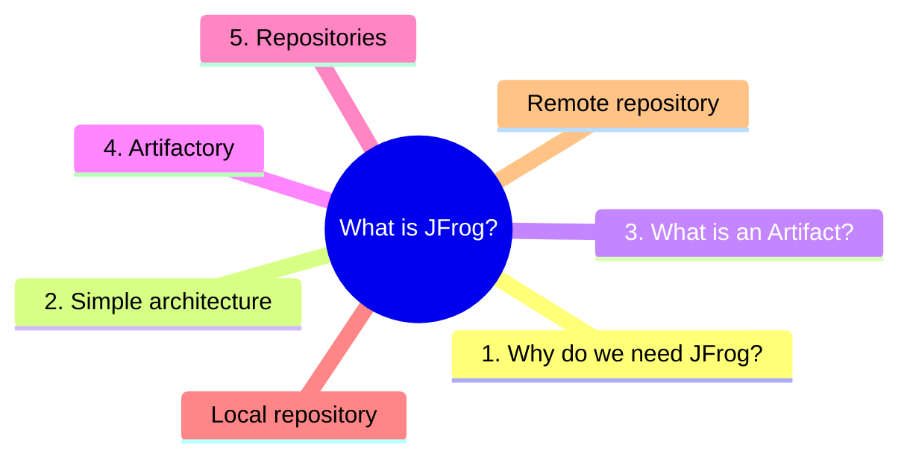

## What is JFrog?

**JFrog** is a platform used to **store, manage, secure, and distribute software packages and artifacts** produced during development.

The most important JFrog product is **JFrog Artifactory**.

Think of it like this:

> **GitHub/GitLab → stores source code**
> **JFrog Artifactory → stores built packages/artifacts**

For example, your application may produce:

- npm packages
- Docker images
- Python packages
- Java `.jar` files
- `.NET` packages
- Helm charts
- Terraform packages
- generic ZIP/TAR files

JFrog Artifactory can act as a central repository for these artifacts.

---

# 1. Why do we need JFrog?



Suppose you have a Node.js application.

Your developer writes:

```text
app.js
package.json
package-lock.json
```

You push the code to GitHub.

Then your CI/CD pipeline runs:

```text
GitHub
   ↓
Jenkins / GitHub Actions
   ↓
npm install
   ↓
npm build
   ↓
Docker build
```

Now you have a Docker image:

```text
my-company/my-app:1.0.0
```

Where do you store this Docker image?

You could use:

- Docker Hub
- AWS ECR
- GitHub Container Registry
- **JFrog Artifactory**

So JFrog can become your organization's **central artifact repository**.

---

# 2. Simple architecture

A common enterprise setup looks like:

```text
Developer
    │
    ▼
GitHub / GitLab
    │
    ▼
CI/CD
Jenkins / GitHub Actions / GitLab CI
    │
    ├───────────────┐
    ▼               ▼
Build            Test
    │
    ▼
JFrog Artifactory
    │
    ├── npm packages
    ├── Docker images
    ├── Maven JARs
    ├── Python packages
    └── other artifacts
    │
    ▼
Deployment
    │
    ├── AWS
    ├── Kubernetes
    └── Servers
```

The important distinction is:

```text
Git repository       → Source code
Artifactory           → Build artifacts
Deployment environment → Running application
```

---

# 3. What is an Artifact?

An **artifact** is basically something produced by your build process that you want to store or distribute.

For example:

### Java

```text
my-app-1.0.0.jar
```

### Node.js

```text
my-library-1.0.0.tgz
```

### Docker

```text
my-app:1.0.0
```

### Python

```text
my_library-1.0.0-py3-none-any.whl
```

### Frontend

```text
dist/
   index.html
   assets/
```

These can all be considered artifacts.

---

# 4. Artifactory

**Artifactory** is the JFrog product you'll hear about most often.

You can think of Artifactory as:

> **A private warehouse for software artifacts.**

For example:

```text
Artifactory
│
├── npm repository
│      ├── company-ui
│      ├── company-auth
│      └── company-utils
│
├── Docker repository
│      ├── user-service
│      ├── payment-service
│      └── order-service
│
├── Maven repository
│      ├── common.jar
│      └── payment.jar
│
└── Python repository
       ├── common-utils
       └── data-utils
```

---

# 5. Repositories

This is one of the most important concepts.

Artifactory repositories generally fall into three important types.

## Local repository

Used to store **your organization's artifacts**.

Example:

```text
company-npm-local
```

You publish:

```text
@company/auth@1.2.0
```

into it.

---

## Remote repository

A remote repository acts as a **proxy/cache** for an external repository.

For example:

```text
Your application
       ↓
Artifactory
       ↓
npmjs.org
```

Instead of every developer directly downloading packages from npm:

```text
Developer 1 ──────→ npmjs
Developer 2 ──────→ npmjs
Developer 3 ──────→ npmjs
```

you can have:

```text
Developer 1 ──┐
Developer 2 ──┼──→ Artifactory ──→ npmjs
Developer 3 ──┘
```

Artifactory can cache packages.

So if 100 developers need:

```text
lodash
```

you don't necessarily need 100 external downloads.

---

# 6. Virtual repository

A virtual repository provides a **single URL** that can combine multiple repositories.

For example:

```text
npm-virtual
     │
     ├── npm-local
     └── npm-remote
```

Your developer only needs:

```text
https://company.jfrog.io/artifactory/api/npm/npm-virtual/
```

Instead of knowing which repository contains the package.

This is very common in enterprise environments.

---

# 7. Example with npm

Suppose your company has a Node.js project.

Normally:

```bash
npm install express
```

downloads from the public npm registry.

With JFrog:

```text
npm
 ↓
Artifactory
 ↓
npm remote repository
 ↓
npmjs
```

Your `.npmrc` might point to your company's Artifactory:

```ini
registry=https://company.jfrog.io/artifactory/api/npm/npm-virtual/
```

Then:

```bash
npm install express
```

actually goes through Artifactory.

---

# 8. Publishing your own package

Suppose you create:

```text
@company/common-utils
```

Version:

```text
1.0.0
```

Your CI pipeline can publish it:

```bash
npm publish
```

to Artifactory.

Then another application can consume it:

```bash
npm install @company/common-utils
```

Architecture:

```text
common-utils project
       │
       ▼
     Build
       │
       ▼
   npm publish
       │
       ▼
JFrog Artifactory
       │
       ▼
Other applications
```

This is particularly useful for **microservices and shared libraries**.

---

# 9. JFrog + Docker

This is another major use case.

Suppose you build:

```bash
docker build -t payment-service:1.0.0 .
```

Then push it to Artifactory:

```text
Docker
   ↓
JFrog Artifactory
   ↓
Docker repository
```

You might have:

```text
docker-local
```

containing:

```text
payment-service:1.0.0
payment-service:1.1.0
order-service:2.0.0
user-service:3.2.1
```

Then Kubernetes or AWS can pull the image.

```text
Developer
   ↓
Git
   ↓
CI/CD
   ↓
Docker Build
   ↓
JFrog
   ↓
Docker Image
   ↓
Kubernetes / AWS
```

---

# 10. JFrog in CI/CD

This is probably the most important concept if you're preparing for DevOps/interviews.

Imagine:

```text
GitHub
   │
   │ push
   ▼
Jenkins
   │
   ├── npm install
   ├── npm test
   ├── npm build
   └── docker build
          │
          ▼
       JFrog
          │
          ▼
      Artifact
          │
          ▼
      Deployment
```

For example:

```text
Git commit
    ↓
Jenkins pipeline
    ↓
Build application
    ↓
Run tests
    ↓
Create artifact
    ↓
Upload to JFrog
    ↓
Security scan
    ↓
Deploy
```

---

# 11. JFrog Xray

Another important JFrog component is **JFrog Xray**.

Artifactory stores your artifacts.

Xray helps with **security and vulnerability analysis**.

For example:

```text
Application
    │
    ├── express
    ├── lodash
    ├── jsonwebtoken
    └── other dependencies
             │
             ▼
          JFrog Xray
             │
             ▼
      Vulnerability detected
```

Suppose your application uses a dependency with a known CVE.

Xray can help identify it.

Conceptually:

```text
Artifactory
     │
     │ artifacts
     ▼
   Xray
     │
     ├── Vulnerabilities
     ├── Licenses
     └── Security policies
```

---

# 12. JFrog Projects

In large organizations, there may be hundreds of teams.

For example:

```text
Company
│
├── Payments
├── Banking
├── Customer
├── Authentication
└── Reporting
```

JFrog Projects can help organize repositories, teams, permissions, and resources around projects.

---

# 13. JFrog CLI

You don't always have to interact with Artifactory through the UI.

JFrog provides a CLI.

For example:

```bash
jf rt upload
```

can upload artifacts.

And:

```bash
jf rt download
```

can download artifacts.

A CI/CD pipeline might therefore do something like:

```bash
jf rt upload "dist/*" my-repo/
```

and later:

```bash
jf rt download my-repo/my-app.zip
```

---

# 14. JFrog vs GitHub

This is a common interview question.

| GitHub               | JFrog                    |
| -------------------- | ------------------------ |
| Source code          | Artifacts                |
| Git repositories     | Artifact repositories    |
| Pull requests        | Artifact management      |
| Code reviews         | Package/image management |
| GitHub Actions       | CI/CD integration        |
| GitHub Packages      | Artifact/package storage |
| Source control focus | Binary/package focus     |

But there is overlap.

GitHub can also store packages and Docker images, while JFrog specializes heavily in **artifact management across many package technologies**.

---

# 15. JFrog vs AWS ECR

For Docker images:

```text
JFrog Artifactory
       vs
AWS ECR
```

Both can store container images.

### AWS ECR

```text
Docker
   ↓
ECR
   ↓
ECS / EKS
```

### JFrog

```text
Docker
   ↓
Artifactory
   ↓
Kubernetes / AWS / Azure / on-prem
```

A major reason enterprises use JFrog is that it can provide a **single artifact platform across multiple technologies and environments**.

---

# 16. The easiest way to remember JFrog

Think about a software company.

```text
                SOFTWARE COMPANY

Developer
    │
    ▼
GitHub
"Here is my source code"
    │
    ▼
CI/CD
"Let's build it"
    │
    ▼
JFrog Artifactory
"Store the build artifacts"
    │
    ▼
JFrog Xray
"Check them for vulnerabilities"
    │
    ▼
AWS / Kubernetes
"Deploy them"
```

### In one sentence:

> **JFrog is a software supply-chain platform, with Artifactory at its core, used to store, manage, secure, and distribute software artifacts.**

---

## What I recommend learning next

Since you're interested in **Node.js, AWS, API/UI testing and CI/CD**, I'd learn JFrog in this order:

```text
1. Artifact
      ↓
2. Artifactory
      ↓
3. Local Repository
      ↓
4. Remote Repository
      ↓
5. Virtual Repository
      ↓
6. npm + JFrog
      ↓
7. Docker + JFrog
      ↓
8. JFrog CLI
      ↓
9. JFrog Xray
      ↓
10. Jenkins/GitHub Actions + JFrog
      ↓
11. AWS + JFrog
      ↓
12. Real CI/CD project
```

If you want, I can next explain **JFrog with a real Node.js + Docker + Jenkins + AWS project**, including the complete flow and commands.
