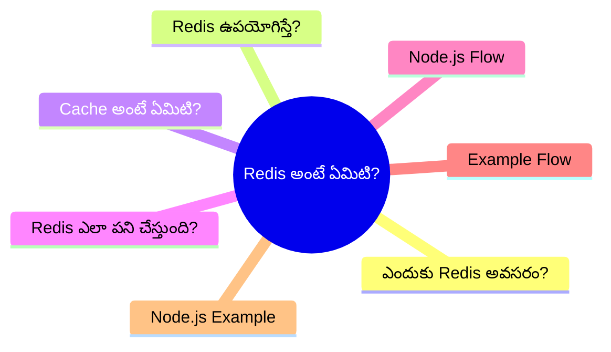

Since you're learning **Node.js, NestJS, AWS Serverless, PostgreSQL, and System Design**, Redis is one of the most important technologies to master. I'll explain it from **beginner to expert level** in Telugu, with a focus on **Node.js applications**.

---

# Redis అంటే ఏమిటి?



**Redis (Remote Dictionary Server)** అనేది ఒక **In-Memory Data Store**.

సాధారణ Database (PostgreSQL, MySQL) లో Data **Disk (SSD/HDD)** లో Store అవుతుంది.

Redis లో Data **RAM (Memory)** లో Store అవుతుంది.

అందుకే Redis చాలా Fast.

```text
PostgreSQL
      │
      ▼
Disk (SSD)
      │
   5-20 ms

Redis
      │
      ▼
RAM
      │
0.1 - 1 ms
```

అందుకే Redis Database కంటే 10 నుంచి 100 రెట్లు వేగంగా ఉంటుంది.

---

# ఎందుకు Redis అవసరం?

ఒక ఉదాహరణ తీసుకుందాం.

మన దగ్గర ఒక API ఉంది.

```http
GET /users/100
```

Flow:

```text
Client
   │
   ▼
Node.js
   │
   ▼
PostgreSQL
   │
   ▼
Return User
```

1000 మంది ఒకేసారి ఈ API ని Call చేస్తే?

ప్రతి Request Database కి వెళ్తుంది.

```text
1000 Requests
      │
      ▼
Database
```

Database మీద భారీ Load పడుతుంది.

---

# Redis ఉపయోగిస్తే?

```text
Client
     │
     ▼
Node.js
     │
     ▼
Redis
     │
     ▼
Found?
 ┌──────┴──────┐
 │             │
Yes            No
 │             │
 ▼             ▼
Return      PostgreSQL
               │
               ▼
          Save in Redis
               │
               ▼
           Return Data
```

దీనిని **Cache Aside Pattern** అంటారు.

---

# Cache అంటే ఏమిటి?

Cache అంటే

**తరచుగా ఉపయోగించే Data ని Fast Memory లో Store చేయడం.**

ఉదాహరణ

```text
User Profile

Roles

Permissions

Product Details

Movie List

Configuration

JWT Session
```

---

# Redis ఎలా పని చేస్తుంది?

Redis ఒక **Key-Value Store**.

ఉదాహరణ

```text
Key

user:101
```

Value

```json
{
  "id": 101,
  "name": "Ravi",
  "age": 30
}
```

Redis లో

```text
user:101

↓

JSON Data
```

---

# Node.js Flow

User API Call చేశాడు.

```http
GET /users/101
```

Node.js

మొదట Redis ని అడుగుతుంది.

```text
Node.js

↓

Redis

↓

user:101
```

ఉంటే

```text
Return Immediately
```

లేకపోతే

```text
Node.js

↓

PostgreSQL

↓

Get Data

↓

Redis Save

↓

Return
```

---

# Example Flow

మొదటి Request

```text
Client

↓

Node.js

↓

Redis

↓

Not Found

↓

Database

↓

Redis Save

↓

Client
```

రెండవ Request

```text
Client

↓

Node.js

↓

Redis

↓

Found

↓

Client
```

Database కి వెళ్లాల్సిన అవసరం లేదు.

---

# Node.js Example

Install

```bash
npm install redis
```

Connect

```javascript
import { createClient } from "redis";

const client = createClient();

await client.connect();
```

Save

```javascript
await client.set("user:101", JSON.stringify(user));
```

Read

```javascript
const data = await client.get("user:101");

const user = JSON.parse(data);
```

Delete

```javascript
await client.del("user:101");
```

---

# TTL అంటే?

TTL

**Time To Live**

ఉదాహరణ

20 Minutes Cache

```javascript
await client.set("user:101", JSON.stringify(user), {
  EX: 1200,
});
```

1200 Seconds తర్వాత

Redis ఆటోమేటిక్‌గా Delete చేస్తుంది.

---

# మీ RBAC Example

మీరు ముందు అడిగిన ప్రశ్న గుర్తుందా?

> ప్రతి API లో Roles & Permissions Database నుండి Fetch చేయకుండా 20 Minutes Cache చేయాలి.

దానికి Redis Perfect Solution.

Flow

```text
User

↓

API Gateway

↓

Lambda

↓

Redis

↓

Roles Found?

     │

 ┌───┴────┐
 │        │
Yes       No
 │        │
 ▼        ▼
Return   PostgreSQL
            │
            ▼
      Save Redis
            │
            ▼
         Return
```

అప్పుడు ప్రతి Request కి Database Hit ఉండదు.

---

# Redis లో ఏమేమి Store చేయవచ్చు?

### 1. User Sessions

```text
session:abc123
```

---

### 2. JWT Blacklist

```text
jwt:blacklist:token
```

---

### 3. OTP

```text
otp:9876543210

↓

948372
```

TTL

```text
5 Minutes
```

---

### 4. API Response

```text
movies:top10
```

---

### 5. Product Details

```text
product:1001
```

---

### 6. Permissions

```text
role:admin
```

---

### 7. Configuration

```text
config:payment
```

---

# Redis Data Types

Redis కేవలం String మాత్రమే కాదు.

చాలా Data Types ఉన్నాయి.

---

## 1. String

```text
name

↓

Ravi
```

---

## 2. Hash

```text
user:101

↓

name

↓

Ravi

age

↓

30
```

Node.js

```javascript
await client.hSet("user:101", {
  name: "Ravi",
  age: 30,
});
```

---

## 3. List

```text
movies

↓

Avatar

↓

Titanic

↓

Batman
```

---

## 4. Set

Duplicate ఉండదు.

```text
roles

↓

Admin

User

Manager
```

---

## 5. Sorted Set

Leaderboard కోసం.

```text
Player

↓

100 Points

↓

Rank
```

Gaming Apps ఎక్కువగా వాడతాయి.

---

## 6. Streams

Event Processing కోసం.

---

# Redis Persistence

Redis RAM లో ఉంటుంది.

Power Off అయితే?

Data పోతుందా?

Redis దగ్గర రెండు Options ఉన్నాయి.

---

## RDB

కొంతకొంత సేపుకి Snapshot తీసుకుంటుంది.

```text
RAM

↓

Dump.rdb
```

---

## AOF

ప్రతి Write ని Log చేస్తుంది.

```text
SET

DEL

HSET

APPEND
```

---

# Redis Pub/Sub

ఉదాహరణ

Chat Application

User A

↓

Message

↓

Redis

↓

Subscribers

↓

User B

↓

User C

↓

User D

```
Publisher
     │
     ▼
Redis Channel
     │
 ┌───┼────┐
 ▼   ▼    ▼
A   B     C
```

---

# Distributed Cache

ఒక Server కాదు.

చాలా Servers.

```text
Node1

Node2

Node3

Node4

↓

Redis Cluster
```

అందరూ అదే Redis ని Use చేస్తారు.

---

# Redis Cluster

```text
          Redis Cluster

      ┌──────────────┐
      │   Master 1   │
      └──────┬───────┘
             │
        Replica 1

      ┌──────────────┐
      │   Master 2   │
      └──────┬───────┘
             │
        Replica 2
```

High Availability కోసం.

---

# AWS లో Redis

AWS లో

Redis Service పేరు

**Amazon ElastiCache for Redis**

Flow

```text
API Gateway

↓

Lambda

↓

Redis (ElastiCache)

↓

PostgreSQL
```

---

# మీ Serverless Application Flow

మీ Architecture కి దగ్గరగా:

```text
Client
   │
   ▼
API Gateway
   │
   ▼
Lambda (Node.js)
   │
   ▼
Redis
   │
Found?
┌─────┴─────┐
│           │
Yes         No
│           │
▼           ▼
Return   PostgreSQL
             │
             ▼
      Save in Redis (TTL 20 min)
             │
             ▼
          Return Response
```

---

# Cache Invalidation

ఇది Redis లో అత్యంత ముఖ్యమైన Topic.

ఉదాహరణ

User పేరు Database లో Update అయింది.

కానీ Redis లో ఇంకా పాత పేరు ఉంది.

Flow

```text
User Update

↓

Database Update

↓

Delete Redis Cache

↓

Next Request

↓

Database

↓

New Cache
```

ఉదాహరణ

```javascript
await updateUser(user);

await client.del(`user:${user.id}`);
```

ఇదే **Cache Invalidation**.

---

# Redis Best Practices

✅ Cache Frequently Used Data మాత్రమే చేయాలి.

✅ TTL తప్పనిసరిగా పెట్టాలి.

✅ Database ను Redis కి Replacement గా ఉపయోగించకూడదు (ప్రత్యేక Use Cases మినహా).

✅ Cache Key Naming Consistent గా ఉండాలి.

ఉదాహరణలు:

```text
user:101

role:admin

permissions:manager

movies:top10

products:iphone16

config:payment

session:abcd1234
```

---

# Interview Questions (Node.js + Redis)

1. Redis అంటే ఏమిటి?
2. Redis ఎందుకు Fast?
3. Cache అంటే ఏమిటి?
4. Cache Aside Pattern అంటే?
5. Write Through Cache అంటే?
6. Write Behind Cache అంటే?
7. TTL అంటే?
8. Redis Data Types ఏమిటి?
9. Pub/Sub ఎలా పని చేస్తుంది?
10. Redis Cluster అంటే?
11. Redis Sentinel అంటే?
12. Redis Persistence అంటే?
13. Cache Invalidation ఎలా చేస్తారు?
14. Redis ను Session Store గా ఎలా ఉపయోగిస్తారు?
15. Redis మరియు PostgreSQL మధ్య తేడా ఏమిటి?
16. AWS ElastiCache అంటే ఏమిటి?
17. Node.js లో Redis Connection Pooling ఎలా నిర్వహిస్తారు?
18. Lambda లో Redis Connections గురించి ఏ జాగ్రత్తలు తీసుకోవాలి?
19. Redis Memory Full అయితే ఏమవుతుంది?
20. Redis Eviction Policies (`allkeys-lru`, `volatile-ttl` మొదలైనవి) ఎలా పనిచేస్తాయి?

---

ఈ Foundation తర్వాత నేర్చుకోవాల్సిన Advanced Topics:

1. **Redis Internal Architecture** (Memory Layout, Event Loop, Single-threaded Design)
2. **Redis Commands** (100+ ముఖ్యమైన Commands)
3. **Redis + Node.js** (Production-grade implementation)
4. **Redis + AWS Lambda** (Connection Reuse, Cold Starts)
5. **Redis Cluster & Sentinel**
6. **Distributed Locking (Redlock)**
7. **Rate Limiting using Redis**
8. **Job Queues (BullMQ/Bull with Redis)**
9. **Pub/Sub vs Streams**
10. **Netflix/Amazon-scale Redis Architecture** (మిలియన్ల Requests ను ఎలా Handle చేస్తారో)
