# Python: Complete Beginner to Advanced Guide

ఈ డాక్యుమెంట్ Python fundamentals, internals, backend development, testing, packaging, performance మరియు production architecture వరకు job/interview-ready roadmapగా organize చేసింది.

> **Learning principle:** Python readability మాత్రమే కాదు; object model, memory model, async model మరియు standard library semantics కూడా strong Python engineerకి అవసరం.

## Python Roadmap


## Python Execution Model

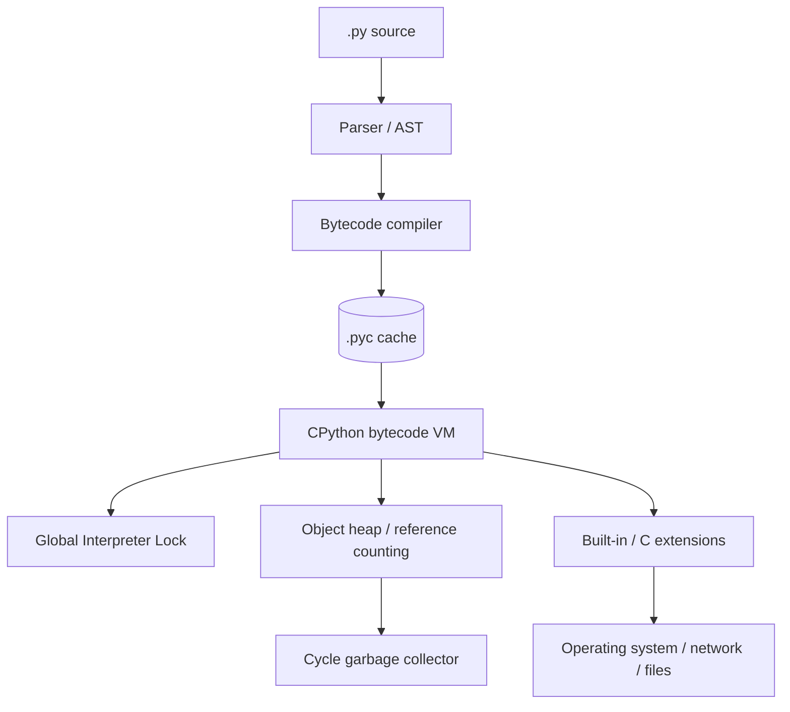

- CPython source converts to bytecode and executes in a virtual machine.
- Reference counting releases many objects immediately; cyclic garbage collection handles unreachable reference cycles.
- GIL generally allows only one thread to execute CPython bytecode at a time, while native I/O/C extensions can release it.
- Use async or threading for I/O waits; multiprocessing or native worker pools for CPU-heavy work.

## Python Project Structure

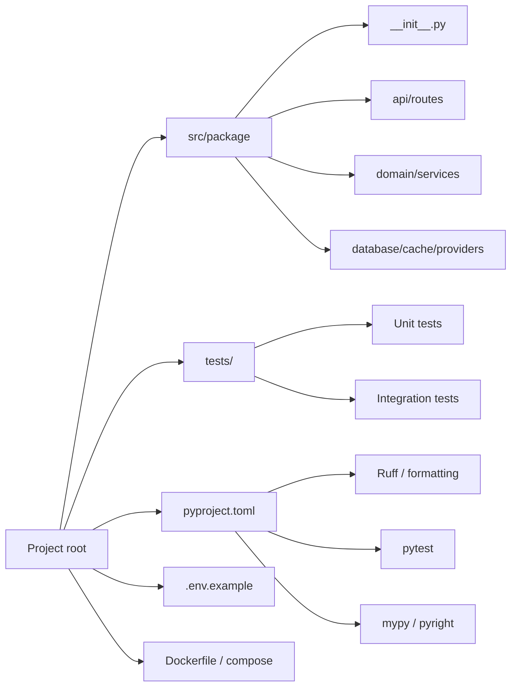

# [1. Python Fundamentals](#1-python-fundamentals-1)

Start here if you're new to Python.

- Python installation & environment setup
- Python syntax
- Variables
- Data types
  - `int`
  - `float`
  - `str`
  - `bool`
  - `None`

- Type conversion
- Operators
- Input/output
- Comments
- `if / elif / else`
- `for` loops
- `while` loops
- `break / continue / pass`
- Functions
- Function arguments
- `*args` and `**kwargs`
- Scope
- Lambda functions

**Practice:** 30–40 small programs.

---

# [2. Python Data Structures](#2-python-data-structures-1)

Master these very well for interviews.

### Lists

```python
numbers = [10, 20, 30, 40]

numbers.append(50)
numbers.pop()
numbers.sort()
```

Learn:

- Indexing
- Slicing
- List methods
- List comprehension
- Nested lists

### Tuples

```python
user = ("John", 25)
```

### Sets

```python
ids = {1, 2, 3, 4}
```

### Dictionaries

```python
user = {
    "name": "John",
    "age": 25
}
```

Learn:

- Dictionary methods
- Nested dictionaries
- Dictionary comprehension

### Important interview topics

- List vs tuple
- List vs set
- Set vs dictionary
- Mutable vs immutable
- Shallow copy vs deep copy

---

# [3. Object-Oriented Programming](#3-object-oriented-programming-1)

This is **very important for Python interviews**.

Learn:

- Classes
- Objects
- `__init__`
- Instance variables
- Class variables
- Instance methods
- Class methods
- Static methods
- Inheritance
- Multiple inheritance
- Encapsulation
- Abstraction
- Polymorphism
- Method overriding
- `super()`
- Magic/dunder methods

Example:

```python
class User:
    def __init__(self, name):
        self.name = name

    def greet(self):
        return f"Hello {self.name}"


user = User("John")

print(user.greet())
```

---

# [4. Intermediate Python](#4-intermediate-python-1)

Now move beyond basic syntax.

### Functions

- First-class functions
- Higher-order functions
- Closures
- Decorators
- Recursion

### Iterators

```python
iter()
next()
```

### Generators

```python
def numbers():
    for i in range(5):
        yield i
```

Learn:

- `yield`
- Generator expressions
- Generator vs list

### Context Managers

```python
with open("file.txt") as file:
    data = file.read()
```

Learn:

- `with`
- `__enter__`
- `__exit__`

---

# [5. Exception Handling](#5-exception-handling-1)

Learn:

```python
try:
    ...
except:
    ...
else:
    ...
finally:
    ...
```

Also:

- Custom exceptions
- `raise`
- Exception hierarchy
- Best practices

Example:

```python
class InvalidAgeError(Exception):
    pass
```

---

# [6. Modules & Packages](#6-modules--packages-1)

Understand how real Python applications are structured.

Learn:

- `import`
- `from ... import`
- Modules
- Packages
- `__init__.py`
- `__name__`
- `__main__`
- Virtual environments
- `pip`
- `requirements.txt`

Then learn:

- `venv`
- `pip`
- `pyproject.toml`

---

# [7. File Handling](#7-file-handling-1)

Learn:

- Reading files
- Writing files
- CSV
- JSON
- YAML
- File paths
- `pathlib`
- Temporary files

Example:

```python
import json

with open("users.json") as file:
    users = json.load(file)
```

---

# [8. Python Standard Library](#8-python-standard-library-1)

You don't need to memorize everything, but become comfortable with:

```text
os
sys
pathlib
datetime
json
csv
math
random
collections
itertools
functools
re
logging
subprocess
threading
multiprocessing
asyncio
```

Especially:

### `collections`

```python
Counter
defaultdict
deque
```

### `functools`

```python
lru_cache
reduce
partial
```

### `itertools`

```python
chain
combinations
permutations
```

---

# [9. Type Hints](#9-type-hints-1)

Modern Python development uses type hints extensively.

Learn:

```python
def add(a: int, b: int) -> int:
    return a + b
```

Then:

- `Optional`
- `Union`
- `Any`
- `Literal`
- `TypeAlias`
- Generics
- `TypedDict`
- `Protocol`

Also learn:

```python
@dataclass
class User:
    name: str
    age: int
```

---

# [10. Testing](#10-testing-1)

Learn testing early.

### pytest

Learn:

- Unit tests
- Fixtures
- Parameterized tests
- Mocking
- Integration tests
- Test coverage

Example:

```python
def test_add():
    assert add(2, 3) == 5
```

---

# [11. Databases](#11-databases-1)

For backend development, learn:

### SQL

- PostgreSQL
- MySQL
- SQLite

Understand:

- SELECT
- INSERT
- UPDATE
- DELETE
- JOIN
- GROUP BY
- Indexes
- Transactions
- Constraints

Then Python database access:

- SQLAlchemy
- Alembic
- ORM concepts

---

# [12. Web Development](#12-web-development-1)

If your goal is **Python backend development**, this is your next major section.

Learn HTTP first:

```text
Client
   ↓
HTTP Request
   ↓
Python Backend
   ↓
Business Logic
   ↓
Database
   ↓
HTTP Response
   ↓
Client
```

Understand:

- HTTP methods
- Headers
- Status codes
- Cookies
- Sessions
- JWT
- REST APIs
- JSON
- Authentication
- Authorization
- CORS

---

# [13. FastAPI](#13-fastapi-1)

For modern Python backend development, learn **FastAPI**.

Topics:

- Routing
- Request/response models
- Pydantic
- Validation
- Dependency injection
- Authentication
- JWT
- Middleware
- Background tasks
- Async endpoints
- OpenAPI/Swagger
- Error handling

Example:

```python
from fastapi import FastAPI

app = FastAPI()

@app.get("/users")
async def get_users():
    return {"users": []}
```

---

# [14. Django](#14-django-1)

After FastAPI, learn Django if you're targeting companies that use Django.

Learn:

- Django project structure
- Apps
- URLs
- Views
- Models
- Templates
- Forms
- Django ORM
- Migrations
- Middleware
- Authentication
- Django REST Framework
- Admin
- Signals
- Caching

**FastAPI vs Django**

| FastAPI                | Django               |
| ---------------------- | -------------------- |
| Lightweight            | Full framework       |
| API-focused            | Full-stack           |
| Async-friendly         | Batteries included   |
| Microservices          | Large applications   |
| Modern API development | Mature web ecosystem |

---

# [15. Async Python](#15-async-python-1)

This is especially important if you're coming from **Node.js**.

Understand:

```text
async
await
coroutines
event loop
tasks
futures
```

Learn:

```python
asyncio
aiohttp
httpx
```

Understand the difference between:

```python
def
```

and

```python
async def
```

Also understand:

- I/O-bound workloads
- CPU-bound workloads
- Async vs threading
- Async vs multiprocessing

---

# [16. Concurrency & Parallelism](#16-concurrency--parallelism-1)

Learn:

### Threading

```python
threading
```

### Multiprocessing

```python
multiprocessing
```

### Async

```python
asyncio
```

Understand:

```text
Concurrency
    ├── AsyncIO
    └── Threads

Parallelism
    └── Multiprocessing
```

Also learn the **GIL (Global Interpreter Lock)**.

---

# [17. Caching & Messaging](#17-caching--messaging-1)

For backend systems:

### Redis

Learn:

- Cache
- TTL
- Pub/Sub
- Distributed locks
- Rate limiting
- Session storage

### Message queues

Learn one or more:

- RabbitMQ
- Kafka
- AWS SQS
- AWS SNS

---

# [18. System Design](#18-system-design-1)

Once you're comfortable with Python backend development, start system design.

Learn:

```text
Load Balancer
      ↓
API Servers
      ↓
Cache
      ↓
Database
      ↓
Message Queue
      ↓
Workers
```

Important topics:

- Scalability
- Load balancing
- Caching
- Database sharding
- Replication
- CAP theorem
- Consistency
- Rate limiting
- Idempotency
- Distributed systems
- Event-driven architecture
- Microservices

---

# [19. Docker & Cloud](#19-docker--cloud-1)

Learn Docker:

```text
Dockerfile
Images
Containers
Volumes
Networks
Docker Compose
```

Then cloud.

Since you're interested in backend/AWS topics, focus on:

- AWS Lambda
- API Gateway
- ECS
- ECR
- S3
- RDS
- DynamoDB
- SQS
- SNS
- EventBridge
- CloudWatch
- IAM

A good architecture to build:

```text
Client
  ↓
API Gateway
  ↓
Lambda / FastAPI
  ↓
Service
  ↓
RDS / DynamoDB
  ↓
SQS
  ↓
Worker
```

---

# [20. DevOps for Python](#20-devops-for-python-1)

Learn:

- Git
- GitHub
- Docker
- CI/CD
- GitHub Actions
- Linux
- Nginx
- Kubernetes basics
- AWS
- Logging
- Monitoring

For production Python:

- `logging`
- Prometheus
- Grafana
- OpenTelemetry
- Sentry

---

# [21. Data Structures & Algorithms](#21-data-structures--algorithms-1)

For interviews, don't skip this.

### Arrays

- Two pointers
- Sliding window
- Prefix sum

### Strings

- Frequency counting
- Palindromes
- Anagrams

### Hashing

- HashMap
- HashSet

### Linked Lists

- Reverse linked list
- Cycle detection

### Stack

- Parentheses
- Monotonic stack

### Queue

- BFS

### Trees

- DFS
- BFS
- Binary search tree

### Graphs

- BFS
- DFS
- Dijkstra
- Topological sort

### Dynamic Programming

Start with:

- Fibonacci
- Climbing stairs
- Knapsack
- Longest common subsequence

---

# [22. Python Interview Preparation](#22-python-interview-preparation-1)

Focus heavily on these:

### Python-specific

1. List vs tuple
2. Mutable vs immutable
3. `is` vs `==`
4. Shallow vs deep copy
5. Decorators
6. Generators
7. Iterators
8. Context managers
9. Lambda
10. `*args` / `**kwargs`
11. GIL
12. Memory management
13. Garbage collection
14. Exception handling
15. AsyncIO
16. Threading vs multiprocessing
17. MRO
18. Magic methods
19. Dataclasses
20. Type hints

### Backend

21. REST API
22. FastAPI
23. Django
24. SQLAlchemy
25. PostgreSQL
26. Redis
27. Authentication
28. JWT
29. Microservices
30. Docker
31. AWS
32. Message queues
33. Caching
34. Rate limiting
35. System design

---

# 🛠️ Projects to Build

Don't learn Python only through tutorials. Build these.

### Project 1 — CLI Application

Build:

**Expense Tracker**

Features:

```text
Add expense
Delete expense
Update expense
List expenses
Search expenses
Export CSV
```

### Project 2 — REST API

Build:

**Task Management API**

```text
POST   /users
POST   /login
GET    /tasks
POST   /tasks
PUT    /tasks/:id
DELETE /tasks/:id
```

Use:

```text
FastAPI
PostgreSQL
SQLAlchemy
JWT
pytest
Docker
```

### Project 3 — Production Backend

Build:

**E-commerce Backend**

```text
Users
Products
Orders
Payments
Inventory
Cart
Authentication
```

Architecture:

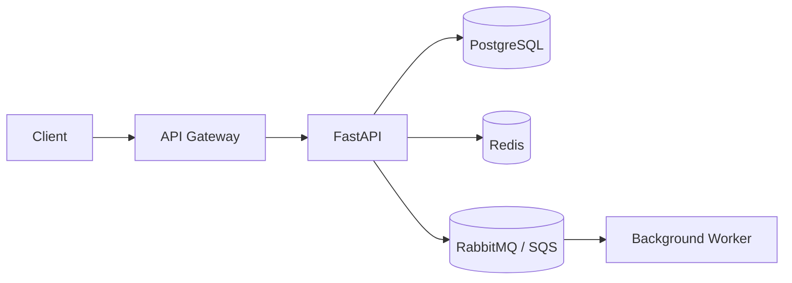

---

# 🎯 Recommended Learning Order

If your goal is **Python Backend Developer**, follow this exact order:

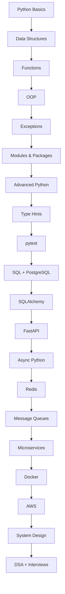

### ⭐ If you're coming from Node.js

You don't need to spend weeks on programming fundamentals. Since the concepts transfer, concentrate on the **Python-specific differences**:

```text
Node.js                  Python
────────────────────────────────────
npm                       pip
package.json              pyproject.toml
Express/NestJS            FastAPI/Django
Promise                   Coroutine
async/await               async/await
Event Loop                asyncio Event Loop
worker_threads            threading
cluster                   multiprocessing
Prisma                    SQLAlchemy
Jest                      pytest
BullMQ                    Celery/RQ
.env                      python-dotenv
```

For your background, I'd recommend **Python → FastAPI → PostgreSQL/SQLAlchemy → AsyncIO → Redis → AWS → Microservices → System Design**, rather than spending too much time on Django initially.

---

# 1. Python Fundamentals

Python ప్రోగ్రామింగ్ ప్రయాణాన్ని ప్రారంభించడానికి **Python Fundamentals** చాలా అద్భుతమైన మొదటి అడుగు! ఈ రోజు మనం ఈ మొదటి జాబితాలోని అంశాలను తెలుగులో చాలా సులభంగా తెలుసుకుందాం.

---

## 1. Python Installation & Environment Setup (పైథాన్ ఇన్‌స్టాలేషన్)

పైథాన్ కోడ్ రాయడానికి మరియు రన్ చేయడానికి మన కంప్యూటర్‌లో పైథాన్ సాఫ్ట్‌వేర్ ఉండాలి.

- **ఇన్‌స్టాల్ చేయడం ఎలా?**

1. అధికారిక వెబ్‌సైట్ [python.org](https://www.python.org) నుండి మీ ఆపరేటింగ్ సిస్టమ్ (Windows/Mac/Linux)కి తగిన లేటెస్ట్ పైథాన్ వెర్షన్‌ను డౌన్‌లోడ్ చేసుకోండి.
2. ఇన్‌స్టాల్ చేసేటప్పుడు **"Add Python to PATH"** అనే బాక్స్‌ను కచ్చితంగా సెలెక్ట్ చేయండి.

- **కోడ్ ఎక్కడ రాయాలి?**
- పైథాన్ ఇన్‌స్టాల్ అయిన తర్వాత వచ్చే **IDLE** లేదా **VS Code**, **PyCharm** వంటి కోడ్ ఎడిటర్లను ఉపయోగించి మీరు పైథాన్ ప్రోగ్రామ్స్ రాయవచ్చు.

---

## 2. Python Syntax (పైథాన్ సింటాక్స్)

సింటాక్స్ అంటే కంప్యూటర్‌కు అర్థమయ్యేలా కోడ్ రాయడానికి ఉండే నియమాలు (Rules). పైథాన్ చాలా సులభమైన సింటాకో కలిగి ఉంటుంది. ఇంగ్లీష్ భాషలాగే ఇది చదవడానికి సులభంగా ఉంటుంది.

- పైథాన్‌లో పెద్దగా సెమికోలన్లు (`;`) లేదా కర్లీ బ్రేసెస్ (`{}`) అవసరం లేదు.
- ఇది **ਇੰਡੈਂటేషన్ (Indentation)** అనగా ఖాళీ స్థలాలను (Spaces) కచ్చితంగా పాటిస్తుంది.

---

## 3. Variables (వేరియబుల్స్)

వేరియబుల్స్ అంటే డేటాను లేదా విలువలను (Values) దాచుకునే పెట్టెలు (Containers) లాంటివి.

**ఉదాహరణ:**

```python
name = "Raju"
age = 25

```

ఇక్కడ `name` మరియు `age` అనేవి వేరియబుల్స్. వీటిలో `"Raju"`, `25` అనే విలువలు నిల్వ చేయబడ్డాయి.

---

## 4. Data Types (డేటా రకాలు)

మనం వేరియబుల్స్‌లో నిల్వ చేసే డేటా ఏ రకానికి చెందినదో చెప్పేవే Data Types. పైథాన్‌లో ప్రధానమైన డేటా రకాలు ఇక్కడ ఉన్నాయి:

### I. int (ఇంటిజర్)

ఇది ఎలాంటి దశాంశాలు (Decimals) లేని పూర్ణ సంఖ్యలను (Whole numbers) సూచిస్తుంది.

```python
x = 10
y = -5

```

### II. float (ఫ్లోట్)

ఇది దశాంశ బిందువు (Decimal point) ఉన్న సంఖ్యలను సూచిస్తుంది.

```python
pi = 3.14
price = 99.50

```

### III. str (స్ట్రింగ్)

ఇది అక్షరాలు, పదాలు లేదా వాక్యాలను సూచిస్తుంది. వీటిని ఎల్లప్పుడూ సింగిల్ కోట్స్ (`'`) లేదా డబుల్ కోట్స్ (`"`) లో రాయాలి.

```python
message = "నమస్తే ఆంధ్రప్రదేశ్"
city = "Hyderabad"

```

### IV. bool (బూలియన్)

ఇది కేవలం రెండు విలువలను మాత్రమే కలిగి ఉంటుంది: **True** (నిజం) లేదా **False** (అబద్ధం). ఇవి షరతులను (Conditions) చెక్ చేయడానికి వాడతారు.

- ఉదాహరణకు: `is_raining = False`

### V. None (నన్)

`None` అంటే ఏ విలువ లేదు (No value లేదా Null) అని అర్థం. ఒక వేరియబుల్‌కు ప్రస్తుతానికి ఎలాంటి విలువ ఇవ్వనప్పుడు దీనిని వాడతారు.

- ఉదాహరణకు: `result = None`

---

> 💡 **చిన్న ప్రాక్టీస్ టాస్క్:**
> మీ పేరును ఒక వేరియబుల్‌లో, మీ వయస్సును మరో వేరియబుల్‌లో నిల్వ చేసి, వాటి డేటా టైప్స్ ఏంటో `type()` ఫంక్షన్ ఉపయోగించి చెక్ చేయండి!
> (ఉదాహరణకు: `print(type(age))`)

---

పైథాన్ లెర్నింగ్ ప్రయాణంలో తదుపరి అద్భుతమైన టాపిక్స్ ఇక్కడ ఉన్నాయి. వీటిని చాలా సులభంగా తెలుగులో ఉదాహరణలతో సహా తెలుసుకుందాం!

---

## 1. Type Conversion (టైప్ కన్వర్షన్)

ఒక డేటా రకాన్ని (Data Type) మరో డేటా రకంగా మార్చడాన్ని టైప్ కన్వర్షన్ అంటారు. పైథాన్‌లో ఇది రెండు రకాలు:

- **Implicit Conversion:** పైథానే స్వయంగా అవసరాన్ని బట్టి మారుస్తుంది (ఉదాహరణకు: ఇంటిజర్ మరియు ఫ్లోట్ కలిపితే ఫలితం ఫ్లోట్ వస్తుంది).
- **Explicit Conversion:** మనమే బలవంతంగా ఫంక్షన్స్ ఉపయోగించి మారుస్తాం.
- `int()` - స్ట్రింగ్ లేదా ఫ్లోట్‌ను ఇంటిజర్‌గా మారుస్తుంది.
- `float()` - సంఖ్యలను ఫ్లోట్‌గా మారుస్తుంది.
- `str()` - సంఖ్యలను స్ట్రింగ్‌గా మారుస్తుంది.

**ఉదాహరణ:**

```python
age_str = "25"          # ఇది స్ట్రింగ్
age_int = int(age_str)  # ఇది ఇంటిజర్‌గా మారింది
print(type(age_int))    # అవుట్‌పుట్: <class 'int'>

```

---

## 2. Operators (ఆపరేటర్స్)

ఆపరేటర్స్ అనేవి వేరియబుల్స్ మరియు విలువలతో కొన్ని లెక్కలు లేదా ఆపరేషన్స్ చేయడానికి వాడతారు. ప్రధాన రకాలు:

- **Arithmetic Operators (గణిత ఆపరేటర్స్):** `+` (Addition), `-` (Subtraction), `*` (Multiplication), `/` (Division), `%` (Modulus - శేషం ఇస్తుంది), `**` (Exponent - ఘాతాంకం).
- **Comparison Operators (పోలిక ఆపరేటర్స్):** `==` (సమానం), `!=` (సమానం కాదు), `>`, `<`, `>=`, `<=`
- **Logical Operators (లాజికల్ ఆపరేటర్స్):** `and`, `or`, `not`

**ఉదాహరణ:**

```python
x = 10
y = 3
print(x % y)   # అవుట్‌పుట్: 1 (శేషం)
print(x > y)   # అవుట్‌పుట్: True

```

---

## 3. Input / Output (ఇన్‌పుట్ / అవుట్‌పుట్)

ప్రోగ్రామ్‌కు యూజర్ ద్వారా సమాచారాన్ని అందించడానికి మరియు ఫలితాన్ని స్క్రీన్‌పై చూపించడానికి ఇవి వాడతారు.

- **Output (`print()`):** ఫలితాన్ని స్క్రీన్‌పై చూపించడానికి వాడతారు.
- **Input (`input()`):** యూజర్ నుండి కీబోర్డ్ ద్వారా డేటాను తీసుకోవడానికి వాడతారు (ఇది డిఫాల్ట్‌గా స్ట్రింగ్‌ను తీసుకుంటుంది).

**ఉదాహరణ:**

```python
name = input("మీ పేరు రాయండి: ")
print("నమస్తే, " + name)

```

---

## 4. Comments (కామెంట్స్)

ప్రోగ్రామ్‌లో కోడ్ ఏం చేస్తుందో వివరించడానికి లేదా కొన్ని లైన్లను తాత్కాలికంగా రన్ అవకుండా ఆపడానికి కామెంట్స్ వాడతారు. పైథాన్ వీటిని పట్టించుకోదు (రన్ చేయదు).

- సింగిల్ లైన్ కామెంట్ కోసం `#` వాడతారు.

**ఉదాహరణ:**

```python
# ఇది ఒక సాదా కామెంట్
print("হ্যালো Python") # ప్రింట్ స్టేట్‌మెంట్

```

---

## 5. if / elif / else (కండిషనల్ స్టేట్‌మెంట్స్)

ప్రోగ్రామ్‌లో షరతులు (Conditions) ఆధారంగా నిర్ణయాలు తీసుకోవడానికి ఇవి సహాయపడతాయి.

- **if:** మొదటి షరతు సరిచూడటానికి.
- **elif:** మొదటి షరతు కాకపోతే మరో షరతు చెక్ చేయడానికి (Else If).
- **else:** ఏ షరతు నిజం కాకపోతే చివరిగా ఇది పనిచేస్తుంది.

**ఉదాహరణ:**

```python
marks = 85

if marks >= 90:
    print("గ్రేడ్ A")
elif marks >= 75:
    print("గ్రేడ్ B")
else:
    print("పాస్ అయ్యారు")

```

---

## 6. for loops (ఫర్ లూప్)

ఒకే పనిని పదే పదే (Repeat) చేయడానికి లేదా లిస్టులు, స్ట్రింగ్స్‌లోని ప్రతి అంశాన్ని (Items) ఒక్కొక్కటిగా పరిశీలించడానికి లూప్స్ వాడతారు.

**ఉదాహరణ:**

```python
# 1 నుండి 5 వరకు ప్రింట్ చేయడానికి
for i in range(1, 6):
    print(i)

```

---

పైథాన్ లెర్నింగ్ ప్రయాణంలో తదుపరి అత్యంత ముఖ్యమైన మరియు అడ్వాన్స్‌డ్ టాపిక్స్ ఇక్కడ ఉన్నాయి. వీటిని చాలా సులభంగా ఉదాహరణలతో తెలుసుకుందాం!

---

## 1. while loops (వైల్ లూప్)

ఒక నిర్దిష్ట షరతు (**Condition**) **True** ఉన్నంత వరకు కోడ్‌ను పదే పదే రన్ చేస్తూనే ఉండటానికి వైల్ లూప్ వాడతారు. షరతు ఎప్పుడైతే **False** అవుతుందో, లూప్ ఆగిపోతుంది.

**ఉదాహరణ:**

```python
count = 1
while count <= 3:
    print(count)
    count = count + 1  # ప్రతిసారీ కౌంట్ పెరుగుతుంది
# అవుట్‌పుట్: 1, 2, 3

```

---

## 2. break / continue / pass (కంట్రోల్ స్టేట్‌మెంట్స్)

లూప్‌ల ప్రవర్తనను నియంత్రించడానికి ఇవి వాడతారు:

- **break:** లూప్ షరతుతో సంబంధం లేకుండా లూప్‌ను పూర్తిగా మధ్యలోనే ఆపేస్తుంది (బయటకు వచ్చేస్తుంది).
- **continue:** ప్రస్తుత ఇటరేషన్ (Iteration)ను మాత్రమే ఆపి, తదుపరి రౌండ్‌కి (Next iteration) వెళ్తుంది.
- **pass:** ఇది ఒక నల్ స్టేట్‌మెంట్ (Null statement). కోడ్ రాయాల్సిన చోట ప్రస్తుతానికి ఏమీ రాయకుండా వదిలేయడానికి ఇది వాడతారు (ఎర్రర్ రాకుండా ఉంటుంది).

**ఉదాహరణ:**

```python
for i in range(1, 5):
    if i == 3:
        break  # i విలువ 3 అయితే లూప్ ఆగిపోతుంది
    print(i)
# అవుట్‌పుట్: 1, 2

```

---

## 3. Functions (ఫంక్షన్స్)

ఒక నిర్దిష్ట పనిని చేయడానికి రాసుకున్న కోడ్ బ్లాక్‌ను **Function** అంటారు. దీనివల్ల ఒకే కోడ్‌ను বারবার (Repeatedly) రాయాల్సిన అవసరం లేకుండా, ఎప్పుడైనా కాల్ (Call) చేసి వాడొచ్చు. `def` అనే కీవర్డ్‌తో ఫంక్షన్‌ను ప్రారంభిస్తాం.

**ఉదాహరణ:**

```python
def greet(name):
    print("నమస్తే, " + name)

greet("Raju")  # ఫంక్షన్‌ను పిలవడం

```

---

## 4. Function Arguments (ఫంక్షన్ ఆర్గ్యూమెంట్స్)

మనం ఫంక్షన్‌కు పంపే విలువలను **Arguments** లేదా **Parameters** అంటారు. ఫంక్షన్ లోపల లెక్కలు చేయడానికి ఇవి ఉపయోగపడతాయి. డిఫాల్ట్ ఆర్గ్యూమెంట్స్ (Default arguments) కూడా వాడవచ్చు.

**ఉదాహరణ:**

```python
def add(a, b):  # a, b లు ఆర్గ్యూమెంట్స్
    return a + b

result = add(5, 3)
print(result)  # అవుట్‌పుట్: 8

```

---

## 5. \*args and kwargs (ఆర్గ్స్ మరియు కెవార్గ్స్)

ఫంక్షన్‌కు ఎన్ని ఆర్గ్యూమెంట్స్ పంపాలో ముందే తెలియనప్పుడు వీటిని వాడతారు:

- **`*args` (Arguments):** ఇది బహుళ సాధారణ విలువలను **Tuple** రూపంలో తీసుకుంటుంది.
- **`**kwargs` (Keyword Arguments):** ఇది కీ-వాల్యూ జంటలను (Key-value pairs) **Dictionary\*\* రూపంలో తీసుకుంటుంది.

**ఉదాహరణ:**

```python
def display(*args, **kwargs):
    print("Args:", args)
    print("Kwargs:", kwargs)

display(1, 2, 3, name="Raju", age=25)

```

---

## 6. Scope (స్కోప్)

ఒక వేరియబుల్ ఎక్కడెక్కడ అందుబాటులో ఉంటుందో చెప్పేదే **Scope**. ఇది రెండు రకాలు:

- **Local Scope:** ఫంక్షన్ లోపల డిక్లేర్ చేసిన వేరియబుల్స్, ఆ ఫంక్షన్ బయట పనిచేయవు.
- **Global Scope:** ప్రోగ్రామ్ మొత్తానికి బయట డిక్లేర్ చేస్తే, ఎక్కడైనా వాడొచ్చు.

**ఉదాహరణ:**

```python
x = 10  # Global Variable

def my_func():
    y = 5  # Local Variable
    print(x)  # పని చేస్తుంది

my_func()

```

---

## 7. Lambda Functions (లాండా ఫంక్షన్స్)

పేరు లేని చిన్న చిన్న సింగిల్-లైన్ ఫంక్షన్లను **Lambda Functions** అంటారు. వీటిని `lambda` కీవర్డ్ ఉపయోగಿಸಿ క్షణాల్లో రాసుకోవచ్చు.

**ఉదాహరణ:**

```python
# రెండు సంఖ్యలను గుణించడానికి లాండా ఫంక్షన్
multiply = lambda a, b: a * b
print(multiply(4, 5))  # అవుట్‌పుట్: 20

```

---

# 2. Python Data Structures

పైథాన్ ఇంటర్వ్యూలలో అత్యంత కీలకమైన భాగం **Python Data Structures**. ఈ రోజు మనం లిస్ట్స్, ట్యూపుల్స్, సెట్స్ మరియు డిక్షనరీల గురించి చాలా స్పష్టంగా ఉదాహరణలతో తెలుగులో తెలుసుకుందాం!

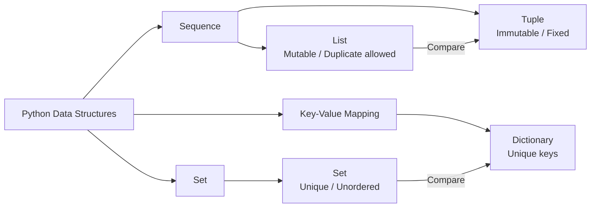

---

## 1. Lists (లిస్ట్స్)

లిస్ట్ అనేది బహుళ విలువలను (Multiple values) ఒకే వేరియబుల్‌లో నిల్వ చేయడానికి వాడతారు. ఇది మ్యూటబుల్ (Mutable), అంటే దీనిలోని విలువలను మనం మార్చవచ్చు (Modify).

- **ఇండెక్సింగ్ (Indexing):** లిస్ట్‌లోని ప్రతి అంశానికి ఒక స్థాన సంఖ్య (Index) ఉంటుంది. పైథాన్‌లో ఇండెక్స్ ఎల్లప్పుడూ **0** తో మొదలవుతుంది.

```python
numbers = [10, 20, 30, 40]
print(numbers[0])  # అవుట్‌పుట్: 10
print(numbers[-1]) # అవుట్‌పుట్: 40 (చివరి అంశం)

```

- **స్లైసింగ్ (Slicing):** లిస్ట్ నుండి ఒక నిర్దిష్ట భాగాన్ని (Sub-list) కట్ చేసి తీసుకోవడానికి ఇది వాడతారు.

```python
numbers = [10, 20, 30, 40, 50]
print(numbers[1:4])  # అవుట్‌పుట్: [20, 30, 40]

```

- **లిస్ట్ మెథడ్స్ (List Methods):**
- `append(val)` - చివర కొత్త విలువను చేరుస్తుంది.
- `pop()` - చివరి విలువను తొలగిస్తుంది.
- `sort()` - ఆరోహణ క్రమంలో (Ascending order) అమరుస్తుంది.
- `insert()`, `remove()`, `reverse()` వంటివి కూడా ఉంటాయి.

- **లిస్ట్ కాంప్రహెన్షన్ (List Comprehension):** తక్కువ కోడ్‌లో కొత్త లిస్ట్‌ను త్వరగా సృష్టించడానికి ఇది అద్భుతమైన మార్గం.

```python
squares = [x**2 for x in range(1, 5)]
print(squares)  # అవుట్‌పుట్: [1, 4, 9, 16]

```

- **నెస్డెడ్ లిస్ట్స్ (Nested Lists):** ఒక లిస్ట్ లోపల మరో లిస్ట్ ఉండటాన్ని నెస్డెడ్ లిస్ట్ అంటారు.

```python
matrix = [[1, 2], [3, 4]]
print(matrix[0][1])  # అవుట్‌పుట్: 2

```

---

## 2. Tuples (ట్యూపుల్స్)

ట్యూపుల్ కూడా లిస్ట్ లాగే ఉంటుంది, కానీ తేడా ఏమిటంటే ఇది **ఇమ్మ్యూటబుల్ (Immutable)**. అనగా ట్యూపుల్ క్రియേట్ చేశాక దానిలోని విలువలను మార్చడం, కొత్తవి కలపడం కుదరదు. వీటిని సాధారణంగా రౌండ్ బ్రాకెట్స్ `()` లో రాస్తారు.

```python
user = ("John", 25)
print(user[0])  # అవుట్‌పుట్: John
# user[1] = 30  -> ఇది ఎర్రర్ ఇస్తుంది, ఎందుకంటే ట్యూపుల్ మారదు.

```

---

## 3. Sets (సెట్స్)

సెట్ అనేది అనూహ్యమైన (Unordered) మరియు డూప్లికేట్ విలువలను అనుమతించని (No duplicates) డేటా స్ట్రక్చర్. వీటిని కర్లీ బ్రాకెట్స్ `{}` లో రాస్తారు. మ్యాథ్స్ లోని సెట్స్ లాగే యూనియన్, ఇంటర్సెక్షన్ వంటి ఆపరేషన్స్ చేయవచ్చు.

```python
ids = {1, 2, 3, 4, 2, 1}
print(ids)  # అవుట్‌పుట్: {1, 2, 3, 4} (డూప్లికేట్స్ తొలగించబడతాయి)

ids.add(5)    # కొత్త విలువను కలపడానికి
ids.remove(3) # విలువను తొలగించడానికి

```

---

## 4. Dictionaries (డిక్షనరీలు)

డిక్షనరీ అనేది కీ-వాల్యూ జంటల (Key-Value pairs) రూపంలో డేటాను నిల్వ చేయడానికి వాడతారు. ఇందులో కీ (Key) యూనిక్‌గా ఉండాలి.

```python
user = {
    "name": "John",
    "age": 25,
    "city": "Hyderabad"
}
print(user["name"])  # అవుట్‌పుట్: John

```

- **డిక్షనరీ మెథడ్స్ (Dictionary Methods):**
- `keys()` - అన్ని కీలను ఇస్తుంది.
- `values()` - అన్ని విలువలను ఇస్తుంది.
- `get("key")`- కీకి సంబంధించిన విలువను ఇస్తుంది (కీ లేకపోతే ఎర్రర్ రాకుండా None ఇస్తుంది).
- `update()` - కొత్త డేటాను జత చేస్తుంది.

- **నెస్డెడ్ డిక్షనరీలు (Nested Dictionaries):** ఒక డిక్షనరీ లోపల మరో డిక్షనరీ ఉండటం.

```python
students = {
    "student1": {"name": "Raju", "marks": 85},
    "student2": {"name": "Rani", "marks": 90}
}
print(students["student1"]["name"])  # అవుట్‌పుట్: Raju

```

- **డిక్షనరీ కాంప్రహెన్షన్ (Dictionary Comprehension):** తక్కువ కోడ్‌తో డిక్షనరీలను త్వరగా సృష్టించడానికి ఇది వాడతారు.

```python
sq_dict = {x: x**2 for x in range(1, 4)}
print(sq_dict)  # అవుట్‌పుట్: {1: 1, 2: 4, 3: 9}

```

---

## Important interview topics

పైథాన్ ఇంటర్వ్యూలలో మిమ్మల్ని దాదాపుగా అడిగే అత్యంత ముఖ్యమైన **ఇంటర్వ్యూ టాపిక్స్ (Important Interview Topics)** ఇవి. వీటి మధ్య తేడాలను చాలా స్పష్టంగా, క్షుణ్ణంగా తెలుసుకుందాం!

---

## 1. List vs Tuple (లిస్ట్ మరియు ట్యూపుల్ మధ్య తేడా)

| అంశం (Feature)               | List (లిస్ట్)                                                                   | Tuple (ట్యూపుల్)                                        |
| ---------------------------- | ------------------------------------------------------------------------------- | ------------------------------------------------------- |
| **మ్యూటబిలిటీ (Mutability)** | **Mutable:** దీన్ని సృష్టించిన తర్వాత మార్చవచ్చు (మార్పులు, చేర్పులు చేయవచ్చు). | **Immutable:** దీన్ని సృష్టించిన తర్వాత మార్చడం కుదరదు. |
| **సింటాక్స్ (Syntax)**       | చతురస్రాకార బ్రాకెట్లు `[]` ఉపయోగిస్తారు.                                       | రౌండ్ బ్రాకెట్లు `()` ఉపయోగిస్తారు.                     |
| **మెమరీ (Memory)**           | ఎక్కువ మెమరీని తీసుకుంటుంది.                                                    | తక్కువ మెమరీని తీసుకుంటుంది (ఫాస్ట్‌గా ఉంటుంది).        |
| **ఎప్పుడు వాడాలి?**          | డేటా మారుతూ ఉండే సందర్భాల్లో.                                                   | డేటా స్థిరంగా (Fixed) ఉండాల్సిన సందర్భాల్లో.            |

```python
# List (మార్చవచ్చు)
my_list = [1, 2, 3]
my_list[0] = 10  # ఇది పనిచేస్తుంది

# Tuple (మార్చలేము)
my_tuple = (1, 2, 3)
# my_tuple[0] = 10  # ఇది ఎర్రర్ ఇస్తుంది

```

---

## 2. List vs Set (లిస్ట్ మరియు సెట్ మధ్య తేడా)

| అంశం (Feature)                | List (లిస్ట్)                                 | Set (సెట్)                                                              |
| ----------------------------- | --------------------------------------------- | ----------------------------------------------------------------------- |
| **క్రమం (Order)**             | ఇది ఆర్డర్‌ను గుర్తుపెట్టుకుంటుంది (Ordered). | ఇది ఆర్డర్‌ను గుర్తుపెట్టుకోదు (Unordered).                             |
| **డూప్లికేట్స్ (Duplicates)** | డూప్లికేట్ విలువలను అనుమతిస్తుంది.            | డూప్లికేట్ విలువలను అస్సలు అనుమతించదు (యూనిక్ వాల్యూస్ మాత్రమే ఉంటాయి). |
| **ఇండెక్సింగ్ (Indexing)**    | ఇండెక్సింగ్ మరియు స్లైసింగ్ సాధ్యమవుతాయి.     | ఇండెక్సింగ్ మరియు స్లైసింగ్ సాధ్యం కాదు.                                |
| **డేటా స్ట్రక్చర్**           | సాధారణ డేటా నిల్వ చేయడానికి.                  | మ్యాథమెటికల్ ఆపరేషన్స్ (Union, Intersection) చేయడానికి.                 |

```python
# List allows duplicates
my_list = [1, 2, 2, 3]  # అవుట్‌పుట్: [1, 2, 2, 3]

# Set removes duplicates
my_set = {1, 2, 2, 3}   # అవుట్‌పుట్: {1, 2, 3}

```

---

## 3. Set vs Dictionary (సెట్ మరియు డిక్షనరీ మధ్య తేడా)

| అంశం (Feature)             | Set (సెట్)                                       | Dictionary (డిక్షనరీ)                                     |
| -------------------------- | ------------------------------------------------ | --------------------------------------------------------- |
| **నిల్వ విధానం (Storage)** | కేవలం సింగిల్ విలువలను (Values) నిల్వ చేస్తుంది. | కీ-వాల్యూ జంటలను (Key-Value pairs) నిల్వ చేస్తుంది.       |
| **సింటాక్స్ (Syntax)**     | `{1, 2, 3}`                                      | `{"name": "John", "age": 25}`                             |
| **ఉపయోగం (Usage)**         | యూనిక్ డేటా కోసం, మ్యాథ్స్ సెట్ ఆపరేషన్స్ కోసం.  | ఒక నిర్దిష్ట కీ ద్వారా వేగంగా డేటాను వెతకడానికి (Lookup). |

---

## 4. Mutable vs Immutable (మ్యూటబుల్ మరియు ఇమ్మ్యూటబుల్)

ఇది ఇంటర్వ్యూలో ఎక్కువగా అడిగే ప్రాథమిక ప్రశ్న:

- **Mutable (మ్యూటబుల్):** ఒక ఆబ్జెక్ట్‌ను సృష్టించిన తర్వాత, దాని మెమరీ లొకేషన్ మార్చకుండానే దానిలోని విలువలను మనం మార్చగలిగితే దానిని Mutable అంటారు.
- _ఉదాహరణలు:_ List, Dictionary, Set.

- **Immutable (ఇమ్మ్యూటబుల్):** ఒక ఆబ్జెక్ట్‌ను సృష్టించిన తర్వాత, దాని విలువలను మార్చడం కుదరదు. ఒకవేళ మారుస్తే, అది కొత్త మెమరీ లొకేషన్‌లో స్టோர் అవుతుంది.
- _ఉదాహరణలు:_ int, float, str, tuple, bool.

---

## 5. Shallow Copy vs Deep Copy (షాలో కాపీ మరియు డీప్ కాపీ)

ఒక లిస్ట్ లేదా డిక్షనరీని మరో వేరియబుల్‌లోకి కాపీ చేసేటప్పుడు ఈ రెండు పద్ధతులు వాడతారు:

- **Shallow Copy (షాలో కాపీ):** ఇది అసలు ఆబ్జెక్ట్‌కి ఒక పైపైన కాపీని సృష్టిస్తుంది. అంటే మెయిన్ లిస్ట్ మారుతుంది కానీ, ఆ లిస్ట్ లోపల ఉండే నెస్డెడ్ లిస్ట్స్ (Nested lists) మారవు - రెండింటిలోనూ ఒకే మెమరీ అడ్రస్ షేర్ అవుతుంది. `copy()` మెథడ్ ద్వారా ఇది జరుగుతుంది.
- **Deep Copy (డీప్ కాపీ):** ఇది అసలు ఆబ్జెక్ట్‌కి మరియు దాని లోపల ఉన్న ప్రతి సబ్-ఆబ్జెక్ట్‌కి పూర్తిగా కొత్త కాపీలను (Independent copies) సృష్టిస్తుంది. మెయిన్ లిస్ట్‌లో మార్పు చేసినా, నెస్డెడ్ లిస్ట్‌లో మార్పు చేసినా కాపీ అయిన దానిపై ఎలాంటి ప్రభావం పడదు. దీనికోసం `copy` మోడ్యూల్‌లోని `deepcopy()` వాడాలి.

**ఉదాహరణ:**

```python
import copy

original = [[1, 2], [3, 4]]
# Deep copy
deep_copied = copy.deepcopy(original)

# ఇప్పుడు deep_copied లో మార్పులు చేస్తే original మారదు.

```

---

# 3. Object-Oriented Programming

పైథాన్ ఇంటర్వ్యూలలో అత్యంత ప్రాధాన్యత ఉన్న మరియు ప్రాజెక్ట్ డెవలప్‌మెంట్‌లో ఉపయోగపడే **Object-Oriented Programming (OOPs)** భావనలను ఈ రోజు క్షుణ్ణంగా, సులభమైన తెలుగులో తెలుసుకుందాం!

---

## 1. Classes & Objects (క్లాసెస్ మరియు ఆబ్జెక్ట్స్)

- **Class (క్లాస్):** ఆబ్జెక్ట్ ఎలా ఉండాలో తయారుచేసే ఒక **బ్లూప్రింట్ (Blueprint)** లేదా డిజైన్.
- **Object (ఆబ్జెక్ట్):** ఆ బ్లూప్రింట్ ఆధారంగా సృష్టించబడిన ఒక నిజమైన ఉనికి (Real-world entity).

> **ఉదాహరణ:** ఇల్లు కట్టడానికి వేసే _ప్లాన్_ క్లాస్ అయితే, ఆ ప్లాన్ ప్రకారం నిర్మించిన _ఇల్లు_ ఆబ్జెక్ట్ అవుతుంది.

---

## 2. `__init__` & Variables (వేరియబుల్స్)

- **`__init__` Method:** దీనిని **కన్‌స్ట్రక్టర్ (Constructor)** అంటారు. మనం ఆబ్జెక్ట్‌ను క్రియేట్ చేసిన వెంటనే ఇది ఆటోమేటిక్‌గా రన్ అవుతుంది.
- **Instance Variables:** ప్రతి ఆబ్జెక్ట్‌కి ప్రత్యేకంగా ఉండే డేటా. ఇవి `self` ద్వారా డిక్లేర్ అవుతాయి.
- **Class Variables:** క్లాస్ ద్వారా తయారైన అన్ని ఆబ్జెక్ట్స్‌కి ఒకేలా షేర్ అయ్యే డేటా.

```python
class Student:
    school_name = "ABC School"  # Class Variable (అందరికీ ఒకటే)

    def __init__(self, name, age):
        self.name = name  # Instance Variable (ఒక్కొక్కరికి వేరు)
        self.age = age    # Instance Variable

```

---

## 3. Methods (మెథడ్స్ రకాలు)

1. **Instance Method:** సాధారణ మెథడ్. ఇది ఆబ్జెక్ట్ యొక్క ఇన్స్టాన్స్ వేరియబుల్స్‌ని ఉపయోగించుకుంటుంది. దీనికి మొదటి ఆర్గ్యూమెంట్‌గా `self` ఉంటుంది.
2. **Class Method:** క్లాస్ వేరియబుల్స్‌తో పనిచేస్తుంది. దీని పైన `@classmethod` డెకరేటర్ వాడతారు. మొదటి ఆర్గ్యూమెంట్‌గా `cls` ఉంటుంది.
3. **Static Method:** క్లాస్ లేదా ఇన్స్టాన్స్ వేరియబుల్స్‌తో సంబంధం లేకుండా స్వతంత్రంగా పనిచేసే హెల్పర్ ఫంక్షన్. దీని పైన `@staticmethod` వాడతారు.

---

## 4. OOPs 4 Pillars (నాలుగు ప్రధాన స్తంభాలు)

```mermaid
mindmap
  root((OOP))
    Inheritance
      Parent to Child
      Code reuse
      super()
      Method overriding
    Encapsulation
      Data hiding
      Private variables
      Getter and setter
    Abstraction
      Hide implementation
      ABC class
      Abstract methods
    Polymorphism
      Same interface
      Different behavior
```

### I. Inheritance (ఇన్‌హెరిటెన్స్)

ఒక క్లాస్ (Parent Class) లోని ప్రాపర్టీస్ మరియు మెథడ్స్‌ను మరొక క్లాస్ (Child Class) స్వాధీనం చేసుకోవడాన్ని ఇన్‌హెరిటెన్స్ అంటారు.

- **Multiple Inheritance:** ఒక చైల్డ్ క్లాస్ ఒకేసారి ఒకటి కంటే ఎక్కువ పేరెంట్ క్లాసెస్ నుండి ప్రాపర్టీస్‌ను పొందడం.

### II. Encapsulation (ఎన్‌క్యాప్సులేషన్)

డేటాను (Variables) మరియు దానిపై పనిచేసే మెథడ్స్‌ను ఒకే యూనిట్‌గా (Class) చుట్టడం మరియు బయటి వ్యక్తులు నేరుగా డేటాను మార్చకుండా నియంత్రించడం.

- **Private Variables:** వేరియబుల్ పేరు ముందు రెండు అండర్‌స్కోర్లు `__` పెడితే అది ప్రైవేట్ అవుతుంది (ఉదా: `self.__salary`).

### III. Abstraction (అబ్‌స్ట్రాక్షన్)

అనవసరమైన లోపలి వివరాలను దాచిపెట్టి, యూజర్‌కు కేవలం అవసరమైన ఫీచర్లను మాత్రమే చూపించడం.

- పైథాన్‌లో దీనికోసం `abc` మోడ్యూల్ నుండి `ABC` మరియు `@abstractmethod` వాడతారు.

### IV. Polymorphism & Method Overriding

- **Polymorphism (పాలిమారఫిజమ్):** ఒకే పేరుతో ఉన్న మెథడ్ వేర్వేరు ఆబ్జెక్ట్స్‌లో వేర్వేరుగా ప్రవర్తించడం.
- **Method Overriding:** పేరెంట్ క్లాస్‌లో ఉన్న మెథడ్‌ను చైల్డ్ క్లాస్‌లో మన అవసరానికి తగినట్లుగా మళ్లీ తిరగరాయడం (Redefine).

---

## 5. `super()` & Dunder Methods

- **`super()`:** చైల్డ్ క్లాస్ నుండి పేరెంట్ క్లాస్ యొక్క మెథడ్స్ లేదా కన్‌స్ట్రక్టర్‌ను పిలవడానికి `super()` ఉపయోగిస్తారు.
- **Magic/Dunder Methods:** రెండు అండర్‌స్కోర్‌లతో ప్రారంభమై అంతమయ్యే ప్రత్యేక ఫంక్షన్లు (ఉదా: `__init__`, `__str__`, `__len__`).
- `__str__`: ఆబ్జెక్ట్‌ను ప్రింట్ చేసినప్పుడు సులభంగా అర్థమయ్యేలా అవుట్‌పుట్ ఇవ్వడానికి వాడతారు.

---

## సంపూర్ణ కోడింగ్ ఉదాహరణ (All-in-One Example)

```python
from abc import ABC, abstractmethod

# 1. Abstraction (Abstract Class)
class Employee(ABC):
    company = "Tech Corp"  # Class Variable

    def __init__(self, name, salary):
        self.name = name          # Instance Variable
        self.__salary = salary    # Encapsulation (Private Variable)

    # Private variable పొందేందుకు Getter method
    def get_salary(self):
        return self.__salary

    @abstractmethod
    def work(self):
        pass  # Abstract method

    # Dunder Method
    def __str__(self):
        return f"Employee: {self.name}"

# 2. Inheritance & Method Overriding
class Developer(Employee):
    def __init__(self, name, salary, tech_stack):
        super().__init__(name, salary)  # calling Parent constructor using super()
        self.tech_stack = tech_stack

    # Method Overriding & Polymorphism
    def work(self):
        return f"{self.name} is coding in {self.tech_stack}."

# ఆబ్జెక్ట్ సృష్టించడం (Object Creation)
dev = Developer("Raju", 70000, "Python")

print(dev)                     # Dunder Method __str__ రన్ అవుతుంది -> Employee: Raju
print(dev.work())              # Polymorphism -> Raju is coding in Python.
print(dev.get_salary())        # Encapsulation -> 70000

```

# 4. Intermediate Python

---

## 1. First-Class Functions (ఫస్ట్-క్లాస్ ఫంక్షన్స్)

పైథాన్‌లో ఫంక్షన్‌లను ఒక సాధారణ డేటా లేదా ఆబ్జెక్ట్ లాగే పరిగణిస్తారు. అందుకే వీటిని **First-Class Functions** అంటారు. దీని అర్థం:

- ఫంక్షన్‌ను ఒక వేరియబుల్‌కు అసైన్ చేయవచ్చు.
- ఫంక్షన్‌ను మరొక ఫంక్షన్‌కు ఆర్గ్యూమెంట్‌గా పంపవచ్చు.
- ఒక ఫంక్షన్ నుండి మరో ఫంక్షన్‌ను రిటర్న్ చేయవచ్చు.

**ఉదాహరణ:**

```python
def say_hello(name):
    return "Hello " + name

# ఫంక్షన్‌ను వేరియబుల్‌కు అసైన్ చేయడం
greet = say_hello
print(greet("Raju"))  # అవుట్‌పుట్: Hello Raju

```

---

## 2. Higher-Order Functions (హైయర్-ఆర్డర్ ఫంక్షన్స్)

ఏదైనా ఒక ఫంక్షన్.. మరో ఫంక్షన్‌ను ఆర్గ్యూమెంట్‌గా తీసుకున్నా లేదా ఫంక్షన్‌ను రిటర్న్ చేసినా దానిని **Higher-Order Function** అంటారు. (ఉదాహరణకు: పైథాన్‌లో ఉండే `map()`, `filter()`, `reduce()` వంటివి).

**ఉదాహరణ:**

```python
def apply_operation(func, value):
    return func(value)

square = lambda x: x * x
print(apply_operation(square, 5))  # అవుట్‌పుట్: 25

```

---

## 3. Closures (క్లోజర్స్)

ఒక నెస్టెడ్ ఫంక్షన్ (Inner function), దాని బయట ఉన్న ఔటర్ ఫంక్షన్ (Outer function) ఎగ్జిక్యూషన్ పూర్తయి మెమరీ నుండి తొలగిపోయినప్పటికీ, ఆ ఔటర్ ఫంక్షన్‌లోని వేరియబుల్స్ విలువలను గుర్తుపెట్టుకుని ఉపయోగించుకోగలగడాన్ని **Closure** అంటారు.

**ఉదాహరణ:**

```python
def outer_func(msg):
    message = msg

    def inner_func():
        print("Message is:", message)

    return inner_func

my_func = outer_func("Hello Python")
my_func()  # అవుట్‌పుట్: Message is: Hello Python (ఔటర్ ఫంక్షన్ ఆగిపోయినా పనవుతుంది)

```

---

## 4. Decorators (డెకరేటర్స్)

ఉన్న ఒక ఫంక్షన్ యొక్క కోడ్‌ను మార్చకుండా, దాని పనితీరును (Behavior) అదనపు ఫీచర్లతో మార్చడానికి లేదా విస్తరించడానికి **Decorators** వాడతారు. దీనికోసం `@` సింబల్ ఉపయోగిస్తారు.

**ఉదాహరణ:**

```python
def my_decorator(func):
    def wrapper():
        print("ఫంక్షన్ రన్ అవ్వడానికి ముందు జరిగే పని...")
        func()
        print("ఫంక్షన్ రన్ అయిన తర్వాత జరిగే పని...")
    return wrapper

@my_decorator
def say_hi():
    print("హాయ్ రాజ్!")

say_hi()

```

---

## 5. Recursion (రికరుషన్)

ఒక ఫంక్షన్ దానిని తానే నేరుగా లేదా పరోక్షంగా మళ్లీ పిలుచుకోవడాన్ని **Recursion** అంటారు. దీనిని రాసేటప్పుడు లూప్ ఎక్కడ ఆగాలో చెప్పడానికి ఒక బేస్ కండిషన్ (Base condition) కచ్చితంగా రాయాలి.

**ఉదాహరణ (Factorial కనుగొనడానికి):**

```python
def factorial(n):
    if n == 1:  # Base condition
        return 1
    return n * factorial(n - 1)

print(factorial(5))  # అవుట్‌పుట్: 120 (5 * 4 * 3 * 2 * 1)

```

---

## 6. Iterators, `iter()` & `next()` (ఇటరేటర్స్)

ఇటరేటర్ అనేది ఒక ఆబ్జెక్ట్, ఇది ఒకేసారి ఒక విలువను చొప్పున లిస్ట్ లేదా స్ట్రింగ్ నుండి డేటాను బయటకు తీసుకురావడానికి (Traverse) సహాయపడుతుంది.

- `iter()` - ఇచ్చిన కలెక్షన్ (List/Tuple) నుండి ఇటరేటర్ ఆబ్జెక్ట్‌ను సృష్టిస్తుంది.
- `next()` - ఇటరేటర్ నుండి తదుపరి (Next) విలువను ఒక్కొక్కటిగా బయటకు తీస్తుంది.

**ఉదాహరణ:**

```python
numbers = [10, 20, 30]

# ఇటరేటర్‌గా మార్చడం
my_iterator = iter(numbers)

print(next(my_iterator))  # అవుట్‌పుట్: 10
print(next(my_iterator))  # అవుట్‌పుట్: 20
print(next(my_iterator))  # అవుట్‌పుట్: 30

```

---

పైథాన్ ఇంటర్వ్యూలలో మరియు పెద్ద ప్రాజెక్ట్‌లలో మెమరీ ఆప్టిమైజేషన్ కోసం వాడే అత్యంత శక్తివంతమైన రెండు కాన్సెప్ట్స్ **Generators** మరియు **Context Managers**. వీటిని చాలా సులభంగా తెలుగులో ఉదాహరణలతో తెలుసుకుందాం!

---

## 1. Generators (జెనరేటర్స్)

సాధారణ ఫంక్షన్లు `return` కీవర్డ్ ద్వారా ఒకేసారి మొత్తం ఫలితాన్ని ఇస్తాయి. కానీ **Generators** అనేవి `yield` కీవర్డ్ ద్వారా డేటాను ఒక్కొక్కటిగా (On-the-fly) ఇస్తాయి.

- **`yield`:** ఇది ఫంక్షన్‌ను పూర్తిగా ఆపేయదు; ప్రస్తుత విలువను ఇచ్చి (Pause) ఆగిపోతుంది. మళ్లీ `next()` లేదా లూప్ ద్వారా పిలిచినప్పుడు అక్కడి నుంచే రన్ అవ్వడం మొదలుపెడుతుంది.
- **Generator Expressions:** లిస్ట్ కాంప్రహెన్షన్ లాగే కనిపిస్తుంది కానీ చతురస్రాకార బ్రాకెట్లకు బదులుగా రౌండ్ బ్రాకెట్లు `()` ఉపయోగిస్తారు. ఇది మెమరీని చాలా సేవ్ చేస్తుంది.

### Generator vs List (జెనరేటర్ మరియు లిస్ట్ మధ్య తేడా)

| అంశం (Feature)     | List (లిస్ట్)                                                  | Generator (జెనరేటర్)                                                 |
| ------------------ | -------------------------------------------------------------- | -------------------------------------------------------------------- |
| **మెమరీ (Memory)** | మొత్తం డేటాను ఒకేసారి మెమరీలో స్టోర్ చేస్తుంది (ఎక్కువ మెమరీ). | ఒక్కొక్క విలువను అవసరమైనప్పుడు మాత్రమే ఇస్తుంది (చాలా తక్కువ మెమరీ). |
| **స్పీడ్ (Speed)** | పెద్ద డేటా ఉంటే స్లో అవ్వవచ్చు.                                | పెద్ద డేటాతో కూడా చాలా ఫాస్ట్‌గా పనిచేస్తుంది.                       |
| **సింటాక్స్**      | `[x for x in range(10)]`                                       | `(x for x in range(10))`                                             |

**ఉదాహరణ:**

```python
def my_generator():
    yield 1
    yield 2
    yield 3

gen = my_generator()
print(next(gen))  # అవుట్‌పుట్: 1
print(next(gen))  # అవుట్‌పుట్: 2

```

---

## 2. Context Managers (కాంటెక్స్ట్ మేనేజర్స్)

మనం ఫైల్స్ ఓపెన్ చేసినప్పుడు లేదా డేటాబేస్ కనెక్షన్ తీసుకున్నప్పుడు, పని పూర్తయిన తర్వాత వాటిని సరిగ్గా క్లోజ్ (Close) చేయడం చాలా ముఖ్యం. లేకపోతే మెమరీ లీక్ అవ్వవచ్చు. దీనిని సులభంగా నిర్వహించడానికి **Context Managers** వాడతారు.

- **`with` statement:** ఇది రిసోర్సెస్‌ని ఆటోమేటిక్‌గా మేనేజ్ చేస్తుంది. ఫైల్ ఓపెన్ అయ్యాక పని పూర్తయినా లేదా ఎర్రర్ వచ్చినా, దానంతట అదే ఫైల్‌ను క్లోజ్ చేస్తుంది.
- **`__enter__` & `__exit__`:** మనం స్వయంగా ఒక కస్టమ్ కాంటెక్స్ట్ మేనేజర్‌ను క్లాస్ రూపంలో తయారు చేయాలనుకున్నప్పుడు ఈ మ్యాజిక్ మెథడ్స్ వాడతాం:
- `__enter__`: కోడ్ బ్లాక్ ప్రారంభమయ్యే ముందు ఏది జరగాలో ఇది చూస్తుంది (రిసోర్స్‌ను ఇస్తుంది).
- `__exit__`: కోడ్ బ్లాక్ ముగిసిన తర్వాత క్లీన్-అప్ పనిని (ఉదాహరణకు ఫైల్ క్లోజ్ చేయడం) చేస్తుంది.

**ఉదాహరణ (with స్టేట్‌మెంట్ వాడకం):**

```python
# ఫైల్ ఆటోమేటిక్‌గా ఓపెన్ అవుతుంది, చదివిన తర్వాత క్లోజ్ అవుతుంది
with open("file.txt", "w") as file:
    file.write("నమస్తే పైథాన్!")

```

**ఉదాహరణ (కస్టమ్ కాంటెక్స్ట్ మేనేజర్ - Class రూపంలో):**

```python
class ManagedFile:
    def __init__(self, filename):
        self.filename = filename

    def __enter__(self):
        print("ఫైల్ ఓపెన్ చేయబడింది...")
        self.file = open(self.filename, 'w')
        return self.file

    def __exit__(self, exc_type, exc_val, exc_tb):
        print("ఫైల్ క్లోజ్ చేయబడింది...")
        self.file.close()

# దీనిని వాడే విధానం:
with ManagedFile("test.txt") as f:
    f.write("హలో వరల్డ్!")

```

---

# 5. Exception Handling

పైథాన్ ప్రోగ్రామింగ్‌లో ఎర్రర్‌లను (Errors) సరిగ్గా నిర్వహించడానికి మరియు ప్రోగ్రామ్ మధ్యలో క్రాష్ అవకుండా ఆపడానికి ఉపయోగపడే అత్యంత కీలకమైన అంశం **Exception Handling**. దీనిని తెలుగులో ఉదాహరణలతో చాలా స్పష్టంగా తెలుసుకుందాం!

---

## 1. Try / Except / Else / Finally (ఎక్సెప్షన్ హ్యాండ్లింగ్ బ్లాక్స్)

ప్రోగ్రామ్ రన్ అవుతున్నప్పుడు ఎర్రర్ వచ్చే అవకాశం ఉన్న కోడ్‌ను హ్యాండ్ చేయడానికి ఇవి వాడతారు:

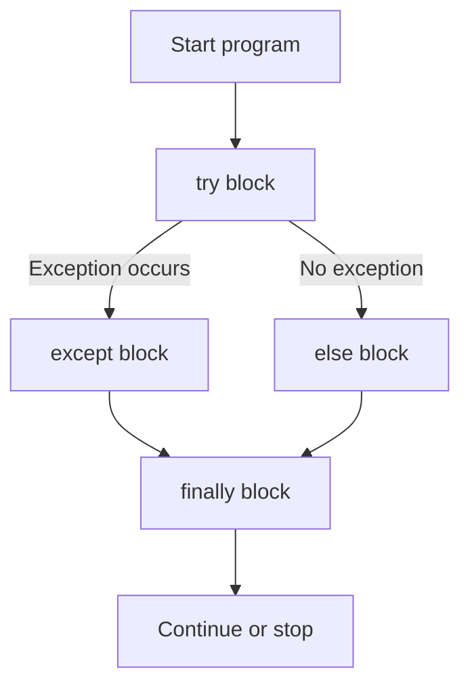

- **`try`:** ఎర్రర్ రావచ్చని అనుమానించే కోడ్‌ను ఇందులో రాస్తాం.
- **`except`:** `try` బ్లాక్‌లో ఎర్రర్ వస్తే, ఈ బ్లాక్ రన్ అయ్యి ప్రోగ్రామ్‌ను కాపాడుతుంది.
- **`else`:** `try` బ్లాక్‌లో ఎలాంటి ఎర్రర్ రాకపోతే, ఈ బ్లాక్ రన్ అవుతుంది.
- **`finally`:** ఎర్రర్ వచ్చినా రాకపోయినా, ప్రోగ్రామ్ ముగిసే ముందు ఈ బ్లాక్ ఖచ్చితంగా రన్ అవుతుంది (ఉదాహరణకు ఫైల్స్ క్లోజ్ చేయడానికి).

**ఉదాహరణ:**

```python
try:
    x = 10 / 0  # జీరోతో భాగించడం సాధ్యం కాదు, కాబట్టి ఎర్రర్ వస్తుంది
except ZeroDivisionError:
    print("హెచ్చరిక: సున్నా(0)తో భాగించడం కుదరదు!")
else:
    print("ఎర్రర్ ఏమీ రాలేదు.")
finally:
    print("ఈ బ్లాక్ ఎప్పటికీ రన్ అవుతుంది.")

```

---

## 2. Raise & Custom Exceptions (రైజ్ మరియు కస్టమ్ ఎక్సెప్షన్స్)

మన స్వంత అవసరాలకు తగినట్లుగా ఎర్రర్ సందేశాలను సృష్టించుకోవడానికి ఇవి వాడతారు:

- **`raise`:** కావాలనే ఒక ఎర్రర్‌ను బయటకు తీసుకురావడానికి (Trigger చేయడానికి) ఇది వాడతారు.
- **Custom Exceptions:** పైథాన్‌లో ఉండే సాధారణ ఎర్రర్స్ కాకుండా, మన ప్రాజెక్ట్‌కి సరిపోయేలా ప్రత్యేకమైన ఎర్రర్ క్లాస్‌ను సృష్టించవచ్చు. దీనికోసం అంతర్లీనంగా ఉన్న `Exception` క్లాస్‌ను ఇన్హెరిట్ (Inherit) చేసుకోవాలి.

**ఉదాహరణ:**

```python
# కస్టమ్ ఎక్సెప్షన్ సృష్టించడం
class InvalidAgeError(Exception):
    pass

def verify_age(age):
    if age < 18:
        raise InvalidAgeError("వయస్సు 18 కంటే తక్కువ ఉంది, అనుమతి లేదు!")
    print("అనుమతి ఇవ్వబడింది.")

try:
    verify_age(15)
except InvalidAgeError as e:
    print("కస్టమ్ ఎర్రర్ వచ్చింది:", e)

```

---

## 3. Exception Hierarchy (ఎక్సెప్షన్ హైరార్కీ)

పైథాన్‌లో అన్ని ఎర్రర్‌లు ఒక క్రమపద్ధతిలో (Hierarchy) ఉంటాయి:

- **`BaseException`** (అన్నింటికంటే పైది)
- **`Exception`** (మనం సాధారణంగా హ్యాండ్ చేసే అన్ని రన్-టైమ్ ఎర్రర్స్ దీని కిందకే వస్తాయి)
- `ArithmeticError` (ఉదా: `ZeroDivisionError`)
- `LookupError` (ఉదా: `IndexError`, `KeyError`)
- `TypeError`, `ValueError`, మొదలైనవి.

---

## 4. Best Practices (ఉత్తమ పద్ధతులు)

ఎక్సెప్షన్ హ్యాండ్లింగ్ రాసేటప్పుడు పాటించవలసిన కొన్ని ముఖ్యమైన నియమాలు:

1. **నిర్దిష్టమైన ఎర్రర్‌ను మాత్రమే హ్యాండ్ చేయండి:** కేవలం `except:` అని రాయకుండా, కచ్చితంగా ఏ ఎర్రర్ రావచ్చునో (`except ValueError:`) స్పష్టంగా రాయాలి.
2. **అవసరమైన చోటే వాడండి:** ప్రతి చిన్న కోడ్‌కి ట్రై-ఎక్సెప్షన్ వాడితే కోడ్ వేగం తగ్గిపోతుంది.
3. **`finally` ని క్లీన్-అప్ కోసం వాడండి:** ఫైల్స్ క్లోజ్ చేయడం లేదా డేటాబేస్ కనెక్షన్ కట్ చేయడం వంటి పనులకు `finally` ఉత్తమమైనది.

---

# 6. Modules & Packages

పైథాన్‌లో పెద్ద పెద్ద రియల్-వరల్డ్ ప్రాజెక్ట్‌లను ఎలా నిర్మించాలి, కోడ్‌ను వేర్వేరు ఫైల్స్‌లో ఎలా నిర్వహించాలి, మరియు డిపెండెన్సీలను ఎలా మేనేజ్ చేయాలో తెలిపే అత్యంత కీలకమైన అంశం **Modules & Packages**. వీటిని తెలుగులో సులభంగా తెలుసుకుందాం!

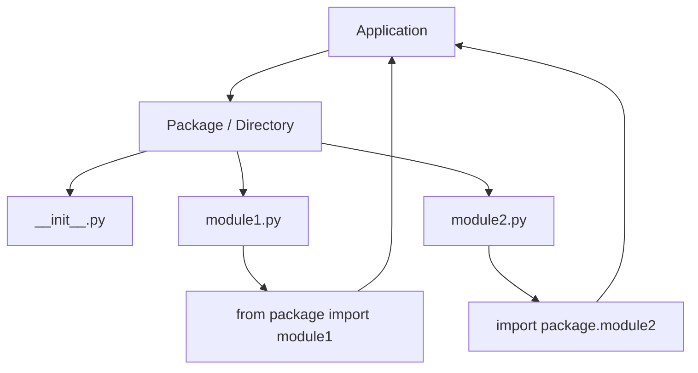

---

## 1. Modules, Packages & Import (మోడ్యూల్స్, ప్యాకేజెస్ మరియు ఇంపોર્ટ)

- **Module (మోడ్యూల్):** పైథాన్ కోడ్ ఉన్న ఒక సాధారణ `.py` ఫైల్ (ఉదాహరణకు: `math.py` లేదా `utils.py`). ఇందులో వేరియబుల్స్, ఫంక్షన్స్ మరియు క్లాసెస్ ఉండవచ్చు.
- **Package (ప్యాకేజీ):** అనేక మోడ్యూల్స్ ఉన్న ఒక ఫోల్డర్ లేదా డైరెక్టరీ. ఈ ఫోల్డర్ లోపల ఖచ్చితంగా ఒక ప్రత్యేకమైన ఫైల్ ఉండాలి, అదే `__init__.py`.
- **`__init__.py`:** ఒక ఫోల్డర్‌ను పైథాన్ ప్యాకేజీగా గుర్తించడానికి ఈ ఫైల్ సహాయపడుతుంది (పైథాన్ 3.3 తర్వాత ఇది లేకపోయినా పనిచేస్తుంది, కానీ స్టాండర్డ్ పద్ధతిలో ఇది వాడతారు).
- **Import & From:**
- `import math` - ఒక మోడ్యూల్ మొత్తాన్ని ఇంపోర్ట్ చేయడానికి.
- `from math import sqrt` - మోడ్యూల్ నుండి కేవలం ఒక నిర్దిష్ట ఫంక్షన్‌ను మాత్రమే ఇంపోర్ట్ చేయడానికి.

**ఉదాహరణ:**

```python
# math_utils.py అనే మోడ్యూల్ నుండి ఫంక్షన్‌ను ఇంపోర్ట్ చేయడం
from math_utils import add_numbers
print(add_numbers(5, 10))

```

---

## 2. `__name__` & `__main__` (మెయిన్ ఎగ్జిక్యూషన్)

పైథాన్ ఫైల్ రన్ అయినప్పుడు, ఆ ఫైల్ నేరుగా రన్ అవుతుందా లేదా మరొక ఫైల్ నుండి ఇంపోర్ట్ చేయబడిందా అని తెలుసుకోవడానికి ఇది ఉపయోగపడుతుంది.

- ఒక ఫైల్‌ను నేరుగా రన్ చేస్తే, పైథాన్ ఆటోమేటిక్‌గా `__name__` విలువను `__main__` గా సెట్ చేస్తుంది.

**ఉదాహరణ:**

```python
def main():
    print("ఈ ప్రోగ్రామ్ నేరుగా రన్ చేయబడింది.")

if __name__ == "__main__":
    main()

```

---

## 3. Virtual Environments (వర్చువల్ ఎన్విరాన్‌మెంట్స్)

ఒకే కంప్యూటర్‌లో వేర్వేరు ప్రాజెక్ట్‌లు పనిచేస్తున్నప్పుడు, ఒక ప్రాజెక్ట్‌కి ఒక లైబ్రరీ వెర్షన్ అవసరం కావచ్చు, మరొకదానికి వేరే వెర్షన్ అవసరం కావచ్చు. ఇలాంటి గందరగోళం రాకుండా ప్రతి ప్రాజెక్ట్‌కి ఒక ప్రత్యేకమైన **Virtual Environment** (ఒంటరి వాతావరణం) సృష్టిస్తారు.

- **venv సృష్టించడం (Windows):**

```bash
python -m venv myenv

```

- **ਐਕਟੀਵੇట్ చేయడం (Activate):**

```bash
myenv\Scripts\activate

```

---

## 4. Pip & Requirements.txt (పిప్ మరియు రిక్వైర్మెంట్స్)

- **`pip`:** పైథాన్ ప్యాకేజీలను ఇన్‌స్టాల్ చేయడానికి, అప్‌డేట్ చేయడానికి మరియు తొలగించడానికి వాడే ప్యాకేజీ మేనేజర్ (ఉదాహరణకు: `pip install requests`).
- **`requirements.txt`:** మీ ప్రాజెక్ట్‌కి ఏయే లైబ్రరీలు (Packages) కావాలో వాటి జాబితాను ఈ ఫైల్‌లో సేవ్ చేస్తారు. దీనివల్ల వేరే వాళ్ళు మీ కోడ్‌ని రన్ చేసినప్పుడు ఒక్క కమాండ్‌తో అన్నింటిని ఇన్‌స్టాల్ చేసుకోవచ్చు.
- లిస్ట్ సేవ్ చేయడానికి: `pip freeze > requirements.txt`
- ఇన్‌స్టాల్ చేయడానికి: `pip install -r requirements.txt`

---

## 5. pyproject.toml (పైప్రాజెక్ట్ డాట్ టోమ్ఎల్)

ఇది ఆధునిక పైథాన్ ప్రాజెక్ట్‌లలో వాడే కాన్ఫిగరేషన్ ఫైల్. పాత పద్ధతిలో ఉన్న `setup.py` స్థానంలో ప్రస్తుతం ప్రాజెక్ట్ వివరాలు, డిపెండెన్సీలు మరియు బిల్డ్ సిస్టమ్‌ను నిర్వచించడానికి **`pyproject.toml`** ని ప్రామాణికంగా వాడుతున్నారు.

---

# 7. File Handling

పైథాన్ ప్రోగ్రామింగ్‌లో డేటాను ఫైల్స్‌లో భద్రపరచడానికి, చదవడానికి మరియు వివిధ రకాల ఫార్మాట్లలో (CSV, JSON, YAML) డేటాను హ్యాండ్ చేయడానికి ఉపయోగపడే అత్యంత కీలకమైన అంశం **File Handling**. దీనిని తెలుగులో ఉదాహరణలతో సులభంగా తెలుసుకుందాం!

---

## 1. Reading & Writing Files (ఫైల్స్ చదవడం మరియు రాయడం)

పైథాన్‌లో ఫైల్స్‌తో పనిచేయడానికి `open()` ఫంక్షన్ వాడతావు.

- మోడ్స్ (Modes):
- `'r'` - ఫైల్ చదవడానికి (Read)
- `'w'` - ఫైల్ రాయడానికి (Write - పాత డేటా ఉంటే పోయి కొత్తది చేరుతుంది)
- `'a'` - అపెండ్ చేయడానికి (Append - పాత డేటాతో పాటు కొత్త డేటా చివర చేరుతుంది)

**ఉదాహరణ (ఫైల్ రాయడం & చదవడం):**

```python
# ఫైల్‌లో రాయడం
with open("data.txt", "w", encoding="utf-8") as f:
    f.write("నమస్తే పైథాన్!\nఇది ఫైల్ హ్యాండ్లింగ్.")

# ఫైల్ చదవడం
with open("data.txt", "r", encoding="utf-8") as f:
    content = f.read()
    print(content)

```

---

## 2. CSV Files (సి.ఎస్.వి ఫైల్స్)

Comma-Separated Values (CSV) ఫైల్స్‌ని ఎక్సెల్ డేటా లేదా పట్టికల రూపంలో ఉన్న డేటాను సేవ్ చేయడానికి వాడతారు. పైథాన్‌లో దీనికోసం ప్రత్యేకంగా `csv` మోడ్యూల్ ఉంటుంది.

**ఉదాహరణ:**

```python
import csv

# CSV ఫైల్‌లో రాయడం
with open("users.csv", "w", newline="", encoding="utf-8") as f:
    writer = csv.writer(f)
    writer.writerow(["Name", "Age"])
    writer.writerow(["Raju", 25])

# CSV ఫైల్ చదవడం
with open("users.csv", "r", encoding="utf-8") as f:
    reader = csv.reader(f)
    for row in reader:
        print(row)

```

---

## 3. JSON Files (జెసాన్ ఫైల్స్)

JavaScript Object Notation (JSON) అనేది వెబ్ అప్లికేషన్లలో డేటాను మార్పిడి చేయడానికి (Data Interchange) అత్యధికంగా వాడే ఫార్మాట్. పైథాన్ డిక్షనరీలను పోలి ఉంటుంది. దీనికోసం `json` మోడ్యూల్ వాడతారు.

**ఉదాహరణ:**

```python
import json

data = {"name": "Raju", "age": 25, "skills": ["Python", "SQL"]}

# JSON ఫైల్‌లో రాయడం (Dump)
with open("user.json", "w", encoding="utf-8") as f:
    json.dump(data, f, indent=4)

# JSON ఫైల్ చదవడం (Load)
with open("user.json", "r", encoding="utf-8") as f:
    loaded_data = json.load(f)
    print(loaded_data["name"])  # అవుట్‌పుట్: Raju

```

---

## 4. YAML Files (యామల్ ఫైల్స్)

YAML (YAML Ain't Markup Language) అనేది కాన్ఫిగరేషన్ ఫైల్స్ రాయడానికి ఎక్కువగా వాడే ఒక రీడబుల్ ఫార్మాట్. దీనికోసం థర్డ్-పార్టీ లైబ్రరీ అయిన `PyYAML` ను ఇన్‌స్టాల్ (`pip install pyyaml`) చేసుకోవాలి.

**ఉదాహరణ:**

```python
import yaml

config_data = {"database": {"host": "localhost", "port": 5432}}

# YAML ఫైల్‌లో రాయడం
with open("config.yaml", "w") as f:
    yaml.dump(config_data, f)

```

---

## 5. File Paths & `pathlib` (ఫైల్ పాత్‌లు మరియు పాత్‌లిబ్)

పాత పద్ధతిలో `os.path` వాడేవారు, కానీ ఆధునిక పైథాన్‌లో ఫైల్ పాత్‌లను చాలా సులభంగా హ్యాండ్ చేయడానికి **`pathlib`** మోడ్యూల్ వాడుతున్నారు. ఇది క్రాస్-ప్లాట్‌ఫార్మ్ (Windows/Mac) సమస్యలను సులభంగా పరిష్కరిస్తుంది.

**ఉదాహరణ:**

```python
from pathlib import Path

# ఒక కొత్త పాత్ ఆబ్జెక్ట్ సృష్టించడం
file_path = Path("data.txt")

# ఫైల్ ఉందో లేదో చెక్ చేయడం
if file_path.exists():
    print("ఫైల్ అందుబాటులో ఉంది!")

```

---

## 6. Temporary Files (తాత్కాలిక ఫైల్స్)

కొన్నిసార్లు ప్రోగ్రామ్ రన్ అవుతున్నంత సేపు మాత్రమే తాత్కాలికంగా కొన్ని ఫైల్స్ అవసరమై, ఆ తర్వాత వాటంతట అవే డిలీట్ అయిపోవాలి. అలాంటి వాటికోసం పైథాన్‌లో **`tempfile`** మోడ్యూల్ వాడతారు.

**ఉదాహరణ:**

```python
import tempfile

# తాత్కాలిక ఫైల్‌ను సృష్టించి వాడటం
with tempfile.TemporaryFile(mode='w+') as temp:
    temp.write("ఇది తాత్కాలిక డేటా.")
    temp.seek(0)
    print(temp.read())
# ప్రోగ్రామ్ ఈ బ్లాక్ దాటిన వెంటనే ఈ ఫైల్ ఆటోమేటిక్‌గా డిలీట్ అయిపోతుంది.

```

---

# 8. Python Standard Library

పైథాన్ స్టాండర్డ్ లైబ్రరీ (Python Standard Library) అనేది పైథాన్‌తో పాటు ఉచితంగా లభించే ఒక పెద్ద టూల్‌బాక్స్ లాంటిది. ఇవన్నీ నేర్చుకోవడానికి మీరు ఏవీ బైహార్ట్ చేయాల్సిన అవసరం లేదు, కానీ ఏ అవసరానికి ఏ మోడ్యూల్ వాడాలో మీకు తెలిసి ఉండాలి.

ఈ ముఖ్యమైన మాడ్యూల్స్ అన్నీ ఏమిటో, వాటిని ఎందుకు వాడతారో తెలుగులో క్లుప్తంగా చూద్దాం!

---

### 1. సిస్టమ్ మరియు ఎన్విరాన్‌మెంట్ మేనేజ్‌మెంట్

- **`os` & `sys`:** ఆపరేటింగ్ సిస్టమ్‌తో మాట్లాడటానికి (`os`), పైథాన్ ఇంటర్‌ప్రెటర్‌కి సంబంధించిన వివరాలు, కమాండ్ లైన్ ఆర్గ్యూమెంట్‌లు మరియు స్క్రిప్ట్‌ను మధ్యలో ఆపేయడానికి (`sys.exit()`) ఇవి వాడతారు.
- **`pathlib`:** ఫైల్ పాత్‌లను (File paths) సులభంగా మరియు మోడర్న్ పద్ధతిలో హ్యాండ్ చేయడానికి ఇది వాడతారు (ఇది ఆపరేటింగ్ సిస్టమ్ గందరగోళాలను తొలగిస్తుంది).
- **`subprocess`:** పైథాన్ కోడ్ నుండి నేరుగా ఆపరేటింగ్ సిస్టమ్ కమాండ్లను (Command prompt/Terminal commands) రన్ చేయడానికి ఇది సహాయపడుతుంది.

---

### 2. డేటా మరియు టైమ్ నిర్వహణ

- **`datetime`:** ప్రస్తుత తేదీ (Date), సమయం (Time), లేదా రెండు తేదీల మధ్య తేడాను లెక్కించడానికి ఇది ఉపయోగపడుతుంది.
- **`json` & `csv`:** JSON మరియు CSV ఫైళ్లను చదవడానికి, రాయడానికి మరియు పైథాన్ డేటాగా మార్చడానికి వాడే అంతర్లీన మాడ్యూల్స్.

---

### 3. గణితం మరియు యాదృచ్ఛిక విలువలు

- **`math`:** వర్గమూలం (Square root), పై విలువ (Pi), త్రिकोणమితి (Trigonometry) వంటి పెద్ద పెద్ద గణిత లెక్కల కోసం.
- **`random`:** లాటరీ నంబర్లు తీయడానికి, పాచికల ఆటలు ఆడటానికి లేదా ఏదైనా యాదృచ్ఛిక (Random) సంఖ్యలను లేదా లిస్ట్ నుండి ఒక ఐటెమ్‌ను సెలెక్ట్ చేయడానికి.

---

### 4. అడ్వాన్స్‌డ్ డేటా స్ట్రక్చర్స్ & లూప్స్

- **`collections`:** సాధారణ లిస్ట్, డిక్షనరీల కంటే అడ్వాన్స్‌డ్ అయిన `Counter`, `defaultdict`, `namedtuple` వంటి ప్రత్యేక డేటా స్ట్రక్చర్స్ ఇందులో ఉంటాయి.
- **`itertools`:** పెద్ద పెద్ద లూప్‌లు, కాంబినేషన్లు (Combinations), పెర్ముటేషన్లు (Permutations) చాలా వేగంగా చేయడానికి ఇది వాడతారు.
- **`functools`:** ఫంక్షన్లను మరింత శక్తివంతంగా మార్చడానికి (ఉదాహరణకు `lru_cache` ద్వారా మెమరీ సేవ్ చేయడానికి, లేదా `reduce()` ఫంక్షన్ కోసం) ఇది వాడతారు.

---

### 5. టెక్స్ట్ సెర్చింగ్ మరియు లాగింగ్

- **`re` (Regular Expressions):** ఒక పెద్ద టెక్స్ట్ లేదా వాక్యంలో నిర్దిష్టమైన పాటర్న్ (ఉదాహరణకు ఈమెయిల్ అడ్రస్ లేదా ఫోన్ నంబర్) వెతకడానికి ఇది వాడతారు.
- **`logging`:** ప్రోగ్రామ్ రన్ అవుతున్నప్పుడు ఎక్కడైనా ఎర్రర్స్ వస్తే వాటిని ట్రాక్ చేయడానికి, ప్రింట్ స్టేట్‌మెంట్‌లకు బదులుగా ప్రొఫెషనల్ లాగ్ ఫైల్స్ తయారు చేయడానికి ఇది ఉపయోగపడుతుంది.

---

### 6. కన్కరెన్సీ మరియు పారలలిజమ్ (Performance & Speed)

- **`threading`:** ఐ/ఓ-బౌండ్ (I/O-bound) పనులను, అంటే ఒకేసారి వేర్వేరు నెట్‌వర్క్ రిక్వెస్ట్‌లు లేదా ఫైల్ ఆపరేషన్స్ చేయడానికి త్రెడ్స్ వాడతారు.
- **`multiprocessing`:** సిపియు-బౌండ్ (CPU-bound) పనులను, అంటే పెద్ద పెద్ద గణిత లెక్కలను కంప్యూటర్ యొక్క బహుళ ప్రాసెసర్ కోర్లపై (CPU Cores) సమాంతరంగా రన్ చేసి వేగం పెంచడానికి వాడతారు.
- **`asyncio`:** సింగిల్ త్రెడ్‌లోనే వేలాది రిక్వెస్ట్‌లను ఏకకాలంలో (Asynchronous programming) చాలా వేగంగా హ్యాండ్ చేయడానికి ఇది అత్యంత శక్తివంతమైన మాడ్యూల్.

---

పైథాన్ స్టాండర్డ్ లైబ్రరీలోని అత్యంత శక్తివంతమైన మరియు ఇంటర్వ్యూలలో తరచుగా అడిగే మూడు ముఖ్యమైన మోడ్యూల్స్ (`collections`, `functools`, `itertools`) గురించిన ప్రత్యేకమైన ఫీచర్లను ఈ రోజు తెలుగులో ఉదాహరణలతో సులభంగా తెలుసుకుందాం!

---

## 1. `collections` (కలెక్షన్స్ మాడ్యూల్)

సాధారణ లిస్ట్, డిక్షనరీల కంటే అడ్వాన్స్‌డ్ అవసరాల కోసం పైథాన్ ఈ ప్రత్యేక డేటా స్ట్రక్చర్లను అందిస్తుంది:

- **`Counter`:** ఒక లిస్ట్ లేదా స్ట్రింగ్‌లో ఏ పదం లేదా అక్షరం ఎన్నిసార్లు రిపీట్ అయిందో (Frequency count) లెక్కించడానికి ఇది అద్భుతంగా పనిచేస్తుంది.

```python
from collections import Counter

words = ["apple", "banana", "apple", "orange", "banana", "apple"]
count = Counter(words)
print(count)  # అవుట్‌పుట్: Counter({'apple': 3, 'banana': 2, 'orange': 1})

```

- **`defaultdict`:** సాధారణ డిక్షనరీలో లేని కీని యాక్సెస్ చేయడానికి చూస్తే `KeyError` వస్తుంది. కానీ `defaultdict` లో డిఫాల్ట్ వాల్యూను ముందే సెట్ చేయవచ్చు, కాబట్టి ఎర్రర్ రాదు.

```python
from collections import defaultdict

d = defaultdict(int)  # డిఫాల్ట్ విలువ 0 ఉంటుంది
d["apple"] += 1
print(d["apple"])  # అవుట్‌పుట్: 1 (ఎర్రర్ రాదు)

```

- **`deque` (Double-ended queue):** సాధారణ లిస్ట్‌లో మొదటి నుండి (Beginning) డేటాను తొలగించడం లేదా చేర్చడం కొంచెం స్లోగా ఉంటుంది. కానీ `deque` లో రెండు వైపుల నుండి (Left మరియు Right) డేటాను చాలా వేగంగా జోడించవచ్చు లేదా తొలగించవచ్చు.

```python
from collections import deque

dq = deque([1, 2, 3])
dq.appendleft(0)  # ముందు వైపు చేర్చడం
print(dq)  # అవుట్‌పుట్: deque([0, 1, 2, 3])

```

---

## 2. `functools` (ఫంక్షన్ టూల్స్)

ఫంక్షన్ల పనితీరును మెరుగుపరచడానికి మరియు మరింత సౌకర్యవంతமாக మార్చడానికి ఇది వాడతారు:

- **`lru_cache` (Least Recently Used Cache):** ఒక ఫంక్షన్‌కు ఒకే ఆర్గ్యూమెంట్స్‌తో పదే పదే కాల్ చేసినప్పుడు, ప్రతిసారీ లెక్కించకుండా ముందే లెక్కించిన ఫలితాన్ని మెమరీలో (Cache) భద్రపరుచుకుని తక్షణమే ఇస్తుంది. ఇది ప్రోగ్రామ్ వేగాన్ని విపరీతంగా పెంచుతుంది.

```python
from functools import lru_cache

@lru_cache(maxsize=None)
def expensive_calc(n):
    return n * n

```

- **`reduce`:** ఒక లిస్ట్‌లోని అన్ని మూలకాలను కలిపి ఒకే ఫలితంగా మార్చడానికి (ఉదాహరణకు అన్ని సంఖ్యలను కూడడం లేదా గుణించడం) ఇది వాడతారు. (ఇది `functools` నుండి ఇంపోర్ట్ చేసుకోవాలి).

```python
from functools import reduce

numbers = [1, 2, 3, 4]
total = reduce(lambda x, y: x + y, numbers)
print(total)  # అవుట్‌పుట్: 10 (1+2+3+4)

```

- **`partial`:** ఒక ఫంక్షన్‌కు ఉన్న కొన్ని ఆర్గ్యూమెంట్స్‌ను ముందే ఫిక్స్ చేసి, కొత్త ఫంక్షన్‌ను తయారు చేయడానికి ఇది వాడతారు.

```python
from functools import partial

def multiply(a, b):
    return a * b

# a ఎల్లప్పుడూ 2 ఉండేలా కొత్త ఫంక్షన్ తయారు చేయడం
double = partial(multiply, 2)
print(double(5))  # అవుట్‌పుట్: 10 (2 * 5)

```

---

## 3. `itertools` (ఇటర్‌టూల్స్)

పెద్ద పెద్ద లూప్‌లు, కాంబినేషన్లు మరియు మ్యాథమెటికల్ లూప్ ఆపరేషన్స్‌ను మెమరీ వేస్ట్ కాకుండా చాలా వేగంగా చేయడానికి ఇది వాడతారు:

- **`chain`:** వేర్వేరు లిస్ట్‌లను ఒకే లూప్‌లో వరుసగా రన్ చేయడానికి ఇది కలుపుతుంది.

```python
from itertools import chain

for x in chain([1, 2], [3, 4]):
    print(x, end=" ")  # అవుట్‌పుట్: 1 2 3 4

```

- **`combinations`:** ఇచ్చిన అంశాల నుండి ఆర్డర్‌తో సంబంధం లేకుండా సాధ్యమయ్యే అన్ని జంటలను (Combinations) సృష్టిస్తుంది.

```python
from itertools import combinations

items = [1, 2, 3]
print(list(combinations(items, 2)))
# అవుట్‌పుట్: [(1, 2), (1, 3), (2, 3)]

```

- **`permutations`:** ఇచ్చిన అంశాలను వేర్వేరు క్రమాలలో అమర్చడానికి (Arrangements / Permutations) ఇది వాడతారు (ఇందులో ఆర్డర్ ముఖ్యం).

```python
from itertools import permutations

items = [1, 2]
print(list(permutations(items, 2)))
# అవుట్‌పుట్: [(1, 2), (2, 1)]

```

---

# 9. Type Hints

ఆధునిక పైథాన్ డెవలప్‌మెంట్‌లో కోడ్ రీడబిలిటీని పెంచడానికి మరియు బగ్స్‌ను ముందే గుర్తించడానికి **Type Hints** మరియు **Data Classes** అత్యంత కీలకం. వీటి గురించి తెలుగులో సులభంగా ఉదాహరణలతో తెలుసుకుందాం!

---

## 1. Type Hints Basics (ప్రాథమిక టైప్ హింట్స్)

పైథాన్ డైనమిక్ టైప్ లాంగ్వేజ్ అయినప్పటికీ, పైథాన్ 3.5 నుండి ఫంక్షన్ ఆర్గ్యూమెంట్స్ మరియు రిటర్న్ టైప్స్ ఏంటో స్పష్టంగా సూచించడానికి టైప్ హింట్స్ వాడడం ప్రారంభించారు.

```python
def add(a: int, b: int) -> int:
    return a + b

# ఇక్కడ a మరియు b ఇంటీజర్స్ అని, వచ్చే ఫలితం కూడా int అని సూచిస్తుంది.

```

---

## 2. Advanced Type Hinting Constructs (అడ్వాన్స్‌డ్ టైప్ హింట్స్)

సంక్లిష్టమైన డేటా రకాలను సూచించడానికి `typing` మోడ్యూల్ నుండి క్రింది వాటిని వాడతారు:

- **`Optional`:** ఒక వేరియబుల్ నిర్దిష్ట డేటా రకాన్ని కలిగి ఉండవచ్చు లేదా `None` అయి ఉండవచ్చు.

```python
from typing import Optional
def get_user(user_id: int) -> Optional[str]:
    # యూజర్ దొరికితే పేరు ఇస్తుంది, లేకపోతే None ఇస్తుంది
    return "Raju" if user_id == 1 else None

```

- **`Union`:** ఒక వేరియబుల్ ఒకటి కంటే ఎక్కువ డేటా రకాలను (ఉదాహరణకు int లేదా str) స్వీకరించవచ్చు అని చెప్పడానికి.

```python
from typing import Union
def process_id(emp_id: Union[int, str]):
    print(emp_id)

```

- **`Any`:** ఏ రకమైన డేಟా అయినా అనుమతించబడుతుంది (డైనమిక్ టైప్ లాగా పనిచేస్తుంది).

```python
from typing import Any
def log_data(data: Any):
    pass

```

- **`Literal`:** వేరియబుల్ కేవలం నిర్దిష్టమైన కొన్ని విలువలను మాత్రమే తీసుకోగలదని పరిమితి విధಿಸಲು.

```python
from typing import Literal
def set_status(status: Literal["active", "inactive"]):
    print(status)

```

- **`TypeAlias`:** పెద్దదైన లేదా సంక్లిష్టమైన టైప్ హింట్‌కు సులభమైన పేరును (Alias) కేటాయించడానికి.

```python
from typing import TypeAlias
Vector: TypeAlias = list[float]

```

- **`Generics` & `Protocol`:**
- **Generics:** వివిధ రకాల డేటాతో పనిచేసే రీూసబుల్ క్లాస్‌లు లేదా ఫంక్షన్‌లను టైప్-సేఫ్‌గా వ్రాయడానికి.
- **Protocol:** స్ట్రక్చరల్ టైపింగ్ (డక్ టైపింగ్) కోసం, ఒక ఆబ్జెక్ట్‌కు నిర్దిష్టమైన మెథడ్స్ ఉన్నాయో లేదో నిర్ధారించడానికి.

- **`TypedDict`:** ఒక డిక్షనరీలో ఏయే కీలు ఉండాలి, వాటి వాల్యూస్ ఏ డేటా టైప్ అయి ఉండాలో ముందుగానే డిఫైన్ చేయడానికి.

```python
from typing import TypedDict
class UserDict(TypedDict):
    name: str
    age: int

```

---

## 3. `@dataclass` (డేటా క్లాసెస్)

మనం సాధారణంగా ఒక క్లాస్ రాసేటప్పుడు `__init__`, `__str__` వంటివి విడిగా రాయాల్సి వస్తుంది. కానీ కేవలం డేటాను నిల్వ చేయడానికి మాత్రమే వాడే క్లాస్‌ల కోసం పైథాన్ **`@dataclass`** ను అందిస్తుంది. ఇది ఆటోమేటిక్‌గా కన్‌స్ట్రక్టర్ మరియు ఇతర మెథడ్స్‌ను సృష్టిస్తుంది.

**ఉదాహరణ:**

```python
from dataclasses import dataclass

@dataclass
class User:
    name: str
    age: int

# ఆబ్జెక్ట్ సృష్టించడం చాలా సులభం:
user1 = User(name="Raju", age=25)
print(user1)  # అవుట్‌పుట్: User(name='Raju', age=25) (మ్యాజిక్ మెథడ్ ఆటోమేటిక్‌గా వస్తుంది)

```

---

# 10. Testing

సాఫ్ట్‌వేర్ డెవలప్‌మెంట్‌లో మనం రాసిన కోడ్ సరిగ్గా పనిచేస్తుందో లేదో ఆటోమేటిక్‌గా చెక్ చేయడానికి **Testing** అత్యంత ముఖ్యం. పైథాన్‌లో టెస్టింగ్ చేయడానికి ప్రస్తుతం అత్యంత ప్రాచుర్యం పొందిన టూల్ **`pytest`**. దీని గురించి తెలుగులో సులభంగా ఉదాహరణలతో తెలుసుకుందాం!

---

## 1. Unit Tests & Pytest (యూనిట్ టెస్ట్‌లు మరియు పైటెస్ట్)

- **Unit Test:** మన ప్రోగ్రామ్‌లోని చిన్న చిన్న భాగాన్ని (ఉదాహరణకు ఒకే ఒక ఫంక్షన్ లేదా మెథడ్) విడిగా టెస్ట్ చేయడాన్ని యూనిట్ టెస్టింగ్ అంటారు.
- **Pytest:** పైథాన్‌లో టెస్ట్‌లను రాయడానికి మరియు రన్ చేయడానికి ఇది ఒక ఆధునిక, సులభమైన ఫ్రేమ్‌వర్క్. టెస్ట్ ఫైల్ పేరు ఎల్లప్పుడూ `test_*.py` లేదా `*_test.py` తో ప్రారంభం కావాలి.

**ఉదాహరణ:**

```python
# test_math.py
def add(a, b):
    return a + b

def test_add():
    assert add(2, 3) == 5  # 2 + 3 కూడితే 5 రావాలి, లేకపోతే టెస్ట్ ఫెయిల్ అవుతుంది

```

_టెస్ట్ రన్ చేయడానికి టెర్మినల్‌లో `pytest` అని టైప్ చేయాలి._

---

## 2. Fixtures (ఫిక్చర్స్)

టెస్ట్‌లు రాసేటప్పుడు కొన్నిసార్లు ప్రతి టెస్ట్‌కు ఒకే రకమైన డేటా లేదా సెటప్ (ఉదాహరణకు డేటాబేస్ కనెక్షన్ లేదా శాంపిల్ డేటా) అవసరం అవుతుంది. ప్రతిసారీ మళ్లీ రాయకుండా, ముందుగానే సెట్ చేసి టెస్ట్‌లకు అందించడానికి **Fixtures** (`@pytest.fixture`) వాడతారు.

**ఉదాహరణ:**

```python
import pytest

@pytest.fixture
def sample_user():
    return {"name": "Raju", "age": 25}

def test_user_age(sample_user):
    assert sample_user["age"] == 25

```

---

## 3. Parameterized Tests (పెరామీటరైజ్డ్ టెస్ట్‌లు)

ఒకే ఫంక్షన్‌ను వేర్వేరు ఇన్‌పుట్‌లతో పదే పదే టెస్ట్ చేయడానికి `@pytest.mark.parametrize` వాడతారు. దీనివల్ల ఒకే కోడ్‌లో అనేక టెస్ట్ కేస్‌లను రన్ చేయవచ్చు.

**ఉదాహరణ:**

```python
import pytest

def multiply(a, b):
    return a * b

@pytest.mark.parametrize("a, b, expected", [
    (2, 3, 6),
    (1, 5, 5),
    (0, 10, 0)
])
def test_multiply(a, b, expected):
    assert multiply(a, b) == expected

```

---

## 4. Mocking (మాకింగ్)

మనం రాసే కోడ్ కొన్నిసార్లు బయటి సర్వర్లతో (API calls) లేదా డేటాబేస్‌తో మాట్లాడవలసి ఉంటుంది. ఇంటర్నెట్ లేనప్పుడు లేదా రియల్ సర్వర్ స్లోగా ఉన్నప్పుడు టెస్ట్ ఫెయిల్ కాకుండా ఉండటానికి, అసలైన సర్వర్‌కు బదులుగా ఒక నకిలీ లేదా అనుకరణ సర్వర్‌ను (**Mock**) సృష్టించి టెస్ట్ చేస్తారు. దీనికోసం `unittest.mock` మోడ్యూల్ వాడతారు.

---

## 5. Integration Tests & Test Coverage (ఇంటిగ్రేషన్ టెస్ట్‌లు మరియు కవరేజ్)

- **Integration Tests (ఇంటిగ్రేషన్ టెస్ట్‌లు):** వేర్వేరు మాడ్యూల్స్ లేదా ఫంక్షన్‌లు అన్నీ కలిసి సరిగ్గా పనిచేస్తున్నాయో లేదో చెక్ చేయడానికి ఇవి వాడతారు (యూనిట్ టెస్ట్‌ల తర్వాత ఇది జరుగుతుంది).
- **Test Coverage (టెస్ట్ కవరేజ్):** మన కోడ్‌లో ఎంత శాతం కోడ్‌కు టెస్ట్‌లు రాయబడ్డాయో కొలవడానికి `pytest-cov` వంటి టూల్స్ వాడతారు. ఇది 100% కోడ్ కవర్ అయ్యేలా చూసుకోవడానికి సహాయపడుతుంది.

---

# 11. Databases

బ్యాక్‌ఎండ్ డెవలప్‌మెంట్‌లో డేటాను సురక్షితంగా మరియు పర్మనెంటర్‌గా నిల్వ చేయడానికి **Databases** అత్యంత కీలకం. పైథాన్ అప్లికేషన్లతో డేటాబేస్‌ను ఎలా అనుసంధానించాలో మరియు ఎస్క్యూఎల్ (SQL) ప్రాథమిక అంశాలను తెలుగులో సులభంగా తెలుసుకుందాం!

---

## 1. Relational Databases & SQL (డేటాబేసులు మరియు ఎస్క్యూఎల్)

డేటాను టేబుల్స్ (Rows మరియు Columns) రూపంలో నిల్వ చేసే వాటిని Relational Databases అంటారు. ప్రముఖ డేటాబేసులు:

- **PostgreSQL / MySQL:** పెద్ద పెద్ద రియల్-వరల్డ్ ప్రాజెక్ట్‌ల కోసం వాడే శక్తివంతమైన డేటాబేసులు.
- **SQLite:** చిన్న ప్రాజెక్ట్‌ల కోసం లేదా మొబైల్ యాప్‌ల కోసం విడిగా సర్వర్ అవసరం లేకుండా నేరుగా ఫైల్‌లో స్టోర్ చేసే డేటాబేస్.

### ముఖ్యమైన SQL కమాండ్స్:

- **`SELECT`:** డేటాబేస్ నుండి డేటాను చదవడానికి (Fetch చేయడానికి).
- **`INSERT`:** టేబుల్‌లో కొత్త రికార్డులను చేర్చడానికి.
- **`UPDATE`:** ఇప్పటికే ఉన్న డేటాను మార్చడానికి (Modify చేయడానికి).
- **`DELETE`:** టేబుల్ నుండి డేటాను తొలగించడానికి.
- **`JOIN`:** ఒకటి కంటే ఎక్కువ టేబుల్స్‌లోని డేటాను సంబంధం ఆధారంగా కలపడానికి.
- **`GROUP BY`:** నిర్దిష్ట కాలమ్ ఆధారంగా డేటాను గ్రూప్ చేసి సగటు లేదా మొత్తం (Aggregate functions) కనుగొనడానికి.

---

## 2. Advanced Database Concepts (అడ్వాన్స్‌డ్ కాన్సెప్ట్స్)

- **Indexes (ఇండెక్సెస్):** పెద్ద పెద్ద టేబుల్స్‌లో డేటాను వెతకడం (Search) చాలా వేగంగా జరగడానికి ఇండెక్సెస్ సహాయపడతాయి (పుస్తకం చివర ఉన్న ఇండెక్స్ పేజీ లాంటిది).
- **Transactions (ట్రాన్సాక్షన్స్):** ఒకదానితో ఒకటి ముడిపడి ఉన్న బహుళ డేటా ఆపరేషన్స్ అన్నీ విజయవంతంగా జరిగితేనే సేవ్ అవ్వాలి, లేకపోతే ఏదీ సేవ్ కాకూడదు (ACID properties - ఉదాహరణకు డబ్బులు ట్రాన్స్‌ఫర్ చేసేటప్పుడు).
- **Constraints (కన్‌స్ట్రైంట్స్):** టేబుల్‌లోని డేటాపై కొన్ని నిబంధనలు విధించడం (ఉదాహరణకు: `PRIMARY KEY`, `NOT NULL`, `UNIQUE`).

---

## 3. Python Database Access & SQLAlchemy (పైథాన్ డేటాబేస్ యాక్సెస్)

పైథాన్ కోడ్ నుండి నేరుగా డేటాబేస్‌తో మాట్లాడటానికి ఎస్క్యూఎల్ క్వెరీలు రాయాల్సిన అవసరం లేకుండా పైథాన్ ఆబ్జెక్ట్స్‌ ద్వారానే డేటాను హ్యాండ్ చేసే పద్ధతిని **ORM (Object-Relational Mapping)** అంటారు.

- **SQLAlchemy:** పైథాన్‌లో అత్యంత ప్రజాదరణ పొందిన ORM టుడే. ఇది పైథాన్ క్లాస్‌లను డేటాబేస్ టేబుల్స్‌గా మారుస్తుంది.
- **Alembic:** డేటాబేస్ టేబుల్స్‌లో ఎప్పుడైనా మార్పులు (Schema Migrations) చేయాల్సి వస్తే, ఆ మార్పులను ట్రాక్ చేయడానికి మరియు అప్‌డేట్ చేయడానికి ఇది వాడతారు.

**SQLAlchemy ORM ఉదాహరణ:**

```python
from sqlalchemy import Column, Integer, String, create_engine
from sqlalchemy.orm import declarative_base, sessionmaker

# 1. డేటాబేస్ కనెక్షన్ సృష్టించడం (SQLite ఉదాహరణ)
engine = create_engine("sqlite:///mydb.db")
Base = declarative_base()

# 2. పైథాన్ క్లాస్‌ని డేటాబేస్ టేబుల్‌గా డిఫైన్ చేయడం
class User(Base):
    __tablename__ = "users"
    id = Column(Integer, primary_key=True)
    name = Column(String)
    age = Column(Integer)

# టేబుల్‌ను క్రియేట్ చేయడం
Base.metadata.create_all(engine)

```

---

# 12. Web Development

పైథాన్ బ్యాక్‌ఎండ్ డెవలప్‌మెంట్ వైపు అడుగుపెట్టేటప్పుడు నేర్చుకోవాల్సిన అత్యంత ముఖ్యమైన విభాగం **Web Development & HTTP**. ఇంటర్నెట్ ఎలా పనిచేస్తుంది, క్లైంట్ మరియు సర్వర్ మధ్య సమాచారం ఎలా మార్పిడి జరుగుతుందో ఈ రోజు తెలుగులో సులభంగా తెలుసుకుందాం!

---

## 1. HTTP Lifecycle (HTTP పని చేసే విధానం)

వెబ్ అప్లికేషన్‌లో క్లైంట్ (బ્રાవ్‌జర్ లేదా మొబైల్ యాప్) నుండి సర్వర్‌కు రిక్వెస్ట్ వెళ్లి, డేటాబేస్ నుండి డేటా తీసుకొని తిరిగి రెస్పాన్స్ ఎలా వస్తుందో ఈ ఫ్లో సూచిస్తుంది:
`Client -> HTTP Request -> Python Backend -> Business Logic -> Database -> HTTP Response -> Client`

---

## 2. Core HTTP Concepts (ముఖ్యమైన HTTP భావనలు)

- **HTTP Methods (మెథడ్స్):** క్లైంట్ సర్వర్‌తో ఏం చేయాలనుకుంటుందో తెలిపే పద్ధతులు:
- `GET` - సర్వర్ నుండి డేటాను చదవడానికి (Fetch).
- `POST` - కొత్త డేటాను సృష్టించడానికి (Create).
- `PUT` - ఇప్పటికే ఉన్న డేటాను పూర్తిగా అప్‌డేట్ చేయడానికి.
- `DELETE` - డేటాను తొలగించడానికి.

- **Headers (హెడర్స్):** రిక్వెస్ట్ లేదా రెస్పాన్స్‌కు సంబంధించిన అదనపు సమాచారం (ఉదాహరణకు కంటెంట్ రకం, టోకెన్లు మొదలైనవి).
- **Status Codes (స్టేటస్ కోడ్స్):** రిక్వెస్ట్ విజయవంతమైందా లేదా ఎర్రర్ వచ్చిందా అని తెలిపే సంఖ్యలు:
- `200 OK` - విజయవంతం.
- `201 Created` - కొత్త డేటా విజయవంతంగా తయారైంది.
- `400 Bad Request` - క్లైంట్ పంపిన ఇన్‌పుట్ తప్పు.
- `401 Unauthorized` - లాగిನ್ అవ్వలేదు.
- `404 Not Found` - అడిగిన పేజీ/డేటా దొరకలేదు.
- `500 Internal Server Error` - సర్వర్ వైపు ఎర్రర్ వచ్చింది.

---

## 3. State & Security (స్టేట్ మరియు భద్రత)

- **Cookies & Sessions:** హెచ్‌టిటిపి (HTTP) అనేది స్టేట్‌లెస్ (Stateless) ప్రోటోకాల్, అంటే ప్రతి రిక్వెస్ట్ కొత్తదే. యూజర్ లాగిన్ అయ్యాక గుర్తుపెట్టుకోవడానికి కుకీలు (Cookies) మరియు సెషన్లు (Sessions) వాడతారు.
- **JWT (JSON Web Token):** మోడర్న్ ఏపీఐలలో యూజర్ ఆథెంటికేషన్ కోసం అత్యధికంగా వాడే సురక్షితమైన టోకెన్ ఆధారిత పద్ధతి.

---

## 4. APIs & Security Rules (ఏపీఐలు మరియు భద్రతా నియమాలు)

- **REST APIs:** రిప్రజెంటేషనల్ స్టేట్ ట్రాన్స్‌ఫర్. వివిధ సిస్టమ్‌లు (వెబ్, మొబైల్) ఒకదానితో ఒకటి మాట్లాడుకోవడానికి వాడే ఒక స్టాండర్డ్ డిజైన్ ఆర్కిటెక్చర్.
- **JSON:** ఏపీఐలలో డేటాను పంపడానికి మరియు స్వీకరించడానికి వాడే అత్యంత ప్రజాదరణ పొందిన ఫార్మాట్.
- **Authentication vs Authorization:**
- _Authentication:_ యూజర్ ఎవరు అని నిర్ధారించడం (Login/Identity check).
- _Authorization:_ ఆ యూజర్‌కు ఆ పేజీ లేదా డేటాను చూసే అనుమతి ఉందా లేదా అని చెక్ చేయడం (Permissions).

- **CORS (Cross-Origin Resource Sharing):** వేర్వేరు డొమైన్‌లలో ఉన్న ఫ్రంట్‌ఎండ్ మరియు బ్యాక్‌ఎండ్ సురక్షితంగా డేటాను పంచుకోవడానికి బ్రౌజర్ అనుమతించే భద్రతా నియమం.

---

# 13. FastAPI

ఆధునిక పైథాన్ బ్యాక్‌ఎండ్ డెవలప్‌మెంట్‌లో అత్యంత వేగవంతమైన మరియు ప్రజాదరణ పొందిన ఫ్రేమ్‌వర్క్ **FastAPI**. దీనిని ఎలా వాడాలో మరియు దీనిలోని ముఖ్యమైన అంశాలను తెలుగులో సులభంగా తెలుసుకుందాం!

---

## 1. FastAPI అంటే ఏమిటి? (Introduction)

FastAPI అనేది పైథాన్ 3.8+ ఆధారంగా ఏపీఐలను (APIs) చాలా వేగంగా నిర్మించడానికి ఉపయోగపడే ఒక మోడర్న్ వెబ్ ఫ్రేమ్‌వర్క్.

- ఇది టైప్ హింట్స్ (Type Hints) ఆధారంగా పనిచేస్తుంది.
- ఆటోమేటిక్‌గా ఇంటరాక్టివ్ డాక్యుమెంటేషన్‌ను (Swagger UI) సృష్టిస్తుంది.

**ప్రాథమిక ఉదాహరణ:**

```python
from fastapi import FastAPI

app = FastAPI()

@app.get("/users")
async def get_users():
    return {"users": []}

```

---

## 2. ముఖ్యమైన టాపిక్స్ (Key Topics)

- **Routing:** యూజర్లు ఏ URLని యాక్సెస్ చేయాలో (`@app.get()`, `@app.post()`) డిఫైన్ చేయడానికి రౌటింగ్ వాడతారు.
- **Pydantic & Validation:** క్లైంట్ నుండి వచ్చే డేటా సరైన ఫార్మాట్‌లో ఉందో లేదో ఆటోమేటిక్‌గా చెక్ చేయడానికి (Validation) Pydantic మోడల్స్ వాడతారు.
- **Request/Response Models:** ఏపీఐకి ఏ డేటా వెళ్లాలో, ఎలాంటి రెస్పాన్స్ బయటకు రావాలో స్పష్టంగా డిఫైన్ చేయడానికి ఇవి సహాయపడతాయి.
- **Dependency Injection:** ఒకే రకమైన కోడ్‌ను (ఉదాహరణకు డేటాబేస్ కనెక్షన్ లేదా ఆథెంటికేషన్) బహుళ ఎండ్‌పొ인트లలో సులభంగా పునర్వినియోగించుకోవడానికి (Reuse) ఇది ఉపయోగపడుతుంది.
- **Authentication & JWT:** యూజర్ లాగిన్ భద్రత కోసం JWT టోకెన్లను ఉపయోగించి సురక్షితమైన ఏపీఐలను నిర్మించవచ్చు.
- **Middleware:** ప్రతి రిక్వెస్ట్ లేదా రెస్పాన్స్ సర్వర్‌ను తాకే ముందు లేదా వెళ్లే ముందు కొన్ని ప్రత్యేక పనులు (ఉదాహరణకు లాగింగ్, CORS) చేయడానికి మిడిల్‌వేర్ వాడతారు.
- **Background tasks:** యూజర్‌కు రెస్పాన్స్ వెళ్ళిపోయిన తర్వాత కూడా బ్యాక్‌గ్రౌండ్‌లో కొన్ని పనులు (ఉదాహరణకు ఈమెయిల్ పంపడం) రన్ అవ్వడానికి ఇది వాడతారు.
- **Async Endpoints:** `async` మరియు `await` ఉపయోగించి ఏకకాలంలో వేలాది రిక్వెస్ట్‌లను చాలా వేగంగా హ్యాండ్ చేయవచ్చు.
- **OpenAPI / Swagger:** FastAPI ఆటోమేటిక్‌గా `[http://127.0.0.1:8000/docs](http://127.0.0.1:8000/docs)` లో ఒక అద్భుతమైన డాక్యుమెంటేషన్‌ను ఇస్తుంది, ఇక్కడే మనం ఏపీఐలను టెస్ట్ చేయవచ్చు.
- **Error handling:** ఏపీఐలలో ఎర్రర్‌లు వచ్చినప్పుడు క్లైంట్‌కు సరైన హెచ్‌టిటిపి స్టేటస్ కోడ్స్‌తో కూడిన ఎర్రర్ మెసేజ్‌లను పంపడానికి ఇది వాడతారు.

---

# 14. Django

పైథాన్ బ్యాక్‌ఎండ్ డెవలప్‌మెంట్‌లో "Batteries Included" (అన్ని సదుపాయాలు ముందుగానే అమర్చబడి ఉండే) శక్తివంతమైన మరియు అత్యంత ప్రాచుర్యం పొందిన ఫ్రేమ్‌వర్క్ **Django**. దీని గురించి మరియు FastAPI తో దీని తేడాలను తెలుగులో సులభంగా తెలుసుకుందాం!

---

## 1. Django ముఖ్యమైన అంశాలు (Key Topics)

- **Project Structure & Apps:** జాంగో ప్రాజెక్ట్‌లో ఒక మెయిన్ ఫోల్డర్ ఉంటుంది, దాని లోపల వేర్వేరు పనుల కోసం విడివిడిగా చిన్న **Apps** (మాడ్యూల్స్) తయారు చేసి మేనేజ్ చేస్తారు.
- **URLs & Views:** యూజర్ అడిగిన వెబ్ అడ్రస్ (`URL`) కి తగినట్లుగా ఏ పేజీ లేదా లాజిక్ (`View`) పనిచేయాలో ఇవి డిఫైన్ చేస్తాయి.
- **Models & Django ORM:** డేటాబేస్ టేబుల్స్‌ను పైథాన్ క్లాసులుగా రాసుకోవడానికి జాంగో ఓయూఆర్ఎం (ORM) అద్భుతంగా పనిచేస్తుంది. మనం ఎస్క్యూఎల్ క్వెరీలు రాయాల్సిన అవసరం లేకుండా పైథాన్ కోడ్‌తోనే డేటాబేస్‌ను ఆపరేట్ చేయవచ్చు.
- **Migrations:** డేటాబేస్ టేబుల్స్‌లో ఏవైనా మార్పులు చేసినప్పుడు, ఆ మార్పులను డేటాబేస్‌కు అప్లై చేయడానికి మైగ్రేషన్స్ వాడతారు.
- **Templates & Forms:** వెబ్ పేజీలలో HTML డిజైన్‌ను చూపించడానికి (Templates) మరియు యూజర్ ఇన్‌పుట్ ఫారమ్‌లను సురక్షితంగా హ్యాండ్ చేయడానికి (Forms) బిల్ట్-ఇన్ సపోర్ట్ ఉంటుంది.
- **Admin Dashboard:** జాంగోలో లభించే అత్యంత గొప్ప ఫీచర్ **Admin Panel**. ఎలాంటి కోడ్ రాయకుండానే వెబ్‌సైట్ డేటాను మేనేజ్ చేయడానికి ఒక అందమైన అడ్మిన్ డ్యాష్‌బోర్డ్ ఆటోమేటిక్‌గా వస్తుంది.
- **Authentication:** యూజర్ లాగిన్, సైన్-అప్, మరియు పర్మిషన్ల కోసం ప్రత్యేకంగా సెక్యూరిటీ సిస్టమ్ ఉంటుంది.
- **Django REST Framework (DRF):** జాంగో ఉపయోగించి శక్తివంతమైన REST APIs ని తయారు చేయడానికి ఇది మోస్ట్ పాపులర్ ఎక్స్‌టెన్షన్.
- **Middleware, Signals & Caching:**
- _Middleware:_ రిక్వెస్ట్/రెస్పాన్స్ మధ్యలో జరిగే పనులు.
- _Signals:_ డేటా సేవ్ అయినప్పుడు లేదా డిలీట్ అయినప్పుడు ఆటోమేటిక్‌గా వేరే పని జరగడానికి.
- _Caching:_ వెబ్‌సైట్ స్పీడ్ పెంచడానికి డేటాను తాత్కాలికంగా మెమరీలో దాచడం.

---

## 2. FastAPI vs Django (ఫాస్ట్ఏపీఐ మరియు జాంగో పోలిక)

| ఫీచర్ / అంశం                | FastAPI                                               | Django                                                         |
| --------------------------- | ----------------------------------------------------- | -------------------------------------------------------------- |
| **స్వభావం (Nature)**        | లైట్‌వెయిట్, మైక్రో-ఫ్రేమ్‌వర్క్ (Lightweight)        | పూర్తిస్థాయి ఫ్రేమ్‌వర్క్ (Full-stack / Batteries included)    |
| **ఉపయోగం (Focus)**          | ప్రధానంగా మోడర్న్ ఏపీఐల (APIs) కోసం                   | పెద్ద పెద్ద వెబ్ అప్లికేషన్లు మరియు మోనోలిత్ ప్రాజెక్ట్స్ కోసం |
| **స్పీడ్ & అసింక్ (Async)** | మొదటి నుంచీ అసింక్ (Async-first), చాలా వేగంగా ఉంటుంది | సాంప్రదాయ సింక్ (Sync), మెల్లగా అసింక్ సపోర్ట్ జోడించారు       |
| **అడ్మిన్ ప్యానెల్**        | లేదు (మనమే క్రియేట్ చేసుకోవాలి)                       | బిల్ట్-ఇన్ అద్భుతమైన అడ్మిన్ ప్యానెల్ ఉంటుంది                  |
| **ఎప్పుడు వాడాలి?**         | మైక్రోసర్వీసెస్, హై-స్పీడ్ ఏపీఐలు, డేటా సైన్స్ ఏపీఐలు | పెద్ద వెబ్ సైట్లు, కంటెంట్ మేనేజ్‌మెంట్ సిస్టమ్స్ (CMS)        |

---

# 15. Async Python

పైథాన్ బ్యాక్‌ఎండ్ డెవలప్‌మెంట్‌లో హై-పెర్ఫార్మెన్స్ అప్లికేషన్లను మరియు ఏకకాలంలో వేలాది రిక్వెస్ట్‌లను హ్యాండ్ చేయడానికి అత్యంత కీలకమైన అంశం **Async Python**. Node.js నేపథ్యం ఉన్నవారికి ఇది చాలా సులభంగా అర్థమవుతుంది. దీని గురించి తెలుగులో వివరంగా తెలుసుకుందాం!

---

## 1. Async, Await & Coroutines (అసింక్, ఎవైట్ మరియు కొరుటిన్స్)

సాధారణ పైథాన్ కోడ్ లైన్-బై-లైన్ (Synchronous) రన్ అవుతుంది. అంటే ఒక పని పూర్తియ్యే వరకు తదుపరి పని ఆగిపోతుంది. కానీ **Async** కోడ్‌లో ఒక పని నెట్‌వర్క్ రెస్పాన్స్ కోసం వెయిట్ చేస్తున్నప్పుడు, ఆ సమయాన్ని వృథా చేయకుండా వేరే పనిని చేసుకోవచ్చు.

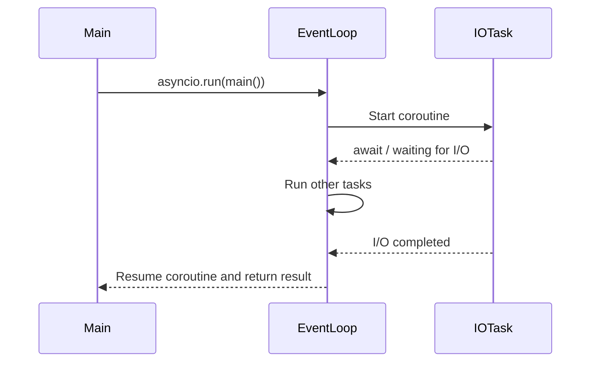

- **`async def` vs `def`:**
- `def` తో రాసే సాధారణ ఫంక్షన్‌లు సింక్రోనస్ (Synchronous) పద్ధతిలో పనిచేస్తాయి.
- `async def` తో రాసే ఫంక్షన్‌లను **Coroutines** అంటారు. ఇవి మధ్యలో ఆగిపోయి (Pause), రిజల్ట్ రాగానే తిరిగి ప్రారంభం కాగలవు.

- **`await`:** నెట్‌వర్క్ కాల్ లేదా డేటాబేస్ క్వెరీ పూర్తయ్యే వరకు వేచి ఉండటానికి `await` కీవర్డ్ వాడతారు. ఇది రెస్పాన్స్ వచ్చేలోపు వేరే కోడ్‌ను రన్ చేయడానికి కంట్రోల్‌ను ఇస్తుంది.

---

## 2. Event Loop, Tasks & Futures (ఈవెంట్ లూప్, టాస్క్స్ మరియు ఫ్యూచర్స్)

- **Event Loop (ఈవెంట్ లూప్):** అసింక్ ప్రోగ్రామింగ్‌కి ఇది గుండెకాయ లాంటిది. ఇది ఏ కోడ్ ఎక్కడ ఆగిందో, ఏది కంప్లీట్ అయిందో ఎల్లప్పుడూ గమనిస్తూ, పనులను ఒకదాని తర్వాత ఒకటిగా (లేదా ఏకకాలంలో) మేనేజ్ చేస్తుంది.
- **Tasks:** ఒక కోరుటిన్ (Coroutine) ఏకకాలంలో బ్యాక్‌గ్రౌండ్‌లో రన్ అవ్వడానికి దీనిని `Task` గా మారుస్తారు.
- **Futures:** భవిష్యత్‌లో ఒక పని పూర్తయిన తర్వాత రాబోయే ఫలితాన్ని (Result) ఇది సూచిస్తుంది.

---

## 3. `asyncio`, `aiohttp` & `httpx` (అసింక్ లైబ్రరీలు)

- **`asyncio`:** పైథాన్ స్టాండర్డ్ లైబ్రరీలో ఉన్న బిల్ట్-ఇన్ మాడ్యూల్. ఇది ఈవెంట్ లూప్‌ను రన్ చేయడానికి మరియు అసింక్ కోడ్‌ను మేనేజ్ చేయడానికి ఉపయోగపడుతుంది.
- **`aiohttp` & `httpx`:** పైథాన్‌లో సాధారణంగా వాడే `requests` మాడ్యూల్ సింక్రోనస్ (బ్లాకింగ్) మోడల్. కానీ మనం ఏపీఐ కాల్స్ అసింక్ పద్ధతిలో చేయాలంటే `aiohttp` లేదా అసింక్ సపోర్ట్ ఉన్న `httpx` ని వాడాలి.

**ఉదాహరణ:**

```python
import asyncio

async def fetch_data():
    print("డేటా డౌన్‌లోడ్ అవుతోంది...")
    await asyncio.sleep(2)  # నెట్‌వర్క్ కాల్ అనుకుందాం (2 సెకన్లు వెయిట్ చేస్తుంది)
    print("డేటా వచ్చేసింది!")
    return {"data": 123}

async def main():
    # ఏకకాలంలో రన్ చేయడం
    result = await fetch_data()
    print(result)

# ఈవెంట్ లూప్ ద్వారా రన్ చేయడం
asyncio.run(main())

```

---

## 4. I/O-Bound vs CPU-Bound Workloads (పనుల రకాలు)

- **I/O-Bound Workloads:** ఇవి ఫైల్ రీడింగ్/రైటింగ్, నెట్‌వర్క్ రిక్వెస్ట్‌లు లేదా డేటాబేస్ క్వెరీలకు సంబంధించినవి. ఇందులో ఎక్కువ సమయం బయటి సిస్టమ్ నుండి రెస్పాన్స్ కోసం వెయిట్ చేయడానికే సరిపోతుంది (CPU ఖాళీగా ఉంటుంది). **ఇలాంటి వాటికి Async అద్భుతంగా పనిచేస్తుంది.**
- **CPU-Bound Workloads:** ఇవి పెద్ద పెద్ద మ్యాథమెటికల్ లెక్కలు, ఇమేజ్ ప్రాసెసింగ్ లేదా మెషీన్ లెర్నింగ్ మోడల్ ట్రైనింగ్ వంటివి. ఇందులో ప్రాసెసర్ (CPU) నిరంతరం పని చేస్తూనే ఉంటుంది. **ఇలాంటి వాటికి Async ఉపయోగపడదు.**

---

## 5. Async vs Threading vs Multiprocessing (పోలికలు)

| అంశం                              | Async (অసింక్)                                             | Threading (త్రెడ్డింగ్)                           | Multiprocessing (మల్టీప్రాసెసింగ్)                |
| --------------------------------- | ---------------------------------------------------------- | ------------------------------------------------- | ------------------------------------------------- |
| **ఎక్కడ వాడాలి?**                 | I/O-bound పనుల కోసం (చాలా ఫాస్ట్)                          | I/O-bound పనుల కోసం                               | CPU-bound పనుల కోసం                               |
| **పనిచేసే విధానం**                | సింగిల్ త్రెడ్‌లోనే ఈవెంట్ లూప్ ద్వారా మారుతూ పనిచేస్తుంది | ఆపరేటింగ్ సిస్టమ్ త్రెడ్లను మారుస్తూ పనిచేస్తుంది | కంప్యూటర్ యొక్క వేర్వేరు CPU కోర్లను వాడుకుంటుంది |
| **GIL (Global Interpreter Lock)** | సమస్య కాదు (Single thread కాబట్టి)                         | GIL ప్రభావం ఉంటుంది                               | GIL ప్రభావం ఉండదు (వేర్వేరు ప్రాసెస్‌లు కాబట్టి)  |

---

# 16. Concurrency & Parallelism

పైథాన్ ప్రోగ్రామింగ్‌లో పనివేగాన్ని (Performance) పెంచడానికి అత్యంత కీలకమైన అంశాలు **Concurrency, Parallelism** మరియు ప్రసిద్ధమైన **GIL (Global Interpreter Lock)**. వీటి గురించి చాలా స్పష్టంగా, సులభమైన తెలుగులో తెలుసుకుందాం!

---

## 1. Concurrency vs Parallelism (తేడా ఏమిటి?)

- **Concurrency (కాన్కరెన్సీ):** ఒకే సమయంలో **ఒకటికి மேற்பட்ட పనులను మేనేజ్ చేయడం** (పనులను ముక్కలు చేసి కొద్దికొద్దిగా చేయడం). ఉదాహరణకు, ఒకే చేత్తో టీ తాగుతూ, మరో చేత్తో ఫోన్ మాట్లాడటం — ఇక్కడ పనులు వేర్వేరు కావచ్చు కానీ ఒకే టైమ్‌లో జరుగుతున్నట్లు అనిపిస్తాయి. (ఇది I/O-bound పనులకు వాడతారు).
- **Parallelism (పారలలిజమ్):** ఒకే సమయంలో **నిజంగా బహుళ పనులను ఏకకాలంలో చేయడం** (ఉదాహరణకు నలుగురు వ్యక్తులు నలుగురు వేర్వేరు పనులు చేయడం). దీనికోసం కంప్యూటర్ యొక్క వేర్వేరు CPU కోర్లు (Cores) వాడతారు. (ఇది CPU-bound పనులకు వాడతారు).

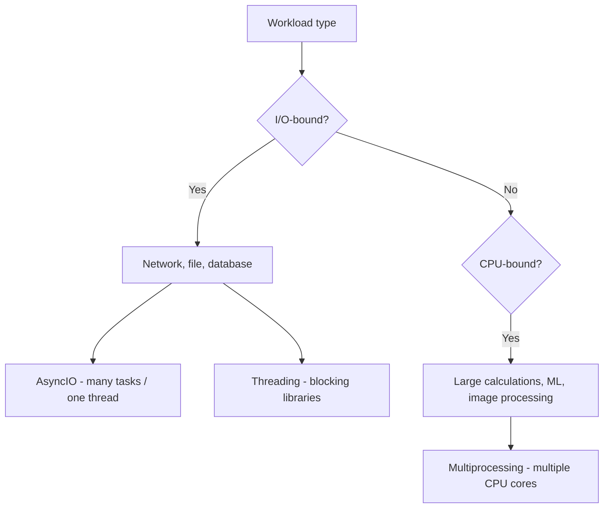

**అవుట్‌లైన్:**

- **Concurrency**
- └── **AsyncIO** (సింగిల్ త్రెడ్‌లో ఈవెంట్ లూప్ ద్వారా)
- └── **Threads** (ఆపరేటింగ్ సిస్టమ్ త్రెడ్స్ ద్వారా)

- **Parallelism**
- └── **Multiprocessing** (కంప్యూటర్ యొక్క బహుళ CPU కోర్లను వాడటం ద్వారా)

---

## 2. Threading, Multiprocessing & AsyncIO (మూడింటి పోలిక)

1. **Threading (`threading`):** ఇది కాన్కరెన్సీ కోసం వాడతారు. ఒకే ప్రోగ్రామ్‌లో వేర్వేరు త్రెడ్స్ సృష్టించి పనులు చేయవచ్చు. కానీ పైథాన్‌లో **GIL** కారణంగా ఇది CPU పనులకు వేగాన్ని ఇవ్వదు, కేవలం నెట్‌వర్క్ లేదా ఫైల్ పనులకు (I/O-bound) మాత్రమే పనిచేస్తుంది.
2. **Multiprocessing (`multiprocessing`):** ఇది నిజమైన పారలలిజమ్. ఇది పైథాన్ యొక్క GIL ని దాటి, కంప్యూటర్‌లో ఉండే వేర్వేరు CPU కోర్లపై విడివిడిగా ప్రాసెస్‌లను రన్ చేస్తుంది. పెద్ద పెద్ద గణిత లెక్కలు లేదా ఇమేజ్ ప్రాసెసింగ్‌కు ఇది అద్భుతంగా పనిచేస్తుంది.
3. **AsyncIO (`asyncio`):** త్రెడ్స్ అవసరం లేకుండా, ఒకే త్రెడ్‌లో ఈవెంట్ లూప్ సహాయంతో వేలాది నెట్‌వర్క్ రిక్వెస్ట్‌లను ఏకకాలంలో హ్యాండ్ చేయడానికి ఇది వాడతారు (ఇది కూడా I/O-bound పనుల కోసమే).

---

## 3. GIL (Global Interpreter Lock - గ్లోబల్ ఇంటర్‌ప్రెటర్ లాక్)

పైథాన్ ఇంటర్వ్యూలలో తప్పకుండా అడిగే అత్యంత ముఖ్యమైన ప్రశ్న **GIL**.

- **GIL అంటే ఏమిటి?** CPython (అత్యధికంగా వాడే పైథాన్ ఇంటర్‌ప్రెటర్) లో మెమరీ మేనేజ్‌మెంట్ సురక్షితంగా జరగడానికి, ఒకే సమయంలో కేవలం ఒకే ఒక త్రెడ్ పైథాన్ బైట్‌కోడ్‌ను రన్ చేయాలని ఒక లాక్ (Lock) ఉంటుంది. దీనినే GIL అంటారు.
- **దీని వల్ల నష్టం ఏమిటి?** ఒకే పైథాన్ ప్రోగ్రామ్‌లో మీరు ఎన్ని త్రెడ్స్ సృష్టించినప్పటికీ, GIL కారణంగా కంప్యూటర్ యొక్క బహుళ CPU కోర్లను (Multi-cores) ఒకేసారి ఉపయోగించుకోవడం కుదరదు. కాబట్టి CPU-bound పనులకు కేవలం `threading` వాడితే వేగం పెరగదు.
- **దీనిని ఎలా దాటాలి?** CPU-bound పనుల కోసం `threading` బదులుగా **`multiprocessing`** వాడాలి. ఎందుకంటే ప్రతి ప్రాసెస్‌కి దాని స్వంత పైథాన్ ఇంటర్‌ప్రెటర్ మరియు మెమరీ ఉంటుంది కాబట్టి GIL అడ్డురాదు.

---

# 17. Caching & Messaging

పెద్ద పెద్ద బ్యాక్‌ఎండ్ సిస్టమ్స్‌లో సిస్టమ్ వేగాన్ని పెంచడానికి మరియు వేర్వేరు సర్వీసులు ఒకదానితో ఒకటి మాట్లాడుకోవడానికి ఉపయోగించే అత్యంత కీలకమైన అంశాలు **Caching & Messaging**. వీటి గురించి తెలుగులో సులభంగా తెలుసుకుందాం!

---

## 1. Redis (ఇన్-మెమరీ డేటా స్టోర్ & క్యాచింగ్)

**Redis** అనేది డేటాను హార్డ్ డిస్క్‌లో కాకుండా నేరుగా కంప్యూటర్ మెమరీలో (RAM) స్టోర్ చేసే ఒక సూపర్-ఫాస్ట్ డేటాబేస్. దీనిని బ్యాక్‌ఎండ్ సిస్టమ్స్‌లో రకరకాలుగా వాడతారు:

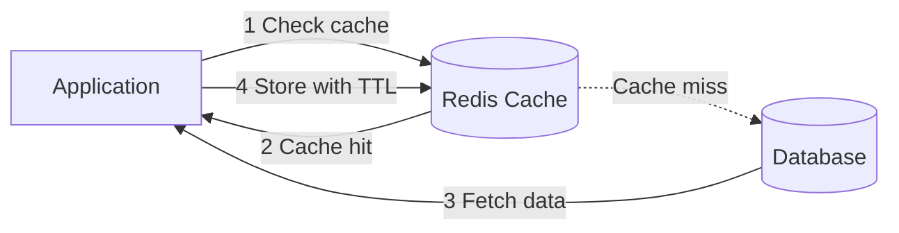

- **Cache (క్యాచింగ్):** పదే పదే డేటాబేస్ నుండి డేటాను తెచ్చి స్లో అవ్వకుండా, తరచుగా అడిగే డేటాను రెడిస్‌లో స్టోర్ చేసి క్షణాల్లో ఇస్తారు.
- **TTL (Time to Live):** రెడిస్‌లో సేవ్ చేసే డేటా ఎంత కాలం ఉండాలో (ఉదాహరణకు 5 నిమిషాలు) ఒక గడువు (Expiration time) పెట్టవచ్చు. ఆ టైమ్ అయిపోగానే డేటా ఆటోమేటిక్‌గా డిలీట్ అవుతుంది.
- **Pub/Sub (Publish/Subscribe):** ఒక సిస్టమ్ మెసేజ్ పబ్లిష్ చేస్తే, దానిని సబ్‌స్క్రైబ్ చేసుకున్న మిగతా అన్ని సిస్టమ్‌లు వెంటనే ఆ మెసేజ్‌ను అందుకునే రియల్-టైమ్ కమ్యూనికేషన్ పద్ధతి (ఉదాహరణకు చాట్ అప్లికేషన్లు).
- **Distributed locks:** బహుళ సర్వర్లు ఒకేసారి ఒకే రిసోర్స్‌ను మార్చకుండా సేఫ్టీ కోసం లాక్స్ వేయడానికి ఇది వాడతారు.
- **Rate limiting:** ఒక యూజర్ లేదా ఐపీ (IP) అడ్రస్ నిమిషానికి ఇన్నిసార్లు మాత్రమే ఏపీఐని హిట్ చేయాలని నియంత్రించడానికి (Spam ఆపడానికి) రెడిస్ వాడతారు.
- **Session storage:** యూజర్ లాగిన్ అయిన తర్వాత వారి సెషన్ వివరాలను ఫాస్ట్‌గా యాక్సెస్ చేయడానికి రెడిస్‌లో స్టోర్ చేస్తారు.

---

## 2. Message Queues & Event Brokers (మెసేజ్ క్యూలు)

బ్యాక్‌ఎండ్‌లో ఒక సర్వీస్ నుండి మరో సర్వీస్‌కు భారీ మొత్తంలో డేటాను లేదా పనులను సురక్షితంగా పంపడానికి (Asynchronous communication) **Message Queues** వాడతారు. ఇవి డేటా ఏదీ పోకుండా క్యూ (Queue) రూపంలో భద్రపరుస్తాయి.

ప్రముఖ టూల్స్:

- **RabbitMQ:** ఒక నమ్మదగిన మరియు పాపులర్ మెసేజ్ బ్రోకర్. సంక్లిష్టమైన రూటింగ్ అవసరమయ్యే చోట ఇది అద్భుతంగా పనిచేస్తుంది.
- **Kafka:** బిగ్ డేటా మరియు రియల్-టైమ్ స్ట్రీమింగ్ కోసం వాడే అత్యంత శక్తివంతమైన మెసేజ్ ప్లాట్‌ఫారమ్. మిలియన్ల కొద్దీ డేటా స్ట్రీమ్స్‌ను ఇది క్షణాల్లో హ్యాండ్ చేస్తుంది.
- **AWS SQS (Simple Queue Service):** అమెజాన్ క్లౌడ్ (AWS) అందించే మేనేజ్డ్ మెసేజ్ క్యూ సర్వీస్. సర్వర్ టెన్షన్ లేకుండా నేరుగా వాడుకోవచ్చు.
- **AWS SNS (Simple Notification Service):** ఇది పబ్లిష్/సబ్‌స్క్రైబ్ మోడల్ ఆధారంగా పనిచేసే నోటిఫికేషన్ సర్వీస్ (ఉదాహరణకు వేలాది మందికి ఒకేసారి SMS లేదా Email అలర్ట్స్ పంపడానికి).

---

# 18. System Design

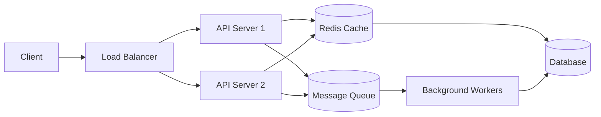

కోట్లాది మంది యూజర్లు వాడే పెద్ద పెద్ద అప్లికేషన్లను (High Scalability & Performance Applications) ఎలా డిజైన్ చేయాలో తెలిపే అత్యంత కీలకమైన విభాగం **System Design**. మీరు ఇచ్చిన ఆర్కిటెక్చర్ ఫ్లో (Architecture Flow) ఆధారంగా, ప్రతి కాంపోనెంట్ ఎలా పనిచేస్తుందో తెలుగులో సులభంగా తెలుసుకుందాం!

---

## 🌐 System Architecture Flow

```text
Load Balancer
      ↓
API Servers
      ↓
Cache
      ↓
Database
      ↓
Message Queue
      ↓
Workers

```

---

### 1. Load Balancer (లోడ్ బ్యాలెన్సర్)

- **పని ఏమిటి?** లక్షలాది మంది యూజర్లు ఒకేసారి వెబ్‌సైట్‌ను విజిట్ చేసినప్పుడు, ఆ ట్రాఫిక్ మొత్తాన్ని ఒకే సర్వర్‌పై పడకుండా వేర్వేరు **API Servers** కి సమానంగా పంపిణీ (Distribute) చేస్తుంది. ఇది సర్వర్ క్రాస్ అవకుండా కాపాడుతుంది (ఉదాహరణకు Nginx, AWS ELB).

### 2. API Servers (ఏపీఐ సర్వర్లు)

- **పని ఏమిటి?** లోడ్ బ్యాలెన్సర్ నుండి వచ్చిన రిక్వెస్ట్‌లను ఇవి స్వీకరిస్తాయి. FastAPI లేదా Djangoతో తయారు చేసిన మన బ్యాక్‌ఎండ్ అప్లికేషన్ కోడ్ ఇక్కడే రన్ అవుతుంది. యూజర్ అడిగిన డేటా ఏమిటో అర్థం చేసుకుని, దానికి తగిన లాజిక్‌ను ఇవి అమలు చేస్తాయి.

### 3. Cache (క్యాచింగ్)

- **పని ఏమిటి?** ప్రతి చిన్న రిక్వెస్ట్‌కి డేటాబేస్ వరకు వెళ్లకుండా, తరచుగా అడిగే డేటాను (ఉదాహరణకు హోమ్ పేజీ బ్యానర్ లేదా యూజర్ ప్రొఫైల్) **Redis** లేదా Memcached వంటి క్యాష్ మెమరీ నుండి క్షణాల్లో యూజర్‌కు పంపిస్తుంది. దీనివల్ల సిస్టమ్ వేగం విపరీతంగా పెరుగుతుంది.

### 4. Database (డేటాబేస్)

- **పని ఏమిటి?** క్యాష్‌లో డేటా దొరకకపోతే లేదా కొత్త డేటాను సేవ్ చేయాల్సి వస్తే, అప్పుడు ఏపీఐ సర్వర్లు **Database** (PostgreSQL, MySQL లేదా NoSQL) ని సంప్రదిస్తాయి. పర్మనెంటర్‌గా యూజర్ డేటాను ఇక్కడే భద్రపరుస్తారు.

### 5. Message Queue (మెసేజ్ క్యూ)

- **పని ఏమిటి?** యూజర్‌కు వెంటనే రెస్పాన్స్ ఇచ్చేసి, బ్యాక్‌గ్రౌండ్‌లో జరగాల్సిన పెద్ద పనులను (ఉదాహరణకు రిజిస్ట్రేషన్ అయిన వెంటనే ఈమెయిల్ పంపడం, లేదా భారీ ఫైల్ అప్‌లోడ్ ప్రాసెస్ చేయడం) **RabbitMQ** లేదా **Kafka** వంటి మెసేజ్ క్యూలలో భద్రపరుస్తారు.

### 6. Workers (వర్కర్లు)

- **పని ఏమిటి?** మెసేజ్ క్యూలో నిల్వ ఉన్న పనులను ఒక్కొక్కటిగా తీసుకుని, యూజర్‌కు ఎలాంటి ఇబ్బంది కలగకుండా బ్యాక్‌గ్రౌండ్‌లో నిశ్శబ్దంగా ఆ పనులను పూర్తి చేసే ప్రత్యేక సర్వర్లు లేదా ప్రోగ్రామ్‌లు (ఉదాహరణకు Celery workers) ఇవి.

---

## Important topics:

పెద్ద పెద్ద సాఫ్ట్‌వేర్ సిస్టమ్‌లను (ఉదాహరణకు Netflix, Amazon, WhatsApp లాంటివి) డిజైన్ చేసేటప్పుడు మనం కచ్చితంగా తెలిసి ఉండాల్సిన అత్యంత ముఖ్యమైన **System Design Concepts** ఇవి. వీటి గురించి తెలుగులో సులభంగా తెలుసుకుందాం!

---

### 1. Scalability & Load Balancing (స్కేలబిలిటీ మరియు లోడ్ బ్యాలెన్సింగ్)

- **Scalability (స్కేలబిలిటీ):** యూజర్లు పెరిగినప్పుడు సిస్టమ్ క్రాస్ అవకుండా, దానికి తగినట్లుగా సర్వర్ సామర్థ్యాన్ని పెంచే శక్తి. ఇది రెండు రకాలు:
- _Vertical Scaling:_ ఉన్న సర్వర్‌లోనే RAM లేదా CPU ని పెంచడం.
- _Horizontal Scaling:_ అదనంగా మరిన్ని కొత్త సర్వర్లను జత చేయడం (ఇది రియల్-వరల్డ్‌లో వాడతారు).

- **Load Balancing:** లక్షలాది మంది యూజర్ల ట్రాఫిక్‌ను వేర్వేరు సర్వర్లకు సమానంగా పంపిణీ చేసే పద్ధతి.

### 2. Caching & Rate Limiting (క్యాచింగ్ మరియు రేట్ లిమిటింగ్)

- **Caching:** పదే పదే డేటాబేస్ నుండి డేటా తెచ్చి సిస్టమ్‌ను స్లో చేయకుండా, తరచుగా వాడే డేటాను RAM (Redis) లో భద్రపరుచుకుని క్షణాల్లో ఇవ్వడం.
- **Rate Limiting:** ఒకే యూజర్ లేదా ఐపీ (IP) నుండి నిమిషానికి ఇన్నిసార్లు మాత్రమే ఏపీఐ రిక్వెస్ట్లు రావాలని నియంత్రించడం (స్పామ్ మరియు DDoS ఎటాక్స్ ఆపడానికి).

### 3. Database Scaling: Sharding & Replication (డేటాబేస్ షార్డింగ్ మరియు రెప్లికేషన్)

- **Database Sharding:** ఒకే పెద్ద టేబుల్‌లోని కోట్లాది రికార్డులను చిన్న చిన్న భాగాలుగా (Shards) చేసి వేర్వేరు డేటాబేస్ సర్వర్లలో నిల్వ చేయడం.
- **Replication:** డేటా భద్రత కోసం ఒకే డేటాబేస్ యొక్క కాపీలను వేర్వేరు సర్వర్లలో మెయింటైన్ చేయడం (Master-Slave పద్ధతి). ఇందులో ఒక మాస్టర్ సర్వర్ డేటాను రాస్తే, మిగతా స్లేవ్ సర్వర్లు చదవడానికి (Read) సహాయపడతాయి.

### 4. CAP Theorem & Consistency (క్యాప్ థియరం మరియు కన్సిస్టెన్సి)

- **CAP Theorem:** ఏ డిస్ట్రిబ్యూటెడ్ సిస్టమ్ అయినా ఈ మూడింటిలో కేవలం **రెండింటిని మాత్రమే** పూర్తిగా సంతృప్తిపరచగలదు:
- **C**onsistency (అన్ని సర్వర్లలోనూ ఒకే లాంటి లేటెస్ట్ డేటా ఉండటం).
- **A**vailability (ఎల్లప్పుడూ సిస్టమ్ డౌన్ అవకుండా రెస్పాన్స్ ఇవ్వడం).
- **P**artition Tolerance (నెట్‌వర్క్ కనెక్షన్ ఫెయిల్ అయినా సిస్టమ్ పని చేయడం).

- **Consistency:** సిస్టమ్‌లోని అన్ని నోడ్స్‌లోనూ యూజర్ డేటా ఎప్పుడూ ఒకే విధంగా కనిపించడాన్ని నిర్ధారించడం.

### 5. Idempotency (ఐడెంటిపోటెన్సీ)

- ఒక ఏపీఐ రిక్వెస్ట్‌ను పొరపాటున లేదా నెట్‌వర్క్ సమస్య వల్ల క్లైంట్ **ఒకటికి రెండుసార్లు పంపినా**, సిస్టమ్‌లో మాత్రం ఆ పని **కేవలం ఒక్కసారే** జరగాలి (ఉదాహరణకు డబ్బులు ట్రాన్స్‌ఫర్ చేసేటప్పుడు డబుల్ డెబిట్ కాకుండా ఉండటానికి ఇది అత్యంత ముఖ్యం).

### 6. Distributed Systems, Microservices & Event-Driven Architecture (అడ్వాన్స్‌డ్ ఆర్కిటెక్చర్స్)

- **Distributed Systems:** ఒకే పెద్ద సిస్టమ్‌ను విడివిడిగా వేర్వేరు సర్వర్లలో రన్ అవుతున్న చిన్న చిన్న సిస్టమ్‌లుగా విభజించి, అన్నీ కలిపి ఒకే అప్లికేషన్‌లా పనిచేసేలా చేయడం.
- **Microservices:** ఒక పెద్ద అప్లికేషన్‌ను చిన్న చిన్న స్వతంత్ర సర్వీసులుగా విడగొట్టడం (ఉదాహరణకు పేమెంట్స్ కోసం ఒక సర్వీస్, లాగిన్ కోసం మరో సర్వీస్).
- **Event-Driven Architecture:** సర్వీసులు నేరుగా మాట్లాడుకోకుండా, ఒక ఈవెంట్ (Event) జరగగానే (ఉదాహరణకు ఆర్డర్ ప్లేస్ అయింది) మెసేజ్ క్యూ ద్వారా మిగతా సర్వీసులు దాన్ని గుర్తించి తమ పనులు ప్రారంభించే మోడర్న్ డిజైన్ పద్ధతి.

---

# 19. Docker & Cloud

సాఫ్ట్‌వేర్ డెవలప్‌మెంట్‌లో మనం రాసిన కోడ్ మన కంప్యూటర్‌లో బాగానే పనిచేస్తుంది, కానీ సర్వర్‌కి వెళ్లాక ఎర్రర్‌లు ఇస్తుంది. ఈ సమస్యకు శాశ్వత పరిష్కారమే **Docker** మరియు క్లౌడ్ టెక్నాలజీ. డాకర్ గురించిన ముఖ్యమైన అంశాలను తెలుగులో సులభంగా తెలుసుకుందాం!

---

## 1. Docker అంటే ఏమిటి? (Introduction)

డాకర్ అనేది మన అప్లికేషన్‌ను, దానికి కావలసిన లైబ్రరీలు మరియు డిపెండెన్సీలతో సహా ఒకే ప్యాకేజీగా (**Container**) మార్చడానికి ఉపయోగపడే ఒక టూల్. "నా లోకల్ కంప్యూటర్‌లో రన్ అవుతుంది, కానీ సర్వర్‌లో రన్ కావట్లేదు" అనే సమస్యకు డాకర్ చెక్ పెడుతుంది.

---

## 2. ముఖ్యమైన డాకర్ భావనలు (Core Concepts)

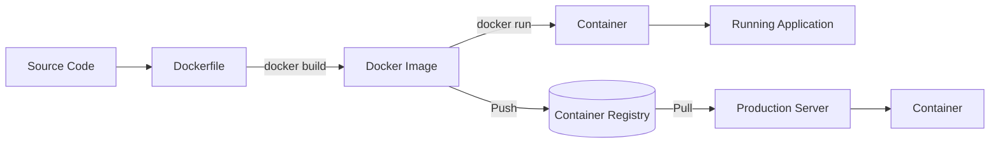

- **Dockerfile:** డాకర్ కంటైనర్‌ను ఎలా సృష్టించాలో దశలవారీగా సూచనలు రాసే ఒక టెక్స్ట్ ఫైల్. (ఉదాహరణకు: పైథాన్ వెర్షన్ ఏంటి, ఏయే ప్యాకేజీలు ఇన్‌స్టాల్ చేయాలి లాంటివి).
- **Image (ఇమేజ్):** డాకర్‌ఫైల్ నుండి తయారైన ఒక రీడ్-ఓని టెంప్లేట్ లేదా బ్లూప్రింట్. దీనిని ఒక అప్లికేషన్ యొక్క కాపీ అనుకోవచ్చు.
- **Container (కంటైనర్):** డాకర్ ఇమేజ్ రన్ అయ్యే సజీవ రూపమే కంటైనర్. ఇది ఒక ఒంటరి వాతావరణంలో (Isolated environment) మన అప్లికేషన్‌ను రన్ చేస్తుంది.
- **Volumes (వాల్యూమ్స్):** కంటైనర్ డిలీಟ್ అయినా సరే, దానిలోని డేటా (ఉదాహరణకు డేటాబేస్ ఫైల్స్) శాశ్వతంగా భద్రంగా ఉండటానికి హోస్ట్ మెషిన్‌తో డేటాను షేర్ చేసే పద్ధతి.
- **Networks (నెట్‌వర్క్స్):** వేర్వేరు డాకర్ కంటైనర్లు (ఉదాహరణకు బ్యాక్‌ఎండ్ కంటైనర్ మరియు డేటాబేస్ కంటైనర్) ఒకదానితో ఒకటి సురక్షితంగా మాట్లాడుకోవడానికి నెట్‌వర్క్స్ సహాయపడతాయి.
- **Docker Compose:** మన అప్లికేషన్‌లో బహుళ కంటైనర్లు (FastAPI + PostgreSQL + Redis) ఉన్నప్పుడు, వాటన్నింటినీ విడివిడిగా రన్ చేయకుండా ఒక్కే ఒక ఫైల్ (`docker-compose.yml`) ద్వారా ఒకే కమాండ్‌తో స్టార్ట్ చేయడానికి, స్టాప్ చేయడానికి ఇది అద్భుతంగా పనిచేస్తుంది.

**డాకర్ కంపోజ్ ఉదాహరణ (`docker-compose.yml`):**

```yaml
version: "3.8"
services:
  web:
    build: .
    ports:
      - "8000:8000"
  db:
    image: postgres:14
    environment:
      POSTGRES_PASSWORD: secretpassword
```

---

బ్యాక్‌ఎండ్ డెవలప్‌మెంట్‌లో క్లౌడ్ (ముఖ్యంగా **AWS - Amazon Web Services**) అనేది అత్యంత ముఖ్యమైన భాగం. క్లౌడ్ సేవలు మన అప్లికేషన్‌ను సర్వర్ టెన్షన్ లేకుండా ఆటోమేటిక్‌గా స్కేల్ చేయడానికి మరియు నిర్వహించడానికి సహాయపడతాయి.

ముఖ్యమైన AWS సేవలు మరియు మీరు ఇచ్చి ఆర్కిటెక్చర్ ఫ్లో గురించి తెలుగులో సులభంగా తెలుసుకుందాం!

---

## ☁️ ముఖ్యమైన AWS సేవలు (Key AWS Services)

- **AWS Lambda:** సర్వర్ల గురించి ఆలోచించకుండా కేవలం కోడ్‌నుమాత్రం రన్ చేసే పద్ధతి (Serverless). కోడ్ రన్ అయినంత సేపటికి మాత్రమే బిల్లు పడుతుంది.
- **API Gateway:** క్లైంట్ నుండి వచ్చే హెచ్‌టిటిపి (HTTP) రిక్వెస్ట్‌లను స్వీకరించి, వాటిని లాంబడా (Lambda) లేదా బ్యాక్‌ఎండ్ సర్వీస్‌లకు పంపే గేట్‌వే.
- **ECS (Elastic Container Service):** డాకర్ కంటైనర్లను క్లౌడ్‌లో సులభంగా మేనేజ్ చేయడానికి మరియు రన్ చేయడానికి వాడే కంటైనర్ ఆర్కెస్ట్రేషన్ సర్వీస్.
- **ECR (Elastic Container Registry):** మన డాకర్ ఇమేజ్‌లను సురక్షితంగా స్టోర్ చేసే రిజిస్ట్రీ (AWS వెర్షన్ ఆఫ్ Docker Hub).
- **S3 (Simple Storage Service):** ఇమేజ్‌లు, వీడియోలు, మరియు డాక్యుమెంట్లు వంటి ఫైళ్లను అపరిమితంగా స్టోర్ చేయడానికి వాడే క్లౌడ్ స్టోరేజ్.
- **RDS (Relational Database Service):** క్లౌడ్‌లో PostgreSQL లేదా MySQL డేటాబేస్‌లను సులభంగా సెటప్ చేసి మేనేజ్ చేయడానికి.
- **DynamoDB:** AWS అందించే సూపర్-ఫాస్ట్ నోస్కాల్ (NoSQL) కీ-వాల్యూ డేటాబేస్ (అత్యంత వేగంగా డేటాను చదవడానికి/రాయడానికి).
- **SQS & SNS:** అసింక్ కమ్యూనికేషన్ కోసం మెసేజ్ క్యూ (SQS) మరియు నోటిఫికేషన్/పబ్-సబ్ (SNS) సర్వీసులు.
- **EventBridge:** వివిధ ఈవెంట్లను బేస్ చేసుకుని ఆటోమేటిక్‌గా సిస్టమ్‌లను ట్రిగ్గర్ చేసే సర్వర్లెస్ ఈవెంట్ బస్.
- **CloudWatch:** మన అప్లికేషన్ లాగ్స్‌ని చెక్ చేయడానికి, ఎర్రర్‌లను ట్రాక్ చేయడానికి మరియు సిస్టమ్ పనితీరును మానిటర్ చేయడానికి.
- **IAM (Identity and Access Management):** ఏ యూజర్‌కు లేదా సర్వీస్‌కు ఏ AWS రిసోర్సెస్ యాక్సెస్ ఉండాలో భద్రతా నియమాలు (Permissions) సెట్ చేయడానికి.

---

## 🏗️ క్లౌడ్ ఆర్కిటెక్చర్ ఫ్లో (Cloud Architecture Flow)

మీరు ఇచ్చిన ఈ ఆర్కిటెక్చర్ మోడర్న్ సర్వర్లెస్ మరియు మైక్రోసర్వీసెస్ డిజైన్‌కు చక్కటి ఉదాహరణ:

```text
Client
  ↓
API Gateway
  ↓
Lambda / FastAPI
  ↓
Service
  ↓
RDS / DynamoDB
  ↓
SQS
  ↓
Worker

```

- **Client:** మొబైల్ యాప్ లేదా వెబ్ బ్రౌజర్ నుండి యూజర్ రిక్వెస్ట్ పంపుతాడు.
- **API Gateway:** ఆ రిక్వెస్ట్‌లను రిసీవ్ చేసుకుని సరైన ఎండ్‌పాయింట్‌కి మళ్లిస్తుంది.
- **Lambda / FastAPI:** సర్వర్లెస్ లాంబడా ఫంక్షన్ లేదా ECS లో రన్ అవుతున్న FastAPI సర్వర్ ఆ రిక్వెస్ట్ లాజిక్‌ను ప్రాసెస్ చేస్తుంది.
- **Service:** బిజినెస్ లాజిక్ ఎగ్జిక్యూట్ అయ్యే సర్వీస్ లేయర్.
- **RDS / DynamoDB:** అవసరమైన డేటాను రిలేషనల్ (RDS) లేదా నోస్కాల్ (DynamoDB) డేటాబేస్‌లో సేవ్ చేస్తుంది లేదా తెస్తుంది.
- **SQS:** వెంటనే యూజర్‌కు రెస్పాన్స్ వెళ్ళిపోయిన తర్వాత, బ్యాక్‌గ్రౌండ్‌లో జరగాల్సిన పనులను మెసేజ్ క్యూ (SQS) లోకి పంపిస్తుంది.
- **Worker:** క్యూ నుండి పనులను తీసుకుని, బ్యాక్‌గ్రౌండ్‌లో నిశ్శబ్దంగా ఆ పనులను పూర్తి చేస్తుంది.

---

# 20. DevOps for Python

పైథాన్ అప్లికేషన్‌ను కేవలం కోడ్ రాయడంతో ఆగిపోకుండా, దానిని విజయవంతంగా ప్రొడక్షన్ (Production) వాతావరణంలో రన్ చేయడానికి మరియు పర్యవేక్షించడానికి (Monitor) అవసరమైన **DevOps & Observability** సాధనాల గురించి తెలుగులో సులభంగా తెలుసుకుందాం!

---

## 1. DevOps & Production Essentials (డెవ్‌ప్స్ మరియు ప్రొడక్షన్ టూల్స్)

- **Git & GitHub:** కోడ్ వెర్షన్‌లను మేనేజ్ చేయడానికి మరియు టీమ్‌తో కలిసి పనిచేయడానికి గిట్ అత్యంత ముఖ్యం.
- **Docker:** మన అప్లికేషన్‌ను డిపెండెన్సీలతో సహా కంటైనర్‌గా మార్చడానికి (స్థిరమైన వాతావరణం కోసం).
- **CI/CD (Continuous Integration / Continuous Deployment):** కోడ్ గిట్‌హబ్‌కు పుష్ చేయగానే, ఆటోమేటిక్‌గా టెస్ట్‌లు రన్ అయ్యి, ప్రొడక్షన్ సర్వర్‌కి డిప్లాయ్ అయ్యేలా ఆటోమేషన్ చేయడం. దీనికోసం **GitHub Actions** విస్తృతంగా వాడతారు.
- **Linux:** బ్యాక్‌ఎండ్ సర్వర్లు అన్నీ ఎక్కువగా లినక్స్ (Linux) ఆపరేటింగ్ సిస్టమ్‌పైనే నడుస్తాయి కాబట్టి, లినక్స్ బేసిక్స్ మరియు టెర్మినల్ కమాండ్స్ తెలిసి ఉండాలి.
- **Nginx:** వెబ్ సర్వర్ లేదా రివర్స్ ప్రాక్సీగా పనిచేస్తూ, లోడ్ బ్యాలెన్సింగ్ చేయడానికి మరియు ఎస్‌ఎస్‌ఎల్ (SSL) సర్టిఫికెట్లను మేనేజ్ చేయడానికి ఇది వాడతారు.
- **Kubernetes basics:** బహుళ డాకర్ కంటైనర్లను ఆటోమేటిక్‌గా స్కేల్ చేయడానికి, మేనేజ్ చేయడానికి క్యూబర్‌నెట్స్ (K8s) ప్రాథమిక అంశాలు అవసరం.
- **AWS:** క్లౌడ్‌లో అప్లికేషన్‌లను హోస్ట్ చేయడానికి మరియు మేనేజ్ చేయడానికి.

---

## 2. Production Python Monitoring & Observability (ప్రొడక్షన్ మానిటరింగ్)

కోడ్ ప్రొడక్షన్‌లో రన్ అవుతున్నప్పుడు ఎక్కడైనా ఎర్రర్‌లు వస్తే వెంటనే తెలుసుకోవడానికి మరియు సిస్టమ్ పనితీరును అంచనా వేయడానికి ఈ టూల్స్ వాడతారు:

- **Logging (`logging`):** ప్రింట్ స్టేట్‌మెంట్‌లకు బదులుగా, ప్రోగ్రామ్ ఎక్కడెక్కడ ఏయే తప్పులు చేసిందో లేదా విజిట్ అయిందో ట్రాక్ చేయడానికి పైథాన్ బిల్ట్-ఇన్ లాగింగ్ మోడ్యూల్.
- **Prometheus:** సిస్టమ్ మెట్రిక్స్ (ഉദാഹరణకు CPU వాడకం, మెమరీ, ఏపీఐ రిక్వెస్ట్ కౌంట్) ను కలెక్ట్ చేసి స్టోర్ చేసే మోనిటరింగ్ టూల్.
- **Grafana:** ప్రొమేథస్ సేకరించిన డేటాను అందమైన గ్రాఫ్‌లు మరియు డాష్‌బోర్డ్‌ల రూపంలో కళ్ళకు కట్టినట్లు చూపించే టూల్.
- **OpenTelemetry:** అప్లికేషన్‌లో రిక్వెస్ట్ ఎక్కడెక్కడ ట్రావెల్ అవుతుందో ట్రేస్ చేయడానికి (Distributed Tracing) వాడే స్టాండర్డ్ టూల్.
- **Sentry:** ప్రొడక్షన్‌లో మన పైథాన్ కోడ్‌లో ఎక్కడైనా అన్‌హ్యాండిల్డ్ ఎర్రర్‌లు (Exceptions) వస్తే, ఆ తప్పు ఎక్కడ జరిగిందో రియల్-టైమ్‌లో డెవలపర్‌కు అలర్ట్ పంపే అద్భుతమైన ఎర్రర్ ట్రాకింగ్ టూల్.

---

# 21. Data Structures & Algorithms

సాఫ్ట్‌వేర్ ఇంజనీరింగ్ ఇంటర్వ్యూలలో (ముఖ్యంగా ప్రొడక్ట్ బేస్డ్ కంపెనీలలో) విజయం సాధించాలంటే **Data Structures & Algorithms (DSA)** అత్యంత కీలకం. పైథాన్ బ్యాక్‌ఎండ్ డెవలపర్‌గా మీరు కచ్చితంగా నేర్చుకోవాల్సిన ప్రాథమిక మరియు ముఖ్యమైన టాపిక్స్ గురించి తెలుగులో సులభంగా తెలుసుకుందాం!

---

## 1. Arrays & Common Patterns (ఎరేలు మరియు ముఖ్యమైన పద్ధతులు)

పైథాన్‌లో ఎరేలను ప్రధానంగా `list` రూపంలో వాడతారు. ఇంటర్వ్యూలలో సమయాన్ని (Time Complexity) తగ్గించడానికి ఈ క్రింది పద్ధతులు (Patterns) బాగా ఉపయోగపడతాయి:

- **Two pointers (టూ పాయింటర్స్):** లిస్ట్ లేదా స్ట్రింగ్‌లో రెండు వేర్వేరు స్థానాల నుండి (ముందర మరియు వెనుక నుండి) శోధించడం ప్రారంభించి మధ్యలోకి రావడం (ఉదాహరణకు: సార్టెడ్ ఎరేలో టార్గెట్ సమ్ కనుగొనడం).
- **Sliding window (స్లైడింగ్ విండో):** ఒక పెద్ద లిస్ట్‌లో నిర్దిష్ట సైజు ఉన్న విండోను (ఉదాహరణకు 3 ఎలిమెంట్స్) ఒకదాని తర్వాత ఒకటిగా జరుపుతూ సబ్-ఎరే (Subarray) సమస్యలను పరిష్కరించడానికి ఇది వాడతారు.
- **Prefix sum (ప్రిఫిక్స్ సమ్):** ఎరేలోని ఎలిమెంట్స్ మొత్తాన్ని పదే పదే లెక్కించకుండా, ముందే కూడికలను సేవ్‌ చేసి ఉంచుకోవడం ద్వారా వేగంగా సమాధానం రాబట్టడం.

---

## 2. Strings (స్ట్రింగ్స్ మానిపులేషన్)

స్ట్రింగ్స్‌కు సంబంధించి ఇంటర్వ్యూలలో తరచుగా అడిగే మూడు ముఖ్యమైన కాన్సెప్ట్స్:

- **Frequency counting:** ఒక స్ట్రింగ్‌లో ఏ అక్షరం ఎన్నిసార్లు రిపీట్ అయిందో కనుగొనడం (దీనికోసం పైథాన్ `collections.Counter` అద్భుతంగా పనిచేస్తుంది).
- **Palindromes:** ఒక స్ట్రింగ్‌ను తిప్పి రాసినా (Reverse) అదే పదం వస్తుందో లేదో చెక్ చేయడం (ఉదాహరణకు: "madam").
- **Anagrams:** రెండు వేర్వేరు పదాలలో ఒకే రకమైన అక్షరాలు ఉన్నాయో లేదో చెక్ చేయడం (ఉదాహరణకు: "listen" మరియు "silent").

---

## 3. Hashing (హాషింగ్ - HashMap & HashSet)

డేటాను సెకన్ల వ్యవధిలో వెతకడానికి (O(1) Time Complexity) హాషింగ్ అత్యంత శక్తివంతమైనది:

- **HashMap (Dictionaries):** కీ-వాల్యూ (Key-Value) జంటల రూపంలో డేటాను నిల్వ చేసి, కీ ద్వారా వెంటనే వాల్యూను రిట్రీవ్ చేయడానికి.
- **HashSet (Sets):** డూప్లికేట్ విలువలను తొలగించడానికి మరియు ఒక ఐటెమ్ ఆ లిస్ట్‌లో ఉందో లేదో సెకన్లలో చెక్ చేయడానికి.

---

## 4. Linked Lists (లింక్డ్ లిస్ట్స్)

ఎరేలా కాకుండా, మెమరీలో వేర్వేరు చోట్ల ఉన్న నోడ్స్ అన్నీ పాయింటర్ల ద్వారా ఒకదానికొకటి కనెక్ట్ అయి ఉండే డేటా స్ట్రక్చర్:

- **Reverse linked list:** ఒక లింక్డ్ లిస్ట్ యొక్క దిశను పూర్తిగా వెనుకకు మార్చడం (ఇది ఇంటర్వ్యూలలో మోస్ట్ పాపులర్ ప్రశ్న).
- **Cycle detection:** లింక్డ్ లిస్ట్ లూప్‌లో (Loop/Cycle) తిరుగుతుందా లేదా అని గుర్తించడం (దీనికోసం ఫాస్ట్ అండ్ స్లో పాయింటర్ అల్గోరిథం - Tortoise and Hare algorithm వాడతారు).

---

సాఫ్ట్‌వేర్ ఇంజనీరింగ్ ఇంటర్వ్యూలలో విజయం సాధించడానికి మరియు కాంప్లెక్స్ ప్రాబ్లమ్స్‌ను సాల్వ్ చేయడానికి అవసరమైన మిగిలిన ముఖ్యమైన **Data Structures & Algorithms (DSA)** టాపిక్స్ గురించి తెలుగులో సులభంగా తెలుసుకుందాం!

---

## 1. Stack & Queue (స్టాక్ మరియు క్యూ)

- **Stack (స్టాక్):** LIFO (Last In, First Out) పద్ధతిలో పనిచేస్తుంది (చివరిగా వచ్చిన వస్తువు మొదట బయտට వస్తుంది - ఉదాహరణకు ప్లేట్ల స్టాక్).
- **Parentheses (బ్రాకెట్ల వాలిడేషన్):** కోడింగ్‌లో లేదా మ్యాథ్స్ ఎక్స్‌ప్రెషన్స్‌లో ఓపెన్ బ్రాకెట్లు `()`, `{}`, `[]` అన్నీ సరిగ్గా క్లోజ్ అయ్యాయో లేదో చెక్ చేయడానికి ఇది క్లాసిక్ ప్రాబ్లం.
- **Monotonic Stack:** స్టాక్‌లోని ఎలిమెంట్స్ ఎల్లప్పుడూ ఒక క్రమపద్ధతిలో (అసెండింగ్ లేదా డిసెండింగ్) ఉండేలా చూసే అడ్వాన్స్‌డ్ టెక్నిక్ (ఉదాహరణకు: Next Greater Element సమస్యలకు).

- **Queue (క్యూ):** FIFO (First In, First Out) పద్ధతిలో పనిచేస్తుంది (ముందు వచ్చినవారికి మొదటి ప్రాధాన్యత - ఉదాహరణకు లైన్లో నిలబడటం).
- **BFS (Breadth-First Search):** క్యూ (Queue) డేటా స్ట్రక్చర్‌ను ఉపయోగించి ట్రీస్ లేదా గ్రాఫ్‌లలో లెవెల్-బై-లెవెల్ గా ట్రావెల్ చేయడానికి ఇది వాడతారు.

---

## 2. Trees (ట్రీస్)

ట్రీ అనేది హైరారికల్ (Hierarchical) డేటా స్ట్రక్చర్ (ఉదాహరణకు కంప్యూటర్‌లోని ఫోల్డర్ స్ట్రక్చర్).

- **DFS (Depth-First Search):** ట్రీ లోతులోకి వెళ్ళి (Preorder, Inorder, Postorder పద్ధతులలో) అన్ని నోడ్స్‌ను విజిట్ చేయడం (దీనికోసం రికర్షన్ లేదా స్టాక్ వాడతారు).
- **BFS (Breadth-First Search):** లెవెల్ వారியாக (Level-order traversal) ట్రీని ట్రావెల్ చేయడం.
- **Binary Search Tree (BST):** ఎడమ వైపు ఉన్న చైల్డ్ నోడ్ విలువ రూట్ కంటే తక్కువగాను, కుడి వైపు ఉన్న చైల్డ్ నోడ్ విలువ ఎక్కువగాను ఉండే ప్రత్యేకమైన ట్రీ. దీనివల్ల డేటాను వెతకడం చాలా వేగంగా (O(log N)) జరుగుతుంది.

---

## 3. Graphs (గ్రాఫ్స్)

గ్రాఫ్ అనేది నోడ్స్ (Vertices) మరియు వాటిని కలిపే ఎడ్జెస్ (Edges) యొక్క నెట్‌వర్క్ (ఉదాహరణకు సోషల్ మీడియాలో ఫ్రెండ్ కనెక్షన్స్ లేదా గూగుల్ మ్యాప్స్ రూట్స్).

- **BFS & DFS:** గ్రాఫ్‌లలో ఒక చోటు నుండి మరొక చోటుకి దారి వెతకడానికి లేదా కనెక్షన్లను చెక్ చేయడానికి ఇవి ప్రాథమిక పద్ధతులు.
- **Dijkstra's Algorithm (డైక్ష్ట్రా అల్గోరిథం):** ఒక ప్లేస్ నుండి మరో ప్లేస్‌కి వెళ్ళడానికి **అత్యంత తక్కువ దూరం లేదా ఖర్చు ఉన్న దారిని (Shortest Path)** కనుగొనడానికి ఇది గూగుల్ మ్యాప్స్‌లో ఎక్కువగా వాడతారు.
- **Topological Sort (టోపోలాజికల్ సార్ట్):** డైరెక్టెడ్ ఎసైక్లిక్ గ్రాఫ్ (DAG) లో పనుల మధ్య ఉన్న ఆధారపడే క్రమాన్ని (Dependencies) బేസ് చేసుకుని, ఏ పని ఏ వరుసలో చేయალో డిసైడ్ చేయడానికి ఇది వాడతారు (ఉదాహరణకు కాలేజీలో సబ్జెక్ట్ ప్రీ-రిక్విజిట్స్ లేదా కోడ్ బిల్డ్ ఆర్డర్).

---

# 22. Python Interview Preparation

పైథాన్ ఇంటర్వ్యూలలో (Python Interviews) మిమ్మల్ని ఖచ్చితంగా అడిగే అత్యంత ముఖ్యమైన పైథాన్-స్పెసిఫిక్ కాన్సెప్ట్స్ గురించి తెలుగులో సులభంగా మరియు స్పష్టంగా తెలుసుకుందాం!

---

## 1. List vs Tuple (లిస్ట్ మరియు టపుల్ మధ్య తేడా)

- **List (`[]`):**
- ఇది **Mutable** (అంటే లిస్ట్ క్రియేట్ చేసిన తర్వాత దానిలోని ఎలిమెంట్స్‌ను మార్చవచ్చు, కొత్తవి కలపవచ్చు లేదా తొలగించవచ్చు).
- మెమరీ పరంగా కొంచెం ఎక్కువ స్థలాన్ని తీసుకుంటుంది.
- ఉదాహరణ: `my_list = [1, 2, 3]`

- **Tuple (`()`):**
- ఇది **Immutable** (అంటే టపుల్ క్రియేట్ చేసిన తర్వాత దానిలోని ఎలిమెంట్స్‌ను ఎట్టి పరిస్థితుల్లోనూ మార్చడం కుదరదు).
- లిస్ట్‌తో పోలిస్తే మెమరీ తక్కువ తీసుకుంటుంది మరియు వేగంగా పనిచేస్తుంది.
- ఉదాహరణ: `my_tuple = (1, 2, 3)`

---

## 2. Mutable vs Immutable (మ్యూటబుల్ మరియు ఇమ్యూటబుల్)

- **Mutable Objects:** వీటి విలువను ఇన్‌ప్లేస్‌లో (In-place) మార్చవచ్చు. మెమరీలోని ఒరిజినల్ ఆబ్జెక్ట్ మారకుండా దాని అడ్రస్ అలాగే ఉంటుంది.
- _ఉదాహరణలు:_ Lists, Dictionaries, Sets.

- **Immutable Objects:** వీటి విలువను మార్చడం కుదరదు. ఒకవేళ విలువను మారుస్తే, పైథాన్ పాత మెమరీ లొకేషన్‌ను మార్చకుండా కొత్త మెమరీ లొకేషన్‌లో కొత్త ఆబ్జెక్ట్‌ను క్రియేట్ చేస్తుంది.
- _ఉదాహరణలు:_ Integers, Floats, Strings, Tuples, Booleans.

---

## 3. `is` vs `==` (`is` మరియు `==` తేడా)

- **`==` (Equality Operator):** ఇది రెండు ఆబ్జెక్ట్‌ల యొక్క **విలువలను (Values)** పోల్చి చూస్తుంది. రెండింటి విలువ సమానంగా ఉంటే `True` ఇస్తుంది.
- **`is` (Identity Operator):** ఇది రెండు ఆబ్జెక్ట్‌లు మెమరీలో **ఒకే లొకేషన్‌ను (Same Memory Address)** సూచిస్తున్నాయో లేదో చెక్ చేస్తుంది.
- _ఉదాహరణ:_
  `a = [1, 2, 3]`
  `b = [1, 2, 3]`
  `a == b` -> `True` (ఎందుకంటే విలువలు సమానం).
  `a is b` -> `False` (ఎందుకంటే మెమరీలో ఇవి వేర్వేరు చోట్ల ఉన్నాయి).

---

## 4. Shallow Copy vs Deep Copy (షాలో కాపీ మరియు డీప్ కాపీ)

కాంప్లెక్స్ డేటా స్ట్రక్చర్స్ (ఉదాహరణకు లిస్ట్ లోపల మరో లిస్ట్ ఉన్నప్పుడు) కాపీ చేసేటప్పుడు ఇది చాలా ముఖ్యం:

- **Shallow Copy (`copy.copy()`):** ఇది పైపైన ఉండే లిస్ట్‌ను మాత్రమే కొత్త మెమరీలోకి కాపీ చేస్తుంది. కానీ దాని లోపల ఉన్న నెస్టెడ్ లిస్ట్స్ (Nested lists) మాత్రం పాత ఒరిజినల్ లిస్ట్‌లోని మెమరీ అడ్రస్‌నే పాయింట్ చేస్తూ ఉంటాయి. కాబట్టి నెస్టెడ్ లిస్ట్‌లో మార్పు చేస్తే ఒరిజినల్‌లో కూడా మారుతుంది.
- **Deep Copy (`copy.deepcopy()`):** ఇది పైపైన ఉన్న లిస్ట్‌తో పాటు, దాని లోపల ఉన్న ప్రతి నెస్టెడ్ లిస్ట్‌ను పూర్తిగా కొత్త మెమరీ లొకేషన్‌లోకి కాపీ చేస్తుంది. ఇందులో ఏ మార్పు చేసినా ఒరిజినల్ డేటా మారదు.

---

## 5. Decorators (డెకరేటర్స్)

పైథాన్‌లో డెకరేటర్ అనేది ఒక ఫంక్షన్‌ను మార్చకుండా లేదా దాని కోడ్‌ను మళ్లీ రాయకుండా, ఆ ఫంక్షన్‌కు అదనపు ప్రవర్తనను (Additional functionality) జోడించడానికి ఉపయోగపడే ఒక అద్భుతమైన ఫీచర్ (ఇది Higher-order function ఆధారంగా పనిచేస్తుంది).

**ఉదాహరణ:**

```python
def my_decorator(func):
    def wrapper():
        print("ఫంక్షన్ రన్ అవ్వడానికి ముందు జరిగే పని...")
        func()
        print("ఫంక్షన్ రన్ అయిన తర్వాత జరిగే పని...")
    return wrapper

@my_decorator
def say_hello():
    print("హలో!")

# కాల్ చేసినప్పుడు:
say_hello()

```

_అవుట్‌పుట్:_

```text
ఫంక్షన్ రన్ అవ్వడానికి ముందు జరిగే పని...
హలో!
ఫంక్షన్ రన్ అయిన తర్వాత జరిగే పని...

```

పైథాన్ ఇంటర్వ్యూలలో (Python Interviews) మిమ్మల్ని ఖచ్చితంగా అడిగే మరో ఐదు అత్యంత కీలకమైన మరియు అడ్వాన్స్‌డ్ పైథాన్ కాన్సెప్ట్స్ గురించి తెలుగులో సులభంగా తెలుసుకుందాం!

---

## 6. Iterators & Generators (ఇటరేటర్స్ మరియు జనరేటర్స్)

- **Iterator (ఇటరేటర్):** ఒక ఆబ్జెక్ట్ నుండి డేటాను ఒక్కొక్కటిగా బయటకు తీయడానికి (`__iter__()` మరియు `__next__()` మెథడ్స్ ఉపయోగించి) ఇది వాడతారు. లిస్ట్ లేదా టపుల్స్ ఇటరబుల్స్ అయినప్పటికీ, వాటిని ఇటరేటర్స్‌గా మార్చవచ్చు.
- **Generator (జనరేటర్):** ఇది మెమరీని ఆదా చేయడానికి ఉపయోగపడే ఒక స్పెషల్ ఫంక్షన్. సాధారణ ఫంక్షన్‌లు `return` వాడి మొత్తం డేటాను ఒకేసారి ఇస్తాయి, కానీ జనరేటర్లు **`yield`** కీవర్డ్ వాడి ఒక్కో విలువను అవసరమైనప్పుడు (On-the-fly) ఇస్తాయి.
- _లాభం:_ కోట్లకొద్దీ డేటా ఉన్నప్పుడు మెమరీ ఓవర్‌లోడ్ కాకుండా చాలా ఫాస్ట్ గా పనిచేస్తుంది.

**ఉదాహరణ:**

```python
def my_generator():
    yield 1
    yield 2
    yield 3

gen = my_generator()
print(next(gen))  # 1
print(next(gen))  # 2

```

---

## 7. Context Managers (కాంటెక్స్ట్ మేనేజర్స్)

మనం ఏదైనా ఫైల్‌ను ఓపెన్ చేసినప్పుడు లేదా డేటాబేస్ కనెక్షన్ తెరిచినప్పుడు, పని అయిపోయాక దానిని సరిగ్గా క్లోజ్ చేయడం చాలా ముఖ్యం. లేకపోతే మెమరీ లీక్ అవుతుంది. ఈ సమస్య రాకుండా చూసుకోవడానికి **`with`** స్టేట్‌మెంట్‌తో కూడిన **Context Managers** వాడతారు.

- ఇది పని పూర్తయిన తర్వాత (ఎర్రర్ వచ్చినా సరే) ఆటోమేటిక్‌గా క్లీనప్ (Clean-up) చేస్తుంది.
- మనం సొంతంగా క్రియేట్ చేయడానికి `contextlib` మాడ్యూల్ లేదా క్లాస్‌లలో `__enter__`, `__exit__` వాడతారు.

**ఉదాహరణ:**

```python
# ఫైల్ క్లోజ్ చేయడం గురించి టెన్షన్ లేకుండా 'with' వాడతాం
with open("file.txt", "w") as f:
    f.write("హలో పైథాన్!")

```

---

## 8. Lambda Functions (లాంబ్డా ఫంక్షన్లు)

పేరు లేని చిన్న సింగిల్-లైన్ ఫంక్షన్‌లను **Lambda Functions** అంటారు. సాధారణ ఫంక్షన్‌లను `def` తో రాస్తాము, కానీ లాంబ్డా ఫంక్షన్‌లను **`lambda`** కీవర్డ్ ఉపయోగించి కేవలం ఒకే లైన్లో రాయవచ్చు. ఇవి సాధారణంగా చిన్న చిన్న పనులకు, `map()`, `filter()`, లేదా `sorted()` తో కలిపి వాడతారు.

**ఉదాహరణ:**

```python
# సాధారణ ఫంక్షన్ బదులుగా లాంబ్డా
add = lambda x, y: x + y
print(add(5, 3))  # 8

```

---

## 9. `*args` and `**kwargs` (స్టార్-ఆర్గ్స్ మరియు డబుల్-స్టార్-క్వార్గ్స్)

ఒక ఫంక్షన్‌కు ఎన్ని ఆర్గ్యూమెంట్లు వస్తాయో ముందుగా మనకు తెలియనప్పుడు వీటిని వాడతారు:

- **`*args` (Arguments):** ఇది ఎన్ని సాధారణ వేరియబుల్స్ నైనా **టపుల్ (Tuple)** రూపంలో రిసీవ్ చేసుకుంటుంది.
- **`**kwargs` (Keyword Arguments):** ఇది కీ-వాల్యూ జంటలుగా వచ్చే డేటాను **డిక్షనరీ (Dictionary)\*\* రూపంలో రిసీవ్ చేసుకుంటుంది.

**ఉదాహరణ:**

```python
def print_details(*args, **kwargs):
    print("Args:", args)
    print("Kwargs:", kwargs)

print_details(1, 2, 3, name="Raju", age=25)
# అవుట్‌పుట్:
# Args: (1, 2, 3)
# Kwargs: {'name': 'Raju', 'age': 25}

```

---

పైథాన్ ఇంటర్వ్యూలలో మిమ్మల్ని తరచుగా అడిగే మరో ఐదు అత్యంత కీలకమైన అడ్వాన్స్‌డ్ కాన్సెప్ట్స్ గురించి తెలుగులో సులభంగా తెలుసుకుందాం!

---

## 10. GIL (Global Interpreter Lock)

పైథాన్ ఇంటర్వ్యూలలో అత్యధికంగా అడిగే ప్రశ్న ఇది:

- **అర్థం:** CPython (అత్యధికంగా వాడే పైథాన్ ఇంటర్‌ప్రెటర్) లో మెమరీ మేనేజ్‌మెంట్ సురక్షితంగా జరగడానికి, ఒకే సమయంలో కేవలం ఒకే ఒక త్రెడ్ పైథాన్ బైట్‌కోడ్‌ను రన్ చేయాలని ఉండే ఒక లాక్‌ని **GIL** అంటారు.
- **ప్రభావం:** దీనివల్ల బహుళ త్రెడ్స్ (Threads) ఉన్నప్పటికీ, పైథాన్ ఒకే సమయంలో కేవలం ఒకే CPU కోర్‌ను మాత్రమే పూర్తిగా ఉపయోగించుకోగలదు (CPU-bound పనులకు ఇది మైనస్).
- **పరిష్ారం:** CPU-bound పనుల కోసం `threading` బదులుగా `multiprocessing` వాడాలి.

---

## 11. Memory Management & Garbage Collection (మెమరీ మేనేజ్‌మెంట్ & గార్బేజ్ కలెక్షన్)

- **Memory Management:** పైథాన్ ఆటోమేటిక్‌గా మెమరీని మేనేజ్ చేస్తుంది. పైథాన్‌లోని అన్ని ఆబ్జెక్ట్‌లు మరియు వేరియబుల్స్ **Private Heap Space** లో స్టోర్ అవుతాయి. డెవలపర్ మ్యాన్యువల్‌గా మెమరీని కేటాయించాల్సిన అవసరం లేదు.
- **Garbage Collection:** ఇక ఉపయోగంలో లేని (Unused) మెమరీని ఆటోమేటిక్‌గా క్లీన్ చేయడానికి పైథాన్ రెండు పద్ధతులను వాడతుంది:

1. **Reference Counting:** ఒక ఆబ్జెక్ట్‌ను ఎంతమంది రిఫర్ చేస్తున్నారు (ఉపయోగిస్తున్నారు) అని కౌంట్ చేస్తుంది. ఆ కౌంట్ `0` కాగానే ఆటోమేటిక్‌గా ఆ మెమరీ డిలీట్ అవుతుంది.
2. **Cyclic Garbage Collector (`gc` module):** కొన్నిసార్లు రెండు ఆబ్జెక్ట్‌లు ఒకదానికొకటి రిఫర్ చేసుకుంటూ ఉంటాయి (Circular Reference - ఉదాహరణకు A బి ని, B ఏ ని రిఫర్ చేయడం). అప్పుడు రిఫరెన్స్ కౌంట్ సున్నాకి రాదు. అలాంటి వాటిని గుర్తించి తొలగించడానికి ప్రత్యేకంగా ఒక సర్క్యులర్ గార్బేజ్ కలెక్టర్ పనిచేస్తుంది.

---

## 12. Exception Handling (ఎక్సెప్షన్ హ్యాండ్లింగ్)

ప్రోగ్రామ్ రన్ అయ్యేటప్పుడు వచ్చే అకస్మాత్ ఎర్రర్‌ల (Runtime Errors - ఉదాహరణకు ZeroDivisionError, FileNotFoundError) వల్ల యాప్ క్రాష్ కాకుండా రక్షించుకోవడానికి ఇది వాడతారు.

- **ముఖ్యమైన కీవర్డ్స్:**
- `try`: ఎర్రర్ వచ్చే అవకాశం ఉన్న కోడ్‌ను ఇక్కడ రాస్తాము.
- `except`: ఎర్రర్ వస్తే దానిని హ్యాండ్ చేసి ప్రత్యామ్నాయంగా ఏం జనాలో రాస్తాము.
- `else`: `try` బ్లాక్‌లో ఎలాంటి ఎర్రర్ రాకపోతే ఈ కోడ్ రన్ అవుతుంది.
- `finally`: ఎర్రర్ వచ్చినా, రాకపోయినా సరే — ఫైల్ క్లోజింగ్ లేదా డేటాబేస్ కనెక్షన్ క్లోజింగ్ వంటి క్లీనప్ పనుల కోసం ఇది **కచ్చితంగా రన్ అవుతుంది**.

**ఉదాహరణ:**

```python
try:
    x = 10 / 0
except ZeroDivisionError:
    print("సున్నా తో భాగించడం కుదరదు!")
finally:
    print("ఈ బ్లాక్ ఎప్పటికీ రన్ అవుతుంది.")

```

---

## 13. AsyncIO (అసింక్ఐఓ)

- **అర్థం:** సింగిల్ త్రెడ్‌లో **Event Loop** సహాయంతో ఏకకాలంలో వేలాది I/O-bound పనులను (నెట్‌వర్క్ కాల్స్, ఫైల్ రీడింగ్) బ్లాక్ కాకుండా వేగంగా హ్యాండ్ చేయడానికి వాడే పైథాన్ మాడ్యూల్.
- **పనిచేసే విధానం:** `async def` తో కొరుటిన్స్ (Coroutines) క్రియేట్ చేసి, రెస్పాన్స్ వచ్చే వరకు వెయిట్ చేయడానికి **`await`** కీవర్డ్ వాడతారు. దీనివల్ల ఆ సమయం వృథా కాకుండా వేరే రిక్వెస్ట్‌లను ప్రాసెస్ చేయడానికి సర్వర్ ఖాళీ అవుతుంది.

---

పైథాన్ ఇంటర్వ్యూలలో (Python Interviews) మిమ్మల్ని ఖచ్చితంగా అడిగే మరో ఐదు అత్యంత ముఖ్యమైన అడ్వాన్స్‌డ్ కాన్సెప్ట్స్ గురించి తెలుగులో సులభంగా తెలుసుకుందాం!

---

## 14. Threading vs Multiprocessing (త్రెడ్డింగ్ మరియు మల్టీప్రాసెసింగ్ తేడా)

- **Threading (`threading`):**
- ఒకే ప్రాసెస్‌లో బహుళ త్రెడ్స్‌ను సృష్టించి పనులు చేస్తుంది.
- ఇది కేవలం **I/O-bound పనుల** (నెట్‌వర్క్ రిక్వెస్ట్‌లు, ఫైల్ రీడింగ్) కోసం మాత్రమే ఉపయోగపడుతుంది.
- పైథాన్‌లో **GIL (Global Interpreter Lock)** కారణంగా త్రెడ్స్ ఏకకాలంలో బహుళ CPU కోర్లను వాడలేవు.

- **Multiprocessing (`multiprocessing`):**
- వేర్వేరు ప్రాసెస్‌లను సృష్టించి, కంప్యూటర్ యొక్క బహుళ CPU కోర్లను (Multi-cores) నిజంగా ఏకకాలంలో వాడుకుంటుంది (Parallelism).
- ఇది **CPU-bound పనుల** (పెద్ద పెద్ద గణిత లెక్కలు, ఇమేజ్ ప్రాసెసింగ్) కోసం అద్భుతంగా పనిచేస్తుంది. ప్రతి ప్రాసెస్‌కి స్వంత మెమరీ ఉంటుంది కాబట్టి GIL అడ్డురాదు.

---

## 15. MRO - Method Resolution Order (మెథడ్ రిజల్యూషన్ ఆర్డర్)

పైథాన్‌లో **Multiple Inheritance** (ఒకటికి ఎక్కువ పేరెంట్ క్లాసుల నుండి చైల్డ్ క్లాస్ ఇన్‌హెరిట్ చేసుకోవడం) ఉన్నప్పుడు, ఒక ఫంక్షన్ లేదా మెథడ్‌ను కాల్ చేసినప్పుడు పైథాన్ దానిని ఏ క్రమంలో వెతಕಾలో నిర్ణయించడాన్ని MRO అంటారు.

- పైథాన్ **C3 Linearization** (లేదా Monotonic) అల్గోరిథంను ఉపయోగించి ఈ ఆర్డర్‌ను డిసైడ్ చేస్తుంది.
- ఏదైనా క్లాస్ యొక్క MRO తెలుసుకోవడానికి `ClassName.__mro__` లేదా `ClassName.mro()` వాడవచ్చు.

---

## 16. Magic Methods / Dunder Methods (మ్యాజిక్ లేదా డండర్ మెథడ్స్)

డండర్ అంటే **Double Underscore** (`__`). పైథాన్ ఇంటర్నల్ బిహేవియర్‌ను మార్చడానికి లేదా కస్టమ్ ఆబ్జెక్ట్‌లపై పైథాన్ బిల్ట్-ఇన్ ఆపరేటర్లను వాడటానికి ఇవి సహాయపడతాయి.

- ముఖ్యమైన ఉదాహరణలు:
- `__init__(self)`: ఆబ్జెక్ట్ క్రియేట్ అయ్యేటప్పుడు ఇనిషియలైజ్ చేయడానికి (Constructor).
- `__str__(self)`: ఆబ్జెక్ట్‌ను ప్రింట్ చేసినప్పుడు యూజర్ ఫ్రెండ్లీ స్ట్రింగ్‌ను చూపించడానికి.
- `__len__(self)`: `len()` ఫంక్షన్ వాడినప్పుడు పొడవును రిటర్న్ చేయడానికి.

**ఉదాహరణ:**

```python
class Book:
    def __init__(self, title):
        self.title = title

    def __str__(self):
        return f"పుస్తకం పేరు: {self.title}"

b = Book("పైథాన్ ప్రోగ్రామింగ్")
print(b)  # అవుట్‌పుట్: పుస్తకం పేరు: పైథాన్ ప్రోగ్రామింగ్

```

---

## 17. Dataclasses (`@dataclass`)

మమము కేవలం డేటాను స్టోర్ చేయడానికి మాత్రమే ఉపయోగపడే క్లాసులను రాసేటప్పుడు, అనవసరమైన బోర్‌డమ్ కోడ్ (`__init__`, `__repr__`, `__eq__` లాంటివి) రాయకుండా పైథాన్ 3.7 నుండి **`@dataclass`** ని పరిచయం చేశారు.

- ఇది ఆటోమేటిక్‌గా ఇనిషియలైజేషన్ మరియు ప్రింటింగ్ మెథడ్స్‌ను బ్యాక్‌గ్రౌండ్‌లో సృష్టిస్తుంది. కోడ్ చాలా క్లీన్‌గా ఉంటుంది.

**ఉదాహరణ:**

```python
from dataclasses import dataclass

@dataclass
class User:
    name: str
    age: int

u = User("రాము", 25)
print(u)  # అవుట్‌పుట్: User(name='రాము', age=25)

```

---

## 18. Type Hints (టైప్ హింట్స్)

పైథాన్ అనేది డైనమిక్ టైప్డ్ లాంగ్వేజ్ (అంటే వేరియబుల్ ఏ డేటా టైప్ అని ముందే చెప్పాల్సిన అవసరం లేదు). కానీ కోడ్ పెద్దదైనప్పుడు ఏ ఫంక్షన్ ఎలాంటి డేటాను తీసుకుంటుందో (Arguments) మరియు ఏమి రిటర్న్ చేస్తుందో స్పష్టంగా తెలియజేయడానికి పైథాన్ 3.5 నుండి **Type Hints** వచ్చాయి.

- ఇవి కేవలం రీడబిలిటీ మరియు కోడింగ్ ఎడిటర్ల (VS Code, PyCharm) సహాయం కోసం మాత్రమే వాడతారు. పైథాన్ రన్ అయ్యేటప్పుడు వీటిని బలవంతంగా చెక్ చేయదు (దీనికోసం `mypy` వంటి టూల్స్ వాడతారు).

**ఉదాహరణ:**

```python
def add_numbers(a: int, b: int) -> int:
    return a + b

```

---

# Advanced Python Production Guide

## Packaging and Environments


- Use `venv` or `uv` per project to isolate dependencies.
- Prefer `pyproject.toml` for build metadata, formatting, linting and pytest/mypy configuration.
- Pin lockfiles in production applications and version constraints in reusable libraries.
- Keep secret values outside source and use environment/secret managers.
- Build immutable wheels/images once and promote the same artifact across environments.

## Testing and Quality

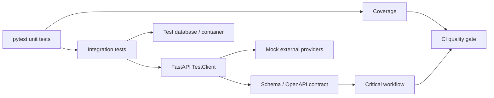

- Unit tests cover pure functions and domain rules.
- Integration tests cover database, cache, filesystem and external adapters.
- Use fixtures/factories for deterministic setup and cleanup.
- Mock at external boundaries, not every internal implementation detail.
- Run Ruff/Black/isort, mypy/pyright, pytest and security scanning in CI.
- Measure branch coverage and mutation quality, not only line coverage.

**Example pytest fixture:**

```python
import pytest

@pytest.fixture
def sample_user():
    return {"name": "Ramu", "age": 25}

def test_user_name(sample_user):
    assert sample_user["name"] == "Ramu"
```

## Profiling and Performance

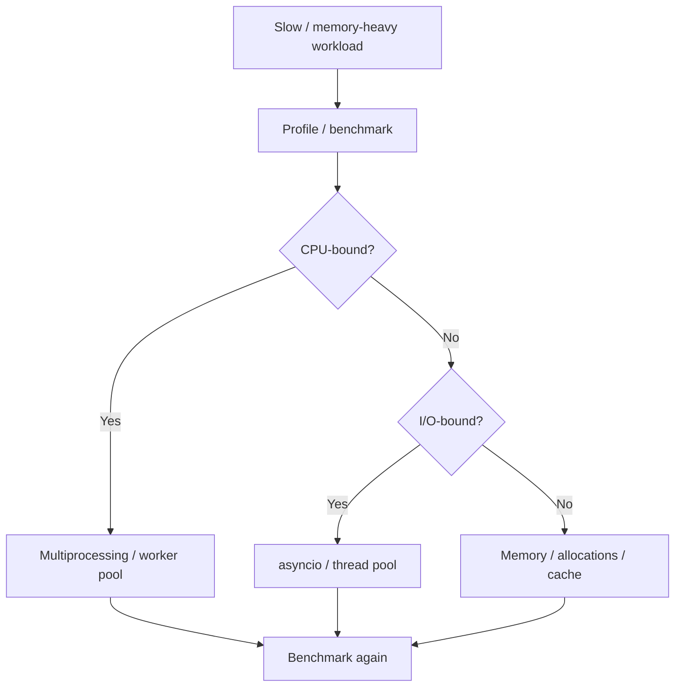

- Profile before optimizing: `cProfile`, `pyinstrument`, `tracemalloc`, `timeit` and `py-spy`.
- Avoid premature micro-optimization or changing clear code for negligible gains.
- Reuse sessions/connection pools and avoid unbounded in-memory lists.
- Use generators for sequential large datasets instead of materializing all records.
- Cache pure or expensive results only with clear invalidation and TTL behavior.
- For CPU-heavy work, multiprocessing or native extensions are preferred over threading under CPython GIL.

## Async FastAPI Architecture

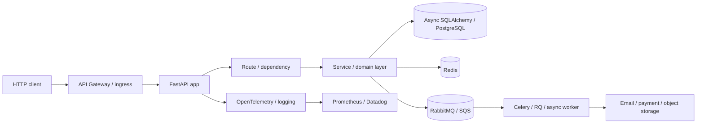

- Route functions stay thin; services own business logic and adapters own infrastructure.
- Use async clients and database drivers consistently across the request path.
- Do not run CPU-heavy or blocking synchronous code inside the event-loop thread.
- Use dependency injection for database sessions, settings, auth and external clients.
- Add request IDs, structured logs, tracing, timeouts and health/readiness endpoints.

## Memory and Object Model

- `==` compares values; `is` compares object identity.
- Small immutable values may be interned, but code should not depend on interned identity.
- Mutability sharing can cause unexpected side effects; copy, freeze or copy.deepcopy when appropriate.
- Iterators produce values lazily; iterables are objects that provide an iterator.
- Generators preserve suspended frame state and are suitable for streaming or on-demand sequences.
- Dataclasses are good for structured data; frozen dataclasses prevent accidental mutation.

## Security and Reliability Checklist

- Validate external input with Pydantic or dedicated schemas.
- Parameterize database queries; never format SQL from raw user input.
- Hash passwords with Argon2/bcrypt, not MD5/SHA alone.
- Store tokens and secrets in secret managers; rotate and scope credentials.
- Add TLS, CORS allowlists, CSRF strategy and rate limiting for public APIs.
- Avoid `pickle`, `eval`, `exec` and dynamic shell strings with untrusted input.
- Use subprocess argument lists, allowlists and least-privileged service users.
- Use retries only for transient failures, with exponential backoff and bounded attempts.
- Catch only relevant exceptions and preserve context for logs/tracing.

## Production Operations

- Configure environment variables and immutable settings models.
- Use Uvicorn/Gunicorn workers, container probes and graceful shutdown.
- Tune worker count based on CPU/I/O and database connection limits.
- Configure timeouts for HTTP clients, database operations and queue jobs.
- Monitor event-loop lag, process memory, GC, latency, error rate and queue backlog.
- Build small Docker images, run non-root, scan dependencies and pin versions.

## Interview Priority Matrix

| Area             | Must explain clearly                                       |
| ---------------- | ---------------------------------------------------------- |
| Python execution | Interpreted bytecode, GIL, reference counting, GC          |
| Data model       | Mutable/immutable, shallow/deep copy, iterables/generators |
| Functions        | Scope, closures, decorators, `*args`, `**kwargs`           |
| OOP              | MRO, polymorphism, dataclasses, dunder methods             |
| Concurrency      | Threading vs asyncio vs multiprocessing                    |
| Testing          | Fixtures, mocks, parametrization, coverage                 |
| Backend          | FastAPI dependencies, SQLAlchemy sessions, async I/O       |
| Performance      | Profiling, caching, connection pools, event-loop blocking  |
| Security         | Validation, SQL injection, secrets, password hashing       |
