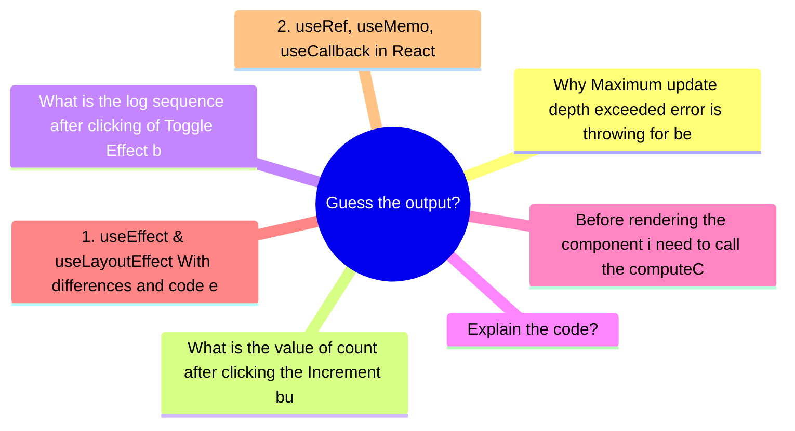

# Guess the output?



## Why `Maximum update depth exceeded` error is throwing for below code? Why it won't throw error if we wrap with `setTimeout`.

```js
import React, { useState, useEffect } from "react";

const Test = () => {
  const [count, setCount] = useState(0);
  useEffect(() => {
    setCount(count + 1);
  }, [count]);

  return <div>{count}</div>;
};

export default Test;
```

---

### ✅ Solution

### ఎందుకు "Maximum update depth exceeded" ఎర్రర్ వస్తుంది?

మీరు రాసిన ఈ కోడ్ చూడండి:

```javascript
useEffect(() => {
  setCount(count + 1); // ఇది సమస్య
}, [count]);
```

**ఎందుకు ఫెయిల్ అవుతుంది?**

1. **ఇన్ఫినిట్ లూప్ (Infinite Loop):** `useEffect` లో మీరు `[count]` అని డిపెండెన్సీ ఇచ్చారు. కాబట్టి, `count` మారిన ప్రతిసారీ ఈ ఎఫెక్ట్ రన్ అవుతుంది.
2. **అప్పటికప్పుడు అప్‌డేట్:** `setCount(count + 1)` ని కాల్ చేసిన వెంటనే, React మళ్ళీ కాంపోనెంట్‌ని రీ-రెండర్ (Re-render) చేస్తుంది.
3. **సైకిల్:** రీ-రెండర్ అయిన తర్వాత `count` విలువ మారుతుంది. విలువ మారింది కాబట్టి `useEffect` మళ్ళీ రన్ అవుతుంది. మళ్ళీ `setCount` కాల్ అవుతుంది, మళ్ళీ రీ-రెండర్ అవుతుంది... ఇలా ఇది అనంతంగా (Infinite Loop) సాగుతూనే ఉంటుంది.
4. **React రక్షణ:** ఇలా అనంతంగా జరగకుండా, బ్రౌజర్ క్రాష్ అవ్వకుండా ఉండటానికి React "Too many re-renders" (Maximum update depth exceeded) అని ఎర్రర్ ఇచ్చి ఆపేస్తుంది.

---

### `setTimeout` వాడితే ఎందుకు పని చేస్తుంది?

```javascript
useEffect(() => {
  setTimeout(() => {
    setCount(count + 1);
  }, 0);
}, [count]);
```

**ఎందుకు పని చేస్తుంది?**

- `setTimeout(..., 0)` వాడినప్పుడు, `setCount` వెంటనే రన్ అవ్వదు.
- ఇది బ్రౌజర్ యొక్క **Event Loop**లో తదుపరి సైకిల్ కోసం వేచి ఉంటుంది.
- అంటే, ప్రస్తుత రెండరింగ్ ప్రక్రియ పూర్తిగా పూర్తయిన తర్వాతే ఈ `setCount` రన్ అవుతుంది.
- దీనివల్ల, React కి "రెండరింగ్ చేస్తున్నప్పుడు మళ్ళీ అప్‌డేట్" చేయడం అనే సమస్య ఎదురుకాదు. అయితే, ఇది కూడా ఇన్ఫినిట్ లూప్‌ను క్రియేట్ చేస్తుంది (కానీ ఎర్రర్ చూపించదు), ఇది పద్ధతి కాదు.

---

### దీన్ని సరిగ్గా ఎలా రాయాలి?

మీరు `count`ని కేవలం ఒక్కసారి లేదా కండిషన్ ప్రకారం పెంచాలనుకుంటే ఇలా చేయాలి:

**1. కేవలం ఒక్కసారి మాత్రమే పెంచాలంటే (Mount అయినప్పుడు):**

```javascript
useEffect(() => {
  setCount((prevCount) => prevCount + 1);
}, []); // ఖాళీ array ఇస్తే సరిపోతుంది
```

**2. ఒక కండిషన్ ఉంటే (ఉదాహరణకు: count 10 లోపు ఉంటేనే పెంచాలి):**

```javascript
useEffect(() => {
  if (count < 10) {
    setCount(count + 1);
  }
}, [count]); // కండిషన్ రాస్తే లూప్ ఆగిపోతుంది
```

**సారాంశం:** `useEffect` లో స్టేట్ అప్‌డేట్ చేస్తున్నప్పుడు, అది మళ్ళీ అదే ఎఫెక్ట్‌ను ట్రిగ్గర్ చేయకుండా జాగ్రత్త పడాలి. లేకపోతే అనంతమైన లూప్ ఏర్పడుతుంది.

---

## What is the value of `count` after clicking the `Increment` button?

```js
import React, { useState } from "react";
function Counter() {
  const [count, setCount] = useState(0);
  function handleIncrement() {
    setCount(count + 1);
    setCount(count + 1);
  }
  function handleDecrement() {
    setCount(count - 1);
  }
  return (
    <div>
      Count: {count}
      <button onClick={handleIncrement}>Increment</button>
      <button onClick={handleDecrement}>Decrement</button>
    </div>
  );
}
```

---

### ✅ Solution

ఈ React కోడ్‌లో "Increment" బటన్‌ని ఒకసారి క్లిక్ చేస్తే `count` విలువ **1** అవుతుంది (2 కాదు). ఇది ఎందుకు జరుగుతుందో వివరంగా చూద్దాం:

### అసలు ఏం జరుగుతోంది?

మీరు `handleIncrement` ఫంక్షన్‌లో ఇలా రాశారు:

```javascript
function handleIncrement() {
  setCount(count + 1);
  setCount(count + 1);
}
```

ఇక్కడ `count` ప్రస్తుతం `0` అనుకుందాం.

1. **మొదటి `setCount(count + 1)`:** ఇది `0 + 1` ని లెక్కించి, `count` ని `1` చేయడానికి ప్రయత్నిస్తుంది.
2. **రెండవ `setCount(count + 1)`:** ఇది కూడా `0 + 1` ని మాత్రమే లెక్కిస్తుంది (ఎందుకంటే అప్పటికి మొదటి అప్‌డేట్ ఇంకా జరగలేదు, `count` విలువ ఇంకా `0` గానే ఉంది).

దీనిని **"Batching"** అంటారు. React ఈవెంట్ హ్యాండ్లర్‌లలో జరిగే స్టేట్ అప్‌డేట్‌లను వెంటనే అప్‌డేట్ చేయకుండా, వాటిని ఒక క్యూ (queue) లాగా పంపి చివర్లో ఒకేసారి అప్‌డేట్ చేస్తుంది. కాబట్టి, రెండు సార్లు `setCount` పిలిచినా, రెండు సార్లూ `0 + 1` అనే సమాచారమే React కి అందుతుంది. ఫలితంగా `count` 1 అవుతుంది.

---

### దీన్ని ఎలా సరిచేయాలి? (2 రావాలంటే ఏం చేయాలి?)

మీకు ప్రతిసారి అప్‌డేట్ అయిన వాల్యూ కావాలంటే, `setCount` కి ఒక ఫంక్షన్‌ని పంపాలి (దీనిని **Functional Update** అంటారు).

**సరిదిద్దిన కోడ్:**

```javascript
function handleIncrement() {
  setCount((prevCount) => prevCount + 1); // prevCount అంటే అప్పటికప్పుడు ఉన్న లేటెస్ట్ విలువ
  setCount((prevCount) => prevCount + 1);
}
```

**ఇప్పుడు ఏమవుతుంది?**

1. మొదటి `setCount`: `prevCount` (0) తీసుకుని, దానికి 1 కలిపి, `count` ని 1 చేస్తుంది.
2. రెండవ `setCount`: ఇది మళ్ళీ పాత 0 ని చూడదు. ఇప్పుడు `prevCount` స్థానంలో అప్డేట్ అయిన `1` ని తీసుకుంటుంది, దానికి 1 కలిపి, `count` ని 2 చేస్తుంది.

**ముఖ్యమైన విషయం:**
మీరు `setCount(count + 1)` అని వాడితే, అది పాత విలువను మాత్రమే చూస్తుంది. కానీ `setCount((c) => c + 1)` అని వాడితే, అది అప్డేట్ అయిన లేటెస్ట్ విలువను తీసుకుంటుంది.

---

## What is the log sequence after clicking of `Toggle Effect` button?

```js
import React, { useState, useEffect } from "react";

export function CleanupTest() {
  const [toggle, setToggle] = useState(false);

  useEffect(() => {
    console.log("Effect triggered");
    return () => {
      console.log("Cleanup triggered");
    };
  }, [toggle]);

  return <button onClick={() => setToggle(!toggle)}>Toggle Effect</button>;
}
```

---

### ✅ Solution

React లో `useEffect` లోపల మనం ఒక ఫంక్షన్‌ని `return` చేస్తే, దాన్ని **Cleanup function** అంటారు. ఇది ఎప్పుడు రన్ అవుతుందంటే, కాంపోనెంట్ అప్‌డేట్ అవ్వడానికి ముందు లేదా అది అన్‌మౌంట్ (Unmount) అయినప్పుడు రన్ అవుతుంది.

దీని వెనుక ఉన్న లాజిక్ ఇది:

### 1. ప్రారంభంలో (Initial Mount)

మొదటిసారి పేజీ లోడ్ అయినప్పుడు, `toggle` విలువ `false` గా ఉంటుంది. అప్పుడు `useEffect` మొదటిసారి రన్ అవుతుంది.

- **లాగ్:** `Effect triggered`

---

### 2. బటన్ క్లిక్ చేసినప్పుడు (On Click)

మీరు "Toggle Effect" బటన్‌ని క్లిక్ చేసినప్పుడు:

1. **Cleanup:** React `toggle` డిపెండెన్సీ మారింది అని గుర్తిస్తుంది. కొత్త ఎఫెక్ట్‌ను రన్ చేయడానికి ముందు, పాత ఎఫెక్ట్ (గతంలో ఉన్నది) క్లీన్ అవ్వాలి. అందుకే మొదట `return` చేసిన ఫంక్షన్ రన్ అవుతుంది.

- **లాగ్:** `Cleanup triggered`

2. **Re-run:** క్లీనప్ పూర్తయిన తర్వాత, కొత్త `toggle` విలువతో `useEffect` మళ్ళీ రన్ అవుతుంది.

- **లాగ్:** `Effect triggered`

---

### క్లుప్తంగా లాగ్ సీక్వెన్స్ (Sequence):

| సమయం                               | ఏం జరుగుతుంది?              | లాగ్ (Output)       |
| ---------------------------------- | --------------------------- | ------------------- |
| **మొదట (Mounting)**                | ఎఫెక్ట్ రన్ అవుతుంది        | `Effect triggered`  |
| **క్లిక్ చేసినప్పుడు (Re-render)** | ముందు పాతది క్లీన్ అవుతుంది | `Cleanup triggered` |
| **ఆ వెంటనే**                       | కొత్త ఎఫెక్ట్ రన్ అవుతుంది  | `Effect triggered`  |

#### **ముఖ్య గమనిక:** `useEffect` డిపెండెన్సీ (ఇక్కడ `[toggle]`) మారిన ప్రతిసారీ, React "పాత ఎఫెక్ట్‌ని క్లీన్ చేసి → కొత్త ఎఫెక్ట్‌ని రన్ చేయడం" అనే పద్ధతిని పాటిస్తుంది. ఇదే కారణం వల్ల మీరు క్లిక్ చేసినప్పుడు మొదట Cleanup, ఆ తర్వాత Effect కనిపిస్తాయి.

## Explain the code?

```js
import React, { useState, useEffect } from "react";

const DebouncedInput = () => {
  const [input, setInput] = useState("");
  const [debouncedInput, setDebouncedInput] = useState("");

  useEffect(() => {
    const timer = setTimeout(() => {
      setDebouncedInput(input);
    }, 500);

    return () => clearTimeout(timer);
  }, [input]);

  return (
    <div>
      <input
        value={input}
        onChange={(e) => setInput(e.target.value)}
        placeholder="Type something"
      />
      <p>Debounced Input: {debouncedInput}</p>
    </div>
  );
};

export default DebouncedInput;
```

---

### ✅ Solution

### 💡 What is debouncing?

**Debouncing** means delaying a function's execution until after a certain period of inactivity.

For example, when typing in a search box, you don't want to send a request on **every keystroke**. Instead, you wait until the user stops typing for a bit — then fire the logic. This avoids flooding the system with unnecessary actions.

---

### 🔍 Breakdown of What the Code Does

```jsx
const [input, setInput] = useState("");
const [debouncedInput, setDebouncedInput] = useState("");
```

- `input`: holds the current value from the input box (updated on every keystroke).
- `debouncedInput`: holds the value **after the user has stopped typing** for 500ms.

---

### 👇 useEffect with debouncing logic

```jsx
useEffect(() => {
  const timer = setTimeout(() => {
    setDebouncedInput(input); // Update after 500ms of no typing
  }, 500);

  return () => clearTimeout(timer); // Clear timer if input changes before 500ms
}, [input]);
```

- **Every time `input` changes**, a new timer starts.
- If the user keeps typing, the previous timer is **cleared**.
- Only when the user stops typing for 500ms does `debouncedInput` get updated.

---

### ✅ When is this useful?

- 🔍 **Search boxes** (API calls)
- 📤 **Autosave forms**
- 📊 **Filter-heavy UIs**
- 🔧 **Avoiding expensive computations on each keystroke**

---

## Before rendering the component i need to call the `computeComplexOperation()`. What is the wrong with this?

```js
function computeComplexOperation() {
  // Resolving Complex Time Consuming Algorithm
  return 0;
}
export default function App() {
  const [count, setCount] = useState(computeComplexOperation());
  const handleCount = () => {
    setCount(count + 1);
  };
  return (
    <div className="App">
      <h1>{count}</h1>
      <button onClick={handleCount}>+</button>
    </div>
  );
}
```

---

### ✅ Solution

మీరు అడిగిన ఈ కోడ్‌లో ఉన్న ప్రధాన సమస్య **"Performance" (పనితీరు)**. దీన్ని ఎందుకు మార్చాలో, ఎందుకు సమస్య వస్తుందో తెలుగులో సులభంగా అర్థం చేసుకుందాం.

### అసలు సమస్య ఏమిటి?

మీరు `useState(computeComplexOperation())` అని రాసినప్పుడు, బ్రాకెట్స్ `()` పెట్టి ఫంక్షన్‌ని పిలుస్తున్నారు.

1. **ప్రతి రెండరింగ్‌లో రన్ అవుతుంది:** React కాంపోనెంట్ ఏదైనా కారణం వల్ల (ఉదాహరణకు `count` మారినప్పుడు) రీ-రెండర్ అయిన ప్రతిసారీ, `useState` లైన్ మళ్ళీ ఎగ్జిక్యూట్ అవుతుంది.
2. **అనవసరమైన గణన:** మీ ఫంక్షన్ పేరు `computeComplexOperation` అంటేనే అది చాలా సమయం తీసుకునే (Expensive) ఆపరేషన్ అని అర్థం. కాంపోనెంట్ ప్రతిసారీ రీ-రెండర్ అయినప్పుడు, ఈ హెవీ ఆపరేషన్ మళ్ళీ మళ్ళీ రన్ అవ్వడం వల్ల మీ వెబ్‌సైట్ **స్లో అయిపోతుంది**.
3. **అవసరం లేకున్నా రన్ అవుతుంది:** `useState` కి మొదటిసారి కాంపోనెంట్ లోడ్ అయినప్పుడు మాత్రమే ఆ వాల్యూ కావాలి. ఆ తర్వాత స్టేట్ అప్‌డేట్ అయినప్పుడు ఆ ఫంక్షన్ మళ్ళీ రన్ అవ్వాల్సిన అవసరం లేదు.

---

### దీన్ని ఎలా సరిచేయాలి? (రెండు మార్గాలు)

#### 1. "Lazy Initialization" (చాలా సులభమైన మార్గం)

మీరు కేవలం ఆ ఫంక్షన్ పేరును, బ్రాకెట్స్ లేకుండా `useState` కి పంపితే సరిపోతుంది:

```javascript
const [count, setCount] = useState(computeComplexOperation);
// బ్రాకెట్స్ () లేవు!
```

- **ఎందుకు ఇది పనిచేస్తుంది?** మీరు `()` తీసేస్తే, ఫంక్షన్‌ని ఇప్పుడే రన్ చేయమని చెప్పడం లేదు. ఆ ఫంక్షన్‌ని React కి ఇస్తున్నారు. React దీన్ని కేవలం **మొదటిసారి (Initial mount)** మాత్రమే కాల్ చేస్తుంది. ఆ తర్వాత రీ-రెండర్ అయినప్పుడు అది దీన్ని పట్టించుకోదు. ఇది పర్ఫార్మెన్స్‌ని బాగా పెంచుతుంది.

---

#### 2. `useCallback` ఎందుకు వాడాలి?

- **ఎందుకు వాడాలి?** `useCallback` ఆ ఫంక్షన్‌ని "Memoize" చేస్తుంది. అంటే, కాంపోనెంట్ రీ-రెండర్ అయినా, ఆ ఫంక్షన్ పాత రిఫరెన్స్‌నే (Reference) పట్టుకుని ఉంటుంది.
- **లాభం:** మీరు ఈ ఫంక్షన్‌ను వేరే `useEffect` లలో డిపెండెన్సీగా వాడినా, లేదా చైల్డ్ కాంపోనెంట్స్‌కి పంపినా, అనవసరంగా అవి రీ-రెండర్ అవ్వవు.

### సారాంశం (Summary)

- **తప్పు:** `useState(computeComplexOperation())` - ఇది ప్రతి రెండరింగ్‌లో ఆ కాంప్లెక్స్ ఫంక్షన్‌ని రన్ చేస్తుంది.
- **ఒరిజినల్ ఫిక్స్:** `useState(computeComplexOperation)` - బ్రాకెట్స్ తీసేస్తే సరిపోతుంది, దీనిని **Lazy Initialization** అంటారు.
- **అడ్వాన్స్‌డ్ ఫిక్స్:** `useCallback` - ఫంక్షన్ స్టేబిలిటీ కోసం (ఇది కూడా చాలా మంచి ప్రాక్టీస్).

### మీరు కేవలం స్టేట్ ఇనిషియలైజ్ చేయడానికి మాత్రమే అయితే, **మొదటి పద్ధతి (Lazy Initialization)** సరిపోతుంది. ఒకవేళ ఆ ఫంక్షన్‌ని వేరే చోట కూడా వాడుతుంటే `useCallback` వాడటం ఉత్తమం.

---

# 1. `useEffect` & `useLayoutEffect` With differences and code example

Reactలో `useEffect` మరియు `useLayoutEffect` అనేవి ఫంక్షనల్ కాంపోనెంట్లలో "side effects" (ఉదాహరణకు: డేటా ఫెచింగ్, DOM మానిప్యులేషన్) నిర్వహించడానికి ఉపయోగించే రెండు ముఖ్యమైన హుక్స్.

వీటి మధ్య ప్రధాన తేడా అవి ఎప్పుడు రన్ అవుతాయి అనే దానిపై ఆధారపడి ఉంటుంది. వీటి గురించి వివరంగా తెలుసుకుందాం:

---

### 1. useEffect

ఇది సర్వసాధారణంగా మనం వాడే హుక్.

- **ఎప్పుడు రన్ అవుతుంది:** బ్రౌజర్ స్క్రీన్‌ను పెయింట్ (Render/Paint) చేసిన **తర్వాత** ఇది రన్ అవుతుంది. కాబట్టి, ఇది యూజర్ అనుభవాన్ని (UI rendering) ఏమాత్రం ఆపదు (Non-blocking).
- **ఎందుకు వాడాలి:** API కాల్స్, డేటా ఫెచింగ్, సబ్‌స్క్రిప్షన్స్ వంటి పనులకు ఇది ఉత్తమం.
- **ఉదాహరణ:**

```javascript
useEffect(() => {
  console.log("ఇది UI పెయింట్ అయిన తర్వాత రన్ అవుతుంది");
}, [count]);
```

---

### 2. useLayoutEffect

ఇది `useEffect` లాగే ఉంటుంది, కానీ దీని సమయం వేరు.

- **ఎప్పుడు రన్ అవుతుంది:** React అన్ని DOM మార్పులను పూర్తి చేసిన **తర్వాత**, కానీ బ్రౌజర్ స్క్రీన్‌పై కొత్త మార్పులను చూపించడానికి (Paint) **ముందే** ఇది రన్ అవుతుంది.
- **ఎందుకు వాడాలి:** ఏదైనా ఎలిమెంట్ యొక్క కొలతలు (Measurements) తీసుకోవాలన్నా లేదా DOMలో ఏదైనా మార్పు చేసి, అది యూజర్‌కు కనిపించే లోపే సరిచేయాలన్నా దీనిని వాడాలి. ఇది సింక్రోనస్ (Synchronous) గా పనిచేస్తుంది, కాబట్టి జాగ్రత్తగా వాడాలి.
- **ఉదాహరణ:**

```javascript
useLayoutEffect(() => {
  // DOM కొలతలు తీసుకుని, మార్పులు చేయడానికి ఉపయోగపడుతుంది
  const dimension = textRef.current.getBoundingClientRect();
  console.log(dimension);
}, []);
```

---

### ప్రధాన తేడాలు (Key Differences)

| ఫీచర్        | useEffect                         | useLayoutEffect                         |
| ------------ | --------------------------------- | --------------------------------------- |
| **టైమింగ్**  | పెయింట్ అయిన తర్వాత (After Paint) | పెయింట్ అవ్వడానికి ముందు (Before Paint) |
| **Blocking** | నాన్-బ్లాకింగ్ (Non-blocking)     | బ్లాకింగ్ (Blocking)                    |
| **ఉపయోగం**   | డేటా ఫెచింగ్, API కాల్స్          | DOM మెజర్మెంట్స్, లేఅవుట్ మార్పులు      |

---

### ఒక చిన్న ఉదాహరణ (Code Example)

ఈ కోడ్‌లో `useEffect` మరియు `useLayoutEffect` ఎలా పని చేస్తాయో చూడవచ్చు:

```javascript
import React, { useEffect, useLayoutEffect, useState } from "react";

const Example = () => {
  const [color, setColor] = useState("blue");

  useEffect(() => {
    console.log("useEffect: UI పెయింట్ అయిన తర్వాత రన్ అయింది");
  }, [color]);

  useLayoutEffect(() => {
    console.log("useLayoutEffect: UI పెయింట్ అవ్వకముందే రన్ అయింది");
  }, [color]);

  return (
    <div>
      <h1 style={{ color }}>Hello, World!</h1>
      <button onClick={() => setColor(color === "blue" ? "red" : "blue")}>
        రంగు మార్చు
      </button>
    </div>
  );
};

export default Example;
```

**Execution Order (ముందు ఏది జరుగుతుంది?):**
మీరు బటన్ నొక్కినప్పుడు, ముందు `useLayoutEffect` రన్ అవుతుంది, ఆ తర్వాత `useEffect` రన్ అవుతుంది.

### ఏది ఎప్పుడు వాడాలి?

- **90% సందర్భాల్లో `useEffect` నే వాడండి.** ఇది అప్లికేషన్ పర్ఫార్మెన్స్‌కు మంచిది.
- ఒకవేళ మీరు ఏదైనా ఎలిమెంట్ సైజు లేదా పొజిషన్ (DOM measurement) ఆధారంగా స్క్రీన్‌పై ఏదైనా మార్పు చేయాల్సి వస్తే, అప్పుడు మాత్రమే `useLayoutEffect` ని వాడండి. లేదంటే యూజర్‌కు స్క్రీన్ flicker (మెరిసినట్లు) అయ్యే అవకాశం ఉంది.

---

# 2. **`useRef`, `useMemo`, `useCallback` in React**

React provides several hooks to optimize state management, performance, and component rendering. Let's dive into some key hooks:

## 📌 Note:

- useMemo for memoization for result(heavy calculations).
- useCallback for memoization for function.
- useEffect, useMemo and useCallback is same. useEffect cant return anything and it cant assign to any variable

---

## **1️⃣ `useRef` - Persist Values Without Re-rendering**

**What is `useRef`?**

- `useRef` **stores a mutable value** that persists across renders **without causing re-renders**.
- It’s commonly used for:  
  ✅ Accessing/manipulating DOM elements.  
  ✅ Persisting values across renders without re-triggering renders.

### 📌 **Example: Accessing a DOM Element**

In this example, inputRef is used to store a reference to the input element, allowing the focusInput function to focus on the input element when the button is clicked without causing re-renders.

```jsx
import React, { useRef } from "react";

function MyComponent() {
  const inputRef = useRef(null);

  const focusInput = () => {
    inputRef.current.focus();
    inputRef.current.style.width = "300px"; // we can manipulate DOM with out rerendering the component
  };

  return (
    <div>
      <input ref={inputRef} type="text" />
      <button onClick={focusInput}>Focus Input</button>
    </div>
  );
}
export default MyComponent;
```

### 📌 **Example: Focus Input Field**

To focus on the username input when the component mounts we can use useRef.

```jsx
import React, { useEffect, useRef } from "react";

function LoginPage() {
  const usernameInputRef = useRef(null);

  useEffect(() => {
    usernameInputRef.current.focus();
  }, []);

  return (
    <div>
      <h2>Login</h2>
      <form>
        <label htmlFor="username">Username:</label>
        <input
          type="text"
          id="username"
          name="username"
          ref={usernameInputRef}
        />
        <br />
        <br />
        <label htmlFor="password">Password:</label>
        <input type="password" id="password" name="password" />
        <br />
        <br />
        <input type="submit" value="Login" />
      </form>
    </div>
  );
}

export default LoginPage;
```

### 📌 **Example: Mutable variable without causing re-rendering**

In this example, inputRef is used to store a count without causing re-renders

```jsx
import React, { useEffect, useRef, useState } from "react";

const App = () => {
  const [name, setName] = useState("");
  const refCount = useRef(0);

  useEffect(() => {
    refCount.current = refCount.current + 1;
  }); // dependency array is not passing. if the state changes this will execute
  return (
    <div>
      <input onChange={({ target }) => setName(target.value)} />
      <h2>Name: {name}</h2>
      <h4>Renders: {refCount.current}</h4>
    </div>
  );
};

export default App;
```

✅ **Best use cases**: DOM manipulation, storing mutable values without re-renders.

---

## **2️⃣ `useMemo` - Optimize Expensive Calculations**

Reactలో `useMemo` అనేది **పెర్ఫార్మెన్స్ ఆప్టిమైజేషన్ (Performance Optimization)** కోసం ఉపయోగించే ఒక హుక్. దీనిని "Memoization" అని కూడా అంటారు.

### `useMemo` అంటే ఏమిటి?

ఒక ఫంక్షనల్ కాంపోనెంట్‌లో ఏదైనా పెద్ద కాలిక్యులేషన్ (ఉదాహరణకు: పెద్ద లూప్‌లు, డేటా ఫిల్టరింగ్) చేస్తున్నప్పుడు, ఆ కాంపోనెంట్ ప్రతిసారి రీ-రెండర్ (Re-render) అయినప్పుడు ఆ కాలిక్యులేషన్ మళ్ళీ మళ్ళీ జరుగుతుంది. దీనివల్ల యాప్ స్లో అవ్వచ్చు.

`useMemo` ఆ కాలిక్యులేషన్ యొక్క **ఫలితాన్ని (result) మెమరీలో దాచుకుంటుంది**. డిపెండెన్సీలు మారనంత వరకు, ఆ పాత ఫలితాన్నే తిరిగి ఇస్తుంది. దీనివల్ల అనవసరమైన కాలిక్యులేషన్స్ ఆగిపోతాయి.

---

### కోడ్ ఉదాహరణ

ఈ ఉదాహరణలో `expensiveCalculation` అనే ఫంక్షన్ చాలా సమయం తీసుకుంటుందని అనుకుందాం.

```javascript
import React, { useState, useMemo } from "react";

const App = () => {
  const [count, setCount] = useState(0);
  const [text, setText] = useState("");

  // ఒక కష్టమైన కాలిక్యులేషన్ అనుకుందాం
  const expensiveCalculation = (num) => {
    console.log("కాలిక్యులేషన్ జరుగుతోంది...");
    for (let i = 0; i < 1000000000; i++) {} // సమయం తీసుకునే లూప్
    return num * 2;
  };

  // useMemo లేకుండా ఉంటే, 'text' మారినప్పుడు కూడా ఈ ఫంక్షన్ రన్ అవుతుంది
  // కానీ useMemo వాడటం వల్ల 'count' మారినప్పుడు మాత్రమే ఇది రన్ అవుతుంది
  const calculationResult = useMemo(() => {
    return expensiveCalculation(count);
  }, [count]);

  return (
    <div>
      <h3>Result: {calculationResult}</h3>
      <button onClick={() => setCount(count + 1)}>
        Count పెంచండి ({count})
      </button>
      <br />
      <br />
      <input
        type="text"
        value={text}
        onChange={(e) => setText(e.target.value)}
        placeholder="ఏదైనా టైప్ చేయండి..."
      />
      <p>మీరు టైప్ చేసింది: {text}</p>
    </div>
  );
};

export default App;
```

### ఈ కోడ్‌లో ఏమవుతుంది?

1. **`useMemo` లేకపోతే:** మీరు "టైప్" చేసినప్పుడల్లా కాంపోనెంట్ రీ-రెండర్ అవుతుంది. అప్పుడు `expensiveCalculation` ఫంక్షన్ ప్రతిసారీ రన్ అయ్యి, యాప్ హ్యాంగ్ అయినట్లు (slow) అనిపిస్తుంది.
2. **`useMemo` ఉంటే:** `[count]` అనే డిపెండెన్సీని మనం ఇచ్చాం. కాబట్టి, `count` మారినప్పుడు మాత్రమే ఆ కాలిక్యులేషన్ జరుగుతుంది. మీరు ఇన్పుట్ బాక్స్‌లో టైప్ చేసినప్పుడు `text` స్టేట్ మారుతుంది, కానీ `count` మారదు కాబట్టి, `expensiveCalculation` మళ్ళీ రన్ అవ్వదు. ఫలితంగా యాప్ వేగంగా పనిచేస్తుంది.

---

### గుర్తుంచుకోవాల్సినవి:

- **ప్రతిచోటా వాడకండి:** చిన్న చిన్న లెక్కలకు (ఉదా: 2+2) `useMemo` అవసరం లేదు. ఇది కూడా ఒక రకమైన మెమరీని తీసుకుంటుంది. కేవలం చాలా ఎక్కువ సమయం తీసుకునే కాలిక్యులేషన్స్ (Expensive calculations) కోసం మాత్రమే దీన్ని వాడండి.
- **డిపెండెన్సీ అర్రే:** `useEffect` లాగే, ఇందులో కూడా మీరు ఏ వాల్యూ మీదైతే మీ కాలిక్యులేషన్ ఆధారపడి ఉందో, ఆ వాల్యూని డిపెండెన్సీ అర్రేలో `[]` ఇవ్వాలి.

---

## **3️⃣ `useCallback` - Memoize Functions for Optimization**

**What is `useCallback`?**

- `useCallback` **memoizes a function** so that it does not get recreated on every render.
- Useful when passing **functions as props** to child components to prevent unnecessary re-renders.
- It helps in **performance optimization** by ensuring that a function retains its reference unless dependencies change.

---

### **Example: Preventing Unnecessary Re-renders in Child Components**

In this example, we'll create a **parent component** that renders a **child component**.

- The child component receives a function as a prop.
- Without `useCallback`, the function would be **recreated** on every render, causing unnecessary re-renders of the child.
- By using `useCallback`, we ensure that the function reference remains **stable**, preventing unnecessary re-renders.

---

### **Code Example**

```jsx
import React, { useState, useCallback } from "react";

// Child component
const ChildComponent = React.memo(({ onIncrement }) => {
  console.log("Child Component Rendered!");
  return <button onClick={onIncrement}>Increment</button>;
});

// Parent component
const ParentComponent = () => {
  const [count, setCount] = useState(0);
  const [theme, setTheme] = useState("light");

  // Memoizing the function using useCallback
  const handleIncrement = useCallback(() => {
    setCount((prevCount) => prevCount + 1);
  }, []); // No dependencies, so the function reference remains the same

  // ChildComponent will called on each button click(Increment/Toggle Theme). if we dint use the useCallback.
  // const handleIncrement = () => {
  //   setCount((prevCount) => prevCount + 1);
  // };

  return (
    <div
      style={{
        background: theme === "light" ? "#fff" : "#333",
        color: theme === "light" ? "#000" : "#fff",
        padding: "20px",
      }}
    >
      <h2>Count: {count}</h2>
      <ChildComponent onIncrement={handleIncrement} />
      <button onClick={() => setTheme(theme === "light" ? "dark" : "light")}>
        Toggle Theme
      </button>
    </div>
  );
};

export default ParentComponent;
```

---

### **🧐 Explanation**

1️⃣ **Without `useCallback`:**

- Every time `ParentComponent` re-renders (e.g., when toggling the theme), `handleIncrement` is recreated.
- Since the function reference changes, `ChildComponent` also re-renders unnecessarily.

2️⃣ **With `useCallback`:**

- `handleIncrement` is **memoized**, meaning it keeps the **same reference** between renders.
- The `ChildComponent` **does not re-render** unless `handleIncrement` changes, improving performance.

3️⃣ **`React.memo` Optimization:**

- `React.memo` **memoizes the child component** to prevent unnecessary re-renders unless its props change.
- Since `handleIncrement` reference remains **stable**, the `ChildComponent` won’t re-render when the theme changes.

---

### **Expected Behavior**

| Action                  | What Happens?                                                                                                                              |
| ----------------------- | ------------------------------------------------------------------------------------------------------------------------------------------ |
| Clicking "Increment"    | The `count` updates, `ParentComponent` re-renders, but `ChildComponent` **does not re-render unnecessarily**.                              |
| Clicking "Toggle Theme" | The theme changes, `ParentComponent` re-renders, but `ChildComponent` **does not re-render** since `onIncrement` reference remains stable. |

✅ **Best use cases**: Passing stable function references to child components, optimizing event handlers.

---

### **🚀 Why Use `useReducer` Instead of `useState`?**

✅ **Better for complex state logic** (especially when the next state depends on the previous one).  
✅ **Keeps state transitions predictable** using a reducer function.  
✅ **Useful for state updates triggered by multiple actions**.

---

### **📌 When to Use `useReducer`?**

| Situation                                         | `useState` ✅             | `useReducer` ✅                     |
| ------------------------------------------------- | ------------------------- | ----------------------------------- |
| Simple state updates (toggle, counter)            | ✅ Best Choice            | 🚫 Overkill                         |
| Complex state logic with multiple actions         | 🚫 Hard to manage         | ✅ Ideal                            |
| When the next state depends on the previous state | 🚫 Less efficient         | ✅ Recommended                      |
| Managing state across deeply nested components    | 🚫 Requires prop drilling | ✅ Can be combined with Context API |

---

### **🎯 Real-World Use Cases for `useReducer`**

✔️ **Form validation** (handling multiple fields, errors, and submission state).  
✔️ **Todo lists** (adding, removing, updating items).  
✔️ **Fetching and managing API data** (handling loading, success, and error states).

---

## **Summary: When to Use What?**

| Hook          | Purpose                                  | Best Use Cases                                    |
| ------------- | ---------------------------------------- | ------------------------------------------------- |
| `useRef`      | Stores mutable values without re-renders | Accessing DOM elements, tracking previous values  |
| `useMemo`     | Memoizes computed values                 | Expensive calculations, filtering large datasets  |
| `useCallback` | Memoizes functions                       | Preventing unnecessary function recreation        |
| `useReducer`  | Manages complex state logic              | Forms, state transitions, complex component state |

# 3. **🆚 `useState` vs `useReducer` in React**

Reactలో స్టేట్ (State) నిర్వహణ కోసం `useState` మరియు `useReducer` అనేవి రెండు ముఖ్యమైన హుక్స్. వీటి మధ్య వ్యత్యాసాన్ని మరియు దేనిని ఎప్పుడు వాడాలో సులభంగా అర్థం చేసుకుందాం.

---

### 📌 ప్రధాన తేడాలు (Key Differences)

| ఫీచర్               | useState                                       | useReducer                                           |
| ------------------- | ---------------------------------------------- | ---------------------------------------------------- |
| **ఎప్పుడు వాడాలి?** | సింపుల్ స్టేట్ (ఉదా: `true/false`, నంబర్లు)    | క్లిష్టమైన స్టేట్ లాజిక్ (ఉదా: Objects, Arrays)      |
| **అప్డేట్ విధానం**  | నేరుగా స్టేట్ వాల్యూని మార్చవచ్చు (`setState`) | ఒక `reducer` ఫంక్షన్ ద్వారా మారుస్తుంది              |
| **నిర్వహణ**         | చిన్న కాంపోనెంట్లకు సులభం                      | క్లిష్టమైన లాజిక్ ఉన్నప్పుడు చాలా పద్ధతిగా ఉంటుంది   |
| **సామర్థ్యం**       | సింపుల్ పనులకు సరిపోతుంది                      | చాలా స్టేట్ మార్పులు ఒకేసారి జరిగేటప్పుడు ఇది ఉత్తమం |

---

### 1. useState: చిన్న చిన్న పనుల కోసం

`useState` అనేది మనం ఎక్కువగా వాడే హుక్. మీ స్టేట్ చాలా సరళంగా (Simple) ఉన్నప్పుడు, అంటే కేవలం ఒక నంబర్ లేదా ఒక స్ట్రింగ్ మాత్రమే ఉన్నప్పుడు `useState` వాడటం ఉత్తమం.

- **ఎప్పుడు వాడాలి?**: ఒక కౌంటర్, టోగుల్ బటన్, లేదా సింపుల్ ఫామ్ ఇన్పుట్ వంటి వాటికి.
- **ఎందుకు?**: ఇది చాలా క్లుప్తంగా (Concise) ఉంటుంది మరియు కోడ్ సులభంగా అర్థమవుతుంది.

**ఉదాహరణ:**

```javascript
const [count, setCount] = useState(0); // కేవలం ఒక నంబర్
```

---

### 2. useReducer: పెద్ద మరియు క్లిష్టమైన పనుల కోసం

`useReducer` అనేది పెద్ద ప్రాజెక్టులలో, ముఖ్యంగా స్టేట్ (State) లో చాలా డేటా లేదా ఆబ్జెక్ట్స్ ఉన్నప్పుడు వాడతారు. ఇది `Redux` పనితీరును పోలి ఉంటుంది.

- **ఎప్పుడు వాడాలి?**: ఒక టోడో లిస్ట్, యూజర్ ఆథెంటికేషన్, లేదా ఒకే ఫామ్‌లో చాలా ఇన్పుట్ ఫీల్డ్స్ ఉన్నప్పుడు.
- **ఎందుకు?**: ఇక్కడ లాజిక్ అంతా ఒక `reducer` ఫంక్షన్‌లో కేంద్రీకృతమై ఉంటుంది. దీనివల్ల పెద్ద పెద్ద ఫంక్షన్స్ రాసే అవసరం ఉండదు, కోడ్ మెయింటెనెన్స్ ఈజీ అవుతుంది.

**ఉదాహరణ (Todo App లాజిక్):**
ఇక్కడ మనం `ADD_TODO` (యాడ్ చేయడం) లేదా `REMOVE_TODO` (తొలగించడం) వంటి వివిధ పనులను ఒకే ఫంక్షన్‌లో రాస్తాం.

```javascript
const todoReducer = (state, action) => {
  switch (action.type) {
    case "ADD_TODO":
      return [...state, { id: Date.now(), description: action.payload }];
    case "REMOVE_TODO":
      return state.filter((todo) => todo.id !== action.payload);
    default:
      return state;
  }
};
```

---

### 🎯 ముగింపు (ఎప్పుడు దేనిని ఎంచుకోవాలి?)

1. **`useState` వాడండి, ఎప్పుడు అంటే:**

- మీ స్టేట్ సింపుల్‌గా (Number, String, Boolean) ఉంటే.
- స్టేట్ అప్డేట్స్ వేటికవే స్వతంత్రంగా (Independent) ఉంటే.
- కోడ్ తక్కువగా, క్లుప్తంగా ఉండాలనుకుంటే.

2. **`useReducer` వాడండి, ఎప్పుడు అంటే:**

- మీ స్టేట్ ఆబ్జెక్ట్స్ (Objects) లేదా అర్రేస్ (Arrays) తో నిండి ఉంటే.
- స్టేట్ అప్డేట్స్ ఒకదానిపై ఒకటి ఆధారపడి ఉంటే (Interdependent).
- మీరు చాలా రకాల యాక్షన్స్ (Actions) ను ఒకే చోట నిర్వహించాలనుకుంటే.

క్లుప్తంగా చెప్పాలంటే, **చిన్న పనులకు `useState`, పెద్ద మరియు క్లిష్టమైన ప్రాజెక్టులకు `useReducer`** వాడటం మంచిది.

### **`useReducer` Example (Todo List)**

```jsx
import React, { useReducer, useState } from "react";

const initialTodos = [
  { id: 1, description: "Learn React" },
  { id: 2, description: "Practice Coding" },
];

// Reducer function
const todoReducer = (state, action) => {
  switch (action.type) {
    case "ADD_TODO":
      return [...state, { id: state.length + 1, description: action.payload }];
    case "REMOVE_TODO":
      return state.filter((todo) => todo.id !== action.payload);
    default:
      return state;
  }
};

const TodoApp = () => {
  const [todos, dispatch] = useReducer(todoReducer, initialTodos);
  const [text, setText] = useState("");

  const addTodo = () => {
    if (text.trim() === "") return;
    dispatch({ type: "ADD_TODO", payload: text });
    setText("");
  };

  const removeTodo = (id) => {
    dispatch({ type: "REMOVE_TODO", payload: id });
  };

  return (
    <div>
      <input value={text} onChange={(e) => setText(e.target.value)} />
      <button onClick={addTodo}>Add Todo</button>

      {todos.map((todo) => (
        <div key={todo.id}>
          <span>{todo.description}</span>
          <button onClick={() => removeTodo(todo.id)}>Remove</button>
        </div>
      ))}
    </div>
  );
};

export default TodoApp;
```

---

# 4. Create a React Counter: Increment 0 to 5, Reset to 0, and Stop

```jsx
import { useState, useEffect } from "react";

const Counter = () => {
  const [count, setCount] = useState(0);

  useEffect(() => {
    const interval = setInterval(() => {
      setCount((prv) => {
        if (prv < 5) {
          return prv + 1;
        } else {
          clearInterval(interval);
          return 0;
        }
      });
      if (count === 5) {
        console.log({ count });
        clearInterval(interval);
      }
    }, 1000);

    return () => clearInterval(interval); // Cleanup on unmount
  }, []);

  return <h1>Count: {count}</h1>;
};

export default Counter;
```

---

# 5. **Why does const allow state changes in React's useState?**

```javascript
function useState(initialState) {
  // 'currentState' is a closure variable, persisting across renders.
  let currentState = initialState;

  function setState(newState) {
    if (typeof newState === "function") {
      currentState = newState(currentState); // Allow functional updates
    } else {
      currentState = newState;
    }

    // This is where the magic of re-rendering happens.
    // In a real React implementation, this would trigger a reconciliation process.
    // For this simplified example, we'll just log the new state.
    console.log("State updated:", currentState);

    // In a real react application this function would trigger a re-render of the component.
    // This example does not have the react engine to trigger a re-render.
  }

  return [currentState, setState];
}

// Example usage (simulating a React component):

function MyComponent() {
  const [count, setCount] = useState(0); // Initialize state

  function increment() {
    setCount(count + 1); // Update state
  }

  function functionalIncrement() {
    setCount((prevCount) => prevCount + 1); //functional update
  }

  console.log("Component rendered. Count:", count);

  return { count, increment, functionalIncrement }; // Return values for testing
}

const componentInstance = MyComponent();
componentInstance.increment();
componentInstance.functionalIncrement();
```

### **Explanation and Important Notes:**

React `useState`లో `const` ఉపయోగించినప్పటికీ స్టేట్ (state) ఎలా మారుతుందో అర్థం చేసుకోవడానికి ఒక ముఖ్యమైన విషయం గుర్తుంచుకోవాలి: **`const` వేరియబుల్‌ని మనం రీ-అసైన్ (re-assign) చేయలేము, కానీ React లో మనం ప్రతిసారీ పాత వేరియబుల్‌ని మార్చడం లేదు, కొత్త వాల్యూతో కాంపోనెంట్‌ని మళ్ళీ రన్ చేస్తున్నాము.**

దీనిని సులభంగా అర్థం చేసుకోవడానికి కింద వివరణ చూడండి:

### 1. `const` ఎందుకు ఉంటుంది?

మనం `const [count, setCount] = useState(0);` అని రాసినప్పుడు, ఆ `count` అనే వేరియబుల్ ఆ నిర్దిష్ట రెండర్ (render) కి మాత్రమే సంబంధించింది. అంటే ఆ పర్టికులర్ ఫంక్షన్ కాల్ జరిగినప్పుడు `count` విలువ `0` గా స్థిరంగా ఉంటుంది. మనం `count = 5` అని మార్చడానికి ప్రయత్నిస్తే ఎర్రర్ వస్తుంది. కానీ మనం అలా చేయడం లేదు.

### 2. 'Closure' (క్లోజర్) మ్యాజిక్

React లో `useState` ఎలా పనిచేస్తుందంటే:

- మీరు `setCount` పిలిచినప్పుడు, అది ఆ స్టేట్ విలువను అప్‌డేట్ చేసి, ఆ తర్వాత **మొత్తం కాంపోనెంట్ ఫంక్షన్‌ని మళ్ళీ రన్ చేస్తుంది (Re-render)**.
- ఇప్పుడు, కొత్తగా రన్ అయిన కాంపోనెంట్‌లో `useState` మళ్ళీ కాల్ అవుతుంది. అప్పుడు React పాత స్టేట్ వాల్యూను గుర్తుపెట్టుకుని (Closure ద్వారా), మీకు కొత్త `count` విలువను ఇస్తుంది.
- అంటే, పాత `count` మారడం లేదు, బదులుగా **కొత్త `count`తో కాంపోనెంట్ కొత్తగా పుడుతోంది**.

### 3. ఒక ఉదాహరణతో అర్థం చేసుకుందాం:

దీనిని ఇలా ఊహించుకోండి:

- **మొదటి సారి:** React ఒక ఫోటో తీసింది. అందులో `count` విలువ `0`.
- **మీరు `setCount(1)` అని పిలిచారు:** React ఆ ఫోటోను పక్కన పెట్టి, మరొక కొత్త ఫోటో తీసింది. ఈ కొత్త ఫోటోలో `count` విలువ `1`.

ఇక్కడ పాత ఫోటోలోని `0` మారలేదు, మీరు కేవలం కొత్త ఫోటోని (Re-render) చూస్తున్నారు. కాబట్టి `const` కి ఎటువంటి ఇబ్బంది లేదు.

### ముఖ్యమైన పాయింట్లు:

- **Immutable (మార్చలేనిది):** React స్టేట్ అంటే పాత వాల్యూని మార్చడం కాదు, కొత్త వాల్యూతో మళ్ళీ రెండర్ చేయడం.
- **Closure:** `useState` లోపల ఉన్న `currentState` వేరియబుల్, ఫంక్షన్ బయట (అంటే React ఇంటర్నల్‌గా) స్టోర్ అవుతుంది. కాబట్టి మీరు `setCount` ద్వారా స్టేట్ మార్చినప్పుడు, ఆ క్లోజర్ లో ఉన్న విలువ మారుతుంది.
- **Re-render:** `setCount` పిలిచినప్పుడు React మీ కాంపోనెంట్ ఫంక్షన్‌ని మళ్ళీ పిలుస్తుంది. అప్పుడు `const [count, setCount] = ...` లైన్ మళ్ళీ ఎగ్జిక్యూట్ అయ్యి, కొత్త `count` విలువని తెచ్చుకుంటుంది.

**సారాంశం:** `const` అనేది ఆ ఒక్క రెండర్ కి మాత్రమే పరిమితం. React ప్రతిసారీ కొత్త రెండర్ చేస్తున్నప్పుడు, ఆ `const` వేరియబుల్‌కి కొత్త విలువను ఇస్తుంది. కాబట్టి మనం `const` వాడినా, స్టేట్ అప్‌డేట్ అవుతుంది.

# **6. Controlled vs. Uncontrolled Components in React**

In React, **controlled** and **uncontrolled components** refer to how form elements like `<input>`, `<textarea>`, and `<select>` manage their state.

---

### **Controlled Component**

In a controlled component, form data is handled by the **React component's state**. You manage the input using `useState` or class state and update it with an `onChange` handler.

- In short: React is in full control of the input element.

#### Example:

```jsx
import React, { useState } from "react";

function ControlledInput() {
  const [value, setValue] = useState("");

  const handleChange = (e) => {
    setValue(e.target.value);
  };

  return (
    <div>
      <h3>Controlled Component</h3>
      <input type="text" value={value} onChange={handleChange} />
      <p>Input: {value}</p>
    </div>
  );
}
```

**Key Points:**

- `value` is controlled by React state.
- React re-renders on every input change.

---

### **Uncontrolled Component**

In an uncontrolled component, the form data is handled by the **DOM** itself. You use **`ref`** to access the value when needed, not on every change.

- In short: The DOM handles the input's state, and React accesses it only when needed.

#### Example:

```jsx
import React, { useRef } from "react";

function UncontrolledInput() {
  const inputRef = useRef();

  const handleSubmit = () => {
    alert(`Input: ${inputRef.current.value}`);
  };

  return (
    <div>
      <h3>Uncontrolled Component</h3>
      <input type="text" ref={inputRef} />
      <button onClick={handleSubmit}>Show Value</button>
    </div>
  );
}
```

**Key Points:**

- No `useState`.
- DOM maintains the value until you explicitly read it using `ref`.

---

### **Summary**

| Feature           | Controlled Component      | Uncontrolled Component |
| ----------------- | ------------------------- | ---------------------- |
| Value source      | React state               | DOM                    |
| Access method     | `useState` & `onChange`   | `ref`                  |
| Real-time control | Yes                       | No                     |
| Recommended for   | Dynamic validation, forms | Simple or legacy forms |

# **7. How to Get Child Component Changes in Parent Component in React?**

In React, child components **cannot directly modify** their parent's state. Instead, the parent must pass a function **as a prop** to the child, allowing the child to send data back to the parent.

---

## **✅ 1. Using Callback Function (Best for Simple Cases)**

**Parent passes a function to the child.**  
**Child calls this function to send data back to the parent.**

### **Example: Child Input Value Updates Parent State**

📌 **Parent Component (`App.js`)**

```jsx
import React, { useState } from "react";
import Child from "./Child";

function App() {
  const [message, setMessage] = useState(""); // State in Parent

  // Function to update Parent state from Child
  const handleChildChange = (childData) => {
    setMessage(childData);
  };

  return (
    <div>
      <h2>Parent Component</h2>
      <p>Message from Child: {message}</p>
      <Child onMessageChange={handleChildChange} />
    </div>
  );
}

export default App;
```

📌 **Child Component (`Child.js`)**

```jsx
import React, { useState } from "react";

function Child({ onMessageChange }) {
  const [inputValue, setInputValue] = useState("");

  const handleChange = (e) => {
    setInputValue(e.target.value);
    onMessageChange(e.target.value); // Send data to Parent
  };

  return (
    <div>
      <h3>Child Component</h3>
      <input type="text" value={inputValue} onChange={handleChange} />
    </div>
  );
}

export default Child;
```

### **📌 How It Works**

✔ The **Parent (`App.js`)** has a `handleChildChange` function to update its state.  
✔ The **Parent passes this function as a prop (`onMessageChange`)** to the **Child (`Child.js`)**.  
✔ The **Child calls `onMessageChange(e.target.value)`**, sending the input value to the Parent.

---

## **✅ 2. Using `useState` with `useEffect` (If Child Needs to Trigger Side Effects in Parent)**

**Useful when the Parent needs to react when the Child's state changes.**

📌 **Parent Component (`App.js`)**

```jsx
import React, { useState } from "react";
import Child from "./Child";

function App() {
  const [childCount, setChildCount] = useState(0);

  return (
    <div>
      <h2>Parent Component</h2>
      <p>Counter from Child: {childCount}</p>
      <Child onCountChange={setChildCount} />
    </div>
  );
}

export default App;
```

📌 **Child Component (`Child.js`)**

```jsx
import React, { useState, useEffect } from "react";

function Child({ onCountChange }) {
  const [count, setCount] = useState(0);

  useEffect(() => {
    onCountChange(count); // Send count to Parent when updated
  }, [count]);

  return (
    <div>
      <h3>Child Component</h3>
      <button onClick={() => setCount(count + 1)}>Increment</button>
    </div>
  );
}

export default Child;
```

### **📌 How It Works**

✔ Every time the **Child's `count` state changes**, `useEffect` sends the updated value to the Parent.

---

## **✅ 3. Using Context API (Best for Deeply Nested Components)**

**If the child is deep inside multiple components, passing functions as props (prop drilling) can be cumbersome.**  
**The Context API allows direct communication between the Parent and Child, no matter where they are in the component tree.**

📌 **Context Setup (`CounterContext.js`)**

```jsx
import React, { createContext, useState } from "react";

// Create Context
export const CounterContext = createContext();

export function CounterProvider({ children }) {
  const [count, setCount] = useState(0);

  return (
    <CounterContext.Provider value={{ count, setCount }}>
      {children}
    </CounterContext.Provider>
  );
}
```

📌 **Parent Component (`App.js`)**

```jsx
import React, { useContext } from "react";
import { CounterProvider, CounterContext } from "./CounterContext";
import Child from "./Child";

function Parent() {
  const { count } = useContext(CounterContext);

  return (
    <div>
      <h2>Parent Component</h2>
      <p>Counter from Child: {count}</p>
      <Child />
    </div>
  );
}

export default function App() {
  return (
    <CounterProvider>
      <Parent />
    </CounterProvider>
  );
}
```

📌 **Child Component (`Child.js`)**

```jsx
import React, { useContext } from "react";
import { CounterContext } from "./CounterContext";

function Child() {
  const { setCount } = useContext(CounterContext);

  return (
    <div>
      <h3>Child Component</h3>
      <button onClick={() => setCount((prev) => prev + 1)}>Increment</button>
    </div>
  );
}

export default Child;
```

### **📌 How It Works**

✔ `CounterContext` provides the `count` and `setCount` state to all child components.  
✔ The **Child updates** the counter using `setCount`, and the **Parent automatically updates** because it reads from the same Context.

✅ **No need to pass props manually through multiple components!**

---

## **✅ 4. Using Zustand for Global State Management**

If you want to share state between **Parent and Child without Context API**, you can use **Zustand**.

📌 **Install Zustand**

```sh
npm install zustand
```

📌 **Create Zustand Store (`store.js`)**

```js
import create from "zustand";

const useCounterStore = create((set) => ({
  count: 0,
  increment: () => set((state) => ({ count: state.count + 1 })),
}));

export default useCounterStore;
```

📌 **Parent Component (`App.js`)**

```jsx
import React from "react";
import useCounterStore from "./store";
import Child from "./Child";

function App() {
  const count = useCounterStore((state) => state.count);

  return (
    <div>
      <h2>Parent Component</h2>
      <p>Counter from Child: {count}</p>
      <Child />
    </div>
  );
}

export default App;
```

📌 **Child Component (`Child.js`)**

```jsx
import React from "react";
import useCounterStore from "./store";

function Child() {
  const increment = useCounterStore((state) => state.increment);

  return (
    <div>
      <h3>Child Component</h3>
      <button onClick={increment}>Increment</button>
    </div>
  );
}

export default Child;
```

### **📌 How It Works**

✔ `useCounterStore` holds the state globally.  
✔ The **Parent reads the state**, and the **Child updates it**.  
✔ The state **automatically updates across components** without prop drilling.

---

## **🚀 Summary: Best Approach for Different Use Cases**

| Approach                      | Best For                                            |
| ----------------------------- | --------------------------------------------------- |
| **Callback Function (Props)** | Simple one-level Parent-Child communication         |
| **useState + useEffect**      | When Parent needs to react to Child's state changes |
| **Context API**               | Deeply nested components needing shared state       |
| **Zustand**                   | Simple global state management without Context API  |

---

# **8. Context API vs. Redux Store: Key Differences & When to Use What?**

Both **Context API** and **Redux** are used for state management in React, but they serve different purposes. Let’s break it down.

---

## **1. What is Context API?**

📌 **Built-in React feature** for passing state deeply without prop drilling.  
📌 Works best for **lightweight** state management like themes, user authentication, etc.

✅ **When to Use Context API?**  
✔ Simple global state (e.g., Theme, User Auth, Language Settings).  
✔ When state updates don’t require complex logic.  
✔ Avoids unnecessary re-renders if used efficiently with `useMemo`.

📌 **Example: Using Context API for Theme State**

```jsx
import React, { createContext, useContext, useState } from "react";

// Create Context
const ThemeContext = createContext();

// Provider Component
export function ThemeProvider({ children }) {
  const [theme, setTheme] = useState("light");

  return (
    <ThemeContext.Provider value={{ theme, setTheme }}>
      {children}
    </ThemeContext.Provider>
  );
}

// Hook to Use Theme
export function useTheme() {
  return useContext(ThemeContext);
}

// App Component
export default function App() {
  return (
    <ThemeProvider>
      <ChildComponent />
    </ThemeProvider>
  );
}

// Child Component
function ChildComponent() {
  const { theme, setTheme } = useTheme();
  return (
    <div>
      <p>Current Theme: {theme}</p>
      <button onClick={() => setTheme(theme === "light" ? "dark" : "light")}>
        Toggle Theme
      </button>
    </div>
  );
}
```

---

## **2. What is Redux Store?**

📌 **External library** used for managing complex application state.  
📌 **Predictable state container** with a single immutable store.  
📌 Uses **actions, reducers, and middleware** for structured updates.

✅ **When to Use Redux?**  
✔ When managing **large, complex, and shared state** across multiple components.  
✔ **If you need features like:**

- Time-travel debugging.
- Middleware for async calls (e.g., API fetching).
- Performance optimization for large apps.

📌 **Example: Redux Store for Global Counter**

1️⃣ **Install Redux Toolkit**

```sh
npm install @reduxjs/toolkit react-redux
```

2️⃣ **Create Redux Store (`store.js`)**

```js
import { configureStore, createSlice } from "@reduxjs/toolkit";

const counterSlice = createSlice({
  name: "counter",
  initialState: { count: 0 },
  reducers: {
    increment: (state) => {
      state.count += 1;
    },
    decrement: (state) => {
      state.count -= 1;
    },
  },
});

export const { increment, decrement } = counterSlice.actions;

export const store = configureStore({
  reducer: { counter: counterSlice.reducer },
});
```

3️⃣ **Wrap App with Redux Provider (`index.js`)**

```jsx
import React from "react";
import ReactDOM from "react-dom";
import { Provider } from "react-redux";
import { store } from "./store";
import App from "./App";

ReactDOM.render(
  <Provider store={store}>
    <App />
  </Provider>,
  document.getElementById("root"),
);
```

4️⃣ **Use Redux Store in Components (`Counter.js`)**

```jsx
import React from "react";
import { useSelector, useDispatch } from "react-redux";
import { increment, decrement } from "./store";

function Counter() {
  const count = useSelector((state) => state.counter.count);
  const dispatch = useDispatch();

  return (
    <div>
      <h2>Counter: {count}</h2>
      <button onClick={() => dispatch(increment())}>+</button>
      <button onClick={() => dispatch(decrement())}>-</button>
    </div>
  );
}

export default Counter;
```

---

## **3. Key Differences: Context API vs. Redux**

| Feature             | Context API                                       | Redux                                                     |
| ------------------- | ------------------------------------------------- | --------------------------------------------------------- |
| **Purpose**         | Passing state between deeply nested components    | Managing large-scale app state                            |
| **Complexity**      | Simple                                            | More structured (actions, reducers, store)                |
| **Performance**     | Can cause unnecessary re-renders if not optimized | Optimized with selectors, middleware, and dev tools       |
| **Async Support**   | Not built-in (requires extra handling)            | Supports middleware like Redux Thunk/Saga for async calls |
| **Debugging Tools** | No built-in debugging tools                       | Redux DevTools for tracking state changes                 |
| **Best for**        | Theming, authentication, UI state                 | Global state, API state, real-time updates                |

---

## **4. When to Choose What?**

| Use Case                                | Context API               | Redux  |
| --------------------------------------- | ------------------------- | ------ |
| **Theme Switching**                     | ✅ Yes                    | ❌ No  |
| **User Authentication**                 | ✅ Yes                    | ❌ No  |
| **Managing API Data**                   | ❌ No                     | ✅ Yes |
| **State Shared Across Many Components** | ❌ No (causes re-renders) | ✅ Yes |
| **Time-Travel Debugging**               | ❌ No                     | ✅ Yes |
| **Optimized for Large Apps**            | ❌ No                     | ✅ Yes |

---

## **5. When to Use Both Together?**

Sometimes, you might **combine Redux and Context API**:  
✔ **Use Context API for UI state** (e.g., theme, user auth).  
✔ **Use Redux for app-wide data** (e.g., API responses, large shared state).

📌 **Example: Theme with Context API + Data Management with Redux**

- **Context API for Theme State**
- **Redux for API Data (e.g., Products, Users, Orders)**

---

## **🔥 Conclusion**

- **Use Context API** when you need to pass state **without unnecessary complexity**.
- **Use Redux** when handling **complex, shared state** with API calls and debugging needs.
- **For small to medium projects**, Context API is enough.
- **For large-scale apps**, Redux is more scalable.

Yes! **You can create multiple states using Redux** by defining multiple **slices** and combining them in the Redux store.

---

# **9. How to Manage Multiple States in Redux?**

📌 **Use Redux Toolkit (`createSlice`)** to create separate states for different features.  
📌 **Combine multiple slices** into a single store using `configureStore`.

---

### **✅ Example: Managing User & Counter States in Redux**

We will create **two slices**:  
1️⃣ **Counter Slice** → Manages a simple counter.  
2️⃣ **User Slice** → Manages user authentication state.

---

### **1️⃣ Install Redux Toolkit (If Not Installed)**

```sh
npm install @reduxjs/toolkit react-redux
```

---

### **2️⃣ Create `counterSlice.js` (For Counter State)**

```js
import { createSlice } from "@reduxjs/toolkit";

const counterSlice = createSlice({
  name: "counter",
  initialState: { count: 0 },
  reducers: {
    increment: (state) => {
      state.count += 1;
    },
    decrement: (state) => {
      state.count -= 1;
    },
    reset: (state) => {
      state.count = 0;
    },
  },
});

export const { increment, decrement, reset } = counterSlice.actions;
export default counterSlice.reducer;
```

---

### **3️⃣ Create `userSlice.js` (For User Authentication State)**

```js
import { createSlice } from "@reduxjs/toolkit";

const userSlice = createSlice({
  name: "user",
  initialState: { name: "", isAuthenticated: false },
  reducers: {
    login: (state, action) => {
      state.name = action.payload; // Set username
      state.isAuthenticated = true;
    },
    logout: (state) => {
      state.name = "";
      state.isAuthenticated = false;
    },
  },
});

export const { login, logout } = userSlice.actions;
export default userSlice.reducer;
```

---

### **4️⃣ Create `store.js` (Combine Multiple States)**

```js
import { configureStore } from "@reduxjs/toolkit";
import counterReducer from "./counterSlice";
import userReducer from "./userSlice";

export const store = configureStore({
  reducer: {
    counter: counterReducer, // Manages counter state
    user: userReducer, // Manages user authentication state
  },
});
```

---

### **5️⃣ Wrap App with Redux Provider (`index.js`)**

```jsx
import React from "react";
import ReactDOM from "react-dom";
import { Provider } from "react-redux";
import { store } from "./store";
import App from "./App";

ReactDOM.render(
  <Provider store={store}>
    <App />
  </Provider>,
  document.getElementById("root"),
);
```

---

### **6️⃣ Use Multiple States in Components**

📌 **Component 1: Counter Component (`Counter.js`)**

```jsx
import React from "react";
import { useSelector, useDispatch } from "react-redux";
import { increment, decrement, reset } from "./counterSlice";

function Counter() {
  const count = useSelector((state) => state.counter.count);
  const dispatch = useDispatch();

  return (
    <div>
      <h2>Counter: {count}</h2>
      <button onClick={() => dispatch(increment())}>+</button>
      <button onClick={() => dispatch(decrement())}>-</button>
      <button onClick={() => dispatch(reset())}>Reset</button>
    </div>
  );
}

export default Counter;
```

---

📌 **Component 2: User Authentication Component (`User.js`)**

```jsx
import React from "react";
import { useSelector, useDispatch } from "react-redux";
import { login, logout } from "./userSlice";

function User() {
  const user = useSelector((state) => state.user);
  const dispatch = useDispatch();

  return (
    <div>
      <h2>User Authentication</h2>
      {user.isAuthenticated ? (
        <>
          <p>Welcome, {user.name}!</p>
          <button onClick={() => dispatch(logout())}>Logout</button>
        </>
      ) : (
        <>
          <button onClick={() => dispatch(login("John Doe"))}>Login</button>
        </>
      )}
    </div>
  );
}

export default User;
```

---

### **7️⃣ Use Both Components in `App.js`**

```jsx
import React from "react";
import Counter from "./Counter";
import User from "./User";

function App() {
  return (
    <div>
      <h1>Redux Multiple State Example</h1>
      <Counter />
      <User />
    </div>
  );
}

export default App;
```

---

## **🎯 Summary: Managing Multiple States in Redux**

| Feature             | Context API                         | Redux                            |
| ------------------- | ----------------------------------- | -------------------------------- |
| **Multiple States** | ❌ Not ideal for complex cases      | ✅ Easy with multiple slices     |
| **Performance**     | ❌ Can cause unnecessary re-renders | ✅ Optimized with Redux DevTools |
| **Scalability**     | ❌ Hard to manage in large apps     | ✅ Best for large applications   |
| **Best for**        | UI state, themes, simple auth       | API data, complex global state   |

✅ **Yes! You can manage multiple states using Redux** by creating multiple slices and combining them in `configureStore`. 🚀

---

Great question! Let's break it down and show you **how to use `redux-thunk` in a React app** step-by-step.

---

# **10. 🧠 What is `redux-thunk`?**

`redux-thunk` is a **middleware** that lets you write **async logic (like API calls)** inside your Redux actions.  
Normally, Redux actions are just plain objects. With thunk, they can return **functions** that dispatch actions after async tasks (like fetching data).

---

## 🔧 Step-by-Step Setup

### 1️⃣ Install Dependencies

```bash
npm install redux react-redux redux-thunk
```

---

### 2️⃣ Create Redux Store with Thunk

```js
// store.js
import { createStore, applyMiddleware } from "redux";
import thunk from "redux-thunk";
import rootReducer from "./reducers"; // combineReducers output

const store = createStore(rootReducer, applyMiddleware(thunk));

export default store;
```

---

### 3️⃣ Wrap App with Provider

```js
// index.js
import React from "react";
import ReactDOM from "react-dom";
import { Provider } from "react-redux";
import App from "./App";
import store from "./store";

ReactDOM.render(
  <Provider store={store}>
    <App />
  </Provider>,
  document.getElementById("root"),
);
```

---

### 4️⃣ Write a Thunk Action (Async Fetch Example)

```js
// actions/userActions.js
export const fetchUsers = () => {
  return async (dispatch) => {
    dispatch({ type: "FETCH_USERS_REQUEST" });

    try {
      const res = await fetch("https://jsonplaceholder.typicode.com/users");
      const data = await res.json();
      dispatch({ type: "FETCH_USERS_SUCCESS", payload: data });
    } catch (err) {
      dispatch({ type: "FETCH_USERS_FAILURE", payload: err.message });
    }
  };
};
```

---

### 5️⃣ Create Reducer

```js
// reducers/userReducer.js
const initialState = {
  loading: false,
  users: [],
  error: null,
};

const userReducer = (state = initialState, action) => {
  switch (action.type) {
    case "FETCH_USERS_REQUEST":
      return { ...state, loading: true };
    case "FETCH_USERS_SUCCESS":
      return { ...state, loading: false, users: action.payload };
    case "FETCH_USERS_FAILURE":
      return { ...state, loading: false, error: action.payload };
    default:
      return state;
  }
};

export default userReducer;
```

---

### 6️⃣ Combine Reducers

```js
// reducers/index.js
import { combineReducers } from "redux";
import userReducer from "./userReducer";

export default combineReducers({
  user: userReducer,
});
```

---

### 7️⃣ Use in Component

```js
// components/UserList.js
import React, { useEffect } from "react";
import { useDispatch, useSelector } from "react-redux";
import { fetchUsers } from "../actions/userActions";

function UserList() {
  const dispatch = useDispatch();
  const { users, loading, error } = useSelector((state) => state.user);

  useEffect(() => {
    dispatch(fetchUsers());
  }, [dispatch]);

  if (loading) return <p>Loading...</p>;
  if (error) return <p>Error: {error}</p>;

  return (
    <ul>
      {users.map((u) => (
        <li key={u.id}>{u.name}</li>
      ))}
    </ul>
  );
}

export default UserList;
```

---

## ✅ Summary

| Part            | Purpose                                          |
| --------------- | ------------------------------------------------ |
| `redux-thunk`   | Middleware to write async logic in Redux actions |
| `dispatch()`    | Triggers actions from inside components          |
| `useSelector()` | Access Redux state                               |
| `useDispatch()` | Send actions (including thunks)                  |

---

# **11. What is a Pure Component**

In React, **Pure Components** are components that implement `shouldComponentUpdate()` with a shallow comparison of props and state. This helps prevent unnecessary re-renders and improves performance.

### Key Points:

- **Extends `React.PureComponent`** instead of `React.Component`
- **Automatically implements `shouldComponentUpdate()`** using a shallow prop and state comparison
- **Useful for optimizing functional and class components** by preventing redundant renders

---

### Example: Using a Pure Component

```jsx
import React, { PureComponent, useState } from "react";

class Counter extends PureComponent {
  render() {
    console.log("Counter component re-rendered");
    return <h2>Count: {this.props.count}</h2>;
  }
}

const App = () => {
  const [count, setCount] = useState(0);
  const [otherState, setOtherState] = useState(false);

  return (
    <div>
      <Counter count={count} />
      <button onClick={() => setCount(count + 1)}>Increment Count</button>
      <button onClick={() => setOtherState(!otherState)}>
        Toggle Other State
      </button>
    </div>
  );
};

export default App;
```

---

### Explanation:

1. `Counter` extends `PureComponent`, so it only re-renders if `count` changes.
2. If `otherState` changes, `Counter` **does not** re-render unnecessarily.
3. This improves performance in large applications.

### Pure Component with React.memo and Objects

```jsx
const ProfileCard = React.memo(
  ({ user }) => {
    console.log("ProfileCard component re-rendered");
    return (
      <div>
        <h3>{user.name}</h3>
        <p>Email: {user.email}</p>
      </div>
    );
  },
  (prevProps, nextProps) => prevProps.user.name === nextProps.user.name,
);

export default ProfileCard;
```

✅ Uses custom comparison to avoid unnecessary re-renders
Great! Let's break it down.

---

# **12. 🪝 What is a **Custom Hook** in React?**

A **custom hook** is just a **JavaScript function** that:

- Starts with the word `use` (like `useFetch`, `useAuth`, etc.)
- Can use other React hooks (`useState`, `useEffect`, etc.)
- Helps **re-use logic** across multiple components.

### ✅ Why use it?

- Keep components clean.
- Avoid duplicating logic (like fetching data, handling forms, etc.)

---

## 🔧 Example: `useFetch` Custom Hook

Here’s a simple custom hook that fetches data from an API.

```js
import { useState, useEffect } from "react";

function useFetch(url) {
  const [data, setData] = useState(null);
  const [loading, setLoading] = useState(true);
  const [error, setError] = useState(null);

  useEffect(() => {
    let isMounted = true; // optional: to avoid setting state on unmounted component

    async function fetchData() {
      setLoading(true);
      try {
        const response = await fetch(url);
        if (!response.ok) throw new Error("Error fetching data");
        const result = await response.json();
        if (isMounted) {
          setData(result);
          setError(null);
        }
      } catch (err) {
        if (isMounted) setError(err.message);
      } finally {
        if (isMounted) setLoading(false);
      }
    }

    fetchData();

    return () => {
      isMounted = false;
    };
  }, [url]);

  return { data, loading, error };
}

export default useFetch;
```

---

## 📦 How to Use `useFetch` in a Component:

```js
import React from "react";
import useFetch from "./useFetch";

function UserList() {
  const { data, loading, error } = useFetch(
    "https://jsonplaceholder.typicode.com/users",
  );

  if (loading) return <p>Loading...</p>;
  if (error) return <p>Error: {error}</p>;

  return (
    <ul>
      {data.map((user) => (
        <li key={user.id}>{user.name}</li>
      ))}
    </ul>
  );
}

export default UserList;
```

---
