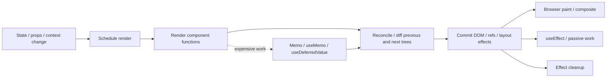
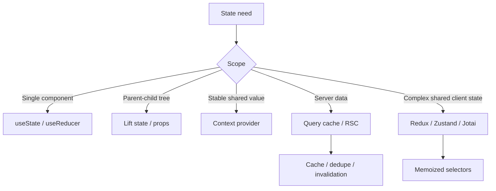
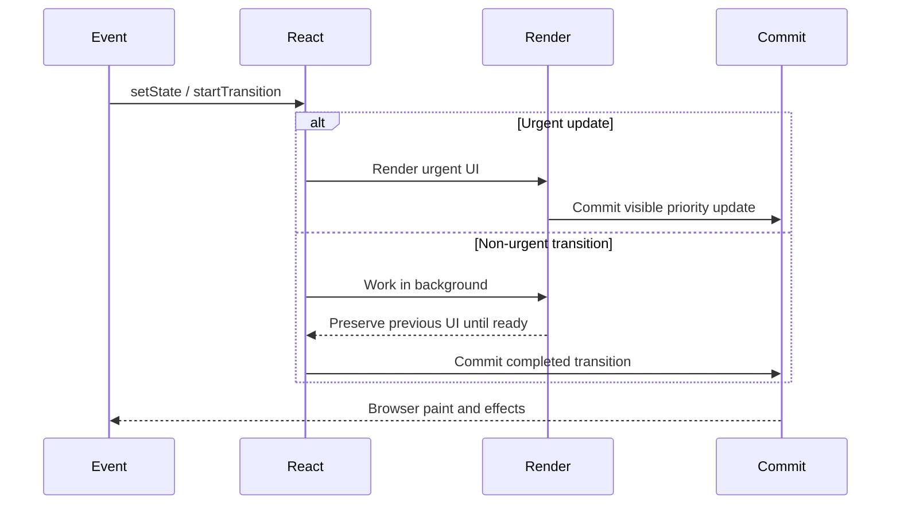
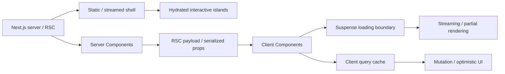
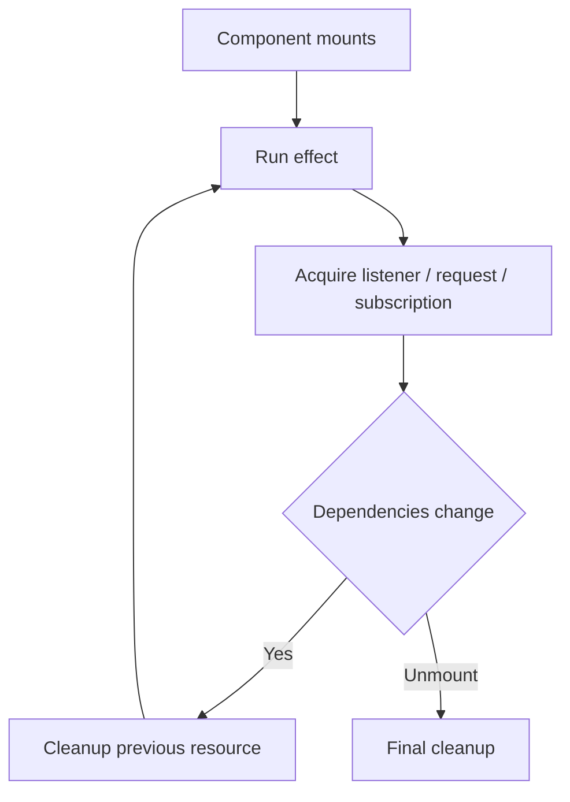
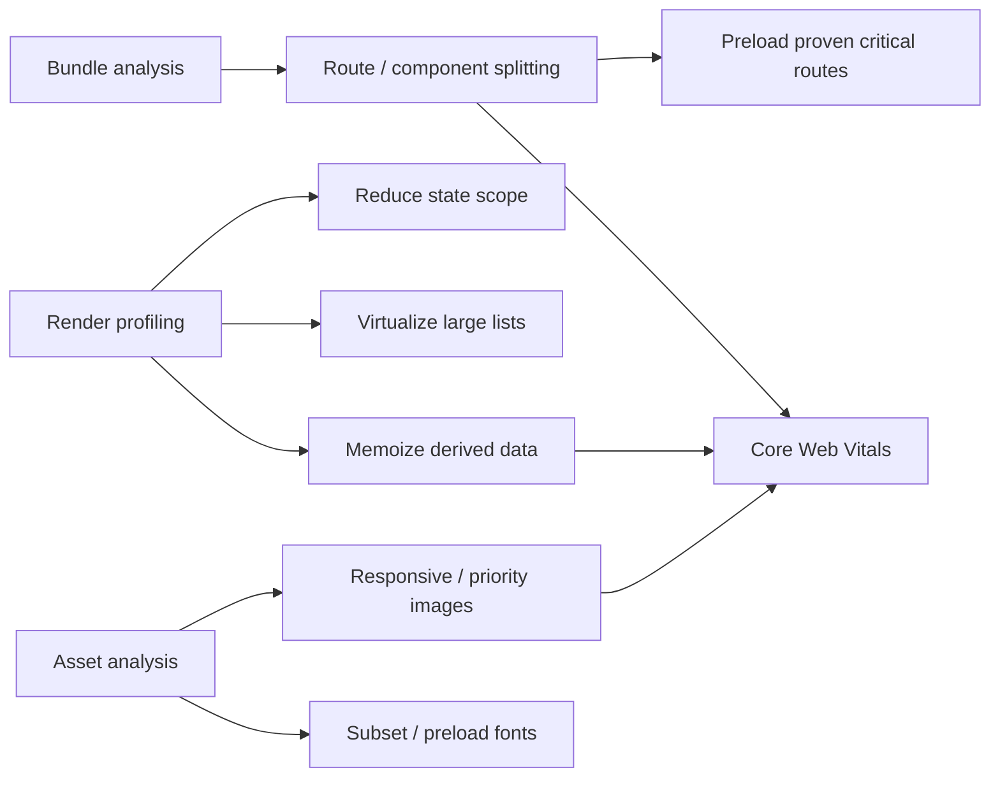
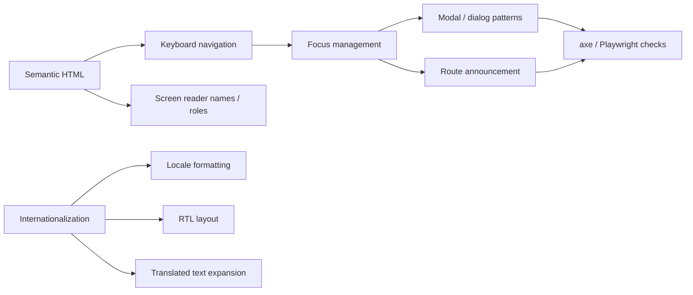
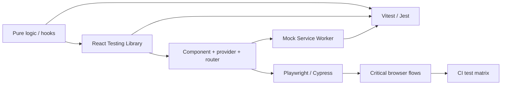
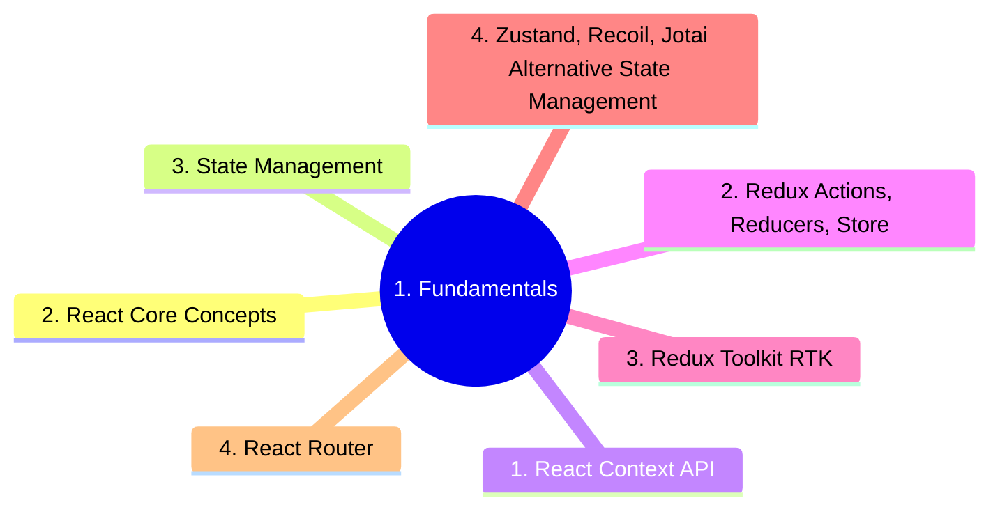

# React.js — Complete Expert Guide

ఈ డాక్యుమెంట్ React fundamentals నుండి modern React 18/19 rendering, concurrent features, Server Components, state architecture, performance, accessibility, testing, security మరియు microfrontends వరకు production-level coverage ఇస్తుంది.

> **Core rule:** React changes UI as a function of state. Good architecture makes state ownership explicit, effects controlled, rendering efficient and user-visible behavior accessible and predictable.

## React Learning Roadmap

```mermaid
flowchart LR
    JS[JavaScript + ES modules] --> JSX[JSX / components / props]
    JSX --> State[State / events / forms]
    State --> Hooks[Hooks / effects / refs]
    Hooks --> Router[Routing / data loading]
    Router --> Architecture[Feature / state architecture]
    Architecture --> Server[Server Components / SSR / streaming]
    Server --> Performance[Memoization / bundles / profiling]
    Performance --> Quality[Accessibility / testing / security]
    Quality --> Scale[Microfrontends / observability]
```



## React Render and Commit Model



- React render is a pure calculation; do not mutate external state or perform network side effects during render.
- Reconciliation compares component tree and keys; it does not compare the entire DOM manually.
- Commit changes real DOM, refs and layout effects.
- Passive effects run after rendering/commit and require cleanup for subscriptions, timers and listeners.

## Component and State Architecture



- Props are explicit component contracts; avoid context for values that are stable unless providers are frequently changing.
- Context change rerenders context consumers, so split providers and memoize provider values when appropriate.
- Server state should not be copied into local Redux state unless it is transformed client-only state.
- URL state belongs in route/search params for shareable and navigable UI.

## State Update and Concurrency Model



- `useTransition` marks updates as non-urgent; `startTransition` preserves responsiveness for expensive UI.
- `useDeferredValue` defers a derived value; it is useful for filtering/sorting but not a replacement for memoized algorithms.
- `useOptimistic` can show intended state before server confirmation, then reconcile or rollback.
- Concurrent rendering can pause, resume or discard work; effects and external subscriptions must remain cleanup-safe.

```jsx
const [isPending, startTransition] = useTransition();

startTransition(() => {
  setSearchResults(filterLargeDataset(search));
});
```

## Modern Data and Rendering Model



- Use Server Components for server-owned data and non-interactive rendering boundaries.
- Use Client Components only for browser hooks, event handlers, local state and browser APIs.
- Stream independent sections with Suspense to reduce time-to-first-content; define meaningful fallbacks.
- Hydration requires serialized props and rendered HTML to match at initial render.
- Avoid secrets or database credentials in Client Component module graphs.

## Effect and Resource Lifecycle



- Place only dependencies used by the effect in dependency arrays.
- Abort fetches and remove event listeners/subscriptions in cleanup.
- Do not use effects as an extra render/data synchronization primitive if derived state or event handlers are sufficient.
- StrictMode development mount/effect replays can expose missing cleanup and impure setup code.
- For expensive initialization, use memoized resources or framework lifecycle primitives appropriately.

## Performance Architecture



- Profile before optimizing: React Profiler, Chrome Performance and bundle treemaps.
- `React.memo` prevents rerender only when props and context remain unchanged; it is not caching a complete app.
- `useMemo` should reduce expensive real calculations, not wrap every expression.
- `useCallback` is useful for stable callback props consumed by memoized children and effect dependencies.
- Virtualize only lists with meaningful row count and preserve keyboard/scroll behavior.
- Code splitting and Suspense should improve route loading, not hide large synchronous work.

## Accessibility and Internationalization



- Semantic elements and native controls are the first accessibility implementation.
- Every interactive UI must be keyboard-operable with a visible focus indicator.
- Dialogs, menus and toasts require focus transfer/restoration and appropriate announcements.
- Test i18n, RTL, locale dates/numbers/currency, text expansion and missing translations.
- Automated tools catch many issues but do not replace manual keyboard/screen-reader testing.

## Testing Model



- Test behavior and accessible output instead of component implementation details.
- RTL recommends queries by role/name/text and `user-event` for interactions.
- Mock network boundaries with MSW, not every internal hook or child component.
- Test loading, empty, error, optimistic, retry and permission states.
- E2E tests should cover only critical journeys, authentication and cross-browser behavior.

## Security and Deployment

- Escape React text content by default; sanitize trusted rich HTML with DOMPurify and validate allowed protocols.
- Keep tokens in HttpOnly/Secure cookies or platform-secure storage, not ordinary XSS-readable local storage.
- Do not leak server-only secrets through props, public client bundles or analytics payloads.
- Validate API responses, authorization and redirects at the backend; UI route guards are not authorization.
- Add CSP, Trusted Types, CORS, Subresource Integrity and dependency scanning for third-party scripts.
- Deploy immutable assets behind CDN, preserve cache-busting names and define HTML/API cache policies.

## React Production Checklist

- State ownership is explicit: local, URL, server cache, shared store or external system.
- Effects acquire and clean up all external resources.
- Keys are stable domain identifiers, not array indexes for reorderable data.
- Route, list and image loading strategies are measured against budgets.
- Components support keyboard, focus, screen readers and locale/RTL behavior.
- Network and mutation boundaries have loading/error/timeout/retry behavior.
- Tests cover public behavior and critical browser journeys.
- Client bundles contain no server secrets and third-party scripts are governed.

---

# **1. Fundamentals**



- What is React?
- JSX (JavaScript XML)
- Components (Functional & Class Components)
- Props and Prop Drilling
- State and useState Hook
- Handling Events in React
- Conditional Rendering
- Lists and Keys
- Forms and Controlled Components
- Lifting State Up

---

### **1. What is React?**

React is a **JavaScript library** for building **user interfaces**. It is maintained by Facebook (Meta) and follows a **component-based architecture**. It allows developers to create reusable UI components and efficiently update and render them.

### **2. JSX (JavaScript XML)**

JSX is a syntax extension for JavaScript that allows writing HTML-like code inside JavaScript. It makes UI development easier and more readable.

Example:

```jsx
const element = <h1>Hello, World!</h1>;
```

JSX gets compiled to JavaScript:

```js
const element = React.createElement("h1", null, "Hello, World!");
```

### **3. Components (Functional & Class Components)**

- **Functional Components** – Simple functions that return JSX.
- **Class Components** – ES6 classes that extend `React.Component` and have a `render` method.

**Functional Component Example:**

```jsx
function Greeting() {
  return <h1>Hello, React!</h1>;
}
```

**Class Component Example:**

```jsx
class Greeting extends React.Component {
  render() {
    return <h1>Hello, React!</h1>;
  }
}
```

### **4. Props and Prop Drilling**

- **Props** (short for "properties") allow passing data from a parent to a child component.
- **Prop Drilling** occurs when data is passed through multiple levels of components unnecessarily.

Example:

```jsx
function Child(props) {
  return <h1>Hello, {props.name}!</h1>;
}

function Parent() {
  return <Child name="John" />;
}
```

### **5. State and useState Hook**

State is used to manage component-specific data that can change over time. The `useState` hook is used in functional components.

Example:

```jsx
import { useState } from "react";

function Counter() {
  const [count, setCount] = useState(0);

  return (
    <div>
      <p>Count: {count}</p>
      <button onClick={() => setCount(count + 1)}>Increment</button>
    </div>
  );
}
```

### **6. Handling Events in React**

React handles events similarly to HTML but uses camelCase syntax for event names.

Example:

```jsx
function Button() {
  function handleClick() {
    alert("Button Clicked!");
  }

  return <button onClick={handleClick}>Click Me</button>;
}
```

### **7. Conditional Rendering**

Rendering components or elements based on conditions.

Example:

```jsx
function UserGreeting({ isLoggedIn }) {
  return isLoggedIn ? <h1>Welcome back!</h1> : <h1>Please log in.</h1>;
}
```

### **8. Lists and Keys**

- **Lists** are used to render multiple elements dynamically.
- **Keys** help React identify and update elements efficiently. Prefer a stable unique domain ID; array indexes are unsuitable for reorderable, insertable or deletable lists.

Example:

```jsx
const names = ["Alice", "Bob", "Charlie"];

function NameList() {
  return (
    <ul>
      {names.map((name, index) => (
        <li key={name}>{name}</li>
      ))}
    </ul>
  );
}
```

### **9. Forms and Controlled Components**

A **controlled component** is a form element controlled by React state.

Example:

```jsx
import { useState } from "react";

function Form() {
  const [name, setName] = useState("");

  function handleChange(event) {
    setName(event.target.value);
  }

  return (
    <div>
      <input type="text" value={name} onChange={handleChange} />
      <p>Name: {name}</p>
    </div>
  );
}
```

### **10. Lifting State Up**

State is moved from a child component to a common parent to share data between siblings.

Example:

```jsx
function Child({ onMessageChange }) {
  return (
    <input type="text" onChange={(e) => onMessageChange(e.target.value)} />
  );
}

function Parent() {
  const [message, setMessage] = useState("");

  return (
    <div>
      <Child onMessageChange={setMessage} />
      <p>Message: {message}</p>
    </div>
  );
}
```

# **2. React Core Concepts**

- Hooks (useState, useEffect, useRef, useContext, useReducer, etc.)
- Context API
- Component Lifecycle Methods (for Class Components)
- Virtual DOM and Reconciliation
- Higher-Order Components (HOC)
- Render Props

---

### **1. Hooks (useState, useEffect, useRef, useContext, useReducer, etc.)**

Hooks are functions that let you **use React features in functional components**.

#### **useState (State Management)**

Manages component state.

```jsx
import { useState } from "react";

function Counter() {
  const [count, setCount] = useState(0);

  return (
    <div>
      <p>Count: {count}</p>
      <button onClick={() => setCount(count + 1)}>Increment</button>
    </div>
  );
}
```

#### **useEffect (Side Effects)**

Runs after render for **fetching data, event listeners, or updating the DOM**.

```jsx
import { useState, useEffect } from "react";

function Timer() {
  const [count, setCount] = useState(0);

  useEffect(() => {
    console.log("Component mounted or updated");
    return () => console.log("Cleanup on unmount");
  }, [count]); // Runs when count changes

  return <button onClick={() => setCount(count + 1)}>Increment</button>;
}
```

#### **useRef (DOM Manipulation & Persisting Values)**

Keeps a reference to a DOM element or a value **without causing re-renders**.

```jsx
import { useRef, useEffect } from "react";

function InputFocus() {
  const inputRef = useRef(null);

  useEffect(() => {
    inputRef.current.focus(); // Auto-focus on mount
  }, []);

  return <input ref={inputRef} type="text" />;
}
```

#### **useContext (Global State Management)**

Avoids **prop drilling** by providing global state.

```jsx
import { createContext, useContext } from "react";

const UserContext = createContext();

function Child() {
  const user = useContext(UserContext);
  return <p>User: {user}</p>;
}

function Parent() {
  return (
    <UserContext.Provider value="John Doe">
      <Child />
    </UserContext.Provider>
  );
}
```

#### **useReducer (Complex State Logic)**

Alternative to `useState` for **handling complex state updates**.

```jsx
import { useReducer } from "react";

function reducer(state, action) {
  switch (action.type) {
    case "increment":
      return { count: state.count + 1 };
    case "decrement":
      return { count: state.count - 1 };
    default:
      return state;
  }
}

function Counter() {
  const [state, dispatch] = useReducer(reducer, { count: 0 });

  return (
    <div>
      <p>Count: {state.count}</p>
      <button onClick={() => dispatch({ type: "increment" })}>Increment</button>
      <button onClick={() => dispatch({ type: "decrement" })}>Decrement</button>
    </div>
  );
}

export default reducer;
```

---

### **2. Context API**

Used for **global state management** without Redux.

#### **Steps to Use Context API**

1. Create a Context
2. Provide the Context
3. Consume the Context

```jsx
import { createContext, useContext, useState } from "react";

const ThemeContext = createContext();

function ThemeProvider({ children }) {
  const [theme, setTheme] = useState("light");
  return (
    <ThemeContext.Provider value={{ theme, setTheme }}>
      {children}
    </ThemeContext.Provider>
  );
}

function ThemedComponent() {
  const { theme, setTheme } = useContext(ThemeContext);
  return (
    <div>
      <p>Theme: {theme}</p>
      <button onClick={() => setTheme(theme === "light" ? "dark" : "light")}>
        Toggle Theme
      </button>
    </div>
  );
}

export default function App() {
  return (
    <ThemeProvider>
      <ThemedComponent />
    </ThemeProvider>
  );
}
```

---

### **3. Component Lifecycle Methods (For Class Components)**

Class components have lifecycle methods to handle **mounting, updating, and unmounting**.

#### **Mounting (Component Creation)**

- `constructor()`
- `componentDidMount()`

#### **Updating (Re-rendering)**

- `shouldComponentUpdate()`
- `componentDidUpdate()`

#### **Unmounting (Cleanup)**

- `componentWillUnmount()`

```jsx
import React, { Component } from "react";

class LifecycleDemo extends Component {
  constructor(props) {
    super(props);
    this.state = { count: 0 };
    console.log("Constructor");
  }

  componentDidMount() {
    console.log("Component Mounted");
  }

  componentDidUpdate() {
    console.log("Component Updated");
  }

  componentWillUnmount() {
    console.log("Component Will Unmount");
  }

  render() {
    return (
      <div>
        <p>Count: {this.state.count}</p>
        <button onClick={() => this.setState({ count: this.state.count + 1 })}>
          Increment
        </button>
      </div>
    );
  }
}

export default LifecycleDemo;
```

---

### **4. Virtual DOM and Reconciliation**

- **Virtual DOM** – A lightweight copy of the actual DOM that React uses to track changes and update only what's necessary.
- **Reconciliation** – The process of comparing the Virtual DOM with the real DOM and making updates efficiently.

#### **How It Works?**

1. React creates a **Virtual DOM** copy of the UI.
2. When state changes, React **compares** the new Virtual DOM with the previous one (diffing).
3. React updates only the **changed parts** in the real DOM (patching).

This improves performance compared to direct DOM manipulation.

---

### **5. Higher-Order Components (HOC)**

A **HOC is a function** that takes a component and returns a new enhanced component. Used for **code reuse, authentication, logging, etc.**

```jsx
function withLogging(WrappedComponent) {
  return function NewComponent(props) {
    console.log("Rendering component...");
    return <WrappedComponent {...props} />;
  };
}

function SimpleComponent() {
  return <h1>Hello, World!</h1>;
}

const EnhancedComponent = withLogging(SimpleComponent);
```

Usage:

```jsx
<EnhancedComponent />
```

---

### **6. Render Props**

A pattern where a function (prop) is passed to a component, allowing **dynamic rendering**.

```jsx
function RenderPropComponent({ render }) {
  return <div>{render("React Developer")}</div>;
}

function Parent() {
  return <RenderPropComponent render={(name) => <h1>Hello, {name}!</h1>} />;
}
```

---

### **Summary**

| Concept                           | Purpose                                       |
| --------------------------------- | --------------------------------------------- |
| `useState`                        | Manage component state                        |
| `useEffect`                       | Handle side effects (API calls, timers)       |
| `useRef`                          | Access DOM elements & persist values          |
| `useContext`                      | Manage global state without prop drilling     |
| `useReducer`                      | Handle complex state logic                    |
| **Context API**                   | Share state globally                          |
| **Lifecycle Methods**             | Manage component mount, update, and unmount   |
| **Virtual DOM**                   | Optimize UI updates                           |
| **HOC (Higher-Order Components)** | Reuse logic across components                 |
| **Render Props**                  | Pass functions as props for dynamic rendering |

# **3. State Management**

- React Context API
- Redux (Actions, Reducers, Store)
- Redux Toolkit (RTK)
- Zustand, Recoil, Jotai (Alternative State Management)

---

## **1. React Context API**

The **Context API** is a built-in React feature for managing **global state** without prop drilling.

### **When to Use Context API?**

- When **state needs to be shared** across multiple components.
- When **prop drilling** becomes an issue.
- When Redux or Zustand is **too complex for the use case**.

### **Steps to Use Context API**

1. **Create Context**
2. **Provide Context**
3. **Consume Context** (using `useContext`)

### **Example: Theme Context**

```jsx
import { createContext, useContext, useState } from "react";

// 1. Create Context
const ThemeContext = createContext();

// 2. Create Provider Component
function ThemeProvider({ children }) {
  const [theme, setTheme] = useState("light");

  return (
    <ThemeContext.Provider value={{ theme, setTheme }}>
      {children}
    </ThemeContext.Provider>
  );
}

// 3. Consume Context in a Child Component
function ThemedComponent() {
  const { theme, setTheme } = useContext(ThemeContext);

  return (
    <div
      style={{
        background: theme === "light" ? "#fff" : "#333",
        color: theme === "light" ? "#000" : "#fff",
        padding: "10px",
      }}
    >
      <p>Current Theme: {theme}</p>
      <button onClick={() => setTheme(theme === "light" ? "dark" : "light")}>
        Toggle Theme
      </button>
    </div>
  );
}

// 4. Wrap the App with Provider
export default function App() {
  return (
    <ThemeProvider>
      <ThemedComponent />
    </ThemeProvider>
  );
}
```

---

## **2. Redux (Actions, Reducers, Store)**

Redux is a **state management library** that manages global state using a **centralized store**.

### **Key Concepts**

- **Store** – Holds the application state.
- **Actions** – Objects that describe what should change.
- **Reducers** – Functions that update the store based on actions.
- **Dispatch** – Sends an action to the reducer.

### **How Redux Works?**

1. **Action** → Dispatched when state needs to change.
2. **Reducer** → Updates the state in the store.
3. **Component** → Reads from the store using `useSelector`.

### **Example: Counter with Redux**

#### **1. Install Redux**

```sh
npm install redux react-redux
```

#### **2. Create Redux Files**

##### **actions.js**

```js
export const increment = () => ({ type: "INCREMENT" });
export const decrement = () => ({ type: "DECREMENT" });
```

##### **reducer.js**

```js
const initialState = { count: 0 };

function counterReducer(state = initialState, action) {
  switch (action.type) {
    case "INCREMENT":
      return { count: state.count + 1 };
    case "DECREMENT":
      return { count: state.count - 1 };
    default:
      return state;
  }
}

export default counterReducer;
```

##### **store.js**

```js
import { createStore } from "redux";
import counterReducer from "./reducer";

const store = createStore(counterReducer);

export default store;
```

##### **App.js (Connecting Redux to React)**

```jsx
import { Provider, useDispatch, useSelector } from "react-redux";
import store from "./store";
import { increment, decrement } from "./actions";

function Counter() {
  const count = useSelector((state) => state.count);
  const dispatch = useDispatch();

  return (
    <div>
      <p>Count: {count}</p>
      <button onClick={() => dispatch(increment())}>+</button>
      <button onClick={() => dispatch(decrement())}>-</button>
    </div>
  );
}

export default function App() {
  return (
    <Provider store={store}>
      <Counter />
    </Provider>
  );
}
```

---

## **3. Redux Toolkit (RTK)**

Redux Toolkit is the **recommended way to use Redux** because it simplifies setup and reduces boilerplate code.

### **Benefits of Redux Toolkit**

✅ Reduces boilerplate code  
✅ Includes **immer.js** (for immutable state)  
✅ Built-in **thunk middleware** for async actions

### **Steps to Use RTK**

1. Install Redux Toolkit

```sh
npm install @reduxjs/toolkit react-redux
```

2. Use **createSlice** to define state & reducers.
3. Use **configureStore** to set up the store.
4. Use **useSelector** and **useDispatch** to interact with Redux.

### **Example: Counter with RTK**

#### **1. Create a Slice**

```js
import { createSlice } from "@reduxjs/toolkit";

const counterSlice = createSlice({
  name: "counter",
  initialState: { count: 0 },
  reducers: {
    increment: (state) => {
      state.count += 1;
    },
    decrement: (state) => {
      state.count -= 1;
    },
  },
});

export const { increment, decrement } = counterSlice.actions;
export default counterSlice.reducer;
```

#### **2. Configure Store**

```js
import { configureStore } from "@reduxjs/toolkit";
import counterReducer from "./counterSlice";

const store = configureStore({
  reducer: { counter: counterReducer },
});

export default store;
```

#### **3. Use in a Component**

```jsx
import { useSelector, useDispatch } from "react-redux";
import { increment, decrement } from "./counterSlice";
import { Provider } from "react-redux";
import store from "./store";

function Counter() {
  const count = useSelector((state) => state.counter.count);
  const dispatch = useDispatch();

  return (
    <div>
      <p>Count: {count}</p>
      <button onClick={() => dispatch(increment())}>+</button>
      <button onClick={() => dispatch(decrement())}>-</button>
    </div>
  );
}

export default function App() {
  return (
    <Provider store={store}>
      <Counter />
    </Provider>
  );
}
```

---

## **4. Zustand, Recoil, Jotai (Alternative State Management)**

These are **lighter alternatives** to Redux.

### **Zustand (Minimal Global State)**

✅ Simple API  
✅ No Provider needed  
✅ Works outside React

```sh
npm install zustand
```

```js
import create from "zustand";

const useStore = create((set) => ({
  count: 0,
  increment: () => set((state) => ({ count: state.count + 1 })),
}));

function Counter() {
  const { count, increment } = useStore();
  return <button onClick={increment}>Count: {count}</button>;
}
```

---

### **Recoil (Facebook’s State Management)**

✅ Works like Context API  
✅ Supports derived state

```sh
npm install recoil
```

```js
import { atom, useRecoilState, RecoilRoot } from "recoil";

const countState = atom({
  key: "countState",
  default: 0,
});

function Counter() {
  const [count, setCount] = useRecoilState(countState);
  return <button onClick={() => setCount(count + 1)}>Count: {count}</button>;
}

export default function App() {
  return (
    <RecoilRoot>
      <Counter />
    </RecoilRoot>
  );
}
```

---

### **Jotai (Atomic State Management)**

✅ Similar to Recoil  
✅ Simpler API

```sh
npm install jotai
```

```js
import { atom, useAtom } from "jotai";

const countAtom = atom(0);

function Counter() {
  const [count, setCount] = useAtom(countAtom);
  return <button onClick={() => setCount(count + 1)}>Count: {count}</button>;
}
```

---

### **Conclusion: When to Use What?**

| **State Management** | **Best For**                          |
| -------------------- | ------------------------------------- |
| **Context API**      | Small apps, local state               |
| **Redux**            | Large apps, strict state management   |
| **RTK**              | Modern Redux with less boilerplate    |
| **Zustand**          | Simple global state, lightweight apps |
| **Recoil**           | Facebook-like apps with derived state |
| **Jotai**            | Simpler alternative to Recoil         |

# **4. React Router**

- React Router Basics (v6+)
- Dynamic Routes & Route Parameters
- Protected Routes
- Lazy Loading with Suspense

---

## **1. React Router Basics (v6+)**

React Router **v6+** is a popular library for **client-side routing** in React applications.

### **Installation**

```sh
npm install react-router-dom
```

### **Key Features of React Router v6+**

✅ **Declarative Routing** (Using `<Routes>` and `<Route>`)  
✅ **Nested Routes** (Support for hierarchy)  
✅ **Use of Hooks** (`useNavigate`, `useParams`, `useLocation`)

---

### **Basic Setup**

```jsx
import { BrowserRouter as Router, Routes, Route, Link } from "react-router-dom";

function Home() {
  return <h1>Home Page</h1>;
}

function About() {
  return <h1>About Page</h1>;
}

export default function App() {
  return (
    <Router>
      <nav>
        <Link to="/">Home</Link> | <Link to="/about">About</Link>
      </nav>
      <Routes>
        <Route path="/" element={<Home />} />
        <Route path="/about" element={<About />} />
      </Routes>
    </Router>
  );
}
```

---

## **2. Dynamic Routes & Route Parameters**

You can pass **dynamic parameters** in routes using `useParams()`.

### **Example: User Profile Route**

```jsx
import {
  BrowserRouter as Router,
  Routes,
  Route,
  Link,
  useParams,
} from "react-router-dom";

function UserProfile() {
  const { username } = useParams();
  return <h1>Welcome, {username}!</h1>;
}

export default function App() {
  return (
    <Router>
      <nav>
        <Link to="/user/john">John's Profile</Link> |
        <Link to="/user/jane">Jane's Profile</Link>
      </nav>
      <Routes>
        <Route path="/user/:username" element={<UserProfile />} />
      </Routes>
    </Router>
  );
}
```

🔹 `/user/john` → Shows "Welcome, John!"  
🔹 `/user/jane` → Shows "Welcome, Jane!"

---

## **3. Protected Routes**

Protected Routes **restrict access** to specific pages (e.g., dashboard, admin panel).

### **Steps to Implement Protected Routes**

1. **Check Authentication Status**
2. **Redirect Unauthorized Users**

### **Example: Protect Dashboard Route**

```jsx
import {
  BrowserRouter as Router,
  Routes,
  Route,
  Navigate,
} from "react-router-dom";

const isAuthenticated = false; // Simulate authentication

function ProtectedRoute({ children }) {
  return isAuthenticated ? children : <Navigate to="/" />;
}

function Home() {
  return <h1>Home Page</h1>;
}

function Dashboard() {
  return <h1>Dashboard (Protected)</h1>;
}

export default function App() {
  return (
    <Router>
      <Routes>
        <Route path="/" element={<Home />} />
        <Route
          path="/dashboard"
          element={
            <ProtectedRoute>
              <Dashboard />
            </ProtectedRoute>
          }
        />
      </Routes>
    </Router>
  );
}
```

🔹 If `isAuthenticated = true`, users can access `/dashboard`.  
🔹 If `isAuthenticated = false`, they are redirected to `/`.

---

## **4. Lazy Loading with Suspense**

Lazy loading improves **performance** by loading components only when needed.

### **Steps to Implement Lazy Loading**

1. Use `React.lazy()` to dynamically import components.
2. Wrap components inside `<Suspense>`.

### **Example: Lazy Loading a Component**

```jsx
import { BrowserRouter as Router, Routes, Route } from "react-router-dom";
import { Suspense, lazy } from "react";

const Home = lazy(() => import("./Home"));
const About = lazy(() => import("./About"));

export default function App() {
  return (
    <Router>
      <Suspense fallback={<h1>Loading...</h1>}>
        <Routes>
          <Route path="/" element={<Home />} />
          <Route path="/about" element={<About />} />
        </Routes>
      </Suspense>
    </Router>
  );
}
```

🔹 **`Suspense` Fallback** – Shows "Loading..." while components are being fetched.  
🔹 **Better Performance** – Loads pages **only when users navigate** to them.

---

## **Summary Table**

| Feature              | Description                                      |
| -------------------- | ------------------------------------------------ |
| **Basic Routing**    | Use `<Routes>` and `<Route>` for navigation.     |
| **Dynamic Routes**   | Use `useParams()` for extracting URL parameters. |
| **Protected Routes** | Restrict access using `<Navigate>`.              |
| **Lazy Loading**     | Load components dynamically with `React.lazy()`. |

# **5. Styling in React**

- Inline Styles
- CSS Modules
- Styled Components
- Tailwind CSS, MUI, SCSS (Since you're learning them)

---

## **1. Inline Styles (Basic & Dynamic Styling)**

✅ Simple and directly applied to elements.  
✅ Useful for **dynamic styles**.  
❌ Not ideal for large-scale styling.

### **Example: Basic Inline Styles**

```jsx
function InlineStyledComponent() {
  return (
    <div
      style={{
        backgroundColor: "lightblue",
        padding: "10px",
        borderRadius: "5px",
      }}
    >
      <h2 style={{ color: "darkblue" }}>This is an Inline Styled Component</h2>
    </div>
  );
}

export default InlineStyledComponent;
```

### **Example: Dynamic Inline Styles**

```jsx
function DynamicStyledComponent({ isDark }) {
  const styles = {
    backgroundColor: isDark ? "#333" : "#fff",
    color: isDark ? "#fff" : "#000",
    padding: "10px",
  };

  return <div style={styles}>Dynamically Styled Component</div>;
}
```

---

## **2. CSS Modules (Scoped Styling)**

✅ Avoids global class name conflicts.  
✅ Works well for large applications.  
✅ **File Naming Convention**: `Component.module.css`.

### **Steps to Use CSS Modules**

1. Create a CSS module file (`styles.module.css`).
2. Import it in the component.

### **Example: Using CSS Modules**

#### **styles.module.css**

```css
.container {
  background-color: lightcoral;
  padding: 10px;
  border-radius: 5px;
}

.text {
  color: white;
  font-weight: bold;
}
```

#### **Component.js**

```jsx
import styles from "./styles.module.css";

function CSSModuleComponent() {
  return (
    <div className={styles.container}>
      <p className={styles.text}>Styled with CSS Modules</p>
    </div>
  );
}

export default CSSModuleComponent;
```

✅ **Advantage:** No conflicts since class names are locally scoped.

---

## **3. Styled Components (CSS-in-JS)**

✅ Uses JavaScript for styling.  
✅ Supports dynamic styling based on props.  
✅ No separate CSS files needed.

### **Installation**

```sh
npm install styled-components
```

### **Example: Styled Components**

```jsx
import styled from "styled-components";

const Container = styled.div`
  background-color: ${(props) => (props.isDark ? "#222" : "#f4f4f4")};
  color: ${(props) => (props.isDark ? "#fff" : "#000")};
  padding: 10px;
  border-radius: 5px;
`;

function StyledComponent({ isDark }) {
  return <Container isDark={isDark}>Styled with Styled Components</Container>;
}

export default StyledComponent;
```

✅ **Advantage:** Dynamic theming is easier.  
❌ **Disadvantage:** Can increase JavaScript bundle size.

---

## **4. Tailwind CSS (Utility-First CSS)**

✅ **Fast development** with prebuilt utility classes.  
✅ No need for writing custom CSS files.  
✅ Highly customizable (`tailwind.config.js`).

### **Installation**

```sh
npm install -D tailwindcss postcss autoprefixer
npx tailwindcss init -p
```

### **Enable Tailwind in `index.css`**

```css
@tailwind base;
@tailwind components;
@tailwind utilities;
```

### **Example: Tailwind Styled Component**

```jsx
function TailwindComponent() {
  return (
    <div className="bg-blue-500 text-white p-4 rounded-lg">
      Styled with Tailwind CSS
    </div>
  );
}

export default TailwindComponent;
```

✅ **Advantage:** Reduces CSS file size.  
✅ **Highly responsive** (`sm:`, `md:`, `lg:` breakpoints).  
❌ **Disadvantage:** Class names can get long (`className="flex flex-col items-center p-4 bg-gray-100 rounded-md shadow-md"`).

---

## **5. MUI (Material-UI)**

✅ Prebuilt **React UI components** for rapid development.  
✅ Supports **dark mode, theming, and accessibility**.  
✅ Styled using inline styles and `sx` prop.

### **Installation**

```sh
npm install @mui/material @emotion/react @emotion/styled
```

### **Example: Using MUI Button**

```jsx
import { Button } from "@mui/material";

function MUIButton() {
  return (
    <Button variant="contained" color="primary">
      MUI Button
    </Button>
  );
}

export default MUIButton;
```

### **Example: Theming in MUI**

```jsx
import { createTheme, ThemeProvider, Button } from "@mui/material";

const theme = createTheme({
  palette: {
    primary: {
      main: "#1976d2",
    },
    secondary: {
      main: "#f50057",
    },
  },
});

function ThemedMUIButton() {
  return (
    <ThemeProvider theme={theme}>
      <Button color="primary" variant="contained">
        Primary Button
      </Button>
      <Button color="secondary" variant="contained">
        Secondary Button
      </Button>
    </ThemeProvider>
  );
}

export default ThemedMUIButton;
```

✅ **Advantage:** Ready-to-use UI components.  
✅ **Dark mode support** with `createTheme()`.  
❌ **Disadvantage:** Heavy for simple projects.

---

## **6. SCSS / SASS (Advanced Styling)**

✅ Supports **nesting, variables, mixins, and loops**.  
✅ More **maintainable** than plain CSS.  
✅ Works with **CSS Modules** for scoped styles.

### **Installation**

```sh
npm install sass
```

### **Example: Using SCSS**

#### **styles.module.scss**

```scss
$primary-color: #4caf50;

.container {
  background-color: $primary-color;
  padding: 10px;
  border-radius: 5px;

  .text {
    color: white;
    font-weight: bold;
  }
}
```

#### **Component.js**

```jsx
import styles from "./styles.module.scss";

function SCSSComponent() {
  return (
    <div className={styles.container}>
      <p className={styles.text}>Styled with SCSS</p>
    </div>
  );
}

export default SCSSComponent;
```

✅ **Advantage:** Cleaner and reusable CSS.  
✅ **Supports variables and mixins** (`$color: red; @mixin flex-center { display: flex; align-items: center; }`).  
❌ **Disadvantage:** Requires compilation (`node-sass`).

---

## **Comparison Table**

| **Method**            | **Best For**                      | **Pros**                                 | **Cons**                       |
| --------------------- | --------------------------------- | ---------------------------------------- | ------------------------------ |
| **Inline Styles**     | Quick, dynamic styles             | No extra files, easy for small styles    | Not reusable, no hover states  |
| **CSS Modules**       | Large projects, scoped styles     | No global conflicts                      | Slightly complex import system |
| **Styled Components** | Theming, component-based styles   | Supports props, dynamic styles           | Increases JS bundle size       |
| **Tailwind CSS**      | Utility-first approach            | Fast styling, no custom CSS needed       | Long class names               |
| **MUI**               | Prebuilt UI components            | Ready-to-use design, customizable themes | Heavy for small projects       |
| **SCSS / SASS**       | Complex styles, variables, mixins | Nesting, reusable variables              | Requires compilation           |

---

## **Conclusion**

- If you want **quick styling**, use **Inline Styles**.
- For **scoped styles**, go with **CSS Modules**.
- If you prefer **JS-in-CSS**, use **Styled Components**.
- **Tailwind CSS** is great for **utility-first styling**.
- **MUI** is perfect for **prebuilt UI components**.
- **SCSS** is powerful for **complex styles and maintainability**.

# **6. API Handling**

- Fetch API & Axios
- Async/Await in React
- Handling Loading, Error, and Success States

---

## **1. Fetch API & Axios in React**

React applications often fetch data from APIs using **Fetch API** or **Axios**. Let's compare both.

### **📌 Fetch API (Built-in JavaScript Method)**

✅ No extra dependency.  
✅ Uses `fetch()` to make HTTP requests.  
✅ Requires `res.json()` to parse JSON.  
❌ Does **not** automatically handle errors.

#### **Example: Fetch API in React (GET Request)**

```jsx
import { useEffect, useState } from "react";

function FetchExample() {
  const [data, setData] = useState(null);

  useEffect(() => {
    fetch("https://jsonplaceholder.typicode.com/posts/1")
      .then((res) => res.json()) // Convert response to JSON
      .then((data) => setData(data))
      .catch((error) => console.error("Error fetching data:", error));
  }, []);

  return (
    <div>
      <h2>Fetch API Example</h2>
      {data ? <p>{data.title}</p> : <p>Loading...</p>}
    </div>
  );
}

export default FetchExample;
```

✅ **Pros:** Simple, native to JavaScript.  
❌ **Cons:** Does not handle errors automatically, needs manual configuration for headers.

---

### **📌 Axios (Third-party Library)**

✅ Automatically parses JSON.  
✅ Handles **timeouts, errors, and headers** better than Fetch.  
✅ Supports **request and response interceptors**.

### **Installation**

```sh
npm install axios
```

#### **Example: Axios in React (GET Request)**

```jsx
import { useEffect, useState } from "react";
import axios from "axios";

function AxiosExample() {
  const [data, setData] = useState(null);

  useEffect(() => {
    axios
      .get("https://jsonplaceholder.typicode.com/posts/1")
      .then((response) => setData(response.data))
      .catch((error) => console.error("Error fetching data:", error));
  }, []);

  return (
    <div>
      <h2>Axios Example</h2>
      {data ? <p>{data.title}</p> : <p>Loading...</p>}
    </div>
  );
}

export default AxiosExample;
```

✅ **Pros:** Easier syntax, built-in error handling.  
❌ **Cons:** Requires an additional package.

---

## **2. Async/Await in React**

✅ **Async/Await** makes asynchronous code more readable.  
✅ **Avoids callback hell** and `.then()` chaining.

### **Example: Fetch API with Async/Await**

```jsx
import { useEffect, useState } from "react";

function AsyncAwaitExample() {
  const [data, setData] = useState(null);

  useEffect(() => {
    const fetchData = async () => {
      try {
        const response = await fetch(
          "https://jsonplaceholder.typicode.com/posts/1"
        );
        const result = await response.json();
        setData(result);
      } catch (error) {
        console.error("Error fetching data:", error);
      }
    };

    fetchData();
  }, []);

  return (
    <div>
      <h2>Async/Await Example</h2>
      {data ? <p>{data.title}</p> : <p>Loading...</p>}
    </div>
  );
}

export default AsyncAwaitExample;
```

### **Example: Axios with Async/Await**

```jsx
import { useEffect, useState } from "react";
import axios from "axios";

function AxiosAsyncExample() {
  const [data, setData] = useState(null);

  useEffect(() => {
    const fetchData = async () => {
      try {
        const response = await axios.get(
          "https://jsonplaceholder.typicode.com/posts/1"
        );
        setData(response.data);
      } catch (error) {
        console.error("Error fetching data:", error);
      }
    };

    fetchData();
  }, []);

  return (
    <div>
      <h2>Axios with Async/Await</h2>
      {data ? <p>{data.title}</p> : <p>Loading...</p>}
    </div>
  );
}

export default AxiosAsyncExample;
```

✅ **Advantage:** More readable than `.then()/.catch()`.  
❌ **Disadvantage:** Requires `try/catch` for error handling.

---

## **3. Handling Loading, Error, and Success States**

When fetching data, handle:  
✔ **Loading state** – Show a loading indicator.  
✔ **Error state** – Show an error message.  
✔ **Success state** – Display fetched data.

### **Example: Complete Fetch Handling**

```jsx
import { useEffect, useState } from "react";
import axios from "axios";

function DataFetcher() {
  const [data, setData] = useState(null);
  const [loading, setLoading] = useState(true);
  const [error, setError] = useState(null);

  useEffect(() => {
    const fetchData = async () => {
      try {
        const response = await axios.get(
          "https://jsonplaceholder.typicode.com/posts/1"
        );
        setData(response.data);
        setError(null);
      } catch (err) {
        setError("Error fetching data");
      } finally {
        setLoading(false);
      }
    };

    fetchData();
  }, []);

  if (loading) return <p>Loading...</p>;
  if (error) return <p style={{ color: "red" }}>{error}</p>;

  return <p>Data: {data.title}</p>;
}

export default DataFetcher;
```

✅ **`loading` state** – Shows a loading message while data is being fetched.  
✅ **`error` state** – Displays an error message if something goes wrong.  
✅ **`data` state** – Shows the API response when successful.

---

## **Comparison Table: Fetch API vs Axios**

| Feature            | Fetch API                | Axios                         |
| ------------------ | ------------------------ | ----------------------------- |
| **Built-in**       | ✅ Yes                   | ❌ No (requires installation) |
| **JSON Handling**  | ❌ Requires `res.json()` | ✅ Automatic                  |
| **Error Handling** | ❌ Manual (`catch()`)    | ✅ Automatic                  |
| **Timeouts**       | ❌ No built-in support   | ✅ Supports timeouts          |
| **Interceptors**   | ❌ No                    | ✅ Yes (for request/response) |
| **Syntax**         | Longer (`.then()`)       | Shorter (`axios.get()`)       |

---

## **Final Thoughts**

- Use **Fetch API** for simple requests when you **don’t want extra dependencies**.
- Use **Axios** if you need **automatic error handling, timeouts, or request interceptors**.
- Always **handle loading, error, and success states** properly for better UX.

# **7. Performance Optimization**

- Memoization (React.memo, useMemo, useCallback)
- Code Splitting and Lazy Loading
- Avoiding Unnecessary Re-renders
- React Profiler

---

## **1. Memoization in React (Optimizing Performance)**

Memoization helps **optimize performance** by preventing unnecessary re-computations or re-renders. React provides three main techniques:

- `React.memo` (For memoizing components)
- `useMemo` (For memoizing computed values)
- `useCallback` (For memoizing functions)

---

### **📌 React.memo (Prevents Unnecessary Re-renders of Components)**

✅ **Wraps a component** and prevents re-renders **if props haven't changed**.  
✅ Useful for optimizing **functional components**.

#### **Example: Using `React.memo`**

```jsx
import React from "react";

const MemoizedComponent = React.memo(({ name }) => {
  console.log("Rendered: MemoizedComponent");
  return <p>Hello, {name}!</p>;
});

export default MemoizedComponent;
```

#### **Usage in Parent Component**

```jsx
import { useState } from "react";
import MemoizedComponent from "./MemoizedComponent";

function ParentComponent() {
  const [count, setCount] = useState(0);

  return (
    <div>
      <button onClick={() => setCount(count + 1)}>Increment ({count})</button>
      <MemoizedComponent name="Alice" />
    </div>
  );
}

export default ParentComponent;
```

✅ **Only re-renders when `name` prop changes**, not when the `count` state changes.

❌ **Doesn't work for deep objects** (use `useMemo` or `useCallback` for that).

---

### **📌 useMemo (Memoizes Computed Values)**

✅ **Prevents expensive re-computations** by caching values.

#### **Example: `useMemo` to Optimize Expensive Computations**

```jsx
import React, { useMemo, useState } from "react";

function Example() {
  const [number, setNumber] = useState(0);
  const [dark, setDark] = useState();

  // syntax for useMemo and useState is same. useEffect cant return the value and cant assign to the variable
  // useMemo remembers the result of expensiveFunction(number) until number changes.
  const memoCalculation = useMemo(() => {
    return expensiveFunction(number);
  }, [number]); // Runs once after the initial render

  // Every time dark changes (theme toggle), expensiveFunction runs again—even though number hasn't changed.
  // const calculation = expensiveFunction(number);
  const cssStyes = {
    backgroundColor: dark ? "black" : "white",
    color: dark ? "white" : "black",
  };

  return (
    <div style={cssStyes}>
      <input type="number" onClick={({ target }) => setNumber(target.value)} />
      {/* <h3>calculation:{calculation}</h3> */}
      <h3>calculation:{memoCalculation}</h3>
      <button onClick={() => setDark((prv) => !prv)}>theme</button>
    </div>
  );
}

function expensiveFunction(num) {
  console.log("for loop started");
  for (let index = 0; index < 200000000; index++) {}
  return num;
}

export default Example;
```

✅ **Avoids re-computation** unless `num` changes.

❌ **Use only when computations are expensive**, otherwise, it adds overhead.

---

### **📌 useCallback (Memoizes Functions)**

✅ **Prevents unnecessary re-creations of functions**, useful in **event handlers** and **dependencies** of `useEffect`.

#### **Example: Using `useCallback`**

```jsx
import React, { useEffect, useCallback, useState } from "react";

function UseCallbackExample() {
  const [number, setNumber] = useState(0);
  const [dark, setDark] = useState();

  // syntax for useMemo and useCallback is same. useCallback memoize the function. useMemo memoize the result.
  // useMemo remembers the result of expensiveFunction(number) until number changes.
  const calculateTable = useCallback(() => {
    return [number * 1, number * 2, number * 3, number * 4, number * 5];
  }, [number]);

  // Every time dark changes (theme toggle), calculateTable runs again—even though number hasn't changed.
  // const calculateTable = () => {
  //   return [number * 1, number * 2, number * 3, number * 4, number * 5];
  // };

  const cssStyes = {
    backgroundColor: dark ? "black" : "white",
    color: dark ? "white" : "black",
  };

  return (
    <div style={cssStyes}>
      <input type="number" onClick={({ target }) => setNumber(target.value)} />
      <PrintTable calculateTable={calculateTable} />
      <button onClick={() => setDark((prv) => !prv)}>theme</button>
    </div>
  );
}

const PrintTable = ({ calculateTable }) => {
  const [rows, setRows] = useState([]);

  useEffect(() => {
    console.log("print table runs");
    setRows(calculateTable());
  }, [calculateTable]);

  return rows.map((row) => {
    return <p key={row}>{row}</p>;
  });
};

export default UseCallbackExample;
```

✅ **Prevents `handleClick` from being re-created** on each render, avoiding unnecessary `PrintTable` re-renders.

❌ **Use only when necessary**, as it adds complexity.

---

## **2. Code Splitting and Lazy Loading**

✅ **Improves performance** by **loading code only when needed**.  
✅ **Reduces initial bundle size**, improving app startup time.  
✅ Implemented using `React.lazy()` and `Suspense`.

---

### **📌 Example: Lazy Loading a Component**

```jsx
import React, { Suspense, lazy } from "react";

const LazyComponent = lazy(() => import("./LazyComponent"));

function App() {
  return (
    <div>
      <h1>Main Component</h1>
      <Suspense fallback={<p>Loading Component...</p>}>
        <LazyComponent />
      </Suspense>
    </div>
  );
}

export default App;
```

✅ `LazyComponent` **only loads when needed**, improving performance.

---

### **📌 Example: Route-based Lazy Loading (React Router v6+)**

```jsx
import { BrowserRouter as Router, Routes, Route } from "react-router-dom";
import { Suspense, lazy } from "react";

const Home = lazy(() => import("./Home"));
const About = lazy(() => import("./About"));

function App() {
  return (
    <Router>
      <Suspense fallback={<p>Loading Page...</p>}>
        <Routes>
          <Route path="/" element={<Home />} />
          <Route path="/about" element={<About />} />
        </Routes>
      </Suspense>
    </Router>
  );
}

export default App;
```

✅ **Only loads the required page**, reducing initial bundle size.

---

## **3. Avoiding Unnecessary Re-renders**

### **❌ Common Causes of Unnecessary Re-renders**

1. **Re-rendering components that don't need updates.**
2. **Passing non-memoized functions as props.**
3. **Updating state unnecessarily.**
4. **Using `useEffect` incorrectly.**

---

### **✅ How to Prevent Unnecessary Re-renders**

| Problem                                            | Solution                                       |
| -------------------------------------------------- | ---------------------------------------------- |
| **Re-rendering all components on state change**    | Use **React.memo** to prevent child re-renders |
| **Passing a new function in every render**         | Wrap functions in **useCallback**              |
| **Expensive computations running on every render** | Use **useMemo**                                |
| **Re-renders due to unnecessary state updates**    | Use state efficiently, avoid redundant updates |

---

## **4. React Profiler (Performance Monitoring)**

✅ Helps **identify slow components** in development.  
✅ Measures **render times** and helps optimize performance.

### **📌 Steps to Use React Profiler**

1. Open **React DevTools** in Chrome/Firefox.
2. Go to the **Profiler** tab.
3. Click **"Record"** and interact with your app.
4. Analyze which components **re-render frequently** and **optimize them**.

---

### **📌 Example: Using React Profiler Programmatically**

```jsx
import { Profiler } from "react";

function onRenderCallback(
  id, // ID of the component
  phase, // "mount" or "update"
  actualDuration, // Time taken to render
  baseDuration, // Estimated render time
  startTime, // Time when render started
  commitTime // Time when render committed
) {
  console.log(`Component: ${id}, Time: ${actualDuration}ms`);
}

function App() {
  return (
    <Profiler id="MyComponent" onRender={onRenderCallback}>
      <MyComponent />
    </Profiler>
  );
}
```

✅ Logs render times, helping find **slow components**.

---

## **🚀 Summary**

| Concept             | Purpose                           | Example Use Case                               |
| ------------------- | --------------------------------- | ---------------------------------------------- |
| `React.memo`        | Memoizes components               | Prevents unnecessary child re-renders          |
| `useMemo`           | Memoizes computed values          | Avoids expensive re-computations               |
| `useCallback`       | Memoizes functions                | Prevents unnecessary re-creations of functions |
| Lazy Loading        | Loads components only when needed | Improves performance, reduces bundle size      |
| Avoiding Re-renders | Optimizes app performance         | Use memoization, avoid redundant state updates |
| React Profiler      | Measures render performance       | Identifies slow components                     |

# **8. Advanced Topics**

- Server-Side Rendering (SSR) with Next.js
- Static Site Generation (SSG)
- Progressive Web Apps (PWAs)
- WebSockets in React

---

## **1. Server-Side Rendering (SSR) with Next.js**

✅ **Renders pages on the server instead of the client.**  
✅ **Improves SEO** (useful for blogs, e-commerce).  
✅ **Faster initial load times.**

### **📌 How SSR Works in Next.js**

- Uses `getServerSideProps()`, which runs **on the server at request time**.
- Returns data as props to the page.

#### **Example: Implementing SSR in Next.js**

```jsx
export async function getServerSideProps() {
  const res = await fetch("https://jsonplaceholder.typicode.com/posts/1");
  const data = await res.json();

  return { props: { data } };
}

function SSRPage({ data }) {
  return (
    <div>
      <h1>Server-Side Rendered Page</h1>
      <p>{data.title}</p>
    </div>
  );
}

export default SSRPage;
```

✅ **Executes on every request**  
✅ **SEO-friendly**  
❌ **Slower than Static Site Generation (SSG)**

---

## **2. Static Site Generation (SSG) in Next.js**

✅ **Generates static HTML at build time.**  
✅ **Fast performance & better SEO.**  
✅ **Use for blogs, documentation, portfolios.**

### **📌 How SSG Works**

- Uses `getStaticProps()` to **fetch data at build time**.
- **Faster than SSR** since pages are prebuilt.

#### **Example: Implementing SSG**

```jsx
export async function getStaticProps() {
  const res = await fetch("https://jsonplaceholder.typicode.com/posts/1");
  const data = await res.json();

  return { props: { data } };
}

function SSGPage({ data }) {
  return (
    <div>
      <h1>Static Site Generated Page</h1>
      <p>{data.title}</p>
    </div>
  );
}

export default SSGPage;
```

✅ **Loads instantly**  
✅ **Best for static content**  
❌ **Not suitable for frequently updated data**

---

## **3. Progressive Web Apps (PWAs) in React**

✅ **Offline support, fast loading, installable like a mobile app.**  
✅ **Uses service workers & manifest.json.**

### **📌 Steps to Create a PWA in React**

1️⃣ Install `create-react-app` with PWA support:

```sh
npx create-react-app my-pwa-app --template cra-template-pwa
```

2️⃣ Register Service Worker in `src/index.js`:

```jsx
import * as serviceWorkerRegistration from "./serviceWorkerRegistration";

serviceWorkerRegistration.register();
```

3️⃣ Configure `manifest.json` in `public/`:

```json
{
  "short_name": "My PWA",
  "name": "My Progressive Web App",
  "icons": [
    {
      "src": "icon.png",
      "type": "image/png",
      "sizes": "192x192"
    }
  ],
  "start_url": "/",
  "display": "standalone",
  "theme_color": "#000000",
  "background_color": "#ffffff"
}
```

4️⃣ Deploy and Test:

- Use **Lighthouse** in Chrome DevTools to check PWA compliance.

✅ **Works offline**  
✅ **Installable on mobile**  
❌ **Requires HTTPS for service workers**

---

## **4. WebSockets in React (Real-time Communication)**

✅ **Used for chat apps, notifications, live updates.**  
✅ **Persistent connection between client & server.**

### **📌 Example: WebSocket Client in React**

```jsx
import { useEffect, useState } from "react";

function WebSocketComponent() {
  const [message, setMessage] = useState("");

  useEffect(() => {
    const socket = new WebSocket("wss://example.com/socket");

    socket.onmessage = (event) => {
      setMessage(event.data);
    };

    return () => socket.close();
  }, []);

  return (
    <div>
      <h1>WebSocket Example</h1>
      <p>Received: {message}</p>
    </div>
  );
}

export default WebSocketComponent;
```

✅ **Real-time updates**  
✅ **Efficient, avoids polling**  
❌ **Requires WebSocket server**

---

## **🚀 Summary Table**

| Concept                          | Purpose                               | Example Use Case                          |
| -------------------------------- | ------------------------------------- | ----------------------------------------- |
| **SSR (Server-Side Rendering)**  | Renders on server at request time     | SEO-heavy pages (e.g., blogs, e-commerce) |
| **SSG (Static Site Generation)** | Pre-builds static pages at build time | Static blogs, landing pages               |
| **PWA (Progressive Web Apps)**   | Offline-capable, installable app      | Web apps that work like native apps       |
| **WebSockets**                   | Real-time data exchange               | Live chat, notifications                  |

# **9. Testing in React**

- Unit Testing with Jest
- React Testing Library
- End-to-End Testing with Cypress

---

## **1. Unit Testing with Jest**

✅ **Jest is a JavaScript testing framework** built-in with Create React App (CRA).  
✅ **Used for unit testing** (testing individual functions and components).  
✅ **Supports mocking, snapshot testing, and coverage reports.**

---

### **📌 Installing Jest (If Not Already Installed)**

```sh
npm install --save-dev jest
```

(CRA already comes with Jest preinstalled.)

---

### **📌 Writing a Simple Unit Test with Jest**

#### **Example: Testing a Function**

```jsx
// utils.js
export function add(a, b) {
  return a + b;
}
```

#### **Test Case:**

```jsx
// utils.test.js
import { add } from "./utils";

test("adds 2 + 3 to equal 5", () => {
  expect(add(2, 3)).toBe(5);
});
```

✅ **Runs with:**

```sh
npm test
```

---

### **📌 Snapshot Testing in Jest**

✅ **Ensures UI components don’t change unexpectedly.**

#### **Example: Snapshot Testing**

```jsx
import React from "react";
import { render } from "@testing-library/react";
import Button from "./Button";

test("Button snapshot", () => {
  const { asFragment } = render(<Button label="Click me" />);
  expect(asFragment()).toMatchSnapshot();
});
```

✅ Generates a **snapshot file** and compares it on future runs.  
❌ Fails if the component changes unexpectedly.

---

## **2. React Testing Library (RTL)**

✅ **Tests UI components in a user-centric way.**  
✅ **Avoids testing implementation details.**

---

### **📌 Installing React Testing Library**

```sh
npm install --save-dev @testing-library/react
```

---

### **📌 Example: Testing a React Component**

```jsx
// Button.js
import React from "react";

export default function Button({ label, onClick }) {
  return <button onClick={onClick}>{label}</button>;
}
```

#### **Test Case:**

```jsx
import { render, screen, fireEvent } from "@testing-library/react";
import Button from "./Button";

test("renders Button component", () => {
  render(<Button label="Click Me" />);
  expect(screen.getByText("Click Me")).toBeInTheDocument();
});

test("calls onClick when clicked", () => {
  const handleClick = jest.fn();
  render(<Button label="Click Me" onClick={handleClick} />);
  fireEvent.click(screen.getByText("Click Me"));
  expect(handleClick).toHaveBeenCalledTimes(1);
});
```

✅ **Uses `screen.getByText()` to check if the button exists.**  
✅ **Uses `fireEvent.click()` to simulate a user clicking the button.**

---

## **3. End-to-End (E2E) Testing with Cypress**

✅ **Automates UI testing by simulating real user interactions.**  
✅ **Runs tests in a browser.**  
✅ **Great for testing user flows (e.g., login, form submissions).**

---

### **📌 Installing Cypress**

```sh
npm install --save-dev cypress
```

Run Cypress:

```sh
npx cypress open
```

This opens the Cypress test runner.

---

### **📌 Writing a Cypress Test**

#### **Example: Testing a Login Page**

```js
// cypress/e2e/login.cy.js
describe("Login Page", () => {
  it("logs in successfully", () => {
    cy.visit("/login");
    cy.get('input[name="username"]').type("admin");
    cy.get('input[name="password"]').type("password");
    cy.get('button[type="submit"]').click();
    cy.url().should("include", "/dashboard");
  });
});
```

✅ **`cy.visit()`** opens the login page.  
✅ **`cy.get()`** selects input fields and buttons.  
✅ **`cy.url().should("include", "/dashboard")`** checks if login was successful.

---

## **🚀 Summary**

| Tool                      | Purpose            | Example Use Case               |
| ------------------------- | ------------------ | ------------------------------ |
| **Jest**                  | Unit testing       | Testing functions & logic      |
| **React Testing Library** | Component testing  | Checking UI rendering & events |
| **Cypress**               | End-to-end testing | Testing full user flows        |

# **10. React with Backend**

- Authentication (JWT, OAuth)
- GraphQL with Apollo Client
- WebSockets for Real-time Data

---

## **1. Authentication in React (JWT & OAuth)**

✅ **JWT (JSON Web Token) for authentication** - used for stateless authentication in APIs.  
✅ **OAuth (Google, GitHub, etc.)** - allows users to log in with third-party providers.

---

### **📌 JWT Authentication in React**

#### **Steps for JWT Authentication:**

1️⃣ User logs in with email & password.  
2️⃣ Backend (Node.js, Express) validates credentials and returns a **JWT token**.  
3️⃣ React app stores JWT in **localStorage** or **HTTP-only cookies**.  
4️⃣ Uses the JWT in API requests to verify authentication.

#### **Example: Login with JWT**

```jsx
const login = async () => {
  const response = await fetch("https://api.example.com/login", {
    method: "POST",
    headers: { "Content-Type": "application/json" },
    body: JSON.stringify({ email: "user@example.com", password: "123456" }),
  });

  const data = await response.json();
  localStorage.setItem("token", data.token);
};
```

✅ **Stores the JWT token in `localStorage`**  
✅ **Includes JWT in API requests:**

```jsx
const fetchProfile = async () => {
  const token = localStorage.getItem("token");
  const response = await fetch("https://api.example.com/profile", {
    headers: { Authorization: `Bearer ${token}` },
  });

  const data = await response.json();
  console.log(data);
};
```

#### **Secure Alternative: HTTP-Only Cookies**

✅ **Prevents XSS attacks by storing JWT in cookies.**  
✅ **Use `credentials: 'include'` for API calls.**

```js
fetch("https://api.example.com/login", {
  method: "POST",
  credentials: "include",
  body: JSON.stringify({ email, password }),
});
```

---

### **📌 OAuth Authentication in React**

✅ **Allows users to log in using Google, GitHub, etc.**  
✅ **Uses OAuth providers like Firebase, Auth0, or NextAuth.js.**

#### **Example: Google OAuth with Firebase**

1️⃣ Install Firebase:

```sh
npm install firebase
```

2️⃣ Configure Firebase:

```js
import { initializeApp } from "firebase/app";
import { getAuth, GoogleAuthProvider, signInWithPopup } from "firebase/auth";

const firebaseConfig = { apiKey: "YOUR_API_KEY", authDomain: "YOUR_DOMAIN" };
const app = initializeApp(firebaseConfig);
const auth = getAuth(app);
const provider = new GoogleAuthProvider();

export const googleLogin = async () => {
  const result = await signInWithPopup(auth, provider);
  console.log(result.user);
};
```

✅ **Handles authentication without backend**  
✅ **Uses Firebase Authentication**

---

## **2. GraphQL with Apollo Client**

✅ **GraphQL allows fetching only required data** (unlike REST, which returns full responses).  
✅ **Apollo Client makes GraphQL easy in React.**

---

### **📌 Installing Apollo Client**

```sh
npm install @apollo/client graphql
```

---

### **📌 Setting Up Apollo Client**

```js
import { ApolloClient, InMemoryCache, ApolloProvider } from "@apollo/client";

const client = new ApolloClient({
  uri: "https://example.com/graphql",
  cache: new InMemoryCache(),
});

export default function App() {
  return (
    <ApolloProvider client={client}>
      <MyComponent />
    </ApolloProvider>
  );
}
```

✅ **Connects React to a GraphQL API**  
✅ **Uses `InMemoryCache` for caching responses**

---

### **📌 Fetching Data with Apollo Client**

```js
import { gql, useQuery } from "@apollo/client";

const GET_USERS = gql`
  query {
    users {
      id
      name
      email
    }
  }
`;

function Users() {
  const { loading, error, data } = useQuery(GET_USERS);

  if (loading) return <p>Loading...</p>;
  if (error) return <p>Error: {error.message}</p>;

  return (
    <ul>
      {data.users.map((user) => (
        <li key={user.id}>{user.name}</li>
      ))}
    </ul>
  );
}
```

✅ **Uses `useQuery()` to fetch GraphQL data.**  
✅ **Handles loading & errors efficiently.**

---

### **📌 Mutations in GraphQL (Adding Data)**

```js
import { gql, useMutation } from "@apollo/client";

const ADD_USER = gql`
  mutation CreateUser($name: String!, $email: String!) {
    createUser(name: $name, email: $email) {
      id
      name
    }
  }
`;

function CreateUserForm() {
  const [addUser] = useMutation(ADD_USER);

  const handleSubmit = () => {
    addUser({ variables: { name: "John Doe", email: "john@example.com" } });
  };

  return <button onClick={handleSubmit}>Add User</button>;
}
```

✅ **Uses `useMutation()` to send data to the server.**

---

## **3. WebSockets for Real-time Data in React**

✅ **Used for real-time updates (chat apps, live notifications).**  
✅ **Maintains a persistent connection between client & server.**

---

### **📌 Setting Up WebSockets in React**

```js
import { useEffect, useState } from "react";

function WebSocketComponent() {
  const [message, setMessage] = useState("");

  useEffect(() => {
    const socket = new WebSocket("wss://example.com/socket");

    socket.onmessage = (event) => {
      setMessage(event.data);
    };

    return () => socket.close();
  }, []);

  return (
    <div>
      <h1>WebSocket Example</h1>
      <p>Received: {message}</p>
    </div>
  );
}

export default WebSocketComponent;
```

✅ **Opens a WebSocket connection.**  
✅ **Listens for messages from the server.**

---

### **📌 WebSocket Server in Node.js**

```js
const WebSocket = require("ws");

const server = new WebSocket.Server({ port: 8080 });

server.on("connection", (socket) => {
  console.log("Client connected");

  socket.send("Welcome to WebSocket server!");

  socket.on("message", (message) => {
    console.log(`Received: ${message}`);
    socket.send(`Echo: ${message}`);
  });
});
```

✅ **Listens for connections & messages.**  
✅ **Sends real-time messages to connected clients.**

---

## **🚀 Summary Table**

| Topic                            | Purpose                         | Example Use Case         |
| -------------------------------- | ------------------------------- | ------------------------ |
| **JWT Authentication**           | Secure API authentication       | User login system        |
| **OAuth (Google, GitHub, etc.)** | Login with third-party accounts | Social login             |
| **GraphQL + Apollo**             | Fetch only required data        | Optimized data fetching  |
| **WebSockets**                   | Real-time communication         | Chat, live notifications |

# **11. Microfrontend architecture with React**

✅ **Microfrontends break a large frontend app into smaller, independent modules.**  
✅ **Each microfrontend can have its own framework, state, and deployment pipeline.**  
✅ **Multiple teams can work independently on different parts of the app.**

---

## **📌 Why Microfrontends?**

| Feature                    | Benefit                                                                              |
| -------------------------- | ------------------------------------------------------------------------------------ |
| **Scalability**            | Different teams can develop & deploy independently.                                  |
| **Technology Flexibility** | Different parts of the app can use different frameworks (React, Vue, Angular, etc.). |
| **Faster Development**     | Teams work in parallel without blocking each other.                                  |
| **Isolated Failures**      | A bug in one microfrontend doesn’t break the whole app.                              |

---

## **📌 Approaches for Microfrontends in React**

There are several ways to implement microfrontends in React:

| Approach                    | Description                                                          | Example                                   |
| --------------------------- | -------------------------------------------------------------------- | ----------------------------------------- |
| **Build-Time Integration**  | Child microfrontends are built and included during the parent build. | `npm install` child components in parent. |
| **Run-Time Integration**    | Microfrontends are loaded dynamically at runtime.                    | Webpack Module Federation, IFrames.       |
| **Server-Side Composition** | The server stitches multiple microfrontends into a single page.      | Next.js, SSR-based solutions.             |

---

## **1️⃣ Build-Time Integration (Static Bundling)**

✅ **Simple but tightly coupled**  
✅ Microfrontends are built together with the main app.

#### **Example:**

- Create a React package for a microfrontend (`@aa/child`).
- Install it in the main app.
- Manually update the package in `node_modules` when needed.

### **📌 Steps:**

1️⃣ **Create the Child Microfrontend**

```sh
mkdir child-microfrontend && cd child-microfrontend
npm init -y
npm install react react-dom
```

2️⃣ **Write a simple component (`index.js`)**

```js
export default function ChildComponent() {
  return <h1>Hello from Child Microfrontend!</h1>;
}
```

3️⃣ **Use it in the Parent App**

```js
import ChildComponent from "@aa/child";
function App() {
  return <ChildComponent />;
}
export default App;
```

✅ **Downside:** Tight coupling – you need to update and rebuild the parent app when the child changes.

---

## **2️⃣ Run-Time Integration with Webpack Module Federation**

✅ **Independent deployment**  
✅ **No need to rebuild the entire app when a microfrontend updates**

### **📌 Steps:**

#### **1️⃣ Configure Webpack for the Child App (`child-mfe`)**

In `webpack.config.js`:

```js
const { ModuleFederationPlugin } = require("webpack").container;

module.exports = {
  output: { publicPath: "http://localhost:3001/" },
  plugins: [
    new ModuleFederationPlugin({
      name: "childMFE",
      filename: "remoteEntry.js",
      exposes: {
        "./ChildComponent": "./src/ChildComponent",
      },
      shared: ["react", "react-dom"],
    }),
  ],
};
```

#### **2️⃣ Use the Microfrontend in the Parent App**

In `webpack.config.js` (Parent App):

```js
const { ModuleFederationPlugin } = require("webpack").container;

module.exports = {
  plugins: [
    new ModuleFederationPlugin({
      remotes: {
        childMFE: "childMFE@http://localhost:3001/remoteEntry.js",
      },
    }),
  ],
};
```

#### **3️⃣ Import & Use the Child Component in Parent**

```js
import React, { lazy, Suspense } from "react";

const ChildComponent = lazy(() => import("childMFE/ChildComponent"));

function App() {
  return (
    <Suspense fallback={<div>Loading...</div>}>
      <ChildComponent />
    </Suspense>
  );
}

export default App;
```

✅ **Now the parent dynamically loads the child at runtime!**  
✅ **No need to redeploy the parent when the child updates.**

---

## **3️⃣ Server-Side Composition (Next.js, Edge-Side Includes)**

✅ **The server merges different microfrontends before sending the response.**  
✅ **Great for SEO (SSR support).**  
✅ **Next.js can fetch microfrontends dynamically using `getServerSideProps()`.**

#### **Example: Next.js with Microfrontends**

```js
export async function getServerSideProps() {
  const response = await fetch("http://child-microfrontend.com/component");
  const childComponentHTML = await response.text();

  return {
    props: { childComponentHTML },
  };
}

export default function Page({ childComponentHTML }) {
  return (
    <div>
      <h1>Parent Page</h1>
      <div dangerouslySetInnerHTML={{ __html: childComponentHTML }} />
    </div>
  );
}
```

✅ **Great for performance and SEO**  
✅ **Requires backend support**

---

## **📌 State Management in Microfrontends**

Since microfrontends are independent, **sharing state** can be tricky. Here are some solutions:

| Approach         | Description                                   | Example                              |
| ---------------- | --------------------------------------------- | ------------------------------------ |
| **Local State**  | Each microfrontend manages its own state.     | `useState()`, `useContext()`         |
| **Event Bus**    | Microfrontends communicate using events.      | `window.postMessage()`, EventEmitter |
| **Global Store** | A shared store is used across microfrontends. | Redux, Zustand, Recoil               |

### **📌 Example: Using Zustand for Shared State**

```js
import create from "zustand";

const useStore = create((set) => ({
  count: 0,
  increment: () => set((state) => ({ count: state.count + 1 })),
}));

export default useStore;
```

✅ **Works across microfrontends**  
✅ **Simple & lightweight**

---

## **🚀 Summary**

| Approach                          | Pros                    | Cons                  |
| --------------------------------- | ----------------------- | --------------------- |
| **Build-Time Integration**        | Simple setup            | Tight coupling        |
| **Module Federation (Webpack)**   | Independent deployments | More setup required   |
| **Server-Side Composition (SSR)** | Good for SEO            | Needs backend support |
