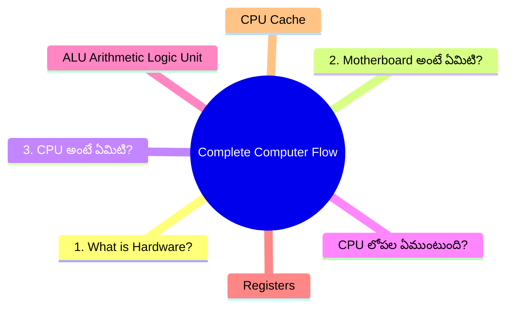

Since you're learning **Node.js, AWS, Serverless, React, and System Design**, understanding **Computer → Hardware → OS → Kernel → CPU → Cores → Clock Speed** is one of the most important foundations.

I'll explain it from **power button pressed → Node.js application running** in **simple Telugu**.

---

# Complete Computer Flow



```text
                Power Button
                     │
                     ▼
              Motherboard Starts
                     │
                     ▼
                  CPU Starts
                     │
                     ▼
                  BIOS / UEFI
                     │
                     ▼
            Bootloader Loads OS
                     │
                     ▼
          Operating System Starts
                     │
                     ▼
               Kernel Starts
                     │
                     ▼
      Drivers Initialize Hardware
                     │
                     ▼
      User Opens Node.js Application
                     │
                     ▼
          Kernel Creates Process
                     │
                     ▼
          CPU Executes Instructions
                     │
                     ▼
          Application Sends Response
```

---

# 1. What is Hardware?

Hardware అంటే

**మనం చేతితో తాకగలిగే Physical Parts.**

ఉదాహరణలు

```text
CPU

RAM

Hard Disk / SSD

Keyboard

Mouse

Monitor

Motherboard

GPU

Network Card
```

ఒక ఉదాహరణ

మన శరీరంతో పోలిస్తే

```text
Brain → CPU

Memory → RAM

Bookshelf → SSD

Eyes → Monitor

Hands → Keyboard

Nerves → Motherboard
```

---

# 2. Motherboard అంటే ఏమిటి?

Motherboard అనేది

అన్ని Hardware Components ను కలిపే Board.

```text
CPU
 │
RAM
 │
SSD
 │
GPU
 │
USB
 │
LAN
```

అన్నీ Motherboard మీదే Connect అవుతాయి.

---

# 3. CPU అంటే ఏమిటి?

CPU

**Computer యొక్క Brain**

అది

Instructions Execute చేస్తుంది.

ఉదాహరణ

```javascript
let a = 5;
let b = 10;

console.log(a + b);
```

CPU

ఇలా ఆలోచిస్తుంది

```text
Load 5

Load 10

Add

Store Result

Print
```

అన్నీ CPU చేస్తుంది.

---

# CPU లోపల ఏముంటుంది?

```text
CPU
│
├── ALU
├── Registers
├── Cache
├── Control Unit
├── Clock
└── Cores
```

ఇప్పుడు ఒక్కొక్కటి చూద్దాం.

---

# ALU (Arithmetic Logic Unit)

ALU

లెక్కలు చేస్తుంది.

```text
5+10

20-4

100*5

20>5

10==20
```

ఇవన్నీ ALU.

---

# Registers

Registers

CPU లో ఉండే

అత్యంత Fast Memory.

```text
RAM

↓

Registers

↓

ALU
```

అందుకే

CPU ముందుగా Data ను Registers లోకి తీసుకుంటుంది.

---

# CPU Cache

Registers చిన్నవి.

RAM Slow.

కాబట్టి మధ్యలో

Cache ఉంటుంది.

```text
CPU

↓

L1 Cache

↓

L2 Cache

↓

L3 Cache

↓

RAM
```

Speed

```text
Registers

↓

L1

↓

L2

↓

L3

↓

RAM

↓

SSD
```

---

# Clock అంటే ఏమిటి?

CPU లో ఒక చిన్న Clock ఉంటుంది.

అది

ప్రతి Second

లక్షల కోట్లు సార్లు Tick అవుతుంది.

ఉదాహరణ

```
Tick

Tick

Tick

Tick

Tick
```

ప్రతి Tick

ఒక Instruction Execute చేయడానికి అవకాశం.

---

# Clock Speed

ఉదాహరణ

CPU

```
3 GHz
```

అంటే

```
3,000,000,000

Ticks

per second
```

అంటే

ఒక సెకనులో

300 కోట్ల Clock Cycles.

ప్రతి Cycle లో

కొన్ని Instructions Execute అవుతాయి.

---

# ఎక్కువ GHz అంటే ఏమిటి?

```text
2 GHz

↓

2 Billion Cycles

per second
```

```text
5 GHz

↓

5 Billion Cycles

per second
```

అంటే

5GHz CPU

సాధారణంగా

2GHz కంటే వేగంగా పని చేస్తుంది.

కానీ

Architecture కూడా ముఖ్యం.

---

# CPU Core అంటే ఏమిటి?

పాత CPUs

```text
CPU

↓

1 Core
```

ఒకేసారి

ఒక పని మాత్రమే.

ఇప్పుడు

```text
CPU

├── Core1

├── Core2

├── Core3

├── Core4

├── Core5

├── Core6

├── Core7

└── Core8
```

ప్రతి Core

ఒక చిన్న CPU లాంటిది.

---

# Example

8 Core CPU

```text
Core1

Chrome
```

```text
Core2

VS Code
```

```text
Core3

Spotify
```

```text
Core4

Node.js
```

అన్నీ ఒకేసారి Run అవుతాయి.

---

# Thread అంటే ఏమిటి?

ఒక Core

కొన్నిసార్లు

రెండు Threads Run చేస్తుంది.

ఉదాహరణ

```text
Core1

↓

Thread1

Thread2
```

Intel దీన్ని

Hyper Threading అంటుంది.

---

# RAM అంటే ఏమిటి?

RAM

Temporary Memory.

మీరు

Netflix Open చేశారు.

Movie Data

RAM లో ఉంటుంది.

Power Off

↓

అన్నీ పోతాయి.

---

# SSD అంటే ఏమిటి?

Permanent Storage.

```text
Windows

Movies

Photos

VS Code

Node.js
```

ఇవన్నీ SSD లో ఉంటాయి.

Power Off అయినా

Delete కావు.

---

# ఇప్పుడు OS అంటే ఏమిటి?

OS

అంటే

Operating System

ఉదాహరణ

```text
Windows

Linux

macOS

Android

iOS
```

OS

Hardware ని Control చేస్తుంది.

---

# ఎందుకు OS కావాలి?

Application

CPU తో Direct గా మాట్లాడలేదు.

ఇలా చేయలేం.

```text
Chrome

↓

CPU
```

మధ్యలో

OS ఉండాలి.

```text
Chrome

↓

Operating System

↓

CPU
```

---

# Kernel అంటే ఏమిటి?

Kernel

OS యొక్క

Heart.

```text
Operating System

↓

Kernel
```

Kernel

Hardware తో Direct గా మాట్లాడుతుంది.

---

# OS Structure

```text
Applications

↓

Operating System

↓

Kernel

↓

Drivers

↓

Hardware
```

---

# Drivers అంటే?

Keyboard Driver

GPU Driver

Printer Driver

Network Driver

అన్నీ Drivers.

Kernel

Drivers ద్వారా

Hardware తో మాట్లాడుతుంది.

---

# Node.js ఎలా Run అవుతుంది?

మీరు

```bash
node app.js
```

అని Run చేశారు.

Flow

```text
node app.js

↓

Operating System

↓

Kernel

↓

Create Process

↓

Allocate RAM

↓

CPU Scheduler

↓

CPU Core

↓

Execute JavaScript

↓

Console Output
```

---

# Process అంటే?

మీరు

Chrome Open చేశారు.

```text
Chrome Process
```

VS Code

```text
VS Code Process
```

Node

```text
Node Process
```

ప్రతి Application

ఒక Process.

---

# Scheduler అంటే?

CPU కి

వేల Processes ఉంటాయి.

Scheduler

నిర్ణయిస్తుంది

```text
Next

Chrome

↓

Next

Node

↓

Next

Spotify

↓

Next

Windows
```

ఎవరికి CPU ఇవ్వాలో.

---

# System Call అంటే?

Node.js

ఇలా File Read చేస్తుంది.

```javascript
fs.readFile();
```

Node

నేరుగా SSD తో మాట్లాడదు.

Flow

```text
Node.js

↓

Kernel

↓

SSD Driver

↓

SSD

↓

Data

↓

Kernel

↓

Node.js
```

దీనినే

System Call అంటారు.

---

# Complete Flow (Power ON నుండి Node.js వరకు)

```text
Power Button
      │
      ▼
Motherboard Receives Power
      │
      ▼
CPU Starts Executing Firmware
      │
      ▼
BIOS / UEFI Checks Hardware (POST)
      │
      ▼
Bootloader Loads Operating System
      │
      ▼
Operating System Starts
      │
      ▼
Kernel Initializes Drivers
      │
      ▼
RAM, SSD, Keyboard, Network Become Ready
      │
      ▼
User Runs: node app.js
      │
      ▼
Operating System Creates a Process
      │
      ▼
Kernel Allocates Memory
      │
      ▼
Scheduler Assigns a CPU Core
      │
      ▼
CPU Fetches Instructions
      │
      ▼
Registers Load Data
      │
      ▼
ALU Executes Operations
      │
      ▼
Results Are Written to Memory
      │
      ▼
Node.js Handles Requests and Sends Responses
```

# దీన్ని మనిషితో పోల్చితే

| Computer         | మనిషి                                                |
| ---------------- | ---------------------------------------------------- |
| Hardware         | శరీరం                                                |
| CPU              | మెదడు                                                |
| Core             | మెదడులో ఒక పని చేసే భాగం                             |
| Clock            | గుండె చప్పుడు లాగా ప్రతి Tick పని ప్రారంభించే సంకేతం |
| RAM              | తాత్కాలిక జ్ఞాపకం                                    |
| SSD              | శాశ్వత జ్ఞాపకం                                       |
| Operating System | శరీరాన్ని నియంత్రించే నాడీ వ్యవస్థ                   |
| Kernel           | నాడీ వ్యవస్థలో ప్రధాన నియంత్రణ కేంద్రం               |
| Drivers          | కళ్ళు, చెవులు, చేతులు వంటి అవయవాలతో మాట్లాడే నరాలు   |
| Process          | ఒక వ్యక్తి చేస్తున్న ఒక పని                          |
| Thread           | ఆ పనిలోని చిన్న ఉపపని                                |
| Scheduler        | ఎవరు ముందుగా పని చేయాలో నిర్ణయించే మేనేజర్           |

ఈ పునాది అర్థమైతే, తరువాత **Node.js Event Loop**, **libuv**, **Multithreading**, **CPU Scheduling**, **Memory Management**, **Docker**, **Kubernetes**, మరియు **AWS Lambda** ఎలా పనిచేస్తాయో అర్థం చేసుకోవడం చాలా సులభమవుతుంది.
