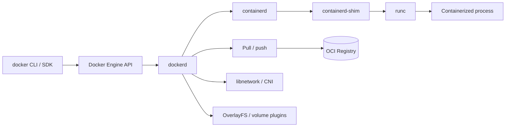
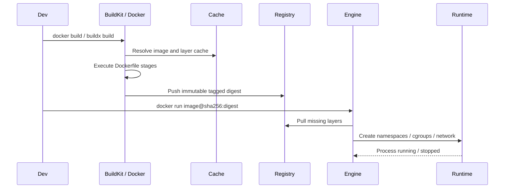
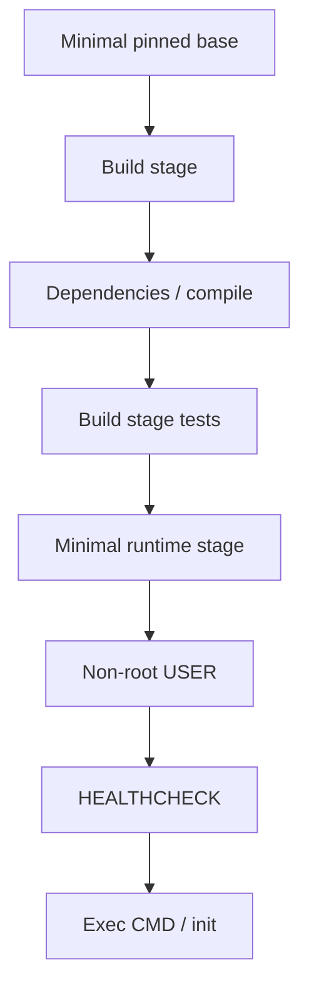
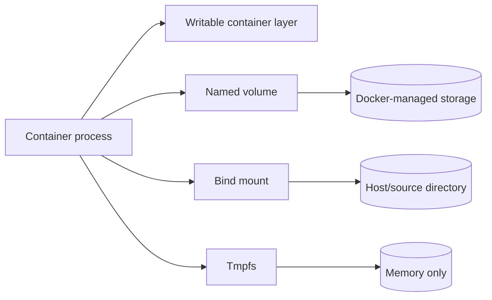
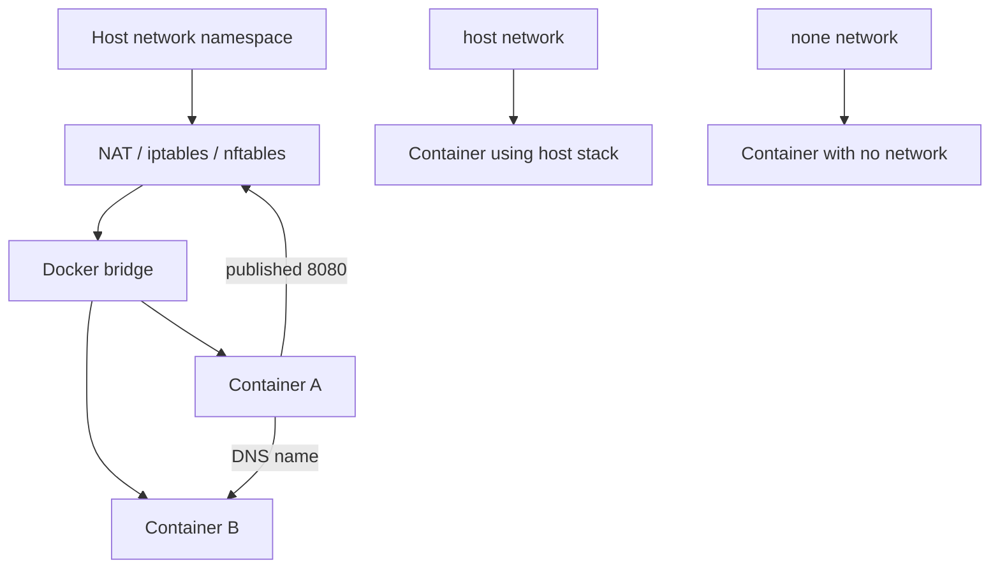
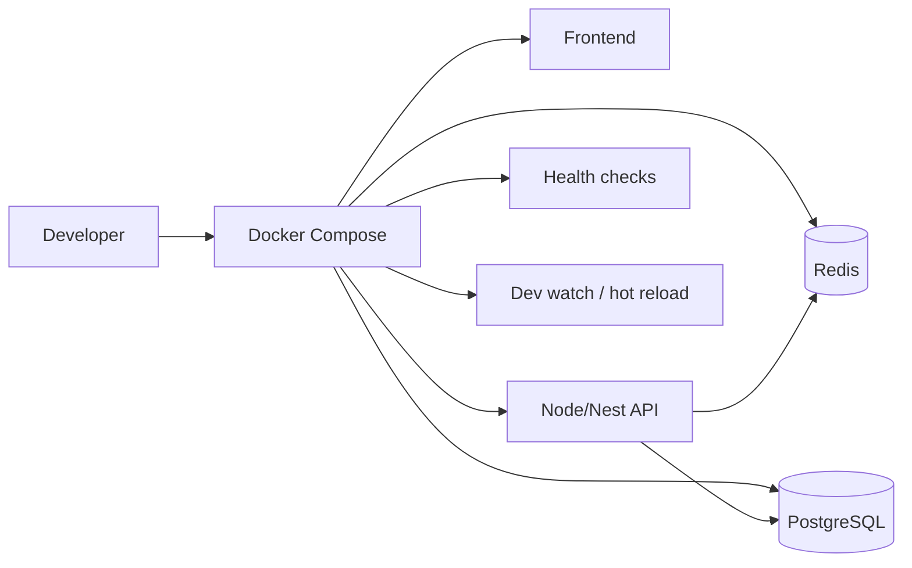
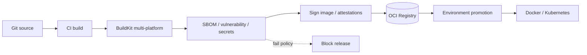
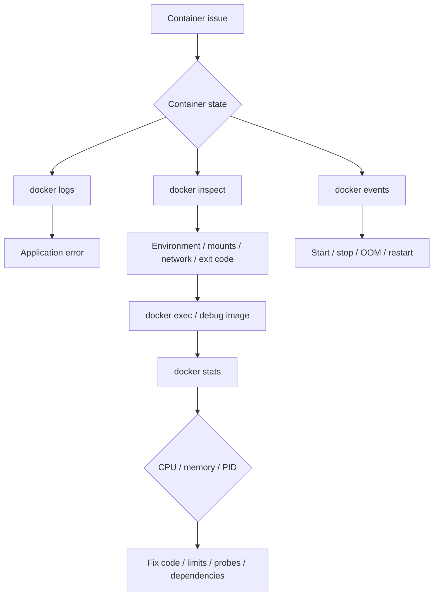
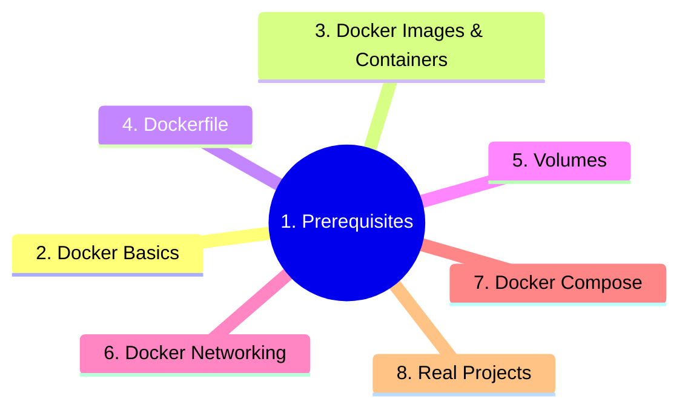

# Docker: Complete Beginner to Production Guide

ఈ గైడ్ Linux basics నుండి image building, storage, networking, Compose, registry, security, CI/CD, మరియు Kubernetes integration వరకు Docker‌ను practical production formatలో cover చేస్తుంది.

> **Core mental model:** Container is an isolated process, not a lightweight virtual machine. Dockerfile builds immutable image layers; runtime creates a process with its own filesystem, namespaces, cgroups and networking view.

## Docker Learning Roadmap

```mermaid
flowchart LR
    Linux[Linux + Networking] --> Runtime[Container Runtime]
    Runtime --> Images[Images + Registries]
    Images --> Dockerfile[Dockerfile + BuildKit]
    Dockerfile --> Containers[Containers + Processes]
    Containers --> Data[Volumes + Backups]
    Data --> Network[Networks + DNS]
    Network --> Compose[Compose + Local Stack]
    Compose --> Secure[Scanning + SBOM + Signing]
    Secure --> CI[CI/CD + Provenance]
    CI --> Orchestrate[Kubernetes + Swarm]
```



## Docker Architecture



- Docker CLI is the client; Engine API and daemon manage lifecycle and resources.
- `containerd` manages container lifecycle and image content; OCI runtimes such as `runc` start the process.
- Modern Docker uses BuildKit for Buildx/buildx, cache exports, SBOM and provenance.
- CRI-compatible runtimes and Kubernetes do not require Docker as their control-plane daemon, but OCI-compatible images remain reusable.

## VM vs Container

| Dimension | Virtual Machine | Container |
|---|---|---|
| Isolation unit | Guest OS + kernel | Shared host kernel process + Linux namespaces/cgroups |
| Startup | Seconds to minutes | Milliseconds to seconds |
| Disk/memory | Full guest overhead | Shared kernel and content-addressed image layers |
| Portability | Hypervisor and image format | OCI image; kernel and architecture compatibility still matter |
| Security boundary | Strong guest isolation | Process isolation; use sandboxing and least privilege for untrusted workloads |

## Image and Container Lifecycle



- Prefer immutable digest pinning for CI/prod; tags are mutable aliases.
- Container state is ephemeral; durable state belongs in volumes or external databases/object storage.
- One container should own one application responsibility and one process supervisor model.
- `PID 1` should be the app or a correct init/signal-forwarding process, not an ignored shell wrapper.

## Dockerfile Best Practices



- Use two or more stages to keep build tools out of production image.
- Copy dependency manifests first, install dependencies, then copy source to maximize cache reuse.
- Use `COPY`, not `ADD`, except when remote URL/tar auto-extraction is specifically required.
- Use exec-form `CMD/ENTRYPOINT`, avoid shell wrappers that break signal forwarding.
- Pin OS/runtime package versions where reproducibility matters and refresh base images frequently.
- Do not add secrets; use BuildKit secret mounts for build-only values and runtime secret mechanisms.

## Storage Model



- Named volumes for durable database/cache state and Docker-managed lifecycle.
- Bind mounts for development source/build artifacts or host integration; avoid production source mounts unless required.
- `tmpfs` for ephemeral secrets or sensitive processing data that should not persist.
- `--mount` syntax provides clearer type/required validation than legacy `-v` syntax.
- Back up database volumes through database-aware dumps or snapshots, not only copying live files.

## Networking Model



- Custom bridge networks provide automatic DNS service-name resolution and better isolation than default bridge.
- Publish only required host ports; `EXPOSE` is metadata and does not publish externally.
- Use user-defined networks to isolate frontend, backend and database tiers.
- IPv6, dual-stack and host firewall rules require explicit validation.
- Service mesh or Kubernetes CNI is an additional layer; Docker Compose networking is not cluster orchestration.

## Compose and Local Production Parity



- Keep Compose override files for development-specific bind mounts and debug settings.
- Every dependent service should have health checks and appropriate `depends_on.condition: service_healthy` usage.
- Define restart policy, resource limits, log rotation and stop grace periods for stable local behavior.
- Prefer environment/config files for configuration; never commit `.env` secrets or private keys.
- Database initialization and migrations must be repeatable and separate from application container startup if possible.

## Registry, CI/CD and Supply Chain



- Build once, promote by immutable digest across environments rather than rebuilding per environment.
- Scan OS/app dependencies and generate SBOM with CycloneDX/SPDX.
- Sign images and verify provenance before deployment; enable least-privilege registry credentials.
- Use GitHub Actions OIDC or workload identity instead of long-lived registry secrets.
- Retention and cleanup policies avoid unbounded registry storage; preserve deployed and rollback digests.

## Docker Security

- Run as a non-root UID, drop Linux capabilities and use `no-new-privileges` where possible.
- Use minimal pinned base images and Distroless/alpine only after compatibility trade-offs are known.
- Mount secrets read-only and through Docker secrets or external secret managers.
- Use read-only root filesystems with explicit writable volumes/tmpfs for required directories.
- Enable Docker content trust/signature verification in restricted environments.
- Constrain memory/CPU/PIDs and set log limits to prevent container or daemon resource exhaustion.
- Use AppArmor/SELinux/seccomp profiles and separate container networks/trust zones.
- Never mount Docker socket (`/var/run/docker.sock`) into application containers unless explicitly isolated as an operator.

## Troubleshooting



- Inspect exit code and OOMKilled status before changing application code.
- Verify DNS resolution, published ports, user namespace, mount source and network attachment.
- Use `docker top`, `docker stats`, `docker inspect`, logs and events together for root-cause evidence.
- Capture container diff only for debugging; use immutable rebuilt images for fixes.
- Add health checks as both Docker Compose and application readiness probes; distinguish liveness from readiness.

## Docker to Kubernetes Handoff

- Docker image is portable, while Compose's `depends_on`, restart policy and networks are not Kubernetes primitives.
- Translate Compose into Deployments, Services, Ingress/Gateway, PVC/StorageClass and Secrets/External Secrets.
- Kubernetes liveness/readiness/startup probes replace or complement Docker health checks.
- Use HPA/KEDA and resource requests/limits for scaling; avoid Docker-only CPU limits as the cluster scheduler contract.
- CI builds and registry artifacts remain reusable; runtime orchestration moves to Kubernetes reconciliation.

---

# 1. Prerequisites



Docker నేర్చుకోవడానికి మీరు ఎంచుకున్న **Prerequisites (ముందస్తు అవసరాలు)** చాలా పర్ఫెక్ట్‌గా ఉన్నాయి. Docker కంటైనర్లు ఎక్కువగా Linux పర్యావరణంలోనే నడుస్తాయి కాబట్టి, ఈ కింది అంశాలు మీకు Dockerని సులభంగా అర్థం చేసుకోవడానికి సహాయపడతాయి.

మీరు నేర్చుకోవాల్సిన టాపిక్స్‌ను తెలుగులో సులభంగా వివరిస్తాను:

### 1. Linux Commands (బేసిక్ కమాండ్స్)

Docker కంటైనర్‌లోకి లాగిన్ అయినప్పుడు (Container Bash Shell), ఇవి మీకు ప్రతి క్షణం అవసరమవుతాయి.

- **`ls` (List):** ఒక డైరెక్టరీలో ఏమేమి ఫైల్స్ ఉన్నాయో చూడటానికి.
- **`cd` (Change Directory):** ఫోల్డర్స్ మారడానికి.
- **`pwd` (Print Working Directory):** ప్రస్తుతం మీరు ఏ ఫోల్డర్‌లో ఉన్నారో తెలుసుకోవడానికి.
- **`cp` (Copy):** ఫైల్స్ లేదా ఫోల్డర్లను కాపీ చేయడానికి.
- **`mv` (Move):** ఫైల్స్‌ను ఒక చోటు నుండి మరో చోటుకి మార్చడానికి లేదా పేరు మార్చడానికి (Rename).

### 2. File Permissions (ఫైల్ అనుమతులు)

Docker ఇమేజెస్ బిల్డ్ చేసేటప్పుడు, కొన్ని ఫైల్స్ ఎగ్జిక్యూట్ అవ్వాలంటే పర్మిషన్స్ అవసరం.

- **`chmod` (Change Mode):** ఒక ఫైల్‌ను ఎవరు చదవాలి (Read), రాయాలి (Write), లేదా రన్ (Execute) చేయాలి అని సెట్ చేయడానికి ఇది వాడతారు.
- _ఉదాహరణ:_ `chmod +x script.sh` (స్క్రిప్ట్‌ను రన్ చేయడానికి పర్మిషన్ ఇవ్వడం).

### 3. Process Management (ప్రాసెస్ నిర్వహణ)

కంటైనర్ లోపల ఏ అప్లికేషన్ రన్ అవుతుందో తెలుసుకోవడానికి ఇవి వాడతాము.

- **`ps` (Process Status):** ప్రస్తుతం నడుస్తున్న ప్రాసెస్‌ల లిస్ట్ చూడటానికి.
- **`grep` (Global Regular Expression Print):** పెద్ద లిస్ట్ నుండి మీకు కావాల్సిన ప్రాసెస్‌ను వెతకడానికి.
- _ఉదాహరణ:_ `ps aux | grep node` (Node.js ప్రాసెస్ రన్ అవుతుందో లేదో చూడటానికి).

### 4. Basic Networking (నెట్‌వర్కింగ్)

Docker కంటైనర్లు ఒకదానితో ఒకటి మాట్లాడుకోవడానికి (Communication) నెట్‌వర్క్ అవసరం.

- **IP Address:** కంటైనర్‌ను గుర్తించడానికి.
- **Ports:** మీ లోకల్ మెషీన్ నుండి కంటైనర్ లోపల ఉన్న అప్లికేషన్‌ను ఎలా యాక్సెస్ చేయాలో (Port Mapping) తెలుసుకోవాలి. (ఉదా: `docker run -p 8080:80`)

### 5. Git Basics

Docker ఇమేజ్‌లను బిల్డ్ చేయడానికి అవసరమైన కోడ్‌ని మేనేజ్ చేయడానికి Git చాలా ముఖ్యం.

- **`git clone`:** మీ ప్రాజెక్ట్ కోడ్‌ని డౌన్‌లోడ్ చేసుకోవడానికి.
- **`git pull`:** లేటెస్ట్ మార్పులను తీసుకోవడానికి.

---

### మీరు ఎలా ప్రాక్టీస్ చేయాలి? (Action Plan)

1. **Linux Practice:** మీ కంప్యూటర్‌లో [WSL (Windows Subsystem for Linux)](https://www.google.com/search?q=https%3A%2F%2Flearn.microsoft.com%2Fen-us%2Fwindows%2Fwsl%2Finstall) ఇన్‌స్టాల్ చేసుకోండి లేదా ఒక చిన్న Linux Virtual Machine (Ubuntu) క్రియేట్ చేసుకోండి.
2. **Hands-on:** పైన మీరు పేర్కొన్న ప్రతి కమాండ్‌ను ఒక 10 నిమిషాలు ప్రాక్టీస్ చేయండి.

- ఒక ఫైల్ క్రియేట్ చేయండి, దానికి `chmod` తో పర్మిషన్స్ మార్చండి.
- `ps` కమాండ్ వాడి మీ సిస్టమ్ ప్రాసెస్‌లను చూడండి.

3. **ముఖ్యమైన గమనిక:** Docker లో మీరు రాసే **Dockerfile** లో ఈ Linux కమాండ్లే ఎక్కువగా వాడతారు. కాబట్టి వీటిపై పట్టు సాధిస్తే, Docker మీకు చాలా తేలికగా అనిపిస్తుంది.

మీరు Linux లో ఏ కమాండ్ గురించి అయినా మరింత వివరంగా తెలుసుకోవాలనుకుంటున్నారా? లేదా తర్వాతి టాపిక్ (Docker Fundamentals) లోకి వెళ్దామా?

---

# 2. Docker Basics

Docker లోని ప్రాథమిక అంశాలు (Basics) చాలా ముఖ్యమైనవి. ఇవి అర్థమైతే Docker పైన మీకు పూర్తి పట్టు వస్తుంది. వీటిని సులభంగా అర్థం చేసుకుందాం:

### 1. అసలు Docker అంటే ఏమిటి?

Docker అనేది ఒక **Platform**. ఇది ఒక సాఫ్ట్‌వేర్ అప్లికేషన్‌ను దాని డిపెండెన్సీలతో (Libraries, configurations, environment) కలిపి ఒక **Container** గా ప్యాక్ చేస్తుంది. దీనివల్ల, ఆ అప్లికేషన్ మీ లాప్‌టాప్‌లో ఎలా రన్ అవుతుందో, సర్వర్‌లో కూడా అలాగే రన్ అవుతుంది. "It works on my machine" అనే సమస్యను Docker పూర్తిగా తొలగిస్తుంది.

---

### 2. Virtual Machine vs Container (ముఖ్యమైన తేడా)

| ఫీచర్     | Virtual Machine (VM)                      | Container                                |
| --------- | ----------------------------------------- | ---------------------------------------- |
| **OS**    | ప్రతి VM కి ఒక ప్రత్యేక Guest OS ఉంటుంది. | కంటైనర్లు హోస్ట్ OS నే షేర్ చేసుకుంటాయి. |
| **సైజు**  | చాలా ఎక్కువ (GBs లో ఉంటుంది).             | చాలా తక్కువ (MBs లో ఉంటుంది).            |
| **వేగం**  | స్టార్ట్ అవ్వడానికి నిమిషాలు పడుతుంది.    | సెకన్లలో స్టార్ట్ అవుతుంది.              |
| **మెమరీ** | ఎక్కువ మెమరీ తీసుకుంటుంది.                | చాలా తక్కువ మెమరీ తీసుకుంటుంది.          |

- **సులభంగా చెప్పాలంటే:** VM అంటే ఒక పూర్తి ఇల్లు (అన్ని సౌకర్యాలు సెపరేట్‌గా ఉంటాయి). కంటైనర్ అంటే ఒక హోటల్ రూమ్ (ఇతర రూమ్స్‌తో పాటు వాటర్, ఎలక్ట్రిసిటీ వంటి బేసిక్ వనరులను పంచుకుంటుంది).

---

### 3. Docker Architecture (ఆకృతి)

Docker మూడు ప్రధాన భాగాలతో పనిచేస్తుంది:

- **Docker Client:** మీరు కమాండ్ ప్రాంప్ట్‌లో ఇచ్చే కమాండ్స్ (`docker run`, `docker pull`) ను తీసుకుని Docker Daemon కి పంపిస్తుంది.
- **Docker Daemon (`dockerd`):** ఇది వెనుక (Background) నడుస్తుంది. క్లయింట్ నుండి వచ్చిన రిక్వెస్ట్‌లను ప్రాసెస్ చేసి, ఇమేజ్‌లను బిల్డ్ చేయడం, కంటైనర్లను రన్ చేయడం వంటి పనులు చేస్తుంది.
- **Docker Registry:** ఇది ఇమేజ్‌ల స్టోర్ హౌస్. ఉదాహరణకు, **Docker Hub**. మీరు అక్కడ నుండి ఇమేజ్‌లను డౌన్‌లోడ్ చేసుకోవచ్చు లేదా మీరు చేసిన ఇమేజ్‌లను అక్కడ అప్‌లోడ్ చేయవచ్చు.

---

### 4. ముఖ్యమైన పరిభాష (Key Concepts)

- **Images:** ఇవి ఒక "Template" లేదా "Blueprint" లాంటివి. ఇందులో అప్లికేషన్ రన్ అవ్వడానికి కావాల్సిన కోడ్, లైబ్రరీలు అన్నీ ఉంటాయి. ఇది **Read-only** ఫైల్.
- **Containers:** ఇమేజ్ నుండి తయారైన **Running Instance** ని కంటైనర్ అంటారు. ఇమేజ్ అనేది ఒక పెయింటింగ్ లాంటిది అయితే, కంటైనర్ అనేది ఆ పెయింటింగ్ ప్రదర్శనలో ఉన్నప్పుడు ఎలా కనిపిస్తుందో అలా ఉంటుంది.

---

### 5. ప్రాథమిక కమాండ్స్ (Practice Commands)

మీరు వీటిని ప్రాక్టీస్ చేయడానికి ఇప్పుడే ట్రై చేయండి:

| కమాండ్                       | వివరణ                                             |
| ---------------------------- | ------------------------------------------------- |
| `docker pull <image_name>`   | Registry నుండి ఇమేజ్‌ని డౌన్‌లోడ్ చేస్తుంది.      |
| `docker run <image_name>`    | ఇమేజ్ నుండి కొత్త కంటైనర్‌ను స్టార్ట్ చేస్తుంది.  |
| `docker ps`                  | ప్రస్తుతం నడుస్తున్న కంటైనర్ల లిస్ట్ చూపిస్తుంది. |
| `docker ps -a`               | ఆగిపోయిన వాటితో సహా అన్నీ చూపిస్తుంది.            |
| `docker stop <container_id>` | నడుస్తున్న కంటైనర్‌ను ఆపుతుంది.                   |
| `docker images`              | మీ సిస్టమ్‌లో ఉన్న అన్ని ఇమేజ్‌లను చూపిస్తుంది.   |
| `docker rm <container_id>`   | కంటైనర్‌ను డిలీట్ చేస్తుంది.                      |

### మీ కోసం చిన్న సలహా:

మీరు వీటిని నేర్చుకుంటున్నప్పుడు, **"Docker Hello World"** అనే ప్రోగ్రామ్ తో మొదలుపెట్టండి.
మీ టెర్మినల్‌లో `docker run hello-world` అని టైప్ చేసి చూడండి. ఇది మీ Docker సెటప్ సరిగ్గా ఉందో లేదో మీకు అర్థమయ్యేలా చెబుతుంది.

ఈ కాన్సెప్ట్స్ లో మీకు ఏవైనా సందేహాలు ఉన్నాయా? లేక Dockerfile గురించి నేర్చుకుందామా?

---

# 3. Docker Images & Containers

Docker లో ఇమేజెస్ (Images) మరియు కంటైనర్స్ (Containers) తో పనిచేయడం అంటే నిజానికి మీరు ఒక సాఫ్ట్‌వేర్ ప్యాకేజీని ఎలా మేనేజ్ చేయాలో నేర్చుకోవడం. మీరు పైన పేర్కొన్న కమాండ్స్ అన్నీ చాలా ముఖ్యమైనవి.

వాటిని ఒక క్రమ పద్ధతిలో ఇక్కడ వివరిస్తున్నాను:

### 1. కమాండ్ల వివరణ (Quick Reference)

- **`docker pull <image>`**: Docker Hub నుండి ఇమేజ్‌ని మీ లోకల్ సిస్టమ్‌కి డౌన్‌లోడ్ చేస్తుంది.
- **`docker images`**: మీ సిస్టమ్‌లో ఉన్న అన్ని ఇమేజ్‌ల లిస్ట్‌ని చూపిస్తుంది.
- **`docker run -d -p <host_port>:<container_port> <image>`**:
- `-d`: Detached mode (బ్యాక్‌గ్రౌండ్‌లో రన్ అవ్వడానికి).
- `-p`: Port mapping (లోకల్ మెషీన్ పోర్ట్‌ని కంటైనర్ పోర్ట్‌కి అనుసంధానిస్తుంది).

- **`docker ps` / `docker ps -a**`: రన్ అవుతున్న కంటైనర్లు / మొత్తం కంటైనర్ల లిస్ట్.
- **`docker stop <id>`**: నడుస్తున్న కంటైనర్‌ను ఆపుతుంది.
- **`docker start <id>`**: ఆగిపోయిన కంటైనర్‌ను మళ్ళీ స్టార్ట్ చేస్తుంది.
- **`docker rm <id>`**: కంటైనర్‌ను తొలగిస్తుంది (ముందు `stop` చేయాలి).
- **`docker rmi <image_id>`**: ఇమేజ్‌ని తొలగిస్తుంది.
- **`docker logs <id>`**: కంటైనర్ లోపల ఏమేమి జరుగుతుందో (Logs) చూడటానికి.
- **`docker exec -it <id> /bin/bash`**: నడుస్తున్న కంటైనర్ లోపలికి లాగిన్ అవ్వడానికి (ఇది Linux కమాండ్స్ ప్రాక్టీస్ చేయడానికి చాలా ఉపయోగకరం).

---

### 2. ప్రాక్టీస్ చేయడానికి స్టెప్స్ (Hands-on)

మీరు ఈ కింద ఉన్న క్రమంలో ప్రాక్టీస్ చేయండి. ప్రతిదీ ట్రై చేసిన తర్వాత `docker ps` మరియు `docker logs` చెక్ చేయడం మర్చిపోవద్దు.

#### A. Ubuntu (Linux ప్రాక్టీస్ కోసం)

Ubuntu కంటైనర్ లోపలికి వెళ్లి మీరు నేర్చుకున్న Linux కమాండ్స్ ప్రాక్టీస్ చేయవచ్చు.

```bash
docker run -it ubuntu /bin/bash
# కంటైనర్ లోపల ఉన్నప్పుడు:
ls
pwd
exit  # ఇది కంటైనర్ నుండి బయటకు వస్తుంది

```

#### B. Nginx (Web Server)

దీనిని రన్ చేసి బ్రౌజర్‌లో చూడవచ్చు.

```bash
docker run -d -p 8080:80 --name my-nginx nginx
# ఇప్పుడు బ్రౌజర్‌లో http://localhost:8080 ఓపెన్ చేయండి.

```

#### C. Redis (In-memory DB)

```bash
docker run -d --name my-redis redis

```

#### D. MySQL (Database)

MySQL రన్ చేసేటప్పుడు పాస్‌వర్డ్ సెట్ చేయడం ముఖ్యం.

```bash
docker run -d --name my-mysql -e MYSQL_ROOT_PASSWORD=password123 -p 3306:3306 mysql

```

---

### 3. మీరు గమనించాల్సిన ముఖ్యమైన పద్ధతులు:

1. **కంటైనర్ పేర్లు:** ప్రతిసారి ID (ఉదా: `a1b2c3d4`) గుర్తుపెట్టుకోవడం కష్టం. కాబట్టి `docker run --name <name>` అని వాడి మీకు నచ్చిన పేరు పెట్టుకోండి.
2. **క్లీనప్ (Cleanup):** మీరు ప్రాక్టీస్ అయిపోయిన తర్వాత అనవసరమైన కంటైనర్లను తీసేయండి, లేకపోతే మెమరీ నిండిపోతుంది.

- `docker stop $(docker ps -q)` - అన్ని కంటైనర్లను ఒకేసారి ఆపడానికి.
- `docker system prune` - వాడని కంటైనర్లు, ఇమేజ్‌లను డిలీట్ చేయడానికి.

**చిన్న సలహా:** మీరు `docker exec` కమాండ్ వాడి MySQL లేదా Redis కంటైనర్ లోపలికి వెళ్లి, డేటాబేస్ లోపల ఎలా ఉంటుందో ఒకసారి చూడండి. ఇది మీకు కంటైనర్ లోపల ఎన్విరాన్మెంట్ ఎలా ఉంటుందో బాగా అర్థమయ్యేలా చేస్తుంది.

మీరు ఈ ప్రాక్టీస్ చేస్తున్నప్పుడు ఏవైనా ఎర్రర్స్ వస్తున్నాయా? లేదా తర్వాతి టాపిక్ **Dockerfile** గురించి తెలుసుకుందామా?

---

# 4. Dockerfile

Dockerfile అనేది మీ అప్లికేషన్‌ను Docker ఇమేజ్‌గా మార్చడానికి ఒక **Recipe** (వంటకం) లాంటిది. ఒక ఇమేజ్ ఎలా తయారవ్వాలో ఇందులో మనం స్టెప్-బై-స్టెప్ రాస్తాము.

మీరు అడిగిన కీవర్డ్స్ మరియు వాటి అర్థాలను ఇక్కడ చూద్దాం:

### 1. Dockerfile కీవర్డ్స్ (Keywords)

- **`FROM`**: ఇది బేస్ ఇమేజ్. అంటే మీ అప్లికేషన్ ఏ OS లేదా ఎన్విరాన్మెంట్‌లో నడవాలి అనేది ఇది నిర్ణయిస్తుంది (ఉదా: `FROM node:18`).
- **`WORKDIR`**: కంటైనర్ లోపల ఏ ఫోల్డర్‌లో మీ కోడ్ ఉండాలో ఇది సెట్ చేస్తుంది (`cd` లాంటిది).
- **`COPY`**: మీ కంప్యూటర్ (Host) లో ఉన్న ఫైల్స్‌ను కంటైనర్ లోపలికి కాపీ చేస్తుంది.
- **`ADD`**: `COPY` లాంటిదే, కానీ ఇది ఇంటర్నెట్ నుండి ఫైల్స్‌ను డౌన్‌లోడ్ చేయడానికి లేదా `.tar` ఫైల్స్‌ను అన్‌జిప్ చేయడానికి కూడా వాడవచ్చు.
- **`RUN`**: ఇమేజ్ బిల్డ్ అయ్యేటప్పుడు జరిగే కమాండ్స్ (ఉదా: `RUN npm install`).
- **`ENV`**: ఎన్విరాన్మెంట్ వేరియబుల్స్ సెట్ చేయడానికి.
- **`EXPOSE`**: కంటైనర్ ఏ పోర్ట్‌ను వాడుతుందో డాక్యుమెంట్ చేయడానికి.
- **`CMD`**: కంటైనర్ స్టార్ట్ అయినప్పుడు రన్ అయ్యే మెయిన్ కమాండ్.
- **`ENTRYPOINT`**: `CMD` లాంటిదే, కానీ దీన్ని ఓవర్‌రైడ్ చేయడం కష్టం. ఇది కంటైనర్‌ను ఒక ఎగ్జిక్యూటబుల్ అప్లికేషన్‌లా మారుస్తుంది.

---

### 2. ఒక ఉదాహరణ (Node.js App)

ఒక సింపుల్ Node.js అప్లికేషన్ కోసం `Dockerfile` ఎలా ఉంటుందో చూడండి:

```dockerfile
# 1. బేస్ ఇమేజ్
FROM node:18

# 2. వర్కింగ్ డైరెక్టరీ సెట్ చేయడం
WORKDIR /app

# 3. ప్యాకేజీ ఫైల్స్ కాపీ చేయడం
COPY package*.json ./

# 4. డిపెండెన్సీలు ఇన్‌స్టాల్ చేయడం
RUN npm install

# 5. మిగతా కోడ్ అంతా కాపీ చేయడం
COPY . .

# 6. పోర్ట్ ఎక్స్‌పోజ్ చేయడం
EXPOSE 3000

# 7. అప్లికేషన్ స్టార్ట్ చేసే కమాండ్
CMD ["node", "index.js"]

```

---

### 3. Build ఎలా చేయాలి?

మీరు `Dockerfile` ఉన్న ఫోల్డర్‌లోకి వెళ్లి టెర్మినల్‌లో ఈ కమాండ్ ఇవ్వాలి:

```bash
docker build -t my-node-app .

```

- `-t my-node-app`: మీ ఇమేజ్‌కి ఒక పేరు (tag) పెట్టడం.
- `.` (చుక్క): ప్రస్తుతం ఉన్న ఫోల్డర్‌ని బేస్ చేసుకోమని అర్థం.

బిల్డ్ అయిన తర్వాత, మీ ఇమేజ్‌ను రన్ చేయడానికి:

```bash
docker run -p 3000:3000 my-node-app

```

### ముఖ్యమైన చిట్కాలు:

1. **`.dockerignore`**: Git లో `.gitignore` ఉన్నట్టే, Docker లో కూడా `.dockerignore` ఉంటుంది. ఇది `node_modules` లేదా `.git` వంటి అవసరం లేని ఫైల్స్ ఇమేజ్‌లోకి రాకుండా ఆపుతుంది (ఇమేజ్ సైజు తగ్గుతుంది).
2. **Layer Caching**: `COPY` కమాండ్లను `RUN` కి పైన వాడండి. దీనివల్ల పదే పదే ఇమేజ్ బిల్డ్ చేసేటప్పుడు సమయం ఆదా అవుతుంది.

మీరు ఇప్పుడు ఏదైనా ఒక చిన్న Python లేదా Node.js అప్లికేషన్‌ను Dockerize చేయడానికి ప్రయత్నిస్తారా? ఏదైనా డౌట్ ఉంటే అడగండి!

---

# 5. Volumes

Docker లో **Volumes** అనేవి చాలా కీలకమైనవి. కంటైనర్లు "Ephemeral" (తాత్కాలికమైనవి)—అంటే కంటైనర్ డిలీట్ అయితే అందులోని డేటా కూడా పోతుంది. డేటాను శాశ్వతంగా (Persistent) ఉంచడానికి **Volumes** వాడతాము.

దీనిని సులభంగా అర్థం చేసుకుందాం:

### 1. మూడు రకాల Volumes

- **Named Volumes:** వీటిని Docker మేనేజ్ చేస్తుంది (`/var/lib/docker/volumes/` లో). ఇవి చాలా సురక్షితమైనవి మరియు కంటైనర్లతో పాటు డిలీట్ అవ్వవు.
- _ఉదాహరణ:_ `my-db-data`

- **Bind Mounts:** ఇది మీ కంప్యూటర్‌లోని ఒక నిర్దిష్ట ఫోల్డర్‌ను కంటైనర్‌కు లింక్ చేస్తుంది. మీరు మీ కంప్యూటర్‌లో మార్పు చేస్తే వెంటనే కంటైనర్‌లో కనిపిస్తుంది (డెవలప్‌మెంట్ కోసం బెస్ట్).
- **Anonymous Volumes:** పేరు లేని వాల్యూమ్స్. కంటైనర్ డిలీట్ అవ్వగానే ఇవి ఆటోమేటిక్‌గా డిలీట్ అయిపోవచ్చు (డెవలపర్లు వీటిని తక్కువగా వాడతారు).

---

### 2. ముఖ్యమైన కమాండ్స్

| కమాండ్                              | వివరణ                                 |
| ----------------------------------- | ------------------------------------- |
| `docker volume create my-vol`       | కొత్త వాల్యూమ్‌ను క్రియేట్ చేస్తుంది. |
| `docker volume ls`                  | ఉన్న అన్ని వాల్యూమ్‌లను చూపిస్తుంది.  |
| `docker volume rm <name>`           | వాల్యూమ్‌ను తొలగిస్తుంది.             |
| `docker run -v my-vol:/path/to/dir` | కంటైనర్‌ను వాల్యూమ్‌తో రన్ చేస్తుంది. |

---

### 3. ప్రాక్టీస్: Persistent MySQL Database

MySQL కంటైనర్ డిలీట్ అయినా డేటా పోకుండా ఉండాలంటే **Named Volume** వాడాలి.

**స్టెప్స్:**

1. ముందుగా ఒక వాల్యూమ్ క్రియేట్ చేయండి:

```bash
docker volume create mysql_data

```

2. ఆ వాల్యూమ్‌ను MySQL కంటైనర్‌కు మౌంట్ చేయండి:

```bash
docker run -d --name my-mysql \
  -e MYSQL_ROOT_PASSWORD=my-secret-pw \
  -v mysql_data:/var/lib/mysql \
  mysql:latest

```

**ఇక్కడ ఏం జరిగింది?**

- `-v mysql_data:/var/lib/mysql`: MySQL తన డేటాను ఎక్కడైతే దాస్తుందో (`/var/lib/mysql`), ఆ ఫోల్డర్‌ను మన `mysql_data` అనే వాల్యూమ్‌కు లింక్ చేశాం.
- ఇప్పుడు మీరు కంటైనర్‌ను `docker rm -f my-mysql` అని డిలీట్ చేసినా, డేటా వాల్యూమ్‌లోనే ఉంటుంది. మళ్ళీ అదే వాల్యూమ్‌తో కొత్త కంటైనర్ స్టార్ట్ చేస్తే, పాత డేటా అలాగే ఉంటుంది.

---

### 4. Bind Mount ఉదాహరణ (డెవలప్‌మెంట్ కోసం)

మీరు మీ కోడ్ మార్పులు వెంటనే కంటైనర్‌లో ప్రతిబింబించాలని కోరుకుంటే:

```bash
docker run -v $(pwd):/app -w /app node:latest npm start

```

- `$(pwd)`: మీ లోకల్ ఫోల్డర్‌ను కంటైనర్‌లోని `/app` కి లింక్ చేస్తుంది.

**చిన్న చిట్కా:**
మీరు Docker లో డేటాబేస్ పనులు చేసేటప్పుడు, ఆ డేటా ఎక్కడ స్టోర్ అవుతుందో (Path) ముందే తెలుసుకోవడం చాలా అవసరం. MySQL కోసం `/var/lib/mysql` అనేది డీఫాల్ట్ పాత్.

ఇప్పుడు మీరు `docker volume ls` అని టైప్ చేసి, మీరు క్రియేట్ చేసిన వాల్యూమ్ కనిపిస్తుందో లేదో చూడండి. దీంట్లో మీకు ఏదైనా సందేహం ఉందా? లేక తర్వాతి టాపిక్ (Docker Compose) కి వెళ్దామా?

---

# 6. Docker Networking

Docker Networking ద్వారా కంటైనర్లు ఒకదానితో ఒకటి (Container-to-Container) మరియు బయటి ప్రపంచంతో (Container-to-Host) ఎలా కమ్యూనికేట్ చేయాలో మనం అర్థం చేసుకోవచ్చు.

### 1. నెట్‌వర్కింగ్ రకాలు (Docker Drivers)

- **Bridge (Default):** మీరు కంటైనర్ రన్ చేసినప్పుడు డీఫాల్ట్‌గా ఇది వాడుతుంది. ఒకే హోస్ట్ మీద ఉన్న కంటైనర్లు ఒకదానితో ఒకటి మాట్లాడుకోవడానికి ఇది వాడతారు.
- **Host:** ఇది కంటైనర్‌కు తన సొంత నెట్‌వర్క్ ఇవ్వదు. హోస్ట్ మెషీన్ యొక్క నెట్‌వర్క్‌నే వాడుకుంటుంది. ఇది నెట్‌వర్క్ వేగం ఎక్కువగా ఉండాల్సిన చోట వాడతారు.
- **None:** కంటైనర్‌కు ఎలాంటి నెట్‌వర్క్ ఉండదు. ఇది హై సెక్యూరిటీ అవసరమైన టాస్క్‌లకు వాడతారు.
- **Custom Network:** మనం సొంతంగా నెట్‌వర్క్ క్రియేట్ చేసి, మనకు నచ్చిన కంటైనర్లను దానికి అటాచ్ చేయడం. ఇది ప్రాజెక్ట్ మేనేజ్‌మెంట్‌కు బెస్ట్.

---

### 2. ముఖ్యమైన కమాండ్స్

| కమాండ్                                         | వివరణ                                          |
| ---------------------------------------------- | ---------------------------------------------- |
| `docker network ls`                            | ప్రస్తుత నెట్‌వర్క్‌లను చూడటానికి.             |
| `docker network create <name>`                 | కొత్త కస్టమ్ నెట్‌వర్క్‌ను క్రియేట్ చేయడానికి. |
| `docker network connect <network> <container>` | కంటైనర్‌ను నెట్‌వర్క్‌కు కలపడానికి.            |
| `docker network inspect <network>`             | నెట్‌వర్క్ వివరాలను చూడటానికి.                 |

---

### 3. ప్రాక్టీస్: Connect MySQL + Backend

నిజమైన అప్లికేషన్లలో అన్నీ ఒకే నెట్‌వర్క్‌లో ఉండాలి. కస్టమ్ నెట్‌వర్క్ వాడితే కంటైనర్ పేర్ల ద్వారానే ఒకదానితో ఒకటి కనెక్ట్ అవ్వచ్చు.

**స్టెప్స్:**

1. **సొంత నెట్‌వర్క్ క్రియేట్ చేయండి:**

```bash
docker network create my-app-net

```

2. **MySQL కంటైనర్‌ను ఈ నెట్‌వర్క్‌లో రన్ చేయండి:**

```bash
docker run -d --name mysql-db \
  --network my-app-net \
  -e MYSQL_ROOT_PASSWORD=password \
  mysql:latest

```

3. **Backend కంటైనర్‌ను అదే నెట్‌వర్క్‌లో రన్ చేయండి:**

```bash
docker run -d --name backend-app \
  --network my-app-net \
  my-backend-image

```

**ముఖ్య గమనిక:**
ఇప్పుడు మీ `backend-app` లో డేటాబేస్ హోస్ట్ (Host) అడ్రస్‌గా `localhost` అని కాకుండా, **`mysql-db`** (కంటైనర్ పేరు) అని ఇస్తే సరిపోతుంది. Docker ఆటోమేటిక్‌గా ఆ కంటైనర్ IP కి రిక్వెస్ట్‌ని పంపిస్తుంది. ఇదే Docker Networking లో ఉన్న అతిపెద్ద ప్లస్ పాయింట్.

---

### ఎలా ప్రాక్టీస్ చేయాలి?

1. `docker network create demo-net` అని క్రియేట్ చేయండి.
2. రెండు కంటైనర్లను రన్ చేసి, ఒకదాని లోపలికి వెళ్లి ( `docker exec -it <name> /bin/bash`) మరొక కంటైనర్ పేరుతో `ping` చేసి చూడండి.

- ఉదా: `ping mysql-db`

3. కంటైనర్ పేరుతో కమ్యూనికేషన్ జరుగుతుందో లేదో చెక్ చేయండి.

మీరు ఈ ప్రాక్టీస్ చేస్తున్నప్పుడు ఏవైనా కనెక్టివిటీ సమస్యలు వస్తున్నాయా? లేదా తర్వాతి టాపిక్ **Docker Compose** లోకి వెళ్దామా? ఇది Docker లో అత్యంత ముఖ్యమైన టాపిక్!

---

# 7. Docker Compose

**Docker Compose** అనేది మల్టిపుల్ కంటైనర్లను ఒకేసారి మేనేజ్ చేయడానికి వాడే ఒక అద్భుతమైన టూల్. మీరు ప్రతి కంటైనర్‌ను `docker run` కమాండ్‌తో విడివిడిగా స్టార్ట్ చేయకుండా, ఒకే ఒక ఫైల్ (`compose.yaml`) ద్వారా అప్లికేషన్ మొత్తాన్ని రన్ చేయవచ్చు.

### 1. `compose.yaml` లోని ప్రధాన భాగాలు

- **Services:** మీరు రన్ చేయాలనుకుంటున్న ప్రతి కంటైనర్ ఒక 'సర్వీస్'.
- **Networks:** సర్వీసుల మధ్య కమ్యూనికేషన్ కోసం క్రియేట్ చేసే నెట్‌వర్క్.
- **Volumes:** డేటాను పర్మనెంట్‌గా సేవ్ చేయడానికి.
- **Environment Variables:** పాస్‌వర్డ్‌లు, డేటాబేస్ URLలు వంటివి సెట్ చేయడానికి.

---

### 2. ఉదాహరణ: (Backend + MySQL)

ఒక ప్రాజెక్ట్ ఫోల్డర్‌లో `compose.yaml` ఫైల్ ఇలా ఉంటుంది:

```yaml
version: "3.8"

services:
  db:
    image: mysql:latest
    environment:
      MYSQL_ROOT_PASSWORD: password123
      MYSQL_DATABASE: my_db
    volumes:
      - db_data:/var/lib/mysql

  backend:
    build: .
    ports:
      - "3000:3000"
    environment:
      DB_HOST: db
      DB_PASSWORD: password123
    depends_on:
      - db

volumes:
  db_data:
```

---

### 3. ముఖ్యమైన కమాండ్స్

| కమాండ్                   | వివరణ                                                          |
| ------------------------ | -------------------------------------------------------------- |
| `docker compose up -d`   | అన్ని కంటైనర్లను బ్యాక్‌గ్రౌండ్‌లో రన్ చేస్తుంది.              |
| `docker compose down`    | అన్ని కంటైనర్లను ఆపి, నెట్‌వర్క్ మరియు కంటైనర్లను తీసేస్తుంది. |
| `docker compose ps`      | రన్ అవుతున్న కంటైనర్లను చూపిస్తుంది.                           |
| `docker compose logs -f` | అన్ని సర్వీసుల లాగ్స్‌ను రియల్ టైమ్‌లో చూపిస్తుంది.            |
| `docker compose restart` | సర్వీసులను రీస్టార్ట్ చేస్తుంది.                               |

---

### 4. ప్రాక్టీస్ చేయడానికి చిట్కాలు:

1. **`depends_on`**: ఇది `db` సర్వీస్ స్టార్ట్ అయిన తర్వాతే `backend` స్టార్ట్ అయ్యేలా చేస్తుంది.
2. **`build: .`**: మీ ప్రాజెక్ట్ లో ఉన్న `Dockerfile` ని ఆటోమేటిక్‌గా బిల్డ్ చేస్తుంది.
3. **`docker compose up --build`**: మీరు కోడ్‌లో మార్పులు చేసిన ప్రతిసారీ ఇమేజ్‌ని మళ్ళీ బిల్డ్ చేసి స్టార్ట్ చేయడానికి ఇది వాడండి.

**ముఖ్య గమనిక:**
మీరు `docker compose down` అని టైప్ చేసినప్పుడు, అప్పటికే క్రియేట్ అయిన నెట్‌వర్క్స్ మరియు కంటైనర్లు తొలగిపోతాయి. కానీ, `volumes` మాత్రం డిలీట్ అవ్వవు. దీనివల్ల మీ డేటా సేఫ్‌గా ఉంటుంది.

ఈ టాపిక్‌తో మీరు Docker లో ఒక సంపూర్ణమైన **Full-stack Application** ని డెవలప్ చేయడానికి సిద్ధంగా ఉన్నట్లు లెక్క! దీనికి సంబంధించి ఏవైనా సందేహాలు ఉన్నాయా? లేదా తర్వాతి టాపిక్స్ (ఉదా: Docker Swarm లేదా Kubernetes బేసిక్స్) వైపు వెళ్దామా?

---

# 8. Real Projects

Docker నేర్చుకోవడంలో **Real Projects** చేయడం అనేది అత్యంత కీలకమైన దశ. మీరు ఎంచుకున్న ఈ మూడు కాంబినేషన్లు (Flask, Node.js, Django) ఇండస్ట్రీలో చాలా పాపులర్.

ఒక్కో ప్రాజెక్టును ఎలా బిల్డ్ చేయాలో ఇక్కడ క్లుప్తంగా ఇస్తున్నాను. మీ ప్రాజెక్ట్ ఫోల్డర్‌లో `compose.yaml` ఫైల్‌ని క్రియేట్ చేసి ప్రాక్టీస్ చేయండి.

---

### 1. Flask + MySQL

Flask అప్లికేషన్ కోసం `Dockerfile` రాసి, `compose.yaml` లో డేటాబేస్‌ని లింక్ చేయాలి.

**Key point:** Flask అప్లికేషన్ MySQL కి కనెక్ట్ అవ్వడానికి `mysql-connector-python` వంటి లైబ్రరీ అవసరం.

- **Dockerfile:** `python:3.9` బేస్ ఇమేజ్ వాడండి.
- **Compose:** MySQL కి `restart: always` అని ఇవ్వండి, తద్వారా డేటాబేస్ ఎప్పుడూ రన్‌లో ఉంటుంది.

---

### 2. Node.js + MongoDB

Node.js కి Mongoose లేదా MongoDB Driver వాడతాము.

**Key point:** MongoDB కంటైనర్‌ను రన్ చేస్తున్నప్పుడు, డేటా పర్మనెంట్‌గా ఉండటానికి వాల్యూమ్స్ (`/data/db`) కచ్చితంగా మౌంట్ చేయండి.

- **Dockerfile:** `node:18-alpine` (ఇది చాలా తేలికగా ఉంటుంది, సైజు తక్కువ).
- **Compose:**

```yaml
services:
  mongo:
    image: mongo:latest
    volumes:
      - mongo-data:/data/db
  app:
    build: .
    environment:
      MONGO_URI: mongodb://mongo:27017/myapp
```

---

### 3. Django + PostgreSQL

ఇది కొంచెం అడ్వాన్స్‌డ్ ఎందుకంటే ఇందులో `migrate` కమాండ్స్ రన్ చేయాలి.

**Key point:** Django స్టార్ట్ అయ్యే లోపు PostgreSQL రెడీగా ఉండాలి, లేకపోతే కనెక్షన్ ఎర్రర్ వస్తుంది. దీనికోసం `healthcheck` లేదా ఒక చిన్న `entrypoint.sh` స్క్రిప్ట్ వాడాలి.

- **Dockerfile:** `python:3.11` వాడండి.
- **Compose:**

```yaml
services:
  db:
    image: postgres:15
    environment:
      POSTGRES_DB: mydb
      POSTGRES_USER: user
      POSTGRES_PASSWORD: password
  web:
    build: .
    command: bash -c "python manage.py migrate && python manage.py runserver 0.0.0.0:8000"
    depends_on:
      - db
```

---

### మీరు చేయాల్సిన ప్రాక్టీస్ పద్ధతి:

1. **ఒక ప్రాజెక్ట్ ఎంచుకోండి:** ముందుగా Flask + MySQL తో మొదలుపెట్టండి (ఇది చిన్నగా ఉంటుంది).
2. **Environment Variables:** పాస్‌వర్డ్‌లను నేరుగా `compose.yaml` లో కాకుండా, ఒక `.env` ఫైల్‌లో పెట్టి `env_file:` కీవర్డ్ ద్వారా వాడటం అలవాటు చేసుకోండి (ఇది బెస్ట్ ప్రాక్టీస్).
3. **Logs:** ఏదైనా ఎర్రర్ వస్తే `docker compose logs -f <service_name>` వాడి కచ్చితంగా చెక్ చేయండి.
4. **Networking:** కంటైనర్ లోపల నుండి డేటాబేస్‌ని కనెక్ట్ చేసేటప్పుడు `localhost` వాడకూడదు. `compose.yaml` లో మీరు పెట్టిన **service name** (ఉదా: `db`, `mongo`) నే హోస్ట్ అడ్రస్‌గా వాడాలి.

మీరు ఈ మూడింటిలో దేనితో మొదలుపెడదామని అనుకుంటున్నారు? ఒకవేళ కోడ్ రాయడంలో ఇబ్బంది ఉంటే, ఒక పర్టికులర్ ప్రాజెక్ట్ కి సంబంధించిన Dockerfile మరియు Compose ఫైల్ ఎలా రాయాలో నేను చూపిస్తాను.

---

### 4. React + Express + MongoDB & Redis Cache

React, Express, MongoDB మరియు Redis కలిపి ఒక పూర్తి స్థాయి Full-Stack అప్లికేషన్ బిల్డ్ చేయడం అనేది చాలా అద్భుతమైన ప్రాజెక్ట్. ఇది మీ డెవలప్‌మెంట్ స్కిల్స్‌ను మరో స్థాయికి తీసుకెళ్తుంది.

Docker Compose ఉపయోగించి దీన్ని ఎలా సెటప్ చేయాలో ఇక్కడ ఉంది:

### 1. ప్రాజెక్ట్ నిర్మాణం (Directory Structure)

ముందుగా మీ ప్రాజెక్ట్ ఫోల్డర్‌ను ఇలా ఆర్గనైజ్ చేయండి:

```text
my-fullstack-app/
├── client/           # React App
├── server/           # Express App
├── compose.yaml
└── .env

```

### 2. Docker Compose (compose.yaml)

ఇది మీ అప్లికేషన్ మొత్తాన్ని ఒకేసారి రన్ చేస్తుంది:

```yaml
version: "3.8"

services:
  # MongoDB Service
  db:
    image: mongo:latest
    ports:
      - "27017:27017"
    volumes:
      - mongo-data:/data/db

  # Redis Service
  cache:
    image: redis:alpine
    ports:
      - "6379:6379"

  # Express Backend
  server:
    build: ./server
    ports:
      - "5000:5000"
    environment:
      MONGO_URI: mongodb://db:27017/myapp
      REDIS_HOST: cache
    depends_on:
      - db
      - cache

  # React Frontend
  client:
    build: ./client
    ports:
      - "3000:3000"
    stdin_open: true # React Dev server కోసం అవసరం

volumes:
  mongo-data:
```

### 3. ముఖ్యమైన విషయాలు (Integration Tips)

#### A. Express Backend లో Redis కనెక్షన్:

మీ `server.js` లో కనెక్షన్ ఇచ్చేటప్పుడు, Docker నెట్‌వర్క్ పేరును హోస్ట్‌గా వాడాలి:

```javascript
const redis = require("redis");
const client = redis.createClient({
  url: "redis://cache:6379", // 'cache' అనేది compose.yaml లో ఉన్న service పేరు
});
```

#### B. Express Backend లో MongoDB కనెక్షన్:

```javascript
mongoose.connect(process.env.MONGO_URI); // .env లో 'mongodb://db:27017/myapp' అని ఉంటుంది
```

#### C. React లో Proxy:

React (3000 port) నుండి Express (5000 port) కి API కాల్స్ చేసేటప్పుడు, `client/package.json` లో ప్రాక్సీ యాడ్ చేయండి:

```json
"proxy": "http://server:5000"

```

_(గమనిక: Docker లో రన్ చేసినప్పుడు 'localhost' బదులు సర్వీస్ పేరు 'server' వాడాలి)._

---

### ఎలా స్టార్ట్ చేయాలి?

1. **Build & Start:**
   టెర్మినల్‌లో మీ రూట్ ఫోల్డర్‌లో ఉండి ఇలా టైప్ చేయండి:

```bash
docker compose up --build

```

2. **Verify:**

- `http://localhost:3000` లో మీ React app ఓపెన్ అవుతుంది.
- API అన్నీ `http://localhost:5000` ద్వారా Backend కి వెళ్తాయి.
- డేటా అంతా `db` కంటైనర్‌లో, Cache అంతా `cache` కంటైనర్‌లో సేవ్ అవుతుంది.

### ప్రాక్టీస్ కోసం టాస్క్:

1. ముందుగా ఒక Simple API రాయండి (Express + MongoDB).
2. ఆ API రెస్పాన్స్‌ని ఒకసారి Redis లో సేవ్ చేయండి (Caching).
3. రెండోసారి అదే API కాల్ చేసినప్పుడు, Redis నుండి డేటా వస్తుందో లేదో కన్సోల్ లాగ్స్‌లో చెక్ చేయండి.

ఈ సెటప్‌లో మీకు ఏవైనా కనెక్టివిటీ ఎర్రర్స్ వస్తున్నాయా? లేదా ఏదైనా సర్వీస్ కన్ఫిగరేషన్‌లో సందేహం ఉందా?

---

# 9. Docker Hub

Docker Hub అనేది GitHub ఎలాగైతే మీ కోడ్‌ని దాస్తుందో, Docker Hub మీ కంటైనర్ ఇమేజ్‌లను దాచుకునే (Repository) ఒక క్లౌడ్ ప్లాట్‌ఫామ్. మీ సొంత ఇమేజ్‌లను ప్రపంచానికి అందుబాటులో ఉంచడానికి ఇది ఉత్తమ మార్గం.

దీన్ని ఎలా ఉపయోగించాలో స్టెప్-బై-స్టెప్ చూద్దాం:

### 1. కమాండ్స్ వివరణ

- **`docker login`**: Docker Hub లోకి మీ అకౌంట్‌తో లాగిన్ అవ్వడానికి. ఇది మీ క్రెడెన్షియల్స్‌ని `~/.docker/config.json` లో సేవ్ చేస్తుంది.
- **`docker tag`**: ఒక లోకల్ ఇమేజ్‌కి ఒక కొత్త పేరు (లేదా వెర్షన్/ట్యాగ్) ఇవ్వడానికి. పబ్లిష్ చేయడానికి ముందు ఇది తప్పనిసరి.
- ఫార్మాట్: `docker tag <local_image_name> <your_dockerhub_username>/<repo_name>:<tag>`

- **`docker push`**: మీ ఇమేజ్‌ను మీ లోకల్ మెషీన్ నుండి Docker Hub లోకి అప్‌లోడ్ చేయడానికి.
- **`docker pull`**: ఎవరైనా సరే మీ ఇమేజ్‌ని వారి కంప్యూటర్‌లో డౌన్‌లోడ్ చేసుకోవడానికి.

---

### 2. మీ సొంత ఇమేజ్‌ను పబ్లిష్ చేసే పద్ధతి

మీరు బిల్డ్ చేసిన `my-node-app` ని Docker Hub లో పెట్టాలనుకుంటే, ఈ కింది స్టెప్స్ ఫాలో అవ్వండి:

**Step 1: Docker Hub లో లాగిన్ అవ్వండి**

```bash
docker login
# మీ username మరియు password అడుగుతుంది, అవి ఎంటర్ చేయండి.

```

**Step 2: ఇమేజ్‌కు ట్యాగ్ వేయండి (Tagging)**
మీ Docker Hub యూజర్ నేమ్ `myusername` అనుకుంటే:

```bash
docker tag my-node-app myusername/my-node-repo:v1

```

_(ఇక్కడ `:v1` అనేది వెర్షన్ నంబర్. మీరు ఇది ఇవ్వకపోతే అది `latest` అని తీసుకుంటుంది.)_

**Step 3: Docker Hub కి పుష్ చేయండి (Push)**

```bash
docker push myusername/my-node-repo:v1

```

ఇప్పుడు మీ **Docker Hub Dashboard** లోకి వెళ్లి చూస్తే, మీ కొత్త ఇమేజ్ అక్కడ కనిపిస్తుంది!

---

### 3. ప్రాక్టీస్ టాస్క్ (మీరు చేయాల్సినవి)

1. **Docker Hub అకౌంట్:** ఒకవేళ అకౌంట్ లేకపోతే [hub.docker.com](https://hub.docker.com/) లో ఫ్రీ అకౌంట్ క్రియేట్ చేసుకోండి.
2. **Create Repo:** Docker Hub లోకి వెళ్లి "Create Repository" బటన్ నొక్కి, మీ ప్రాజెక్ట్ పేరుతో ఒక రిపోజిటరీ క్రియేట్ చేయండి.
3. **Publish:** పైన చెప్పిన `tag` మరియు `push` కమాండ్స్ వాడి మీ ఇమేజ్‌ను పబ్లిష్ చేయండి.
4. **Test:** ఆ ఇమేజ్‌ను డిలీట్ చేసి (`docker rmi ...`), మీ స్నేహితుడి సిస్టమ్‌లో లేదా మీ ఇంకో మెషీన్‌లో `docker pull myusername/my-node-repo:v1` అని కొట్టి అది రన్ అవుతుందో లేదో చూడండి.

### ఒక చిన్న చిట్కా (Security):

మీ `Dockerfile` లో డేటాబేస్ పాస్‌వర్డ్‌లు లేదా API కీలు ఎప్పుడూ పెట్టకండి. ఒకవేళ పొరపాటున పబ్లిష్ చేస్తే, మీ క్రెడెన్షియల్స్ ఇతరులకు తెలిసిపోయే ప్రమాదం ఉంది. అందుకే ఎప్పుడూ **Environment Variables** ని వాడండి.

Docker లో ఇప్పటివరకు నేర్చుకున్న టాపిక్స్ అన్నీ కలిపి ఒక ప్రాజెక్ట్ చేయడమే మిగిలి ఉంది. మీరు ఏదైనా ఒక అప్లికేషన్‌ను పబ్లిష్ చేశాక, మీకు ఏమైనా ఇబ్బందులు ఎదురైతే అడగండి!

మీరు Docker ని పూర్తి స్థాయిలో నేర్చుకోవడానికి ఇంకా ఏదైనా ప్లాన్ ఉందా? లేదా Kubernetes వైపు అడుగు వేద్దామా?

---

# 10. Advanced Docker

Docker లోని ఈ **Advanced Topics** మీరు ప్రొడక్షన్ (Production) లెవల్ అప్లికేషన్లను బిల్డ్ చేసేటప్పుడు చాలా అవసరం అవుతాయి. ఇవి మీ అప్లికేషన్‌ను మరింత సురక్షితంగా మరియు పటిష్టంగా (Robust) మారుస్తాయి.

### 1. Multi-stage Builds

ఇమేజ్ సైజును తగ్గించడానికి ఇది బెస్ట్ వే. బిల్డ్ చేయడానికి ఒక ఇమేజ్, రన్ చేయడానికి మరొక చిన్న ఇమేజ్ వాడుతాము.

- **ఎందుకు?** మీరు నోడ్ అప్లికేషన్ బిల్డ్ చేసేటప్పుడు `node_modules` తో కలిపి 500MB ఉంటుంది. రన్ చేసేటప్పుడు కేవలం బిల్డ్ అయిన ఫైల్స్ ఉంటే 50MB చాలు.

```dockerfile
# Stage 1: Build
FROM node:18 AS builder
WORKDIR /app
COPY package*.json ./
RUN npm install
COPY . .
RUN npm run build

# Stage 2: Production
FROM nginx:alpine
COPY --from=builder /app/dist /usr/share/nginx/html

```

### 2. Health Checks

కంటైనర్ రన్ అవుతున్నా, అప్లికేషన్ లోపల సరిగ్గా పనిచేస్తుందో లేదో Docker నిరంతరం చెక్ చేస్తుంది.

- **ఎందుకు?** అప్లికేషన్ హ్యాంగ్ అయితే, దాన్ని ఆటోమేటిక్‌గా రీస్టార్ట్ చేయడానికి ఇది ఉపయోగపడుతుంది.

```dockerfile
# Dockerfile లో
HEALTHCHECK --interval=30s --timeout=3s \
  CMD curl -f http://localhost:3000/health || exit 1

```

### 3. Restart Policies

కంటైనర్ క్రాష్ అయితే లేదా సర్వర్ రీస్టార్ట్ అయితే, Docker దాన్ని ఆటోమేటిక్‌గా ఏం చేయాలో ఇది చెబుతుంది.

- `no`: డిఫాల్ట్ (రీస్టార్ట్ చేయదు).
- `always`: ఎప్పుడూ రీస్టార్ట్ చేయి.
- `on-failure`: ఏదైనా ఎర్రర్ వస్తే మాత్రమే రీస్టార్ట్ చేయి.

```yaml
# compose.yaml లో
services:
  web:
    restart: always
```

### 4. Secrets

డేటాబేస్ పాస్‌వర్డ్‌లు లేదా API కీలను Dockerfile లో రాయకూడదు. వీటిని సురక్షితంగా పంపడానికి Secrets వాడాలి.

- **ఎందుకు?** సెన్సిటివ్ డేటాను ఇమేజ్ లోపల కాకుండా, రన్ టైమ్‌లో సురక్షితంగా పంపడానికి.
- **Docker Compose లో:**

```yaml
services:
  db:
    image: mysql
    secrets:
      - db_password

secrets:
  db_password:
    file: ./my_secret_password.txt
```

---

### మీరు ప్రాక్టీస్ చేయాల్సినవి (Action Plan):

1. **Multi-stage:** మీ నోడ్ అప్లికేషన్‌కు Multi-stage Dockerfile రాయండి. `docker images` కమాండ్ తో పాత ఇమేజ్‌కి, కొత్త ఇమేజ్‌కి ఉన్న సైజు తేడాను గమనించండి.
2. **Health Check:** మీ అప్లికేషన్‌కు ఒక `/health` ఎండ్ పాయింట్ క్రియేట్ చేసి, అందులో `HEALTHCHECK` సెట్ చేయండి. `docker ps` లో `(healthy)` అని వస్తుందో లేదో చూడండి.
3. **Restart Policy:** `docker run --restart always nginx` అని ఒక కంటైనర్ రన్ చేసి, ఆ కంటైనర్‌ను `kill` చేసి చూడండి. అది ఆటోమేటిక్‌గా మళ్ళీ వస్తుందో లేదో గమనించండి.

ఈ అంశాలను మీరు ఇంప్లిమెంట్ చేయడం మొదలుపెట్టారా? వీటిలో దేని గురించైనా మరింత లోతుగా తెలుసుకోవాలనుకుంటున్నారా? లేదా Docker ప్రయాణంలో తర్వాతి అడుగు Kubernetes వైపు వేద్దామా?

---

Docker లో అప్లికేషన్‌ను ప్రొడక్షన్-రెడీ (Production-ready) గా మార్చడానికి ఈ నాలుగు అంశాలు చాలా ముఖ్యమైనవి. వీటిని వివరంగా చూద్దాం:

### 5. Environment Variables (ఎన్విరాన్మెంట్ వేరియబుల్స్)

కోడ్‌లో హార్డ్‌కోడ్ చేయకుండా, బయట నుండి కాన్ఫిగరేషన్స్ పంపడానికి వీటిని వాడతాము.

- **ఎందుకు?** డేటాబేస్ URL, API కీలు, Port నంబర్లు వంటివి ఎన్విరాన్మెంట్‌ను బట్టి మారుతుంటాయి (Dev, Test, Prod).
- **ఎలా?**
- `docker run -e DB_URL=localhost:27017`
- `compose.yaml` లో:

```yaml
environment:
  - DB_URL=mongodb://db:27017
```

### 6. Resource Limits (రిసోర్స్ లిమిట్స్)

ఒక కంటైనర్ మొత్తం సర్వర్ మెమరీని లేదా CPU ని తీసుకోకుండా పరిమితులు విధించడం.

- **ఎందుకు?** ఒక కంటైనర్ వల్ల మొత్తం సర్వర్ క్రాష్ అవ్వకుండా ఉండటానికి.
- **ఎలా?**

```yaml
services:
  app:
    deploy:
      resources:
        limits:
          cpus: "0.5" # CPU లో 50% మాత్రమే
          memory: 512M # గరిష్టంగా 512MB మెమరీ
```

### 7. Image Optimization (ఇమేజ్ ఆప్టిమైజేషన్)

ఇమేజ్ సైజును తగ్గించడం వల్ల, అది క్లౌడ్‌లో త్వరగా అప్‌లోడ్/డౌన్‌లోడ్ అవుతుంది.

- **పద్ధతులు:**
- **Alpine Images:** `node:18` కి బదులుగా `node:18-alpine` వాడండి (సైజు చాలా తక్కువ).
- **Minimize Layers:** `RUN` కమాండ్లను తగ్గించండి. ప్రతి `RUN` కమాండ్ ఒక లేయర్‌ని క్రియేట్ చేస్తుంది.
- _బ్యాడ్:_ `RUN apt update` \n `RUN apt install -y curl`
- _గుడ్:_ `RUN apt update && apt install -y curl && rm -rf /var/lib/apt/lists/*` (చివర్లో తాత్కాలిక ఫైళ్లను డిలీట్ చేయాలి).

### 8. Layer Caching (లేయర్ క్యాషింగ్)

Docker బిల్డ్ చేసేటప్పుడు ప్రతి లైన్‌ను ఒక 'లేయర్'గా చూస్తుంది. ఏదైనా లైన్‌లో మార్పు చేస్తే, దాని తర్వాత ఉన్న లేయర్లన్నీ మళ్ళీ బిల్డ్ అవుతాయి.

- **ఎందుకు?** బిల్డ్ టైమ్‌ను తగ్గించడానికి.
- **ఎలా?** మారే అవకాశం లేని (సాధారణంగా లైబ్రరీలు) వాటిని పైన, తరచుగా మారే కోడ్‌ను కింద రాయాలి.

```dockerfile
# ఇలా చేయడం వల్ల ఇమేజ్ బిల్డ్ వేగంగా జరుగుతుంది
COPY package.json .
RUN npm install          # కోడ్ మారినా, ప్యాకేజీలు మారనంత వరకు ఇది క్యాష్‌ నుండే వస్తుంది
COPY . .                 # ఇది చివర్లో రాయడం వల్ల, కోడ్ మారినప్పుడు మాత్రమే ఇది రన్ అవుతుంది

```

---

### మీరు చేయాల్సిన ప్రాక్టీస్ (Pro Tip):

1. **ఇమేజ్ సైజ్ చూడండి:** `docker images` కమాండ్ ద్వారా మీ ఇమేజ్ సైజును గమనించండి. ఇప్పుడు పైన చెప్పినట్టు `alpine` ఇమేజ్ కి మారి మళ్ళీ బిల్డ్ చేసి చూడండి. కచ్చితంగా సైజు తగ్గుతుంది.
2. **Resources చెక్ చేయండి:** `docker stats` అనే అద్భుతమైన కమాండ్ వాడండి. ఇది కంటైనర్లు ఎంత RAM మరియు CPU వాడుతున్నాయో రియల్ టైమ్‌లో చూపిస్తుంది.
3. **Optimize:** `docker history <image_name>` అని టైప్ చేస్తే, మీ ఇమేజ్ ఏ ఏ లేయర్ల ద్వారా తయారైందో తెలుస్తుంది.

మీరు Docker లోని ప్రాథమిక మరియు అడ్వాన్స్‌డ్ టాపిక్స్ అన్నీ పూర్తి చేశారు! ఇప్పుడు ఒక పూర్తి స్థాయి ప్రాజెక్ట్ (Full-stack with Redis, MongoDB, React, Express) ని డాకరైజ్ చేసి చూడండి.

---

# 11. Docker + CI/CD

Dockerని CI/CD (Continuous Integration/Continuous Deployment) పైప్‌లైన్‌తో కలపడం అంటే, మీరు రాసే ప్రతి కోడ్ మార్పు ఆటోమేటిక్‌గా టెస్ట్ అయ్యి, Docker ఇమేజ్‌గా మారి, సర్వర్‌లో డిప్లాయ్ అయ్యేలా చేయడం. ఇది సాఫ్ట్‌వేర్ డెవలప్‌మెంట్‌లో 'గోల్డెన్ స్టాండర్డ్'.

ఈ పైప్‌లైన్‌ను ఎలా నిర్మించాలో చూద్దాం:

### 1. CI/CD పైప్‌లైన్ దశలు (The Workflow)

1. **Code:** డెవలపర్ తన కోడ్‌ను GitHub/GitLabకి పుష్ చేస్తారు.
2. **Build:** CI టూల్ (GitHub Actions/Jenkins) ఆటోమేటిక్‌గా కోడ్‌ని తీసుకొని `docker build` చేస్తుంది.
3. **Test:** కంటైనర్ లోపల టెస్టింగ్ స్క్రిప్ట్స్ (`npm test` లేదా `pytest`) రన్ అవుతాయి. టెస్ట్ పాస్ అయితేనే ముందుకు వెళ్తుంది.
4. **Push:** ఇమేజ్ సక్సెస్‌ఫుల్ అయితే, దాన్ని Docker Hub కి పుష్ చేస్తుంది.
5. **Deploy:** సర్వర్ (AWS/VPS) లో `docker pull` చేసి, పాత కంటైనర్‌ను ఆపి, కొత్త దాన్ని స్టార్ట్ చేస్తుంది.

---

### 2. GitHub Actions (ఉదాహరణ)

ఇది చాలా సులభం మరియు ఆధునికమైనది. మీ ప్రాజెక్ట్‌లో `.github/workflows/deploy.yaml` అనే ఫైల్ క్రియేట్ చేయండి:

```yaml
name: CI/CD Pipeline
on: [push]

jobs:
  build-and-push:
    runs-on: ubuntu-latest
    steps:
      - uses: actions/checkout@v3

      - name: Login to Docker Hub
        uses: docker/login-action@v2
        with:
          username: ${{ secrets.DOCKERHUB_USERNAME }}
          password: ${{ secrets.DOCKERHUB_TOKEN }}

      - name: Build and Push Docker Image
        uses: docker/build-push-action@v4
        with:
          push: true
          tags: your-username/your-app:latest
```

---

### 3. మీరు నేర్చుకోవాల్సిన ముఖ్యమైన విషయాలు

- **Secrets Management:** మీ Docker Hub పాస్‌వర్డ్ లేదా సర్వర్ కీలను GitHub లో నేరుగా రాయకండి. GitHub లో **Settings -> Secrets** లో దాచండి.
- **Version Tagging:** ప్రతిసారీ `latest` ట్యాగ్ వాడకండి. `github.sha` (commit ID) ని ట్యాగ్‌గా వాడితే, ఏ వెర్షన్ క్రాష్ అయ్యిందో సులభంగా తెలుస్తుంది.
- **Zero Downtime Deployment:** ఒకేసారి పాతది ఆపి కొత్తది స్టార్ట్ చేస్తే యూజర్లకు సర్వర్ కనిపించదు. దీనికోసం `docker-compose` తో అప్‌డేట్ చేయడం లేదా **Blue-Green Deployment** పద్ధతులు వాడతారు.

---

### 4. ప్రాక్టీస్ చేయడానికి రోడ్‌మ్యాప్

1. **GitHub Actions తో మొదలుపెట్టండి:** ఒక చిన్న నోడ్ అప్లికేషన్ తీసుకోండి. పైన ఇచ్చిన `workflow` ఫైల్ రాసి, కోడ్ పుష్ చేయండి. మీ Docker Hub లోకి ఆటోమేటిక్‌గా ఇమేజ్ వెళ్తుందో లేదో చూడండి.
2. **Jenkins (Advanced):** మీరు ఒకవేళ ఆఫీసులో Jenkins వాడుతుంటే, `Jenkinsfile` రాయడం నేర్చుకోండి. ఇది కొంచెం సంక్లిష్టంగా ఉన్నా, భారీ ప్రాజెక్టులకు ఇది చాలా పవర్‌ఫుల్.
3. **Deployment:** ఒక చిన్న AWS EC2 ఇన్‌స్టాన్స్ క్రియేట్ చేసి, GitHub Actions ద్వారా ఆ సర్వర్‌లోకి SSH చేసి `docker pull` చేసేలా ఆటోమేట్ చేయండి.

### ఇది మీకు ఎలా సహాయపడుతుంది?

ఈ దశ పూర్తి చేస్తే, మీరు కేవలం డెవలపర్ మాత్రమే కాదు, **DevOps** పరిజ్ఞానం ఉన్న డెవలపర్‌గా మారుతారు. ఇది మీ కెరీర్‌లో చాలా వాల్యూని ఇస్తుంది.

దీనితో మీరు Docker నేర్చుకోవడానికి పెట్టుకున్న టాపిక్స్ అన్నీ పూర్తయ్యాయి! మీరు వీటిలో దేనినైనా ప్రాక్టీస్ చేయడం మొదలుపెట్టారా? లేదా ಯಾವುದైనా పర్టికులర్ పైప్‌లైన్ (GitHub Actions లేదా Jenkins) గురించి మరింత వివరంగా చెప్పమంటారా?

---

# Interview Topics

Dockerని CI/CD (Continuous Integration/Continuous Deployment) పైప్‌లైన్‌తో కలపడం అంటే, మీరు రాసే ప్రతి కోడ్ మార్పు ఆటోమేటిక్‌గా టెస్ట్ అయ్యి, Docker ఇమేజ్‌గా మారి, సర్వర్‌లో డిప్లాయ్ అయ్యేలా చేయడం. ఇది సాఫ్ట్‌వేర్ డెవలప్‌మెంట్‌లో 'గోల్డెన్ స్టాండర్డ్'.

ఈ పైప్‌లైన్‌ను ఎలా నిర్మించాలో చూద్దాం:

### CI/CD పైప్‌లైన్ దశలు (The Workflow)

1. **Code:** డెవలపర్ తన కోడ్‌ను GitHub/GitLabకి పుష్ చేస్తారు.
2. **Build:** CI టూల్ (GitHub Actions/Jenkins) ఆటోమేటిక్‌గా కోడ్‌ని తీసుకొని `docker build` చేస్తుంది.
3. **Test:** కంటైనర్ లోపల టెస్టింగ్ స్క్రిప్ట్స్ (`npm test` లేదా `pytest`) రన్ అవుతాయి. టెస్ట్ పాస్ అయితేనే ముందుకు వెళ్తుంది.
4. **Push:** ఇమేజ్ సక్సెస్‌ఫుల్ అయితే, దాన్ని Docker Hub కి పుష్ చేస్తుంది.
5. **Deploy:** సర్వర్ (AWS/VPS) లో `docker pull` చేసి, పాత కంటైనర్‌ను ఆపి, కొత్త దాన్ని స్టార్ట్ చేస్తుంది.

---

### GitHub Actions (ఉదాహరణ)

ఇది చాలా సులభం మరియు ఆధునికమైనది. మీ ప్రాజెక్ట్‌లో `.github/workflows/deploy.yaml` అనే ఫైల్ క్రియేట్ చేయండి:

```yaml
name: CI/CD Pipeline
on: [push]

jobs:
  build-and-push:
    runs-on: ubuntu-latest
    steps:
      - uses: actions/checkout@v3

      - name: Login to Docker Hub
        uses: docker/login-action@v2
        with:
          username: ${{ secrets.DOCKERHUB_USERNAME }}
          password: ${{ secrets.DOCKERHUB_TOKEN }}

      - name: Build and Push Docker Image
        uses: docker/build-push-action@v4
        with:
          push: true
          tags: your-username/your-app:latest
```

---

### మీరు నేర్చుకోవాల్సిన ముఖ్యమైన విషయాలు

- **Secrets Management:** మీ Docker Hub పాస్‌వర్డ్ లేదా సర్వర్ కీలను GitHub లో నేరుగా రాయకండి. GitHub లో **Settings -> Secrets** లో దాచండి.
- **Version Tagging:** ప్రతిసారీ `latest` ట్యాగ్ వాడకండి. `github.sha` (commit ID) ని ట్యాగ్‌గా వాడితే, ఏ వెర్షన్ క్రాష్ అయ్యిందో సులభంగా తెలుస్తుంది.
- **Zero Downtime Deployment:** ఒకేసారి పాతది ఆపి కొత్తది స్టార్ట్ చేస్తే యూజర్లకు సర్వర్ కనిపించదు. దీనికోసం `docker-compose` తో అప్‌డేట్ చేయడం లేదా **Blue-Green Deployment** పద్ధతులు వాడతారు.

---

### ప్రాక్టీస్ చేయడానికి రోడ్‌మ్యాప్

1. **GitHub Actions తో మొదలుపెట్టండి:** ఒక చిన్న నోడ్ అప్లికేషన్ తీసుకోండి. పైన ఇచ్చిన `workflow` ఫైల్ రాసి, కోడ్ పుష్ చేయండి. మీ Docker Hub లోకి ఆటోమేటిక్‌గా ఇమేజ్ వెళ్తుందో లేదో చూడండి.
2. **Jenkins (Advanced):** మీరు ఒకవేళ ఆఫీసులో Jenkins వాడుతుంటే, `Jenkinsfile` రాయడం నేర్చుకోండి. ఇది కొంచెం సంక్లిష్టంగా ఉన్నా, భారీ ప్రాజెక్టులకు ఇది చాలా పవర్‌ఫుల్.
3. **Deployment:** ఒక చిన్న AWS EC2 ఇన్‌స్టాన్స్ క్రియేట్ చేసి, GitHub Actions ద్వారా ఆ సర్వర్‌లోకి SSH చేసి `docker pull` చేసేలా ఆటోమేట్ చేయండి.

### ఇది మీకు ఎలా సహాయపడుతుంది?

ఈ దశ పూర్తి చేస్తే, మీరు కేవలం డెవలపర్ మాత్రమే కాదు, **DevOps** పరిజ్ఞానం ఉన్న డెవలపర్‌గా మారుతారు. ఇది మీ కెరీర్‌లో చాలా వాల్యూని ఇస్తుంది.

దీనితో మీరు Docker నేర్చుకోవడానికి పెట్టుకున్న టాపిక్స్ అన్నీ పూర్తయ్యాయి! మీరు వీటిలో దేనినైనా ప్రాక్టీస్ చేయడం మొదలుపెట్టారా? లేదా ಯಾವುದైనా పర్టికులర్ పైప్‌లైన్ (GitHub Actions లేదా Jenkins) గురించి మరింత వివరంగా చెప్పమంటారా?

---

Docker లో చాలా మంది కన్ఫ్యూజ్ అయ్యే అతి ముఖ్యమైన కాన్సెప్ట్స్ ఇవి. వీటి మధ్య తేడాలను సులభంగా అర్థం చేసుకుందాం:

---

### CMD vs ENTRYPOINT

ఈ రెండూ కూడా కంటైనర్ రన్ అయినప్పుడు ఏ కమాండ్ ఎగ్జిక్యూట్ అవ్వాలో చెబుతాయి.

- **CMD (Command):**
- ఇది కంటైనర్ స్టార్ట్ అయినప్పుడు డిఫాల్ట్ కమాండ్‌ను రన్ చేస్తుంది.
- కానీ, మీరు `docker run` కమాండ్ చివరలో ఏదైనా కమాండ్ ఇస్తే, అది `CMD` ని ఓవర్‌రైడ్ చేస్తుంది (మారిపోతుంది).
- _ఉదాహరణ:_ `CMD ["echo", "Hello"]` -> `docker run image echo Hi` అని ఇస్తే 'Hi' అని ప్రింట్ అవుతుంది.

- **ENTRYPOINT:**
- ఇది కంటైనర్‌ను ఒక ఎగ్జిక్యూటబుల్ అప్లికేషన్‌లా మారుస్తుంది.
- దీన్ని ఓవర్‌రైడ్ చేయడం కష్టం. మీరు `docker run` లో ఇచ్చే కమాండ్స్ అన్నీ `ENTRYPOINT` కి పారామీటర్లుగా (Arguments) వెళ్తాయి.
- _ఉదాహరణ:_ `ENTRYPOINT ["echo"]` -> `docker run image Hi` అని ఇస్తే 'echo Hi' లా పనిచేసి 'Hi' అని ప్రింట్ అవుతుంది.

**ముగింపు:** అప్లికేషన్ స్టార్ట్ అవ్వడానికి ఎప్పుడూ రన్ అవ్వాల్సిన కమాండ్ అయితే `ENTRYPOINT` వాడండి. అప్పుడప్పుడు మారే అవకాశం ఉన్న కమాండ్స్ కోసం `CMD` వాడండి.

---

### COPY vs ADD

ఈ రెండూ ఫైల్స్‌ను మీ హోస్ట్ మెషీన్ నుండి కంటైనర్‌లోకి కాపీ చేస్తాయి.

- **COPY:**
- ఇది చాలా సింపుల్. మీ లోకల్ మెషీన్ లో ఉన్న ఫైల్స్‌ను కంటైనర్‌లోకి కాపీ చేస్తుంది.
- ఇది సురక్షితమైనది మరియు డీఫాల్ట్‌గా వాడాల్సిన కమాండ్.

- **ADD:**
- ఇది `COPY` చేసే పనులన్నీ చేస్తుంది.
- అదనంగా: ఇది ఇంటర్నెట్ నుండి ఫైల్స్‌ను డౌన్‌లోడ్ చేయగలదు (Remote URL) మరియు `.tar` ఫైల్స్‌ను ఆటోమేటిక్‌గా అన్‌జిప్ (Extract) చేయగలదు.

**ముగింపు:** కేవలం ఫైల్స్ కాపీ చేయడానికి ఎప్పుడూ `COPY` నే వాడండి. ఫైల్స్ డౌన్‌లోడ్ చేయాలన్నా లేదా అన్‌జిప్ చేయాలన్నా మాత్రమే `ADD` వాడండి.

---

### Volumes vs Bind Mounts

రెండూ డేటాను పర్మనెంట్‌గా ఉంచడానికి వాడతారు, కానీ వీటి మూలాలు వేరు.

- **Volumes:**
- ఇది Docker మేనేజ్ చేసే ఒక ఏరియా (`/var/lib/docker/volumes/`).
- మీకు కంటైనర్లతో సంబంధం లేకుండా డేటా సేఫ్ గా ఉండాలి, ఎక్కువ పర్ఫార్మెన్స్ కావాలి అంటే `Volumes` వాడాలి.
- ఇది Linux, Windows ఏ OS అయినా సరే ఒకేలా పనిచేస్తుంది.

- **Bind Mounts:**
- ఇది మీ హోస్ట్ మెషీన్ లో ఉన్న ఒక నిర్దిష్ట ఫోల్డర్‌ను కంటైనర్‌కు లింక్ చేస్తుంది.
- డెవలప్‌మెంట్ సమయంలో కోడ్‌లో మార్పులు చేస్తే వెంటనే కంటైనర్‌లో ప్రతిబింబించాలి (Live Reload) అనుకుంటే ఇది వాడాలి.
- ఇది ఆ OS యొక్క ఫైల్ సిస్టమ్ మీద ఆధారపడి ఉంటుంది.

**ముగింపు:** డేటాబేస్ డేటా, యూజర్ ఫైల్స్ వంటివి స్టోర్ చేయడానికి **Volumes** వాడండి. డెవలప్‌మెంట్ ప్రాజెక్ట్స్ మరియు కోడ్ కోసం **Bind Mounts** వాడండి.

---

Docker లో మీరు అడిగిన ఈ అంశాలు "Expert Level" కి వెళ్ళడానికి చాలా అవసరం. వీటిని ఒక ప్రొఫెషనల్ పద్ధతిలో ఎలా అర్థం చేసుకోవాలో చూద్దాం.

### Bridge vs Host Networking

- **Bridge Network (Default):**
- **ఏమిటి?:** కంటైనర్లు ఒకే హోస్ట్ మీద ఉంటూ, ఒకదానితో ఒకటి మాట్లాడుకోవడానికి ఒక "వర్చువల్ బ్రిడ్జ్" ని ఉపయోగిస్తాయి.
- **ఎప్పుడు వాడాలి?:** సాధారణ వెబ్ అప్లికేషన్లు, డేటాబేస్ + బ్యాకెండ్ ఉన్నప్పుడు. ఇది కంటైనర్లను హోస్ట్ నెట్‌వర్క్ నుండి వేరు చేసి (Isolation) సెక్యూరిటీని ఇస్తుంది.

- **Host Network:**
- **ఏమిటి?:** కంటైనర్ తనకంటూ విడిగా నెట్‌వర్క్ తీసుకోదు. హోస్ట్ మెషీన్ యొక్క IP మరియు పోర్ట్‌లనే నేరుగా వాడుకుంటుంది.
- **ఎప్పుడు వాడాలి?:** నెట్‌వర్క్ పర్ఫార్మెన్స్ చాలా వేగంగా ఉండాలి అనుకున్నప్పుడు (ఉదా: హై-స్పీడ్ డేటా స్ట్రీమింగ్).
- **ముఖ్య గమనిక:** ఇందులో పోర్ట్ మ్యాపింగ్ (`-p`) అవసరం లేదు. కానీ ఒకే పోర్ట్‌ను వేరే కంటైనర్లు వాడలేవు.

---

### Multi-stage Builds

ఇది ఇమేజ్ సైజును తగ్గించడానికి మరియు భద్రతను పెంచడానికి వాడే అడ్వాన్స్‌డ్ టెక్నిక్.

- **ఎలా జరుగుతుంది?:** ఒక `Dockerfile` లోనే మనం ఒకటి కంటే ఎక్కువ `FROM` స్టేట్‌మెంట్లను వాడతాము.
- **Stage 1 (Builder):** ఇందులో కోడ్‌ను కంపైల్ చేయడం, డిపెండెన్సీలను ఇన్‌స్టాల్ చేయడం జరుగుతుంది.
- **Stage 2 (Runtime):** ఇందులో కేవలం రన్ అవ్వడానికి కావాల్సిన ఫైల్స్‌ను మాత్రమే Stage 1 నుండి కాపీ చేస్తాము. (Node, Maven, Python env వంటి భారీ టూల్స్ ఉండవు).

- **ఫలితం:** 500MB ఉన్న ఇమేజ్, 50MB కి తగ్గిపోతుంది. దీనివల్ల ప్రొడక్షన్ వేగంగా ఉంటుంది.

---

### Layer Caching

Docker ప్రతి లైన్‌ను ఒక "లేయర్"గా బిల్డ్ చేస్తుంది. ఏదైనా మార్పు చేస్తే ఆ లేయర్ నుండి తర్వాతివన్నీ రీ-బిల్డ్ అవుతాయి.

- **ఉత్తమ పద్ధతి:**

1. మారని ఫైల్స్ (ఉదా: `package.json`, `requirements.txt`) ముందుగా కాపీ చేసి ఇన్‌స్టాల్ చేయండి.
2. తరచుగా మారే కోడ్ (ఉదా: `src/`) ని చివరలో కాపీ చేయండి.

- **ఎందుకు?:** కోడ్ మారినా, `package.json` మారనంత వరకు Docker `npm install` లేయర్‌ను మళ్ళీ రన్ చేయదు. ఇది నిమిషాల సమయాన్ని ఆదా చేస్తుంది.

---

### Docker Security Best Practices

ప్రొడక్షన్‌లో కంటైనర్లు హ్యాక్ అవ్వకుండా ఉండటానికి ఇవి కచ్చితంగా పాటించాలి:

1. **Non-Root User:** కంటైనర్‌ను ఎప్పుడూ `root` యూజర్‌తో రన్ చేయకండి. `Dockerfile` లో `USER node` అని క్రియేట్ చేసి వాడండి.
2. **Minimal Images:** `debian` లేదా `ubuntu` బదులు `alpine` లేదా `distroless` ఇమేజ్‌లను వాడండి. వీటిలో అనవసరమైన టూల్స్ ఉండవు, కాబట్టి హ్యాకింగ్ అవకాశం తక్కువ.
3. **No Secrets in Dockerfile:** పాస్‌వర్డ్స్ లేదా API కీలను ఎప్పుడూ Dockerfile లో పెట్టకండి. `docker secret` లేదా `.env` ఫైల్స్ వాడండి.
4. **Scan Images:** `docker scan <image>` కమాండ్ వాడి ఇమేజ్‌లో ఏవైనా సెక్యూరిటీ వల్నరబిలిటీస్ (Vulnerabilities) ఉన్నాయేమో చెక్ చేయండి.
5. **Read-only Filesystem:** కంటైనర్‌ను రన్ చేసేటప్పుడు `--read-only` ఫ్లాగ్ వాడితే, కంటైనర్ లోపల ఎవరూ కొత్త ఫైల్స్ క్రియేట్ చేయలేరు.

---

**మీ తదుపరి అడుగు:**
మీరు ఇప్పుడు ఒక `Dockerfile` రాసేటప్పుడు, పైన చెప్పిన **Multi-stage build** ని వాడి, `USER` ని సెట్ చేసి, ఇమేజ్ సైజును తగ్గించడానికి ప్రయత్నించండి.

Docker లో ఇప్పటివరకు మీరు అడిగిన టాపిక్స్ అన్నీ మీరు ఒక మంచి **DevOps Engineer** కావడానికి అవసరమైన పునాదిని ఇచ్చాయి. ఇప్పుడు వీటిని ప్రాక్టికల్‌గా అమలు చేయడం మొదలుపెట్టండి.

ఇంకేమైనా సందేహాలు ఉన్నాయా, లేదా Docker నుండి వేరే టెక్నాలజీ (ఉదా: **Kubernetes**) కి వెళ్దామా?

---
