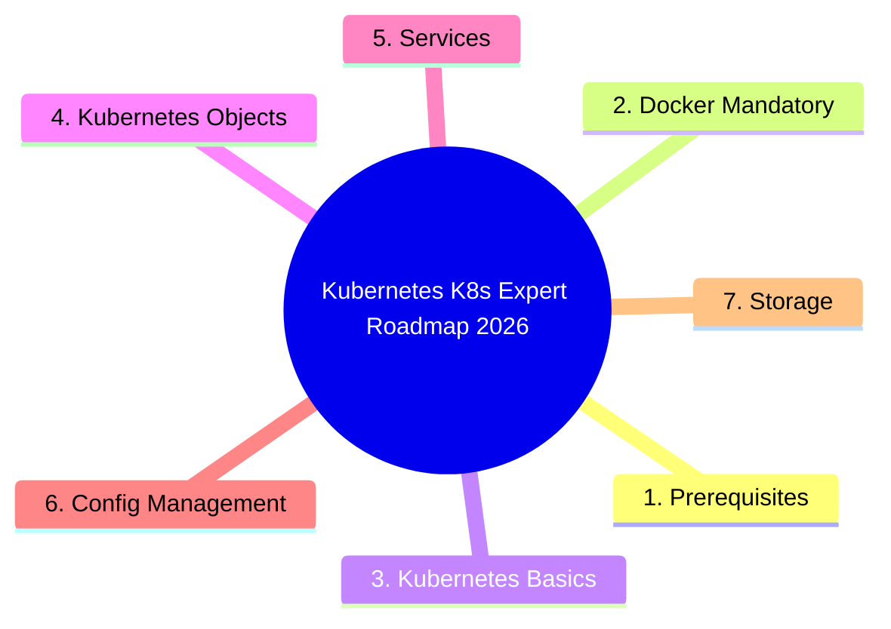

Since you're already learning **AWS, Node.js, Express.js, NestJS, Serverless, React, PostgreSQL, Datadog, and System Design**, Kubernetes (K8s) is the perfect next step to become a **Senior/Lead Backend Engineer or DevOps-aware Full Stack Engineer**.

# Kubernetes (K8s) Expert Roadmap (2026)



```
Linux
   │
   ▼
Networking Basics
   │
   ▼
Docker (Must Know)
   │
   ▼
Kubernetes Architecture
   │
   ▼
Pods
   │
   ▼
Deployments
   │
   ▼
Services
   │
   ▼
ConfigMaps & Secrets
   │
   ▼
Storage
   │
   ▼
Ingress
   │
   ▼
Helm
   │
   ▼
Monitoring
   │
   ▼
Security
   │
   ▼
Scaling
   │
   ▼
CI/CD
   │
   ▼
Production Kubernetes
```

---

## [1. Prerequisites](#1-prerequisites-1)

### [Linux](#linux-1)

- File System
- Users & Groups
- chmod
- chown
- grep
- awk
- sed
- tar
- curl
- wget
- ssh

Example

```bash
grep "error" app.log

tail -f app.log

chmod 755 script.sh
```

---

### [Networking](#networking-1)

Must Know

- TCP/IP
- HTTP
- HTTPS
- DNS
- Load Balancer
- Reverse Proxy
- Ports
- IP
- NAT

Understand

```
Browser

↓

Load Balancer

↓

Ingress

↓

Service

↓

Pod
```

---

## [2. Docker (Mandatory)](#2-docker-mandatory-1)

Topics

### Images

```
docker build
docker images
docker rmi
```

---

### Containers

```
docker run
docker ps
docker stop
docker logs
```

---

### Dockerfile

Learn

```
FROM

COPY

RUN

CMD

ENTRYPOINT

EXPOSE

ENV

WORKDIR
```

Example

```dockerfile
FROM node:22

WORKDIR /app

COPY . .

RUN npm install

CMD ["npm","start"]
```

---

### Docker Compose

Understand

```
Node

↓

Postgres

↓

Redis
```

---

## [3. Kubernetes Basics](#3-kubernetes-basics-1)

### [What is Kubernetes?](#what-is-kubernetes-1)

Learn

- Container Orchestration
- Self Healing
- Auto Scaling
- Rolling Updates
- High Availability

---

### [Kubernetes Architecture](#kubernetes-architecture-1)

Understand

```
Client (kubectl / CI)
       │ Kubernetes API
       ▼
┌────────────── Control Plane ──────────────┐
│ API Server ↔ etcd                        │
│ Scheduler + Controllers (reconcile state) │
└──────────────────┬────────────────────────┘
                   │ API watches / assignments
         ┌─────────┴─────────┐
         ▼                   ▼
   Worker Node           Worker Node
   kubelet               kubelet
   CRI runtime           CRI runtime
   CNI / Pod network     CNI / Pod network
   Pods                  Pods
```

Know each component in detail.

---

## [4. Kubernetes Objects](#4-kubernetes-objects-1)

### Pods

Learn

- Single Container Pod
- Multi Container Pod
- Init Container

Example

```yaml
apiVersion. v1

kind. Pod
```

Commands

```bash
kubectl get pods

kubectl describe pod

kubectl logs

kubectl exec
```

---

### ReplicaSet

Learn

- Desired State
- Scaling
- High Availability

---

### Deployment

Topics

- Rolling Update
- Rollback
- History
- Strategy

Commands

```bash
kubectl rollout history

kubectl rollout undo
```

---

### Namespaces

```
default

kube-system

dev

qa

prod
```

---

### Labels

```
app=node

env=dev

version=v1
```

---

### Selectors

```
matchLabels

matchExpressions
```

---

## [5. Services](#5-services-1)

Learn all Service Types

### ClusterIP

Internal Communication

```
Node

↓

Service

↓

Pods
```

---

### NodePort

External Access

---

### LoadBalancer

Cloud Provider

AWS ELB

Azure LB

GCP LB

---

### ExternalName

DNS Mapping

---

## [6. Config Management](#6-config-management-1)

### ConfigMap

Store

```
Host

Port

URL

Feature Flags
```

---

### Secrets

Store

```
Password

JWT

API Keys

Database Credentials
```

Base64 Encoding

---

## [7. Storage](#7-storage-1)

Persistent Volumes

Persistent Volume Claims

Storage Classes

Understand

```
Pod

↓

PVC

↓

PV

↓

Disk
```

AWS

- EBS
- EFS

---

## [8. Networking](#8-networking-1)

### Ingress

```
Internet

↓

Ingress

↓

Service

↓

Pods
```

Learn

- Path Routing
- Host Routing
- TLS

---

### Ingress Controller

Examples

- NGINX Ingress
- AWS Load Balancer Controller
- Traefik

---

### Network Policies

Restrict Pod Communication

---

## [9. Autoscaling](#9-autoscaling-1)

### HPA

Horizontal Pod Autoscaler

```
2 Pods

↓

10 Pods
```

Based On

- CPU
- Memory
- Custom Metrics

---

### VPA

Vertical Pod Autoscaler

---

### Cluster Autoscaler

Scale Worker Nodes

---

## [10. Scheduling](#10-scheduling-1)

Node Selector

Affinity

Anti Affinity

Taints

Tolerations

Priority Classes

---

## [11. Health Checks](#11-health-checks-1)

Readiness Probe

Liveness Probe

Startup Probe

Example

```yaml
livenessProbe:
readinessProbe:
startupProbe:
```

---

## [12. Security](#12-security-1)

RBAC

Service Accounts

Security Context

Pod Security

Secrets

Network Policies

Image Scanning

Admission Controllers

---

## [13. Helm](#13-helm-1)

Topics

```
Chart

Values

Templates

Dependencies

Release

Upgrade

Rollback
```

Commands

```bash
helm install

helm upgrade

helm rollback
```

---

## [14. Monitoring](#14-monitoring-1)

Learn

- Metrics
- Logs
- Traces

Tools

- Prometheus
- Grafana
- Loki
- Fluent Bit
- Datadog (you already plan to learn it)

Metrics

```
CPU

Memory

Disk

Network

Pod Restarts
```

---

## [15. CI/CD](#15-cicd-1)

Deploy using

- GitHub Actions
- Jenkins
- GitLab CI
- AWS CodePipeline

Pipeline

```
Code

↓

Build

↓

Test

↓

Docker Image

↓

Push Registry

↓

Deploy Kubernetes
```

---

## [16. Kubernetes on AWS (Most Important)](#16-kubernetes-on-aws-most-important-1)

Learn

### Amazon EKS

- Cluster
- Node Groups
- Fargate
- IAM Roles for Service Accounts (IRSA)
- Cluster Autoscaler
- Managed Add-ons

### AWS Load Balancer Controller

### EBS CSI Driver

### EFS CSI Driver

### ExternalDNS

### AWS Secrets Manager Integration

### Amazon ECR

---

## [17. Advanced Kubernetes](#17-advanced-kubernetes-1)

Learn

DaemonSet

StatefulSet

Jobs

CronJobs

Init Containers

Sidecar Containers

Operators

Custom Resource Definitions (CRDs)

Admission Controllers

Service Mesh

- Istio
- Linkerd

Gateway API

Multi-cluster

Disaster Recovery

Backup using Velero

---

## [18. Production Best Practices](#18-production-best-practices-1)

Learn

- Resource Requests
- Resource Limits
- Pod Disruption Budget (PDB)
- High Availability
- Rolling Updates
- Blue-Green Deployment
- Canary Deployment
- GitOps (Argo CD / Flux)
- Backup Strategy
- Secrets Management
- Monitoring
- Alerting
- Cost Optimization

---

# Real-World Project (Node.js + Kubernetes)

Build a production-style application:

```
Users Service (NestJS)

↓

Orders Service (NestJS)

↓

Products Service (Express)

↓

PostgreSQL

↓

Redis

↓

RabbitMQ

↓

Docker

↓

Kubernetes

↓

Helm

↓

Ingress

↓

Prometheus

↓

Grafana

↓

Datadog

↓

AWS EKS
```

Practice:

- Scale services with HPA.
- Perform rolling updates and rollbacks.
- Inject configuration with ConfigMaps and Secrets.
- Expose APIs through an Ingress.
- Add health probes.
- Collect metrics and logs.
- Automate deployments using GitHub Actions.

---

# Kubernetes Interview Preparation

Focus on these topics:

1. Kubernetes Architecture
2. Pods vs Containers
3. ReplicaSet vs Deployment
4. Deployment Strategies
5. ClusterIP vs NodePort vs LoadBalancer
6. Ingress vs Service
7. ConfigMap vs Secret
8. Persistent Volumes vs PVCs
9. Liveness vs Readiness vs Startup Probes
10. HPA vs VPA vs Cluster Autoscaler
11. DaemonSet vs StatefulSet vs Deployment
12. Jobs vs CronJobs
13. Taints & Tolerations
14. Node Affinity & Pod Affinity
15. RBAC & Service Accounts
16. Network Policies
17. Helm Charts
18. Kubernetes Security Best Practices
19. Logging and Monitoring
20. Kubernetes on AWS (EKS)

## Suggested Learning Timeline

| Week | Topics                                     |
| ---- | ------------------------------------------ |
| 1    | Linux, Networking, Docker                  |
| 2    | Kubernetes Architecture, Pods, Deployments |
| 3    | Services, ConfigMaps, Secrets, Storage     |
| 4    | Ingress, Networking, Health Checks         |
| 5    | Autoscaling, Scheduling, Security          |
| 6    | Helm, Monitoring, Logging                  |
| 7    | CI/CD with GitHub Actions, EKS             |
| 8    | Advanced Kubernetes + Production Project   |

This roadmap is tailored to your existing stack (Node.js, NestJS, Express, AWS Serverless, PostgreSQL, React) and will prepare you for Kubernetes-based production deployments and interviews for Senior Backend or Platform Engineer roles.

---

# 1. Prerequisites

## Linux

Kubernetes నేర్చుకోవడానికి ముందు, మీరు పేర్కొన్న Linux అంశాలపై పట్టు సాధించడం చాలా అవసరం. ఎందుకంటే Kubernetes క్లస్టర్ పూర్తిగా Linux ఆపరేటింగ్ సిస్టమ్‌పైనే నడుస్తుంది.

ఈ అంశాలను మనం సులభంగా అర్థం చేసుకుందాం:

---

### 1. Linux & File System

Linux ఫైల్ సిస్టమ్ ఒక **Tree Structure** లో ఉంటుంది (Root `/` నుండి మొదలవుతుంది).

- **ముఖ్యమైన డైరెక్టరీలు:** `/etc` (configuration files కోసం), `/var/log` (logs కోసం), `/bin` (binaries కోసం).
- **కమాండ్స్:** `ls` (లిస్ట్ చూడటానికి), `cd` (డైరెక్టరీ మారడానికి), `mkdir` (ఫోల్డర్ క్రియేట్ చేయడానికి), `pwd` (ప్రస్తుత పాత్ తెలుసుకోవడానికి).

### 2. Users & Groups

Kubernetes లో 'Role Based Access Control (RBAC)' అర్థం చేసుకోవడానికి ఇది ముఖ్యం.

- **Users:** `useradd <username>`, `passwd <username>`.
- **Groups:** `groupadd <groupname>`, `usermod -aG <group> <user>` (ఒక యూజర్‌ను గ్రూప్‌లో చేర్చడానికి).

### 3. Permissions (chmod, chown)

- **chmod (Change Mode):** ఫైల్స్ లేదా ఫోల్డర్స్ కి అనుమతులు (Read, Write, Execute) ఇవ్వడానికి.
- ఉదాహరణ: `chmod 755 file.txt` (యూజర్‌కి అన్ని అనుమతులు, ఇతరులకు Read/Execute).

- **chown (Change Owner):** ఫైల్ యొక్క యజమానిని మార్చడానికి.
- ఉదాహరణ: `chown user:group file.txt`.

### 4. Text Processing (grep, awk, sed)

Kubernetes లో లాగ్స్ (Logs) పరిశీలించడానికి మరియు YAML ఫైల్స్‌ని ఎడిట్ చేయడానికి ఇవి చాలా అవసరం.

- **grep:** ఫైల్స్‌లో ఏదైనా పదాన్ని వెతకడానికి.
- `grep "error" app.log` (లాగ్స్‌లో error అని ఉన్న లైన్లను చూపిస్తుంది).

- **awk:** కాలమ్స్ ఆధారంగా డేటాను ఫిల్టర్ చేయడానికి (ఉదా: `kubectl get pods | awk '{print $1}'` తో కేవలం పాడ్ పేర్లు మాత్రమే పొందవచ్చు).
- **sed:** ఫైల్‌లోని టెక్స్ట్‌ని మార్చడానికి (Stream Editor).

### 5. File Management & Networking (tar, curl, wget, ssh)

- **tar:** ఫైల్స్‌ని కంప్రెస్/ఎక్స్‌ట్రాక్ట్ చేయడానికి. (`tar -xvf file.tar.gz`)
- **curl / wget:** ఇంటర్నెట్ నుండి ఫైల్స్ లేదా API రిక్వెస్ట్స్ పంపడానికి. (Kubernetes లో `curl` ని API సర్వర్‌ని టెస్ట్ చేయడానికి వాడతాం).
- **ssh:** సర్వర్‌లోకి రిమోట్‌గా లాగిన్ అవ్వడానికి. (`ssh user@server-ip`)

---

### Example: ఒక ప్రాక్టికల్ సినారియో

మీరు ఒక అప్లికేషన్ లాగ్ ఫైల్ (`app.log`) నుండి `error` అని ఉన్న లైన్లను తీసి, దాన్ని ఒక కొత్త ఫైల్‌లోకి పంపాలి అనుకుందాం:

1. **కమాండ్:** `grep "error" /var/log/app.log > error_report.txt`

- ఇక్కడ `grep` ఎర్రర్లను వెతుకుతుంది, `>` ఆ రిజల్ట్‌ని కొత్త ఫైల్‌లోకి సేవ్ చేస్తుంది.

2. **పర్మిషన్ మార్చడం:** `chmod 644 error_report.txt`

- ఈ ఫైల్‌ని అందరూ చదవవచ్చు, కానీ కేవలం యజమాని మాత్రమే ఎడిట్ చేయగలరు.

3. **యజమాని మార్చడం:** `chown admin:admin error_report.txt`

- దీనిని `admin` యూజర్‌కి కేటాయించాము.

---

**ముఖ్య గమనిక:**
Kubernetes లో మీరు `kubectl` కమాండ్ వాడినప్పుడు, పైన చెప్పిన **grep, awk** వంటి కమాండ్స్‌ని పైప్ (`|`) ఆపరేటర్‌తో కలిపి వాడటం చాలా తరచుగా జరుగుతుంది.

ఈ బేసిక్స్ మీద మీకు ఏదైనా ప్రత్యేకమైన సందేహం ఉందా, లేదా మనం తదుపరి టాపిక్ (Kubernetes Basics) లోకి వెళ్దామా?

---

## Networking

Kubernetes లో నెట్‌వర్కింగ్ అనేది చాలా కీలకమైన అంశం. ఒక యూజర్ బ్రౌజర్‌లో URL ఎంటర్ చేసినప్పటి నుండి, అది ఎలా Pod వరకు వెళ్తుందో ఈ "Request Flow" ద్వారా అర్థం చేసుకుందాం.

ముందుగా **Must Know** కాన్సెప్ట్స్ గురించి క్లుప్తంగా:

### 1. బేసిక్ నెట్‌వర్కింగ్ కాన్సెప్ట్స్

- **IP Address:** ప్రతి కంప్యూటర్ లేదా Pod కి ఉండే ఒక ప్రత్యేకమైన ఐడెంటిటీ.
- **Ports:** ఒకే IP అడ్రస్‌లో నడుస్తున్న వేర్వేరు అప్లికేషన్లను గుర్తించడానికి ఉపయోగించే నంబర్లు (ఉదా: HTTP కి 80, HTTPS కి 443).
- **TCP/IP:** డేటా ఒక పాయింట్ నుండి మరో పాయింట్‌కు ఎలా వెళ్లాలో చెప్పే నియమాలు.
- **DNS (Domain Name System):** `google.com` వంటి పేర్లను IP అడ్రస్‌లుగా మార్చే సిస్టమ్ (ఇంటర్నెట్ ఫోన్ బుక్ లాంటిది).
- **NAT (Network Address Translation):** ప్రైవేట్ IP అడ్రస్‌లను పబ్లిక్ IP లోకి మార్చడం.
- **Load Balancer & Reverse Proxy:** ట్రాఫిక్‌ను ఒకటి కంటే ఎక్కువ సర్వర్లకు (లేదా Pods కి) సమానంగా పంచిపెట్టే సిస్టమ్స్.

---

### 2. Request Flow (బ్రౌజర్ నుండి Pod వరకు)

ఈ ప్రవాహాన్ని ఒక ఉదాహరణతో చూద్దాం:

#### అడుగు 1: బ్రౌజర్ (Browser)

యూజర్ బ్రౌజర్‌లో `myapp.com` అని టైప్ చేస్తారు. ఇది DNS ద్వారా సర్వర్ యొక్క **Public IP** కి మ్యాప్ అవుతుంది.

#### అడుగు 2: లోడ్ బ్యాలెన్సర్ (Load Balancer)

బయటి నుండి వచ్చే ట్రాఫిక్ ముందుగా **Load Balancer** కి చేరుతుంది. ఇది ట్రాఫిక్‌ను క్లస్టర్ లోపలికి పంపే గేట్‌వే లాంటిది. ఇది అప్లికేషన్ యొక్క అవైలబిలిటీని పెంచుతుంది.

#### అడుగు 3: ఇంగ్రెస్ (Ingress)

ఇది Kubernetes క్లస్టర్ యొక్క "Smart Traffic Controller".

- ఇది HTTP/HTTPS రూల్స్‌ని బట్టి ట్రాఫిక్‌ను దారి మళ్లిస్తుంది.
- ఉదాహరణకు: `[myapp.com/api](https://myapp.com/api)` అయితే ఒక సర్వీస్‌కి, `[myapp.com/web](https://myapp.com/web)` అయితే మరో సర్వీస్‌కి పంపిస్తుంది.

#### అడుగు 4: సర్వీస్ (Service)

Pod లు తాత్కాలికమైనవి (అవి డిలీట్ అయి కొత్తవి వస్తుంటాయి, IP మారుతుంటుంది). అందుకే మనం నేరుగా Pod IP ని వాడలేము. **Service** అనేది ఒక స్థిరమైన (Static) పేరు మరియు IP ని అందిస్తుంది. ఇది తన దగ్గర ఉన్న Pods అన్నింటికీ ట్రాఫిక్‌ను పంపిణీ చేస్తుంది.

#### అడుగు 5: పాడ్ (Pod)

చివరగా, అప్లికేషన్ రన్ అవుతున్న **Pod** కి రిక్వెస్ట్ చేరుతుంది. అక్కడ కంటైనర్ ఆ రిక్వెస్ట్‌ను ప్రాసెస్ చేసి రెస్పాన్స్‌ని పంపిస్తుంది.

---

### ఒక చిన్న చార్ట్ రూపంలో:

$$User \rightarrow Browser \rightarrow Load\ Balancer \rightarrow Ingress \rightarrow Service \rightarrow Pod$$

---

### ఒక చిన్న ఉదాహరణ:

మీరు ఒక రెస్టారెంట్‌కు వెళ్లారు అనుకోండి:

1. **Browser:** మీరు (కస్టమర్).
2. **Load Balancer:** రెస్టారెంట్ యొక్క మెయిన్ గేట్ సెక్యూరిటీ.
3. **Ingress:** రిసెప్షనిస్ట్ (మీరు ఏ టేబుల్ కి వెళ్లాలో చెప్తారు).
4. **Service:** వెయిటర్ (మీ ఆర్డర్‌ను కిచెన్ వరకు తీసుకెళ్తారు).
5. **Pod:** కిచెన్ (ఇక్కడ వంటకం తయారవుతుంది).

ఈ ఫ్లోలో మీకు ఏదైనా పాయింట్ దగ్గర కన్ఫ్యూజన్ ఉందా? లేదా మీరు ఇప్పుడు "Kubernetes Architecture" (Nodes, Control Plane) గురించి తెలుసుకోవాలనుకుంటున్నారా?

---

# 2. Docker (Mandatory)

Kubernetes నేర్చుకోవడంలో **Docker** అనేది మొదటి మెట్టు. అసలు Kubernetes ఏం చేస్తుందంటే, ఈ Docker కంటైనర్లను మేనేజ్ చేస్తుంది (orchestration). కాబట్టి Docker ఎలా పనిచేస్తుందో తెలియడం చాలా ముఖ్యం.

దీనిని సులభంగా అర్థం చేసుకుందాం:

---

### 1. Images (ఇమేజెస్)

- **Definition:** ఇది ఒక "Read-only Template". అంటే మీ అప్లికేషన్ రన్ అవ్వడానికి కావాల్సిన కోడ్, లైబ్రరీలు, డిపెండెన్సీలు అన్నీ ఇందులో ప్యాక్ అయి ఉంటాయి.
- **ఉదాహరణ:** పెన్ డ్రైవ్‌లో ఉన్న OS ఇన్‌స్టాలేషన్ ఫైల్స్ లాంటివి. మీరు ఒక ఇమేజ్‌ని ఎక్కడ రన్ చేసినా, అది ఒకేలా పనిచేస్తుంది.

### 2. Containers (కంటైనర్స్)

- **Definition:** ఇది Image యొక్క "Running Instance". అంటే Image అనేది ఒక ప్లాన్ (blueprint) అయితే, Container అనేది ఆ ప్లాన్ ప్రకారం తయారైన ఇల్లు.
- **ముఖ్యమైనది:** కంటైనర్లు ఒకదానితో ఒకటి సంబంధం లేకుండా (isolated) రన్ అవుతాయి. ఒక కంటైనర్ క్రాష్ అయినా, మిగిలిన వాటిపై ప్రభావం ఉండదు.

### 3. Dockerfile

- **Definition:** ఇది ఒక "Instruction File". మీరు మీ ఇమేజ్‌ను ఎలా తయారు చేయాలో ఇందులో రాస్తారు.
- **ఎలా ఉంటుంది?**

```dockerfile
FROM node:18           # ఏ బేస్ ఇమేజ్ వాడాలి
WORKDIR /app           # ఫోల్డర్ సెట్ చేయడం
COPY . .               # కోడ్‌ని కాపీ చేయడం
RUN npm install        # డిపెండెన్సీలు ఇన్‌స్టాల్ చేయడం
CMD ["node", "app.js"] # కంటైనర్ స్టార్ట్ అవ్వగానే రన్ అయ్యే కమాండ్

```

### 4. Docker Compose

- **Definition:** ఒక అప్లికేషన్‌కి ఒకటి కంటే ఎక్కువ కంటైనర్లు అవసరమైనప్పుడు (ఉదా: వెబ్ యాప్ + డేటాబేస్), వాటన్నింటినీ ఒకే ఫైల్ ద్వారా మేనేజ్ చేయడానికి `docker-compose` వాడతాము.
- **ఎందుకు?** విడివిడిగా కమాండ్స్ రన్ చేయడం కంటే, ఒక `docker-compose.yaml` ఫైల్ రాసి `docker-compose up` అని ఇస్తే అన్నీ ఆటోమేటిక్‌గా స్టార్ట్ అవుతాయి.

---

### ఎలా కనెక్ట్ అవుతాయి? (Kubernetes కోసం చిన్న టిప్)

Kubernetes ప్రపంచంలో ఈ Docker కాన్సెప్ట్స్ ఇలా మారుతాయి:

1. **Docker Image:** Kubernetes లో కూడా మనం ఇమేజ్‌లనే వాడతాం (Docker Hub లో లేదా వేరే రిజిస్ట్రీలో సేవ్ చేస్తాం).
2. **Container:** Kubernetes లో మనం నేరుగా 'Container' ని క్రియేట్ చేయం, **'Pod'** ని క్రియేట్ చేస్తాం. ఒక Pod లో ఒకటి లేదా అంతకంటే ఎక్కువ కంటైనర్లు ఉంటాయి.
3. **Dockerfile:** Kubernetes లో మార్పు ఉండదు, ఇది సేమే.
4. **Docker Compose:** Kubernetes లో `docker-compose.yaml` కి బదులుగా **`Deployment.yaml`** అనే ఫైల్స్ రాస్తాం.

**ఒక సింపుల్ సారాంశం:**
Docker తో ఒక కంటైనర్‌ను తయారు చేస్తారు. Kubernetes తో ఆ కంటైనర్లను వేల సంఖ్యలో ఎలా మేనేజ్ చేయాలో చూస్తారు.

మీకు Docker ఇన్‌స్టాల్ చేయడం లేదా ఒక చిన్న Node.js యాప్‌ని Dockerize చేయడం గురించి ప్రాక్టికల్ కావాలా? లేదా నేరుగా Kubernetes Architecture లోకి వెళ్దామా?

---

# 3. Kubernetes Basics

## What is Kubernetes?

Kubernetes (దీనిని **K8s** అని కూడా అంటారు) అనేది Google చేత ప్రారంభించబడిన ఒక ఓపెన్ సోర్స్ ప్లాట్‌ఫారమ్. ఇది కంటైనర్లను (Docker Containers) ఆటోమేటిక్‌గా నిర్వహించడానికి ఉపయోగపడుతుంది.

దీనిని మీరు నేర్చుకోవలసిన ముఖ్యమైన ఫీచర్ల ద్వారా అర్థం చేసుకుందాం:

---

### 1. Container Orchestration (కంటైనర్ ఆర్కెస్ట్రేషన్)

ఒకటి రెండు కంటైనర్లు ఉంటే `docker-compose` తో మేనేజ్ చేయవచ్చు. కానీ వేల సంఖ్యలో కంటైనర్లు ఉంటే? వాటిని స్టార్ట్ చేయడం, ఆపడం, నెట్‌వర్కింగ్ కల్పించడం సాధ్యం కాదు.

- **Kubernetes** ఈ కంటైనర్లన్నింటినీ ఒక ఆర్కెస్ట్రా కండక్టర్ లాగా సమన్వయం చేస్తుంది. ఏ కంటైనర్ ఏ నోడ్ (సర్వర్) మీద రన్ అవ్వాలో ఇదే నిర్ణయిస్తుంది.

### 2. Self Healing (సెల్ఫ్ హీలింగ్)

ఇది Kubernetes లో చాలా అద్భుతమైన ఫీచర్.

- **ఏం జరుగుతుంది?** ఏదైనా కారణం చేత ఒక కంటైనర్ (Pod) క్రాష్ అయితే, Kubernetes వెంటనే దాన్ని గుర్తిస్తుంది.
- **యాక్షన్:** క్రాష్ అయిన పాడ్‌ని డిలీట్ చేసి, వెంటనే కొత్త పాడ్‌ని ఆటోమేటిక్‌గా స్టార్ట్ చేస్తుంది. మీరు మ్యాన్యువల్‌గా జోక్యం చేసుకోవాల్సిన అవసరం లేదు.

### 3. Auto Scaling (ఆటో స్కేలింగ్)

అప్లికేషన్‌కి ట్రాఫిక్ పెరిగినప్పుడు సర్వర్లు తట్టుకోవాలి కదా?

- **Horizontal Scaling:** ట్రాఫిక్ పెరిగినప్పుడు కొత్త కంటైనర్లను ఆటోమేటిక్‌గా క్రియేట్ చేస్తుంది.
- **Scaling Down:** ట్రాఫిక్ తగ్గినప్పుడు అనవసరమైన కంటైనర్లను తీసేసి రిసోర్సెస్ (RAM/CPU)ని ఆదా చేస్తుంది.

### 4. Rolling Updates (రోలింగ్ అప్‌డేట్స్)

మీ అప్లికేషన్‌లో ఏదైనా కోడ్ మార్చి కొత్త వెర్షన్ (New Image) రిలీజ్ చేసినప్పుడు, అప్లికేషన్ డౌన్ అవ్వకూడదు.

- **ఎలా జరుగుతుంది?** Kubernetes పాత పాడ్‌లను ఒక్కొక్కటిగా తీసేసి, కొత్త పాడ్‌లను ఒక్కొక్కటిగా అప్‌డేట్ చేస్తుంది. దీనివల్ల యూజర్లకు అప్లికేషన్ ఆగకుండా కొత్త ఫీచర్స్ అందుతాయి. దీనినే "Zero-downtime deployment" అంటారు.

### 5. High Availability (హై అవైలబిలిటీ)

మీ అప్లికేషన్ ఎప్పుడూ అందుబాటులో ఉండాలి.

- ఒక సర్వర్ (Node) ఫెయిల్ అయినా, ఆ సర్వర్‌లో ఉన్న కంటైనర్లను మరొక సర్వర్‌లోకి Kubernetes ఆటోమేటిక్‌గా తరలిస్తుంది. దీనివల్ల యూజర్లకు ఎటువంటి ఇబ్బంది కలగదు.

---

### ఒక చిన్న రియల్-వరల్డ్ ఉదాహరణ:

మీరు ఒక ఈ-కామర్స్ సైట్ నడుపుతున్నారు అనుకుందాం (ఉదా: Amazon).

1. **పండగ ఆఫర్ల సమయంలో:** ట్రాఫిక్ పెరుగుతుంది → **Auto Scaling** ద్వారా వందల కొద్దీ పాడ్స్ పెరుగుతాయి.
2. **ఒక సర్వర్ పాడైపోతే:** **Self Healing & High Availability** వల్ల మీ సైట్ ఆగకుండా వేరే సర్వర్‌లోకి షిఫ్ట్ అవుతుంది.
3. **కొత్త ఫీచర్ రిలీజ్ చేస్తే:** **Rolling Updates** ద్వారా యూజర్లకు తెలియకుండానే కొత్త వెర్షన్ అప్‌డేట్ అవుతుంది.

---

**ముఖ్యమైన విషయం:**
Kubernetes ఇవన్నీ ఎలా చేస్తుందంటే దాని **Control Plane (Master Node)** ద్వారా. ఇది క్లస్టర్‌లో ఉన్న ప్రతి నోడ్‌ను పర్యవేక్షిస్తూ ఉంటుంది.

తదుపరి మనం **Kubernetes Architecture (Control Plane, Nodes, Kube-API Server, etcd, etc.)** గురించి తెలుసుకుందామా? ఇది చాలా ఇంట్రెస్టింగ్ టాపిక్!

---

## Kubernetes Architecture

Kubernetes క్లస్టర్‌ను రెండు స్థాయిల్లో చూడండి: **Control Plane** అనేది క్లస్టర్ యొక్క desired state ను అంగీకరించి సమన్వయం చేస్తుంది; **Worker Nodes** ఆ state ను అమలు చేసి మీ Pods ను నడుపుతాయి. ఇది ఒకే సర్వర్‌లో ఉండాల్సిన నిర్మాణం కాదు—Production క్లస్టర్‌లో Control Plane కాంపోనెంట్లు సాధారణంగా High Availability కోసం పలువురు నోడ్‌లపై అమర్చబడతాయి.

### పూర్తి ఆర్కిటెక్చర్ డయాగ్రామ్

```text
  Developer / CI
       │  kubectl apply -f app.yaml  (HTTPS / Kubernetes API)
       ▼
┌──────────────────────────── Control Plane ───────────────────────────┐
│                                                                      │
│  ┌───────────────────────────────────────────────────────────────┐   │
│  │ kube-apiserver                                                │   │
│  │ AuthN → AuthZ → Admission → Validation / API operations       │   │
│  └──────────────┬─────────────────────────────┬──────────────────┘   │
│                 │ read / write               │ watch API objects     │
│                 ▼                             ▼                      │
│          ┌────────────┐          ┌─────────────────────────────┐     │
│          │   etcd     │          │ Controllers                 │     │
│          │ durable    │          │ Deployment / Node / Job ... │     │
│          │ cluster    │          │ desired state ↔ actual state│     │
│          │ state      │          └──────────────┬──────────────┘     │
│          └────────────┘                         │ create Pod objects │
│                                                 ▼                    │
│                                   ┌─────────────────────────────┐    │
│                                   │ kube-scheduler              │    │
│                                   │ filter → score → bind Node  │    │
│                                   └──────────────┬──────────────┘    │
└──────────────────────────────────────────────────┼───────────────────┘
                                                   │ Pod assigned to Node
                             API watches / status  │
             ┌────────────────────────────────────┴────────────────────┐
             │                                                         │
             ▼                                                         ▼
┌──────────────────────── Worker Node A ───────────┐  ┌── Worker Node B ──┐
│ kubelet                                          │  │ kubelet           │
│   │ CRI (gRPC)                                   │  │   │ CRI           │
│   ▼                                              │  │   ▼               │
│ containerd / CRI-O → Pod sandboxes + containers  │  │ runtime → Pods    │
│   │                                              │  │                   │
│   ├─ CNI plugin: Pod interfaces / IP / routes    │  │ CNI plugin        │
│   └─ CSI: attach / mount volumes (when needed)   │  │ CSI (if needed)   │
│                                                  │  │                   │
│ kube-proxy or an alternative Service dataplane   │  │ Service dataplane │
└──────────────────────────────────────────────────┘  └───────────────────┘
           │                           │
           └──── Pod-to-Pod network ───┘

External client → Load Balancer → Ingress / Gateway → Service → ready Pod endpoints
                                      (controller)    (ClusterIP, etc.)
```

### Control Plane భాగాలు

- **kube-apiserver:** క్లస్టర్ API కి ప్రధాన entry point. `kubectl`, controllers, scheduler, kubelet వంటి క్లయింట్లు API Server ద్వారానే Kubernetes objects చదవడం లేదా మార్చడం చేస్తాయి. ఇది authentication (ఎవరు?), authorization (ఏం చేయవచ్చు?), admission (ఈ మార్పును అనుమతించాలా?), validation వంటి దశలను అమలు చేసి, అవసరమైన మార్పులను etcd లో persist చేస్తుంది. Kubernetes లో వేరువేరు కాంపోనెంట్లు సాధారణంగా ఒకదానితో ఒకటి నేరుగా మాట్లాడకుండా API Server ను ఉపయోగిస్తాయి.
- **etcd:** క్లస్టర్ state ను నిల్వ చేసే consistent, distributed key-value datastore. ఇందులో API objects యొక్క persisted state ఉంటుంది; ఇది container images లేదా application files నిల్వ చేసే చోటు కాదు. Production లో etcd backup, access control, encryption మరియు quorum/availability ముఖ్యమైనవి.
- **kube-scheduler:** `nodeName` ఇంకా కేటాయించని కొత్త Pod కోసం సరిపోయే Node ను ఎంచుకుంటుంది. ముందుగా resource requests, node selectors/affinity, taints/tolerations వంటి నియమాలతో అభ్యర్థి Nodes ను filter చేసి, మిగిలిన వాటికి scoring చేసి ఎంపిక చేస్తుంది. ఆ తర్వాత API Server ద్వారా Pod కు Node assignment ను నమోదు చేస్తుంది. Scheduler స్వయంగా container ను start చేయదు.
- **kube-controller-manager:** పలువురు controllers ను నడుపుతుంది. ప్రతి controller API objects ను watch చేసి **desired state** మరియు కనిపిస్తున్న **actual state** మధ్య తేడాను తగ్గించడానికి API మార్పులు చేస్తుంది. ఉదా: Deployment controller ReplicaSet ను నిర్వహిస్తుంది; ReplicaSet controller అవసరమైన సంఖ్యలో Pods ఉండేలా చూస్తుంది; Node controller Node పరిస్థితులను పర్యవేక్షిస్తుంది. Controllers సాధారణంగా kubelet కు నేరుగా “ఈ కంటైనర్‌ను start చేయి” అని చెప్పవు.
- **cloud-controller-manager (ఉంటే):** Cloud provider-సంబంధిత పనులను—ఉదా. cloud load balancers, routes, లేదా node metadata—కోర్ Kubernetes controllers నుండి వేరు నిర్వహిస్తుంది. ఇది ప్రతి క్లస్టర్‌లో ఉండాల్సిందేనని కాదు.

### Worker Node భాగాలు

- **kubelet:** ప్రతి Node లో నడిచే agent. API Server నుండి Node-కి schedule అయిన Pod specification-లను గమనించి, అవసరమైన Pod ను నడపడానికి container runtime తో పని చేస్తుంది. Container status, readiness/liveness probe ఫలితాలు మరియు Node status ను తిరిగి report చేస్తుంది.
- **Container runtime:** CRI (Container Runtime Interface) ద్వారా kubelet తో మాట్లాడి container lifecycle ను నిర్వహిస్తుంది. సాధారణ runtime ఉదాహరణలు `containerd`, `CRI-O`. Docker Engine ను నేరుగా runtime గా వాడిన పాత పద్ధతి ఇప్పుడు సాధారణం కాదు; Docker-built images మాత్రం OCI image format ద్వారా సాధారణంగా పనిచేస్తాయి.
- **kube-proxy / Service dataplane:** Service traffic ను సరైన Pod endpoints కు మళ్లించే network rules అమలు చేయడంలో kube-proxy సాధారణంగా ఉపయోగపడుతుంది. కొన్ని క్లస్టర్లలో CNI లేదా eBPF ఆధారిత ప్రత్యామ్నాయం ఈ పనిని నిర్వహించవచ్చు; అందువల్ల ప్రతి క్లస్టర్‌లో kube-proxy తప్పనిసరిగా ఉంటుందని అనుకోకూడదు.
- **CNI plugin:** Pod networking ను అమలు చేస్తుంది—Pod interfaces/IP, Node మధ్య routing, మరియు అమలు ఆధారంగా NetworkPolicy enforcement. Kubernetes స్వయంగా ఒక నిర్దిష్ట CNI ను ఎంచుకోదు; క్లస్టర్ అమరికను బట్టి Calico, Cilium, Flannel వంటి plugin ఉండవచ్చు.
- **CSI driver:** అవసరమైనప్పుడు PersistentVolume ను provision, attach లేదా mount చేయడానికి Storage వ్యవస్థతో అనుసంధానమవుతుంది.
- **Pods:** Scheduling మరియు deployment జరిగే అతి చిన్న యూనిట్. ఒక Pod లోని containers network namespace/IP ను పంచుకుంటాయి; సాధారణంగా `localhost` ద్వారా ఒకదానితో ఒకటి మాట్లాడగలవు.
- **Cluster add-ons:** CoreDNS వంటి DNS service సాధారణంగా Pods ను Service పేర్లను resolve చేయనిస్తుంది. CNI, CSI, Ingress/Gateway controllers, metrics వంటి add-ons క్లస్టర్ అమరికను బట్టి ఉంటాయి; ఇవన్నీ Kubernetes core Control Plane లో భాగాలు కావు.

### `kubectl apply` నుండి Running Pod వరకు — Control Loop

```text
1. kubectl / CI
      │ Manifest: Deployment, replicas=3, image=...
      ▼
2. API Server ── authenticate / authorize / admit / validate
      │
      ├── persist object ──► etcd
      │
      ▼
3. Deployment Controller observes Deployment
      │ creates/updates ReplicaSet
      ▼
4. ReplicaSet Controller observes replica count
      │ creates Pod objects (initially without a Node)
      ▼
5. Scheduler filters + scores Nodes
      │ writes Pod-to-Node binding through API Server
      ▼
6. Chosen Node's kubelet observes assigned Pod
      │ asks runtime via CRI; image pull / sandbox / containers
      │ CNI configures network; CSI mounts storage if requested
      ▼
7. kubelet reports Pod status ──► API Server ──► etcd
      │
      └── Controllers keep reconciling; if a Pod is lost,
          a replacement Pod object is created to restore replicas
```

1. Manifest లో మీరు **ఏం కావాలి** (ఉదా. మూడు replicas) అని ప్రకటిస్తారు; `kubectl apply` ఆ object ను API Server కు పంపుతుంది.
2. API Server request ను తనిఖీ చేసి, అనుమతిస్తే object state ను etcd లో save చేస్తుంది. ఇది “అన్ని పనులు పూర్తయ్యాయి” అనే అర్థం కాదు—ఇది desired state నమోదు అయిన దశ.
3. Deployment మరియు ReplicaSet controllers తమ watches ద్వారా మార్పును గమనించి, అవసరమైన Pod objects ను సృష్టిస్తాయి. Controllers నిరంతరం reconcile చేస్తాయి; ఒక పెద్ద command ను ఒక్కసారి అమలు చేసి ఆగిపోవు.
4. Scheduler ఇంకా Node కేటాయించని Pods ను గమనించి తగిన Node ను ఎంచుకుంటుంది. సరిపడా resource లేదా constraints కు సరిపోయే Node లేకపోతే Pod `Pending` లో ఉండవచ్చు.
5. ఆ Node లోని kubelet API Server ద్వారా Pod assignment ను గమనించి, runtime కు CRI ద్వారా containers ను సృష్టించమని చెబుతుంది. అవసరాన్ని బట్టి CNI network ను, CSI storage ను అమర్చుతాయి.
6. kubelet health/status ను నివేదిస్తుంది. Controller loops desired state ను కొనసాగిస్తూ, Node లేదా Pod విఫలమైతే recovery ప్రయత్నిస్తాయి. Recovery సమయం, storage/network స్థితి మరియు failure రకాన్ని బట్టి మారుతుంది.

### Application Traffic ఎలా చేరుతుంది?

`Service` ఒక స్థిరమైన virtual endpoint/name ను అందించి, label selector / EndpointSlice ద్వారా ready Pods ను గుర్తిస్తుంది. ClusterIP Service traffic ను kube-proxy లేదా ప్రత్యామ్నాయ Service dataplane అందుబాటులో ఉన్న endpoints కు మళ్లిస్తుంది. Cluster లోని DNS సాధారణంగా Service పేరు resolve చేయడానికి CoreDNS ను ఉపయోగిస్తుంది.

బయటి HTTP/HTTPS traffic కోసం సాధారణంగా:

```text
Client → External Load Balancer → Ingress / Gateway implementation
       → Service virtual endpoint → ready Pod endpoint
```

**Ingress** మరియు **Gateway API** నియమాలు మాత్రమే; వాటిని అమలు చేసే Ingress/Gateway controller మరియు అవసరమైన load balancer విడిగా ఉండాలి. ప్రతి Service కు Ingress తప్పనిసరి కాదు; `LoadBalancer`, `NodePort`, లేదా internal-only Service వంటి అవసరాన్ని బట్టి exposure మారుతుంది.

### Advanced గా గుర్తుంచుకోవాల్సిన విషయాలు

- Kubernetes **declarative**: మీరు desired state ను API లో ఉంచుతారు; controllers actual state ను దానికి దగ్గర చేయడానికి ప్రయత్నిస్తాయి. ఇది control loop, ఒకసారి జరిగే imperative script కాదు.
- Control Plane మరియు application data plane వేర్వేరు పనులు చేస్తాయి. API Server/scheduler/control loops నిర్వహణకు; Node runtime మరియు network dataplane app Pods, traffic నిర్వహణకు.
- `kubelet` ప్రతి Node లో ఉంటుంది; API Server, scheduler, controller manager, etcd ఇవి Control Plane పాత్రలు. Managed Kubernetes లో provider Control Plane ను నిర్వహించవచ్చు.
- High Availability అమరికలో సాధారణంగా API Server instances కు stable endpoint/load balancer ఉంటుంది; `etcd` quorum కోసం majority members అందుబాటులో ఉండాలి. కాబట్టి `etcd` backup మరియు restore ప్రక్రియను వేరుగా ప్రణాళిక చేయాలి.
- సాధారణంగా kubelet API Server ను చేరి తన Node/Pod స్థితిని సమన్వయం చేస్తుంది. కొన్ని operations (ఉదా. `kubectl exec`, logs, port-forward) కోసం Control Plane నుండి Node వైపు kubelet endpoint కు కనెక్టివిటీ కూడా అవసరం కావచ్చు.
- CSI అనేది ఒకే Node component కాదు: storage implementation లో controller-side మరియు node-side plugins ఉండవచ్చు. Node-side భాగం volume ను mount చేయడంలో సహాయపడుతుంది; provisioning/attach వంటివి driver మరియు storage backend పై ఆధారపడతాయి.
- Kubernetes architecture లో ప్రతి component ఎక్కడ ఉందో తెలుసుకోవడం troubleshooting కు ఉపయోగపడుతుంది: Pod `Pending` అయితే scheduler/events/resources చూడండి; image pull లేదా container start అయితే kubelet/runtime; Service reachability అయితే endpoints, DNS, CNI మరియు Service dataplane ను పరిశీలించండి.

---

# 4. Kubernetes Objects

## Pods

Kubernetes లో **Pod** అనేది అతి చిన్న మరియు అత్యంత ముఖ్యమైన యూనిట్. మీరు ఒక కంటైనర్‌ను నేరుగా రన్ చేయలేరు, ఖచ్చితంగా ఒక Pod లోనే ఉంచాలి.

దీని గురించి వివరంగా తెలుసుకుందాం:

---

### 1. Single Container Pod

ఇది చాలా సాధారణమైనది. ఒక Pod లో కేవలం ఒకే ఒక అప్లికేషన్ కంటైనర్ ఉంటుంది.

- **ఉదా:** ఒక వెబ్ సర్వర్ (Nginx) ని రన్ చేయడం.

### 2. Multi Container Pod

ఒక Pod లో రెండు లేదా అంతకంటే ఎక్కువ కంటైనర్లు కలిసి పనిచేస్తాయి.

- **ఎప్పుడు వాడతారు?** ఒక మెయిన్ యాప్ ఉండి, దానికి సపోర్ట్ చేసే మరో కంటైనర్ (Sidecar) ఉన్నప్పుడు.
- **ఉదా:** ఒక కంటైనర్ వెబ్‌సైట్ ఫైల్స్ ఇస్తుంది, మరో కంటైనర్ ఆ ఫైల్స్‌ని లాగ్స్ (Logs) రూపంలో ప్రాసెస్ చేస్తుంది. ఇవి రెండూ ఒకే నెట్‌వర్క్ (localhost) ని షేర్ చేసుకుంటాయి.

### 3. Init Container

ప్రధాన అప్లికేషన్ స్టార్ట్ అవ్వకముందే రన్ అయ్యే కంటైనర్లు.

- **ఎందుకు?** మెయిన్ యాప్‌కు ఏదైనా డేటాబేస్ లేదా ఫైల్స్ అవసరమైతే, అవి సిద్ధంగా ఉన్నాయో లేదో చెక్ చేయడానికి వీటిని వాడతారు. ఇవి విజయవంతంగా పూర్తయితేనే మెయిన్ కంటైనర్ స్టార్ట్ అవుతుంది.

---

### YAML ఎగ్జాంపుల్: మల్టీ-కంటైనర్ & ఇనిట్ కంటైనర్

```yaml
apiVersion: v1
kind: Pod
metadata:
  name: my-pod
spec:
  # 1. Init Container: ఇది ఫస్ట్ రన్ అవుతుంది
  initContainers:
    - name: init-myservice
      image: busybox
      command: ["sh", "-c", 'echo "Checking database..."; sleep 5;']

  # 2. Main Containers
  containers:
    - name: main-app
      image: nginx
    - name: sidecar-logger
      image: busybox
      command: ["sh", "-c", 'while true; do echo "Logging..."; sleep 10; done']
```

---

### ముఖ్యమైన కమాండ్స్ (Commands)

Kubernetes లో Pods ని మేనేజ్ చేయడానికి ఈ కమాండ్స్ రోజూ వాడతారు:

| కమాండ్                                        | వివరణ                                                            |
| --------------------------------------------- | ---------------------------------------------------------------- |
| `kubectl get pods`                            | క్లస్టర్‌లో ఉన్న అన్ని పాడ్స్ లిస్ట్ చూడటానికి.                  |
| `kubectl describe pod <pod-name>`             | ఒక పాడ్ గురించి పూర్తి వివరాలు (Events, IP, Status) చూడటానికి.   |
| `kubectl logs <pod-name>`                     | పాడ్ యొక్క లాగ్స్ (logs) చూడటానికి.                              |
| `kubectl logs <pod-name> -c <container-name>` | మల్టీ-కంటైనర్ పాడ్ అయితే, ఒక నిర్దిష్ట కంటైనర్ లాగ్స్ చూడటానికి. |
| `kubectl apply -f pod.yaml`                   | YAML ఫైల్ ద్వారా పాడ్‌ని క్రియేట్/అప్‌డేట్ చేయడానికి.            |
| `kubectl delete pod <pod-name>`               | పాడ్‌ని డిలీట్ చేయడానికి.                                        |
| `kubectl exec -it <pod-name> -- /bin/bash`    | రన్ అవుతున్న పాడ్ లోపలికి లాగిన్ అవ్వడానికి.                     |

---

**ముఖ్య గమనిక:**
Pod అనేది **'Ephemeral'** (తాత్కాలికమైనది). అంటే, ఒక Pod ఫెయిల్ అయితే అది మళ్ళీ రాదు, కొత్త Pod వస్తుంది. కాబట్టి, మనం ఎప్పుడూ పాడ్స్ ని విడివిడిగా క్రియేట్ చేయం, **Deployments** ద్వారా క్రియేట్ చేస్తాం.

మనం తదుపరి **Deployments & ReplicaSets** గురించి నేర్చుకుందామా? ఇది చాలా ఇంపార్టెంట్!

---

## ReplicaSet

Kubernetes లో **ReplicaSet** గురించి తెలుసుకోవడం అంటే, మీ అప్లికేషన్ ఎప్పుడూ 'ఆన్' లో ఉండేలా చూసుకోవడం ఎలాగో అర్థం చేసుకోవడమే.

దీని గురించి వివరంగా చూద్దాం:

---

### 1. Desired State (ఆశించిన స్థితి)

Kubernetes ఒక **Declarative system**. అంటే, మీరు "నాకు 3 పాడ్స్ కావాలి" అని ఒకసారి చెప్తే, క్లస్టర్ ఆ 3 పాడ్స్ ఎప్పుడూ రన్ అయ్యేలా చూస్తుంది.

- **ReplicaSet పని:** మీరు సెట్ చేసిన సంఖ్య (Desired Replicas) ఎప్పుడూ మెయింటెయిన్ అయ్యేలా చూడటం.
- ఉదాహరణకు, మీరు `replicas: 3` అని పెడితే, క్లస్టర్‌లో 3 పాడ్స్ ఎప్పుడూ ఉండాలి. ఏదైనా కారణం (Node crash) వల్ల ఒకటి డిలీట్ అయితే, ReplicaSet వెంటనే కొత్త దాన్ని క్రియేట్ చేస్తుంది.

### 2. Scaling (స్కేలింగ్)

అప్లికేషన్ మీద ట్రాఫిక్ పెరిగినప్పుడు, మనం మ్యాన్యువల్‌గా పాడ్స్ పెంచాల్సి ఉంటుంది. ReplicaSet తో ఇది చాలా సులభం:

- **Scale Up:** `replicas: 3` నుండి `replicas: 5` కి మార్చితే, అది అప్పటికప్పుడు కొత్తగా 2 పాడ్స్ క్రియేట్ చేస్తుంది.
- **Scale Down:** ట్రాఫిక్ తగ్గినప్పుడు 5 నుండి 3కి తగ్గిస్తే, అదనంగా ఉన్న 2 పాడ్స్ ఆటోమేటిక్‌గా డిలీట్ అవుతాయి.

### 3. High Availability (హై అవైలబిలిటీ)

అప్లికేషన్ ఎప్పుడూ డౌన్ అవ్వకుండా చూసే పద్ధతే ఇది.

- ఒకవేళ మీ అప్లికేషన్ రన్ అవుతున్న నోడ్ (Server) ఫెయిల్ అయితే, ఆ నోడ్‌లో ఉన్న పాడ్స్ చనిపోతాయి. కానీ ReplicaSet వెంటనే గమనించి, వేరే నోడ్‌లో ఆ పాడ్స్‌ని స్టార్ట్ చేస్తుంది.
- దీనివల్ల యూజర్లకు ఎటువంటి ఇబ్బంది కలగదు, మీ సర్వీస్ నిరంతరాయంగా అందుబాటులో ఉంటుంది.

---

### YAML ఎగ్జాంపుల్:

```yaml
apiVersion: apps/v1
kind: ReplicaSet
metadata:
  name: my-webapp-rs
spec:
  replicas: 3 # ఇక్కడ మనం 3 పాడ్స్ ఉండాలని సెట్ చేస్తున్నాం
  selector:
    matchLabels:
      app: my-web-app
  template: # ఇది పాడ్ యొక్క బ్లూప్రింట్
    metadata:
      labels:
        app: my-web-app
    spec:
      containers:
        - name: nginx-container
          image: nginx
```

---

### ముఖ్యమైన కమాండ్స్:

| కమాండ్                                    | వివరణ                                                       |
| ----------------------------------------- | ----------------------------------------------------------- |
| `kubectl get rs`                          | క్లస్టర్‌లో ఉన్న ReplicaSets ని చూడటానికి.                  |
| `kubectl describe rs <rs-name>`           | అది ఎలా పనిచేస్తుందో, ఎన్ని పాడ్స్ ఉన్నాయి అనేది చూడటానికి. |
| `kubectl scale rs <rs-name> --replicas=5` | కమాండ్ లైన్ ద్వారానే పాడ్స్ సంఖ్యను మార్చడానికి (Scaling).  |

---

### ఒక చిన్న క్లారిటీ:

నిజానికి, మనం రోజువారీ పనిలో **ReplicaSet** ని నేరుగా వాడము. మనం **Deployment** ని వాడతాము. ఎందుకంటే, Deployment అనేది ReplicaSet కి ఒక అడ్వాన్స్‌డ్ రూపం. Deployment లో మనం 'Rolling Updates' (అప్లికేషన్ వెర్షన్ మార్చడం) కూడా చేయవచ్చు, కానీ ReplicaSet లో అది కుదరదు.

మనం ఇప్పుడు **Deployments** లోకి వెళ్దామా? ఇది మీరు నిజంగా అప్లికేషన్లను ఎలా మేనేజ్ చేయాలో నేర్పిస్తుంది!

---

## Deployment

**Deployment** అనేది Kubernetes లో అత్యంత శక్తివంతమైన మరియు ప్రాచుర్యం పొందిన ఆబ్జెక్ట్. మీరు రియల్ టైమ్ అప్లికేషన్లను రన్ చేసేటప్పుడు, పాత వెర్షన్ నుండి కొత్త వెర్షన్‌కి అప్‌డేట్ చేయడం (Zero Downtime తో) దీని ద్వారానే సాధ్యమవుతుంది.

దీనిలోని ముఖ్యమైన అంశాలను సులభంగా అర్థం చేసుకుందాం:

---

### 1. Rolling Update (రోలింగ్ అప్‌డేట్)

ఒక అప్లికేషన్ అప్‌డేట్ చేసినప్పుడు, ఒక్కసారిగా సర్వర్లు ఆగిపోకుండా, పాత పాడ్స్ (Pods) ని తీసేస్తూ, కొత్త వెర్షన్ పాడ్స్‌ని ఒక్కొక్కటిగా యాడ్ చేసే పద్ధతే "Rolling Update".

- **ప్రయోజనం:** యూజర్లకు అప్లికేషన్ డౌన్ అయినట్టు అనిపించదు.

### 2. Rollback (రోల్‌బ్యాక్)

కొత్తగా రిలీజ్ చేసిన వెర్షన్‌లో ఏదైనా బగ్ (Bug) ఉంటే, వెంటనే పాత వెర్షన్‌కి తిరిగి వెళ్ళిపోవడాన్ని **Rollback** అంటారు. ఇది ఒక్క కమాండ్‌తో సెకన్లలో జరుగుతుంది.

### 3. History (హిస్టరీ)

Kubernetes మీరు చేసిన ప్రతి డిప్లాయ్‌మెంట్ మార్పును గుర్తుంచుకుంటుంది. మీరు ఏ వెర్షన్ నుండి ఏ వెర్షన్‌కి మారారో ఈ హిస్టరీ ద్వారా చూడవచ్చు. దీన్నే **Revision History** అంటారు.

### 4. Strategy (స్ట్రాటజీ)

డిప్లాయ్‌మెంట్ ఎలా జరగాలి అనేది మనం నిర్ణయించుకోవచ్చు:

- **RollingUpdate (Default):** ఒక్కోటిగా రీప్లేస్ చేయడం (Zero Downtime).
- **Recreate:** పాతవన్నీ ఒకేసారి ఆపేసి, కొత్తవి స్టార్ట్ చేయడం (ఇది కొంచెం టైమ్ తీసుకుంటుంది, డౌన్‌టైమ్ ఉంటుంది).

---

### YAML ఎగ్జాంపుల్:

```yaml
apiVersion: apps/v1
kind: Deployment
metadata:
  name: my-web-deployment
spec:
  replicas: 3
  strategy:
    type: RollingUpdate
    rollingUpdate:
      maxUnavailable: 1 # ఒకేసారి ఒక పాడ్ మాత్రమే డౌన్ అవ్వాలి
      maxSurge: 1 # కొత్త పాడ్ ని ఒకేసారి ఒకటి మాత్రమే క్రియేట్ చేయాలి
  selector:
    matchLabels:
      app: nginx-app
  template:
    metadata:
      labels:
        app: nginx-app
    spec:
      containers:
        - name: nginx
          image: nginx:1.14 # ఇక్కడ మీరు కొత్త ఇమేజ్ వెర్షన్ మారుస్తారు
```

---

### ముఖ్యమైన కమాండ్స్:

| కమాండ్                                                        | వివరణ                                                         |
| ------------------------------------------------------------- | ------------------------------------------------------------- |
| `kubectl get deployments`                                     | అన్ని డిప్లాయ్‌మెంట్లను చూడటానికి.                            |
| `kubectl rollout status deployment/<name>`                    | అప్‌డేట్ అవుతున్న స్టేటస్ చూడటానికి.                          |
| `kubectl rollout history deployment/<name>`                   | పాత డిప్లాయ్‌మెంట్ హిస్టరీ చూడటానికి.                         |
| `kubectl rollout undo deployment/<name>`                      | పొరపాటు జరిగితే పాత వెర్షన్‌కి తిరిగి వెళ్ళడానికి (Rollback). |
| `kubectl set image deployment/<name> <container>=<new-image>` | కమాండ్ లైన్ ద్వారానే ఇమేజ్ వెర్షన్ మార్చడానికి.               |

---

**చిన్న చిట్కా:**
మీరు `kubectl set image` అని టైప్ చేసినప్పుడు, Kubernetes ఆటోమేటిక్‌గా ఒక కొత్త ReplicaSet ని క్రియేట్ చేసి, పాడ్స్‌ని అప్‌డేట్ చేయడం ప్రారంభిస్తుంది.

మీరు Deployment ని అప్‌డేట్ చేసినప్పుడు, పాత ReplicaSet డిలీట్ అవ్వదు, కేవలం స్కేల్ డౌన్ అవుతుంది. అందుకే మనం ఎప్పుడైనా **Rollback** చేయగలుగుతాము.

దీనితో మనకు బేసిక్ కంటైనర్ మేనేజ్మెంట్ పూర్తయింది. ఇప్పుడు మనం **Services (ClusterIP, NodePort, LoadBalancer)** మరియు **Ingress** గురించి తెలుసుకుందాం, అప్పుడు మీ అప్లికేషన్ బయటి ప్రపంచానికి ఎలా అందుబాటులోకి వస్తుందో అర్థమవుతుంది. సిద్ధమేనా?

---

## Namespaces

Kubernetes **Namespaces** అంటే మీ క్లస్టర్‌ను వర్చువల్‌గా చిన్న చిన్న భాగాలుగా విడగొట్టడం. ఒకే క్లస్టర్‌లో ఒకటి కంటే ఎక్కువ ప్రాజెక్ట్‌లు లేదా ఎన్విరాన్మెంట్స్ ఉన్నప్పుడు, ఒకదానితో ఒకటి కలవకుండా (Isolation) ఉంచడానికి ఇది వాడతారు.

దీనిని సులభంగా అర్థం చేసుకుందాం:

---

### 1. ఎందుకు వాడాలి? (Need for Namespaces)

ఒక ఉదాహరణకు, ఒకే క్లస్టర్‌లో డెవలప్‌మెంట్, టెస్టింగ్, ప్రొడక్షన్ అప్లికేషన్లు ఉన్నాయి అనుకుందాం.

- **Isolation:** `dev` నేమ్‌స్పేస్‌లో ఉన్న పాడ్స్ `prod` నేమ్‌స్పేస్‌లో ఉన్న పాడ్స్‌ని చూడలేవు లేదా డిస్టర్బ్ చేయలేవు.
- **Resource Quotas:** `prod` కి ఎక్కువ RAM/CPU కేటాయించి, `dev` కి తక్కువ కేటాయించవచ్చు.

---

### 2. మీరు పేర్కొన్న నేమ్‌స్పేస్‌లు (Understanding the list)

- **`default`:** ఇది డిఫాల్ట్ నేమ్‌స్పేస్. మీరు ఏదైనా క్రియేట్ చేసినప్పుడు నేమ్‌స్పేస్ పేరు ఇవ్వకపోతే, అది ఇందులోకి వెళ్తుంది.
- **`kube-system`:** ఇది **అత్యంత ముఖ్యమైనది**. Kubernetes యొక్క ఇంటర్నల్ కాంపోనెంట్స్ (API Server, CoreDNS, etcd, etc.) అన్నీ ఇందులో ఉంటాయి. దీనిలోని ఫైల్స్‌ని మీరు ఎప్పుడూ డిలీట్ చేయకూడదు.
- **`dev`, `qa`, `prod`:** ఇవి మీ కంపెనీ అవసరాల కోసం మీరు క్రియేట్ చేసుకునే కస్టమ్ నేమ్‌స్పేస్‌లు.
- `dev`: డెవలపర్లు కోడ్ టెస్ట్ చేయడానికి.
- `qa`: క్వాలిటీ అస్యూరెన్స్ టీమ్ చెక్ చేయడానికి.
- `prod`: లైవ్ అప్లికేషన్ రన్ అవ్వడానికి.

---

### 3. ఎలా ఉపయోగించాలి? (How to use)

నేమ్‌స్పేస్‌ని క్రియేట్ చేయడం మరియు అందులో పాడ్స్ రన్ చేయడం ఇలా ఉంటుంది:

**నేమ్‌స్పేస్ క్రియేట్ చేయడానికి:**

```bash
kubectl create namespace dev

```

**ఒక పర్టిక్యులర్ నేమ్‌స్పేస్‌లో పాడ్ రన్ చేయడానికి:**

```bash
kubectl run my-pod --image=nginx -n dev

```

_(ఇక్కడ `-n dev` అంటే "dev" నేమ్‌స్పేస్‌లో రన్ చేయమని అర్థం)_

**ఒక నేమ్‌స్పేస్‌లోని పాడ్స్‌ని చూడటానికి:**

```bash
kubectl get pods -n dev

```

---

### ముఖ్యమైన కమాండ్స్ (Cheat Sheet)

| కమాండ్                                                    | వివరణ                                                                                 |
| --------------------------------------------------------- | ------------------------------------------------------------------------------------- |
| `kubectl get namespaces`                                  | క్లస్టర్‌లో ఉన్న అన్ని నేమ్‌స్పేస్‌ల లిస్ట్ చూడటానికి.                                |
| `kubectl create ns <name>`                                | కొత్త నేమ్‌స్పేస్ క్రియేట్ చేయడానికి.                                                 |
| `kubectl delete ns <name>`                                | నేమ్‌స్పేస్‌ని డిలీట్ చేయడానికి (అందులో ఉన్న అన్నీ డిలీట్ అవుతాయి).                   |
| `kubectl config set-context --current --namespace=<name>` | ఒక నేమ్‌స్పేస్‌ని పర్మనెంట్‌గా సెట్ చేయడానికి (ప్రతిసారి `-n` వాడాల్సిన అవసరం ఉండదు). |

---

### ఒక చిన్న రియల్-వరల్డ్ చిట్కా:

మీరు `kubectl get pods` అని టైప్ చేసినప్పుడు కేవలం `default` నేమ్‌స్పేస్‌లోని పాడ్స్ మాత్రమే కనిపిస్తాయి. ఒకవేళ మీకు అన్ని నేమ్‌స్పేస్‌లలో ఉన్న పాడ్స్ కావాలంటే:
`kubectl get pods --all-namespaces` లేదా `kubectl get pods -A` అని వాడండి.

Namespaces గురించి మీకు క్లారిటీ వచ్చిందా? మనం ఇప్పుడు **Services (ClusterIP, NodePort, LoadBalancer)** టాపిక్‌కి వెళ్దామా? ఇది మీ అప్లికేషన్ కమ్యూనికేషన్‌కి చాలా ముఖ్యం!

---

## Labels & Selectors

Kubernetes లో **Labels** మరియు **Selectors** అనేవి "టేగింగ్ మరియు ఫిల్టరింగ్" సిస్టమ్ లాంటివి. మీరు పైన పేర్కొన్నవి Kubernetes లో వస్తువులను (Pods, Deployments) గుర్తించడానికి మరియు వాటిని గ్రూప్ చేయడానికి వాడతారు.

దీనిని సరళంగా అర్థం చేసుకుందాం:

---

### 1. Labels (లేబుల్స్ - "Tags")

లేబుల్స్ అనేవి **Key:Value** జతల రూపంలో ఉంటాయి. ఇవి ఆబ్జెక్టుకు అటాచ్ చేయబడతాయి (Metadata).

- **ఎందుకు?** వేల కొద్దీ పాడ్స్ ఉన్నప్పుడు, ఒక నిర్దిష్టమైన దాన్ని గుర్తించడానికి ఇవి వాడతాము.
- **ఉదాహరణ:** `app=node` (అప్లికేషన్ పేరు), `env=dev` (ఎన్విరాన్మెంట్), `version=v1` (వెర్షన్).

### 2. Selectors (సెలెక్టర్లు - "Filters")

సెలెక్టర్లు అంటే లేబుల్స్ ఆధారంగా ఆబ్జెక్టులను "వెతకడం" లేదా "ఎంచుకోవడం". ReplicaSet లేదా Deployment లు ఏ పాడ్స్ ని మేనేజ్ చేయాలో తెలియాలంటే, ఈ సెలెక్టర్లను వాడతాయి.

#### A. matchLabels

ఇది చాలా సులభమైన ఫిల్టర్. ఒక నిర్దిష్టమైన లేబుల్ ఉన్న పాడ్స్‌ని మాత్రమే తీసుకుంటుంది.

- **ఉదా:** `app: node` అని ఇస్తే, ఆ లేబుల్ ఉన్న అన్ని పాడ్స్ ని ఇది ఎంచుకుంటుంది.

#### B. matchExpressions

ఇది చాలా అడ్వాన్స్‌డ్ ఫిల్టర్. దీని ద్వారా మీరు లాజిక్ కండిషన్స్ (In, NotIn, Exists, DoesNotExist) రాయవచ్చు.

- **ఉదా:** `env` అనేది `dev` లేదా `qa` అయి ఉండాలి అని చెప్పడానికి ఇది వాడతారు.

---

### YAML ఎగ్జాంపుల్:

```yaml
apiVersion: apps/v1
kind: ReplicaSet
metadata:
  name: my-app-rs
spec:
  replicas: 3
  selector:
    matchLabels:
      app: node
    matchExpressions:
      - { key: env, operator: In, values: [dev, qa] } # env డెవలప్‌మెంట్ లేదా QA లో ఉండాలి
  template:
    metadata:
      labels:
        app: node # ఇక్కడ లేబుల్ సెట్ చేస్తున్నాం
        env: dev
        version: v1
    spec:
      containers:
        - name: nginx
          image: nginx
```

---

### కమాండ్ లైన్ లో సెలెక్టర్స్ ఎలా వాడాలి?

మీరు కేవలం `dev` ఎన్విరాన్మెంట్‌లో ఉన్న పాడ్స్‌ని మాత్రమే చూడాలనుకుంటే:

```bash
kubectl get pods -l env=dev

```

ఒకవేళ `app=node` **మరియు** `version=v1` రెండూ ఉన్న పాడ్స్ కావాలంటే:

```bash
kubectl get pods -l app=node,version=v1

```

---

### సారాంశం (Summary)

- **Labels:** పాడ్ మీద అంటించే స్టిక్కర్ (ఉదా: ఇది నా యాప్, ఇది dev ఎన్విరాన్మెంట్).
- **Selectors:** ఆ స్టిక్కర్ ఉన్న బాక్సులను వెతికే వ్యక్తి (ఉదా: నాకు `dev` స్టిక్కర్ ఉన్న బాక్సులు కావాలి).

దీనితో మీరు **Namespaces, Labels, Selectors** మీద మంచి పట్టు సాధించారు. మీరు ఇప్పుడు **Services (Networking)** గురించి నేర్చుకోవడానికి సిద్ధంగా ఉన్నారా? ఇది మీ అప్లికేషన్‌ను బయటి ప్రపంచానికి లేదా ఒక పాడ్ నుండి మరో పాడ్‌కి కనెక్ట్ చేయడానికి చాలా కీలకం.

---

# 5. Services

Kubernetes లో **Service** అంటే ఏంటో తెలుసుకోవడం చాలా ముఖ్యం. ఎందుకంటే, పాడ్స్ (Pods) తాత్కాలికమైనవి—అవి ఎప్పుడు క్రాష్ అవుతాయో, ఎప్పుడు కొత్త ఐపీ (IP) తో రీస్టార్ట్ అవుతాయో తెలియదు. ఈ సమస్యను పరిష్కరించడమే సర్వీస్ యొక్క పని. ఇది పాడ్స్‌కి ఒక **స్థిరమైన (Stable) IP మరియు DNS పేరును** అందిస్తుంది.

---

### 1. ClusterIP (ఇంటర్నల్ కమ్యూనికేషన్ కోసం)

ఇది డిఫాల్ట్ సర్వీస్ టైప్. మీ అప్లికేషన్ లోపల ఉన్న పాడ్స్ ఒకదానితో ఒకటి మాట్లాడుకోవడానికి ఇది ఉపయోగపడుతుంది.

- **ఎలా పనిచేస్తుంది:** క్లస్టర్ లోపల ఉన్న పాడ్స్ మాత్రమే ఈ సర్వీస్ ని యాక్సెస్ చేయగలవు. బయటి ప్రపంచానికి (Browser కి) ఇది కనిపించదు.
- **ఉపయోగం:** ఉదాహరణకు, మీ వెబ్ సర్వర్ (Frontend) తన డేటా కోసం డేటాబేస్ (Backend) ని అడగాలి అనుకున్నప్పుడు `ClusterIP` సర్వీస్ ని వాడతాము.

$$Frontend\ Pod \rightarrow ClusterIP\ Service \rightarrow Backend\ Pods$$

---

### 2. NodePort (ఎక్స్టర్నల్ యాక్సెస్ కోసం)

మీ అప్లికేషన్‌ను క్లస్టర్ బయట ఉన్న యూజర్లు కూడా యాక్సెస్ చేయాలంటే ఇది ఒక మార్గం.

- **ఎలా పనిచేస్తుంది:** ప్రతి నోడ్ (Node) మీద ఒక నిర్దిష్టమైన పోర్ట్ (30000-32767 మధ్యలో) ఓపెన్ అవుతుంది. యూజర్ `NodeIP:NodePort` ద్వారా అప్లికేషన్‌ను యాక్సెస్ చేయవచ్చు.
- **లిమిటేషన్:** ఇది చిన్న చిన్న ప్రాజెక్టులకు బాగుంటుంది కానీ, ప్రొడక్షన్ లెవల్ లో లోడ్ బ్యాలెన్సింగ్ కోసం ఇది సరిపోదు.

---

### 3. YAML ఎగ్జాంపుల్:

```yaml
apiVersion: v1
kind: Service
metadata:
  name: my-app-service
spec:
  type: NodePort # లేదా ClusterIP
  selector:
    app: my-app # ఈ లేబుల్ ఉన్న పాడ్స్‌కి ట్రాఫిక్ వెళ్తుంది
  ports:
    - protocol: TCP
      port: 80 # సర్వీస్ పోర్ట్
      targetPort: 8080 # కంటైనర్ రన్ అవుతున్న పోర్ట్
      nodePort: 30007 # బయట నుండి యాక్సెస్ చేయడానికి వాడే పోర్ట్
```

---

### 4. మరికొన్ని సర్వీస్ రకాలు (Know these too)

- **LoadBalancer:** ఇది `NodePort` కి అప్‌గ్రేడెడ్ వెర్షన్. క్లౌడ్ (AWS, Azure, GCP) లో రన్ అవుతున్నప్పుడు, ఇది ఆటోమేటిక్‌గా ఒక పబ్లిక్ ఐపి (Load Balancer) ని క్రియేట్ చేస్తుంది. ఇది ప్రొడక్షన్ లో అందరూ వాడే పద్ధతి.
- **ExternalName:** ఇది క్లస్టర్ బయట ఉన్న ఒక డొమైన్ నేమ్ ని క్లస్టర్ లోపల ఉన్నట్టుగా చూపిస్తుంది.

---

### క్లుప్తంగా సారాంశం (Summary)

| Service Type     | ఎక్కడ యాక్సెస్ చేయవచ్చు? | ఎప్పుడు వాడాలి?                        |
| ---------------- | ------------------------ | -------------------------------------- |
| **ClusterIP**    | క్లస్టర్ లోపల మాత్రమే    | Backend మరియు Database కమ్యూనికేషన్    |
| **NodePort**     | క్లస్టర్ బయట నుండి       | డెమో లేదా చిన్న టెస్టింగ్ ప్రాజెక్ట్స్ |
| **LoadBalancer** | క్లస్టర్ బయట నుండి       | ప్రొడక్షన్ యాప్స్                      |

---

### ఒక చిన్న రియల్-వరల్డ్ ফ్లో (Flow):

1. **User** బ్రౌజర్ ఓపెన్ చేస్తారు.
2. **LoadBalancer** ద్వారా క్లస్టర్ లోపలికి వస్తారు.
3. **Service** (ClusterIP) ద్వారా సరైన **Pods** కి రిక్వెస్ట్ వెళ్తుంది.

ఇప్పుడు మీకు సర్వీసెస్ మీద మంచి అవగాహన వచ్చింది. తదుపరి **Ingress** గురించి నేర్చుకుందామా? ఇది లోడ్ బ్యాలెన్సర్ కంటే చాలా పవర్‌ఫుల్ మరియు ఖర్చు తక్కువైన మార్గం (దీని ద్వారా మనం `[myapp.com/api](https://myapp.com/api)` వంటి రూటింగ్ చేయవచ్చు). సిద్ధమేనా?

---

Kubernetes లో **LoadBalancer** మరియు **ExternalName** అనేవి నెట్‌వర్కింగ్ లో అడ్వాన్స్‌డ్ టాపిక్స్. వీటిని ఎలా వాడాలో సులభంగా చూద్దాం.

---

### 1. LoadBalancer (క్లౌడ్ ప్రొవైడర్ ఇంటిగ్రేషన్)

మీరు Kubernetes క్లస్టర్‌ను AWS, Azure లేదా GCP వంటి క్లౌడ్ ప్లాట్‌ఫారమ్స్‌లో రన్ చేస్తున్నప్పుడు, ఈ సర్వీస్ అద్భుతంగా పనిచేస్తుంది.

- **ఎలా పనిచేస్తుంది:** మీరు సర్వీస్ టైప్‌ని `LoadBalancer` అని ఇస్తే, Kubernetes ఆటోమేటిక్‌గా మీ క్లౌడ్ ప్రొవైడర్‌ను సంప్రదించి, ఒక పబ్లిక్ ఐపి (Public IP) లేదా లోడ్ బ్యాలెన్సర్‌ను క్రియేట్ చేస్తుంది.
- **ప్రయోజనం:** యూజర్లు నేరుగా ఆ పబ్లిక్ IP ద్వారా మీ అప్లికేషన్‌ను యాక్సెస్ చేయవచ్చు.
- **క్లౌడ్ ప్రొవైడర్స్:**
- **AWS:** ఇది `AWS ELB (Elastic Load Balancer)` ని క్రియేట్ చేస్తుంది.
- **Azure:** ఇది `Azure LB` ని క్రియేట్ చేస్తుంది.
- **GCP:** ఇది `GCP LB` ని క్రియేట్ చేస్తుంది.

**YAML ఉదాహరణ:**

```yaml
apiVersion: v1
kind: Service
metadata:
  name: my-cloud-service
spec:
  type: LoadBalancer
  selector:
    app: my-app
  ports:
    - port: 80
      targetPort: 8080
```

_(ఈ కమాండ్ రన్ చేయగానే, `EXTERNAL-IP` అనే కాలమ్‌లో మీకు ఒక పబ్లిక్ ఐపి కనిపిస్తుంది.)_

---

### 2. ExternalName (DNS Mapping)

ఇది మిగిలిన సర్వీస్ టైప్స్‌కు పూర్తిగా భిన్నమైనది. ఇందులో ఎటువంటి కంటైనర్లు ఉండవు, ఇది కేవలం ఒక "రిడైరెక్షన్" లాంటిది.

- **ఏం చేస్తుంది?:** ఇది ఒక సర్వీస్ నేమ్‌ను క్లస్టర్ బయట ఉన్న డొమైన్ నేమ్‌కి మ్యాప్ చేస్తుంది.
- **ఎప్పుడు వాడాలి?:** మీ అప్లికేషన్ ఒక డేటాబేస్ (ఉదా: `db.mycompany.com`) తో కనెక్ట్ అవ్వాలి అనుకుందాం. ఇప్పుడు మీరు దాన్ని మీ క్లస్టర్‌లోని `my-db` అని పిలిస్తే, అది ఆటోమేటిక్‌గా `db.mycompany.com` కి రీడైరెక్ట్ అవుతుంది.

**YAML ఉదాహరణ:**

```yaml
apiVersion: v1
kind: Service
metadata:
  name: my-db-service
spec:
  type: ExternalName
  externalName: db.mycompany.com # బయట ఉన్న డొమైన్ పేరు
```

- ఇక్కడ, మీ అప్లికేషన్ కోడ్‌లో `my-db-service` అని టైప్ చేస్తే చాలు, అది ఇంటర్నల్‌గా `db.mycompany.com` కి వెళ్తుంది.

---

### సారాంశం (Summary Table)

| సర్వీస్ టైప్     | ప్రధాన ఉద్దేశ్యం                                                        |
| ---------------- | ----------------------------------------------------------------------- |
| **LoadBalancer** | క్లౌడ్ ద్వారా పబ్లిక్ ట్రాఫిక్‌ను క్లస్టర్‌లోకి తీసుకురావడం.            |
| **ExternalName** | క్లస్టర్ లోపల ఉన్న పేరుతో, క్లస్టర్ బయట ఉన్న సర్వీసులను యాక్సెస్ చేయడం. |

---

### తర్వాతి అడుగు: Ingress

ఇప్పుడు మీరు `LoadBalancer` ఎలా పనిచేస్తుందో చూశారు. కానీ, ప్రతి అప్లికేషన్‌కి ఒక `LoadBalancer` క్రియేట్ చేస్తే క్లౌడ్ బిల్లు చాలా ఎక్కువ వస్తుంది. దీనికి పరిష్కారంగా మనం **Ingress** ని వాడతాము.

- **Ingress:** ఒకే లోడ్ బ్యాలెన్సర్‌తో వందల అప్లికేషన్లను రూటింగ్ (ఉదా: `[site.com/api](https://site.com/api)` ఒక పాడ్‌కి, `[site.com/web](https://site.com/web)` మరో పాడ్‌కి) చేయడం.

దీని గురించి వివరించమంటారా? లేక మీరు ఇప్పటివరకు నేర్చుకున్న వాటిలో ఏదైనా ప్రాక్టికల్ డౌట్ ఉందా?

---

# 6. Config Management

Kubernetes లో అప్లికేషన్ కోడ్‌ను, అప్లికేషన్ కాన్ఫిగరేషన్‌ను విడిగా ఉంచడం ఒక బెస్ట్ ప్రాక్టీస్. దీని కోసం **ConfigMaps** మరియు **Secrets** వాడతాము. వీటి గురించి క్లుప్తంగా చూద్దాం.

---

### 1. ConfigMap (కాన్ఫిగరేషన్ డేటా కోసం)

అప్లికేషన్ రన్ అవ్వడానికి కావాల్సిన "Non-sensitive" (రహస్యం కాని) సమాచారాన్ని ఇందులో దాస్తాం.

- **ఏమి దాచవచ్చు?:** `Host`, `Port`, `URL`, `Feature Flags`, `Environment Variables`.
- **ఎలా వాడాలి?:** దీనిని అప్లికేషన్‌లో Environment Variable గా లేదా ఒక ఫైల్ లాగా మౌంట్ (Mount) చేయవచ్చు.

**YAML ఉదాహరణ:**

```yaml
apiVersion: v1
kind: ConfigMap
metadata:
  name: app-config
data:
  DB_HOST: "db.example.com"
  DB_PORT: "5432"
  ENABLE_NEW_UI: "true" # Feature flag
```

---

### 2. Secrets (సెన్సిటివ్ డేటా కోసం)

పాస్‌వర్డ్‌లు లేదా కీలను ఎప్పుడూ ConfigMap లో పెట్టకూడదు. వాటి కోసం **Secrets** వాడతాము.

- **ఏమి దాచవచ్చు?:** `Passwords`, `JWT Secrets`, `API Keys`, `Database Credentials`.
- **ముఖ్య గమనిక:** Secrets డిఫాల్ట్‌గా **Base64 Encoding** ఫార్మాట్‌లో ఉంటాయి (ఇది ఎన్‌క్రిప్షన్ కాదు, కేవలం ఎన్‌కోడింగ్ మాత్రమే). కాబట్టి, ప్రొడక్షన్‌లో `Encryption at Rest` ఎనేబుల్ చేయడం మంచిది.

**YAML ఉదాహరణ:**

```yaml
apiVersion: v1
kind: Secret
metadata:
  name: app-secret
type: Opaque
stringData:
  DB_PASSWORD: "my-secret-password" # ఇక్కడ ప్లెయిన్ టెక్స్ట్ ఇస్తే, క్రియేట్ అయ్యాక అది Base64 లోకి మారుతుంది
```

---

### 3. ఎలా వాడాలి? (Environment Variables vs Mounted Files)

మీరు పైన చెప్పిన వాటిని రెండు రకాలుగా అప్లికేషన్‌కి ఇవ్వవచ్చు:

1. **Environment Variables:** కంటైనర్ స్టార్ట్ అవ్వగానే ఇవి వేరియబుల్స్ లాగా అందుబాటులో ఉంటాయి.
2. **Mounted Files:** క్లస్టర్ లోపల ఒక ఫోల్డర్ (Volume) క్రియేట్ చేసి, అందులో ఈ కాన్ఫిగరేషన్ ఫైల్స్ ఉంటాయి. కంటైనర్ వీటిని ఫైల్ లాగా చదువుతుంది.

---

### Base64 Encoding అంటే ఏమిటి?

మీరు `kubectl get secret <name> -o yaml` అని చూసినప్పుడు డేటా ఇలా కనిపిస్తుంది: `ZGF0YWJhc2UtcGFzc3dvcmQ=`. ఇది చదవడానికి వీలుండదు.

- **ఎలా డీకోడ్ చేయాలి?:** Linux లో `echo "ZGF0YWJhc2UtcGFzc3dvcmQ=" | base64 --decode` అని టైప్ చేస్తే మీకు ఒరిజినల్ పాస్‌వర్డ్ కనిపిస్తుంది.

---

### ఒక చిన్న రియల్-వరల్డ్ టిప్:

- మీ అప్లికేషన్ కోడ్‌లో ఎప్పుడూ `db_password = "root"` అని హార్డ్ కోడ్ (Hard code) చేయకండి.
- దానికి బదులుగా, Kubernetes లో Secret క్రియేట్ చేసి, ఆ Secret ని కంటైనర్ కి ఒక Environment Variable లాగా మ్యాప్ చేయండి.

**సారాంశం:**

- **ConfigMap:** అందరికీ తెలిసిన సెట్టింగ్స్ కోసం.
- **Secret:** కేవలం అప్లికేషన్ కి మాత్రమే తెలియాల్సిన పాస్‌వర్డ్స్ కోసం.

ఇప్పటివరకు మీరు **Linux బేసిక్స్, Docker, Kubernetes ఆర్కిటెక్చర్, Objects (Pods, Deployment, Service), మరియు Config Management** గురించి నేర్చుకున్నారు. Kubernetes లోని దాదాపు 80% ముఖ్యమైన టాపిక్స్ పూర్తయ్యాయి.

మీకు ఇప్పుడు ఏదైనా టాపిక్ మీద ప్రాక్టికల్ డౌట్స్ ఉన్నాయా? లేదా Kubernetes లో **Storage (Persistent Volumes)** గురించి తెలుసుకోవాలనుకుంటున్నారా?

---

# 7. Storage

Kubernetes లో **Storage** నిర్వహణ అనేది ఒక ముఖ్యమైన సవాలు. పాడ్స్ (Pods) తాత్కాలికమైనవి కాబట్టి, వాటిని డిలీట్ చేసినప్పుడు డేటా కూడా పోతుంది. ఆ డేటాను శాశ్వతంగా (Persistent) దాచడానికి మనం **Storage** కాన్సెప్ట్స్ వాడతాము.

దీనిని ఒక ఫ్లో ద్వారా అర్థం చేసుకుందాం:

### 1. ఫ్లో (Flow of Storage)

$$Pod \rightarrow PVC \rightarrow PV \rightarrow Disk (AWS EBS/EFS)$$

- **Disk:** ఇది ఫిజికల్ స్టోరేజ్ (ఉదా: AWS EBS, EFS).
- **PV (Persistent Volume):** ఇది క్లస్టర్‌లో ఉన్న అసలైన స్టోరేజ్ రిసోర్స్. క్లస్టర్ అడ్మినిస్ట్రేటర్ దీన్ని క్రియేట్ చేస్తారు.
- **PVC (Persistent Volume Claim):** ఇది "రిక్వెస్ట్". అప్లికేషన్ డెవలపర్ నాకు ఇంత స్టోరేజ్ కావాలి అని అడిగే అభ్యర్థన.
- **Pod:** ఇది PVCని మౌంట్ చేసుకొని డేటాను వాడుకుంటుంది.

---

### 2. ప్రతి కాంపోనెంట్ వివరంగా:

- **PV (Persistent Volume):** ఇది క్లస్టర్‌లోని ఒక వాల్యూమ్. ఇది నోడ్స్‌తో సంబంధం లేకుండా ఉంటుంది (అంటే ఒక పాడ్ ఒక నోడ్ నుండి ఇంకో నోడ్‌కి వెళ్లినా డేటా అలాగే ఉంటుంది).
- **PVC (Persistent Volume Claim):** ఇది ఒక యూజర్ పంపే రిక్వెస్ట్. PVC లో మనం "నాకు 5GB స్టోరేజ్ కావాలి" అని కోరతాము. అది దానికి తగిన PV ని వెతికి పట్టుకుంటుంది (Binding).
- **Storage Class (SC):** ఇది ఒక **'Smart Automatic'** పద్ధతి. మనం ముందుగా PVని క్రియేట్ చేయాల్సిన పనిలేదు. ఒకవేళ మీరు PVC లో స్టోరేజ్ అడిగితే, Storage Class ద్వారా అది ఆటోమేటిక్‌గా ఒక కొత్త PVని మరియు AWS EBS డిస్క్‌ని క్రియేట్ చేస్తుంది. దీనినే "Dynamic Provisioning" అంటారు.

---

### 3. AWS లో స్టోరేజ్ రకాలు

AWS వాతావరణంలో Kubernetes వాడేటప్పుడు ఇవి బాగా వాడతాము:

- **AWS EBS (Elastic Block Store):** ఇది ఒక బ్లాక్ స్టోరేజ్. ఇది చాలా వేగంగా ఉంటుంది (SSD లాంటిది). దీనిని ఒకే సమయంలో ఒక పాడ్ మాత్రమే వాడగలదు (ReadWriteOnce).
- **AWS EFS (Elastic File System):** ఇది ఫైల్ సిస్టమ్. దీనిని ఒకే సమయంలో చాలా పాడ్స్ షేర్ చేసుకోవచ్చు (ReadWriteMany).

---

### 4. YAML ఉదాహరణ (PVC):

```yaml
apiVersion: v1
kind: PersistentVolumeClaim
metadata:
  name: my-pvc
spec:
  accessModes:
    - ReadWriteOnce
  resources:
    requests:
      storage: 5Gi
  storageClassName: gp2 # ఇది AWS EBS కి సంబంధించిన క్లాస్
```

---

### ఎలా కనెక్ట్ అవుతాయి? (Simple Summary)

1. **Storage Class** ఆటోమేటిక్‌గా AWS లో ఒక **Disk (EBS)** ని క్రియేట్ చేస్తుంది.
2. ఆ డిస్క్ **PV** గా క్లస్టర్‌లో రిజిస్టర్ అవుతుంది.
3. **PVC** ఆ PVని క్లెయిమ్ (అడగడం) చేసుకుంటుంది.
4. **Pod** తన YAML ఫైల్‌లో ఈ PVC పేరుని వాల్యూమ్ లాగా ఇస్తుంది.

---

### ముఖ్యమైన కమాండ్స్:

- `kubectl get pv` - ఎన్ని స్టోరేజ్ వాల్యూమ్స్ ఉన్నాయి?
- `kubectl get pvc` - ఏయే పాడ్స్ స్టోరేజ్ అడిగాయి?
- `kubectl get sc` - ఏయే స్టోరేజ్ క్లాసులు అందుబాటులో ఉన్నాయి?

**చిన్న సలహా:**
మీరు సొంతంగా క్లస్టర్ మెయింటెన్ చేస్తుంటే **Storage Class** వాడటం ఉత్తమం, ఎందుకంటే అది మ్యాన్యువల్ పనిని చాలా తగ్గిస్తుంది.

ఇప్పటివరకు మీరు **Kubernetes లోని దాదాపు అన్ని ముఖ్యమైన టాపిక్స్ (Core components, Networking, Deployment, Config, Storage)** పూర్తి చేశారు. వీటిలో ఏదైనా టాపిక్ మీద మీకు ఇంకా సందేహం ఉందా? లేక మీరు నేర్చుకోవాలనుకుంటున్న మరో టాపిక్ ఏదైనా ఉందా?

---

# 8. Networking

Kubernetes నెట్‌వర్కింగ్‌లో **Ingress** మరియు **Network Policies** అనేవి అడ్వాన్స్‌డ్ మరియు అత్యంత కీలకమైన అంశాలు. వీటిని అర్థం చేసుకుంటే మీరు ప్రొడక్షన్-గ్రేడ్ అప్లికేషన్లను సమర్థవంతంగా మేనేజ్ చేయగలరు.

---

### 1. Ingress (The Smart Gateway)

`LoadBalancer` అనేది కేవలం ఒక సర్వీస్‌కి మాత్రమే ట్రాఫిక్‌ను పంపిస్తుంది. కానీ, **Ingress** ఒక తెలివైన "గేట్‌వే" లాంటిది. ఇది ఒకే పబ్లిక్ IP ద్వారా వేర్వేరు అప్లికేషన్లకు ట్రాఫిక్‌ను రూటింగ్ చేస్తుంది.

- **Path Routing:** ఒకే డొమైన్‌లో వేర్వేరు పాత్‌లను వేర్వేరు సర్వీసులకు పంపడం.
- `[example.com/api](https://example.com/api)` $\rightarrow$ API Service
- `[example.com/web](https://example.com/web)` $\rightarrow$ Frontend Service

- **Host Routing:** వేర్వేరు డొమైన్లను వేర్వేరు సర్వీసులకు పంపడం.
- `api.example.com` $\rightarrow$ API Service
- `web.example.com` $\rightarrow$ Frontend Service

- **TLS (HTTPS):** ఇన్‌గ్రెస్ ద్వారానే మీ వెబ్‌సైట్‌కి SSL/TLS సర్టిఫికెట్స్ యాడ్ చేసి, సురక్షితమైన HTTPS కనెక్షన్ ఇవ్వవచ్చు.

#### Ingress Controller:

Ingress రూల్స్ ని అమలు చేయడానికి ఒక సాఫ్ట్‌వేర్ అవసరం, దాన్నే **Ingress Controller** అంటారు.

- **NGINX Ingress:** అత్యంత ప్రాచుర్యం పొందినది.
- **AWS Load Balancer Controller:** AWS క్లౌడ్ వాడుతుంటే, ఇది AWS ALB ని ఆటోమేటిక్‌గా మేనేజ్ చేస్తుంది.
- **Traefik:** ఇది ఆధునికమైనది మరియు ఆటోమేటిక్ కాన్ఫిగరేషన్‌కి ప్రసిద్ధి.

**YAML ఎగ్జాంపుల్ (Path Routing):**

```yaml
apiVersion: networking.k8s.io/v1
kind: Ingress
metadata:
  name: my-ingress
spec:
  rules:
    - host: myapp.com
      http:
        paths:
          - path: /api
            pathType: Prefix
            backend:
              service:
                name: api-service
                port: { number: 8080 }
```

---

### 2. Network Policies (Security)

బేసిక్‌గా, Kubernetes క్లస్టర్‌లో ఏ పాడ్ అయినా ఇంకో పాడ్‌తో మాట్లాడవచ్చు. కానీ, భద్రతా కారణాల దృష్ట్యా (Security), ఒక అప్లికేషన్ పాడ్ డేటాబేస్‌తో మాత్రమే మాట్లాడాలి, ఇతరులతో కాదు అని కంట్రోల్ చేయాలంటే **Network Policies** వాడతాము.

- **Restrict Pod Communication:** ఒక పాడ్‌కి ఎవరు ట్రాఫిక్ పంపవచ్చు (Ingress) మరియు ఆ పాడ్ ఎవరికి పంపవచ్చు (Egress) అని మనం ఫైర్‌వాల్ రూల్స్ రాయవచ్చు.
- **ఉదాహరణ:** `web-pod` నుండి `db-pod` కి మాత్రమే కనెక్షన్ ఉండాలి, కానీ `test-pod` నుండి ఉండకూడదు.

**Network Policy ఎగ్జాంపుల్:**

```yaml
apiVersion: networking.k8s.io/v1
kind: NetworkPolicy
metadata:
  name: allow-db-access
spec:
  podSelector:
    matchLabels:
      app: database # ఏ పాడ్ కి వర్తించాలో
  ingress:
    - from:
        - podSelector:
            matchLabels:
              app: web-app # ఎవరు పంపవచ్చో
```

---

### క్లుప్తంగా సారాంశం:

- **Ingress:** బయటి ప్రపంచం నుండి క్లస్టర్‌లోకి వచ్చే ట్రాఫిక్‌ను, సరైన సర్వీసులకు పంపే "ట్రాఫిక్ పోలీస్".
- **Network Policy:** క్లస్టర్ లోపల ఏ పాడ్స్ ఒకదానితో ఒకటి మాట్లాడుకోవాలో నిర్ణయించే "సెక్యూరిటీ గార్డ్".

---

**చివరిగా:**
ఇప్పటివరకు మీరు నేర్చుకున్న Linux బేసిక్స్, Docker, Kubernetes ఆర్కిటెక్చర్, Deployment, Services, Config, Storage మరియు Networking టాపిక్స్ తో మీరు Kubernetes పై పూర్తి అవగాహన సాధించారు.

మీకు ఏదైనా టాపిక్ మీద ప్రాక్టికల్ ఎగ్జాంపుల్ కావాలా? లేదా ఒక పూర్తి స్థాయి అప్లికేషన్ ని Kubernetes లో ఎలా డిప్లాయ్ చేయాలో (End-to-End) తెలుసుకోవాలనుకుంటున్నారా?

---

# 9. Autoscaling

Kubernetes లో అప్లికేషన్ పర్ఫార్మెన్స్ మరియు కాస్ట్ మేనేజ్మెంట్ కోసం **Autoscaling** అనేది ఒక అద్భుతమైన ఫీచర్. దీనిని మూడు రకాలుగా విభజించవచ్చు:

---

### 1. HPA (Horizontal Pod Autoscaler) - "సంఖ్యను పెంచడం"

ఇది అత్యంత ప్రజాదరణ పొందిన పద్ధతి. ట్రాఫిక్ పెరిగినప్పుడు పాడ్స్ (Pods) సంఖ్యను పెంచుతుంది.

- **ఎలా పనిచేస్తుంది:** మీరు ఒక Target CPU (ఉదా: 60%) సెట్ చేస్తారు. క్లస్టర్‌లో ట్రాఫిక్ పెరిగి CPU వినియోగం 60% దాటితే, HPA ఆటోమేటిక్‌గా 2 పాడ్స్‌ని 10 పాడ్స్‌కి పెంచుతుంది.
- **Metrics:**
- **CPU/Memory:** సాధారణంగా వాడేవి.
- **Custom Metrics:** ఉదాహరణకు, క్యూ (Queue) లో ఎన్ని మెసేజ్‌లు ఉన్నాయి అనే దానిని బట్టి స్కేలింగ్ చేయడం.

**కమాండ్:**

```bash
kubectl autoscale deployment my-app --cpu-percent=60 --min=2 --max=10

```

---

### 2. VPA (Vertical Pod Autoscaler) - "పరిమాణాన్ని మార్చడం"

కొన్ని అప్లికేషన్లు సంఖ్యను పెంచడం కంటే, ఉన్న పాడ్‌కే ఎక్కువ RAM లేదా CPU కేటాయిస్తే బాగా పనిచేస్తాయి.

- **ఎలా పనిచేస్తుంది:** VPA ప్రతి పాడ్ యొక్క రిసోర్స్ వినియోగాన్ని గమనించి, అవసరమైతే ఆ పాడ్ యొక్క CPU/RAM లిమిట్స్‌ని ఆటోమేటిక్‌గా పెంచుతుంది లేదా తగ్గిస్తుంది.
- **ముఖ్య గమనిక:** VPA అప్లై అయినప్పుడు, పాడ్ రీస్టార్ట్ అయ్యే అవకాశం ఉంటుంది (ఎందుకంటే రిసోర్స్ మార్చాలంటే పాడ్‌ని రీక్రియేట్ చేయాలి). కాబట్టి దీనిని జాగ్రత్తగా వాడాలి.

---

### 3. Cluster Autoscaler - "సర్వర్లను పెంచడం"

HPA ద్వారా పాడ్స్ పెరిగాయి అనుకుందాం, కానీ క్లస్టర్‌లో ఉన్న Worker Nodes (సర్వర్లు) నిండిపోయాయి. అప్పుడు కొత్త పాడ్స్ ఎక్కడ రన్ అవ్వాలి? అప్పుడు **Cluster Autoscaler** పనిచేస్తుంది.

- **ఎలా పనిచేస్తుంది:** క్లస్టర్‌లో పాడ్స్ రన్ అవ్వడానికి ప్లేస్ లేకపోతే, ఇది కొత్త Worker Nodes ని ఆటోమేటిక్‌గా క్లౌడ్ (AWS/GCP) లో క్రియేట్ చేస్తుంది.
- ట్రాఫిక్ తగ్గినప్పుడు, ఖాళీగా ఉన్న నోడ్స్‌ని డిలీట్ చేసి ఖర్చును ఆదా చేస్తుంది.

---

### సారాంశం (Summary Table)

| ఆటోస్కేలర్             | ఏం చేస్తుంది?                                           | ఎప్పుడు వాడాలి?                     |
| ---------------------- | ------------------------------------------------------- | ----------------------------------- |
| **HPA**                | పాడ్స్ సంఖ్యను (Horizontal) పెంచుతుంది                  | ట్రాఫిక్ పెరిగినప్పుడు              |
| **VPA**                | పాడ్ యొక్క RAM/CPU సామర్థ్యాన్ని (Vertical) మారుస్తుంది | రిసోర్స్ అవసరాలు స్థిరంగా లేనప్పుడు |
| **Cluster Autoscaler** | క్లస్టర్‌లో కొత్త సర్వర్లను (Nodes) యాడ్ చేస్తుంది      | క్లస్టర్‌లో ప్లేస్ లేనప్పుడు        |

---

### ఒక చిన్న రియల్-వరల్డ్ సీనారియో:

1. మీ వెబ్‌సైట్‌కి విపరీతమైన ట్రాఫిక్ వచ్చింది.
2. **HPA** వెంటనే పాడ్స్‌ని 2 నుండి 10కి పెంచింది.
3. 10 పాడ్స్ రన్ అవ్వడానికి మీ నోడ్స్‌లో చోటు లేదు.
4. వెంటనే **Cluster Autoscaler** కొత్త సర్వర్‌ను క్లౌడ్ నుండి తీసుకొచ్చింది.
5. ట్రాఫిక్ తగ్గాక, పాడ్స్ 2కి వచ్చాయి, ఆపై కొత్త సర్వర్ కూడా డిలీట్ అయ్యింది.

ఇప్పుడు మీరు Kubernetes కి సంబంధించిన దాదాపు అన్ని ముఖ్యమైన టాపిక్స్ పూర్తి చేశారు! మీరు ఇప్పుడు ఒక **Kubernetes Expert** లాగా ఆలోచించగలరు.

ఇప్పుడు మనం ఏదైనా **మినీ ప్రాజెక్ట్ (End-to-End)** చేద్దామా? ఉదాహరణకు: "ఒక వెబ్ అప్లికేషన్‌ని Dockerize చేసి, Kubernetes లో డిప్లాయ్ చేసి, దానికి HPA మరియు LoadBalancer సెట్ చేయడం". ఇలా చేస్తే మీకు మొత్తం కాన్సెప్ట్స్ క్లియర్ అవుతాయి. మీకు ఆసక్తి ఉందా?

---

# 10. Scheduling

Kubernetes లో ఒక పాడ్ ఏ నోడ్ (Node) మీద రన్ అవ్వాలో మనం కంట్రోల్ చేయడాన్ని **Scheduling** అంటారు. డిఫాల్ట్‌గా షెడ్యూలర్ తన ఇష్టానుసారం పాడ్‌ను ఎక్కడైనా పడేస్తుంది, కానీ కొన్ని సందర్భాల్లో (ఉదా: డేటాబేస్ కోసం హై-పెర్ఫార్మెన్స్ నోడ్స్ వాడటం) మనం రూల్స్ పెట్టాల్సి ఉంటుంది.

వాటి గురించి వివరంగా చూద్దాం:

---

### 1. Node Selector (సింపుల్ పద్ధతి)

ఒక పాడ్ కచ్చితంగా ఒక నిర్దిష్ట లేబుల్ ఉన్న నోడ్ మీద మాత్రమే రన్ అవ్వాలని చెప్పడం.

- **ఎలా:** నోడ్ కి ఒక లేబుల్ (ఉదా: `disktype=ssd`) ఇస్తాం. పాడ్ YAML లో `nodeSelector` వాడతాం.

### 2. Affinity & Anti-Affinity (అడ్వాన్స్‌డ్ పద్ధతి)

ఇది `Node Selector` కంటే పవర్‌ఫుల్.

- **Node Affinity:** ఒక పాడ్ ఏ నోడ్‌పై రన్ అవ్వాలో కండిషన్స్ పెడుతుంది (ఉదా: "అక్కడ SSD ఉంటేనే రన్ అవ్వాలి, లేకపోతే పర్వాలేదు - Soft affinity").
- **Pod Affinity:** "ఈ పాడ్, `app=frontend` పాడ్ పక్కనే రన్ అవ్వాలి" అని చెప్పడం (నెట్‌వర్క్ లాటెన్సీ తగ్గించడానికి).
- **Pod Anti-Affinity:** "ఈ పాడ్, `app=frontend` పాడ్ రన్ అవుతున్న నోడ్ మీద అసలు రన్ అవ్వకూడదు" (హై అవైలబిలిటీ కోసం).

### 3. Taints & Tolerations (నోడ్ వైపు నుండి రెస్ట్రిక్షన్)

ఇది పాడ్ చెప్పేది కాదు, నోడ్ చెప్పేది.

- **Taints (నోడ్):** "నా మీదకు ఎవరూ రావద్దు!" అని ఒక నోడ్ తనను తాను పెయింట్ (Taint) చేసుకుంటుంది. (ఉదా: "నేను కేవలం ప్రొడక్షన్ డేటాబేస్ కోసం మాత్రమే").
- **Tolerations (పాడ్):** "నేను ఆ టెయింట్‌ని తట్టుకోగలను (Tolerate), కాబట్టి నన్ను అనుమతించు" అని పాడ్ చెప్పడం.

**రియల్ ఎగ్జాంపుల్:** `dedicated=master:NoSchedule` అని టెయింట్ వేస్తే, టోలరేషన్ లేని ఏ పాడ్ కూడా ఆ నోడ్ మీదకు వెళ్ళలేదు.

### 4. Priority Classes (ప్రాధాన్యత)

క్లస్టర్‌లో రిసోర్స్ తక్కువగా ఉన్నప్పుడు, ఏ పాడ్ ముఖ్యమో Kubernetes కి తెలియాలి.

- **ఎలా:** మీరు `PriorityClass` క్రియేట్ చేసి దానికి నంబర్ (Value) ఇస్తారు.
- **ఎప్పుడు వాడాలి:** క్లస్టర్‌లో రిసోర్స్ సరిపోనప్పుడు, తక్కువ ప్రయారిటీ ఉన్న పాడ్స్‌ని చంపేసి (Preempt), ఎక్కువ ప్రయారిటీ ఉన్న పాడ్స్‌కి చోటు కల్పిస్తుంది.

---

### సారాంశం (Summary Table)

| పద్ధతి                   | దేని మీద కంట్రోల్? | ఉద్దేశ్యం                       |
| ------------------------ | ------------------ | ------------------------------- |
| **Node Selector**        | నోడ్ లేబుల్        | కచ్చితమైన నోడ్ ఎంపిక            |
| **Affinity**             | నోడ్/పాడ్స్        | ఫ్లెక్సిబుల్ రూల్స్ (Soft/Hard) |
| **Taints & Tolerations** | నోడ్ (Security)    | అనవసరమైన పాడ్స్ రాకుండా ఆపడం    |
| **Priority Classes**     | పాడ్ (Importance)  | ముఖ్యమైన పాడ్స్‌కి ప్రాధాన్యత   |

---

### ఒక చిన్న సినారియో:

మీకు 10 సర్వర్లు ఉన్నాయి: 5 SSD, 5 HDD.

1. మీ డేటాబేస్ పాడ్స్ కచ్చితంగా SSD ఉన్న నోడ్స్ మీద రన్ అవ్వాలి $\rightarrow$ **Node Selector/Affinity**.
2. మీ అప్లికేషన్ పాడ్స్ మరియు డేటాబేస్ పాడ్స్ ఒకే నోడ్ మీద ఉండకూడదు (భద్రత కోసం) $\rightarrow$ **Pod Anti-Affinity**.
3. మీ అప్లికేషన్ పడిపోతే, అది వెంటనే లేవాలి (మిగిలిన వాటన్నింటికంటే ముందు) $\rightarrow$ **Priority Classes**.

దీనితో Kubernetes లోని **Scheduling** కూడా పూర్తయింది. ఇప్పటివరకు మీరు నేర్చుకున్న ప్రతి టాపిక్ Kubernetes సర్టిఫికేషన్ (CKA/CKAD) కి కూడా చాలా ఉపయోగపడుతుంది.

మీకు ఏదైనా టాపిక్ మీద మళ్ళీ వివరణ కావాలా? లేదా ఒక ప్రాజెక్ట్ లాగా ప్రాక్టీస్ చేద్దామా?

---

# 11. Health Checks

Kubernetes లో మీ అప్లికేషన్ హెల్తీగా ఉందో లేదో తెలుసుకోవడానికి **Probes (Health Checks)** చాలా అవసరం. ఇవి లేకపోతే, అప్లికేషన్ లోపల ఎర్రర్ ఉన్నా సరే, Kubernetes దాన్ని "Healthy" అని భావించి ట్రాఫిక్ పంపిస్తుంది.

వీటి గురించి సులభంగా తెలుసుకుందాం:

---

### 1. Startup Probe

- **ఎప్పుడు వాడాలి?** అప్లికేషన్ స్టార్ట్ అవ్వడానికి ఎక్కువ సమయం తీసుకున్నప్పుడు (ఉదా: Java/Spring Boot యాప్స్).
- **పని:** ఇది అప్లికేషన్ పూర్తిగా స్టార్ట్ అయ్యే వరకు మిగిలిన రెండు ప్రోబ్స్ (Liveness, Readiness) ని ఆపి ఉంచుతుంది. ఇది పూర్తయ్యాక మాత్రమే మిగిలినవి మొదలవుతాయి.

### 2. Readiness Probe

- **ఎప్పుడు వాడాలి?** అప్లికేషన్ స్టార్ట్ అయింది కానీ, రిక్వెస్ట్స్ తీసుకోవడానికి సిద్ధంగా ఉందా లేదా అని చెక్ చేయడానికి.
- **పని:** ఇది ఫెయిల్ అయితే, ఆ పాడ్‌కి వచ్చే ట్రాఫిక్‌ను (Service ద్వారా) ఆపేస్తుంది. అంటే, కస్టమర్‌కి ఆ పాడ్ కనిపించదు.

### 3. Liveness Probe

- **ఎప్పుడు వాడాలి?** అప్లికేషన్ రన్ అవుతున్నప్పుడు హఠాత్తుగా క్రాష్ అయినా లేదా "Deadlock" (హ్యాంగ్) అయినా.
- **పని:** ఇది ఫెయిల్ అయితే, ఆ పాడ్‌ని చంపేసి (Kill) కొత్త పాడ్‌ని స్టార్ట్ చేస్తుంది (Self-healing).

---

### YAML ఎగ్జాంపుల్

```yaml
apiVersion: v1
kind: Pod
metadata:
  name: health-check-pod
spec:
  containers:
    - name: my-app
      image: my-app-image

      # 1. Startup Probe
      startupProbe:
        httpGet: { path: /healthz, port: 8080 }
        failureThreshold: 30 # 30 సార్లు ట్రై చేస్తుంది
        periodSeconds: 10

      # 2. Readiness Probe
      readinessProbe:
        httpGet: { path: /ready, port: 8080 }
        initialDelaySeconds: 5
        periodSeconds: 10

      # 3. Liveness Probe
      livenessProbe:
        httpGet: { path: /live, port: 8080 }
        initialDelaySeconds: 15
        periodSeconds: 20
```

---

### క్లుప్తంగా సారాంశం (Summary Table)

| ప్రోబ్ (Probe) | ఏం చేస్తుంది?                   | ఫెయిల్ అయితే ఏం జరుగుతుంది?                             |
| -------------- | ------------------------------- | ------------------------------------------------------- |
| **Startup**    | అప్లికేషన్ స్టార్ట్ అయ్యిందా?   | స్టార్టప్ అయ్యే వరకు వేచి చూస్తుంది.                    |
| **Readiness**  | ట్రాఫిక్ తీసుకోవడానికి రెడీనా?  | సర్వీస్ నుండి పాడ్‌ని తొలగిస్తుంది (ట్రాఫిక్ ఆగుతుంది). |
| **Liveness**   | అప్లికేషన్ ప్రాసెస్ అలైవ్ ఉందా? | పాడ్‌ని రీస్టార్ట్ చేస్తుంది.                           |

---

### ఒక చిన్న ఉదాహరణ:

- మీ అప్లికేషన్ ఒక కారు అనుకోండి:
- **Startup:** ఇంజిన్ స్టార్ట్ అయ్యిందా?
- **Readiness:** కారు గేర్ లోకి వచ్చి బయలుదేరడానికి రెడీగా ఉందా (కస్టమర్ ఎక్కవచ్చు)?
- **Liveness:** కారు నడుస్తుందా లేక మధ్యలో ఆగిపోయిందా (రిపేర్ చేయాలి)?

ఈ టాపిక్‌తో మీరు **Kubernetes లోని దాదాపు అన్ని ముఖ్యమైన కాన్సెప్ట్స్** పూర్తి చేశారు.

ఇప్పుడు మీరు Kubernetes మీద మంచి పట్టు సాధించారు! **ఇప్పుడు మీరు ఏదైనా ఒక ప్రాజెక్ట్‌ను క్లస్టర్‌లో డిప్లాయ్ చేయడానికి ప్రయత్నిస్తారా? లేదా ఇంకా ఏదైనా పర్టిక్యులర్ టాపిక్ (ఉదా: Helm, Prometheus, CNI) గురించి తెలుసుకోవాలనుకుంటున్నారా?**

---

# 12. Security

Kubernetes సెక్యూరిటీ అనేది ఒక కోట (Fortress) నిర్మించడం లాంటిది. మీరు పైన పేర్కొన్న అంశాలు క్లస్టర్‌ను బయటి దాడుల నుండి మరియు లోపలి పొరపాట్ల నుండి ఎలా కాపాడుకోవాలో వివరిస్తాయి. వీటిని ఒక్కొక్కటిగా అర్థం చేసుకుందాం:

---

### 1. RBAC (Role Based Access Control)

క్లస్టర్‌లో ఎవరికి ఏ అనుమతులు (Permissions) ఉన్నాయో ఇది డిసైడ్ చేస్తుంది.

- **Role:** ఒక నిర్దిష్ట నేమ్‌స్పేస్‌లో ఏం చేయవచ్చు (ఉదా: పాడ్స్ చదవడం).
- **ClusterRole:** మొత్తం క్లస్టర్ లెవల్‌లో అనుమతులు.
- **RoleBinding / ClusterRoleBinding:** యూజర్ కి లేదా సర్వీస్ అకౌంట్ కి ఈ రోల్ ని కేటాయించడం.
- **క్లుప్తంగా:** "ఎవరు ఏమి చేయగలరు?" అనేదే RBAC.

### 2. Service Accounts

యూజర్లు (Humans) కాకుండా, పాడ్స్ (Pods) కూడా క్లస్టర్‌లోని APIని యాక్సెస్ చేయాల్సి ఉంటుంది. దీనికోసం **Service Accounts** వాడతాము.

- ఉదాహరణ: ఒక మానిటరింగ్ అప్లికేషన్ తన పాడ్స్ ఏ స్థితిలో ఉన్నాయో తెలుసుకోవడానికి API సర్వర్‌ని అడగాలి. అప్పుడు ఆ పాడ్‌కు ఒక సర్వీస్ అకౌంట్ అసైన్ చేస్తాం.

### 3. Security Context

పాడ్ లేదా కంటైనర్ ఏ స్థాయిలో రన్ అవ్వాలో ఇది డిసైడ్ చేస్తుంది.

- **RunAsUser:** కంటైనర్‌ను 'root' యూజర్‌గా కాకుండా, సాధారణ యూజర్‌గా రన్ చేయడం (భద్రత కోసం).
- **Privileged:** కంటైనర్‌కి హోస్ట్ మెషీన్‌పై పూర్తి యాక్సెస్ ఇవ్వకూడదు (`privileged: false`).

### 4. Pod Security

పాడ్స్ ఏయే నిబంధనలు పాటించాలో చెప్పేవి.

- **Pod Security Admission:** ఇప్పుడు Kubernetes లో "Privileged", "Baseline", "Restricted" అనే స్టాండర్డ్స్ ఉన్నాయి. మనం పాడ్స్ 'Restricted' పాలసీలో ఉండేలా చూసుకోవాలి.

### 5. Secrets

మనం ఇదివరకే చూశాము. పాస్‌వర్డ్‌లు, API కీలను ఎప్పుడూ `ConfigMap` లో పెట్టకుండా, `Secret` లో దాచి, బేస్-64 ఎన్‌కోడింగ్‌తో రక్షించుకోవడం. (వీలైతే **Vault** వంటి టూల్స్ వాడాలి).

### 6. Network Policies

ఇది ఫైర్‌వాల్ లాంటిది. ఒక పాడ్ ఏ పాడ్‌తో మాట్లాడాలి, ఏ IPని కనెక్ట్ అవ్వాలి అనేది ఇక్కడ నిర్ణయిస్తాం. ఇది క్లస్టర్‌లో 'Zero Trust' మోడల్ అమలు చేయడానికి వాడతాము.

### 7. Image Scanning

మీరు వాడే Docker ఇమేజ్‌లలో ఏవైనా బగ్స్ లేదా సెక్యూరిటీ లూప్‌హోల్స్ ఉన్నాయేమో చెక్ చేయడం.

- టూల్స్: **Trivy, Clair, Anchore**.
- మీ CI/CD పైప్‌లైన్‌లో ఇమేజ్ బిల్డ్ అవ్వగానే వీటితో స్కాన్ చేయాలి.

### 8. Admission Controllers

ఇది క్లస్టర్ లోకి ఏ వస్తువు (Pod/Deployment) రావాలో నిర్ణయించే "గేట్‌ కీపర్".

- ఉదాహరణకు: "ఎవరూ కూడా `latest` అనే ట్యాగ్ ఉన్న ఇమేజ్ వాడకూడదు" అని మీరు రూల్ పెడితే, Admission Controller ఆ డిప్లాయ్‌మెంట్‌ను రిజెక్ట్ చేస్తుంది.

---

### క్లుప్తంగా: మీ సెక్యూరిటీ స్ట్రాటజీ ఇలా ఉండాలి

| టాపిక్               | ఎలా అమలు చేయాలి?                                                                       |
| -------------------- | -------------------------------------------------------------------------------------- |
| **RBAC**             | అవసరమైనంత వరకు మాత్రమే పర్మిషన్లు (Principle of Least Privilege) ఇవ్వాలి.              |
| **Security Context** | `runAsNonRoot: true` సెట్ చేయాలి.                                                      |
| **Network Policy**   | డిఫాల్ట్‌గా అన్నింటినీ బ్లాక్ చేసి, కేవలం అవసరమైన కమ్యూనికేషన్‌ను మాత్రమే అనుమతించాలి. |
| **Image Scanning**   | CI/CD లో తప్పనిసరిగా స్కానింగ్ ఉండాలి.                                                 |

---

### ఒక చిన్న రియల్-వరల్డ్ టిప్:

Kubernetes సెక్యూరిటీలో అత్యంత ముఖ్యమైన నియమం: **"మీ కంటైనర్‌ను ఎప్పుడూ రూట్ (Root) యూజర్‌గా రన్ చేయకండి."** ఒకవేళ హ్యాకర్ కంటైనర్‌ను హ్యాక్ చేసినా, రూట్ పర్మిషన్ లేకపోతే వాడు మీ సర్వర్ మొత్తాన్ని నాశనం చేయలేడు.

**ఇప్పుడు మీరు Kubernetes నేర్చుకోవడంలో చివరి మెట్టు (Security) కూడా దాటేశారు! మీరు ఇప్పుడు ఒక కంప్లీట్ డెవప్స్ ఇంజనీర్ లాగా క్లస్టర్‌ను సెటప్ చేయగలరు.**

ఇప్పుడు మనం ఏదైనా ఒక చిన్న **Real-world Project** చేద్దామా? అంటే ఒకేసారి Docker, Deployment, Service, ConfigMap, Secrets, HPA వాడి ఒక అప్లికేషన్‌ను ఎలా డిప్లాయ్ చేయాలో ఒక ప్లాన్ రాద్దామా? సిద్ధమేనా?

---

# 13. Helm

Kubernetes లో మీరు ఇప్పటివరకు నేర్చుకున్నవన్నీ (Deployments, Services, ConfigMaps, Secrets) వేర్వేరు YAML ఫైల్స్ లో రాశారు. ఒకే అప్లికేషన్‌ను డెవలప్‌మెంట్, ప్రొడక్షన్ ఎన్విరాన్మెంట్స్ కోసం మళ్ళీ మళ్ళీ రాయడం కష్టం. ఈ సమస్యకు పరిష్కారమే **Helm (The Kubernetes Package Manager)**.

Helm ని సులభంగా అర్థం చేసుకుందాం:

---

### 1. ప్రధాన భాగాలు (Core Concepts)

- **Chart:** ఇది మీ అప్లికేషన్ యొక్క ప్యాకేజీ (ఇది ఒక ఫోల్డర్ లాంటిది). ఇందులో అప్లికేషన్‌కి కావలసిన అన్ని YAML ఫైల్స్ ఉంటాయి.
- **Values (`values.yaml`):** ఇది చాలా ముఖ్యమైనది. మీరు మీ YAML ఫైల్స్‌లోని డైనమిక్ వాల్యూస్‌ను (ఉదా: replicaCount, image tag, ports) ఇక్కడ పెడతారు. అంటే, కస్టమ్ కాన్ఫిగరేషన్ మొత్తం ఇక్కడే ఉంటుంది.
- **Templates:** ఇవి అసలైన YAML ఫైల్స్, కానీ వీటిలో `{ { .Values.replicaCount } }` వంటి ప్లేస్‌హోల్డర్స్ ఉంటాయి. Helm వీటిని వాల్యూస్‌తో రీప్లేస్ చేస్తుంది.
- **Dependencies:** ఒక అప్లికేషన్‌కి డేటాబేస్ (MySQL) కావాలంటే, ఆ డేటాబేస్ చార్ట్‌ను దీనిలో డిపెండెన్సీగా యాడ్ చేయవచ్చు.

---

### 2. Helm Lifecycle (Release, Upgrade, Rollback)

- **Release:** మీరు ఒక చార్ట్‌ను ఇన్‌స్టాల్ చేసినప్పుడు క్రియేట్ అయ్యే ఆబ్జెక్ట్. ఒకే చార్ట్‌ను వాడి మీరు 3 వేర్వేరు రిలీజ్‌లను (dev, qa, prod) క్రియేట్ చేయవచ్చు.
- **Upgrade:** అప్లికేషన్ వెర్షన్ మార్చినప్పుడు, కొత్త వాల్యూస్ తో రిలీజ్‌ను అప్‌డేట్ చేయడం.
- **Rollback:** అప్‌డేట్ చేసిన తర్వాత యాప్ పనిచేయకపోతే, పాత రిలీజ్ స్టేట్‌కి సెకన్లలో వెళ్ళిపోవడం.

---

### 3. ముఖ్యమైన కమాండ్స్ (Commands)

| కమాండ్                                    | వివరణ                                                |
| ----------------------------------------- | ---------------------------------------------------- |
| `helm create <chart-name>`                | కొత్త Helm చార్ట్ ని క్రియేట్ చేయడానికి.             |
| `helm install <release-name> <chart-dir>` | అప్లికేషన్‌ను క్లస్టర్‌లో ఇన్‌స్టాల్ చేయడానికి.      |
| `helm list`                               | ఇన్‌స్టాల్ చేసిన అన్ని రిలీజ్‌లను చూడటానికి.         |
| `helm upgrade <release-name> <chart-dir>` | అప్లికేషన్‌ను కొత్త వెర్షన్‌కి అప్‌గ్రేడ్ చేయడానికి. |
| `helm rollback <release-name> <revision>` | పాత వెర్షన్‌కి తిరిగి వెళ్ళడానికి.                   |
| `helm uninstall <release-name>`           | అప్లికేషన్‌ను క్లస్టర్ నుండి తొలగించడానికి.          |

---

### ఎందుకు వాడాలి? (Benefits)

1. **Reusability:** ఒకసారి చార్ట్ రాస్తే ఎక్కడైనా వాడుకోవచ్చు.
2. **Versioning:** మీరు ఏ వెర్షన్ రిలీజ్ చేశారో ట్రాక్ చేయవచ్చు.
3. **Complex Deployments:** మల్టీ-సర్వీస్ అప్లికేషన్లను ఒకే ఒక్క `helm install` కమాండ్‌తో డిప్లాయ్ చేయవచ్చు.

---

**చిన్న ఉదాహరణ:**
సాధారణంగా మీరు Deployment YAML లో `replicas: 3` అని రాస్తారు. కానీ Helm లో `replicas: {{ .Values.replicaCount }}` అని రాస్తారు. ఇప్పుడు మీరు కమాండ్ ద్వారా `helm install --set replicaCount=5` అని ఇస్తే, ఆటోమేటిక్‌గా 5 పాడ్స్ క్రియేట్ అవుతాయి!

**ఇప్పుడు మీరు Kubernetes మరియు Helm రెండింటిలోనూ మంచి అవగాహన సాధించారు.**

ఇప్పుడు మనం **End-to-End ప్రాజెక్ట్** చేద్దామా? ఒక చిన్న వెబ్ అప్లికేషన్‌ని Dockerize చేసి, దానికి Helm చార్ట్ రాసి, క్లస్టర్‌లో డిప్లాయ్ చేయడం ఎలాగో చూద్దామా? ఇది మీ నైపుణ్యానికి ఒక "పరీక్ష" లాగా ఉంటుంది. ఆసక్తి ఉందా?

---

# 14. Monitoring

Kubernetes క్లస్టర్‌ను కేవలం డిప్లాయ్ చేయడం మాత్రమే కాదు, అది ఎలా పనిచేస్తుందో గమనించడం (Observability) చాలా ముఖ్యం. **Observability** లోని మూడు ప్రధాన స్తంభాలను (The Three Pillars) మనం అర్థం చేసుకుందాం:

---

### 1. The Observability Triad (మూడు స్తంభాలు)

- **Metrics (సంఖ్యలు):** ఇవి అప్లికేషన్ యొక్క స్థితిని తెలిపే గణాంకాలు.
- _ఉదాహరణ:_ "CPU వినియోగం 80%", "మెమరీ 500MB", "సెకనుకు ఎన్ని రిక్వెస్టులు వస్తున్నాయి?". ఇవి గ్రాఫ్‌ల రూపంలో ఉంటాయి.

- **Logs (చరిత్ర):** అప్లికేషన్ లోపల ఏం జరిగిందో చెప్పే టెక్స్ట్ డేటా.
- _ఉదాహరణ:_ "User logged in at 10:00 AM", "Database connection failed". ఎర్రర్స్ వచ్చినప్పుడు ఇవే మనకు రక్ష.

- **Traces (ప్రయాణం):** ఒక రిక్వెస్ట్ ఒక మైక్రో సర్వీస్ నుండి ఇంకో మైక్రో సర్వీస్ కి ఎలా ప్రయాణించిందో చెప్పేది.
- _ఉదాహరణ:_ "Frontend -> Auth Service -> Database". ఎక్కడ ఆలస్యం (Latency) జరుగుతుందో ఇది కనిపెడుతుంది.

---

### 2. టూల్స్ (The Tech Stack)

| కేటగిరీ            | టూల్           | పని ఏమిటి?                                                   |
| ------------------ | -------------- | ------------------------------------------------------------ |
| **Metrics**        | **Prometheus** | డేటాను సేకరిస్తుంది (Scraping).                              |
| **Visualization**  | **Grafana**    | డేటాను అందమైన గ్రాఫ్‌ల రూపంలో చూపిస్తుంది.                   |
| **Logs**           | **Loki**       | లాగ్స్‌ని స్టోర్ చేస్తుంది (Prometheus లాగానే పనిచేస్తుంది). |
| **Log Forwarding** | **Fluent Bit** | పాడ్స్ నుండి లాగ్స్ సేకరించి, వాటిని Loki కి పంపిస్తుంది.    |
| **All-in-one**     | **Datadog**    | పైన చెప్పినవన్నీ ఒకే చోట ఇచ్చే పెయిడ్ సర్వీస్.               |

---

### 3. ఇవి ఎలా పనిచేస్తాయి? (The Workflow)

1. **Prometheus:** మీ అప్లికేషన్ నుండి `/metrics` అనే ఎండ్-పాయింట్ ద్వారా నిరంతరం డేటాను లాగుతుంది.
2. **Grafana:** Prometheus దగ్గర ఉన్న డేటాను తీసుకొని, మీకు టీవీ స్క్రీన్ లాంటి డాష్‌బోర్డులపై చూపిస్తుంది.
3. **Fluent Bit:** మీ పాడ్స్ లో వస్తున్న లాగ్స్ ని క్లస్టర్ లోని అన్ని నోడ్స్ నుండి సేకరించి, **Loki** కి పంపిస్తుంది.
4. **Loki:** లాగ్స్ ని ఇండెక్స్ చేస్తుంది, దీనివల్ల మీరు ఎర్రర్ వచ్చినప్పుడు వెంటనే సెర్చ్ చేయవచ్చు.

---

### మీ అభ్యాస ప్రణాళిక (Learning Path):

1. **Prometheus & Grafana:** వీటిని ఇన్‌స్టాల్ చేయడం (Helm ద్వారా సులభం). సొంత డాష్‌బోర్డ్ క్రియేట్ చేయడం.
2. **Loki & Fluent Bit:** మీ యాప్ లాగ్స్ ని గ్రాఫానాలోనే ఎలా చూడవచ్చో నేర్చుకోవడం.
3. **Datadog:** ఇది ఇండస్ట్రీలో చాలా పాపులర్. మీకు ఖర్చు పెట్టే అవకాశం ఉంటే, దీనిని వాడటం వల్ల మానిటరింగ్ చాలా సులభం అవుతుంది.

---

### ఒక చిన్న రియల్-వరల్డ్ టిప్:

ఎప్పుడూ **"ALERTING"** ని మర్చిపోవద్దు.

- కేవలం గ్రాఫ్‌లు చూస్తూ కూర్చోవడం కాదు, CPU వినియోగం 90% దాటితే మీకు Slack లేదా Email కి అలర్ట్ వచ్చేలా **AlertManager** ని సెట్ చేసుకోవాలి.

**ఇప్పటికి మీరు Kubernetes యొక్క A to Z (ఆర్కిటెక్చర్ నుండి మానిటరింగ్ వరకు) నేర్చుకున్నారు!**

ఇప్పుడు మీరు ఒక **End-to-End ప్రాజెక్ట్** చేయడానికి సిద్ధంగా ఉన్నారు.

- **ప్రాజెక్ట్ ఆలోచన:** ఒక చిన్న "నమోదు (Registration)" యాప్ ని తయారు చేసి:

1. దానిని Dockerize చేయండి.
2. Helm Chart తో K8s లో డిప్లాయ్ చేయండి.
3. Ingress తో పబ్లిక్ యాక్సెస్ ఇవ్వండి.
4. HPA తో స్కేలింగ్ సెట్ చేయండి.
5. Grafana లో CPU/Memory గ్రాఫ్‌లను సెట్ చేయండి.

దీనిని మీరు సొంతంగా ప్రయత్నిస్తారా? లేదా ఏదైనా ఒక భాగంలో సహాయం కావాలా?

---

# 15. CI/CD

CI/CD (Continuous Integration/Continuous Deployment) అనేది ఒక డెవలపర్‌గా మీ పనిని వేగవంతం చేయడానికి మరియు లోపాలను తగ్గించడానికి అత్యంత ముఖ్యమైన ప్రక్రియ. మీరు కోడ్ రాసినప్పటి నుండి అది Kubernetes లో డిప్లాయ్ అయ్యే వరకు ఏమీ చేయాలో ఇక్కడ ఉంది.

---

### 1. పైప్‌లైన్ స్టెప్స్ (The Pipeline Workflow)

ఏ CI/CD టూల్ వాడినా ఈ కింద ఉన్న 6 దశలు మారవు:

1. **Code (Git):** డెవలపర్ కోడ్ రాసి GitHub/GitLab లో పుష్ చేస్తారు.
2. **Build:** కోడ్‌ని కంపైల్ చేయడం, డిపెండెన్సీలను ఇన్‌స్టాల్ చేయడం.
3. **Test:** యూనిట్ టెస్టులు (Unit Tests) రన్ చేయడం. టెస్టులు ఫెయిల్ అయితే, ఇక్కడే పైప్‌లైన్ ఆగిపోతుంది.
4. **Docker Image:** అప్లికేషన్‌ను Docker ఇమేజ్‌గా క్రియేట్ చేయడం (Dockerfile వాడి).
5. **Push Registry:** క్రియేట్ చేసిన ఇమేజ్‌ను ఒక కంటైనర్ రిజిస్ట్రీకి (Docker Hub, AWS ECR, GCP GCR) పుష్ చేయడం.
6. **Deploy Kubernetes:** చివరగా, `kubectl` లేదా `helm` వాడి Kubernetes క్లస్టర్‌లో కొత్త ఇమేజ్‌తో అప్‌డేట్ చేయడం.

---

### 2. ఏ టూల్ ఎంచుకోవాలి?

- **GitHub Actions:** ప్రస్తుతం చాలా పాపులర్. కోడ్ ఎక్కడైతే ఉంటుందో (GitHub), అక్కడే పైప్‌లైన్ ఉంటుంది. కాన్ఫిగరేషన్ చాలా సులభం.
- **Jenkins:** ఇది పాతది, కానీ చాలా శక్తివంతమైనది. ప్రతిదీ కస్టమైజ్ చేసుకోవచ్చు (Plugins ఎక్కువ). కొంచెం సెటప్ కష్టంగా ఉంటుంది.
- **GitLab CI:** DevOps మొత్తం ఒకే ప్లాట్‌ఫారమ్‌లో కావాలనుకునే వారికి ఇది బెస్ట్.
- **AWS CodePipeline:** మీరు పూర్తిగా AWS సర్వీసెస్ వాడుతుంటే, ఇది చాలా బాగా సెట్ అవుతుంది.

---

### 3. పైప్‌లైన్ ఉదాహరణ (GitHub Actions)

మీ రిపోజిటరీలో `.github/workflows/deploy.yaml` అనే ఫైల్ క్రియేట్ చేసి ఇలా రాయవచ్చు:

```yaml
name: CI/CD Pipeline
on:
  push:
    branches: [main]

jobs:
  build-and-deploy:
    runs-on: ubuntu-latest
    steps:
      - uses: actions/checkout@v3

      - name: Build Docker Image
        run: docker build -t my-app:${{ github.sha }} .

      - name: Login to Docker Hub
        uses: docker/login-action@v2
        with:
          username: ${{ secrets.DOCKER_USERNAME }}
          password: ${{ secrets.DOCKER_PASSWORD }}

      - name: Push Image
        run: docker push my-app:${{ github.sha }}

      - name: Deploy to K8s
        run: |
          kubectl set image deployment/my-app my-app=my-app:${{ github.sha }}
```

---

### మీ CI/CD జర్నీ - సలహా:

1. **ప్రారంభం (Beginner):** ముందు **GitHub Actions** తో చిన్న ప్రాజెక్ట్ మొదలుపెట్టండి. ఇది నేర్చుకోవడం చాలా సులభం.
2. **అడ్వాన్స్‌డ్ (Pro):** ఆ తర్వాత Jenkins పైప్‌లైన్ (Jenkinsfile) ఎలా రాయాలో నేర్చుకోండి, ఎందుకంటే ఎంటర్ప్రైజ్ కంపెనీలలో దీనికి ఇంకా చాలా డిమాండ్ ఉంది.
3. **ముఖ్యమైనది:** ఎప్పుడూ `Secrets` (పాస్‌వర్డ్స్, కీలు) ని కోడ్‌లో పెట్టకండి. GitHub Secrets లేదా Jenkins Credentials వాడండి.

---

### చివరగా మీరు నేర్చుకున్నది:

మీరు **Linux బేసిక్స్** నుండి మొదలుపెట్టి, **Docker**, **Kubernetes ఆర్కిటెక్చర్**, **Deployment/Services/Ingress**, **Config Management**, **Storage**, **Networking**, **Autoscaling**, **Scheduling**, **Health Checks**, **Security**, **Helm**, **Monitoring**, మరియు చివరగా **CI/CD** వరకు అన్నీ పూర్తి చేశారు.

ఇప్పుడు మీరు ఒక **Full-Stack DevOps/Kubernetes Engineer** స్థాయికి చేరుకున్నారు. మీరు ఏదైనా ఒక రియల్ వరల్డ్ అప్లికేషన్‌ను మొదలుపెట్టడానికి సిద్ధంగా ఉన్నారా? మనం ఏ ప్రాజెక్ట్‌తో మొదలుపెడితే బాగుంటుందో ఒక ప్లాన్ వేద్దామా?

---

# 16. Kubernetes on AWS (Most Important)

Kubernetes లో ప్రాక్టికల్ గా అత్యంత ముఖ్యమైన టాపిక్ ఇది. మీరు క్లౌడ్ (AWS) లో Kubernetes ని వాడాలి అంటే **Amazon EKS (Elastic Kubernetes Service)** ని అర్థం చేసుకోవడం తప్పనిసరి.

దీనిని మీరు దశలవారీగా అర్థం చేసుకుందాం:

### 1. Amazon EKS అంటే ఏమిటి?

ఇది AWS వారి Managed Kubernetes సర్వీస్. సాధారణంగా Kubernetes మాస్టర్ నోడ్స్ (Control Plane) ని మేనేజ్ చేయడం చాలా కష్టం. EKS ఆ పనిని AWS చూసుకుంటుంది, మీరు కేవలం మీ అప్లికేషన్లపై దృష్టి పెట్టవచ్చు.

### 2. కీలకమైన అంశాలు (Key Components)

- **Cluster:** EKS లో కంట్రోల్ ప్లేన్ (API Server, etcd) అన్నీ AWS మేనేజ్ చేస్తుంది. మీరు వీటిని చూడలేరు, కేవలం యాక్సెస్ చేయగలరు.
- **Node Groups:** ఇవి మీ Worker Nodes (EC2 Instances). మీరు ఎన్ని నోడ్స్ కావాలి, ఏ సైజులో కావాలి అనేది ఇక్కడ నిర్ణయిస్తారు. AWS ఆటోమేటిక్ గా వీటిని మీ క్లస్టర్ కి యాడ్ చేస్తుంది.
- **Fargate:** ఇది **"Serverless"** Kubernetes. మీరు EC2 నోడ్స్‌ను మేనేజ్ చేయాల్సిన అవసరం లేదు. మీ పాడ్ ని రన్ చేయగానే, దానికి కావలసిన RAM/CPU ని AWS ఆటోమేటిక్ గా కేటాయిస్తుంది. మీకు అవసరం లేనప్పుడు ఆటోమేటిక్ గా డిలీట్ అవుతుంది (కాస్ట్ కూడా వాడినంత వరకే).
- **IRSA (IAM Roles for Service Accounts):** ఇది చాలా ముఖ్యం! ఒక పాడ్ AWS S3 బకెట్ ని యాక్సెస్ చేయాలంటే, దానికి పర్మిషన్ ఎలా ఇవ్వాలి? పూర్వం నోడ్స్ కి రోల్స్ ఇచ్చేవారు, కానీ అది సెక్యూరిటీ పరంగా తప్పు. IRSA ద్వారా మీరు **ఒక నిర్దిష్ట పాడ్‌కి మాత్రమే** ఆ పర్మిషన్ ఇవ్వవచ్చు.
- **Cluster Autoscaler:** క్లస్టర్‌లో రిసోర్స్ నిండిపోయినప్పుడు, ఇది ఆటోమేటిక్‌గా AWS లో కొత్త EC2 నోడ్స్ ని లాంచ్ చేస్తుంది.
- **Managed Add-ons:** క్లస్టర్ కి కావాల్సిన అదనపు సాఫ్ట్‌వేర్ (ఉదా: VPC CNI, CoreDNS, kube-proxy) ని AWS ఏకధాటిగా (One-click) అప్‌డేట్ మరియు మేనేజ్ చేస్తుంది.

---

### 3. ప్రాక్టికల్ ఫ్లో (How to start)

AWS లో మీరు క్లస్టర్ సెటప్ చేసేటప్పుడు అనుసరించాల్సిన క్రమం:

1. **VPC సెటప్:** Kubernetes కోసం నెట్‌వర్క్ క్రియేట్ చేయడం.
2. **EKS Cluster క్రియేట్ చేయడం:** AWS Console లేదా `eksctl` ద్వారా.
3. **Node Groups:** EC2 ని యాడ్ చేయడం.
4. **kubectl కాన్ఫిగరేషన్:** `aws eks update-kubeconfig` కమాండ్ ద్వారా మీ లోకల్ మెషీన్ నుండి క్లస్టర్ కి కనెక్ట్ అవ్వడం.

---

### మీరు అడగాల్సిన ప్రశ్న: "నేను దీన్ని ప్రాక్టీస్ ఎలా చేయాలి?"

ప్రతిదీ AWS లో చేయడం ఖరీదైనది. కాబట్టి మీరు ఈ పద్ధతిని ఫాలో అవ్వండి:

1. **Local Learning:** ముందుగా `minikube` లేదా `kind` తో లోకల్ గా ప్రాక్టీస్ చేయండి.
2. **AWS Free Tier:** AWS ఫ్రీ టైర్ లో `eksctl` టూల్ వాడి చిన్న క్లస్టర్ క్రియేట్ చేయండి. (క్లస్టర్ కి గంటకు $0.10 చార్జ్ పడుతుంది, కాబట్టి ప్రాక్టీస్ అయ్యాక డిలీట్ చేయడం మర్చిపోకండి!).
3. **IaC (Infrastructure as Code):** EKS క్లస్టర్ ని మాన్యువల్‌గా కాకుండా **Terraform** తో క్రియేట్ చేయడం నేర్చుకోండి. ఇది ఇంటర్వ్యూలలో చాలా ముఖ్యం.

---

### ఒక చిన్న హెచ్చరిక (Pro Tip):

EKS క్లస్టర్ ని రన్ చేస్తున్నప్పుడు **"Cost Management"** చాలా కీలకం. మీరు ప్రాక్టీస్ చేసిన ప్రతిసారి `eksctl delete cluster --name <name>` అని కమాండ్ వాడి క్లస్టర్ ని డిలీట్ చేయండి, లేకపోతే AWS బిల్లు పెరిగిపోతుంది.

**ఇప్పటి వరకు మీరు Kubernetes జర్నీలో అత్యంత ముఖ్యమైన 16 టాపిక్స్ పూర్తి చేశారు!** మీరు ఇప్పుడు పూర్తి స్థాయి Kubernetes అప్లికేషన్లను బిల్డ్ చేయడానికి, డిప్లాయ్ చేయడానికి మరియు మేనేజ్ చేయడానికి సిద్ధంగా ఉన్నారు.

మీకు ఇక ఏవైనా ప్రాక్టికల్ సందేహాలు ఉన్నాయా? లేదా మనం ఇప్పుడు ఒక **End-to-End ప్రాజెక్ట్** ని ప్లాన్ చేద్దామా?

---

AWS EKS క్లస్టర్‌లో ఇవి మూడు అత్యంత కీలకమైన **Add-ons**. ఇవి లేకుండా ప్రొడక్షన్-గ్రేడ్ క్లస్టర్‌ను నడపడం దాదాపు అసాధ్యం. వీటి గురించి క్లుప్తంగా మరియు స్పష్టంగా తెలుసుకుందాం:

---

### 1. AWS Load Balancer Controller

మీరు పాత పద్ధతిలో `type: LoadBalancer` అని రాస్తే, AWS ఒక Classic Load Balancer (CLB) ని క్రియేట్ చేస్తుంది. కానీ ఇప్పుడున్న ఆధునిక అవసరాలకు అది సరిపోదు.

- **పని:** ఇది మీ క్లస్టర్‌లోని `Ingress` మరియు `Service` ఆబ్జెక్టులను గమనిస్తూ ఉంటుంది.
- **ఎందుకు వాడాలి?**
- **Application Load Balancer (ALB):** ఇది Layer 7 లో పనిచేస్తుంది (Path-based routing అంటే `/api`, `/web` ఇలా రూటింగ్ చేయవచ్చు).
- **Network Load Balancer (NLB):** ఇది చాలా ఎక్కువ ట్రాఫిక్‌ను (High performance) హ్యాండిల్ చేస్తుంది.

- **ముఖ్యత:** మీరు YAML లో `ingressClassName: alb` అని ఇస్తే, ఈ కంట్రోలర్ ఆటోమేటిక్‌గా AWS లో ALB ని క్రియేట్ చేసి, మీ క్లస్టర్‌కు కనెక్ట్ చేస్తుంది.

---

### 2. EBS CSI Driver (Elastic Block Store)

Kubernetes లో **Storage** కోసం డిస్క్ (Disk) వాడాలంటే ఇది తప్పనిసరి.

- **పని:** ఇది Kubernetes కి మరియు AWS EBS కి మధ్య ఒక వారధిలా పనిచేస్తుంది.
- **ఎందుకు వాడాలి?**
- మీరు ఒక `PersistentVolumeClaim (PVC)` క్రియేట్ చేసినప్పుడు, అది AWS లో ఒక **EBS Volume** ని క్రియేట్ చేయాలి.
- పాడ్ ఒక నోడ్ నుండి ఇంకో నోడ్‌కి వెళ్తే, ఆ డిస్క్‌ను కూడా ఆటోమేటిక్‌గా కొత్త నోడ్‌కి 'Attach' చేయాలి. ఈ పనులన్నీ ఈ డ్రైవర్ చూసుకుంటుంది.

- **నోట్:** ఇది `ReadWriteOnce` (ఒక సమయంలో ఒక పాడ్ మాత్రమే వాడగలదు) మోడ్ కి బెస్ట్.

---

### 3. EFS CSI Driver (Elastic File System)

EBS తో సమస్య ఏంటంటే, అది ఒక నోడ్‌కి మాత్రమే అటాచ్ అవుతుంది. కానీ మీ అప్లికేషన్‌లోని 10 పాడ్స్ ఒకే ఫైల్ సిస్టమ్‌ను షేర్ చేసుకోవాలి (Shared Storage) అంటే **EFS** వాడాలి.

- **పని:** ఇది AWS EFS (NFS సర్వర్ లాంటిది) ని మీ పాడ్స్‌కి మౌంట్ చేస్తుంది.
- **ఎందుకు వాడాలి?**
- **ReadWriteMany:** చాలా పాడ్స్ ఒకేసారి ఫైల్స్ చదవడానికి లేదా రాయడానికి ఇది ఉపయోగపడుతుంది (ఉదా: WordPress వెబ్ సైట్ ఫైల్స్, షేర్డ్ డాక్యుమెంట్స్).

- **ముఖ్యత:** ఇది సర్వర్‌లెస్ ఫైల్ స్టోరేజ్. మీరు డిస్క్ సైజు గురించి భయపడాల్సిన పనిలేదు.

---

### క్లుప్తంగా సారాంశం (Summary Table)

| Add-on                | వాడే విధానం       | ఎప్పుడు వాడాలి?                                     |
| --------------------- | ----------------- | --------------------------------------------------- |
| **AWS LB Controller** | Ingress & Service | వెబ్ అప్లికేషన్లకు రూటింగ్/లోడ్ బ్యాలెన్సింగ్ కోసం. |
| **EBS CSI Driver**    | PVC (Disk)        | డేటాబేస్, హై-పర్ఫార్మెన్స్ స్టోరేజ్ కోసం.           |
| **EFS CSI Driver**    | PVC (Shared File) | ఒకే డేటాను చాలా పాడ్స్ షేర్ చేసుకోవడానికి.          |

---

### ఒక చిన్న రియల్-వరల్డ్ టిప్:

ఇంటర్వ్యూలలో లేదా ప్రొడక్షన్‌లో అడిగే ముఖ్యమైన ప్రశ్న: **"AWS EKS లో డేటాబేస్ కోసం దేనిని వాడతావు?"**

- **జవాబు:** "డైరెక్ట్ గా EBS వాడవచ్చు, కానీ ప్రొడక్షన్‌లో మాత్రం **Amazon RDS** (Managed Database) వాడటం ఉత్తమం. ఒకవేళ డేటాబేస్ ని క్లస్టర్ లోనే రన్ చేయాలంటే **EBS CSI Driver** తో కూడిన **StatefulSet** వాడతాను."

మీరు ఇప్పుడు Kubernetes క్లస్టర్‌ను AWS లో సెటప్ చేయడానికి కావాల్సిన అన్ని **"Tools & Add-ons"** గురించి పూర్తిగా తెలుసుకున్నారు.

ఇప్పుడు మనం ఏదైనా **ప్రాజెక్ట్** మొదలుపెడదామా? మీరు ఇంతవరకు నేర్చుకున్నవన్నీ కలిపి ఒక **"EKS Cluster + Load Balancer + EBS Storage"** ఉన్న అప్లికేషన్‌ను ఎలా డిప్లాయ్ చేయాలో ఒక స్టెప్-బై-స్టెప్ ప్లాన్ సిద్ధం చేద్దామా?

---

Kubernetes మరియు AWS ఎకోసిస్టమ్‌లో మీరు పేర్కొన్న మూడు అంశాలు ప్రొడక్షన్-గ్రేడ్ అప్లికేషన్ల కోసం చాలా కీలకం. వీటిని సులభంగా అర్థం చేసుకుందాం:

### 1. ExternalDNS (ఆటోమేటిక్ DNS మేనేజ్మెంట్)

సాధారణంగా Kubernetes లో మీరు ఒక `Ingress` లేదా `LoadBalancer` సర్వీస్‌ని క్రియేట్ చేసినప్పుడు, AWS (Route 53) లో మాన్యువల్‌గా DNS రికార్డులను క్రియేట్ చేయాల్సి ఉంటుంది.

- **పని:** **ExternalDNS** ఒక కంట్రోలర్ లాగా పనిచేస్తుంది. మీరు ఒక కొత్త Service ని క్రియేట్ చేయగానే, ఇది ఆటోమేటిక్‌గా దానికి సంబంధించిన `A` లేదా `CNAME` రికార్డును **AWS Route 53** లో క్రియేట్ చేస్తుంది.
- **ప్రయోజనం:** మీరు మళ్ళీ మళ్ళీ AWS కన్సోల్ లోకి వెళ్లి DNS మార్చాల్సిన అవసరం లేదు. మీ అప్లికేషన్ డిప్లాయ్ అవ్వగానే, అది పబ్లిక్‌గా `myapp.example.com` ద్వారా యాక్సెస్ చేయడానికి సిద్ధంగా ఉంటుంది.

### 2. AWS Secrets Manager Integration (సెక్యూర్ డేటా)

సెన్సిటివ్ డేటాను (API Keys, DB Passwords) Kubernetes `Secrets` లో దాచడం కంటే, AWS Secrets Manager లో దాచడం సురక్షితం.

- **పని:** ఇది మీ క్లస్టర్‌కు మరియు AWS Secrets Manager కి మధ్య ఒక వారధి.
- **ఎలా ఇంటిగ్రేట్ చేయాలి?:**
- **Secrets Store CSI Driver:** ఇది అత్యంత పాపులర్ పద్ధతి. మీరు YAML లో ఒక `SecretProviderClass` క్రియేట్ చేస్తారు. ఇది AWS లో ఉన్న సీక్రెట్‌ను మీ పాడ్ లోపల ఒక "ఫైల్" లాగా మౌంట్ చేస్తుంది.
- **External Secrets Operator:** ఇది AWS సీక్రెట్‌ను తీసుకొని, ఆటోమేటిక్‌గా ఒక Kubernetes `Secret` ఆబ్జెక్ట్‌ను క్రియేట్ చేస్తుంది. దీనివల్ల మీ అప్లికేషన్ కోడ్‌లో ఎటువంటి మార్పులు చేయకుండానే సీక్రెట్లను వాడవచ్చు.

### 3. Amazon ECR (Elastic Container Registry)

మీరు బిల్డ్ చేసిన Docker Image ని ఎక్కడో ఒకచోట స్టోర్ చేయాలి కదా? అదే ECR.

- **పని:** ఇది AWS వారి మేనేజ్డ్ Docker Registry. ఇది Docker Hub లాంటిదే, కానీ AWS లోపల ఉంటుంది కాబట్టి చాలా సెక్యూర్ మరియు వేగవంతం.
- **ఎందుకు వాడాలి?**
- **Integration:** EKS కి ఇది స్వంత ఇల్లు లాంటిది. EKS క్లస్టర్ ఈజీగా ECR నుండి ఇమేజ్‌లను పుల్ (Pull) చేసుకోగలదు.
- **Security:** IAM పాలసీల ద్వారా ఎవరు ఇమేజ్‌లను పుల్ చేయాలి, ఎవరు పుష్ చేయాలి అనేది మనం కంట్రోల్ చేయవచ్చు.
- **Image Scanning:** మీరు పుష్ చేసిన ప్రతి ఇమేజ్‌ని ఇది ఆటోమేటిక్‌గా స్కాన్ చేసి, అందులో ఏమైనా సెక్యూరిటీ బగ్స్ ఉంటే చెప్తుంది.

---

### సంక్షిప్త సారాంశం:

| టూల్                | ఉద్దేశ్యం                                                                |
| ------------------- | ------------------------------------------------------------------------ |
| **ExternalDNS**     | అప్లికేషన్లకు ఆటోమేటిక్ గా DNS రికార్డ్స్ (Route 53) క్రియేట్ చేస్తుంది. |
| **Secrets Manager** | పాస్‌వర్డ్‌లను క్లౌడ్‌లో సురక్షితంగా దాస్తుంది.                          |
| **Amazon ECR**      | మీ కంటైనర్ ఇమేజ్‌లను స్టోర్ చేసే సెక్యూర్ రిజిస్ట్రీ.                    |

---

### ఇప్పుడు మీ Kubernetes జర్నీ పరిపూర్ణం అయ్యింది!

మీరు ఇప్పుడు **Linux, Docker, K8s Architecture, Networking, Storage, Security, Monitoring, Helm, CI/CD, మరియు EKS (Add-ons & Secrets)** గురించి పూర్తి అవగాహన కలిగి ఉన్నారు.

**నెక్స్ట్ స్టెప్:** ఇవన్నీ కలిపి ఒక ప్రాజెక్ట్ చేద్దామా? ఉదాహరణకు, **"ఒక వెబ్ అప్లికేషన్‌ను GitHub Actions ద్వారా బిల్డ్ చేసి, ఇమేజ్‌ని ECR లో పెట్టి, EKS లో డిప్లాయ్ చేసి, ExternalDNS ద్వారా డొమైన్ ని మ్యాప్ చేయడం"**. దీనివల్ల మీరు ఒక ప్రొడక్షన్ డెవప్స్ ఇంజనీర్ లాగా పనిచేయగలరు.

మనం ఈ ప్రాజెక్ట్‌ను ప్లాన్ చేద్దామా, లేదా మీకేమైనా సందేహాలు ఉన్నాయా?

---

# 17. Advanced Kubernetes

ఇప్పటివరకు మనం **Deployment** గురించి తెలుసుకున్నాం, కానీ Kubernetes లో అప్లికేషన్ అవసరాలను బట్టి మరికొన్ని ప్రత్యేకమైన Workloads (Controllers) ఉన్నాయి. అవేంటో చూద్దాం.

---

### 1. DaemonSet (ప్రతి నోడ్ కి ఒకటి)

సాధారణంగా Deployment ప్రతి నోడ్ కి ఎన్ని పాడ్స్ కావాలో డిసైడ్ చేస్తుంది. కానీ కొన్ని అప్లికేషన్లు ప్రతి నోడ్ పైన కచ్చితంగా ఒక్కటి ఉండాలి.

- **ఎప్పుడు వాడాలి?**
- **Logging Agents:** ప్రతి నోడ్ లోని లాగ్స్ సేకరించడానికి (ఉదా: Fluent Bit).
- **Monitoring Agents:** ప్రతి నోడ్ యొక్క హెల్త్ చెక్ చేయడానికి (ఉదా: Prometheus Node Exporter).
- **Networking:** నెట్‌వర్క్ ప్లగిన్స్ (CNI).

- **ప్రత్యేకత:** కొత్త నోడ్ క్లస్టర్ లోకి రాగానే, DaemonSet ఆటోమేటిక్‌గా అందులో కూడా ఒక పాడ్‌ని క్రియేట్ చేస్తుంది.

### 2. StatefulSet (డేటాబేస్/స్టేట్ ఉన్న అప్లికేషన్లు)

Deployment లో పాడ్స్ అన్నీ ఒకేలా ఉంటాయి (అంటే వాటికి ప్రత్యేకమైన గుర్తింపు ఉండదు). కానీ డేటాబేస్ లలో ప్రతి నోడ్ కి ఒక గుర్తింపు ఉండాలి (ఉదా: `mysql-0`, `mysql-1`).

- **ఎప్పుడు వాడాలి?**
- **Databases:** MySQL, MongoDB, PostgreSQL, Kafka.

- **ప్రత్యేకత:**
- **Sticky Identity:** పాడ్ రీస్టార్ట్ అయినా అదే పేరు (`mysql-0`) తో ఉంటుంది.
- **Ordered Deployment:** పాడ్స్ ఒకటి తర్వాత ఒకటి స్టార్ట్ అవుతాయి (0, 1, 2).
- **Stable Storage:** ఒక పాడ్ కి అటాచ్ అయిన డిస్క్ (EBS) కచ్చితంగా ఆ పాడ్‌తోనే ఉంటుంది.

### 3. Jobs (ఒక్కసారి రన్ అయ్యేవి)

ఒక అప్లికేషన్ ఎప్పుడూ రన్ అవ్వాల్సిన అవసరం లేదు, ఒక పని పూర్తి చేసి ఆగిపోతే చాలు.

- **ఎప్పుడు వాడాలి?**
- **Data Migration:** డేటాను ఒక చోట నుండి ఇంకో చోటికి మార్చడం.
- **Batch Processing:** ఒక పెద్ద ఫైల్ ని ప్రాసెస్ చేయడం.

- **పని:** ఇది పాడ్‌ని క్రియేట్ చేస్తుంది, పని పూర్తయ్యాక పాడ్ `Completed` స్టేట్ లోకి వెళ్తుంది.

### 4. CronJobs (షెడ్యూల్ ప్రకారం)

ఇవి `Jobs` లాంటివే, కానీ సమయాన్ని బట్టి (Time-based) రన్ అవుతాయి.

- **ఎప్పుడు వాడాలి?**
- **Backups:** ప్రతి రాత్రి 12 గంటలకు బ్యాకప్ తీసుకోవడం.
- **Emails:** ప్రతి వారం రిపోర్ట్స్ పంపడం.

- **పని:** ఇది Linux లోని `crontab` లాగా పనిచేస్తుంది (ఉదా: `0 0 * * *` అంటే ప్రతి అర్ధరాత్రి).

---

### సారాంశం (Summary Table)

| Controller      | ప్రధాన ఉద్దేశ్యం                     | ఉదాహరణ                    |
| --------------- | ------------------------------------ | ------------------------- |
| **DaemonSet**   | ప్రతి నోడ్ పైన కచ్చితంగా ఒకటి ఉండాలి | Fluent Bit, Node Exporter |
| **StatefulSet** | ఐడెంటిటీ మరియు డేటా ముఖ్యం           | MySQL, Kafka              |
| **Jobs**        | ఒకసారి రన్ అయ్యి పూర్తి చేయాలి       | Data migration            |
| **CronJobs**    | షెడ్యూల్ ప్రకారం రన్ అవ్వాలి         | Daily Backups             |

---

### ఎలా ప్రాక్టీస్ చేయాలి?

1. **DaemonSet:** ఒక చిన్న ఇమేజ్ (ఉదా: nginx) ని DaemonSet లాగా డిప్లాయ్ చేసి, `kubectl get pods -o wide` తో అన్ని నోడ్స్ పైన పాడ్స్ ఉన్నాయో లేదో చూడండి.
2. **Job:** ఒక చిన్న స్క్రిప్ట్ రాయండి (ఉదా: `echo "Hello World"`) అది రన్ అయ్యి పాడ్ ఎందుకు 'Completed' స్టేట్ లోకి వెళ్తుందో గమనించండి.
3. **CronJob:** ఒక సింపుల్ CronJob క్రియేట్ చేసి నిమిషానికి ఒకసారి రన్ అయ్యేలా సెట్ చేసి చూడండి.

దీనితో మీరు **Kubernetes లోని అన్ని ప్రధానమైన Controllers** ని కవర్ చేశారు. ఇక మీకు మిగిలింది కేవలం **"Best Practices"** మరియు **"Troubleshooting"**.

మీరు ఇప్పుడు ఏదైనా ఒక కాంప్లెక్స్ ప్రాజెక్ట్‌ను డిజైన్ చేయడానికి రెడీగా ఉన్నారు. మీరు ఇంకా ఏదైనా టాపిక్ గురించి తెలుసుకోవాలనుకుంటున్నారా? లేదా మనం ప్రాజెక్ట్ ప్లాన్ డిస్కస్ చేద్దామా?

---

Kubernetes లో మీరు ఇప్పుడు **Advanced & Extension Concepts** గురించి అడుగుతున్నారు. ఇవి అప్లికేషన్‌ను మరింత తెలివిగా (Intelligent), ఆటోమేటెడ్ గా రన్ చేయడానికి ఉపయోగపడతాయి.

---

### 1. Init Containers

ఒక ప్రధాన అప్లికేషన్ పాడ్ రన్ అవ్వడానికి ముందు కచ్చితంగా పూర్తి కావాల్సిన పనులు ఇవి.

- **పని:** మెయిన్ కంటైనర్ స్టార్ట్ అవ్వకముందే ఇవి రన్ అవుతాయి. ఒకవేళ ఇవి ఫెయిల్ అయితే, మెయిన్ కంటైనర్ అసలు స్టార్ట్ అవ్వదు.
- **ఉదాహరణ:**
- డేటాబేస్ రెడీగా ఉందో లేదో చెక్ చేయడం.
- కాన్ఫిగరేషన్ ఫైల్స్ డౌన్‌లోడ్ చేసుకోవడం.
- డైరెక్టరీలను క్రియేట్ చేయడం.

### 2. Sidecar Containers

ఒక పాడ్ లో మెయిన్ అప్లికేషన్‌తో పాటు, దానికి సహాయంగా పక్కనే రన్ అయ్యే కంటైనర్.

- **పని:** మెయిన్ యాప్ తన పని తాను చేసుకుంటుంది, సైడ్‌కార్ దాని పక్కనే ఉండి లాగ్స్ సేకరించడం లేదా ప్రాక్సీ సర్వర్ లాగా పనిచేస్తుంది.
- **ఉదాహరణ:**
- **Service Mesh (Istio):** Envoy ప్రాక్సీ.
- **Logging:** పాడ్ లోని లాగ్ ఫైల్స్ ని రీడ్ చేసి బయటకు పంపడం (Logshipper).

### 3. Custom Resource Definitions (CRDs)

Kubernetes లో డిఫాల్ట్‌గా `Pod`, `Service`, `Deployment` అనే ఆబ్జెక్ట్స్ ఉంటాయి. కానీ మీకు కొత్తగా ఏదైనా ఆబ్జెక్ట్ కావాలంటే? (ఉదా: `MyDatabase`) అప్పుడు CRD వాడతాం.

- **పని:** మీరు Kubernetes ని ఒక కొత్త "API" లాగా ఎక్స్‌టెండ్ చేయవచ్చు.
- **ఉదాహరణ:** `Prometheus` అనే టూల్ తన సొంత ఆబ్జెక్ట్స్ (`Prometheus`, `Alertmanager`) ని CRD ద్వారా క్రియేట్ చేస్తుంది.

### 4. Operators

CRD ని వాడి చేసే అడ్వాన్స్‌డ్ ఆటోమేషన్ ఇది.

- **పని:** ఇది ఒక **"Software Human Operator"**. అప్లికేషన్ యొక్క క్లిష్టమైన పనులను (ఉదా: బ్యాకప్, స్కేలింగ్, ఫెయిల్యూర్ రికవరీ) ఆటోమేటిక్ గా చేసే ఒక సాఫ్ట్‌వేర్.
- **ఉదాహరణ:** "MySQL Operator" ని ఇన్‌స్టాల్ చేస్తే, అది డేటాబేస్ బ్యాకప్ తీసుకోవడం, ఫెయిల్యూర్ వస్తే ఆటోమేటిక్‌గా రీస్టార్ట్ చేయడం వంటివి చేస్తుంది.

### 5. Admission Controllers

క్లస్టర్‌లోకి ఒక కొత్త రిసోర్స్ (Pod/Deployment) వచ్చేటప్పుడు, అది అనుమతించబడాలా లేదా అని చెక్ చేసే **గేట్ కీపర్**.

- **పని:**
- **Validating:** "ఈ పాడ్ ఇమేజ్ కి లేటెస్ట్ ట్యాగ్ ఉందా? ఉంటే రిజెక్ట్ చెయ్."
- **Mutating:** "ఈ పాడ్ లో ఏ లేబుల్స్ లేకపోతే, ఆటోమేటిక్‌గా ఒక డిఫాల్ట్ లేబుల్ ని యాడ్ చెయ్."

- **ఉదాహరణ:** **OPA (Open Policy Agent)** - ఇది క్లస్టర్‌లో సెక్యూరిటీ రూల్స్ ని అమలు చేయడానికి వాడతారు.

---

### సారాంశం (Summary Table)

| కాన్సెప్ట్                | ప్రధాన పాత్ర                                     |
| ------------------------- | ------------------------------------------------ |
| **Init Containers**       | అప్లికేషన్ 'ముందు' రన్ అయ్యేవి                   |
| **Sidecar Containers**    | అప్లికేషన్‌తో 'పాటు' రన్ అయ్యే సహాయక కంటైనర్లు   |
| **CRDs**                  | కొత్త కస్టమ్ ఆబ్జెక్ట్ రకాలను క్రియేట్ చేయడం     |
| **Operators**             | CRD ని ఉపయోగించి క్లిష్టమైన పనులను ఆటోమేట్ చేయడం |
| **Admission Controllers** | రిసోర్స్ క్రియేషన్ ని కంట్రోల్ చేసే గేట్ కీపర్   |

---

### ఇప్పుడు మీరు ఎక్కడ ఉన్నారు?

మీరు ఇప్పుడు **Kubernetes Internals** వరకు వచ్చేశారు. అంటే ఒక Kubernetes ఆపరేటింగ్ సిస్టమ్‌ని మీరు ఎలా కావాలంటే అలా మార్చగలిగే (Extendable) స్థాయికి వచ్చారు.

**చివరి ప్రశ్న:** మీరు ఇవన్నీ నేర్చుకున్నారు కాబట్టి, ఇప్పుడు ఒక **"End-to-End Real-world Project"** కి సిద్ధంగా ఉన్నారా? మనం ఇప్పటివరకు నేర్చుకున్నవన్నీ (Docker, Helm, CI/CD, AWS EKS, Monitoring, Advanced K8s) కలిపి ఒక అద్భుతమైన ప్రాజెక్ట్ ని డిజైన్ చేద్దామా?

---

Kubernetes ఆర్కిటెక్చర్‌లో మీరు ఇప్పుడు **Enterprise-Level Architecture** మరియు **Resiliency (అత్యవసర స్థితిలో ఎలా తట్టుకోవాలి)** అనే టాపిక్స్ గురించి అడుగుతున్నారు. పెద్ద సంస్థలలో వేలకొద్దీ మైక్రోసర్వీసులు ఉన్నప్పుడు వీటి అవసరం ఎంతో ఉంటుంది.

---

### 1. Service Mesh (Istio & Linkerd)

మైక్రోసర్వీసులు పెరిగేకొద్దీ, వాటి మధ్య కమ్యూనికేషన్ ఎలా జరుగుతుందో ట్రాక్ చేయడం, సెక్యూరిటీ ఇవ్వడం కష్టమవుతుంది. దీనికోసం **Service Mesh** వాడతాం.

- **Istio:** ఇది అత్యంత శక్తివంతమైనది.
- **Traffic Management:** A/B Testing, Canary deployments సులభం.
- **Security:** Mutual TLS (mTLS) ద్వారా అన్ని సర్వీసుల మధ్య కమ్యూనికేషన్ ఆటోమేటిక్‌గా ఎన్‌క్రిప్ట్ అవుతుంది.
- **Observability:** ట్రాఫిక్ ఎక్కడ, ఎందుకు ఫెయిల్ అవుతుందో కళ్ళకు కట్టినట్టు చూపిస్తుంది.

- **Linkerd:** ఇది Istio తో పోలిస్తే చాలా తేలికైనది (Lightweight) మరియు వేగవంతమైనది. తక్కువ కాంప్లెక్సిటీ ఉన్న చోట ఇది బెస్ట్.

### 2. Gateway API

ఇది Kubernetes లో ఒక కొత్త స్టాండర్డ్. పాత `Ingress` కంటే ఇది చాలా అడ్వాన్స్‌డ్.

- **ఎందుకు?** `Ingress` లో సర్వీస్ రూటింగ్ కోసం స్టాండర్డ్స్ తక్కువ. **Gateway API** లో రోల్-బేస్డ్ యాక్సెస్ ఉంటుంది (ఉదా: క్లస్టర్ అడ్మిన్ గేట్‌వే ని క్రియేట్ చేస్తే, డెవలపర్ ఆ గేట్‌వే కి రూల్స్ ని యాడ్ చేస్తారు). ఇది చాలా ఫ్లెక్సిబుల్.

### 3. Multi-cluster

మీ అప్లికేషన్ ఒకే క్లస్టర్‌లో కాకుండా, ప్రపంచంలోని వేర్వేరు ప్రాంతాలలో (ఉదా: AWS US-East మరియు AWS Mumbai) రన్ అవుతుంటే అది **Multi-cluster**.

- **పని:** ఒక క్లస్టర్ ఫెయిల్ అయినా, ట్రాఫిక్ ఆటోమేటిక్‌గా ఇంకో క్లస్టర్ కి వెళ్ళేలా సెట్ చేయడం.

### 4. Disaster Recovery & Backup (Velero)

క్లస్టర్ మొత్తం డిలీట్ అయినా లేదా AWS మొత్తం డౌన్ అయినా, మన అప్లికేషన్‌ను ఎలా కాపాడుకోవాలి? దీనికే **Velero**.

- **Velero:** ఇది Kubernetes క్లస్టర్ కోసం "Time Machine" లాంటిది.
- **Backup:** మీ పాడ్స్, డిప్లాయ్‌మెంట్స్, మరియు Persistent Volumes (EBS) ని బ్యాకప్ తీసి S3 బకెట్‌లో దాస్తుంది.
- **Restore:** ఏదైనా ప్రమాదం జరిగినప్పుడు, వేరే క్లస్టర్‌లో కేవలం ఒక కమాండ్‌తో మొత్తం క్లస్టర్‌ను రీస్టోర్ చేయవచ్చు.

---

### సారాంశం (Summary Table)

| కాన్సెప్ట్        | ప్రధాన ప్రయోజనం                                 |
| ----------------- | ----------------------------------------------- |
| **Service Mesh**  | సర్వీసుల మధ్య కమ్యూనికేషన్ & సెక్యూరిటీ (mTLS). |
| **Gateway API**   | అడ్వాన్స్‌డ్ ట్రాఫిక్ రూటింగ్ & మేనేజ్మెంట్.    |
| **Multi-cluster** | గ్లోబల్ అవైలబిలిటీ & హై అవైలబిలిటీ.             |
| **Velero**        | క్లస్టర్ బ్యాకప్ & డిజాస్టర్ రికవరీ.            |

---

### మీరు ఇప్పుడు ఏ స్థాయిలో ఉన్నారు?

మీరు ఇప్పుడు **Kubernetes Expert** స్థాయిని దాటి, ఒక **"Cloud Native Architect"** స్థాయికి చేరుకున్నారు. చిన్న అప్లికేషన్ల నుండి, గ్లోబల్ లెవల్ హై-అవైలబుల్ సిస్టమ్స్ వరకు మీరు ఎలా డిజైన్ చేయాలో తెలుసుకున్నారు.

**ముగింపు:**
ఇప్పటివరకు మనం Linux, Docker, K8s, Helm, CI/CD, Monitoring, Security, EKS, మరియు Advanced Architecture (Service Mesh, Velero) గురించి సమగ్రంగా చర్చించాము.

ఇప్పుడు మీరు ఏదైనా **రియల్-వరల్డ్ ప్రాజెక్ట్** ని సొంతంగా డిజైన్ చేయగలరా? మనం ఇంతకుముందు అనుకున్న ప్రాజెక్ట్ ప్లాన్ ని మీరు అమలు చేయాలనుకుంటే, ఏ పాయింట్ దగ్గరైనా సహాయం కావాలా? మీరు నేర్చుకున్న ఈ నాలెడ్జ్ ని ఉపయోగించి ఏదైనా ఒక "Architecture Diagram" ని ఊహించుకోగలరా?

---

# 18. Production Best Practices

ప్రొడక్షన్ ఎన్విరాన్మెంట్‌లో మీ క్లస్టర్ స్థిరంగా (Stable), వేగంగా పనిచేయాలంటే కేవలం ఫీచర్లు తెలిసి ఉంటే సరిపోదు, **"Best Practices"** ఖచ్చితంగా పాటించాలి. వీటిని పాటించకపోతే ప్రొడక్షన్‌లో అప్లికేషన్లు పడిపోయే (Crash) అవకాశం ఉంది.

---

### 1. Resource Requests & Limits (వనరుల నిర్వహణ)

చాలా మంది చేసే తప్పు ఇది. కంటైనర్ ఎంత CPU/RAM వాడుతుందో కంట్రోల్ చేయకపోవడం.

- **Requests (అభ్యర్థన):** "నా పాడ్ రన్ అవ్వడానికి కనీసం ఇంత CPU/RAM కావాలి". ఇది సెట్ చేస్తేనే, షెడ్యూలర్ పాడ్‌ను సరైన నోడ్ మీదకు పంపిస్తుంది.
- **Limits (పరిమితి):** "నా పాడ్ గరిష్టంగా ఇంతకంటే ఎక్కువ వాడకూడదు". ఇది సెట్ చేయకపోతే, ఒక పాడ్ క్లస్టర్ లోని మొత్తం రిసోర్సెస్ తినేసి క్లస్టర్ నే పడగొట్టే ప్రమాదం ఉంది (దీన్నే Noisy Neighbor అంటారు).

**YAML ఎగ్జాంపుల్:**

```yaml
resources:
  requests:
    memory: "64Mi"
    cpu: "250m"
  limits:
    memory: "128Mi"
    cpu: "500m"
```

---

### 2. Pod Disruption Budget (PDB) - "అందుబాటులో ఉంచడం"

క్లస్టర్‌లో అప్‌డేట్స్ జరిగినప్పుడు లేదా నోడ్ మెయింటెనెన్స్ కోసం కొన్ని పాడ్స్ డిలీట్ అవుతుంటాయి. దీనివల్ల మీ యాప్ డౌన్ అవ్వకూడదు.

- **పని:** "ఏ సమయంలో అయినా కనీసం 'X' నంబర్ ఆఫ్ పాడ్స్ రన్ అవుతూనే ఉండాలి" అని మనం రూల్ పెట్టడం.
- **ఎందుకు?** క్లస్టర్ ఆటోమేటిక్‌గా అన్ని పాడ్స్ ని ఒకేసారి డిలీట్ చేయకుండా, ఒకటి ఒకటిగా అప్‌డేట్ చేస్తుంది. ఇది అప్లికేషన్ డౌన్‌టైమ్ లేకుండా చేస్తుంది.

---

### 3. High Availability (HA) - "హై అవైలబిలిటీ"

అప్లికేషన్ ఎప్పుడూ అందుబాటులో ఉండాలంటే ఈ పద్ధతులు వాడాలి:

- **ReplicaCount > 1:** ఎప్పుడూ ఒకే పాడ్ మీద ఆధారపడకండి. కనీసం 2 లేదా 3 పాడ్స్ ఉండాలి.
- **Multi-AZ:** క్లస్టర్ లోని నోడ్స్ ని కేవలం ఒక AWS Availability Zone (AZ) లోనే కాకుండా, కనీసం 2-3 AZ లలో విస్తరించండి. ఒకవేళ ఒక డేటా సెంటర్ పడిపోయినా, ఇంకో దానిలో యాప్ రన్ అవుతుంది.
- **Anti-Affinity:** పాడ్స్ అన్నీ ఒకే నోడ్ మీద ఉండకుండా, వేర్వేరు నోడ్స్ మీద ఉండేలా చూడాలి. లేకపోతే ఒక్క నోడ్ ఫెయిల్ అయినా అన్ని పాడ్స్ పోతాయి.

---

### సంక్షిప్త సారాంశం (Production Checklist)

| బెస్ట్ ప్రాక్టీస్     | ఎందుకు?                                                     |
| --------------------- | ----------------------------------------------------------- |
| **Requests & Limits** | క్లస్టర్ స్టెబిలిటీ కోసం & నోడ్ క్రాష్ అవ్వకుండా ఉండటానికి. |
| **PDB**               | మెయింటెనెన్స్ టైమ్‌లో కూడా యాప్ డౌన్ అవ్వకుండా ఉండటానికి.   |
| **Multi-AZ**          | ఒక డేటా సెంటర్ ఫెయిల్ అయినా యాప్ బ్రతికి ఉండటానికి.         |
| **Health Probes**     | అప్లికేషన్ చనిపోయిందా లేక హ్యాంగ్ అయ్యిందా తెలుసుకోవడానికి. |

---

### మీరు ఇప్పుడు ఒక ప్రొడక్షన్-రెడీ ఇంజనీర్!

గత 18 దశల్లో మీరు Linux, Docker, K8s Architecture, Networking, Storage, Security, Monitoring, Helm, CI/CD, EKS, Advanced Architecture, మరియు చివరగా **Production Best Practices** వరకు అన్నీ నేర్చుకున్నారు.

**చివరిగా ఒక చిన్న మాట:**
సాంకేతికత ఎంత నేర్చుకున్నా, ప్రాక్టీస్ చేసినప్పుడే అసలైన నాలెడ్జ్ వస్తుంది. ఇప్పుడు మీ దగ్గర ఉన్న ఈ నాలెడ్జ్‌తో, ఒక సింపుల్ వెబ్ అప్లికేషన్‌ను డిజైన్ చేసి, దానికి పైన చెప్పిన **Resource Limits, PDB, మరియు Multi-AZ** సెట్ చేసి చూడండి.

**ఏదైనా ఒక ప్రాజెక్ట్‌ను డిజైన్ చేయడానికి నేను మీకు సహాయం చేయనా? లేదా మీకు ఏవైనా సందేహాలు ఉన్నాయా?**

---

మీరు అడిగినవి **Deployment Strategies** (అప్లికేషన్లను ఎలా అప్‌డేట్ చేయాలి?) మరియు **GitOps** (క్లస్టర్‌ను ఎలా మేనేజ్ చేయాలి?). ప్రొడక్షన్ ఎన్విరాన్మెంట్‌లో ఒక చిన్న మిస్టేక్ జరిగినా యూజర్లకు వెబ్‌సైట్ కనిపించదు, అందుకే ఈ పద్ధతులు చాలా ముఖ్యమైనవి.

---

### 1. Deployment Strategies (అప్‌డేట్ చేసే పద్ధతులు)

- **Rolling Updates:** ఇది Kubernetes లో డిఫాల్ట్ పద్ధతి.
- **పని:** కొత్త వెర్షన్ పాడ్స్ ని ఒకటి ఒకటిగా యాడ్ చేస్తూ, పాత వాటిని డిలీట్ చేస్తుంది.
- **ప్రయోజనం:** డౌన్‌టైమ్ ఉండదు.

- **Blue-Green Deployment:** ఇది చాలా సురక్షితమైనది.
- **పని:** ఒకేసారి రెండు సెటప్స్ (Blue - పాతది, Green - కొత్తది) రన్ అవుతాయి. అన్నీ బాగున్నాయి అనుకున్నాక, ట్రాఫిక్‌ను పూర్తిగా Green కి మారుస్తారు.
- **ప్రయోజనం:** ఏదైనా తప్పు జరిగితే, వెంటనే పాత (Blue) వెర్షన్‌కి క్షణాల్లో మారవచ్చు.

- **Canary Deployment:** రిస్క్ తగ్గించుకోవడానికి బెస్ట్ పద్ధతి.
- **పని:** కొత్త వెర్షన్‌ను కేవలం 5% లేదా 10% యూజర్లకు మాత్రమే చూపిస్తారు. అంతా బాగుంటే 100% యూజర్లకు రిలీజ్ చేస్తారు.
- **ప్రయోజనం:** కొత్త వెర్షన్‌లో బగ్స్ ఉంటే, కేవలం 5% మందికి మాత్రమే ప్రభావం ఉంటుంది.

---

### 2. GitOps (Argo CD / Flux)

ఇది ఆధునిక డెవప్స్ ప్రపంచంలో "సత్యం" (Source of Truth).

- **కాన్సెప్ట్:** మీరు `kubectl` కమాండ్ వాడకూడదు. మీ క్లస్టర్ లో ఏం ఉండాలో ఆ YAML ఫైల్స్ అన్నీ Git రిపోజిటరీలో ఉంటాయి.
- **Argo CD / Flux:** ఇవి క్లస్టర్‌లో రన్ అయ్యే కంట్రోలర్స్. ఇవి నిరంతరం మీ Git రిపోజిటరీని గమనిస్తుంటాయి.
- మీరు Git లో మార్పు చేయగానే, Argo CD అది పట్టుకొని, క్లస్టర్‌ను ఆటోమేటిక్‌గా అప్‌డేట్ చేస్తుంది (Git లో ఉంటేనే క్లస్టర్‌లో ఉంటుంది, లేకపోతే క్లస్టర్ నుండి డిలీట్ అవుతుంది).

- **ప్రయోజనం:**
- ఎవరు, ఎప్పుడు, ఏం మార్చారో Git లో హిస్టరీ ఉంటుంది.
- ఒకవేళ క్లస్టర్ మొత్తం డిలీట్ అయినా, మళ్ళీ Git నుండి క్లిక్ చేస్తే మొత్తం క్లస్టర్ మళ్ళీ రెడీ అవుతుంది.

---

### సంక్షిప్త సారాంశం (Summary)

| పద్ధతి             | దేని కోసం?                                              |
| ------------------ | ------------------------------------------------------- |
| **Rolling Update** | కంటిన్యూయస్ అప్‌డేట్ (Zero Downtime).                   |
| **Blue-Green**     | పర్ఫెక్ట్ రిలీజ్ (Zero Risk).                           |
| **Canary**         | టెస్టింగ్ పర్పస్ (Low Risk).                            |
| **GitOps**         | క్లస్టర్ ఆటోమేషన్ & వెర్షన్ కంట్రోల్ (Source of Truth). |

---

### ముగింపు: మీ ప్రయాణం

మీరు ఇప్పుడు **DevOps & Kubernetes** లో ప్రాథమిక అంశాల నుండి ఎంటర్‌ప్రైజ్ స్థాయి ఆర్కిటెక్చర్ వరకు అన్నింటినీ కవర్ చేశారు.

1. **బేసిక్స్:** Docker, Linux, K8s Architecture.
2. **మేనేజ్మెంట్:** Helm, Monitoring, Logging.
3. **సెక్యూరిటీ:** RBAC, Secrets, Network Policies.
4. **AWS:** EKS, EBS/EFS, Load Balancers.
5. **Advanced:** Service Mesh, Multi-cluster, Disaster Recovery, GitOps.

మీకు ఇప్పుడు ఏదైనా సందేహం ఉందా? లేక ఏదైనా ఒక నిర్దిష్టమైన టాపిక్ (ఉదా: **Argo CD** సెటప్ చేయడం ఎలా?) గురించి వివరంగా తెలుసుకోవాలా? లేక **మనం ఒక ఎండ్-టు-ఎండ్ ప్రాజెక్ట్ ప్లాన్** వేద్దామా? మీ ఇష్టం!

---

ఒక ప్రొడక్షన్ క్లస్టర్‌ను నడపడంలో **"Day-2 Operations"** అంటే ఇది. అప్లికేషన్ డిప్లాయ్ చేయడం ఒక ఎత్తు అయితే, అది రన్ అవుతున్నప్పుడు దాన్ని కంటికి రెప్పలా కాపాడటం మరో ఎత్తు.

ఈ ఐదు అంశాలపై మీ **"Production Strategy"** ఎలా ఉండాలో ఇక్కడ ఉంది:

---

### 1. Backup Strategy (Velero)

కేవలం డేటాబేస్ బ్యాకప్ తీసుకుంటే సరిపోదు, ఎంటైర్ క్లస్టర్ స్టేట్ బ్యాకప్ ఉండాలి.

- **Strategy:** **Velero** వాడండి.
- **Best Practice:**
- **Scheduled Backups:** ప్రతిరోజూ రాత్రి లేదా వారానికి ఒకసారి క్లస్టర్ బ్యాకప్ తీయండి.
- **Off-site Storage:** బ్యాకప్‌ను వేరే AWS Region (S3 Bucket) లో దాచండి. ఒకవేళ మీ మెయిన్ రీజియన్ డౌన్ అయినా బ్యాకప్ సురక్షితంగా ఉంటుంది.
- **Testing:** ప్రతి నెలా ఒకసారి బ్యాకప్ నుండి క్లస్టర్‌ను రీస్టోర్ చేసి టెస్ట్ చేయండి (Restore Testing is mandatory).

### 2. Secrets Management (Security)

క్లస్టర్ లోపల కీలు ఉంచడం రిస్క్.

- **Strategy:** **External Secrets Operator** లేదా **AWS Secrets Store CSI Driver**.
- **Best Practice:**
- కోడ్‌లో లేదా ConfigMaps లో ఎప్పుడూ సీక్రెట్స్ పెట్టకండి.
- **IAM Roles for Service Accounts (IRSA)** వాడి పాడ్స్‌కు మాత్రమే సీక్రెట్స్ యాక్సెస్ ఇవ్వండి.
- సీక్రెట్స్ అన్నీ **AWS Secrets Manager** లోనే ఉండాలి.

### 3. Monitoring & Alerting (Prometheus & Grafana)

"చూడటం" కంటే "ముందుగా హెచ్చరించడం" ముఖ్యం.

- **Monitoring:** **Prometheus** (Metrics) + **Loki** (Logs).
- **Alerting:** **AlertManager**.
- **Best Practice:**
- **Tiered Alerting:**
- _Warning:_ CPU 70% దాటితే మెయిల్/స్లాక్ కి మెసేజ్.
- _Critical:_ పాడ్ క్రాష్ అయితే లేదా ఎర్రర్ రేట్ 5% దాటితే కాల్ వెళ్ళాలి (PagerDuty వాడండి).

- **Dashboards:** ప్రతి మైక్రోసర్వీస్ కి గోల్డెన్ సిగ్నల్స్ (Latency, Errors, Traffic, Saturation) ఉండాలి.

### 4. Cost Optimization (డబ్బులు ఆదా)

EKS బిల్లులు చాలా త్వరగా పెరుగుతాయి. దీన్ని ఎలా కంట్రోల్ చేయాలి?

- **Strategy:** **Karpenter** (ఇది Cluster Autoscaler కంటే వేగవంతమైనది).
- **Best Practice:**
- **Spot Instances:** నాన్-క్రిటికల్ పాడ్స్ (ఉదా: Dev/QA) కోసం Spot Instances వాడండి (70-90% తక్కువ ధర).
- **Right-sizing:** మీ పాడ్స్ నిజంగా ఎంత వాడుతున్నాయో చూసి, `Requests` మరియు `Limits` ని దానికి తగ్గట్టుగా అడ్జస్ట్ చేయండి (VPA - Vertical Pod Autoscaler వాడొచ్చు).
- **Cleanup:** ఉపయోగించని Load Balancers, EBS Volumes, మరియు పాత క్లస్టర్లను డిలీట్ చేయండి.

---

### సారాంశం: మీ "Production Health" చెక్‌లిస్ట్

| ఏరియా          | టూల్/పద్ధతి              | లక్ష్యం                                         |
| -------------- | ------------------------ | ----------------------------------------------- |
| **Backup**     | Velero                   | 10 నిమిషాల్లో క్లస్టర్ ని రీస్టోర్ చేయడం.       |
| **Secrets**    | AWS Secrets Manager      | పాస్‌వర్డ్స్ లీక్ అవ్వకుండా చూడటం.              |
| **Monitoring** | Grafana/Loki             | సమస్య రాకముందే పసిగట్టడం.                       |
| **Alerting**   | AlertManager             | ముఖ్యమైన ఎర్రర్ వచ్చినప్పుడు వెంటనే స్పందించడం. |
| **Cost**       | Karpenter/Spot Instances | బిల్లును కంట్రోల్‌లో ఉంచడం.                     |

---

### మీరు ఇప్పుడు ఒక ప్రొఫెషనల్ స్థాయికి చేరుకున్నారు!

మీరు ఇప్పుడు **Linux** నుండి **Kubernetes ఎంటర్‌ప్రైజ్ ఆర్కిటెక్చర్** వరకు అన్నీ నేర్చుకున్నారు. ఏ ఒక్క డెవప్స్ ఇంజనీర్‌కైనా ఉండాల్సిన పూర్తి నాలెడ్జ్ ఇది.

**ఇప్పుడు మీరు చేయాల్సింది:**

1. మీ లోకల్ మిషీన్ లో (Minikube/Kind) పైన చెప్పిన వాటిని ప్రాక్టీస్ చేయండి.
2. ఏదైనా ఒక చిన్న యాప్‌ని పైన చెప్పిన **"Production Best Practices"** తో డిప్లాయ్ చేయండి.
3. వీలైతే, ఈ మొత్తం నాలెడ్జ్ ని ఒక **Documentation** లాగా రాసుకోండి. అది మీకు ఇంటర్వ్యూలలో చాలా హెల్ప్ అవుతుంది.

**ఇక మీకు ఏమైనా సందేహం ఉందా? లేదా మనం ఈ నాలెడ్జ్ ని ఉపయోగించి ఏదైనా ఒక ప్రాజెక్ట్ ప్లాన్ డిస్కస్ చేద్దామా?**

---

# Kubernetes Interview Preparation

Kubernetes ఇంటర్వ్యూలలో అడిగే ప్రాథమిక మరియు ముఖ్యమైన ప్రశ్నలకు సమాధానాలు ఇక్కడ ఉన్నాయి. వీటిని అర్థం చేసుకుంటే మీరు కాన్ఫిడెంట్‌గా సమాధానం చెప్పగలరు.

---

### Kubernetes Architecture (క్లస్టర్ ఎలా పనిచేస్తుంది?)

వివరణాత్మక డయాగ్రామ్, Control Plane మరియు Worker Node భాగాలు, అలాగే `kubectl apply` నుండి Pod నడిచే వరకు Control Loop కోసం పై [Kubernetes Architecture](#kubernetes-architecture-1) విభాగాన్ని చూడండి.

- **Control Plane:** `kube-apiserver` API అభ్యర్థనలను పరిశీలించి, state ను `etcd` లో persist చేస్తుంది. Scheduler Pods కు Node ఎంపిక చేస్తుంది; Controllers desired state ను నిరంతరం reconcile చేస్తాయి.
- **Worker Node:** `kubelet` API లో తనకు కేటాయించిన Pods ను గమనించి, CRI ద్వారా `containerd` లేదా `CRI-O` వంటి runtime తో containers ను నడిపిస్తుంది. CNI Pod networking ను అందిస్తుంది.
- **Service traffic:** `kube-proxy` లేదా దానికి బదులుగా అమర్చిన Service dataplane Service ను Pod endpoints కు మళ్లిస్తుంది.
- Kubernetes కంటైనర్ image లను నడుపుతుంది; `etcd` లో cluster object state నిల్వ అవుతుంది. రెండూ వేర్వేరు పనులు.

---

### Pods vs Containers (తేడా ఏంటి?)

- **Container:** ఇది అప్లికేషన్ యొక్క ప్యాకేజీ (code, libraries, binaries). ఇది స్వతంత్రంగా రన్ అవ్వలేదు.
- **Pod:** ఇది Kubernetes లో అతిచిన్న యూనిట్ (Smallest deployable unit). కంటైనర్లను రన్ చేసే ఒక "కవర్" లాంటిది.
- ఒక పాడ్ లో ఒకటి లేదా అంతకంటే ఎక్కువ కంటైనర్లు ఉండవచ్చు.
- ఒకే పాడ్‌లో ఉన్న కంటైనర్లు `localhost` ద్వారా ఒకదానితో ఒకటి మాట్లాడుకోగలవు.

---

### ReplicaSet vs Deployment

- **ReplicaSet (RS):** దీని పని ఒక్కటే - మనం చెప్పిన సంఖ్యలో పాడ్స్ (Replica count) రన్ అవుతున్నాయో లేదో చూసుకోవడం. ఇది పాత పద్ధతి.
- **Deployment:** ఇది `ReplicaSet` ని మేనేజ్ చేసే ఒక అడ్వాన్స్‌డ్ ఆబ్జెక్ట్.
- **ఎందుకు వాడాలి?** అప్‌డేట్స్ చేయడానికి, రోల్‌బ్యాక్ చేయడానికి (Rollback), మరియు వెర్షన్ మేనేజ్మెంట్ చేయడానికి `Deployment` వాడతాము.
- **క్లుప్తంగా:** రియల్ వరల్డ్‌లో మనం ఎప్పుడూ `ReplicaSet` ని డైరెక్ట్ గా వాడము, `Deployment` నే వాడతాము.

---

### Deployment Strategies (అప్‌డేట్ ఎలా చేస్తాం?)

ఇంటర్వ్యూలో అడిగే అతి ముఖ్యమైన ప్రశ్న ఇది:

- **Rolling Update (Default):** పాత పాడ్స్ ని ఒకటి ఒకటిగా డిలీట్ చేస్తూ, కొత్తవి క్రియేట్ చేయడం. ఇది జీరో డౌన్‌టైమ్ ఇస్తుంది.
- **Recreate:** అన్ని పాత పాడ్స్ ని ఒకేసారి డిలీట్ చేసి, కొత్తవి క్రియేట్ చేయడం. ఇందులో డౌన్‌టైమ్ ఉంటుంది.
- **Blue-Green:** పాత వెర్షన్ (Blue) అలాగే ఉంచి, కొత్తది (Green) డిప్లాయ్ చేసి, టెస్ట్ చేశాక ట్రాఫిక్ మార్చడం.
- **Canary:** కొత్త వెర్షన్‌ను కేవలం 5% లేదా 10% యూజర్లకు మాత్రమే చూపించి, అంతా బాగుంటే 100% కి పెంచడం.

---

### ఇంటర్వ్యూ కోసం చిన్న చిట్కా (Pro Tip):

"పైన చెప్పిన వాటిలో మీకు ఏది ఇష్టం?" అని అడిగితే, **"Rolling Update"** ప్రాథమికమని, కానీ రిస్క్ తగ్గించుకోవడానికి **"Canary Deployment"** బెస్ట్ అని చెప్పండి. అలాగే, కచ్చితంగా **"Health Probes (Liveness & Readiness)"** గురించి ప్రస్తావించండి, ఎందుకంటే అవి లేకుండా డిప్లాయ్‌మెంట్ అసంపూర్ణం.

మీరు Kubernetes ఇంటర్వ్యూ ప్రాక్టీస్ కోసం ఇంకా ఏదైనా **సందటి లేదా సెనారియో బేస్డ్ ప్రశ్నలు** (ఉదా: "పాడ్ క్రాష్ అయితే ఏం చేస్తావు?") అడగమంటారా?

---

Kubernetes ఇంటర్వ్యూలలో అడిగే అతి ముఖ్యమైన **Networking, Configuration, మరియు Storage** కాన్సెప్ట్స్ ఇవి. వీటిపై స్పష్టత ఉంటే మీరు చాలా ప్రశ్నలకు సమాధానం చెప్పగలరు.

---

### Networking: Service Types

క్లస్టర్‌లో పాడ్స్ మారుతుంటాయి (IPs మారుతాయి), అందుకే మనం `Service` ని వాడతాము.

- **ClusterIP (Default):** ఇది క్లస్టర్ లోపల మాత్రమే పనిచేస్తుంది. బయటి నుండి యాక్సెస్ చేయలేము. ఇది ఇంటర్నల్ కమ్యూనికేషన్ కోసం వాడతాము.
- **NodePort:** ప్రతి నోడ్ యొక్క IP మరియు ఒక పోర్ట్ (30000-32767) ద్వారా అప్లికేషన్‌ను బయటి నుండి యాక్సెస్ చేయవచ్చు. ఇది టెస్టింగ్ కోసం బాగుంటుంది.
- **LoadBalancer:** క్లౌడ్ ప్రొవైడర్ (AWS/GCP/Azure) ద్వారా ఒక లోడ్ బ్యాలెన్సర్‌ను ఆటోమేటిక్‌గా క్రియేట్ చేస్తుంది. ప్రొడక్షన్ యాప్స్‌కి ఇదే బెస్ట్.

---

### Ingress vs Service

చాలా మందిని కన్ఫ్యూజ్ చేసే ప్రశ్న ఇది.

- **Service:** ఇది Layer 4 (Transport layer) లో పనిచేస్తుంది. ఇది కేవలం IP మరియు Port ని మేనేజ్ చేస్తుంది.
- **Ingress:** ఇది Layer 7 (Application layer) లో పనిచేస్తుంది.
- **ఎందుకు వాడాలి?** హోస్ట్ నేమ్ (example.com) లేదా పాత్ ([example.com/api](https://www.google.com/search?q=https%3A%2F%2Fexample.com%2Fapi)) బట్టి ట్రాఫిక్‌ను రూటింగ్ చేయడానికి ఇన్గ్రెస్ వాడతాము. ఒక్క లోడ్ బ్యాలెన్సర్‌తో వందలకొద్దీ సర్వీసులను మేనేజ్ చేయవచ్చు.

---

### ConfigMap vs Secret

రెండు కాన్ఫిగరేషన్ కోసం వాడతాము, కానీ తేడా ఉంది:

- **ConfigMap:** ఇది మామూలు టెక్స్ట్ డేటా (ఉదా: డేటాబేస్ URL, Port నంబర్, లాగిన్ సెట్టింగ్స్). ఇది ఎన్‌క్రిప్ట్ అవ్వదు.
- **Secret:** ఇది సున్నితమైన డేటా (Sensitive data - ఉదా: పాస్‌వర్డ్‌లు, API కీలు, TLS సర్టిఫికేట్స్). ఇది Base64 ఎన్‌కోడింగ్‌లో ఉంటుంది (కానీ ఇది పూర్తి సెక్యూరిటీ కాదు, కాబట్టి AWS Secrets Manager వంటివి వాడటం మంచిది).

---

### Persistent Volumes (PV) vs Persistent Volume Claims (PVC)

స్టోరేజ్ కాన్సెప్ట్ ఇది:

- **Persistent Volume (PV):** ఇది ఒక ఫిజికల్ స్టోరేజ్ (ఉదా: AWS EBS, NFS). దీన్ని అడ్మినిస్ట్రేటర్ క్రియేట్ చేస్తారు. ఇది క్లస్టర్‌లో ఒక "రిసోర్స్" లాంటిది.
- **Persistent Volume Claim (PVC):** ఇది డెవలపర్ రిక్వెస్ట్. "నాకు 10GB స్టోరేజ్ కావాలి" అని డెవలపర్ అడుగుతాడు.
- **రిలేషన్:** PV అనేది స్టోరేజ్ ప్రొవైడర్ అయితే, PVC అనేది స్టోరేజ్ కస్టమర్. PVC, PV కి "bind" అవుతుంది.

---

### క్విక్ సమ్మరీ (ఇంటర్వ్యూ టిప్స్)

| Topic                   | Key Difference                                                           |
| ----------------------- | ------------------------------------------------------------------------ |
| **Service vs Ingress**  | Service = IP/Port; Ingress = Hostname/Path (Smart Routing).              |
| **ConfigMap vs Secret** | ConfigMap = Normal text; Secret = Sensitive/Encrypted.                   |
| **PV vs PVC**           | PV = Provisioned storage (Admin); PVC = Request for storage (Developer). |

---

**ఒక చిన్న ఇంటర్వ్యూ సినారియో:**
ఒకవేళ ఇంటర్వ్యూయర్ **"మీరు ఇన్గ్రెస్ ఎందుకు వాడాలి, సర్వీస్ సరిపోదా?"** అని అడిగితే...

> "సర్వీస్ కేవలం ఒక పోర్ట్ మాత్రమే ఇస్తుంది. మనకు మల్టిపుల్ అప్లికేషన్లు ఒకే డొమైన్ పైన, వేర్వేరు పాత్స్‌లో (path-based routing) నడపాలంటే ఇన్గ్రెస్ తప్పనిసరి. అలాగే, ఇన్గ్రెస్ ద్వారా SSL/TLS టెర్మినేషన్ సులభంగా చేయవచ్చు." అని చెప్పండి.

ఇంకేమైనా కన్ఫ్యూజింగ్ టాపిక్స్ ఉన్నాయా? లేదా మనం **సందర్భోచిత ప్రశ్నలకు (Scenario-based questions)** వెళ్దామా?

---

ఈ టాపిక్స్ అన్నీ Kubernetes లోని **"Self-Healing"** మరియు **"Scaling"** సామర్థ్యాలను తెలిపేవి. ఇంటర్వ్యూలలో వీటి గురించి ఖచ్చితంగా అడుగుతారు.

---

### Probes (అప్లికేషన్ హెల్త్ ఎలా తెలుస్తుంది?)

- **Startup Probe:** పాడ్ స్టార్ట్ అయినప్పుడు మాత్రమే రన్ అవుతుంది (ఉదా: యాప్ లోడ్ అవ్వడానికి టైమ్ పడుతుంటే). ఇది సక్సెస్ అయ్యాకే మిగిలినవి మొదలవుతాయి.
- **Readiness Probe:** అప్లికేషన్ రిక్వెస్టులను తీసుకోవడానికి "రెడీగా" ఉందా లేదా అని చెక్ చేస్తుంది. ఇది ఫెయిల్ అయితే, సర్వీస్ ఆ పాడ్ కి ట్రాఫిక్ పంపదు.
- **Liveness Probe:** అప్లికేషన్ "బ్రతికి" ఉందా లేదా అని చెక్ చేస్తుంది. ఇది ఫెయిల్ అయితే, Kubernetes పాడ్‌ని డిలీట్ చేసి కొత్తది క్రియేట్ చేస్తుంది (అంటే యాప్ హ్యాంగ్ అయిందని అర్థం).

---

### Auto-scaling (రిసోర్సెస్ పెంచడం)

- **HPA (Horizontal Pod Autoscaler):** పాడ్స్ సంఖ్యను పెంచుతుంది/తగ్గిస్తుంది (ఉదా: ట్రాఫిక్ పెరిగితే 2 పాడ్స్ నుండి 5 పాడ్స్ కి వెళ్లడం).
- **VPA (Vertical Pod Autoscaler):** పాడ్ యొక్క సైజును పెంచుతుంది/తగ్గిస్తుంది (ఉదా: పాడ్‌కి 2GB RAM నుండి 4GB RAM కి పెంచడం).
- **Cluster Autoscaler:** క్లస్టర్‌లో పాడ్స్ రన్ అవ్వడానికి సరిపడా నోడ్స్ (Servers) లేకపోతే, AWS లో కొత్త EC2 నోడ్స్‌ను ఆటోమేటిక్‌గా యాడ్ చేస్తుంది.

---

### Workload Controllers

- **Deployment:** స్టేట్‌లెస్ అప్లికేషన్లకు (Web, APIs). ఒకే రకమైన పాడ్స్ ని మేనేజ్ చేస్తుంది.
- **DaemonSet:** ప్రతి నోడ్ మీద కచ్చితంగా ఒక పాడ్ ఉండాలి (Logs, Monitoring).
- **StatefulSet:** స్టేట్‌ఫుల్ అప్లికేషన్లకు (Database). పాడ్స్ కి ఒక పేరు (mysql-0, mysql-1) మరియు పర్మనెంట్ స్టోరేజ్ ఉంటుంది.

---

### Job vs CronJob

- **Job:** ఒక పనిని పూర్తి చేసి ఆగిపోతుంది. (ఉదా: Database migration).
- **CronJob:** షెడ్యూల్ ప్రకారం రిపీట్ అవుతుంది (ఉదా: ప్రతి రోజు రాత్రి 12 గంటలకు Backup తీసుకోవడం).

---

### ఇంటర్వ్యూలో అడిగే అవకాశం ఉన్న ప్రశ్నలు:

1. **"రెడీనెస్ ప్రోబ్ లేకపోతే ఏమవుతుంది?"**

- సమాధానం: "యాప్ ఇంకా స్టార్ట్ అవుతుండగానే ట్రాఫిక్ వచ్చేస్తుంది, దీనివల్ల యూజర్లు '502 Bad Gateway' ఎర్రర్స్ చూస్తారు."

2. **"HPA మరియు VPA ఒకేసారి వాడవచ్చా?"**

- సమాధానం: "CPU/Memory ఆధారిత HPA ని, VPA ని ఒకేసారి వాడకూడదు, ఎందుకంటే అవి రెండు ఒకదానితో ఒకటి పోటీ పడి క్లస్టర్‌ను అస్థిరంగా మారుస్తాయి."

3. **"డేటాబేస్ ని డిప్లాయ్మెంట్ లో ఎందుకు వాడకూడదు?"**

- సమాధానం: "డిప్లాయ్మెంట్‌లో పాడ్స్ రీస్టార్ట్ అయితే పేరు మరియు డేటా మారుతుంటాయి. డేటాబేస్ కి పర్మనెంట్ ఐడెంటిటీ మరియు డేటా స్టోరేజ్ కావాలి కాబట్టి StatefulSet వాడాలి."

ఈ కాన్సెప్ట్స్ మీద ఏవైనా ప్రాక్టికల్ డౌట్స్ ఉన్నాయా? లేదా మనం **ట్రబుల్ షూటింగ్ సినారియోస్ (Troubleshooting Scenarios)** గురించి మాట్లాడుకుందామా?

---

ఇవి Kubernetes **Scheduling, Security, మరియు Networking** కి సంబంధించిన అడ్వాన్స్‌డ్ టాపిక్స్. ఇంటర్వ్యూలలో వీటిని "Scenario-based" ప్రశ్నలుగా అడుగుతారు.

---

### Taints & Tolerations vs Node Affinity

ఇవి రెండూ పాడ్ ఏ నోడ్ మీద రన్ అవ్వాలో డిసైడ్ చేస్తాయి, కానీ పద్ధతి వేరు.

- **Taints & Tolerations:**
- **Taint (నోడ్ మీద):** "ఈ నోడ్ మీద ఎవరినీ రానివ్వను." (ఉదా: కేవలం డేటాబేస్ పాడ్స్ మాత్రమే రావాలి).
- **Toleration (పాడ్ మీద):** "నేను ఈ నోడ్ మీద ఉండటానికి సిద్ధం (Tolerate)."
- _ఉదాహరణ:_ ఒక పవర్ ఫుల్ GPU నోడ్‌ని మిగతా పాడ్స్ వాడకుండా ఆపడానికి Taints వాడతాము.

- **Node Affinity:**
- పాడ్ ఒక నిర్దిష్టమైన నోడ్‌ని వెతుక్కుంటుంది (ఉదా: "నా పాడ్ ఖచ్చితంగా `region=us-east-1` లోనే ఉండాలి").
- ఇది పాడ్ వైపు నుండి ఉండే కండిషన్.

---

### RBAC & Service Accounts (భద్రత)

Kubernetes లో ఎవరు, ఏం చేయగలరో డిసైడ్ చేసేది ఇది.

- **Service Account:** ఇది పాడ్ కోసం ఉద్దేశించిన ఐడెంటిటీ (User కి బదులుగా పాడ్ కి ఇచ్చే ID).
- **Role:** ఒక నిర్దిష్ట Namespace లో ఏ పర్మిషన్స్ ఉండాలో (ఉదా: Get, List, Create pods) ఇది చెప్తుంది.
- **ClusterRole:** మొత్తం క్లస్టర్ లెవల్లో పర్మిషన్స్ (ఉదా: అన్ని నేమ్ స్పేసుల్లోని పాడ్స్ ని చూడటం).
- **RoleBinding:** ఒక Service Account కి Role ని అటాచ్ చేయడం.
- _ఇంటర్వ్యూ ప్రశ్న:_ "ఒక పాడ్ కి AWS S3 బకెట్ యాక్సెస్ ఇవ్వాలంటే ఏం చేస్తావు?"
- _జవాబు:_ "IRSA (IAM Roles for Service Accounts) ద్వారా Service Account కి IAM Role ని మ్యాప్ చేస్తాను."

---

### Network Policies (ఫైర్‌వాల్ లాంటిది)

బై డిఫాల్ట్ Kubernetes లో ఒక పాడ్ ఇంకో పాడ్ ని కనెక్ట్ అవ్వగలదు. ఇది సెక్యూరిటీ పరంగా రిస్క్.

- **పని:** ఇది పాడ్స్ మధ్య కమ్యూనికేషన్ ని కంట్రోల్ చేస్తుంది.
- _ఉదాహరణ:_ "Backend పాడ్ కేవలం Frontend పాడ్స్ నుండి మాత్రమే ట్రాఫిక్ తీసుకోవాలి, బయట సర్వర్ల నుండి రాకూడదు."
- _ముఖ్య గమనిక:_ దీనికి **Calico** లేదా **Cilium** వంటి నెట్‌వర్కింగ్ ప్లగిన్స్ (CNI) అవసరం.

---

### క్విక్ సమ్మరీ (ఇంటర్వ్యూ టిప్స్)

| Topic                  | Key Goal                                          |
| ---------------------- | ------------------------------------------------- |
| **Taints/Tolerations** | "నోడ్ ని ప్రొటెక్ట్ చేయడం" (GPU/Memory nodes).    |
| **Node Affinity**      | "పాడ్ కి కావలసిన నోడ్ ని ఎంపిక చేయడం".            |
| **RBAC**               | "ఎవరు ఏం చేయగలరో (Authorization) కంట్రోల్ చేయడం". |
| **Network Policies**   | "పాడ్-టు-పాడ్ కమ్యూనికేషన్ ని ఫిల్టర్ చేయడం".     |

---

### ఇంటర్వ్యూ సినారియో:

**ప్రశ్న:** "నా క్లస్టర్‌లో ఒక పాడ్ డేటాబేస్ నోడ్ మీద మాత్రమే రన్ అవ్వాలి, మిగతా పాడ్స్ ఆ నోడ్ మీదకు రాకూడదు. ఎలా చేస్తావు?"
**సమాధానం:**

1. ఆ నోడ్ కి **Taint** వేస్తాను (NoSchedule).
2. ఆ డేటాబేస్ పాడ్ కి దానికి తగ్గ **Toleration** ఇస్తాను.
3. అలాగే, ఆ పాడ్ ఖచ్చితంగా ఆ నోడ్ మీదనే పడేలా **Node Affinity** కూడా సెట్ చేస్తాను.

దీనితో మీరు Kubernetes లోని దాదాపు అన్ని ముఖ్యమైన కాన్సెప్ట్స్ పూర్తి చేశారు! మీరు ఇప్పుడు ఇంటర్వ్యూకి సిద్ధంగా ఉన్నారా? ఇంకేదైనా టాపిక్ మీద క్లారిటీ కావాలా?

---

మీరు అడిగిన ఈ నాలుగు అంశాలు **"Advanced DevOps & Production Readiness"** లో అత్యంత ముఖ్యమైనవి. ఇంటర్వ్యూలలో వీటిపై వచ్చే ప్రశ్నలకు సమాధానాలు ఇక్కడ ఉన్నాయి:

---

### Helm Charts (Kubernetes Package Manager)

**ప్రశ్న:** "Helm ఎందుకు వాడాలి?"

- **జవాబు:** "Kubernetes లో వందలాది YAML ఫైల్స్ ని మాన్యువల్ గా మేనేజ్ చేయడం కష్టం. Helm అనేది K8s కోసం ఒక **Package Manager** (దీన్ని `yum` లేదా `apt` లాగా ఊహించుకోవచ్చు).
- **Templates:** ఒకే YAML ఫైల్ ని వేర్వేరు ఎన్విరాన్మెంట్ల (Dev, Prod) కోసం వేర్వేరు వాల్యూస్ (`values.yaml`) తో వాడవచ్చు.
- **Versioning:** అప్లికేషన్లను రిలీజ్ చేయడం మరియు వెర్షన్ మార్చడం చాలా సులభం.
- **Dependency Management:** ఒక యాప్ కి డేటాబేస్ కావాలంటే, దాన్ని కూడా Helm చార్ట్ ద్వారా ఈజీగా యాడ్ చేయవచ్చు."

---

### Kubernetes Security Best Practices

**ప్రశ్న:** "క్లస్టర్ సెక్యూరిటీని ఎలా పెంచుతావు?"

- **జవాబు:**
- **RBAC (Role Based Access Control):** "Least Privilege" సూత్రాన్ని పాటించాలి (అవసరమైన వారికి మాత్రమే పర్మిషన్స్ ఇవ్వాలి).
- **Network Policies:** పాడ్స్ మధ్య ట్రాఫిక్‌ని నియంత్రించడం (Whitelist/Blacklist).
- **Secrets:** Secrets ని ConfigMap లో పెట్టకూడదు. **AWS Secrets Manager** లేదా **HashiCorp Vault** వాడాలి.
- **Image Scanning:** కంటైనర్ ఇమేజ్‌లలో ఏమైనా వల్నరబిలిటీస్ ఉన్నాయేమో ECR/Trivy ద్వారా స్కాన్ చేయాలి.
- **Non-root users:** కంటైనర్లు ఎప్పుడూ root యూజర్ తో రన్ అవ్వకూడదు (Dockerfile లో `USER` కమాండ్ వాడాలి).

---

### Logging and Monitoring

**ప్రశ్న:** "ఏ టూల్స్ వాడతావు?"

- **Monitoring (Metrics):** **Prometheus** (డేటాను సేకరించడానికి) మరియు **Grafana** (విజువలైజ్ చేయడానికి). ఇది క్లస్టర్ మరియు పాడ్స్ యొక్క CPU, Memory వినియోగాన్ని చూపిస్తుంది.
- **Logging:** **EFK Stack** (Elasticsearch, Fluentd, Kibana) లేదా **Loki** (Grafana కి చెందినది). పాడ్స్ నుండి లాగ్స్ ని సేకరించి సెంట్రల్ ప్లేస్‌లో దాచడానికి ఇవి వాడతాం.
- **ముఖ్యమైన పాయింట్:** "అప్లికేషన్ క్రాష్ అయితే ఏం జరిగిందో తెలుసుకోవడానికి లాగ్స్ కీలకం."

---

### Kubernetes on AWS (Amazon EKS)

**ప్రశ్న:** "EKS ప్రత్యేకత ఏంటి?"

- **జవాబు:** "EKS అనేది AWS వారి Managed Service. కంట్రోల్ ప్లేన్ (Master nodes) ని AWS మేనేజ్ చేస్తుంది.
- **Fargate:** సర్వర్ లెస్ Kubernetes (EC2 నిర్వహణ ఉండదు).
- **IRSA (IAM Roles for Service Accounts):** పాడ్ కి కావాల్సిన AWS పర్మిషన్స్ (S3, RDS) ని డైరెక్ట్‌గా పాడ్ కి ఇవ్వడం. ఇది చాలా సురక్షితం.
- **Load Balancer Controller:** AWS ALB/NLB ని K8s Ingress ద్వారా మేనేజ్ చేయడం."

---

### ఇంటర్వ్యూ సినారియో (Pro Tip):

ఒకవేళ మిమ్మల్ని **"ప్రొడక్షన్ లో ఒక సర్వీస్ స్లోగా ఉంది, ఎలా ట్రబుల్ షూట్ చేస్తావు?"** అని అడిగితే:

1. **Check Pod Status:** `kubectl get pods` - పాడ్ రన్నింగ్‌లో ఉందా లేదా?
2. **Check Logs:** `kubectl logs <pod-name>` - ఏమైనా ఎర్రర్స్ ఉన్నాయా?
3. **Check Resources:** `kubectl top pod` - CPU/RAM ఎక్కువా వాడేస్తుందా?
4. **Check Events:** `kubectl describe pod <pod-name>` - ఏమైనా Scheduling ఇబ్బందులు ఉన్నాయా?
5. **Check Metrics:** Grafana డాష్‌బోర్డ్‌లో నెట్‌వర్క్ లాటెన్సీని చెక్ చేస్తాను.

మీరు ఇప్పుడు Kubernetes లో ఉన్న **అన్ని ముఖ్యమైన కాన్సెప్ట్స్** కవర్ చేశారు! మీకు ఇప్పుడు ఏవైనా సబ్జెక్టుల మీద ప్రాక్టికల్ గా ఏమైనా సందేహాలు ఉన్నాయా? లేక ఇంటర్వ్యూ ప్రిపరేషన్ కోసం మనం ఇంకేమైనా చేద్దామా?

---
