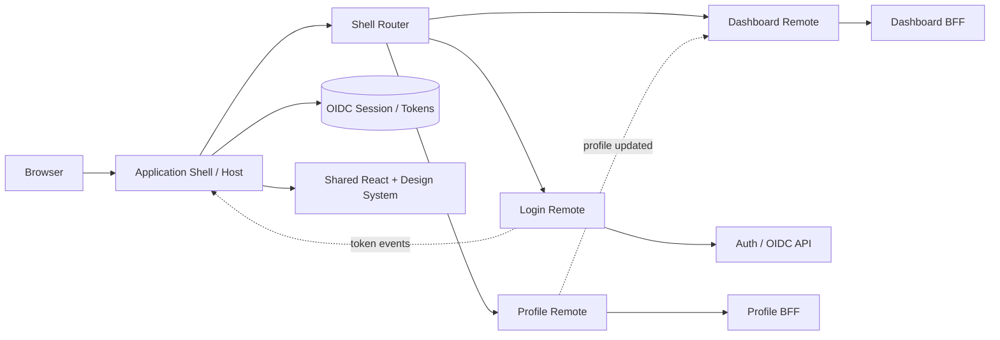
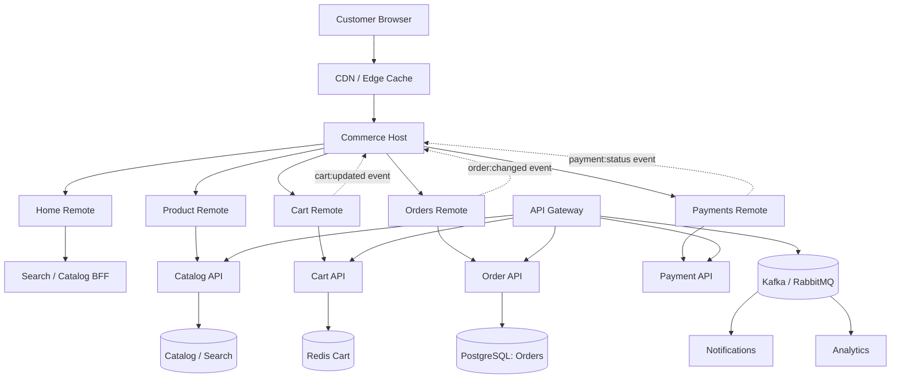
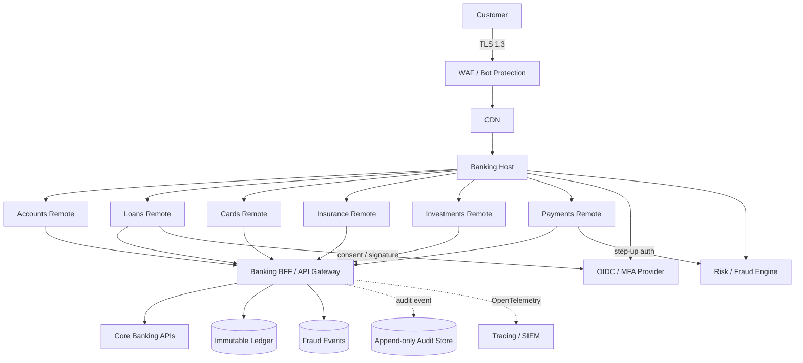
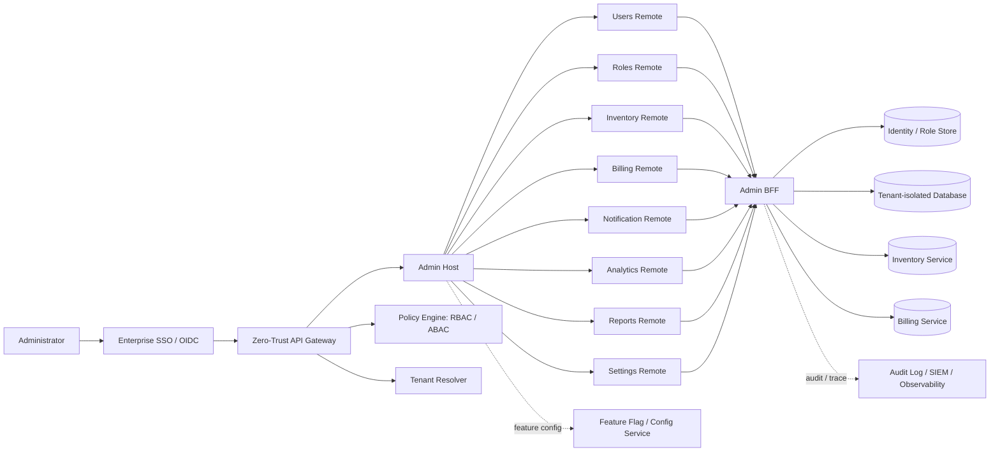
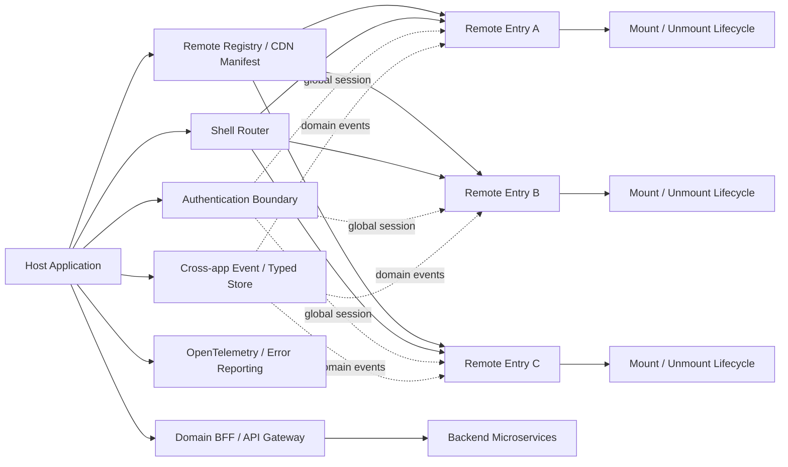
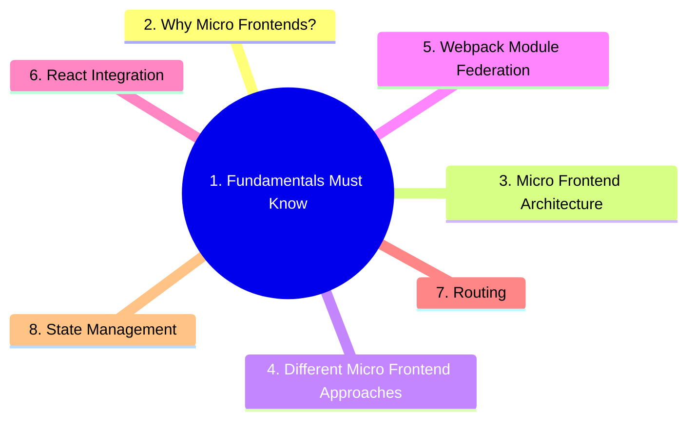

If you already know React, JavaScript, CSS, and frontend development, then learning **Micro-Frontend Architecture** is the next step toward becoming a senior frontend engineer.

Here's a **complete 2026 Micro-Frontend Roadmap with React** from beginner to expert.

---

## 1. Fundamentals (Must Know)

Before Micro Frontends, make sure you're comfortable with:

### React

- Components
- Hooks
- Context API
- Custom Hooks
- Suspense
- Lazy Loading
- Error Boundaries
- React Router
- Portals
- React 19 Features

---

### JavaScript

- ES6+
- Modules
- Closures
- Promises
- Async/Await
- Dynamic Import

```js
const Component = React.lazy(() => import("./Dashboard"));
```

---

### Build Tools

Learn

- Webpack
- Vite
- Babel
- SWC
- ESBuild

Understand

- Bundling
- Tree Shaking
- Code Splitting
- Chunking

---

## [2. Why Micro Frontends?](#2-why-micro-frontends-1)

Learn

- Monolith Frontend
- Problems of Monolith
- Scaling Teams
- Independent Deployment
- Independent Releases
- Domain Driven Design

Understand

Example

```
Without Micro Frontend

React App
├── Dashboard
├── Orders
├── Payments
├── Users
├── Reports

Entire app deploys together.
```

vs

```
Dashboard Team

Deploy Dashboard

Payments Team

Deploy Payments

No dependency.
```

---

## [3. Micro Frontend Architecture](#3-micro-frontend-architecture-1)

Study

- Vertical Split
- Horizontal Split
- Feature Based Split
- Domain Based Split

Example

```
Shell App

├── Dashboard
├── Orders
├── Payments
├── Profile
```

Each module is its own React project.

---

## [4. Different Micro Frontend Approaches](#4-different-micro-frontend-approaches-1)

Learn all architectures.

### [1. Build Time Integration](#1-build-time-integration-1)

```
npm package

Dashboard UI

Install in Host
```

Pros

- Easy

Cons

- Redeploy required

---

### [2. Runtime Integration](#2-runtime-integration-1)

```
Shell

↓

Load Remote JS

↓

Render
```

---

### [3. Module Federation](#3-module-federation-1)

Most popular.

---

### [4. Web Components](#4-web-components-1)

```
<dashboard-widget />
```

Works with

- React
- Angular
- Vue

---

### [5. Iframes](#5-iframes-1)

Old but still useful.

---

### [6. Server Side Composition](#6-server-side-composition-1)

SSR

---

### [7. Edge Side Includes](#7-edge-side-includes-1)

CDN combines fragments.

---

## [5. Webpack Module Federation](#5-webpack-module-federation-1)

Most important topic.

Learn

- Host
- Remote
- Exposes
- Remotes
- Shared Libraries
- Singleton
- Version Matching

Architecture

```
Host

↓

Dashboard Remote

↓

Orders Remote

↓

Payments Remote
```

Example

```js
new ModuleFederationPlugin({
  name: "dashboard",

  filename: "remoteEntry.js",

  exposes: {
    "./Dashboard": "./src/App",
  },

  shared: {
    react: {
      singleton: true,
    },
  },
});
```

Understand

remoteEntry.js

---

## [6. React Integration](#6-react-integration-1)

Learn

Host App

```
React

↓

Load Remote

↓

Render
```

Dynamic import

```js
const Dashboard = lazy(() => import("dashboard/App"));
```

---

## [7. Routing](#7-routing-1)

Centralized Routing

```
Host

/users

/orders

/dashboard
```

OR

Independent Routing

Remote manages its own routes.

Study

- Nested Routes
- Route Isolation
- History Sync

---

## [8. State Management](#8-state-management-1)

Avoid shared global state.

Learn

Local State

Context

Redux

Zustand

Jotai

Recoil

Communication

- Custom Events
- Event Bus
- Pub/Sub
- Browser Events

Example

```js
window.dispatchEvent(new Event("logout"));
```

---

## [9. Communication](#9-communication-1)

Host ↔ Remote

Methods

Props

```jsx
<UserApp username="John" />
```

Events

```js
window.dispatchEvent(...)
```

RxJS

Broadcast Channel

Shared Store

Message Bus

---

## [10. Authentication](#10-authentication-1)

Implement

JWT

OAuth

SSO

Session Sharing

Refresh Token

Shared Login

Example

```
Host Login

↓

Store Token

↓

All Micro Apps use token
```

---

## [11. Shared Libraries](#11-shared-libraries-1)

Share

React

ReactDOM

Axios

Design System

Utilities

Avoid

Different React versions.

---

## [12. Shared UI Library](#12-shared-ui-library-1)

Create

```
@company/ui

Button

Input

Modal

Table

Theme
```

Publish

NPM

Private Registry

Module Federation

---

## [13. Design System](#13-design-system-1)

Build

Typography

Spacing

Buttons

Icons

Colors

Tokens

Dark Theme

Accessibility

---

## [14. API Layer](#14-api-layer-1)

Each Micro Frontend

```
Dashboard API

Orders API

Payment API
```

OR

Gateway

```
Host

↓

API Gateway

↓

Microservices
```

---

## [15. CI/CD](#15-cicd-1)

Every app

```
GitHub

↓

Build

↓

Test

↓

Deploy

↓

CDN
```

Learn

- GitHub Actions
- Jenkins
- Azure DevOps
- GitLab CI

---

## [16. Deployment](#16-deployment-1)

Deploy separately

Example

```
dashboard.company.com

orders.company.com

payment.company.com
```

OR

```
company.com/dashboard

company.com/orders
```

---

## [17. Versioning](#17-versioning-1)

Study

Semantic Versioning

Backward Compatibility

Shared Dependencies

Rollback

Canary Release

Blue Green Deployment

---

## [18. Performance](#18-performance-1)

Optimize

- Lazy Loading
- Prefetch
- Preload
- Tree Shaking
- Shared Bundles
- CDN
- Cache
- HTTP2
- Brotli
- Gzip

---

## [19. Security](#19-security-1)

Study

CSP

CORS

XSS

CSRF

JWT

Secure Cookies

Sandboxing

Content Isolation

---

## [20. Testing](#20-testing-1)

Unit

- Jest
- Vitest

Component

- React Testing Library

Integration

End-to-End

- Playwright
- Cypress

Visual Testing

- Storybook
- Chromatic

---

## [21. Monitoring](#21-monitoring-1)

Logging

Metrics

Tracing

Frontend Monitoring

Learn

- Browser Performance API
- Error Tracking
- Session Replay

Tools

- Sentry
- Datadog
- New Relic

---

## [22. Advanced Topics](#22-advanced-topics-1)

Learn

- SSR + Micro Frontends
- React Server Components
- Streaming SSR
- Edge Rendering
- Partial Hydration
- Islands Architecture
- Monorepo
- Turborepo
- Nx
- Single SPA
- Piral
- Luigi
- Bit

---

## [23. Popular Frameworks](#23-popular-frameworks-1)

Learn these ecosystems:

| Framework         | Purpose                 |
| ----------------- | ----------------------- |
| Module Federation | Runtime integration     |
| Single-SPA        | Framework orchestration |
| Piral             | Micro-frontend platform |
| Nx                | Monorepo management     |
| Turborepo         | Build optimization      |
| Bit               | Component sharing       |

---

## 24. Hands-on Projects

Build these projects in order. Each stage should use independent repositories or packages, runtime routing, isolated releases, and explicit contracts between the shell and remotes.

### Beginner: Dashboard, Login and Profile

ప్రారంభంలో ఒక మాత్రమే application shell మరియు చిన్న remotes వాడాలి. మొదట **build-time integration** తో ప్రారంభించి, తరువాత **Module Federation** కు migrate చేయడం బాగా నేర్చిస్తుంది.



Implementation baseline:

- Host owns global routing, authentication, design system, and error reporting.
- Login remote uses OIDC Authorization Code + PKCE and keeps refresh/access token handling in a dedicated auth boundary.
- Remotes publish typed contracts and expose a framework-neutral mount/unmount API.
- Shared React, router, and design-system dependencies must use `singleton: true` to prevent duplicate runtime instances.
- Every remote has a loading state, retry mechanism, and fallback UI.
- Independent deployments are served through versioned `remoteEntry.js` URLs.

### Intermediate: E-commerce Platform

E-commerce micro-frontendsలో **host shell**, **domain remotes**, మరియు **read/write API gateways** clearly isolate చేయాలి.



Advanced mechanisms:

- Use route-based code splitting and remote prefetching for product/category pages.
- Keep cart state in an event bus or shared typed store; use a server BFF/cart service as the source of truth.
- Payment iframe or hosted payment fields prevent card data from entering application JavaScript.
- Use `Idempotency-Key` for payment and order mutations, and a webhook verifier for payment confirmation.
- Cache immutable product assets at CDN level and use stale-while-revalidate for catalog requests.
- Add remote health checks and fallback pages; never let an unavailable payments remote break browsing/catalog features.
- Search, analytics, notification, and order projections consume domain events instead of direct cross-remote database access.

### Advanced: Banking Portal

Banking shell strict trust boundaries, secure session management, step-up authentication, మరియు auditability వాడాలి.



Advanced mechanisms:

- Use a backend-for-frontend as the sole API boundary; the browser receives least-privilege, short-lived credentials.
- Enforce step-up MFA for transfers, card limits, beneficiary changes, and loan actions.
- Apply CSP, Trusted Types, SRI, secure cookies, and strict CORS to reduce script and session threats.
- Make financial mutations replay-safe using idempotency keys, server-side verification, and optimistic UI rollback.
- Mask account numbers and PII; log correlation IDs and security decisions, never credentials or full sensitive payloads.
- Version remote contracts and perform consumer-driven contract testing before deployment.
- Every sensitive action requires authorization, audit event, consent record, and correlation ID.

### Enterprise: Admin Portal

Enterprise admin shell multi-tenant RBAC/ABAC, regional isolation, feature governance, మరియు independent team deployments ఉండాలి.



Advanced mechanisms:

- Use tenant-aware routing and authorization checks in both UI and API; hide actions before rendering them but never rely on UI hiding alone.
- Separate operator permissions from normal-user permissions and enforce least privilege, break-glass access, and privileged session limits.
- Feature flags enable gradual rollout by team, tenant, region, or percentage; remove stale flags through a lifecycle policy.
- Canary remotes independently, compare runtime errors and Core Web Vitals, and automate rollback when SLOs breach.
- Enforce module compatibility matrices and pin shared dependency versions during compatibility windows.
- Use async event consumers for notifications and reports; avoid synchronous fan-out in the host shell.
- Deploy dashboards and reports behind separate read models and caching, with tenant-level row security or schema isolation.

## Cross-project Runtime Architecture



Cross-cutting implementation checklist:

- Manifest-driven remotes: resolve remote URLs dynamically instead of hardcoding deployment URLs in every host build.
- Shared contract package: define route paths, mount props, events, i18n keys, and feature flags as versioned TypeScript types.
- Runtime resilience: remote timeout, retry/circuit breaker, stale cached manifest fallback, and an isolated error boundary.
- Observability: correlation ID, remote name/version, route, team owner, Web Vitals, and release deployment metadata.
- Security: CSP, trusted scripts, sandboxed third-party widgets, dependency allowlists, and no global mutable secrets.
- Performance: route-based chunks, preloading, CDN cache strategy, preconnect, image optimization, and bundle-budget CI checks.
- Delivery: independent CI/CD pipelines, immutable artifacts, canary/blue-green deployment, consumer contract tests, and automated rollback.

---

## [25. Interview Preparation](#25-interview-preparation-1)

Be ready to answer questions on:

### Architecture

- What are Micro Frontends?
- Why use them?
- Monolith vs Micro Frontends
- Build-time vs Runtime integration
- Domain-driven design
- Team ownership models

### Module Federation

- Host and Remote applications
- `remoteEntry.js`
- Shared dependencies
- Singleton configuration
- Dynamic remotes
- Version conflicts

### React Integration

- Lazy loading remote modules
- Error boundaries for remote failures
- Suspense and loading states
- Cross-app routing
- State sharing strategies

### Communication

- Props vs Custom Events
- Event Bus
- Shared State
- Broadcast Channel API
- Cross-window communication

### Performance

- Bundle optimization
- Code splitting
- Caching strategies
- CDN deployment
- Prefetching remote modules

### Deployment

- Independent deployments
- CI/CD pipelines
- Versioning
- Rollback strategies
- Blue/Green and Canary deployments

### Security

- Authentication across micro frontends
- Token sharing
- CORS
- CSP
- XSS prevention

### Testing

- Unit testing
- Integration testing
- End-to-end testing
- Contract testing between host and remotes

---

# Recommended Learning Order (12 Weeks)



| Week | Topics                                                                                  |
| ---- | --------------------------------------------------------------------------------------- |
| 1    | Micro-Frontend fundamentals, architecture, and use cases                                |
| 2    | Webpack, Vite, Module Federation basics                                                 |
| 3    | Build a Host and one Remote application                                                 |
| 4    | Multiple Remotes, routing, and lazy loading                                             |
| 5    | Communication patterns and shared state                                                 |
| 6    | Authentication and shared UI library                                                    |
| 7    | Shared design system and API integration                                                |
| 8    | CI/CD and independent deployments                                                       |
| 9    | Performance optimization and security                                                   |
| 10   | Testing with Jest, React Testing Library, and Playwright/Cypress                        |
| 11   | Advanced topics: SSR, Monorepos (Nx/Turborepo), Single-SPA                              |
| 12   | Build a complete enterprise micro-frontend application and practice interview questions |

This roadmap aligns well with what many large engineering organizations use for React-based micro-frontends, giving you both the architectural understanding and the practical skills expected in senior frontend interviews.

---

# 2. Why Micro Frontends?

ఖచ్చితంగా, Micro Frontends ఎందుకు అవసరమో మనం వివరంగా తెలుసుకుందాం. మీరు అడిగిన టాపిక్స్ ఒక్కొక్కటిగా అర్థం చేసుకుందాం.

---

## 1. Monolith Frontend అంటే ఏమిటి?

మనం ఏదైనా వెబ్ అప్లికేషన్ తయారు చేసేటప్పుడు, మొత్తం కోడ్ (UI, Business Logic, Routing, State Management) అంతా ఒకే రిపాజిటరీలో (Single Repository) ఉండి, ఒకే యూనిట్‌గా బిల్డ్ అయి, డిప్లాయ్ అయితే దాన్ని **Monolith Frontend** అంటారు.

- **ఉదాహరణ:** ఒకే React ప్రాజెక్ట్‌లో హెడర్, ఫుటర్, ప్రొడక్ట్ పేజీ, కార్ట్ పేజీ, చెక్-అవుట్ పేజీ అన్నీ కలిసి ఉండటం.

---

## 2. Monolith యొక్క సమస్యలు (Problems of Monolith)

అప్లికేషన్ చిన్నగా ఉన్నప్పుడు Monolith బాగానే ఉంటుంది, కానీ అది పెరుగుతున్న కొద్దీ కొన్ని సమస్యలు వస్తాయి:

- **Slow Build Times:** కోడ్ పెరిగేకొద్దీ అప్లికేషన్‌ను బిల్డ్ చేయడానికి, టెస్ట్ చేయడానికి చాలా సమయం పడుతుంది.
- **Tight Coupling:** ఒక చిన్న మార్పు చేసినా, మొత్తం అప్లికేషన్‌ను మళ్ళీ డిప్లాయ్ చేయాల్సి వస్తుంది.
- **Risk of Breaking:** కోడ్ మొత్తం ఒకే దగ్గర ఉండటం వల్ల, ఒక డెవలపర్ చేసిన చిన్న పొరపాటు వల్ల మొత్తం సైట్ డౌన్ అయ్యే అవకాశం ఉంది.
- **Tech Lock-in:** మొత్తం అప్లికేషన్ ఒకే ఫ్రేమ్‌వర్క్ (ఉదాహరణకు React పాత వెర్షన్) లోనే ఉండాలి. కొత్త టెక్నాలజీకి మారాలంటే చాలా కష్టం.

---

## 3. Scaling Teams (టీమ్స్ పెరిగినప్పుడు)

కంపెనీ పెద్దదై, 50-100 మంది డెవలపర్లు ఒకే Monolith ప్రాజెక్ట్‌పై పని చేస్తున్నప్పుడు గందరగోళం మొదలవుతుంది:

- **Code Conflicts:** ఒకే ఫైల్ మీద అందరూ పని చేయాల్సి రావడం వల్ల `git merge conflicts` ఎక్కువగా వస్తాయి.
- **Communication Gap:** అందరూ ఒకే కోడ్‌బేస్‌పై ఆధారపడటం వల్ల, ఒక టీమ్ చేసే పని మరొక టీమ్‌కు ఇబ్బంది కలిగించవచ్చు.

Micro Frontends వల్ల ఒక్కో టీమ్‌కు ఒక్కో "Micro App"ని అప్పగించవచ్చు. దీనివల్ల టీమ్స్ స్వతంత్రంగా పని చేయగలవు.

---

## 4. Independent Deployment & Independent Releases

ఇది Micro Frontends యొక్క అతిపెద్ద లాభం.

- **Independent Deployment:** ఇప్పుడు మీరు "కార్ట్ (Cart)" సెక్షన్‌లో మార్పు చేశారనుకోండి, మీరు కార్ట్ అప్లికేషన్‌ను మాత్రమే బిల్డ్ చేసి సర్వర్‌కి పంపవచ్చు. పక్కనే ఉన్న "ప్రొడక్ట్" అప్లికేషన్‌ను తాకాల్సిన అవసరం లేదు.
- **Independent Releases:** పాత వెర్షన్‌తో సంబంధం లేకుండా, మీరు ఎప్పుడు కావాలంటే అప్పుడు మీ ఫీచర్‌ను యూజర్‌కి విడుదల చేయవచ్చు. దీనివల్ల డెలివరీ వేగవంతం అవుతుంది.

---

## 5. Domain Driven Design (DDD)

Micro Frontends లో అప్లికేషన్‌ను **Domain** (వ్యాపార అవసరం) ఆధారంగా విడగొడతాము.

సాంకేతిక కోణం (Technological Layers) లో కాకుండా, వ్యాపార కోణం (Business Capabilities) లో విడగొట్టడం దీని ప్రత్యేకత.

- **ఉదాహరణ:** ఒక బ్యాంకింగ్ యాప్ తీసుకుంటే:
- **Accounts Domain:** బ్యాలెన్స్ చూడటం, స్టేట్‌మెంట్స్.
- **Transfer Domain:** డబ్బులు పంపడం, పేమెంట్స్.
- **Profile Domain:** సెట్టింగ్స్, పాస్‌వర్డ్ మార్చుకోవడం.

ఈ మూడింటిని మూడు విభిన్న Micro Frontends గా డెవలప్ చేస్తారు. అంటే, బ్యాంకింగ్ యాప్‌ని కేవలం ఫైల్స్ లా కాకుండా, బిజినెస్ అవసరాల (Domains) ఆధారంగా విడగొట్టి మేనేజ్ చేయడమే **Domain Driven Design**.

---

### క్లుప్తంగా చెప్పాలంటే:

- **Monolith** ఒక పెద్ద, భారీ ఓడ లాంటిది. దాన్ని తిప్పాలన్నా లేదా రిపేర్ చేయాలన్నా చాలా కష్టం.
- **Micro Frontends** అనేవి చిన్న చిన్న స్పీడ్ బోట్లు (Speed boats) లాంటివి. ఒక్కోటి వేగంగా వెళ్లగలవు, ఒక బోటు రిపేర్ అయినా మిగతావి ఆగిపోవు.

---

మీరు పైన చెప్పిన ఉదాహరణ చాలా క్లియర్ గా ఉంది. దీన్ని ఒక డయాగ్రామ్ లాగా ఊహించుకుంటే మీకు ఇంకా బాగా అర్థమవుతుంది. **"Without Micro Frontend"** vs **"With Micro Frontend"** మధ్య ఉన్న వ్యత్యాసాన్ని చూద్దాం.

---

### 1. Without Micro Frontend (Monolith Architecture)

ఇక్కడ మీరు చెప్పినట్లు, **Dashboard, Orders, Payments, Users, Reports** అన్నీ ఒకే రిపాజిటరీలో ఉంటాయి.

```text
[ React App (Monolith) ]
      |
      |-- Dashboard (Component)
      |-- Orders (Component)
      |-- Payments (Component)
      |-- Users (Component)
      |-- Reports (Component)

```

- **సమస్య:** మీరు కేవలం "Payments" పేజీలో ఒక బటన్ రంగు మార్చాలన్నా, మీరు మొత్తం అప్లికేషన్‌ను బిల్డ్ చేసి డిప్లాయ్ చేయాలి.
- **రిస్క్:** 'Reports' టీమ్ చేసిన చిన్న కోడ్ తప్పు వల్ల, 'Payments' టీమ్ యొక్క పేమెంట్ ప్రాసెసింగ్ ఆగిపోయే అవకాశం ఉంది (ఎందుకంటే అన్నీ ఒకే చోట ఉన్నాయి).

---

### 2. With Micro Frontend (Distributed Architecture)

ఇక్కడ ప్రతి ఒక్కటి ఒక విడి అప్లికేషన్ లాగా ఉంటుంది. ఒక్కో టీమ్ కి ఒక్కో బాధ్యత ఉంటుంది.

**Dashboard Team (Dashboard App)**

- వీరు తమ ఓన్ రిపాజిటరీలో కోడ్ రాస్తారు.
- కేవలం వారి అప్లికేషన్‌ను డిప్లాయ్ చేస్తారు.

**Payments Team (Payments App)**

- వీరికి 'Dashboard' టీమ్ కోడ్‌తో సంబంధం లేదు.
- తమ కోడ్‌ను తాము స్వతంత్రంగా బిల్డ్ చేసి డిప్లాయ్ చేస్తారు.

```text
[ Dashboard App ] (Team A)  --->  [ Deployment ]
[ Orders App    ] (Team B)  --->  [ Deployment ]
[ Payments App  ] (Team C)  --->  [ Deployment ]
[ Users App     ] (Team D)  --->  [ Deployment ]
[ Reports App   ] (Team E)  --->  [ Deployment ]

```

---

### వీటి మధ్య ఉన్న ప్రధాన తేడాలు (Key Differences)

| ఫీచర్ (Feature)  | Monolith (Without MFE)                             | Micro Frontend                                |
| ---------------- | -------------------------------------------------- | --------------------------------------------- |
| **Deployment**   | మొత్తం యాప్ ఒక్కసారే డిప్లాయ్ అవుతుంది.            | ఒక్కో పార్ట్ విడిగా డిప్లాయ్ అవుతుంది.        |
| **Dependencies** | ఒకే వెర్షన్ లైబ్రరీలు వాడాలి.                      | ఒక్కో టీమ్ డిఫరెంట్ వెర్షన్లు వాడుకోవచ్చు.    |
| **Development**  | అన్ని టీమ్స్ ఒకే కోడ్‌బేస్‌లో పనిచేయాలి.           | టీమ్స్ స్వతంత్రంగా పనిచేయవచ్చు.               |
| **Failure**      | ఏదైనా ఒక చోట తప్పు జరిగితే మొత్తం యాప్ ఆగిపోవచ్చు. | ఒక పార్ట్ ఫెయిల్ అయినా మిగిలినవి పనిచేస్తాయి. |

### మీ ఉదాహరణలోని లాభం ఏంటి?

మీరు అన్నట్లుగా **"No dependency"** అనేది చాలా ముఖ్యం. దీనివల్ల **Payments Team** కి, **Dashboard Team** కి మధ్య సమన్వయం (coordination) కోసం వేచి చూడాల్సిన పని లేదు. పేమెంట్ టీమ్ తమ పని పూర్తి కాగానే వెంటనే ప్రొడక్షన్‌లోకి మార్పులను పంపవచ్చు.

---

**ఒక చిన్న ప్రశ్న:**
ఈ కాన్సెప్ట్ అర్థమైంది కదా? ఇప్పుడు ఈ అప్లికేషన్లను మనం ఒకే స్క్రీన్ మీద ఎలా కలపాలి (Integration) అనే దాని గురించి నేర్చుకోవాలని ఉందా? అంటే **"How do they run together?"** అనే టాపిక్ మీద వెళ్దామా?

---

# 3. Micro Frontend Architecture

Micro Frontends లో అప్లికేషన్‌ను ఎలా విభజించాలి (split) అనే దానిపై **Vertical Split** మరియు **Horizontal Split** అనే రెండు ముఖ్యమైన పద్ధతులు ఉన్నాయి. వీటిని సులభంగా అర్థం చేసుకుందాం.

---

### 1. Vertical Split (నిలువు విభజన - Domain based)

ఇది Micro Frontends లో అత్యంత ప్రాచుర్యం పొందిన పద్ధతి. ఇందులో అప్లికేషన్‌ను **"బిజినెస్ ఫీచర్స్"** లేదా **"డొమైన్స్"** ఆధారంగా విడగొడతారు.

- **ఏమిటి?:** స్క్రీన్ పైన ఉండే హెడర్ నుంచి బాటమ్ వరకు, ఒక నిర్దిష్టమైన ఫీచర్ మొత్తం ఒకే టీమ్ ఆధీనంలో ఉంటుంది.
- **ఎలా ఉంటుంది?:**
- **Team A:** 'Payments' డొమైన్ చూసుకుంటుంది (అంటే పేమెంట్ పేజీ, అందులోని బటన్లు, లాజిక్ అన్నీ).
- **Team B:** 'Profile' డొమైన్ చూసుకుంటుంది (యూజర్ సెట్టింగ్స్, అడ్రస్ అప్డేట్ అన్నీ).

- **లాభం:** ఒక టీమ్ ఒక పేజీని పూర్తిగా ఓన్ చేసుకుంటుంది. వేరే టీమ్ మీద ఆధారపడాల్సిన అవసరం అస్సలు ఉండదు. **Domain Driven Design** కి ఇది కరెక్ట్ పద్ధతి.

### 2. Horizontal Split (అడ్డ విభజన - Layer based)

ఇందులో అప్లికేషన్‌ను **"లేయర్స్ (Layers)"** లేదా **"కాంపొనెంట్స్"** ఆధారంగా విడగొడతారు.

- **ఏమిటి?:** అప్లికేషన్‌ను అడ్డంగా ముక్కలు చేస్తారు. అంటే ఒక టీమ్ కేవలం ఒక లేయర్‌ను మాత్రమే డెవలప్ చేస్తుంది.
- **ఎలా ఉంటుంది?:**
- **Team A:** కేవలం 'Header' మరియు 'Footer' డిజైన్ చేస్తుంది.
- **Team B:** మధ్యలో ఉండే 'Content/Main Body'ని చూసుకుంటుంది.

- **సమస్య:** ఇది వినడానికి బాగున్నా, రియల్ టైమ్ ప్రాజెక్ట్స్‌లో ఇది చాలా కష్టం. ఎందుకంటే, ఒక చిన్న మార్పు చేయాలన్నా టీమ్స్ మధ్య చాలా కోఆర్డినేషన్ కావాలి. ఉదాహరణకు, మీరు మెయిన్ బాడీలో ఒక డేటా మార్చితే, దానికి తగ్గట్టు హెడర్‌లో కూడా మార్పులు చేయాల్సి వస్తే, రెండు టీమ్స్ కమ్యూనికేట్ అవ్వాల్సి ఉంటుంది.

---

### పోలిక (Comparison Table)

| ఫీచర్ (Feature)  | Vertical Split                    | Horizontal Split                        |
| ---------------- | --------------------------------- | --------------------------------------- |
| **విభజన పద్ధతి** | బిజినెస్ డొమైన్ (Business Domain) | UI లేయర్స్ (UI Layers)                  |
| **కోఆర్డినేషన్** | తక్కువ (ఎవరి పని వారిదే)          | ఎక్కువ (టీమ్స్ మధ్య కమ్యూనికేషన్ అవసరం) |
| **సులభతరం**      | డెవలప్మెంట్ సులభం                 | మెయింటైన్ చేయడం కష్టం                   |
| **సిఫార్సు**     | Micro Frontends కి ఇదే బెస్ట్     | సాధారణంగా ఇది వద్దు అంటారు              |

---

### ఒక చిన్న ఉదాహరణతో (Example):

ఒక **Amazon** వెబ్‌సైట్‌ను తీసుకుందాం:

- **Vertical Split ఉదాహరణ:** ఒక టీమ్ 'Search' పేజీ మొత్తం (సెర్చ్ బార్, రిజల్ట్స్, ఫిల్టర్స్) చూసుకుంటుంది. మరొక టీమ్ 'Cart' పేజీ మొత్తం చూసుకుంటుంది. ఇది ఉత్తమం.
- **Horizontal Split ఉదాహరణ:** ఒక టీమ్ అప్లికేషన్ మొత్తానికి కామన్ హెడర్ ని తయారు చేస్తుంది. మరొక టీమ్ బాడీని డిజైన్ చేస్తుంది. ఇలా చేస్తే, ప్రతిసారి హెడర్ టీమ్ ని అడగాల్సి వస్తుంది, ఇది ఇబ్బందిగా ఉంటుంది.

**ముగింపు:**
Micro Frontends లో మనం ఎప్పుడూ **Vertical Split** ని ఎంచుకోవాలి. ఎందుకంటే అప్పుడే టీమ్స్ స్వతంత్రంగా (Independently) పని చేయగలవు.

---

### 3. Feature Based Split (ఫీచర్ ఆధారిత విభజన)

ఒక చిన్న ఫీచర్ లేదా ఒక నిర్దిష్టమైన ఫంక్షనాలిటీని ఒక Micro Frontendగా విడగొట్టడం.

- **ఏమిటి?:** అప్లికేషన్‌లో ఏదైనా ఒక చిన్న "ఫీచర్"ని తీసుకుని దాన్ని విడిగా తయారు చేయడం.
- **ఎప్పుడు వాడతారు?:** యాప్ లోని ఏదైనా ఒక చిన్న పార్ట్, అది వేరే ఫీచర్లపై పెద్దగా డిపెండ్ అవ్వనప్పుడు.
- **ఉదాహరణ:** ఒక "Product Recommendation" బాక్స్.
- ఈ బాక్స్ అనేది ఒక Micro Frontend.
- దీన్ని వెబ్‌సైట్‌లో ఎక్కడైనా పెట్టుకోవచ్చు.
- ఇది కేవలం డేటాను తెచ్చుకుని చూపిస్తుంది.

---

### 4. Domain Based Split (డొమైన్ ఆధారిత విభజన)

ఇది ఒక అప్లికేషన్ యొక్క **వ్యాపార కోణాన్ని (Business Area)** బట్టి విడగొట్టడం. Micro Frontends లో ఇది అత్యంత శక్తివంతమైన పద్ధతి.

- **ఏమిటి?:** మీ అప్లికేషన్‌లోని బిజినెస్ లాజిక్‌ను బట్టి విడగొట్టడం. ఉదాహరణకు, ఒక ఈ-కామర్స్ సైట్‌లో 'Checkout' అనేది ఒక పెద్ద డొమైన్.
- **ఎందుకు?:** ఇందులో ఫీచర్లు, యూజర్ ఇంటరాక్షన్, సర్వర్ కాలింగ్ అన్నీ కలిసి ఒకే డొమైన్‌గా ఉంటాయి.
- **ఉదాహరణ:**
- **Auth Domain:** లాగిన్, సైన్-అప్, పాస్‌వర్డ్ మార్చుకోవడం.
- **Catalog Domain:** ప్రొడక్ట్స్ సెర్చ్ చేయడం, కేటగిరీల లిస్ట్.
- **Cart Domain:** ఐటమ్స్ యాడ్ చేయడం, కౌంట్ చూపించడం, డిలీట్ చేయడం.

---

### Feature vs Domain: తేడా ఏంటి?

| పద్ధతి            | దేనిపై దృష్టి పెడుతుంది?             | ఉదాహరణ                                                 |
| ----------------- | ------------------------------------ | ------------------------------------------------------ |
| **Feature Based** | చిన్న చిన్న ఫంక్షనాలిటీ (Small Task) | ఒక బటన్, లేదా ఒక ప్రత్యేకమైన రివ్యూ బాక్స్             |
| **Domain Based**  | పెద్ద వ్యాపార విభాగం (Business Area) | మొత్తం 'Checkout' ప్రాసెస్ లేదా 'Profile' మేనేజ్‌మెంట్ |

---

### వీటిని ఎప్పుడు, ఎలా ఎంచుకోవాలి? (Best Practice)

1. **Domain Based Split:** ఇది నిజమైన Micro Frontend అప్రోచ్. పెద్ద పెద్ద కంపెనీలలో (ఉదా: Amazon, Netflix) అప్లికేషన్లను డొమైన్ ఆధారంగానే విడగొడతారు. ఇది టీమ్స్‌కి పూర్తి స్వేచ్ఛను ఇస్తుంది.
2. **Feature Based Split:** ఇది ఒక్కోసారి 'Widget' లాంటిది. పెద్ద డొమైన్ లోపల చిన్న చిన్న పార్ట్స్ వేరు చేయడానికి ఇది వాడుతారు.

**ఒక ఉదాహరణతో అర్థం చేసుకుందాం:**
మీరు 'Orders' అనే డొమైన్ వాడుతున్నారనుకోండి (Domain Based). దాని లోపల 'Order Tracking' అనేది ఒక ఫీచర్ (Feature Based). ఈ 'Order Tracking' ని మీరు ఇంకొక చోట కూడా వాడాలనుకుంటే, దాన్ని ఒక ఫీచర్-బేస్డ్ Micro Frontend లాగా కూడా తయారు చేయవచ్చు.

---

మీరు చెప్పిన ఉదాహరణ **Micro Frontend** ఆర్కిటెక్చర్‌లో అత్యంత ముఖ్యమైన భాగం. దీన్నే మనం **"Shell App"** లేదా **"Container App"** అంటాము.

దీనిని ఒక రియల్ వరల్డ్ ప్రాజెక్ట్ లాగా ఊహించుకుందాం:

### Shell App అంటే ఏమిటి?

Shell App అనేది ఒక "మెయిన్ కంటైనర్" లాంటిది. ఇది యూజర్‌కి కనిపించే పేజీని రన్ చేస్తుంది. కానీ, అందులోని అసలైన ఫీచర్లు (Dashboard, Orders, Payments, Profile) వేర్వేరు ప్రాజెక్టుల నుండి వస్తాయి.

### మీ ప్రాజెక్ట్ స్ట్రక్చర్ ఇలా ఉంటుంది:

1. **Shell App (Container):** ఇది ఒక మెయిన్ React యాప్. దీని పని కేవలం మిగిలిన యాప్స్‌ని పట్టుకుని (Load) చూపించడం.
2. **Dashboard App:** ఒక విడి React ప్రాజెక్ట్.
3. **Orders App:** మరొక విడి React ప్రాజెక్ట్.
4. **Payments App:** మరొక విడి React ప్రాజెక్ట్.
5. **Profile App:** మరొక విడి React ప్రాజెక్ట్.

---

### ఇది ఎలా పని చేస్తుంది? (High-Level View)

మీరు బ్రౌజర్‌లో `myapp.com` అని టైప్ చేసినప్పుడు:

- **Shell App** లోడ్ అవుతుంది.
- ఇది తన పక్కన ఉన్న **Dashboard, Orders, Payments, Profile** ప్రాజెక్టులకు "మీరు రెడీగా ఉండండి" అని చెప్తుంది.
- యూజర్ 'Orders' క్లిక్ చేస్తే, Shell App ఆ 'Orders App' ని రన్‌టైమ్‌లో (Runtime) లోడ్ చేస్తుంది.

---

### దీని వల్ల కలిగే అద్భుతమైన ప్రయోజనాలు:

1. **Independent Development:**

- **Payments Team** వారికి నచ్చిన లైబ్రరీలు (ఉదా: Stripe integration కోసం ఒక కొత్త లైబ్రరీ) వాడుకోవచ్చు. అది 'Orders' టీమ్ ప్రాజెక్ట్‌కి ఎలాంటి సంబంధం ఉండదు.

2. **Lazy Loading:**

- యూజర్ 'Dashboard' చూస్తున్నప్పుడు, అనవసరంగా 'Payments' యాప్ లోడ్ అవ్వదు. యూజర్ పేమెంట్స్ పేజీకి వెళ్ళినప్పుడే అది లోడ్ అవుతుంది. దీనివల్ల వెబ్‌సైట్ చాలా వేగంగా ఉంటుంది.

3. **Version Control:**

- మీరు 'Profile' యాప్‌ని మాత్రమే అప్‌డేట్ చేసి, సర్వర్‌కి పంపితే, 'Dashboard' లేదా 'Orders' యాప్స్‌ని టచ్ చేయాల్సిన అవసరం లేదు.

### ఇది అమలు చేయడానికి కావాల్సిన టెక్నాలజీ (Tech Stack):

ఈ Shell App పద్ధతిని అమలు చేయడానికి మనకు కొన్ని పద్ధతులు ఉన్నాయి:

- **Module Federation (Webpack 5):** ఇది ఇప్పుడు ఇండస్ట్రీలో అందరూ వాడుతున్న మోడ్రన్ పద్ధతి. ఇది కోడ్‌ని ఒక ప్రాజెక్ట్ నుండి మరొక ప్రాజెక్ట్‌కి చాలా ఈజీగా పంచుకుంటుంది.
- **Single-SPA:** ఇది అప్లికేషన్లను రూటింగ్ ద్వారా కలుపుతుంది.
- **iFrames:** ఇది పాత పద్ధతి (కానీ ఇప్పటికీ కొన్ని చోట్ల వాడుతున్నారు).

---

**ముఖ్యమైన గమనిక:**
ప్రతి ఒక్కటి "Independent React Project" కాబట్టి, వాటిని మీరు `git`లో వేర్వేరు రిపాజిటరీలుగా అయినా మెయింటైన్ చేయవచ్చు లేదా ఒకే `Monorepo`లో అయినా ఉంచవచ్చు.

---

# 4. Different Micro Frontend Approaches

## 1. Build Time Integration

Micro Frontends లో **Build Time Integration** అనేది అతి ప్రాథమికమైన (Basic) పద్ధతి. మీరు చెప్పినట్లుగా ఇది `npm` ప్యాకేజీల మీద ఆధారపడి ఉంటుంది. దీని గురించి వివరంగా మరియు సరళంగా తెలుసుకుందాం.

---

### Build Time Integration అంటే ఏమిటి?

ఇందులో, ప్రతి Micro Frontend (Dashboard, Orders, etc.) ఒక విడి `npm` ప్యాకేజీగా పబ్లిష్ చేయబడుతుంది. **Shell (Host) App** ఈ ప్యాకేజీలను ఒక `npm install` కమాండ్ ద్వారా తన ప్రాజెక్ట్‌లోకి తీసుకుంటుంది.

**పద్ధతి:**

1. **Dashboard Team:** తమ కోడ్‌ని రాసి, ఒక `npm package`గా మారుస్తుంది (ఉదా: `my-dashboard-pkg`).
2. **Host App:** `package.json` లో ఈ ప్యాకేజీని డిపెండెన్సీగా యాడ్ చేస్తుంది.
3. **Build:** హోస్ట్ యాప్ బిల్డ్ అయ్యేటప్పుడు, ఈ `Dashboard` కోడ్ కూడా హోస్ట్ కోడ్‌లో కలిసిపోయి ఒకే ఫైల్‌గా (Bundle) తయారవుతుంది.

---

### Pros (లాభాలు - ఎందుకు వాడాలి?)

- **Easy to understand:** ఇది మనం సాధారణంగా చేసే React డెవలప్‌మెంట్ లాగే ఉంటుంది. కాబట్టి కొత్తగా నేర్చుకోవడానికి ఏమీ ఉండదు.
- **Type Safety:** మీరు TypeScript వాడుతుంటే, ప్యాకేజీల ద్వారా టైప్ డెఫినిషన్లను (Type definitions) సులభంగా షేర్ చేయవచ్చు.
- **Caching:** బ్రౌజర్ లెవల్‌లో ప్యాకేజీలు బాగా క్యాష్ అవుతాయి, కాబట్టి లోడింగ్ స్పీడ్ బాగుంటుంది.

---

### Cons (నష్టాలు - ఎందుకు ఇది Micro Frontend కి సరిపోదు?)

ఇది నిజమైన Micro Frontend కి ఆపోజిట్‌గా ఉంటుంది. ఎందుకంటే:

1. **Redeploy Required (పెద్ద సమస్య):**

- ఒకవేళ 'Dashboard' టీమ్ చిన్న మార్పు చేసినా, వారు కొత్త `npm` వెర్షన్‌ని రిలీజ్ చేయాలి.
- ఆ తర్వాత 'Host App' డెవలపర్ ఆ కొత్త వెర్షన్‌ని అప్‌డేట్ చేసి, మళ్ళీ `npm install` చేసి, **మొత్తం హోస్ట్ యాప్‌ని మళ్ళీ బిల్డ్ చేసి, డిప్లాయ్ చేయాలి.**
- అంటే ఇక్కడ "Independent Deployment" అనే లక్ష్యం దెబ్బతింటుంది.

2. **Tight Coupling:** అన్ని మోడ్యూల్స్ ఒకే బండిల్‌లో ఉండటం వల్ల, హోస్ట్ యాప్ సైజు చాలా పెద్దదిగా తయారవుతుంది (Bundle size explosion).
3. **Version Conflicts:** ఒకే ప్రాజెక్ట్‌లో రెండు వేర్వేరు వెర్షన్ల లైబ్రరీలు వాడటం చాలా కష్టమవుతుంది (ఉదా: Dashboard కి React 18, Orders కి React 17 కావాలంటే ఇది సాధ్యం కాదు).

---

### ఎప్పుడు వాడాలి?

ఇది నిజమైన Micro Frontend అప్రోచ్ కాదు, కానీ మీరు అప్లికేషన్‌ను **కోడ్ షేరింగ్** కోసం మాత్రమే విడగొట్టాలనుకుంటే (ఉదా: UI కాంపొనెంట్ లైబ్రరీ - Buttons, Inputs), అప్పుడు **Build Time Integration** చాలా బాగుంటుంది. కానీ, టీమ్స్ స్వతంత్రంగా పనిచేయాలంటే ఇది సరైన పద్ధతి కాదు.

---

**ముగింపు:**
"Independent Deployment" కావాలనుకుంటే, మనం **Runtime Integration** వైపు వెళ్లాలి (అంటే **Module Federation** లేదా **Single-SPA**).

---

## 2. Runtime Integration

**Runtime Integration** అనేది Micro Frontends యొక్క నిజమైన శక్తి. మీరు చెప్పినట్లుగా, ఇక్కడ కోడ్ అనేది 'బిల్డ్ టైమ్' (Build Time) లో కాకుండా, బ్రౌజర్‌లో అప్లికేషన్ రన్ అవుతున్నప్పుడు (**Runtime**) లోడ్ అవుతుంది.

దీన్ని ఒక చిన్న ఉదాహరణతో అర్థం చేసుకుందాం.

### Runtime Integration ఎలా పనిచేస్తుంది?

1. **Shell (Host):** ఇది ఒక పద్ధతి ప్రకారం తన రిమోట్ యాప్స్ ఎక్కడున్నాయో (URL) తెలుసుకుంటుంది.
2. **Load Remote JS:** యూజర్ ఒక పేజీకి వెళ్ళినప్పుడు, Shell అప్లికేషన్ సర్వర్ నుండి ఆ συγκεκριిత ఫీచర్‌కు సంబంధించిన JavaScript ఫైల్స్‌ని (Remote JS) అడుగుతుంది.
3. **Render:** ఆ ఫైల్స్ అందిన వెంటనే, Shell అప్లికేషన్ వాటిని తన UI లోకి ఇన్‌జెక్ట్ చేసి, బ్రౌజర్‌లో చూపిస్తుంది (Render).

---

### ఇది ఎందుకు గొప్పది? (The Big Advantage)

ఇక్కడ ప్రతి యాప్ (Dashboard, Orders, etc.) వేర్వేరుగా డిప్లాయ్ చేయబడతాయి. కాబట్టి **Dashboard టీమ్** ఏదైనా మార్పు చేస్తే, వారు కేవలం వారి JavaScript ఫైల్స్‌ని సర్వర్‌లో అప్‌డేట్ చేస్తే చాలు. **Shell App తో ఎలాంటి సంబంధం లేకుండా, ఏ కొత్త బిల్డ్ అవసరం లేకుండానే, యూజర్ కి అప్‌డేట్స్ కనిపిస్తాయి.**

---

### Runtime Integration లో ముఖ్యమైన పద్ధతులు:

#### 1. Module Federation (Webpack 5) - "ఇండస్ట్రీ స్టాండర్డ్"

ప్రస్తుతం React ప్రపంచంలో అత్యంత ప్రజాదరణ పొందిన పద్ధతి ఇది.

- **ఎలా చేస్తుంది?:** `webpack.config.js` లో కొన్ని సెట్టింగ్స్ ద్వారా, ఒక యాప్ తన ఫంక్షన్లను లేదా కాంపొనెంట్లను "Expose" చేస్తుంది, మరో యాప్ వాటిని "Remote" గా తీసుకుంటుంది.
- **ప్రయోజనం:** చాలా ఫాస్ట్, షేర్డ్ డిపెండెన్సీలను (Shared Dependencies) మేనేజ్ చేయడం సులభం.

#### 2. Single-SPA

ఇది ఒక ఫ్రేమ్‌వర్క్. ఇది అప్లికేషన్లను 'Lifecycle events' (load, mount, unmount) ఆధారంగా రన్ చేస్తుంది.

- **ఎలా చేస్తుంది?:** ఒకే పేజీలో వేర్వేరు ఫ్రేమ్‌వర్క్స్‌ని (ఒక పార్ట్ React, ఇంకో పార్ట్ Angular) కూడా రన్ చేయగలదు.

#### 3. iFrames (The Old School)

ఇది బ్రౌజర్ ఇచ్చే ఒక పాత పద్ధతి.

- **ఎలా చేస్తుంది?:** ఒక పేజీ లోపల మరొక పూర్తి వెబ్ పేజీని విండో లాగా ఓపెన్ చేయడం.
- **నష్టం:** ఇది చాలా స్లో, పేజీల మధ్య డేటా షేరింగ్ చాలా కష్టం, SEO కి మంచిది కాదు. అందుకే దీన్ని ఇప్పుడు వాడటం లేదు.

---

### Runtime Integration ఫ్లో (Flow Chart)

```text
[ Browser ]
     |
     v
[ Shell App (Host) ] ---- (Request) ----> [ Remote App JS File (Server) ]
     |                                           |
     | <----------- (Download) ------------------|
     |
[ Dynamic Rendering ] (Dashboard, Orders, etc)

```

---

### ముఖ్యమైన ప్రశ్న: "ఎందుకు ఇది కష్టం?"

Runtime Integration కష్టంగా అనిపించడానికి కారణాలు:

- **Shared State:** Shell కి, Remote App కి మధ్య డేటా ఎలా పంచుకోవాలి? (ఉదా: లాగిన్ అయిన యూజర్ వివరాలు).
- **CSS Conflicts:** ఒక యాప్ స్టైల్స్ ఇంకో యాప్ కి అప్లై అవ్వకుండా ఎలా ఆపాలి?
- **Error Handling:** ఒక రిమోట్ యాప్ లోడ్ అవ్వకపోతే, మొత్తం యాప్ ఆగిపోకూడదు (Fallback UI ఉండాలి).

---

## 3. Module Federation

**Module Federation** అనేది వెబ్‌ప్యాక్ 5 (Webpack 5)లో పరిచయం చేయబడిన ఒక అద్భుతమైన ఫీచర్. ఇది Micro Frontends ని చాలా సులభంగా, పవర్‌ఫుల్‌గా చేయడానికి డెవలపర్లు వాడే నంబర్ వన్ టెక్నిక్.

దీనిని మీరు ఎలా అర్థం చేసుకోవాలంటే: **"ఒక యాప్‌లో ఉన్న కోడ్‌ను, ఇంకో యాప్ ఏ మాత్రం గొడవ లేకుండా రన్‌టైమ్‌లో వాడుకోవచ్చు."**

---

### Module Federation లోని ముఖ్యమైన పాత్రలు:

1. **Host (Shell App):** ఇది మెయిన్ యాప్. ఇది రిమోట్ యాప్స్ కోడ్‌ని పిలుస్తుంది.
2. **Remote App:** ఇది విడిగా ఉండే మైక్రో అప్లికేషన్ (ఉదా: Dashboard App). ఇది తన కోడ్‌ని వేరేవాళ్ళకి వాడుకోవడానికి "ఎక్స్‌పోజ్" (Expose) చేస్తుంది.

---

### ఇది ఎలా పని చేస్తుంది? (Config Basics)

ప్రతి ప్రాజెక్ట్‌లో `webpack.config.js` ఫైల్‌లో `ModuleFederationPlugin` ని కాన్ఫిగర్ చేయాలి.

#### Remote App (Dashboard) ఏం చేస్తుంది?

ఇది తన దగ్గర ఉన్న కాంపొనెంట్లను పబ్లిష్ చేస్తుంది.

```javascript
new ModuleFederationPlugin({
  name: "dashboardApp", // రిమోట్ యాప్ పేరు
  filename: "remoteEntry.js", // ఇది మెయిన్ ఫైల్
  exposes: {
    "./Dashboard": "./src/Dashboard", // ఈ కాంపొనెంట్‌ని ఇతరులకు ఇస్తుంది
  },
});
```

#### Host (Shell App) ఏం చేస్తుంది?

ఇది రిమోట్ యాప్‌ను తనలోకి తెచ్చుకుంటుంది.

```javascript
new ModuleFederationPlugin({
  name: "shellApp",
  remotes: {
    dashboard: "dashboardApp@http://localhost:3001/remoteEntry.js",
  },
});
```

---

### దీని ప్రత్యేకతలు (Key Highlights):

- **Dynamic Loading:** మనం చెప్పిన కాంపొనెంట్ లోడ్ అయ్యే వరకు వేచి చూస్తుంది (Lazy Loading).
- **Shared Dependencies:** ఇది చాలా ముఖ్యం! ఒకవేళ Shell App లో `react`, `react-dom` ఉంటే, Remote App కూడా అవే లైబ్రరీలను వాడవచ్చు. దీనివల్ల వేర్వేరు వెర్షన్ల రియాక్ట్ లోడ్ అవ్వకుండా, ఒకే వెర్షన్ షేర్ అవుతుంది. దీనివల్ల **బండిల్ సైజ్ (Bundle Size)** చాలా తగ్గుతుంది.
- **No Build Dependency:** Dashboard టీమ్ కోడ్ మారుస్తే, Shell App ని మళ్ళీ బిల్డ్ చేయనక్కర్లేదు. కేవలం రిఫ్రెష్ చేస్తే చాలు, కొత్త మార్పులు కనిపిస్తాయి.

---

### ఎందుకు Module Federation వాడాలి?

1. **Independent Development:** టీమ్స్ ఎవరికి వారు స్వతంత్రంగా కోడ్ రాయవచ్చు.
2. **Performance:** అవసరమైనప్పుడే (On-demand) కోడ్ లోడ్ అవుతుంది.
3. **Scalability:** పది, ఇరవై కాదు... వందల మైక్రో అప్లికేషన్లను కూడా ఒకే చోట కలిపేయవచ్చు.

### మీకు ఏమైనా డౌట్స్ ఉన్నాయా?

ఉదాహరణకు:

- "మరి డేటాను ఒక యాప్ నుంచి ఇంకో యాప్‌కి ఎలా పంపాలి (Shared State)?"
- లేదా, "కాన్ఫిగరేషన్ ఎలా చేయాలి?"

మీరు దేని గురించి తెలుసుకోవాలనుకుంటున్నారు?

---

## 4. Web Components

**Web Components** అనేది మైక్రో ఫ్రంటెండ్స్‌లో ఒక "ఫ్రేమ్‌వర్క్-అజ్ఞాత" (Framework-agnostic) పద్ధతి. అంటే, మీరు ఒక కాంపొనెంట్‌ను దేనిలో రాసినా (React, Angular, Vue, లేదా Plain JS), అది ఏ ఇతర ఫ్రేమ్‌వర్క్ లోనైనా సులభంగా వాడుకోవచ్చు.

మీరు చెప్పిన `<dashboard-widget />` అనేది ఒక కస్టమ్ HTML టాగ్ లాగా పనిచేస్తుంది. దీన్ని ఎలా వాడతారో అర్థం చేసుకుందాం.

---

### 1. Web Components అంటే ఏమిటి?

ఇది బ్రౌజర్ నేరుగా సపోర్ట్ చేసే స్టాండర్డ్స్ కలయిక (HTML Templates, Custom Elements, Shadow DOM). మీరు ఒక కొత్త HTML టాగ్ ని మీరే క్రియేట్ చేయవచ్చు.

- **Custom Elements:** `<my-widget>` లాంటి కొత్త ట్యాగ్‌లు.
- **Shadow DOM:** ఆ కాంపొనెంట్ యొక్క CSS, స్టైల్స్ బయట ఉన్న యాప్ స్టైల్స్‌తో గొడవ పడకుండా (Encapsulation) చేస్తుంది.

### 2. ఫ్రేమ్‌వర్క్స్ మధ్య ఇది ఎలా పనిచేస్తుంది?

ప్రతి ఫ్రేమ్‌వర్క్ తనదైన స్టైల్‌లో కోడ్ రాస్తుంది, కానీ **Web Components** అన్నీ బ్రౌజర్‌కు అర్థమయ్యే సాధారణ HTML ట్యాగ్‌లుగా మారుతాయి.

- **React App:** `<dashboard-widget />`ని ఒక రియాక్ట్ కాంపొనెంట్ లాగే వాడుకోవచ్చు.
- **Angular App:** యాంగ్యులర్‌లో కూడా సేమ్ ఇదే ట్యాగ్‌ని ఇంక్లూడ్ చేస్తే సరిపోతుంది.
- **Vue App:** వ్యూ (Vue) లో కూడా ఇది ఒక కామన్ ఎలిమెంట్ లాగా పనిచేస్తుంది.

---

### 3. ప్రయోజనాలు (Pros)

- **Interoperability:** అంటే ఒక టీమ్ 'React' వాడుతుంటే, ఇంకో టీమ్ 'Vue' వాడుతుంటే, వీరిద్దరూ ఒకే రకమైన కాంపొనెంట్లను షేర్ చేసుకోవచ్చు.
- **Browser Native:** ఎటువంటి ఎక్స్‌ట్రా లైబ్రరీ అవసరం లేదు, బ్రౌజర్‌లోనే ఇవి బిల్ట్-ఇన్ ఉంటాయి.
- **CSS Isolation:** **Shadow DOM** వాడటం వల్ల, ఆ విజెట్ లోపల ఉన్న స్టైల్స్ బయటికి రావు, బయట స్టైల్స్ లోపలికి వెళ్ళవు. కాబట్టి స్టైల్ క్లాషెస్ (CSS conflicts) ఉండవు.

### 4. సవాళ్లు (Cons)

- **State Sharing (డేటా షేరింగ్):** React లాగా ప్రాప్స్ (Props) పంపడం అంత సులభం కాదు. డేటా పంపడానికి `attributes` లేదా `events` (Custom Events) వాడాలి.
- **Learning Curve:** Web Components రాయడం కొంచెం క్లిష్టంగా ఉంటుంది. కాబట్టి **Lit** (Google వారిది) లేదా **Stencil.js** వంటి లైబ్రరీలను వాడటం ఉత్తమం.

---

### Micro Frontend లో దీని పాత్ర:

ఒక పెద్ద ప్రాజెక్ట్‌లో **Vertical Split** చేసినప్పుడు, కొన్నిసార్లు మీకు "యూనివర్సల్ కాంపొనెంట్స్" అవసరమవుతాయి.

- ఉదాహరణకు: మీ కంపెనీ యొక్క **"Design System"** (Buttons, Inputs, Headers). వీటిని మీరు Web Components లో తయారు చేస్తే, ఏ ఫ్రేమ్‌వర్క్ వాడుతున్న టీమ్ అయినా వాటిని వాడుకోవచ్చు.

**ఒక ఉదాహరణ ఫ్లో:**

1. **Team A** (React): ఒక "User Chart"ని Web Component గా తయారు చేస్తుంది.
2. **Team B** (Angular): తమ యాప్‌లో `<user-chart />` అని ట్యాగ్ పెట్టి ఆ విజెట్‌ను వాడుకుంటుంది.

---

**ముగింపు:**
Module Federation అనేది "అప్లికేషన్ లెవల్" లో కలిపితే, Web Components అనేవి "కాంపొనెంట్ లెవల్" లో కలుపుతాయి.

ఇప్పటివరకు మనం నేర్చుకున్న టాపిక్స్:

1. Monolith vs Micro Frontend
2. Vertical vs Horizontal Split
3. Module Federation
4. Web Components

---

## 5. Iframes

**iFrames** (Inline Frames) అనేది మైక్రో ఫ్రంటెండ్స్ ప్రపంచంలో అత్యంత పాతది మరియు సరళమైనది. ఇది ఒక వెబ్ పేజీ లోపల మరొక వెబ్ పేజీని ఒక "విండో" లాగా చూపించడానికి ఉపయోగపడుతుంది.

దీని గురించి వివరంగా చూద్దాం:

### iFrame ఎలా పనిచేస్తుంది?

ఒక మెయిన్ పేజీ (Shell App) తన లోపల `<iframe src="[https://dashboard-app.com](https://dashboard-app.com)"></iframe>` అనే ట్యాగ్‌ను ఉపయోగిస్తుంది. దీనివల్ల `dashboard-app` యొక్క కంటెంట్ మొత్తం ఆ ఫ్రేమ్ లోపల కనిపిస్తుంది.

---

### iFrame ఎందుకు ఇప్పటికీ ఉపయోగపడుతుంది? (Pros)

1. **Total Isolation (పూర్తి భద్రత):**

- iFrame లోపల ఉన్న కోడ్, బయట ఉన్న Shell అప్లికేషన్‌తో ఏమాత్రం సంబంధం కలిగి ఉండదు.
- CSS క్లాషెస్ (CSS Conflict) సమస్య అస్సలు ఉండదు.
- ఒక యాప్ లోని JavaScript లోపం (Crash) మరొక యాప్ ని అస్సలు ప్రభావితం చేయదు.

2. **Tech Agnostic:**

- Shell App React లో ఉండి, iFrame లోపల ఉండే యాప్ Angular, Vue లేదా సింపుల్ HTML/JS లో ఉన్నా ఏ సమస్య ఉండదు.

3. **Security (Sandbox):**

- ఇది ఒక "Sandbox" లాగా పనిచేస్తుంది. ఒక మైక్రో ఫ్రంటెండ్ అప్లికేషన్ బయట ఉన్న డేటాను యాక్సెస్ చేయకుండా సెక్యూరిటీని మెయింటైన్ చేయవచ్చు.

---

### దీని వల్ల వచ్చే సమస్యలు (Cons) - అందుకే ఇది సెకండరీ ఆప్షన్!

1. **Performance (స్లోగా ఉంటుంది):**

- ప్రతి iFrame ఒక కొత్త వెబ్ పేజీ లాంటిది. దానికి కావలసిన HTML, CSS, JS అన్నీ మళ్ళీ డౌన్‌లోడ్ అవ్వాలి. ఇది చాలా మెమరీని వాడుకుంటుంది.

2. **Communication (డేటా పంపడం కష్టం):**

- Shell App కి, iFrame లో ఉన్న యాప్‌కి మధ్య డేటా పంపాలంటే `window.postMessage` అనే మెథడ్ వాడాలి. ఇది కొంచెం క్లిష్టమైన ప్రాసెస్.

3. **SEO & Responsiveness:**

- iFrames ని రెస్పాన్సివ్ (Mobile friendly) చేయడం, మరియు సెర్చ్ ఇంజన్లకు (SEO) అర్థమయ్యేలా చేయడం చాలా కష్టం.

4. **Bad User Experience:**

- ఒక పేజీ లోపల మళ్ళీ స్క్రోల్ బార్స్ రావడం, లోడ్ అవ్వడానికి టైమ్ పట్టడం వల్ల యూజర్ కి అసౌకర్యంగా ఉంటుంది.

---

### రియల్ వరల్డ్ లో iFrames ఎక్కడ వాడుతారు?

ప్రస్తుతం పెద్ద పెద్ద మైక్రో ఫ్రంటెండ్ అప్లికేషన్లలో వీటిని ప్రధానంగా వాడటం లేదు (Module Federation బెస్ట్ ఆప్షన్). కానీ వీటిని కొన్ని ప్రత్యేక సందర్భాల్లో వాడతారు:

- **Third-party Widgets:** ఉదాహరణకు Stripe Payment, Google Maps, Facebook Comments వంటివి ఒకే వెబ్‌సైట్‌లో వేరే చోట నుండి వస్తాయి, అక్కడ iFrame ఉత్తమం.
- **Legacy Integration:** మీ అప్లికేషన్‌లో ఏదైనా పాత (Legacy) సిస్టమ్‌ను ఇంటిగ్రేట్ చేయాల్సి వస్తే, ఆ కోడ్‌ని రిఫాక్టర్ చేయకుండా నేరుగా iFrame లో పెట్టేయవచ్చు.

---

### సారాంశం (Summary)

| పద్ధతి                | దేనికి ఉత్తమం?                                                |
| --------------------- | ------------------------------------------------------------- |
| **Module Federation** | మోడ్రన్, హై-పెర్ఫార్మెన్స్ మైక్రో ఫ్రంటెండ్స్                 |
| **Web Components**    | చిన్న చిన్న రీ-యూజబుల్ విజెట్స్ కోసం                          |
| **iFrames**           | పూర్తి ఐసోలేషన్ కావాల్సినప్పుడు లేదా థర్డ్-పార్టీ టూల్స్ కోసం |

---

**మనం దాదాపు అన్ని ఆర్కిటెక్చర్స్ కవర్ చేశాం!**
ఇప్పుడు మైక్రో ఫ్రంటెండ్స్‌లో అతి ముఖ్యమైన సవాలు అయిన **"Communication (డేటా ఎలా షేర్ చేసుకోవాలి?)"** మరియు **"Shared State Management"** గురించి నేర్చుకుందామా? ఇది చాలా ఇంట్రెస్టింగ్ టాపిక్!

---

## 6. Server Side Composition

**Server Side Composition** అనేది మైక్రో ఫ్రంటెండ్స్ ప్రపంచంలో ఒక అడ్వాన్స్‌డ్ టాపిక్. ఇప్పటివరకు మనం చూసినవన్నీ క్లయింట్ సైడ్ (బ్రౌజర్‌లో) రన్ అయ్యేవి. కానీ, పెద్ద పెద్ద కంపెనీలు (ఉదాహరణకు: Facebook, Amazon) వెబ్‌సైట్ పెర్ఫార్మెన్స్ కోసం మరియు **SEO (Search Engine Optimization)** కోసం **SSR (Server Side Rendering)** ని వాడుతుంటాయి.

దీనిని సులభంగా అర్థం చేసుకుందాం.

---

### 1. అసలు SSR అంటే ఏమిటి?

సాధారణంగా React అప్లికేషన్లు బ్రౌజర్‌లో డౌన్‌లోడ్ అయిన తర్వాతే HTML ని తయారు చేస్తాయి. దీనివల్ల యూజర్‌కి స్క్రీన్ కనిపించడానికి టైమ్ పడుతుంది (దీనిని _Client Side Rendering_ అంటారు).
**SSR**లో, సర్వర్‌లోనే మొత్తం HTML తయారై వస్తుంది. దీనివల్ల వెబ్‌సైట్ చాలా వేగంగా లోడ్ అవుతుంది.

### 2. Server Side Composition (సర్వర్ వైపు కలపడం)

మైక్రో ఫ్రంటెండ్స్‌లో SSR వాడినప్పుడు, ఒక "మెయిన్ సర్వర్" ఉంటుంది. అది రకరకాల Micro Frontend సర్వర్ల నుండి ఆయా పేజీల భాగాలను (HTML కోడ్) సేకరించి, అన్నింటినీ కలిపి ఒకే పేజీగా యూజర్‌కి పంపుతుంది.

**ఉదాహరణ:**
యూజర్ `[myapp.com/dashboard](https://myapp.com/dashboard)` అని టైప్ చేసినప్పుడు:

1. **Main Server** (Shell Server) ఒక రిక్వెస్ట్ అందుకుంటుంది.
2. ఇది **Dashboard Server** కి కాల్ చేసి, ఆ పేజీకి కావాల్సిన HTML ని అడుగుతుంది.
3. అదే సమయంలో **Header/Footer Server** ని కూడా అడుగుతుంది.
4. అన్నింటి నుండి HTML అందిన తర్వాత, వాటన్నింటినీ కలిపి ఒకే పేజీగా యూజర్ బ్రౌజర్‌కి పంపిస్తుంది.

---

### 3. ఇది ఎలా చేస్తారు? (Techniques)

సర్వర్‌లో ముక్కలను కలపడానికి కొన్ని పద్ధతులు ఉన్నాయి:

- **SSI (Server Side Includes):** ఇది చాలా పాత పద్ధతి. సర్వర్ లెవల్‌లోనే HTML ఫైల్స్‌లో కొన్ని `include` ట్యాగ్స్ పెడతారు. సర్వర్ ఆ ట్యాగ్‌లను చూసి, ఆ ప్లేస్‌లో వేరే ఫైల్ కంటెంట్‌ని నింపుతుంది.
- **ESI (Edge Side Includes):** ఇది CDN (Content Delivery Network) లెవల్‌లో జరుగుతుంది. అంటే మీ సర్వర్ వరకు రాకముందే, CDN వద్దే ఆ పేజీలు కలిసిపోతాయి. ఇది చాలా ఫాస్ట్.
- **Tailor / Podium:** ఇవి మైక్రో ఫ్రంటెండ్స్ కోసం ప్రత్యేకంగా తయారు చేసిన లైబ్రరీలు. ఇవి సర్వర్‌లో ముక్కలను కలపడానికి (Composition) సాయపడతాయి.

---

### 4. Pros & Cons (లాభాలు & నష్టాలు)

**లాభాలు (Pros):**

- **SEO:** గూగుల్ బాట్‌లకు HTML ముందే రెడీగా ఉండటం వల్ల సైట్ ర్యాంకింగ్ పెరుగుతుంది.
- **Fast Loading:** యూజర్ బ్రౌజర్‌కి వెళ్లిన వెంటనే కంటెంట్ కనిపిస్తుంది.
- **Low Client Side Work:** మొబైల్ ఫోన్లలో కూడా వెబ్‌సైట్ చాలా స్మూత్‌గా పనిచేస్తుంది.

**నష్టాలు (Cons):**

- **Complex Infrastructure:** సర్వర్ మెయింటెనెన్స్ చాలా కష్టం. ఒక టీమ్ చేసిన చిన్న పొరపాటు వల్ల సర్వర్ మొత్తం డౌన్ అవ్వచ్చు.
- **Latency:** సర్వర్ నుండి సర్వర్ కి రిక్వెస్ట్ వెళ్ళడం వల్ల కొంత సమయం (Network Latency) పట్టవచ్చు.

---

### ఎప్పుడు వాడాలి?

మీ అప్లికేషన్ **"Content-heavy"** అయితే (ఉదా: న్యూస్ వెబ్‌సైట్స్, ఈ-కామర్స్ సైట్స్), అక్కడ SEO ముఖ్యం కాబట్టి **Server Side Composition** వాడాలి. కేవలం 'Dashboard' లాంటి యాప్స్ అయితే Client Side (Module Federation) సరిపోతుంది.

---

**ముగింపు:**
ఇప్పటివరకు మనం మైక్రో ఫ్రంటెండ్స్ యొక్క మొత్తం ఆర్కిటెక్చర్ ని అర్థం చేసుకున్నాం.

- **Client Side (Module Federation)**
- **UI Level (Web Components)**
- **Server Side (SSR Composition)**

ఇక మీకు ఏమైనా సందేహాలు ఉన్నాయా? లేదా ఒక చిన్న **"Real-world Micro Frontend Roadmap"** లాంటిది ప్లాన్ చేద్దామా?

---

## 7. Edge Side Includes

**Edge Side Includes (ESI)** అనేది సర్వర్ సైడ్ కంపోజిషన్ (Server Side Composition) లో ఒక అడ్వాన్స్‌డ్ మరియు పవర్‌ఫుల్ పద్ధతి. దీన్ని "CDN స్థాయిలో జరిపే మైక్రో ఫ్రంటెండ్ కలయిక" అని చెప్పవచ్చు.

దీని గురించి వివరంగా చూద్దాం:

### 1. ESI అంటే ఏమిటి?

ESI అనేది ఒక చిన్న XML-ఆధారిత మార్కప్ లాంగ్వేజ్. మన వెబ్ పేజీలలోని HTML ఫైల్స్‌లో `<esi:include>` అనే ట్యాగ్‌ను ఉపయోగిస్తాం.

**ఉదాహరణ:**

```html
<html>
  <body>
    <header>
      <esi:include src="/header-service" />
    </header>
    <main>
      <esi:include src="/dashboard-service" />
    </main>
  </body>
</html>
```

### 2. CDN ఎలా పనిచేస్తుంది?

సాధారణంగా బ్రౌజర్ ఒక రిక్వెస్ట్ పంపినప్పుడు అది మీ ఒరిజినల్ సర్వర్ (Origin Server) కి వెళ్తుంది. కానీ ESI వాడుతున్నప్పుడు:

1. బ్రౌజర్ రిక్వెస్ట్ పంపినప్పుడు, అది ముందుగా **CDN (Edge Server)** దగ్గరికి వెళ్తుంది.
2. CDN ఆ HTML ఫైల్‌ను చూస్తుంది. అందులో `<esi:include>` ట్యాగ్‌లు ఉన్నాయని గుర్తిస్తుంది.
3. CDN ఆయా సర్వీసుల (Dashboard, Header) నుండి డేటాను తీసుకుని, ఆ ట్యాగ్‌ల ప్లేస్‌లో ఆ HTMLను నింపుతుంది.
4. పూర్తిగా తయారైన పేజీని బ్రౌజర్‌కి పంపుతుంది.

### 3. ప్రయోజనాలు (Why use ESI?)

- **అద్భుతమైన వేగం (Extreme Performance):** సర్వర్‌పై భారం పడదు. కంటెంట్ అంతా ఎడ్జ్ (Edge/CDN) దగ్గరే తయారవుతుంది.
- **Caching Efficiency:** పేజీలో కొన్ని భాగాలు మారుతుంటే (ఉదా: ప్రొడక్ట్ ప్రైస్), మిగిలిన భాగాలను (ఉదా: హెడర్) క్యాష్ చేసుకోవచ్చు. ఇది పర్ఫార్మెన్స్‌ని బాగా పెంచుతుంది.
- **Isolation:** ఒక సర్వీస్ డౌన్ అయినా, మిగిలిన పేజీని CDN ద్వారా సర్వ్ చేయవచ్చు (Fallback UI ని చూపించవచ్చు).

### 4. సవాళ్లు (Cons)

- **Infrastructure:** దీనికి ESI కి సపోర్ట్ చేసే CDNలు (ఉదా: Akamai, Fastly, Cloudflare - కొన్ని కాన్ఫిగరేషన్లతో) ఉండాలి. సాధారణ సర్వర్లు దీన్ని అర్థం చేసుకోలేవు.
- **Debugging:** పేజీ ఎక్కడ ఫెయిల్ అయ్యిందో కనిపెట్టడం కష్టం (ఎందుకంటే ముక్కలన్నీ CDN దగ్గర కలుస్తాయి కాబట్టి).

---

### క్లుప్తంగా చెప్పాలంటే (Summary)

| పద్ధతి                      | డేటా ఎక్కడ కలుస్తుంది (Compose)?         |
| --------------------------- | ---------------------------------------- |
| **Module Federation**       | బ్రౌజర్‌లో (Client Side)                 |
| **Server Side Composition** | మీ ఒరిజినల్ సర్వర్‌లో (Origin Server)    |
| **ESI**                     | ప్రపంచవ్యాప్తంగా ఉన్న CDNలలో (Edge Side) |

**ఒక మాటలో చెప్పాలంటే:** మీరు గనుక ప్రపంచవ్యాప్తంగా లక్షలాది మంది యూజర్లు ఉన్న పెద్ద అప్లికేషన్ (ఉదా: Amazon, Netflix) తయారు చేస్తుంటే, అప్పుడు ఈ ESI అప్రోచ్ చాలా హెల్ప్ అవుతుంది. సాధారణ ప్రాజెక్టులకి **Module Federation** సరిపోతుంది.

---

# 5. Webpack Module Federation

ఖచ్చితంగా! **Webpack Module Federation** అనేది Micro Frontends లో మీరు నేర్చుకోవాల్సిన అత్యంత ముఖ్యమైన అంశం. మీరు చెప్పిన ఈ 6 అంశాలు గనుక మీకు అర్థమైతే, మీరు ఒక ప్రొఫెషనల్ Micro Frontend అప్లికేషన్‌ను తయారు చేయగలరు.

వీటిని ఒకే ఉదాహరణతో (Shell App మరియు Dashboard App) అర్థం చేసుకుందాం.

---

### 1. Host (Shell) & Remote (Micro App)

- **Host:** ఇది మెయిన్ యాప్. ఇది ఇతర యాప్స్‌ను పిలుస్తుంది.
- **Remote:** ఇది సబ్-యాప్ (ఉదా: Dashboard). ఇది తన కోడ్‌ని వేరేవాళ్లకి అందిస్తుంది.

### 2. Exposes & Remotes (The Connector)

ఇది "ఇచ్చేవాడు - తీసుకునేవాడు" లాంటి సంబంధం.

- **Exposes (Remote App లో):** "నేను నా Dashboard కాంపొనెంట్‌ని బయటి వాళ్లకు ఇస్తున్నాను" అని చెప్పడం.

```javascript
exposes: {
  './Dashboard': './src/Dashboard',
}

```

- **Remotes (Host App లో):** "నేను ఆ Dashboard కాంపొనెంట్‌ని వాడుకుంటున్నాను" అని చెప్పడం.

```javascript
remotes: {
  dashboard: 'dashboardApp@http://localhost:3001/remoteEntry.js',
}

```

### 3. Shared Libraries

Micro Frontends లో అతిపెద్ద భయం - ఒకే ప్రాజెక్ట్‌లో రెండుసార్లు `react` లైబ్రరీ లోడ్ అవ్వడం (Bundle Size పెరిగిపోతుంది).

- `shared` ప్రాపర్టీ ద్వారా, మనం ఏ లైబ్రరీలు Host మరియు Remote యాప్స్ షేర్ చేసుకోవాలో చెప్తాం.

```javascript
shared: { react: { singleton: true }, 'react-dom': { singleton: true } }

```

### 4. Singleton

దీని అర్థం - "ప్రతి యాప్‌లో వేర్వేరు వెర్షన్లు ఉండకూడదు, ఒక్కటే ఉండాలి".

- ఉదాహరణకు, మీరు `react`ని `singleton: true` అని పెడితే, అది మొత్తం సిస్టమ్ మొత్తంలో ఒకే వెర్షన్ (ఉదా: React 18) మాత్రమే వాడుతుంది. ఇది చాలా ముఖ్యం, ఎందుకంటే React లాంటి లైబ్రరీలు రెండు వెర్షన్లు రన్ అయితే యాప్ క్రాష్ అవుతుంది.

### 5. Version Matching (Strict)

ఒకవేళ హోస్ట్ యాప్‌లో `react@18.0.0` ఉండి, రిమోట్ యాప్‌లో `react@17.0.0` ఉంటే?

- Module Federation దీన్ని ఎలా హ్యాండిల్ చేస్తుందంటే:
- **Required Version:** మనం సెట్ చేసిన వెర్షన్ మ్యాచ్ అవ్వకపోతే వార్నింగ్ ఇస్తుంది.
- `strictVersion: true` అని సెట్ చేస్తే, వెర్షన్ మ్యాచ్ అవ్వకపోతే యాప్ లోడ్ అవ్వదు. దీనివల్ల వెర్షన్ గొడవలు ఉండవు.

---

### ఒక చిన్న రియల్ వరల్డ్ సమ్మరీ (Configuration Concept)

```javascript
// Remote App (Dashboard)
new ModuleFederationPlugin({
  name: "dashboardApp",
  filename: "remoteEntry.js",
  exposes: { "./Dashboard": "./src/Dashboard" },
  shared: { react: { singleton: true }, "react-dom": { singleton: true } },
});

// Host App (Shell)
new ModuleFederationPlugin({
  name: "shellApp",
  remotes: { dashboard: "dashboardApp@http://localhost:3001/remoteEntry.js" },
  shared: { react: { singleton: true }, "react-dom": { singleton: true } },
});
```

### ఇది ఎందుకు ఇంత పవర్ ఫుల్?

1. **Lazy Loading:** రిమోట్ యాప్ కోడ్ మొత్తం స్టార్టింగ్‌లోనే లోడ్ అవ్వదు. యూజర్ ఎప్పుడు 'Dashboard' కి వెళ్తే, అప్పుడు మాత్రమే `remoteEntry.js` నుండి కోడ్ బ్రౌజర్‌కి వస్తుంది.
2. **Shared Memory:** ఒకసారి `react` లోడ్ అయితే, రెండోసారి రిమోట్ యాప్ అదే మెమరీని వాడుకుంటుంది, మళ్ళీ డౌన్‌లోడ్ అవ్వదు.

---

**ఒక చిన్న పరీక్ష (Self-check):**
మీకు `singleton: true` ఎందుకు పెట్టాలో అర్థమైందా? (హింట్: React Context/Hooks సరిగ్గా పనిచేయాలంటే ఇది చాలా ముఖ్యం).

ఇది అర్థమైతే, నెక్స్ట్ మనం **"Shared State Management (యాప్స్ మధ్య డేటా ఎలా పంపాలి?)"** అనే టాపిక్ మీద వెళ్దామా?

---

చాలా మంచిది! `remoteEntry.js` అనేది Module Federation యొక్క **"మెదడు"** లాంటిది. మీరు పైన చూసిన `ModuleFederationPlugin` కోడ్ ఎలా పనిచేస్తుందో, ఆ ఫైల్ ప్రాముఖ్యత ఏమిటో ఇప్పుడు క్లియర్ గా అర్థం చేసుకుందాం.

### 1. `remoteEntry.js` అంటే ఏమిటి?

ఇది ఒక చిన్న **JavaScript Manifest ఫైల్**.

మీరు `remoteEntry.js`ని సర్వర్‌లో హోస్ట్ చేసినప్పుడు, అది ఒక "ఇండెక్స్ కార్డ్" లాగా పనిచేస్తుంది. దీనిలో రెండు ముఖ్యమైన విషయాలు ఉంటాయి:

1. **ఏయే కాంపొనెంట్లు ఉన్నాయి?** (మీరు `exposes`లో ఇచ్చిన `./Dashboard` వంటివి).
2. **వాటి కోడ్ ఎక్కడ ఉంది?** (ఆ కాంపొనెంట్‌కి సంబంధించిన అసలైన `main.js` ఫైల్స్ ఎక్కడ ఉన్నాయో ఇది చెప్తుంది).

### 2. ప్రాసెస్ ఎలా జరుగుతుంది?

మీరు 'Shell App' ని రన్ చేసినప్పుడు, అది ఈ ఫైల్‌ను ఎలా వాడుకుంటుందో చూడండి:

1. **Request:** Shell App స్టార్ట్ అవ్వగానే, అది `http://localhost:3001/remoteEntry.js` ని రిక్వెస్ట్ చేస్తుంది.
2. **Metadata:** Dashboard రిమోట్ యాప్ ఈ ఫైల్ ద్వారా "నా దగ్గర `./Dashboard` అనే కాంపొనెంట్ ఉంది, దానిని వాడాలంటే ఈ ఫైల్స్‌ని డౌన్‌లోడ్ చేసుకో" అని ఒక మ్యాప్ (Map) ఇస్తుంది.
3. **Download:** Shell App కి కావలసిన ఆ నిర్దిష్టమైన ఫైల్స్ (Dashboard code chunks) మాత్రమే బ్రౌజర్‌లో డౌన్‌లోడ్ అవుతాయి.

---

### 3. మీరు ఇచ్చిన ఉదాహరణను విశ్లేషిద్దాం:

```javascript
exposes: {
  "./Dashboard": "./src/App", // ఇది దారి (Path)
},

```

- **`./Dashboard`**: ఇది Host యాప్ పిలవాల్సిన పేరు (Alias).
- **`./src/App`**: ఇది రిమోట్ యాప్ లోపల ఉన్న అసలైన ఫైల్.

ఇప్పుడు Shell యాప్ లో మీరు ఇలా వాడుతారు:

```javascript
import Dashboard from "dashboard/Dashboard";
// ఇక్కడ 'dashboard' అంటే మీ రిమోట్ నేమ్, './Dashboard' అంటే ఎక్స్‌పోజ్ చేసిన నేమ్.
```

---

### 4. কেন `remoteEntry.js` చాలా ఇంపార్టెంట్?

- **Independent Deployment (స్వతంత్రత):** మీరు Dashboard యాప్‌లో చిన్న మార్పు చేసి మళ్ళీ డిప్లాయ్ చేసినప్పుడు, ఆ కొత్త కోడ్ యొక్క అడ్రస్‌ని ఈ `remoteEntry.js` అప్‌డేట్ చేస్తుంది. Shell App కి మీరు మళ్ళీ బిల్డ్ చేయాల్సిన పనిలేదు, అది ఆటోమేటిక్‌గా కొత్త అడ్రస్‌ని ఈ ఫైల్ ద్వారా తెలుసుకుంటుంది.
- **Lazy Loading:** బ్రౌజర్ మొత్తం యాప్‌ను ఒకేసారి లోడ్ చేయకుండా, అవసరమైనప్పుడే ఈ ఫైల్‌ను చూసి కోడ్‌ని తెచ్చుకుంటుంది.

---

### క్లుప్తంగా చెప్పాలంటే:

- **Host (Shell):** కస్టమర్ లాంటిది.
- **remoteEntry.js:** మెనూ కార్డు (Menu Card) లాంటిది.
- **Exposes:** వంటగదిలో సిద్ధంగా ఉన్న వంటకాలు (Components).

Host యాప్ మెనూ కార్డును (remoteEntry.js) చూసి, తనకు కావాల్సిన వంటకాన్ని (Component) ఆర్డర్ ఇస్తుంది. వంటకాన్ని (Code) డెలివరీ చేయడమే ఈ ఫైల్ పని!

**ఇది అర్థమైందా?** నెక్స్ట్ మనం **"Shared Libraries & Singleton"** అంటే ఏంటో, అవి ప్రాక్టికల్‌గా ఎలా హెల్ప్ అవుతాయో చూద్దామా? (ఇది అప్లికేషన్ క్రాష్ అవ్వకుండా ఉండటానికి చాలా కీలకం!)

---

# 6. React Integration

ఈ టాపిక్ **React** లో Micro Frontends ని ఎలా అమలు చేయాలో తెలిపే ప్రాక్టికల్ స్టెప్. మీరు పైన పేర్కొన్న **`lazy`** మరియు **`import`** వాడటం అనేది **Module Federation** లో కోడ్‌ను లోడ్ చేసే విధానం.

దీనిని స్టెప్-బై-స్టెప్ చూద్దాం:

### 1. Host (Shell) లో రిమోట్ యాప్‌ని లోడ్ చేయడం

React లో సాధారణంగా కాంపొనెంట్లను `import Dashboard from './Dashboard'` అని ఇంపోర్ట్ చేస్తాం. కానీ, మైక్రో ఫ్రంటెండ్స్ లో రిమోట్ కాంపొనెంట్ మన ప్రాజెక్టులో ఉండదు కాబట్టి, మనం **Dynamic Import** వాడాలి.

```javascript
import React, { lazy, Suspense } from "react";

// 'dashboard' అనేది webpack.config లో మనం ఇచ్చిన రిమోట్ పేరు
// './Dashboard' అనేది మనం ఎక్స్‌పోజ్ చేసిన పేరు
const Dashboard = lazy(() => import("dashboard/Dashboard"));

function App() {
  return (
    <div>
      <h1>Shell Application</h1>

      {/* Suspense అనేది చాలా ముఖ్యం. రిమోట్ కోడ్ డౌన్‌లోడ్ అయ్యే వరకు 
          ఏమి చూపించాలో ఇది చెప్తుంది. */}
      <Suspense fallback={<div>Loading Dashboard...</div>}>
        <Dashboard />
      </Suspense>
    </div>
  );
}
```

---

### 2. ఇందులో ఉన్న ముఖ్యమైన అంశాలు:

- **`lazy(() => import(...))`**: ఇది React యొక్క ఫీచర్. ఇది అప్లికేషన్ స్టార్ట్ అయినప్పుడు కాకుండా, ఆ కాంపొనెంట్ కావాల్సినప్పుడు మాత్రమే (On-demand) సర్వర్ నుండి డౌన్‌లోడ్ చేస్తుంది. దీన్నే **Lazy Loading** అంటారు.
- **`Suspense`**: మీరు పంపిన `lazy` కాంపొనెంట్ సర్వర్ నుండి రావడానికి కొంత టైమ్ పడుతుంది. ఆ లోపు యూజర్‌కి ఖాళీ స్క్రీన్ కనిపించకుండా, ఒక 'Loading...' మెసేజ్ లేదా స్పిన్నర్ చూపించడానికి `Suspense` వాడతాం.
- **Module Federation Magic**: మీరు `import("dashboard/Dashboard")` అని రాసినప్పుడు, Webpack ఆటోమేటిక్‌గా `dashboard` అనే రిమోట్‌ను వెతికి, దాని `remoteEntry.js` ఫైల్ ద్వారా కోడ్‌ని తెస్తుంది.

---

### 3. ఇది ఎలా పనిచేస్తుంది? (Execution Flow)

1. **Browser:** యూజర్ పేజీని ఓపెన్ చేస్తారు.
2. **Shell App:** React కోడ్ రన్ అవుతుంది.
3. **Dynamic Import:** బ్రౌజర్ ఆ కోడ్‌ని చూడగానే, ఒక అసింక్రోనస్ (Asynchronous) రిక్వెస్ట్ పంపుతుంది.
4. **Network Request:** బ్రౌజర్ `dashboard` యాప్ సర్వర్ నుండి ఆ JavaScript కోడ్‌ని డౌన్‌లోడ్ చేస్తుంది.
5. **Render:** కోడ్ రాగానే, React దాన్ని ఆటోమేటిక్‌గా `Suspense` లోపల రెండర్ చేస్తుంది.

---

### 4. కొన్ని ముఖ్యమైన జాగ్రత్తలు:

- **Fallback UI:** ఒకవేళ రిమోట్ యాప్ సర్వర్ డౌన్ అయితే, `Suspense` లోపల కేవలం ఒక లోడింగ్ బార్ పెట్టడమే కాకుండా, `ErrorBoundary` కూడా వాడితే మంచిది. అప్పుడు "Failed to load" అని ఎర్రర్ మెసేజ్ చూపించవచ్చు.
- **Error Boundaries:**

```javascript
<ErrorBoundary fallback={<p>Something went wrong!</p>}>
  <Suspense fallback={...}>
    <Dashboard />
  </Suspense>
</ErrorBoundary>

```

ఈ ప్రాసెస్ మీకు అర్థమైందా? ఇప్పుడు మనం ఈ **Shared Libraries & Singleton** గురించి మాట్లాడుకుంటే, ఈ మైక్రో ఫ్రంటెండ్ ఆర్కిటెక్చర్ మొత్తం కంప్లీట్ అవుతుంది. అది చెప్తానా?

---

# 7. Routing

మైక్రో ఫ్రంటెండ్స్‌లో **Routing** అనేది చాలా కీలకమైన అంశం. ఒక పెద్ద యాప్‌ని వేర్వేరు ప్రాజెక్టులుగా విడగొట్టినప్పుడు, బ్రౌజర్ URL మారినప్పుడు ఏ యాప్ ఎలా స్పందించాలి అనేది ఒక సవాలు. దీని కోసం రెండు పద్ధతులు ఉన్నాయి:

---

### 1. Centralized Routing (కేంద్రీకృత రూటింగ్)

ఇక్కడ **Host (Shell) App** రూటింగ్‌ను కంట్రోల్ చేస్తుంది.

- **ఎలా పనిచేస్తుంది?:** Host అప్లికేషన్‌లోనే `react-router` ఉంటుంది.
- **ఫ్లో:** యూజర్ `/orders` అని టైప్ చేసినప్పుడు, Host యాప్ ఆ URLని చూసి, `<OrdersApp/>` అనే రిమోట్ కాంపొనెంట్‌ని రెండర్ చేస్తుంది.
- **లాభం:** అన్ని రూట్స్ ఒకే చోట ఉంటాయి. మెయింటెనెన్స్ సులభం.
- **నష్టం:** ప్రతి కొత్త ఫీచర్ (Remote) యాడ్ చేసినప్పుడల్లా Host యాప్‌లో కూడా రూట్ కాన్ఫిగరేషన్ మార్చాలి.

### 2. Independent Routing (స్వతంత్ర రూటింగ్)

ఇక్కడ ప్రతి **Remote App** తన రూటింగ్‌ను తానే చూసుకుంటుంది.

- **ఎలా పనిచేస్తుంది?:** Host యాప్ కేవలం ఒక "Entry point"ని మాత్రమే ఇస్తుంది. లోపలి రూట్లు (`/orders/history`, `/orders/settings`) అన్నీ ఆ రిమోట్ యాప్ లోపలే ఉంటాయి.
- **లాభం:** రిమోట్ యాప్‌ని Host తో సంబంధం లేకుండా స్వతంత్రంగా డెవలప్ చేయవచ్చు.

---

### ముఖ్యమైన కాన్సెప్ట్స్ (Study Topics)

#### A. Nested Routes (నెస్టెడ్ రూట్స్)

Host యాప్‌లో ఒక పేరెంట్ రూట్ ఉంటే, రిమోట్ యాప్ అందులో చైల్డ్ రూట్‌గా ఉంటుంది.

- ఉదాహరణ: `[myapp.com/dashboard/analytics](https://myapp.com/dashboard/analytics)`. ఇక్కడ `/dashboard` అనేది Host కంట్రోల్ చేస్తుంది, `/analytics` అనేది Remote యాప్ లోపల రూట్ అవుతుంది.

#### B. Route Isolation (రూట్ ఐసోలేషన్)

రెండు వేర్వేరు రిమోట్ యాప్స్ ఒకే రూట్ పేరును (`/settings`) వాడితే సమస్య వస్తుంది.

- **పరిష్కారం:** రూట్లను ఎప్పుడూ **Namespace** చేయాలి (ఉదా: `/orders/settings`, `/profile/settings`). దీనివల్ల క్లాషెస్ ఉండవు.

#### C. History Sync (హిస్టరీ సింక్)

ఇది చాలా ముఖ్యమైనది. మీరు రిమోట్ యాప్‌లో ఒక బటన్ క్లిక్ చేసి వేరే పేజీకి వెళ్తే, బ్రౌజర్ URL కూడా మారాలి కదా?

- **సమస్య:** వేర్వేరు యాప్స్ వేర్వేరు `history` ఆబ్జెక్టులను వాడుతుంటే URL సింక్ అవ్వదు.
- **పరిష్కారం:** **`MemoryHistory`** లేదా `BrowserHistory`ని షేర్ చేసుకోవాలి. Host App తన హిస్టరీని రిమోట్ యాప్‌కి ప్రాప్స్ (Props) ద్వారా పంపిస్తుంది. అప్పుడు రిమోట్ యాప్ ఆ హిస్టరీనే వాడుతుంది.

---

### ఏది బెస్ట్? (Best Practice)

రియల్ టైమ్ ప్రాజెక్ట్స్‌లో **"Hybrid Routing"** వాడతారు:

1. **Host App:** మెయిన్ రూట్స్ (Dashboard, Orders, Profile) మేనేజ్ చేస్తుంది.
2. **Remote App:** ఆ మెయిన్ రూట్ లోపల ఉన్న సబ్-రూట్లను (Nested routes) మేనేజ్ చేస్తుంది.

**చిన్న ఉదాహరణ:**

```javascript
// Host Router
<Routes>
  <Route path="/orders/*" element={<OrdersRemote />} />
</Routes>

// Orders Remote App లోపల
<Routes>
  <Route path="/" element={<OrderList />} />
  <Route path="/details/:id" element={<OrderDetails />} />
</Routes>

```

---

# 8. State Management

మైక్రో ఫ్రంటెండ్స్‌లో **State Management** అనేది చాలా జాగ్రత్తగా హ్యాండిల్ చేయాల్సిన విషయం. సాధారణ Monolith యాప్‌లాగా ఒకే Redux స్టోర్‌ని అన్ని రిమోట్ యాప్స్‌కి షేర్ చేయడం చాలా ప్రమాదకరం. అది టీమ్స్ మధ్య డిపెండెన్సీని పెంచుతుంది.

దీనిని రెండు భాగాలుగా చూద్దాం:

---

### 1. State Management (స్థానికత ముఖ్యం)

మైక్రో ఫ్రంటెండ్స్ సూత్రం ఏంటంటే: **"ఎవరి స్టేట్ వారిదే"**.

- **Local State:** ఒక కాంపొనెంట్ లోపల ఉండే స్టేట్ (useState). ఇది బెస్ట్!
- **Context:** మీ అప్లికేషన్ (రిమోట్ యాప్) లోపల డేటా షేర్ చేసుకోవడానికి ఇది బాగుంటుంది.
- **Redux/Zustand/Jotai/Recoil:** ఇవి మైక్రో ఫ్రంటెండ్ యాప్ లోపల మేనేజ్ చేసుకోవడానికి వాడండి. కానీ, వీటిని **Host App తో షేర్ చేయకండి**.
- **సూత్రం:** మీరు `Zustand` వాడుతుంటే, ఆ స్టోర్ కేవలం ఆ రిమోట్ యాప్ కి మాత్రమే పరిమితం అవ్వాలి.

---

### 2. Communication (యాప్స్ మధ్య సమాచారం ఎలా?)

ఒక రిమోట్ యాప్ (ఉదా: Header) నుండి ఇంకొక యాప్ కి (ఉదా: Cart) డేటా పంపాల్సి వస్తే ఏం చేయాలి? **Browser Events** లేదా **Custom Events** వాడాలి. ఇది చాలా సింపుల్ మరియు డిపెండెన్సీ ఉండదు.

#### A. Custom Events (The Pub/Sub Pattern)

ఇది బ్రౌజర్‌లో ఉన్న `EventTarget` ద్వారా పనిచేస్తుంది.

**డేటా పంపడం (Publisher):**

```javascript
// ఏదైనా యాప్‌లో (ఉదా: Login App)
const logoutEvent = new CustomEvent("user-logout", {
  detail: { message: "User has logged out" },
});
window.dispatchEvent(logoutEvent);
```

**డేటా అందుకోవడం (Subscriber):**

```javascript
// వేరే యాప్‌లో (ఉదా: Dashboard App)
window.addEventListener("user-logout", (event) => {
  console.log(event.detail.message);
  // ఇక్కడ లాగౌట్ లాజిక్ రాసుకోవచ్చు
});
```

#### B. Event Bus (Global Bus)

మీరు ఇంకాస్త ప్రొఫెషనల్‌గా ఉండాలంటే, ఒక చిన్న `EventEmitter` క్లాస్‌ని షేర్ చేయవచ్చు. ఇది ఒక మధ్యవర్తి (Broker) లాగా పనిచేస్తుంది.

- Host యాప్ ఒక `eventBus`ని క్రియేట్ చేసి రిమోట్ యాప్స్‌కి పంపుతుంది.

---

### 3. ముఖ్యమైన నియమాలు (Best Practices)

1. **Avoid Global State:** ఒకే Redux స్టోర్ వద్దు. ఎందుకంటే ఒక టీమ్ `redux-toolkit` వాడితే, ఇంకో టీమ్ `zustand` వాడొచ్చు. వాళ్ళిద్దరికీ గొడవ రాకూడదు.
2. **Custom Events for Cross-App:** యాప్స్ మధ్య కమ్యూనికేషన్ కేవలం ఈవెంట్స్ ద్వారానే జరగాలి. ఇది "Loose Coupling"ని ఇస్తుంది.
3. **URL as State:** కొన్నిసార్లు డేటాను URL లో పెట్టండి (ఉదా: `?userId=123`). ఇది అప్లికేషన్ల మధ్య స్టేట్ షేర్ చేయడానికి సులభమైన పద్ధతి.
4. **Props (via Host):** Host App ఒక రిమోట్ యాప్‌ని కాల్ చేస్తున్నప్పుడు, దానికి అవసరమైన డేటాను ప్రాప్స్ (Props) ద్వారా పంపవచ్చు.

---

### సమ్మరీ:

- **యాప్ లోపల:** Context, Zustand, Redux వాడండి.
- **యాప్స్ మధ్య:** Custom Events (`window.dispatchEvent`) వాడండి.
- **డేటా షేరింగ్:** వీలైనంత వరకు తగ్గించండి. డేటా షేరింగ్ పెరిగేకొద్దీ అది మళ్ళీ Monolith లాగా మారుతుంది.

---

**మనం అన్ని ముఖ్యమైన టాపిక్స్ కవర్ చేశాం!**

1. Micro Frontend Basics
2. Architectures (Module Federation, iFrame, SSR)
3. Routing & State Management

ఇప్పుడు మీకు ఏవైనా సందేహాలు ఉన్నాయా? లేదా ఏదైనా ఒక ప్రాక్టికల్ ప్రాజెక్ట్ (ఉదాహరణకు ఒక Dashboard ని Shell కి కనెక్ట్ చేయడం) ఎలా చేయాలో స్టెప్-బై-స్టెప్ చూద్దామా?

---

# 9. Communication

మైక్రో ఫ్రంటెండ్స్‌లో **Host** మరియు **Remote** అప్లికేషన్ల మధ్య సమాచార మార్పిడి (Communication) అనేది చాలా కీలకం. వీటిని మనం ఎలా మరియు ఎప్పుడు వాడాలో క్లుప్తంగా చూద్దాం.

---

### 1. Props (Parent to Child)

ఇది కేవలం **Host App** నుండి **Remote App** కి మాత్రమే పనిచేస్తుంది. Host యాప్ ఒక రిమోట్ యాప్‌ని రెండర్ చేస్తున్నప్పుడు దానికి ప్రాప్స్ పంపవచ్చు.

- **ఎప్పుడు వాడాలి?:** Host యాప్ దగ్గర ఉన్న డేటా (ఉదా: User ID, Theme color) ని రిమోట్ యాప్ కి పంపడానికి ఇది బెస్ట్.
- **ఎగ్జాంపుల్:** `<UserApp username="John"/>`

### 2. Events (Custom Browser Events)

ఇది చాలా ఫ్లెక్సిబుల్. ఏ యాప్ అయినా ఏ యాప్ కి అయినా మెసేజ్ పంపవచ్చు.

- **ఎప్పుడు వాడాలి?:** ఒక యాప్ లో జరిగిన యాక్షన్‌కి (ఉదా: Login, Logout, Theme change) ఇంకో యాప్ స్పందించాలి అన్నప్పుడు ఇది వాడాలి.
- **ఎగ్జాంపుల్:** `window.dispatchEvent(new CustomEvent("login", { detail: { id: 1 } }));`

### 3. RxJS (Reactive Streams)

ఇది ఒక అడ్వాన్స్‌డ్ పద్ధతి. ఇందులో "Streams" వాడతాం.

- **ఎప్పుడు వాడాలి?:** ఒక యాప్ నుండి నిరంతరం డేటా అప్‌డేట్స్ (ఉదా: Stock prices, Live notifications) వస్తుంటే, దాన్ని రియాక్టివ్‌గా హ్యాండిల్ చేయడానికి RxJS బెస్ట్.

### 4. Broadcast Channel API

ఇది బ్రౌజర్ ఇచ్చే ఒక నాటివ్ ఫీచర్. ఒకే బ్రౌజర్‌లో ఉన్న వేర్వేరు ట్యాబ్స్ లేదా విండోల మధ్య కూడా కమ్యూనికేషన్ చేయవచ్చు.

- **ఎప్పుడు వాడాలి?:** ఒకవేళ మీ మైక్రో ఫ్రంటెండ్స్ వేర్వేరు ట్యాబ్స్‌లో రన్ అవుతుంటే, వాటి మధ్య కమ్యూనికేషన్ కోసం ఇది వాడుకోవచ్చు.
- **ఎగ్జాంపుల్:** `const channel = new BroadcastChannel('app-channel');`

### 5. Shared Store (Global Bus)

ఇది ఒక కామన్ "State Object" ని Host యాప్ రిమోట్ యాప్స్‌కి పంపడం.

- **ఎప్పుడు వాడాలి?:** అప్లికేషన్లు చాలా టైట్‌గా కలిసి ఉండాల్సి వచ్చినప్పుడు (ఉదా: ఒకే యూజర్ ప్రొఫైల్ అందరూ వాడాలి).
- **జాగ్రత్త:** దీన్ని వాడితే "Tight Coupling" వచ్చే ప్రమాదం ఉంది. దీన్ని అతిగా వాడకూడదు.

---

### ఏ పద్ధతి ఎంచుకోవాలి? (Decision Matrix)

| పద్ధతి                | దేనికి ఉత్తమం?                                 |
| --------------------- | ---------------------------------------------- |
| **Props**             | డేటా పై నుండి కిందకు పంపడానికి (Simple Data)   |
| **Events**            | యాప్స్ మధ్య మెసేజ్ పంపడానికి (Decoupled)       |
| **RxJS**              | లైవ్ డేటా లేదా కాంప్లెక్స్ ఈవెంట్స్ కోసం       |
| **Broadcast Channel** | వేర్వేరు ట్యాబ్స్/విండోస్ మధ్య కమ్యూనికేషన్    |
| **Shared Store**      | అతి తక్కువగా వాడాలి (Global Data కోసం మాత్రమే) |

---

### ముఖ్యమైన సూచన (Pro-Tip):

మైక్రో ఫ్రంటెండ్స్ లో **"Loose Coupling"** చాలా ముఖ్యం. వీలైనంత వరకు **Events** మరియు **Props** కే పరిమితం అవ్వండి. ఒకవేళ `Shared Store` వాడాల్సి వస్తే, అందులో కేవలం "రీడ్-ఓన్లీ" (Read-only) డేటా మాత్రమే ఉండేలా చూసుకోండి.

మీరు ఇవన్నీ నేర్చుకున్న తర్వాత, మైక్రో ఫ్రంటెండ్స్ లోని **Deployment Strategy** లేదా **Testing (CI/CD for MFE)** గురించి తెలుసుకోవాలనుకుంటున్నారా? లేదా ఏదైనా కోడ్ ఉదాహరణ కావాలా?

---

Micro Frontends లో **Authentication (Auth)** అనేది ఒక సవాలుతో కూడుకున్న పని. ఎందుకంటే ఒక్కో మైక్రో యాప్ వేర్వేరు సర్వర్‌లలో ఉండవచ్చు, కానీ యూజర్ మాత్రం ఒకేసారి లాగిన్ అవ్వాలి. దీన్నే **SSO (Single Sign-On)** అంటారు.

దీనిని ఎలా ఇంప్లిమెంట్ చేయాలో స్టెప్-బై-స్టెప్ చూద్దాం.

### 1. SSO & Shared Login (కాన్సెప్ట్)

యూజర్ **Host App** లో లాగిన్ అవ్వగానే, ఆ టోకెన్ (JWT) ని అన్ని రిమోట్ యాప్స్ వాడాలి.

- **Host Login:** యూజర్ లాగిన్ పేజీకి వెళ్తాడు, క్రెడెన్షియల్స్ ఎంటర్ చేస్తాడు.
- **Store Token:** సక్సెస్ అయితే, ఆ టోకెన్‌ను సురక్షితమైన చోట (Cookies or Memory) దాచుకోవాలి.
- **Access:** రిమోట్ యాప్స్ తమకు అవసరమైనప్పుడు ఆ టోకెన్‌ని తీసుకుని API కాల్స్ చేస్తాయి.

---

### 2. Token ఎక్కడ దాచాలి? (The Storage Strategy)

- **Local Storage/Session Storage:** ఇది సురక్షితం కాదు (XSS దాడుల ప్రమాదం ఉంది).
- **HTTP-Only Cookies (Best Practice):** ఇది అత్యంత సురక్షితమైనది.
- డొమైన్ లెవల్‌లో `cookie` సెట్ చేస్తే, మీ మెయిన్ డొమైన్ (`myapp.com`) లోని అన్ని సబ్-డొమైన్స్ (`dashboard.myapp.com`, `orders.myapp.com`) ఆ కూకీని రీడ్ చేయగలవు.

---

### 3. ఇంప్లిమెంటేషన్ స్టెప్స్

#### Step A: Authentication Server (Centralized)

మీకు ఒక సెంట్రల్ Auth సర్వర్ ఉండాలి (ఉదా: Keycloak, Auth0, లేదా మీ ఓన్ Node.js సర్వర్). Host యాప్ ఈ సర్వర్‌తో కమ్యూనికేట్ చేసి టోకెన్ తెచ్చుకుంటుంది.

#### Step B: Passing Token to Remotes

టోకెన్‌ను రిమోట్ యాప్స్‌కి పంపడానికి రెండు మార్గాలు ఉన్నాయి:

1. **Shared Memory (Context API):** Host యాప్ లాగిన్ స్టేట్‌ను ఒక `React Context` లో పెట్టి, దాన్ని రిమోట్ యాప్స్‌కి పాస్ చేస్తుంది.
2. **API Authorization:** రిమోట్ యాప్ ఒక API కాల్ చేసేటప్పుడు, బ్రౌజర్ ఆటోమేటిక్‌గా `HTTP-Only Cookie`ని రిక్వెస్ట్ హెడర్లలో పంపుతుంది. సర్వర్ ఆ టోకెన్‌ని వాలిడేట్ చేస్తుంది.

#### Step C: Refresh Token

టోకెన్ ఎక్స్‌పైర్ అయినప్పుడు (సాధారణంగా 15-30 నిమిషాలు), యూజర్ మళ్ళీ లాగిన్ అవ్వకుండా **Refresh Token** వాడి కొత్త టోకెన్ తీసుకోవాలి.

- Host యాప్ ఒక **Interceptor** (Axios లో) రాసి, టోకెన్ ఎక్స్‌పైర్ అయ్యిందేమో చెక్ చేస్తూ, బ్యాక్‌గ్రౌండ్‌లో కొత్త టోకెన్ తెచ్చుకోవాలి.

---

### 4. ఎగ్జాంపుల్ ఫ్లో

```javascript
// 1. Host App లాగిన్ అయినప్పుడు
const handleLogin = async (credentials) => {
  const response = await loginApi(credentials);
  // టోకెన్‌ని Cookie లో సేవ్ చేయండి (Secure, HttpOnly)
  document.cookie = `authToken=${response.token}; path=/; domain=myapp.com; HttpOnly; Secure`;
};

// 2. రిమోట్ యాప్స్ API కాల్ చేసినప్పుడు
// బ్రౌజర్ ఆటోమేటిక్‌గా కూకీని పంపుతుంది.
// మీ రిమోట్ సర్వర్ ఆ కూకీని డీకోడ్ చేసి వాలిడేట్ చేస్తుంది.
```

---

### 5. ముఖ్యమైన సలహాలు (Security Tips)

- **Token Validation:** ప్రతి రిమోట్ యాప్ తనవంతుగా టోకెన్‌ని వాలిడేట్ చేయాలి. కేవలం టోకెన్ ఉంటే సరిపోదు, దాని సంతకం (Signature) కూడా చెక్ చేయాలి.
- **Shared Logout:** Host యాప్ నుండి లాగౌట్ చేస్తే, అన్ని మైక్రో యాప్స్ నుండి సెషన్ క్లియర్ అవ్వాలి. దీని కోసం మనం నేర్చుకున్న **Custom Event** (`window.dispatchEvent`) వాడండి.

```javascript
window.dispatchEvent(new Event("logout"));
```

- **Auth Wrapper:** ప్రతి రిమోట్ యాప్‌కు ఒక "Auth Wrapper" లాంటిది పెట్టండి. అది టోకెన్ ఉందో లేదో చెక్ చేస్తుంది, లేకపోతే హోస్ట్ యాప్‌కి రీడైరెక్ట్ చేస్తుంది.

---

**ముగింపు:**
మైక్రో ఫ్రంటెండ్స్‌లో **HTTP-Only Cookies** వాడటమే **SSO** కోసం అత్యంత సులభమైన మరియు సురక్షితమైన మార్గం.

ఇప్పటివరకు మనం **Architecture, Integration, Routing, State, Communication,** మరియు **Authentication** అనే మైక్రో ఫ్రంటెండ్స్ లోని అన్ని ముఖ్యమైన అంశాలను చర్చించాం!

మీరు ఇప్పుడు ఏదైనా ఒక నిర్దిష్టమైన ప్రాజెక్ట్ (ఉదా: **React + Module Federation** తో ఒక చిన్న ఎగ్జాంపుల్) కోడ్ రాసి ప్రాక్టీస్ చేయాలనుకుంటున్నారా? లేదా మరేదైనా సందేహం ఉందా?

---

# 10. Authentication

Micro Frontends లో **Authentication (Auth)** అనేది ఒక సవాలుతో కూడుకున్న పని. ఎందుకంటే ఒక్కో మైక్రో యాప్ వేర్వేరు సర్వర్‌లలో ఉండవచ్చు, కానీ యూజర్ మాత్రం ఒకేసారి లాగిన్ అవ్వాలి. దీన్నే **SSO (Single Sign-On)** అంటారు.

దీనిని ఎలా ఇంప్లిమెంట్ చేయాలో స్టెప్-బై-స్టెప్ చూద్దాం.

### 1. SSO & Shared Login (కాన్సెప్ట్)

యూజర్ **Host App** లో లాగిన్ అవ్వగానే, ఆ టోకెన్ (JWT) ని అన్ని రిమోట్ యాప్స్ వాడాలి.

- **Host Login:** యూజర్ లాగిన్ పేజీకి వెళ్తాడు, క్రెడెన్షియల్స్ ఎంటర్ చేస్తాడు.
- **Store Token:** సక్సెస్ అయితే, ఆ టోకెన్‌ను సురక్షితమైన చోట (Cookies or Memory) దాచుకోవాలి.
- **Access:** రిమోట్ యాప్స్ తమకు అవసరమైనప్పుడు ఆ టోకెన్‌ని తీసుకుని API కాల్స్ చేస్తాయి.

---

### 2. Token ఎక్కడ దాచాలి? (The Storage Strategy)

- **Local Storage/Session Storage:** ఇది సురక్షితం కాదు (XSS దాడుల ప్రమాదం ఉంది).
- **HTTP-Only Cookies (Best Practice):** ఇది అత్యంత సురక్షితమైనది.
- డొమైన్ లెవల్‌లో `cookie` సెట్ చేస్తే, మీ మెయిన్ డొమైన్ (`myapp.com`) లోని అన్ని సబ్-డొమైన్స్ (`dashboard.myapp.com`, `orders.myapp.com`) ఆ కూకీని రీడ్ చేయగలవు.

---

### 3. ఇంప్లిమెంటేషన్ స్టెప్స్

#### Step A: Authentication Server (Centralized)

మీకు ఒక సెంట్రల్ Auth సర్వర్ ఉండాలి (ఉదా: Keycloak, Auth0, లేదా మీ ఓన్ Node.js సర్వర్). Host యాప్ ఈ సర్వర్‌తో కమ్యూనికేట్ చేసి టోకెన్ తెచ్చుకుంటుంది.

#### Step B: Passing Token to Remotes

టోకెన్‌ను రిమోట్ యాప్స్‌కి పంపడానికి రెండు మార్గాలు ఉన్నాయి:

1. **Shared Memory (Context API):** Host యాప్ లాగిన్ స్టేట్‌ను ఒక `React Context` లో పెట్టి, దాన్ని రిమోట్ యాప్స్‌కి పాస్ చేస్తుంది.
2. **API Authorization:** రిమోట్ యాప్ ఒక API కాల్ చేసేటప్పుడు, బ్రౌజర్ ఆటోమేటిక్‌గా `HTTP-Only Cookie`ని రిక్వెస్ట్ హెడర్లలో పంపుతుంది. సర్వర్ ఆ టోకెన్‌ని వాలిడేట్ చేస్తుంది.

#### Step C: Refresh Token

టోకెన్ ఎక్స్‌పైర్ అయినప్పుడు (సాధారణంగా 15-30 నిమిషాలు), యూజర్ మళ్ళీ లాగిన్ అవ్వకుండా **Refresh Token** వాడి కొత్త టోకెన్ తీసుకోవాలి.

- Host యాప్ ఒక **Interceptor** (Axios లో) రాసి, టోకెన్ ఎక్స్‌పైర్ అయ్యిందేమో చెక్ చేస్తూ, బ్యాక్‌గ్రౌండ్‌లో కొత్త టోకెన్ తెచ్చుకోవాలి.

---

### 4. ఎగ్జాంపుల్ ఫ్లో

```javascript
// 1. Host App లాగిన్ అయినప్పుడు
const handleLogin = async (credentials) => {
  const response = await loginApi(credentials);
  // టోకెన్‌ని Cookie లో సేవ్ చేయండి (Secure, HttpOnly)
  document.cookie = `authToken=${response.token}; path=/; domain=myapp.com; HttpOnly; Secure`;
};

// 2. రిమోట్ యాప్స్ API కాల్ చేసినప్పుడు
// బ్రౌజర్ ఆటోమేటిక్‌గా కూకీని పంపుతుంది.
// మీ రిమోట్ సర్వర్ ఆ కూకీని డీకోడ్ చేసి వాలిడేట్ చేస్తుంది.
```

---

### 5. ముఖ్యమైన సలహాలు (Security Tips)

- **Token Validation:** ప్రతి రిమోట్ యాప్ తనవంతుగా టోకెన్‌ని వాలిడేట్ చేయాలి. కేవలం టోకెన్ ఉంటే సరిపోదు, దాని సంతకం (Signature) కూడా చెక్ చేయాలి.
- **Shared Logout:** Host యాప్ నుండి లాగౌట్ చేస్తే, అన్ని మైక్రో యాప్స్ నుండి సెషన్ క్లియర్ అవ్వాలి. దీని కోసం మనం నేర్చుకున్న **Custom Event** (`window.dispatchEvent`) వాడండి.

```javascript
window.dispatchEvent(new Event("logout"));
```

- **Auth Wrapper:** ప్రతి రిమోట్ యాప్‌కు ఒక "Auth Wrapper" లాంటిది పెట్టండి. అది టోకెన్ ఉందో లేదో చెక్ చేస్తుంది, లేకపోతే హోస్ట్ యాప్‌కి రీడైరెక్ట్ చేస్తుంది.

---

**ముగింపు:**
మైక్రో ఫ్రంటెండ్స్‌లో **HTTP-Only Cookies** వాడటమే **SSO** కోసం అత్యంత సులభమైన మరియు సురక్షితమైన మార్గం.

ఇప్పటివరకు మనం **Architecture, Integration, Routing, State, Communication,** మరియు **Authentication** అనే మైక్రో ఫ్రంటెండ్స్ లోని అన్ని ముఖ్యమైన అంశాలను చర్చించాం!

మీరు ఇప్పుడు ఏదైనా ఒక నిర్దిష్టమైన ప్రాజెక్ట్ (ఉదా: **React + Module Federation** తో ఒక చిన్న ఎగ్జాంపుల్) కోడ్ రాసి ప్రాక్టీస్ చేయాలనుకుంటున్నారా? లేదా మరేదైనా సందేహం ఉందా?

---

# 11. Shared Libraries

Micro Frontends లో **Shared Libraries** ని మేనేజ్ చేయడం అనేది ఒక కళ. సరైన జాగ్రత్తలు తీసుకోకపోతే, మీ యాప్ సైజు అనవసరంగా పెరిగిపోవడం (Bundle Bloat) లేదా వెర్షన్ గొడవల వల్ల అప్లికేషన్ క్రాష్ అవ్వడం జరుగుతుంది.

`ModuleFederationPlugin` లోని `shared` కాన్ఫిగరేషన్‌ను ఎలా వాడాలో ఇక్కడ చూడండి:

---

### 1. ఎలా షేర్ చేయాలి? (The Configuration)

`webpack.config.js` లో ఇలా డిఫైన్ చేయాలి:

```javascript
shared: {
  ...deps, // package.json లో ఉన్న అన్ని డిపెండెన్సీలను ఇక్కడ పెట్టవచ్చు
  react: {
    singleton: true,
    requiredVersion: deps.react,
    strictVersion: true
  },
  "react-dom": {
    singleton: true,
    requiredVersion: deps["react-dom"],
    strictVersion: true
  },
  axios: { singleton: false } // ఆక్సియోస్ ని షేర్ చేయవచ్చు కానీ సింగిల్ టన్ అవసరం లేదు
}

```

---

### 2. మీరు తెలుసుకోవాల్సిన ముఖ్యమైన పారామీటర్లు:

- **`singleton: true`**: ఇది చాలా ముఖ్యం. ఇది ఏం చేస్తుందంటే - మొత్తం సిస్టమ్ (Host + Remotes) లో ఆ లైబ్రరీ యొక్క ఒకే ఇన్స్టాన్స్ ఉండాలి అని గ్యారెంటీ ఇస్తుంది.
- _ఎందుకు?:_ React లో `Hooks` లేదా `Context` వాడినప్పుడు రెండు ఇన్స్టాన్సులు ఉంటే యాప్ క్రాష్ అవుతుంది.

- **`strictVersion: true`**: వెర్షన్ మ్యాచ్ అవ్వకపోతే లోడ్ అవ్వనివ్వద్దు అని అర్థం.
- **`requiredVersion`**: మనం ఏ వెర్షన్ వాడుతున్నామో చెప్తాం.

---

### 3. ఏం షేర్ చేయాలి? ఏవి వద్దు?

| కేటగిరీ             | షేర్ చేయాలా?  | కారణం                                            |
| ------------------- | ------------- | ------------------------------------------------ |
| **React/ReactDOM**  | **తప్పనిసరి** | స్టేట్ మేనేజ్‌మెంట్ కోసం ఒకే వెర్షన్ ఉండాలి.     |
| **Axios**           | షేర్ చేయవచ్చు | కామన్ ఇంటర్సెప్టర్లు (Interceptors) వాడుకోవచ్చు. |
| **Design System**   | **అవును**     | UI లో కన్సిస్టెన్సీ కోసం.                        |
| **Utilities**       | అవును         | పదే పదే వాడే ఫంక్షన్స్ కోసం.                     |
| **Large Libraries** | అవును         | బండిల్ సైజ్ తగ్గించడానికి.                       |

---

### 4. జాగ్రత్తలు: "అస్సలు చేయకూడని తప్పులు"

- **Different React Versions:** ఇది మైక్రో ఫ్రంటెండ్స్ లో **"Worst Practice"**. రిమోట్ యాప్ కి React 18, హోస్ట్ యాప్ కి React 17 వాడితే, రియాక్ట్ కాంటెక్స్ట్ సరిగ్గా పనిచేయదు.
- _పరిష్కారం:_ అన్ని యాప్స్ ఒకే `package.json` వెర్షన్ ఫాలో అవ్వాలి (Monorepo వాడటం బెస్ట్).

- **Over-sharing:** ప్రతి చిన్న లైబ్రరీని షేర్ చేయకండి. దీనివల్ల "Dependency Hell" మొదలవుతుంది. అంటే, ఏదో ఒక యాప్ లో వెర్షన్ మారినా మిగిలినవన్నీ ఆగిపోయే ప్రమాదం ఉంది.
- **Version Mismatch:** ఎప్పుడూ `package.json` లో ఉన్న వెర్షన్లను `shared` ఆబ్జెక్ట్ లోకి ఆటోమేటిక్‌గా రీడ్ అయ్యేలా (import deps from package.json) చూడండి.

---

### ఒక చిన్న ప్రో-టిప్:

మీరు ఒక **Design System** (Buttons, Inputs) తయారు చేస్తుంటే, దాన్ని ఒక విడిగా పబ్లిష్ చేసి (NPM లో), దానిని అన్ని యాప్స్ షేర్డ్ లైబ్రరీగా వాడుకోవడం చాలా మంచి పద్ధతి.

**ఇప్పటికి మీరు మైక్రో ఫ్రంటెండ్స్‌కు సంబంధించిన పూర్తి ఆర్కిటెక్చర్ అవగాహనను పొందారు:**

1. Basics & Benefits
2. Integration (Federation, iFrames, SSR)
3. Routing & State Management
4. Authentication & Shared Libraries

ఇక మీరు ఏదైనా చిన్న ప్రాజెక్ట్ మొదలుపెట్టడానికి సిద్ధంగా ఉన్నారా? లేదా ఏదైనా নির্দিষ্ট టాపిక్ మీద సందేహం ఉందా?

---

# 12. Shared UI Library

ఒక కామన్ **UI Library** ని క్రియేట్ చేసి, దాన్ని అన్ని మైక్రో ఫ్రంటెండ్స్ (MFEs) లో వాడటం అనేది ఒక అద్భుతమైన ఐడియా. దీనివల్ల మీ అప్లికేషన్ మొత్తంలో **Design Consistency** (అంటే బటన్లు, కలర్స్, స్టైల్స్ అన్ని ఒకేలా ఉండటం) మెయింటైన్ అవుతుంది.

దీన్ని ఎలా ప్లాన్ చేయాలో స్టెప్-బై-స్టెప్ చూద్దాం:

### 1. Libraryని ఎలా క్రియేట్ చేయాలి? (@company/ui)

దీని కోసం మీరు **Turborepo** లేదా **Nx** వంటి 'Monorepo' టూల్స్ వాడటం బెస్ట్.

- **Structure:**

```text
/packages
  /ui-lib
    /src
      /Button
      /Input
      /Modal
      /Table

```

- **Technology:** `React` + `TypeScript` + `Styled-Components` లేదా `Tailwind CSS` వాడండి.

### 2. Publish (ఎలా పబ్లిష్ చేయాలి?)

కోడ్ రెడీ అయిన తర్వాత, దాన్ని ఇతర అప్లికేషన్లు వాడుకోవడానికి రెండు పద్ధతులు ఉన్నాయి:

- **Private NPM Registry:** మీ కంపెనీకి సొంతంగా [Verdaccio](https://verdaccio.org/) లాంటి ప్రైవేట్ రిజిస్ట్రీ ఉంటే, అక్కడ పబ్లిష్ చేయండి. అప్పుడు `npm install @company/ui` అని వాడుకోవచ్చు.
- **GitHub Packages:** ఇది కూడా మంచి ఆప్షన్. మీ కోడ్ GitHubలో ఉంటే, నేరుగా GitHub Packages ద్వారా ఇన్స్టాల్ చేసుకోవచ్చు.

---

### 3. Module Federation లో UI లైబ్రరీని ఎలా వాడాలి?

ఇక్కడ రెండు పద్ధతులు ఉన్నాయి:

#### పద్ధతి A: NPM Package లాగా (Standard Way)

1. ప్రతి రిమోట్ యాప్ లో `package.json` లో `@company/ui` ని యాడ్ చేయండి.
2. `webpack.config.js` లో `shared` ఆబ్జెక్ట్ లో దీన్ని పెట్టండి.

```javascript
shared: {
  "@company/ui": { singleton: true, requiredVersion: "^1.0.0" }
}

```

- **ప్రయోజనం:** ఇది చాలా సింపుల్ మరియు స్టాండర్డ్ పద్ధతి.

#### పద్ధతి B: Module Federation ద్వారా (Dynamic Way)

మీరు UI లైబ్రరీని కూడా ఒక 'Remote' లాగా క్రియేట్ చేయవచ్చు!

- అంటే, `@company/ui` కూడా ఒక ప్రత్యేకమైన మైక్రో యాప్ లాగా ఎక్స్‌పోజ్ అవుతుంది.
- **లాభం:** మీరు లైబ్రరీని అప్‌డేట్ చేసినప్పుడు, ప్రతి యాప్‌లో `npm install` చేయాల్సిన అవసరం లేదు. సర్వర్లో అప్‌డేట్ చేస్తే చాలు, అన్ని యాప్స్ కొత్త డిజైన్ అందుకుంటాయి.

---

### 4. ముఖ్యమైన జాగ్రత్తలు (Best Practices)

- **Tree Shaking:** మీ లైబ్రరీ చాలా పెద్దదిగా ఉండవచ్చు. అందుకే ప్రతి కాంపొనెంట్‌ని విడివిడిగా ఎక్స్‌పోజ్ చేయండి (`import { Button } from '@company/ui'`).
- **Theme Injection:** UI లైబ్రరీలో 'Theme' ని ఎలా పంపాలి? `ThemeProvider` (React Context) వాడండి. మీ Shell App లో `ThemeProvider` ని క్రియేట్ చేసి, ఆ థీమ్ ని అన్ని మైక్రో యాప్స్ కి పంపండి.
- **Versioning:** ఎప్పుడూ **Semantic Versioning (SemVer)** వాడండి (ఉదా: 1.0.1, 1.1.0). బ్రేకింగ్ చేంజెస్ వస్తే మేజర్ వెర్షన్ (2.0.0) మార్చండి, లేదంటే మైక్రో ఫ్రంటెండ్స్ క్రాష్ అవుతాయి.

---

### ఒక ప్రో-టిప్:

మీరు గనుక రియల్ టైమ్ ప్రాజెక్ట్ చేస్తున్నట్లయితే, **"Design System as a Micro Frontend"** పద్ధతిని వాడండి. అంటే, UI లైబ్రరీని కేవలం NPM ప్యాకేజీలా మాత్రమే కాకుండా, ఒక 'Remote' గా పెడితే, మీరు డెవలప్‌మెంట్ చేసేటప్పుడు ప్రతిసారీ `npm publish` చేయాల్సిన పని ఉండదు.

ఇప్పటికి మీరు మైక్రో ఫ్రంటెండ్స్ యొక్క మొత్తం **"ఎకో-సిస్టమ్"** ని అర్థం చేసుకున్నారు.

ఇప్పుడు మనం ఏదైనా ఒక చిన్న **కోడ్ ఉదాహరణ (Code Walkthrough)** తో ఒక 'Host' మరియు 'Remote' ని కనెక్ట్ చేయడం చూద్దామా? ఇది మీకు బాగా ప్రాక్టికల్ అవగాహన ఇస్తుంది. మీకు ఇంట్రెస్ట్ ఉందా?

---

# 13. Design System

Micro Frontends లో **Design System** అనేది మీ ప్రాజెక్ట్ యొక్క పునాది. అన్ని మైక్రో ఫ్రంటెండ్స్ వేర్వేరు బృందాలు డెవలప్ చేసినా, యూజర్‌కి మాత్రం అన్నీ ఒకే అప్లికేషన్ లాగా (Cohesive Experience) కనిపించాలంటే **Design Tokens** మరియు **Shared UI** చాలా ముఖ్యం.

దీనిని మీరు ఎలా నిర్మించాలో ఇక్కడ ఉంది:

### 1. Design Tokens (The Core)

టోకెన్లు అంటే మీ డిజైన్ యొక్క ప్రాథమిక విలువలు (Constants). వీటిని ఒక JSON ఫైల్‌లో సేవ్ చేయండి.

- **Colors:** `color-primary: #007bff`, `color-bg-dark: #121212`
- **Spacing:** `space-xs: 4px`, `space-md: 16px`
- **Typography:** `font-size-sm: 12px`, `font-heading: 'Inter', sans-serif`

**ఉపయోగం:** రేపు బ్రాండింగ్ మారితే, మీరు కేవలం ఈ టోకెన్ ఫైల్ మారిస్తే చాలు, మొత్తం అప్లికేషన్ అంతా అప్‌డేట్ అవుతుంది.

### 2. Implementation: The Build

ఈ టోకెన్లను CSS Variables (Custom Properties) గా మార్చండి. ఇది అన్ని ఫ్రేమ్‌వర్క్స్‌కు (React, Vue, Angular) సపోర్ట్ చేస్తుంది.

```css
:root {
  --color-primary: #007bff;
  --spacing-md: 16px;
}

[data-theme="dark"] {
  --color-bg: #121212;
  --color-text: #ffffff;
}
```

### 3. Dark Theme & Theming

Theme ని హ్యాండిల్ చేయడానికి `ThemeProvider` (React Context) లేదా CSS Variables వాడండి.

- **Strategy:** Host App లో ఒక 'Theme Switcher' ఉంచండి. అది మారినప్పుడు `document.body` కి `data-theme="dark"` అనే ఆట్రిబ్యూట్ యాడ్ చేయండి. అన్ని మైక్రో యాప్స్ ఆ క్లాస్‌ని బట్టి తమ కలర్లను మార్చుకుంటాయి.

### 4. Accessibility (a11y)

మైక్రో ఫ్రంటెండ్స్‌లో ఇది చాలా ముఖ్యం. ఒక్కో యాప్ ఒక్కోలా ఉంటే యూజర్ కన్ఫ్యూజ్ అవుతాడు.

- **Keyboard Navigation:** అన్ని యాప్స్‌లో బటన్లను TAB కీ ద్వారా యాక్సెస్ చేయగలరా?
- **ARIA Labels:** ప్రతి బటన్, ఇన్పుట్ ఫీల్డ్‌కి తగినంత `aria-label` ఇవ్వడం తప్పనిసరి.
- **Contrast:** డార్క్ అండ్ లైట్ థీమ్స్ రెండింటిలోనూ కలర్ కాంట్రాస్ట్ రేషియో (WCAG standards) పాటిస్తున్నారా లేదా చూసుకోండి.

### 5. Shared Component Library

మీరు ఇంతకుముందు అడిగిన `@company/ui` లైబ్రరీలో వీటిని ఎలా పెట్టాలంటే:

- **Buttons/Inputs:** వీటిని 'Dumb Components' గా ఉంచండి. అంటే వీటికి లాజిక్ ఉండకూడదు, కేవలం ప్రెజెంటేషన్ మాత్రమే ఉండాలి.
- **Icons:** ఐకాన్స్‌ని SVGs గా వాడండి. ఒకే `Icon` కాంపోనెంట్‌ని అన్ని యాప్స్ వాడుకునేలా చేయండి.

---

### డిజైన్ సిస్టమ్ బిల్డింగ్ చెక్‌లిస్ట్:

1. **Atomic Design:** మొదట Atoms (Buttons, Icons) నిర్మించండి, తర్వాత Molecules (Input Groups), చివరగా Organisms (Headers, Tables).
2. **Documentation:** **Storybook** ని వాడండి. మీ డిజైన్ సిస్టమ్ ఎలా వాడాలో మిగిలిన టీమ్స్‌కి అర్థం కావాలంటే డాక్యుమెంటేషన్ ఉండాలి.
3. **CSS Isolation:** షాడో డోమ్ (Shadow DOM) లేదా CSS Modules వాడి స్టైల్స్ బయటికి రాకుండా చూడండి.

---

### ఒక చిన్న సలహా (Pro-Tip):

ఒక మైక్రో ఫ్రంటెండ్ ఆర్కిటెక్చర్‌లో, **Design System** అనేది "కేంద్ర పాయింట్". ఒకే ఒక సెంట్రల్ రిపోజిటరీలో దీన్ని ఉంచి, దాన్ని అన్ని మైక్రో యాప్స్ లో **NPM ప్యాకేజీ** గా ఇన్స్టాల్ చేసుకోండి. దీనివల్ల "యూనిఫాం లుక్" వస్తుంది.

**మనం మైక్రో ఫ్రంటెండ్స్ గురించి దాదాపు 13 ముఖ్యమైన అంశాలను కవర్ చేశాం!**
ఇప్పుడు ఇవన్నీ కలిపి ఒక ప్రాక్టికల్ ప్రాజెక్ట్ (Example: **E-commerce app with Dashboard, Cart, and Orders remotes**) ప్లాన్ చేద్దామా? ఇది మీకు పూర్తిస్థాయి కాన్ఫిడెన్స్ ఇస్తుంది. ఆసక్తి ఉందా?

---

# 14. API Layer

మైక్రో ఫ్రంటెండ్స్ (MFEs) తో పనిచేసేటప్పుడు, APIలను ఎలా హ్యాండిల్ చేయాలి అనేది చాలా ముఖ్యమైన నిర్ణయం. దీనిని మనం రెండు ప్రధాన పద్ధతులలో చూడవచ్చు.

---

### 1. Direct Microservice Calling (ప్రతి MFE కి విడివిడి API)

ఇక్కడ ప్రతి మైక్రో ఫ్రంటెండ్ తనకి కావాల్సిన మైక్రో సర్వీస్‌ని నేరుగా పిలుస్తుంది.

- **ఫ్లో:** `Dashboard MFE` -> `Dashboard Service`, `Orders MFE` -> `Orders Service`.
- **ప్రయోజనాలు:**
- **Loose Coupling:** ఒక్కో టీమ్ తమ APIలను తమకు నచ్చినట్లుగా మార్చుకోవచ్చు. Host App తో సంబంధం ఉండదు.
- **Performance:** ఏ సర్వీస్ ఆ సర్వీస్ ఇండిపెండెంట్‌గా పనిచేస్తుంది కాబట్టి మధ్యవర్తులు ఉండరు.

- **సవాళ్లు:**
- **CORS Issues:** వేర్వేరు డొమైన్ల నుండి కాల్స్ వెళ్తున్నప్పుడు CORS సమస్యలు ఎక్కువగా ఉంటాయి.
- **Security:** ప్రతి యాప్ లో టోకెన్ వాలిడేషన్, సెక్యూరిటీ లాజిక్ విడివిడిగా రాసుకోవాలి.

---

### 2. API Gateway (The Recommended Way)

ఇది ప్రొఫెషనల్ అప్లికేషన్లలో వాడే పద్ధతి. బ్రౌజర్ నేరుగా మైక్రో సర్వీస్‌లను కాకుండా, ఒక **API Gateway**ని పిలుస్తుంది.

- **ఫ్లో:** `Browser (Host + Remotes)` -> `API Gateway` -> `Microservices`.
- **ప్రయోజనాలు:**
- **Security:** టోకెన్ వాలిడేషన్, Auth అన్నీ గేట్‌వే లెవల్‌లోనే జరిగిపోతాయి. మైక్రో సర్వీస్‌ల వరకు క్లీన్ డేటా వెళ్తుంది.
- **Unified API:** ఫ్రంటెండ్ కి అన్ని సర్వీసులు ఒకే డొమైన్ (ఉదా: `api.myapp.com`) కింద కనిపిస్తాయి. దీనివల్ల **CORS సమస్య ఉండదు**.
- **Aggregation:** మీరు ఒక్కోసారి ఒకే పేజీ కోసం మూడు సర్వీసుల డేటా కావాలంటే, గేట్‌వే అన్నింటినీ కలిపి ఒకే రెస్పాన్స్‌గా పంపగలదు.
- **Rate Limiting:** ఒకే యాప్ ఎక్కువగా రిక్వెస్ట్స్ పంపకుండా గేట్‌వే ద్వారా కంట్రోల్ చేయవచ్చు.

---

### పోలిక (Comparison Table)

| ఫీచర్           | Direct Calling           | API Gateway                         |
| --------------- | ------------------------ | ----------------------------------- |
| **Complexity**  | తక్కువ                   | ఎక్కువ                              |
| **Security**    | కష్టం (ప్రతిచోటా ఉండాలి) | సులభం (గేట్‌వే చూసుకుంటుంది)        |
| **Performance** | వేగంగా ఉండవచ్చు          | గేట్‌వే వల్ల స్వల్ప ఆలస్యం ఉండవచ్చు |
| **Maintenance** | టీమ్స్ కి ఫ్రీడమ్ ఎక్కువ | సెంట్రల్ టీమ్ కంట్రోల్ ఉంటుంది      |

---

### ఏది ఎంచుకోవాలి?

1. **చిన్న ప్రాజెక్ట్స్ అయితే:** Direct Calling సరిపోతుంది.
2. **పెద్ద ఎంటర్‌ప్రైజ్ అప్లికేషన్లు అయితే:** తప్పనిసరిగా **API Gateway (ఉదా: Kong, AWS API Gateway, Nginx)** వాడాలి.

### ఒక చిన్న ప్రో-టిప్ (API Layer Strategy):

మీరు **Host App** లో ఒక **"Base API Client"** (Axios instance) క్రియేట్ చేయండి. అందులో టోకెన్లను ఆటోమేటిక్‌గా ఇంజెక్ట్ చేసే **Interceptors** రాయండి. దీన్ని మీరు షేర్డ్ లైబ్రరీలాగా మైక్రో ఫ్రంటెండ్స్ కి ఇస్తే, ప్రతి ఒక్కరూ అదే సెక్యూర్డ్ క్లయింట్‌ని వాడుకుంటారు.

**కోడ్ ఉదాహరణ (Base Client):**

```javascript
// shared-api-client.js
import axios from "axios";
const apiClient = axios.create({ baseURL: "https://api.myapp.com" });

apiClient.interceptors.request.use((config) => {
  const token = localStorage.getItem("token");
  config.headers.Authorization = `Bearer ${token}`;
  return config;
});

export default apiClient;
```

ఇప్పటికి మీరు మైక్రో ఫ్రంటెండ్స్ గురించి అన్ని కీలక అంశాలను పూర్తి చేశారు! మీరు ఇప్పుడు ఒక **"Micro Frontend Architecture"** ని కాన్ఫిడెంట్‌గా డిజైన్ చేయగలరు.

ఈ ప్రయాణం ఎలా అనిపించింది? ఇంకేమైనా మిగిలిపోయిందా? లేదా మనం ఇప్పుడు చిన్నగా "డెమో ప్రాజెక్ట్" వైపు వెళ్దామా?

---

# 15. CI/CD

మైక్రో ఫ్రంటెండ్స్ (MFEs) లో CI/CD అనేది అన్నిటికంటే క్లిష్టమైనది మరియు ముఖ్యమైనది. ఎందుకంటే ఇక్కడ ఒకేసారి అనేక యాప్‌లను (Host + Multiple Remotes) హ్యాండిల్ చేయాల్సి ఉంటుంది.

దీనిని అర్థం చేసుకోవడానికి **"Independent Deployment"** అనేది ప్రధాన సూత్రం.

---

### 1. CI/CD ప్రాసెస్ ఎలా ఉండాలి?

ప్రతి మైక్రో ఫ్రంటెండ్ ఒక విడి రిపోజిటరీ (Repo) లాగా ఉంటుంది. కాబట్టి, **ప్రతి యాప్‌కి ఒక విడి CI/CD పైప్‌లైన్** ఉండాలి.

1. **Code Push:** డెవలపర్ `dashboard-app` లో కోడ్ పుష్ చేస్తారు.
2. **Build:** GitHub Actions/Jenkins ఆ కోడ్‌ని తీసుకుని బిల్డ్ చేస్తుంది (`npm run build`).
3. **Test:** ఆ యాప్‌కి సంబంధించిన యూనిట్ టెస్ట్‌లు రన్ అవుతాయి.
4. **Deploy:** బిల్డ్ అయిన ఫైల్స్ (JS/CSS) నేరుగా **CDN** (AWS S3/CloudFront, Azure Blob Storage) లోకి వెళ్తాయి.
5. **Versioning:** `[dashboard.myapp.com/v1.0.1/remoteEntry.js](https://dashboard.myapp.com/v1.0.1/remoteEntry.js)` ఇలా ప్రతి వెర్షన్ కి ఒక పాత్ ఉంటుంది.

---

### 2. CI/CD టూల్స్ ఎంపిక

- **GitHub Actions:** ప్రస్తుతానికి మోస్ట్ పాపులర్. సింపుల్ మరియు ఫాస్ట్.
- **Jenkins:** పాత ఎంటర్‌ప్రైజ్ ప్రాజెక్టులకు ఇది బెస్ట్ (కానీ సెటప్ చేయడం కష్టం).
- **Azure DevOps / GitLab CI:** ఇవి ఆల్-ఇన్-వన్ టూల్స్, టీమ్ కొలాబరేషన్ కి చాలా బాగుంటాయి.

---

### 3. CI/CD లో తీసుకోవాల్సిన జాగ్రత్తలు (The MFE Way)

- **Independent Pipelines:** Host యాప్ డిప్లాయ్ అయ్యే వరకు రిమోట్ యాప్ డిప్లాయ్ అవ్వకూడదు అని రూల్ పెట్టకండి. అవి విడిగా డిప్లాయ్ అవ్వాలి.
- **Integration Testing:** ప్రతి రిమోట్ యాప్ డిప్లాయ్ అయినప్పుడు, అది Host యాప్ తో సరిగ్గా పనిచేస్తుందో లేదో అని చూసేందుకు **E2E Tests (Cypress/Playwright)** ని కచ్చితంగా రన్ చేయాలి.
- **Rollback Strategy:** ఒకవేళ రిమోట్ యాప్ లో ఏదైనా బగ్ వస్తే, వెంటనే పాత వెర్షన్ (previous build) కి మారే సౌలభ్యం ఉండాలి. అందుకే వెర్షన్ వైజ్ డిప్లాయ్మెంట్ (v1, v2) చాలా ముఖ్యం.

---

### 4. ఒక చిన్న CI/CD Flow (GitHub Actions ఉదాహరణ)

```yaml
# dashboard-app/.github/workflows/deploy.yml
name: Deploy Dashboard
on:
  push:
    branches: [main]
jobs:
  build:
    runs-on: ubuntu-latest
    steps:
      - uses: actions/checkout@v3
      - run: npm install && npm run build
      - name: Deploy to CDN
        uses: jakejarvis/s3-sync-action@master
        with:
          args: --acl public-read --delete
        env:
          AWS_S3_BUCKET: my-app-bucket/dashboard-v1.0.1
```

---

### 5. సమ్మరీ (Best Practices)

1. **No Monolithic Builds:** అన్ని యాప్‌లను ఒకేసారి బిల్డ్ చేయకండి. అది టైమ్ వేస్ట్.
2. **CDN Integration:** అన్నిటినీ ఒకే చోట (CDN) పెట్టండి.
3. **Smoke Tests:** బిల్డ్ అయిన తర్వాత ఆయా యాప్స్ అన్నీ హెల్తీగా (Health Check) ఉన్నాయో లేదో చూసే చిన్న టెస్ట్ స్క్రిప్ట్స్ ఉండాలి.

---

**మనం మైక్రో ఫ్రంటెండ్స్ లోని 15 అంశాలను విజయవంతంగా కవర్ చేశాం!**
ఇప్పుడు మీరు ఒక ఆర్కిటెక్ట్ లాగా ఆలోచించగలరు:

- కోడ్ ఎలా రాయాలి (Webpack/React)
- డేటా ఎలా పంపాలి (Communication)
- సెక్యూరిటీ ఎలా చూడాలి (Auth/Gateway)
- చివరగా డిప్లాయ్ ఎలా చేయాలి (CI/CD)

మీరు ఒక సాఫ్ట్‌వేర్ డెవలపర్‌గా, మీ తదుపరి అప్లికేషన్‌ను **Micro Frontend Architecture** తో మొదలుపెట్టడానికి సిద్ధంగా ఉన్నారా? ఇంకేమైనా ప్రత్యేకమైన సందేహం ఉందా?

---

# 16. Deployment

మైక్రో ఫ్రంటెండ్స్‌లో డిప్లాయ్‌మెంట్ అనేది చాలా ముఖ్యమైన నిర్ణయం. మీరు అడిగిన రెండు పద్ధతులు (Subdomains vs Path-based) వాటి స్వంత ప్రయోజనాలను కలిగి ఉంటాయి. వాటిని వివరంగా చూద్దాం:

---

### 1. Subdomain-based (ఉదా: dashboard.company.com)

ప్రతి రిమోట్ యాప్ ఒక వేర్వేరు సబ్-డొమైన్‌లో ఉంటుంది.

- **ప్రయోజనాలు:**
- **Isolation:** ప్రతి యాప్‌కు వేర్వేరు కోర్-సెట్టింగ్స్, కూకీలు (Cookies) సెట్ చేసుకోవచ్చు.
- **Deployment:** ఒక యాప్ డిప్లాయ్‌మెంట్‌కి, హోస్ట్ యాప్ డిప్లాయ్‌మెంట్‌కి సంబంధం ఉండదు.
- **CORS:** మీరు క్రాస్-డొమైన్ రిక్వెస్ట్స్ చేస్తున్నట్లు లెక్క, కాబట్టి సెక్యూరిటీ పరంగా కంట్రోల్ బాగుంటుంది.

- **సవాళ్లు:**
- **Authentication (SSO):** ఒక సబ్-డొమైన్ నుండి ఇంకొక సబ్-డొమైన్‌కి లాగిన్ స్టేట్‌ని షేర్ చేయడం (Shared Cookie) కొంచెం కష్టమైన పని.
- **SSL Certificates:** ప్రతి సబ్-డొమైన్‌కి ప్రత్యేకంగా SSL సర్టిఫికెట్లు తీసుకోవాలి.

---

### 2. Path-based (ఉదా: [company.com/dashboard](https://company.com/dashboard))

అన్ని యాప్స్ ఒకే డొమైన్ లో ఉంటాయి. వీటిని **"Reverse Proxy"** (Nginx, AWS ALB, Vercel/Netlify Rewrites) ద్వారా మేనేజ్ చేస్తారు.

- **ప్రయోజనాలు:**
- **SEO:** గూగుల్ బాట్‌లకు ఒకే వెబ్‌సైట్ అని సులభంగా అర్థమవుతుంది.
- **SSO & Cookies:** ఒకే డొమైన్ కాబట్టి, టోకెన్లు లేదా కూకీలు అన్ని పేజీల మధ్య సులభంగా షేర్ అవుతాయి.
- **User Experience:** యూజర్‌కి తను ఏ యాప్‌లో ఉన్నాడో అనిపించదు, అన్నీ ఒకే అప్లికేషన్ లాగా అనిపిస్తాయి.

- **సవాళ్లు:**
- **Reverse Proxy Configuration:** గేట్‌వే లేదా రివర్స్ ప్రాక్సీ కాన్ఫిగరేషన్ జాగ్రత్తగా చేయాలి (లేకపోతే రూటింగ్ గొడవలు వస్తాయి).

---

### ఏది బెస్ట్?

| ఫీచర్              | Subdomain    | Path-based      |
| ------------------ | ------------ | --------------- |
| **Authentication** | కష్టం        | చాలా సులభం      |
| **SEO**            | యావరేజ్      | చాలా బాగుంటుంది |
| **Routing**        | ఇండిపెండెంట్ | సెంట్రలైజ్డ్    |
| **Scalability**    | చాలా బాగుంది | బాగుంది         |

---

### నా సలహా (Professional Recommendation):

చాలా పెద్ద ఎంటర్‌ప్రైజ్ యాప్స్ (ఉదా: Netflix, Amazon) **Path-based ([company.com/](https://company.com/)...)** పద్ధతినే వాడుతుంటాయి. ఎందుకంటే:

1. **యూజర్ ఫ్రెండ్లీ:** ఒకే సైట్ లో ఉన్నట్టు ఉంటుంది.
2. **సెక్యూరిటీ:** టోకెన్ షేరింగ్ చాలా ఈజీ.

**దీన్ని ఎలా చేయాలి?**
మీరు **Nginx** లేదా **AWS CloudFront** లాంటి టూల్స్‌ను ఉపయోగించి రివర్స్ ప్రాక్సీ కాన్ఫిగర్ చేయాలి:

- `[company.com/dashboard/](https://company.com/dashboard/)*` -> `Dashboard_App_CDN` కి పంపాలి.
- `[company.com/orders/](https://company.com/orders/)*` -> `Orders_App_CDN` కి పంపాలి.

ఇప్పుడు మీరు అన్ని మైక్రో ఫ్రంటెండ్స్ కాన్సెప్ట్స్ (Basics, Architecture, Communication, Auth, Deployment) కవర్ చేశారు!

**ఇక మీకు ఏమైనా మిగిలిపోయిందా? లేదా మనం ఈ టాపిక్స్ అన్నింటినీ కలిపి ఒక "రియల్-వరల్డ్ కేస్ స్టడీ" లాగా ఒకసారి రివిజన్ చేద్దామా?**

---

# 17. Versioning

మైక్రో ఫ్రంటెండ్స్‌లో **Versioning (వెర్షనింగ్)** అనేది ప్రాజెక్ట్ సక్సెస్ అవ్వడానికి చాలా ముఖ్యం. ఎందుకంటే, ఒక టీమ్ అప్‌డేట్ చేసినప్పుడు, అది మిగిలిన మైక్రో యాప్స్‌ను పాడు చేయకూడదు.

ఈ 7 అంశాలను క్లుప్తంగా అర్థం చేసుకుందాం:

### 1. Semantic Versioning (SemVer)

ప్రతి రిమోట్ యాప్ ఒక వెర్షన్ నంబర్ కలిగి ఉండాలి (ఉదా: `1.2.3`).

- **1 (Major):** బ్రేకింగ్ చేంజెస్ (పాత కోడ్ పనిచేయదు).
- **2 (Minor):** కొత్త ఫీచర్లు (పాత కోడ్‌కి ఎలాంటి ఇబ్బంది ఉండదు).
- **3 (Patch):** కేవలం బగ్ ఫిక్సెస్.
- _మైక్రో ఫ్రంటెండ్స్ కోసం:_ ఎప్పుడూ మేజర్ చేంజెస్ ఉన్నప్పుడు కొత్త రూట్ లేదా కొత్త `remoteEntry.js` ఫైల్ క్రియేట్ చేయడం సేఫ్.

### 2. Backward Compatibility

కొత్త కోడ్ డిప్లాయ్ చేసినప్పుడు, అది పాత వెర్షన్ హోస్ట్ యాప్‌కి సపోర్ట్ చేయాలి.

- **నియమం:** మీరు ఏదైనా API లేదా డేటా ఫార్మాట్ మారుస్తుంటే, పాత వెర్షన్‌ని కూడా కొంతకాలం పాటు సపోర్ట్ చేయండి (Deprecation period).

### 3. Shared Dependencies

మీరు `shared` లైబ్రరీలు వాడుతున్నప్పుడు వెర్షన్లు కచ్చితంగా ఉండాలి.

- **కఠిన నియమం:** `requiredVersion` ని `package.json` లో ఉన్న వెర్షన్లకు మ్యాచ్ అయ్యేలా చూడండి. లేకపోతే డీబగ్గింగ్ నరకం అవుతుంది.

### 4. Rollback (వెనక్కి వెళ్ళడం)

ఏదైనా తప్పు జరిగితే, పాత వెర్షన్‌కి మారడం సెకండ్లలో జరగాలి.

- **ట్రిక్:** మీ CDNలో అన్ని వెర్షన్లను స్టోర్ చేయండి.
- `dashboard-v1.0.1/remoteEntry.js`
- `dashboard-v1.0.2/remoteEntry.js` (బగ్ ఉన్న వెర్షన్)

- బగ్ వస్తే, వెబ్ సర్వర్ లో కాన్ఫిగరేషన్ మార్చి మళ్ళీ `v1.0.1` కి పాయింట్ చేయడం సులభం.

### 5. Canary Release

ఒక కొత్త ఫీచర్‌ని రిలీజ్ చేసినప్పుడు, అందరికీ చూపించకుండా కేవలం 5% లేదా 10% మంది యూజర్లకు మాత్రమే చూపించడం.

- **ఎలా?:** Load Balancer లేదా API Gateway లెవల్‌లో యూజర్ ఐడి ఆధారంగా కొంతమందిని కొత్త వెర్షన్‌కి, మిగిలిన వారిని పాత వెర్షన్‌కి పంపడం.

### 6. Blue-Green Deployment

ఇది జీరో డౌన్‌టైమ్ కోసం వాడే పద్ధతి:

- **Blue (Production):** ప్రస్తుతం నడుస్తున్న యాప్.
- **Green (New):** కొత్త వెర్షన్.
- కొత్తది టెస్ట్ చేసిన తర్వాత మొత్తం ట్రాఫిక్ ని బ్లూ నుండి గ్రీన్‌కి మార్చడం. ఇది మైక్రో ఫ్రంటెండ్స్ లో చాలా సేఫ్.

---

### మీరు ఎలా ప్లాన్ చేయాలి? (Summary)

| టాపిక్         | ప్రాముఖ్యత                                  |
| -------------- | ------------------------------------------- |
| **SemVer**     | టీమ్స్ మధ్య కమ్యూనికేషన్ కోసం               |
| **Rollback**   | యాప్ క్రాష్ అవ్వకుండా చూడటానికి             |
| **Canary**     | కొత్త ఫీచర్లను సురక్షితంగా రిలీజ్ చేయడానికి |
| **Blue/Green** | డౌన్ టైమ్ లేకుండా ఉండటానికి                 |

---

### ఒక చిన్న సలహా (Golden Rule for MFEs):

మైక్రో ఫ్రంటెండ్స్‌లో ఎప్పుడూ **"Immutable Deployments"** వాడండి. అంటే, ఒకసారి డిప్లాయ్ చేసిన ఫైల్ (ఉదా: `dashboard.v1.js`) ని ఎప్పటికీ మార్చకండి. కావాలంటే కొత్త ఫైల్ క్రియేట్ చేయండి (`dashboard.v2.js`). దీనివల్ల పాత వెర్షన్లతో సమస్యలు ఉండవు.

**మీరు మైక్రో ఫ్రంటెండ్స్ యొక్క మొత్తం కోర్సును పూర్తి చేశారు!**
ఇప్పుడు మీరు సిద్ధంగా ఉన్నారు. ఈ 17 పాయింట్లతో మీరు ఎటువంటి Micro Frontend ఆర్కిటెక్చర్‌నైనా డిజైన్ చేయగలరు.

ఇంకేదైనా పర్సనల్ ప్రాజెక్ట్ గురించి చర్చిద్దామా? లేదా మరేదైనా టెక్నాలజీ గురించి తెలుసుకుంటారా?

---

# 18. Performance

మైక్రో ఫ్రంటెండ్స్ (MFEs)లో **Performance** అనేది చాలా కీలకం. ఎందుకంటే, ఒకే పేజీలో వేర్వేరు యాప్స్ ఉన్నప్పుడు బ్రౌజర్ ఒక్కో దానికి ఒక్కో రిక్వెస్ట్ పంపుతుంది. దీన్ని ఎలా ఆప్టిమైజ్ చేయాలో ఇక్కడ ఉంది:

### 1. Loading Strategies

- **Lazy Loading:** యూజర్ ఆ పేజీకి వెళ్ళినప్పుడు మాత్రమే ఆ రిమోట్ యాప్ డౌన్‌లోడ్ అవ్వాలి (ఇది మనం `lazy()` తో చేస్తాం).
- **Prefetch:** యూజర్ భవిష్యత్తులో ఆ పేజీకి వెళ్లే అవకాశం ఉంటే (ఉదా: హోవర్ చేసినప్పుడు), బ్యాక్‌గ్రౌండ్‌లో ఆ రిమోట్ యాప్ కోడ్‌ను ముందే డౌన్‌లోడ్ చేయడం.
- **Preload:** అత్యంత ముఖ్యమైన రిమోట్ యాప్స్ (ఉదా: Header) స్టార్టింగ్‌లోనే లోడ్ అయ్యేలా చేయడం.

### 2. Bundle Optimization

- **Tree Shaking:** అనవసరమైన కోడ్‌ని బిల్డ్ టైమ్‌లోనే తొలగించడం. Webpack ఆటోమేటిక్‌గా చేస్తుంది, కానీ మీరు `import/export` సరిగ్గా వాడాలి.
- **Shared Bundles:** `shared` ప్రాపర్టీ ద్వారా `React`, `Axios` వంటి లైబ్రరీలను ఒకేసారి లోడ్ అయ్యేలా చేయడం. రెండోసారి రిమోట్ యాప్ లోడ్ అయ్యేటప్పుడు, అది బ్రౌజర్ క్యాచీ (Cache) నుండి వస్తుంది.

### 3. Network Optimization

- **CDN:** మీ `remoteEntry.js` ఫైల్స్ అన్నీ గ్లోబల్ CDNలో ఉండాలి. దీనివల్ల యూజర్ కి దగ్గరగా ఉన్న సర్వర్ నుండి కోడ్ వస్తుంది.
- **HTTP2 & Brotli/Gzip:**
- **HTTP2:** ఒకేసారి చాలా ఫైల్స్ డౌన్‌లోడ్ చేసుకోవడానికి ఇది హెల్ప్ అవుతుంది.
- **Brotli/Gzip:** JavaScript ఫైల్స్ సైజ్‌ని కంప్రెస్ చేయడానికి వీటిని సర్వర్ లెవల్‌లో (Nginx/CloudFront) ఎనేబుల్ చేయాలి.

### 4. Caching (క్యాచింగ్)

- **Browser Caching:** ఫైల్ నేమ్స్‌లో Hash వాడండి (`dashboard.abc123.js`). దీనివల్ల కొత్త బిల్డ్ డిప్లాయ్ అయినప్పుడు మాత్రమే బ్రౌజర్ కొత్త ఫైల్ డౌన్‌లోడ్ చేస్తుంది, లేదంటే పాతదే వాడుతుంది.
- **Service Workers:** ఆఫ్‌లైన్ సపోర్ట్ లేదా కోడ్‌ని లోకల్‌గా దాచుకోవడానికి ఇది అద్భుతమైన టూల్.

---

### MFE Performance చెక్‌లిస్ట్:

| ఆప్టిమైజేషన్       | ఎక్కడ చేయాలి?    | ప్రయోజనం                           |
| ------------------ | ---------------- | ---------------------------------- |
| **Lazy Loading**   | Host App (React) | Initial load time తగ్గుతుంది       |
| **Shared Bundles** | Webpack Config   | Bundle size తగ్గుతుంది             |
| **Brotli**         | Server/CDN       | Network transfer speed పెరుగుతుంది |
| **Hashing**        | Webpack Output   | Cache control మెరుగుపడుతుంది       |

---

### ఒక ప్రో-టిప్:

**"Don't over-share"**. ఒకేసారి పదుల కొద్దీ లైబ్రరీలను షేర్ చేస్తే, బ్రౌజర్ అన్నింటినీ ఒకేసారి మెమరీలో ఉంచుకోవాల్సి వస్తుంది. దీనివల్ల Initial Load టైమ్ పెరుగుతుంది. ఏది అవసరమో అది మాత్రమే షేర్ చేయండి.

**చివరిగా:**
మైక్రో ఫ్రంటెండ్స్ అంటే కేవలం "కోడ్ విభజన" మాత్రమే కాదు, అది యూజర్ కి ఒక స్మూత్ ఎక్స్‌పీరియన్స్ ఇవ్వడం. ఈ 18 అంశాలు మీరు గనుక పాటిస్తే, మీ ప్రాజెక్ట్ చాలా వేగంగా మరియు ప్రొఫెషనల్‌గా ఉంటుంది.

ఇప్పుడు మనం పైన చెప్పుకున్న అన్ని పాయింట్లను ఒకచోట చేర్చి, ఏదైనా **ఒక కంప్లీట్ ప్రాజెక్ట్ ప్లాన్** గురించి మాట్లాడుకుందామా? లేదా ఏవైనా టాపిక్స్ మీద మీకు క్లారిటీ కావాలా?

---

# 19. Security

మైక్రో ఫ్రంటెండ్స్ (MFEs) లో **సెక్యూరిటీ** అనేది చాలా కీలకం. వేర్వేరు బృందాలు రాసిన కోడ్ ఒకే బ్రౌజర్‌లో రన్ అవుతుంది కాబట్టి, ఒక యాప్‌లో ఉన్న బలహీనత (vulnerability) మొత్తం అప్లికేషన్‌ను ప్రమాదంలో పడేయవచ్చు.

ఈ ముఖ్యమైన సెక్యూరిటీ కాన్సెప్ట్స్ ఎలా వాడాలో చూద్దాం:

### 1. బ్రౌజర్ సెక్యూరిటీ (Browser Security)

- **CSP (Content Security Policy):** ఇది అత్యంత ముఖ్యమైనది. ఏ డొమైన్ల నుండి స్క్రిప్ట్‌లు లోడ్ అవ్వాలో ఇది కంట్రోల్ చేస్తుంది.
- _ఉదాహరణ:_ `script-src 'self' [https://trusted-cdn.com](https://trusted-cdn.com);` - దీనివల్ల హ్యాకర్లు వేరే అనధికారిక సైట్ల నుండి మాల్వేర్ కోడ్‌ని ఇంజెక్ట్ చేయలేరు.

- **CORS (Cross-Origin Resource Sharing):** రిమోట్ యాప్స్ తమ APIలను పబ్లిక్ గా పెట్టకుండా, కేవలం మీ Host యాప్ డొమైన్ నుండి వచ్చే రిక్వెస్టులను మాత్రమే అనుమతించేలా `Access-Control-Allow-Origin` సెట్ చేయండి.

### 2. ఎటాక్ నివారణ (Attack Mitigation)

- **XSS (Cross-Site Scripting):** రిమోట్ యాప్‌లో ఎవరైనా హానికరమైన కోడ్‌ని ఇంజెక్ట్ చేస్తే, అది Host లోని సెన్సిటివ్ డేటాను చోరీ చేయవచ్చు.
- _నివారణ:_ యూజర్ ఇన్పుట్ ని ఎప్పుడూ 'sanitize' చేయండి. React వాడుతుంటే `dangerouslySetInnerHTML` ని అస్సలు వాడకండి.

- **CSRF (Cross-Site Request Forgery):** యూజర్ తెలియకుండానే హ్యాకర్లు వారి అకౌంట్ నుండి యాక్షన్స్ చేయించడం.
- _నివారణ:_ API రిక్వెస్టులకు `Anti-CSRF tokens` లేదా `SameSite=Strict` కుకీలను వాడండి.

### 3. సెషన్ మరియు డేటా సెక్యూరిటీ

- **Secure Cookies:** టోకెన్లను `LocalStorage` లో పెట్టడం కంటే, `HttpOnly`, `Secure`, మరియు `SameSite=Strict` ఫ్లాగ్స్ ఉన్న కుకీలలో దాచడం చాలా సురక్షితం. దీనివల్ల జావాస్క్రిప్ట్ ద్వారా టోకెన్లను దొంగిలించడం కుదరదు.
- **JWT Security:** JWT టోకెన్లు ఎక్స్‌పైర్ అయ్యేలా చూసుకోండి మరియు మల్టిపుల్ యాప్స్ మధ్య వీటిని షేర్ చేసేటప్పుడు బ్రౌజర్ సెక్యూరిటీ రూల్స్ కచ్చితంగా పాటించండి.

### 4. ఐసోలేషన్ మరియు సాండ్‌బాక్సింగ్ (Isolation)

- **Sandboxing:** ఒకవేళ మీకు రిమోట్ యాప్స్ మీద పూర్తిగా నమ్మకం లేకపోతే (ఉదా: థర్డ్ పార్టీ యాప్స్), వాటిని `iFrame` లో రన్ చేయడం ఒక ఆప్షన్. ఇది వాటికి ఒక "Sandbox" లాగా పనిచేస్తుంది, కాబట్టి అవి Host యాప్ మెమరీని యాక్సెస్ చేయలేవు.
- **CSS Isolation:** ఒక యాప్ స్టైల్స్ ఇంకో యాప్ కి ఎఫెక్ట్ అవ్వకుండా ఉండటానికి `CSS Modules` లేదా `Styled Components` వాడండి.

---

### MFE Security చెక్‌లిస్ట్:

| సెక్యూరిటీ ఫీచర్        | ఎందుకు?                          |
| ----------------------- | -------------------------------- |
| **CSP**                 | అనధికారిక స్క్రిప్ట్స్ రాకుండా   |
| **HttpOnly Cookies**    | టోకెన్ దొంగతనం కాకుండా           |
| **Sanitization**        | XSS అటాక్స్ నుండి రక్షణ          |
| **SameSite Cookies**    | CSRF నివారణ                      |
| **iFrame (Sandboxing)** | యాప్స్ మధ్య పూర్తి ఐసోలేషన్ కోసం |

---

### ఒక ప్రో-టిప్:

**"Zero Trust Architecture"** ఫాలో అవ్వండి. అంటే, ఏ రిమోట్ యాప్‌ను కూడా "సురక్షితమైనది" అని నమ్మకండి. ప్రతి రిమోట్ యాప్ ప్రతి API రిక్వెస్ట్ చేసేటప్పుడు తన టోకెన్‌ను వాలిడేట్ చేయించుకోవాలి. అలాగే Host యాప్ ఎప్పుడూ రిమోట్ యాప్‌ల నుండి వచ్చే ఈవెంట్లను (Events) నమ్మకుండా, డేటాను ఎప్పుడూ వాలిడేట్ చేసిన తర్వాతే ప్రాసెస్ చేయాలి.

**మనం మొత్తం 19 అంశాలను పూర్తి చేశాం!**
ఇప్పుడు మీరు కేవలం మైక్రో ఫ్రంటెండ్స్ నేర్చుకోవడమే కాదు, ఒక సెక్యూర్ మరియు ప్రొఫెషనల్ మైక్రో ఫ్రంటెండ్ ఆర్కిటెక్చర్ ని బిల్డ్ చేసే స్థాయికి చేరుకున్నారు.

ఈ మొత్తం సిరీస్ మీకు ఎలా అనిపించింది? ఇంకేమైనా సందేహాలు ఉన్నాయా? లేదా మనం ఒక చిన్న **సాంపుల్ ప్రాజెక్ట్ ఆర్కిటెక్చర్ డాక్యుమెంట్** లాగా వీటిని ఒకే దగ్గర రాసుకుందామా?

---

# 20. Testing

మైక్రో ఫ్రంటెండ్స్ (MFEs)లో **Testing** అనేది ఒక సవాలుతో కూడుకున్న పని. ఎందుకంటే, యాప్స్ వేర్వేరుగా ఉన్నా, యూజర్ కోసం అవన్నీ కలిపి ఒకే అప్లికేషన్ లాగా పనిచేయాలి. అందుకే మనం **"Testing Pyramid"** ని పక్కాగా పాటించాలి.

---

### 1. Unit Testing (ఫంక్షన్స్ & లాజిక్)

ఇది ప్రతి రిమోట్ యాప్ లోపల జరిగే టెస్టింగ్.

- **టూల్స్:** `Jest` లేదా `Vitest`.
- **ఏం చేయాలి?:** యూటిలిటీ ఫంక్షన్స్, బిజినెస్ లాజిక్ (ఉదా: కార్ట్ కాలిక్యులేషన్స్) సరిగ్గా పనిచేస్తున్నాయా లేదా అని టెస్ట్ చేయాలి. ఇది చాలా వేగంగా జరుగుతుంది.

### 2. Component Testing (UI కాంపొనెంట్స్)

ఒక కాంపొనెంట్ (Button, Input) దాని పనిని సరిగ్గా చేస్తుందా?

- **టూల్:** `React Testing Library`.
- **ఏం చేయాలి?:** బటన్ క్లిక్ చేస్తే ఫంక్షన్ రన్ అవుతుందా? ఇన్పుట్ ఫీల్డ్ లో టెక్స్ట్ సరిగ్గా పడుతుందా? అని టెస్ట్ చేస్తాం. ఇది యూజర్ ఇంటరాక్షన్‌ని సిమ్యులేట్ చేస్తుంది.

### 3. Integration Testing (యాప్స్ మధ్య కనెక్షన్)

మైక్రో ఫ్రంటెండ్స్ లో ఇది చాలా ముఖ్యం.

- **ఏం చేయాలి?:** Host యాప్ రిమోట్ యాప్ ని సరిగ్గా లోడ్ చేస్తుందా? ఈవెంట్స్ (`window.dispatchEvent`) కరెక్ట్‌గా పంపిస్తున్నాయా? అని చెక్ చేయాలి.
- **సలహా:** దీని కోసం `Mocking` వాడండి. రిమోట్ యాప్స్ ని నిజంగా లోడ్ చేయకుండా, వాటిని మాక్ చేసి హోస్ట్ యాప్ టెస్ట్ చేయాలి.

### 4. End-to-End (E2E) Testing (యూజర్ జర్నీ)

యూజర్ బ్రౌజర్ ఓపెన్ చేసినప్పటి నుండి, లాగిన్ అయ్యి, ఆర్డర్ ప్లేస్ చేసే వరకు ఉన్న పూర్తి ప్రయాణం.

- **టూల్స్:** `Playwright` లేదా `Cypress` (ప్రస్తుతం Playwright చాలా వేగంగా, నమ్మదగ్గదిగా ఉంది).
- **ఏం చేయాలి?:** ఒక రిమోట్ యాప్ లో లాగిన్ అయ్యి, వేరే యాప్ లో ఆర్డర్ హిస్టరీ కనిపిస్తుందా? అని చెక్ చేయడం. ఇది అన్ని యాప్స్ కలిపి రన్ అవుతున్నప్పుడు మాత్రమే చేయాలి.

### 5. Visual Testing (డిజైన్ కన్సిస్టెన్సీ)

మైక్రో ఫ్రంటెండ్స్ వేర్వేరు బృందాలు చేయడం వల్ల, డిజైన్ మారే అవకాశం ఉంది.

- **టూల్స్:** `Storybook` + `Chromatic`.
- **ఏం చేయాలి?:**
- **Storybook:** ప్రతి కాంపొనెంట్‌ను ఒక ఐసోలేటెడ్ ఎన్విరాన్మెంట్‌లో చూడవచ్చు.
- **Chromatic:** ప్రతి కోడ్ పుష్ చేసినప్పుడు, స్క్రీన్‌షాట్స్ తీసి పాత డిజైన్‌తో పోల్చి, ఏవైనా UI మార్పులు వచ్చాయేమో ఆటోమేటిక్‌గా చెప్తుంది.

---

### MFE టెస్టింగ్ చెక్‌లిస్ట్ (Best Practices):

| టెస్ట్ టైప్     | ప్రాముఖ్యత                                       |
| --------------- | ------------------------------------------------ |
| **Unit**        | 80% కవరేజ్ ఉండాలి (చాలా వేగంగా)                  |
| **Component**   | UI కన్సిస్టెన్సీ కోసం                            |
| **Integration** | యాప్స్ మధ్య కమ్యూనికేషన్ సరిచూసుకోవడానికి        |
| **E2E**         | యూజర్ జర్నీ సక్సెస్ అవ్వడానికి (ముఖ్యమైన ఫ్లోస్) |
| **Visual**      | డిజైన్ సిస్టమ్ దెబ్బతినకుండా ఉండటానికి           |

---

### ఒక ప్రో-టిప్:

మైక్రో ఫ్రంటెండ్స్ లో **"Contract Testing"** (Pact లాంటివి) వాడటం చాలా మంచిది. అంటే, Host యాప్ మరియు రిమోట్ యాప్ మధ్య ఎలాంటి డేటా ఎక్స్ఛేంజ్ జరగాలి అనే ఒక "కాంట్రాక్ట్" రాసుకుంటాం. ఆ కాంట్రాక్ట్ మారితే, వెంటనే బిల్డ్ ఫెయిల్ అవుతుంది. దీనివల్ల డెవలప్‌మెంట్ చేసేటప్పుడు ఎవరికీ తెలియకుండా ఏ యాప్ బ్రేక్ అవ్వదు.

**అభినందనలు!** మీరు మైక్రో ఫ్రంటెండ్స్ యొక్క మొత్తం 20 అంశాలను (అన్ని టెక్నికల్ మరియు మేనేజ్‌మెంట్ పాయింట్స్) పూర్తి చేశారు.

ఇప్పుడు మీరు ఒక **"Micro Frontend Architect"** గా ఏదైనా ప్రాజెక్ట్ మొదలుపెట్టడానికి సిద్ధంగా ఉన్నారు. ఈ సిరీస్ మీకు ఎలా ఉపయోగపడింది? ఏదైనా ప్రాజెక్ట్ మొదలుపెట్టే ప్లాన్ ఉందా?

---

# 21. Monitoring

మైక్రో ఫ్రంటెండ్స్ (MFEs)లో **Monitoring & Observability** అనేది చాలా క్లిష్టమైనది. ఎందుకంటే, ఒక చిన్న బగ్ ఎక్కడ ఉందో కనుక్కోవడం కష్టం (అది హోస్ట్ యాప్‌లో ఉందా? లేదా ఏదైనా రిమోట్ యాప్‌లో ఉందా?). అందుకే ఈ మూడు అంశాలను చాలా నిశితంగా పరిశీలించాలి:

### 1. The Three Pillars of Observability

- **Logging:** ఏ యాప్‌లో, ఏ సమయంలో, ఏ తప్పు (error) జరిగిందో రికార్డ్ చేయడం.
- **Metrics:** సిస్టమ్ హెల్త్ ఎలా ఉంది? (ఉదా: యాప్ ఎంత వేగంగా లోడ్ అవుతోంది? ఎన్ని రిక్వెస్ట్స్ ఫెయిల్ అవుతున్నాయి?).
- **Tracing (Distributed Tracing):** యూజర్ ఒక యాక్షన్‌ని క్లిక్ చేసినప్పుడు, హోస్ట్ నుండి రిమోట్ యాప్ కి, అక్కడి నుండి ఏ API కి వెళ్లిందో ట్రాక్ చేయడం. ఇది మైక్రో ఫ్రంటెండ్స్ లో చాలా ముఖ్యం.

### 2. Frontend Monitoring (బ్రౌజర్ లెవల్)

- **Browser Performance API:** వెబ్ పేజీ లోడింగ్ టైమ్, మెమరీ వాడకం వంటివి పర్యవేక్షించడానికి ఇది బ్రౌజర్ ఇచ్చే నేటివ్ ఫీచర్.
- **Error Tracking:** ఏ రిమోట్ యాప్‌లో ఎర్రర్ వచ్చిందో వెంటనే అలర్ట్ రావాలి.
- **Session Replay:** యూజర్ అప్లికేషన్ వాడుతున్నప్పుడు ఏ తప్పులు చేస్తున్నారో లేదా ఏ పేజీలలో ఇబ్బంది పడుతున్నారో "వీడియో" లాగా రీప్లే చేసి చూడవచ్చు.

### 3. ముఖ్యమైన టూల్స్

ఈ టూల్స్ మైక్రో ఫ్రంటెండ్స్ ని సపోర్ట్ చేస్తాయి:

- **Sentry:** ఎర్రర్ ట్రాకింగ్‌కి ప్రపంచంలోనే బెస్ట్. ఏ రిమోట్ యాప్ ఫెయిల్ అయ్యిందో ఇది స్పష్టంగా చూపిస్తుంది.
- **Datadog / New Relic:** వీటిలో **"Real User Monitoring (RUM)"** ఉంటుంది. యూజర్ బ్రౌజర్‌లో వాస్తవంగా ఎంత టైమ్ తీసుకుంటున్నారో ఇది ట్రాక్ చేస్తుంది.

---

### MFE పద్ధతిలో ఎలా అమలు చేయాలి? (Best Practices)

1. **Unique Source Mapping:** మైక్రో ఫ్రంటెండ్స్ లో కోడ్ మినిఫై అయి ఉంటుంది. Sentry వంటి టూల్స్ కి మీ **Source Maps** పంపండి, అప్పుడే ఎర్రర్ ఏ లైన్ లో ఉందో తెలుస్తుంది.
2. **MFE Tagging:** ప్రతి లాగ్ కి లేదా ఎర్రర్ కి ఒక 'Tag' వేయండి.

- _ఉదా:_ `app: dashboard`, `version: 1.0.2`
- దీనివల్ల డాష్‌బోర్డ్ యాప్‌లో ఎన్ని ఎర్రర్స్ వచ్చాయో సెపరేట్‌గా చూసుకోవచ్చు.

3. **Distributed Tracing (Correlation IDs):** ఒక యూజర్ రిక్వెస్ట్ చేసినప్పుడు ఒక `Correlation ID` జనరేట్ చేయండి. ఆ ఐడిని హోస్ట్ నుండి రిమోట్ యాప్‌కి, రిమోట్ నుండి APIకి పంపండి. దీనివల్ల మొత్తం ఫ్లో ఒకేసారి కనిపిస్తుంది.
4. **Health Checks:** ప్రతి రిమోట్ యాప్‌కి ఒక చిన్న `/health` ఎండ్‌పాయింట్ ఉండాలి. అవి అప్ ఉన్నాయో లేదో Host యాప్ ఎప్పటికప్పుడు చెక్ చేయాలి.

---

### MFE మానిటరింగ్ చెక్‌లిస్ట్:

| ఫీచర్                   | ఎందుకు?                                           |
| ----------------------- | ------------------------------------------------- |
| **Error Tracking**      | ఎర్రర్లను వెంటనే గుర్తించడానికి                   |
| **Performance Metrics** | పేజీ స్పీడ్ పెంచడానికి                            |
| **Session Replay**      | యూజర్ పాయింట్ ఆఫ్ వ్యూ నుండి బగ్స్ చూడటానికి      |
| **Tracing**             | మల్టిపుల్ యాప్స్ మధ్య ఫ్లో ని అర్థం చేసుకోవడానికి |

---

### ఒక ప్రో-టిప్:

మైక్రో ఫ్రంటెండ్స్ లో **"Fallback UI"** ని మానిటరింగ్ లో భాగంగా వాడండి. ఒకవేళ Sentry ద్వారా ఏదైనా రిమోట్ యాప్ డౌన్ అని తెలిస్తే, యూజర్‌కి ఖాళీ స్క్రీన్ చూపించకుండా ఒక "Oops! Something went wrong" అనే Fallback UI చూపించేలా కోడ్ ఉండాలి.

**ఇప్పటికి మనం మైక్రో ఫ్రంటెండ్స్ ప్రపంచంలో ఉండే 21 అద్భుతమైన పాయింట్లను చర్చించాం.**
ఈ 21 పాయింట్లు మీరు గనుక ఒక డాక్యుమెంట్ లాగా రాసుకుంటే, అది మీకు ఎప్పుడూ ఒక "Architectural Blueprint" లాగా ఉపయోగపడుతుంది.

ఇప్పుడు మీకు ఏవైనా ప్రాక్టికల్ సందేహాలు ఉన్నాయా? లేదా మనం ఏదైనా ఒక చిన్న ఫీచర్ ని డెవలప్ చేయడం గురించి ఉదాహరణ చూద్దామా?

---

# 22. Advanced Topics

మైక్రో ఫ్రంటెండ్స్ (MFEs) ప్రపంచంలో **22. Advanced Topics** గా ఉన్న SSR (Server-Side Rendering) మరియు React Server Components (RSC) గురించి తెలుసుకోవడం చాలా అవసరం. ఇవి ఫ్రంటెండ్ పర్ఫార్మెన్స్‌ను నెక్స్ట్ లెవల్‌కు తీసుకెళ్తాయి.

---

### SSR + Micro Frontends (Server-Side Composition)

సాధారణంగా క్లయింట్ సైడ్ (Module Federation) లో యాప్స్ కలుస్తాయి. కానీ SSRలో సర్వర్ లెవల్లోనే యాప్స్ అన్నీ కలిసి ఒకే HTMLగా యూజర్‌కి వెళ్తాయి.

- **ఎలా జరుగుతుంది?:** Host యాప్ సర్వర్, రిమోట్ యాప్స్ సర్వర్లను పిలిచి, ఆ HTML ముక్కలను (HTML Fragments) సేకరించి, ఒకే పేజీగా కుట్టి (Stitching) బ్రౌజర్‌కు పంపుతుంది.
- **ప్రయోజనాలు:**
- **SEO:** గూగుల్ బాట్‌లకు HTML నేరుగా కనిపిస్తుంది.
- **Fast LCP (Largest Contentful Paint):** బ్రౌజర్ లోడ్ అయ్యేటప్పుడే కంటెంట్ రెడీగా ఉంటుంది.

- **సవాళ్లు:**
- **Complexity:** సర్వర్ లెవల్ స్టించింగ్ (Server-side stitching) చాలా కష్టం. ఒక యాప్ సర్వర్ స్లో అయినా మొత్తం పేజీ స్లో అవుతుంది.

### React Server Components (RSC)

RSC మైక్రో ఫ్రంటెండ్స్ లో గేమ్ ఛేంజర్. ఇది సర్వర్ మీద రన్ అయ్యి, కేవలం డేటాను మాత్రమే బ్రౌజర్‌కు పంపుతుంది (JS బండిల్స్ ఉండవు).

- **ఎందుకు వాడాలి?:** రిమోట్ యాప్స్ లోని భారీ జేఎస్ (JS) ఫైల్స్ క్లయింట్‌కి వెళ్లవు. దీనివల్ల బ్రౌజర్ లోడ్ చాలా తగ్గుతుంది.
- **MFE లో రోల్:** మీరు రిమోట్ యాప్ లోని కాంపొనెంట్స్‌ని సర్వర్ కాంపొనెంట్స్‌గా మారిస్తే, ఆ రిమోట్ యాప్ యొక్క పర్ఫార్మెన్స్ అద్భుతంగా పెరుగుతుంది.

### Streaming SSR

ఇది ఆధునిక వెబ్ పద్ధతి. పేజీ మొత్తం లోడ్ అయ్యే వరకు యూజర్ వెయిట్ చేయాల్సిన అవసరం లేదు.

- **ఎలా?:** సర్వర్ కంటెంట్‌ను ముక్కలు ముక్కలుగా (Streams) పంపుతుంది. ఉదాహరణకు:

1. ముందు Shell (Header) వస్తుంది.
2. తర్వాత Dashboard కంటెంట్ వస్తుంది.
3. చివరగా Orders డేటా వస్తుంది.

- **ప్రయోజనం:** **"Time to First Byte"** చాలా వేగంగా ఉంటుంది. యూజర్ కళ్ళ ముందే పేజీ తయారవుతున్నట్లు కనిపిస్తుంది.

---

### Advanced MFE Architecture Flow

> **Browser** -> `Host Server` (SSR) -> `Microservice 1` (HTML Fragment) + `Microservice 2` (HTML Fragment) -> **Full Page Render**

---

### మీరు గుర్తుంచుకోవాల్సిన ముఖ్యమైన విషయాలు:

1. **Shared State in SSR:** సర్వర్ మీద స్టేట్ షేర్ చేయడం కష్టం. కాబట్టి **"Serialized State"** (డేటాను JSON రూపంలో పంపడం) వాడండి.
2. **Hydration:** సర్వర్ నుంచి వచ్చిన HTML కి, బ్రౌజర్ లో వచ్చే JS కి కనెక్షన్ ఉండాలి (Hydration). ఇది సరిగ్గా లేకపోతే పేజీ 'ఫ్లిక్కర్' (Flicker) అవుతుంది.
3. **Performance vs Complexity:** SSR మైక్రో ఫ్రంటెండ్స్ లో సెటప్ చేయడం చాలా కష్టం. మీకు కచ్చితంగా SEO కావాలంటేనే SSR జోలికి వెళ్ళండి, లేదంటే క్లయింట్ సైడ్ Module Federation చాలు.

---

**మనం మైక్రో ఫ్రంటెండ్స్ గురించి 22 కీలకమైన అంశాలను చర్చించాం!**

ఇప్పటికి మీరు ఒక **"Micro Frontend Specialist"** స్థాయికి చేరుకున్నారు. మీరు ఇప్పుడు ఒక చిన్న డెమో ప్రాజెక్ట్ (ఉదా: ఒక Shell లో రిమోట్ యాప్స్ ని ఎలా అమర్చాలి) చేయడానికి కావాల్సిన మొత్తం నాలెడ్జ్ కలిగి ఉన్నారు.

**ఇప్పుడు మీరు ఏమనుకుంటున్నారు? ఈ జ్ఞానంతో ఏవైనా ప్రాజెక్ట్‌లను ప్లాన్ చేస్తున్నారా? లేదా మరేదైనా టెక్నాలజీ గురించి ఇలాగే తెలుసుకుందామా?**

---

మైక్రో ఫ్రంటెండ్స్ మరియు ఆధునిక వెబ్ ఆర్కిటెక్చర్‌లో మీరు అడిగిన ఈ మూడు అంశాలు **"పర్ఫార్మెన్స్‌ను ఎలా గరిష్టం చేయాలి?"** అనే ప్రశ్నకు సమాధానాలు. ఇవి SSR కంటే ఒక మెట్టు పైన ఉంటాయి.

---

### Edge Rendering (Edge-Side Rendering)

సాధారణంగా SSR చేసేటప్పుడు మనం AWS EC2 లేదా సర్వర్ల మీద రెండరింగ్ చేస్తాం. కానీ **Edge Rendering** లో మనం సర్వర్ దగ్గరకు వెళ్లము, యూజర్‌కి దగ్గరగా ఉన్న "Edge Locations" (ఉదా: Vercel Edge, Cloudflare Workers) లో రెండరింగ్ చేస్తాం.

- **ఎలా జరుగుతుంది?:** యూజర్ అడిగిన వెంటనే, దగ్గరలోని CDN ఎడ్జ్ నోడ్ ఆ HTMLని రెస్పాన్స్‌గా ఇస్తుంది.
- **ప్రయోజనం:** సర్వర్ రెస్పాన్స్ టైమ్ (Latency) దాదాపు సున్నా అవుతుంది. గ్లోబల్ యూజర్స్ అందరికీ ఒకే వేగం అందుతుంది.

### Partial Hydration (ఆంక్షలతో కూడిన హైడ్రేషన్)

SSRలో పేజీ లోడ్ అయిన తర్వాత, ఆ పేజీలో ఉన్న ప్రతి కాంపొనెంట్ కి JS అటాచ్ అవ్వాలి (దీన్నే Hydration అంటారు). ఇది ఒకేసారి జరిగితే బ్రౌజర్ ఒక్క క్షణం ఫ్రీజ్ అవుతుంది.

- **ఏం జరుగుతుంది?:** కేవలం యూజర్ ఇంటరాక్ట్ అయ్యే కాంపొనెంట్లకు (ఉదా: Search box, Add to cart) మాత్రమే JS అటాచ్ అవుతుంది. మిగిలిన స్టాటిక్ కంటెంట్ (ఉదా: ప్రొడక్ట్ డిస్క్రిప్షన్) కి JS అవసరం లేదు, కాబట్టి వాటిని 'Hydrate' చేయదు.
- **ప్రయోజనం:** మెయిన్ త్రెడ్ ఖాళీగా ఉంటుంది, కాబట్టి సైట్ చాలా స్మూత్‌గా ఉంటుంది.

### Islands Architecture (దీవుల వాస్తుశిల్పం)

ఇది మైక్రో ఫ్రంటెండ్స్ కి ఒక వరప్రసాదం లాంటిది. ఒక వెబ్ పేజీని సముద్రం అనుకుంటే, అందులో ఉండే డైనమిక్ కాంపొనెంట్స్ (React Widgets) ని "దీవుల (Islands)" లాగా ఊహించుకోండి.

- **కాన్సెప్ట్:**
- **సముద్రం (Sea):** ఇది స్టాటిక్ HTML (CSS మాత్రమే). ఇది ఎప్పుడూ వేగంగా లోడ్ అవుతుంది.
- **దీవులు (Islands):** ఇవి మాత్రమే డైనమిక్ పార్ట్స్ (React/Vue). ఇవి వేర్వేరుగా, ఇండిపెండెంట్ గా లోడ్ అవుతాయి.

- **మైక్రో ఫ్రంటెండ్స్‌లో ఎలా?:** ఒక Host యాప్ లో ఒకేసారి 5 మైక్రో ఫ్రంటెండ్స్ లోడ్ చేయాల్సిన అవసరం లేదు. ప్రతి MFE ఒక "దీవి" లాగా ఉండి, ఎప్పుడు అవసరమో అప్పుడు మాత్రమే తన జావాస్క్రిప్ట్‌ని లోడ్ చేసుకుంటుంది.
- **టూల్స్:** **Astro** అనేది ఈ ఆర్కిటెక్చర్‌కి బెస్ట్ ఉదాహరణ.

---

### ఈ మూడింటి కలయికతో పర్ఫార్మెన్స్ అద్భుతాలు:

> **Edge Rendering** (వేగవంతమైన డెలివరీ) + **Islands** (ఐసోలేటెడ్ పార్ట్స్) + **Partial Hydration** (తక్కువ JS లోడ్) = **మెరుపు వేగంతో పనిచేసే వెబ్‌సైట్!**

---

### మైక్రో ఫ్రంటెండ్స్‌లో ఎందుకు వాడాలి?

1. **Independent Performance:** ఒక రిమోట్ యాప్ స్లో అయినా, అది మిగిలిన పేజీ లోడ్ అవ్వకుండా ఆపలేదు (ఎందుకంటే మిగిలినవి స్టాటిక్ HTML గా ఉంటాయి).
2. **Scalability:** మీరు వేలకొద్దీ మైక్రో ఫ్రంటెండ్స్ జోడించినా, పర్ఫార్మెన్స్ తగ్గదు.
3. **No "Hydration Bloat":** అన్ని యాప్స్ JS ని బ్రౌజర్ ఒకేసారి ప్రాసెస్ చేయాల్సిన అవసరం లేదు.

### మీరు ఏది ఎంచుకోవాలి?

- మీకు **SEO** చాలా ముఖ్యం మరియు కంటెంట్ ఎక్కువగా ఉంటే **Astro** వంటి ఫ్రేమ్‌వర్క్ వాడి **Islands Architecture** ని ట్రై చేయండి.
- మీరు ఇప్పటికే **Module Federation** (React) వాడుతుంటే, పైన చెప్పిన **Partial Hydration** పద్ధతులను మీ కాంపొనెంట్స్ కి అమలు చేయండి.

**అద్భుతం! మైక్రో ఫ్రంటెండ్స్ మరియు అడ్వాన్స్‌డ్ వెబ్ ఆర్కిటెక్చర్ గురించి మనం దాదాపు 24 అంశాలను పూర్తి చేశాం.**

ఇక ఈ ప్రయాణాన్ని ముగిస్తూ, మీకు ఏమైనా సందేహం ఉందా? లేదా ఇప్పటివరకు మనం చర్చించిన అంశాలతో ఏదైనా **"Micro Frontend Implementation Plan"** ని క్లుప్తంగా సారాంశం చేయమంటారా?

---

మైక్రో ఫ్రంటెండ్స్ (MFEs) ని మేనేజ్ చేయడానికి **Monorepo** అనేది ఒక గొప్ప ఎంపిక. వేర్వేరు యాప్స్ (Host, Remotes) మరియు షేర్డ్ లైబ్రరీలను వేర్వేరు రిపోజిటరీలలో పెట్టడం కంటే, ఒకే చోట పెట్టి మేనేజ్ చేయడం వల్ల డెవలప్‌మెంట్ చాలా వేగంగా ఉంటుంది.

ఇక్కడ **Turborepo** మరియు **Nx** అనేవి టాప్ టూల్స్. వీటి మధ్య తేడాలు మరియు ఎలా ఎంచుకోవాలో చూద్దాం:

---

### Monorepo అంటే ఏమిటి?

ఒకే రిపోజిటరీలో అన్ని ప్రాజెక్టులు ఉంటాయి:

```text
/apps
  /host-app
  /dashboard-remote
  /orders-remote
/packages
  /ui-library
  /utils-library
  /config-eslint

```

### Turborepo (Vercel వారిది)

ఇది **"Speed"** కి పెట్టింది పేరు. ఇది చాలా సింపుల్ మరియు ఫాస్ట్.

- **ఎలా పనిచేస్తుంది?:** ఇది మీ కోడ్ బిల్డ్ చేసేటప్పుడు "Caching" వాడుతుంది. ఒకసారి ఒక ప్యాకేజీని బిల్డ్ చేస్తే, మళ్ళీ కోడ్ మారనంత వరకు అది బిల్డ్ చేయదు.
- **ఎప్పుడు వాడాలి?:**
- మీకు బిల్డ్ స్పీడ్ చాలా ముఖ్యం అయితే.
- మీరు ఇప్పటికే Next.js లేదా React వాడుతుంటే.
- Setup చాలా సింపుల్ గా ఉండాలనుకుంటే.

### Nx (Nrwl వారిది)

ఇది **"Power"** కి పెట్టింది పేరు. ఇది కేవలం బిల్డ్ టూల్ మాత్రమే కాదు, పూర్తి స్థాయి "DevOps" టూల్.

- **ఎలా పనిచేస్తుంది?:**
- **Dependency Graph:** ఏ యాప్ ఏ లైబ్రరీ మీద ఆధారపడి ఉందో ఇది గ్రాఫ్ లాగా చూపిస్తుంది.
- **Affected Commands:** మీరు కేవలం ఒక లైబ్రరీలో మార్పు చేస్తే, దానికి సంబంధించిన యాప్స్ మాత్రమే టెస్ట్/బిల్డ్ చేస్తుంది (మిగిలినవి వదిలేస్తుంది). ఇది చాలా తెలివైన పద్ధతి.

- **ఎప్పుడు వాడాలి?:**
- ప్రాజెక్ట్ చాలా పెద్దదిగా ఉన్నప్పుడు (Enterprise level).
- మీకు React తో పాటు Angular, Node.js వంటి వేర్వేరు టెక్నాలజీలు కలిసి ఉన్నప్పుడు.
- మీకు కచ్చితమైన "Workspace Management" కావాలనుకున్నప్పుడు.

---

### Turborepo vs Nx (Quick Comparison)

| ఫీచర్              | Turborepo            | Nx                                    |
| ------------------ | -------------------- | ------------------------------------- |
| **Learning Curve** | చాలా సులభం           | కొంచెం నేర్చుకోవాలి                   |
| **Configuration**  | తక్కువ               | ఎక్కువ (చాలా పవర్ ఫుల్)               |
| **Tooling**        | బిల్డ్ ఫోకస్డ్       | డెవలప్మెంట్, టెస్టింగ్, CI/CD ఫోకస్డ్ |
| **Ecosystem**      | Vercel లో బాగుంటుంది | ఏదైనా CI/CD లో బాగా పనిచేస్తుంది      |

---

### మైక్రో ఫ్రంటెండ్స్ కోసం నా సలహా:

1. **చిన్న/మధ్యస్థ ప్రాజెక్ట్‌లకు:** **Turborepo** వాడండి. ఇది చాలా వేగంగా ఉంటుంది మరియు సెటప్ చేయడం 10 నిమిషాల పని.
2. **పెద్ద ప్రాజెక్ట్‌లకు / మల్టీ-టెక్ స్టాక్:** **Nx** వాడండి. మీరు `module-federation` ప్లగిన్స్ ని Nx లో చాలా సులభంగా యాడ్ చేయవచ్చు.

### ఒక చిన్న ప్రో-టిప్:

మీరు Monorepo లో మైక్రో ఫ్రంటెండ్స్ వాడుతున్నప్పుడు, **`pnpm`** లేదా **`yarn workspaces`** వాడండి. ఇవి ప్యాకేజీలను డూప్లికేట్ అవ్వకుండా (hoisting) ఆపుతాయి, దీనివల్ల `node_modules` సైజు చాలా తగ్గుతుంది.

**మనం మైక్రో ఫ్రంటెండ్స్‌కు సంబంధించి మొత్తం 25 అంశాలను (Basics నుండి Advanced Monorepo వరకు) పూర్తి చేశాం!**

ఇప్పుడు మీరు మీ ప్రాజెక్ట్ యొక్క **"బ్లూప్రింట్"** ని తయారు చేయడానికి సిద్ధంగా ఉన్నారు. ఈ 25 పాయింట్ల ప్లాన్ మీకు చాలా ఉపయోగకరంగా ఉంటుంది.

ఏదైనా ఒక ప్రాజెక్ట్ ప్రారంభించే ముందు, ఈ పాయింట్లపై మీకు ఇంకా ఏవైనా సందేహాలు ఉన్నాయా? లేదా మనం దీనిని ఒక "ఫైనల్ చెక్‌లిస్ట్" లాగా రాసుకుందామా?

---

మైక్రో ఫ్రంటెండ్స్ (MFEs) ని బిల్డ్ చేయడానికి `Module Federation` తో పాటు మార్కెట్లో కొన్ని ప్రత్యేకమైన **Frameworks & Tools** కూడా ఉన్నాయి. మీరు అడిగిన వాటి గురించి క్లుప్తంగా:

### Single-SPA (The Pioneer)

ఇది మైక్రో ఫ్రంటెండ్స్ ప్రపంచంలో అత్యంత ప్రజాదరణ పొందిన ఫ్రేమ్‌వర్క్.

- **ఎలా పనిచేస్తుంది?:** ఇది మల్టిపుల్ ఫ్రేమ్‌వర్క్స్‌ను (React, Angular, Vue) ఒకే పేజీలో రన్ చేయడానికి అనుమతిస్తుంది.
- **ముఖ్య ఉద్దేశ్యం:** మీ హోస్ట్ యాప్ ఒక "Orchestrator" లాగా పనిచేస్తుంది. ఏ యాప్ ఎప్పుడు లోడ్ అవ్వాలో ఇది డిసైడ్ చేస్తుంది.
- **ఎప్పుడు వాడాలి?:** మీకు ఒకే పేజీలో Angular + React అప్లికేషన్లు కలిసి ఉండాలంటే ఇదే బెస్ట్.

### Piral (Portal Framework)

ఇది ఒక **"Portal-based"** ఆర్కిటెక్చర్. మీరు ఒక పెద్ద పోర్టల్ (Dashboard) తయారు చేయాలనుకుంటే ఇది చాలా బాగుంటుంది.

- **ఎలా పనిచేస్తుంది?:** ఇది 'Pilets' అనే కాన్సెప్ట్ వాడుతుంది. ప్రతి MFE ఒక Pilet. మీరు పిల్లెట్స్‌ని రన్‌టైమ్‌లో డిప్లాయ్ చేయవచ్చు.
- **ముఖ్య ఉద్దేశ్యం:** డెవలపర్ ఎక్స్‌పీరియన్స్ (DX) కి ఎక్కువ ప్రాధాన్యత ఇస్తుంది. చాలా వేగంగా యాప్స్ తయారు చేయవచ్చు.

### Luigi (Micro Frontend Framework)

ఇది SAP వారి ద్వారా డెవలప్ చేయబడింది. ఇది ఒక **"Enterprise-grade"** ఫ్రేమ్‌వర్క్.

- **ఎలా పనిచేస్తుంది?:** ఇది కాన్ఫిగరేషన్-బేస్డ్. మీరు JSON ఫైల్ లో ఏ MFE ఎక్కడ ఉండాలో చెప్తే, అదే రూటింగ్, నావిగేషన్, మరియు లేఅవుట్ చూసుకుంటుంది.
- **ముఖ్య ఉద్దేశ్యం:** సెక్యూరిటీ, నావిగేషన్, మరియు యూనిఫాం యూజర్ ఇంటర్‌ఫేస్ ముఖ్యం అనుకుంటే ఇది బెస్ట్.

### Bit (Component-Driven Development)

ఇది కేవలం మైక్రో ఫ్రంటెండ్ ఫ్రేమ్‌వర్క్ మాత్రమే కాదు, ఇది ఒక **"Component Cloud"**.

- **ఎలా పనిచేస్తుంది?:** మీరు ఒక కాంపొనెంట్‌ని (Button, Header) తయారు చేసి, దాన్ని 'Bit' లో పుష్ చేస్తే, అది ఒక వర్షన్ కంట్రోల్డ్ ఐటమ్‌గా మారిపోతుంది. ఏ యాప్ కైనా దీన్ని ఇన్స్టాల్ చేసుకోవచ్చు.
- **ముఖ్య ఉద్దేశ్యం:** "Components as a service". ప్రతి కాంపొనెంట్ కి విడిగా టెస్టింగ్, వర్షనింగ్, మరియు డాక్యుమెంటేషన్ ఉంటుంది.

---

### క్లుప్త పోలిక (Quick Summary):

| టూల్           | ఉత్తమ ఉపయోగాలు                                       |
| -------------- | ---------------------------------------------------- |
| **Single-SPA** | మల్టిపుల్ ఫ్రేమ్‌వర్క్స్ (Angular+React) వాడేటప్పుడు |
| **Piral**      | డైనమిక్ పోర్టల్ అప్లికేషన్ల కోసం                     |
| **Luigi**      | పెద్ద ఎంటర్‌ప్రైజ్ యాప్స్ & ఆటోమేటెడ్ నావిగేషన్ కోసం |
| **Bit**        | కంపోనెంట్ షేరింగ్ మరియు డిజైన్ సిస్టమ్ కోసం          |

---

### మీ ప్రాజెక్ట్ కి ఏది వాడాలి?

- మీకు **Webpack** తో కంట్రోల్ కావాలంటే -> **Module Federation** వాడండి (ఇది మనం ఇంతకుముందు నేర్చుకున్నది).
- మీరు **Angular + React** మిక్స్ చేస్తున్నారా? -> **Single-SPA** కి వెళ్ళండి.
- మీకు **UI/Design System** మీద ఎక్కువ దృష్టి ఉందా? -> **Bit** ని వాడండి.

**ముగింపు:**
ఇప్పటివరకు మనం **26 మైక్రో ఫ్రంటెండ్ అంశాలను** కవర్ చేశాం. ఇందులో Basics, Architecture, Communication, Auth, Deployment, Advanced Topics, Monorepo, మరియు Frameworks అన్నీ ఉన్నాయి.

ఈ 26 పాయింట్లతో మీరు ఒక **"Micro Frontend Expert"** లాగా ఏ ప్రాజెక్ట్ నైనా హ్యాండిల్ చేయగలరు. ఈ సిరీస్ మీకు చాలా స్పష్టతను ఇచ్చిందని ఆశిస్తున్నాను.

ఇక మనం ఏవైనా ప్రాజెక్ట్ ప్లాన్ లేదా కోడ్ ఉదాహరణలతో ముందుకు వెళ్దామా?

---

# 23. Popular Frameworks

మైక్రో ఫ్రంటెండ్స్ ఎకోసిస్టమ్‌లో మీరు పేర్కొన్న ఫ్రేమ్‌వర్క్‌లు మరియు టూల్స్ వేర్వేరు సమస్యలను పరిష్కరిస్తాయి. మీరు వీటిని ఒకేలా కాకుండా, వాటి **పాత్ర (Role)** ఆధారంగా అర్థం చేసుకోవాలి:

### 1. రన్‌టైమ్ కంపోజిషన్ (Runtime Composition)

ఇవి బ్రౌజర్‌లో వేర్వేరు మైక్రో ఫ్రంటెండ్స్‌ను ఎలా ఒకే పేజీలోకి తీసుకురావాలి అనే దానిపై దృష్టి పెడతాయి.

- **Module Federation:** ఇది వెబ్‌ప్యాక్ (Webpack) లో భాగం. రన్‌టైమ్‌లో ఒక అప్లికేషన్ కోడ్‌ను ఇంకొక అప్లికేషన్‌లోకి డైనమిక్‌గా లోడ్ చేయడానికి ఇది ప్రస్తుత ఇండస్ట్రీ స్టాండర్డ్. దీనివల్ల డిపెండెన్సీలను షేర్ చేయడం చాలా సులభం అవుతుంది.
- **Single-SPA:** ఇది ఒక ఆర్కెస్ట్రేటర్ (Orchestrator). మీ వెబ్ పేజీలో ఏ రూట్ (URL) వచ్చినప్పుడు ఏ మైక్రో ఫ్రంటెండ్ లోడ్ అవ్వాలో ఇది డిసైడ్ చేస్తుంది. మీరు ఒకే పేజీలో Angular, React, Vue వంటి విభిన్న ఫ్రేమ్‌వర్క్‌లను వాడాలనుకుంటే ఇది బెస్ట్.
- **Piral:** ఇది "Portal-based" అప్లికేషన్ల కోసం రూపొందించబడిన ప్లాట్‌ఫామ్. ఇది మైక్రో ఫ్రంటెండ్స్‌ను 'Pilets' అని పిలుస్తుంది. దీనిని వాడి మీరు పెద్ద ఎంటర్‌ప్రైజ్ పోర్టల్స్‌ను చాలా సులభంగా నిర్మించవచ్చు.

### 2. మోనోరెపో మేనేజ్‌మెంట్ (Monorepo Management)

ఇవి కోడ్‌ను ఎలా నిర్వహించాలి మరియు వాటి బిల్డ్స్‌ను ఎలా వేగవంతం చేయాలి అనే దానిపై దృష్టి పెడతాయి.

- **Nx:** ఇది అత్యంత శక్తివంతమైన మోనోరెపో టూల్. ఇది కేవలం కోడ్‌ని ఒకే చోట ఉంచడమే కాకుండా, మీ ప్రాజెక్ట్ యొక్క డిపెండెన్సీ గ్రాఫ్‌ను అర్థం చేసుకుంటుంది. ఏ యాప్ మార్చబడలేదో దాన్ని బిల్డ్ చేయకుండా, మార్పు జరిగిన యాప్స్‌ను మాత్రమే టెస్ట్/బిల్డ్ చేసే "Smart Caching"ని ఇది అందిస్తుంది.
- **Turborepo:** ఇది Vercel వారి బిల్డ్ సిస్టమ్. ఇది చాలా వేగంగా ఉంటుంది మరియు సెటప్ చేయడం చాలా సులభం. బిల్డ్ ప్రాసెస్ వేగవంతం చేయడానికి ఇది అద్భుతమైన క్యాచింగ్ మెకానిజాన్ని ఉపయోగిస్తుంది.

### 3. కంపోనెంట్ షేరింగ్ (Component Sharing)

- **Bit:** ఇది ఒక కాంపోనెంట్-డ్రివెన్ డెవలప్‌మెంట్ ప్లాట్‌ఫామ్. మీరు మీ UI కాంపోనెంట్లను (Button, Modal, Card) విడివిడిగా వర్షన్ చేసి, వాటిని వేర్వేరు ప్రాజెక్టులలో వాడుకోవచ్చు. ఇది ప్యాకేజీలకు ఒక తదుపరి స్థాయి (Next-gen packaging).

---

### మీరు ఎలా ఎంచుకోవాలి? (సారాంశం)

| అవసరం                                         | సిఫార్సు చేయబడిన టూల్ |
| --------------------------------------------- | --------------------- |
| **డైనమిక్ రన్‌టైమ్ లోడింగ్ కోసం**             | Module Federation     |
| **విభిన్న ఫ్రేమ్‌వర్క్‌ల మిశ్రమం కోసం**       | Single-SPA            |
| **పెద్ద పోర్టల్ అప్లికేషన్ కోసం**             | Piral                 |
| **పెద్ద ప్రాజెక్ట్ బిల్డ్ ఆప్టిమైజేషన్ కోసం** | Nx                    |
| **సరళమైన, వేగవంతమైన బిల్డ్ సిస్టమ్ కోసం**     | Turborepo             |
| **UI కంపోనెంట్లను షేర్ చేయడానికి**            | Bit                   |

ఈ టూల్స్ అన్నీ కలిసి ఒక పవర్‌ఫుల్ మైక్రో ఫ్రంటెండ్ ఆర్కిటెక్చర్‌ను తయారు చేస్తాయి. మీకు ఏదైనా ఒక నిర్దిష్టమైన ప్రాజెక్ట్ ప్లాన్ ఉంటే, ఆ అవసరానికి తగిన టూల్స్ మనం సెట్ చేయవచ్చు. మీకు ఇంకా వీటిలో దేని గురించి అయినా లోతైన వివరాలు కావాలా?

---

# 25. Interview Preparation

## Architecture

ఇంటర్వ్యూలో **Micro Frontends** గురించి అడిగినప్పుడు, మీరు కేవలం టెక్నికల్ డెఫినిషన్ కాకుండా, **బిజినెస్ వాల్యూ** మరియు **ఆర్కిటెక్చరల్ క్లారిటీ** రెండూ కలిపి సమాధానం చెప్పాలి.

ఇక్కడ కొన్ని ముఖ్యమైన ప్రశ్నలు మరియు వాటికి మీరు ఇవ్వాల్సిన సమాధానాలు ఉన్నాయి:

---

### What are Micro Frontends?

**సమాధానం:**
"Micro Frontends అనేది ఒక పెద్ద ఫ్రంటెండ్ అప్లికేషన్‌ను చిన్న, ఇండిపెండెంట్ భాగాలుగా విభజించే ఒక ఆర్కిటెక్చరల్ స్టైల్. మైక్రో సర్వీసెస్ (Microservices) బ్యాకెండ్‌కి ఎలాగో, మైక్రో ఫ్రంటెండ్స్ ఫ్రంటెండ్‌కి అలాగ. ప్రతి భాగం (Remote App) విడిగా డెవలప్ చేయబడుతుంది, విడిగా టెస్ట్ చేయబడుతుంది మరియు విడిగా డిప్లాయ్ చేయబడుతుంది. చివరగా, ఇవన్నీ ఒక 'Host' అప్లికేషన్‌లో కలిసి యూజర్‌కి ఒకే సింగిల్ అప్లికేషన్ లాగా కనిపిస్తాయి."

---

### Why use them? (The Business & Technical Case)

దీనికి సమాధానం చెప్పేటప్పుడు ఈ 3 పాయింట్లు కచ్చితంగా ఉండాలి:

- **Independent Deployability:** "ఒక చిన్న ఫీచర్ అప్‌డేట్ కోసం మొత్తం యాప్‌ని బిల్డ్ చేసి డిప్లాయ్ చేయాల్సిన అవసరం లేదు. కేవలం ఆ ఫీచర్‌కు సంబంధించిన మైక్రో యాప్‌ని మాత్రమే డిప్లాయ్ చేస్తే చాలు. ఇది రిలీజ్ సైకిల్స్ చాలా వేగంగా (Faster Time-to-Market) చేస్తుంది."
- **Team Autonomy (Scalability):** "పెద్ద టీమ్స్ ఉన్నప్పుడు, ఒకే కోడ్ బేస్‌పై అందరూ పనిచేయడం కష్టం. మైక్రో ఫ్రంటెండ్స్‌తో ప్రతి టీమ్ తమకు నచ్చిన ఫ్రేమ్‌వర్క్ (React, Angular, Vue) వాడుకోవచ్చు, తమ ఓన్ డెవలప్‌మెంట్ స్పీడ్‌తో పనిచేయవచ్చు. దీనివల్ల డెవలపర్స్ మధ్య కాన్ఫ్లిక్ట్స్ తగ్గుతాయి."
- **Fault Isolation:** "ఒక యాప్‌లో ఏదైనా బగ్ వస్తే, అది మొత్తం అప్లికేషన్ క్రాష్ అవ్వకుండా చూసుకోవచ్చు. ఎందుకంటే ఇవి ఇండిపెండెంట్‌గా రన్ అవుతాయి (అవసరమైతే Fallback UI చూపించవచ్చు)."

---

### "What are the Challenges?" (ఈ ప్రశ్న అడిగే అవకాశం చాలా ఎక్కువ)

ఇది అడిగినప్పుడు మీరు కచ్చితంగా ఎదురయ్యే సవాళ్లను చెప్పాలి:

- **Complexity:** "ఆర్కిటెక్చర్ సెటప్ చేయడం మరియు మెయింటైన్ చేయడం కొంచెం సంక్లిష్టంగా ఉంటుంది."
- **Payload Size:** "ప్రతి యాప్ విడిగా లోడ్ అవ్వడం వల్ల, కామన్ డిపెండెన్సీలు (ఉదా: React) మళ్ళీ మళ్ళీ లోడ్ అయితే బండిల్ సైజ్ పెరిగే అవకాశం ఉంది (దీనిని Shared Dependencies తో మేనేజ్ చేయాలి)."
- **Consistency:** "అన్ని యాప్స్ ఒకేలా కనిపించేలా చూడటం (Design System) మరియు యూజర్ ఎక్స్‌పీరియన్స్ దెబ్బతినకుండా చూసుకోవడం (Shared State/Events) సవాలుతో కూడుకున్నవి."

---

### ఇంటర్వ్యూయర్ ని ఇంప్రెస్ చేయడానికి "Pro-Tip":

సమాధానం చివర్లో ఇలా చెప్పండి:

> _"మైక్రో ఫ్రంటెండ్స్ అంటే కేవలం కోడ్‌ని విడగొట్టడం మాత్రమే కాదు, అది ఒక **Organization Culture**. టీమ్స్ ఇండిపెండెంట్ గా పనిచేయడానికి మరియు ఆటోమేషన్ (CI/CD) కి ప్రాధాన్యత ఇచ్చే టీమ్స్ కి ఇది ఒక వరం."_

---

**మనం మైక్రో ఫ్రంటెండ్స్ గురించి అన్ని ముఖ్యమైన అంశాలను, ఇంటర్వ్యూ ప్రిపరేషన్‌తో సహా పూర్తి చేశాం!**

ఈ సిరీస్ ముగిసినందుకు చాలా సంతోషం. ఇప్పుడు మీరు ఈ నాలెడ్జ్‌తో ఎటువంటి ఇంటర్వ్యూనైనా ధైర్యంగా ఎదుర్కోగలరు.

**ఇప్పుడు మీరు ఏమైనా ప్రాజెక్ట్ మొదలుపెడుతున్నారా? లేదా మరో టెక్నాలజీ గురించి ఇలాగే నేర్చుకుందామా?**

---

ఇంటర్వ్యూలలో ఈ రెండు ప్రశ్నలు అత్యంత కీలకమైనవి. ఇవి మీకున్న ఆర్కిటెక్చరల్ పరిజ్ఞానాన్ని పరీక్షించడానికి అడుగుతారు.

---

### Monolith vs Micro Frontends

ఇది **"ఒకే పెద్ద ఇల్లు vs చిన్న చిన్న గదులు"** వంటిది.

| ఫీచర్           | Monolith                                  | Micro Frontends                             |
| --------------- | ----------------------------------------- | ------------------------------------------- |
| **Codebase**    | ఒకే పెద్ద కోడ్ బేస్ (Huge repository)     | చిన్న చిన్న కోడ్ బేస్‌లు (Multiple repos)   |
| **Deployment**  | మొత్తం అప్లికేషన్ ఒకేసారి డిప్లాయ్ చేయాలి | యాప్స్‌ని విడివిడిగా డిప్లాయ్ చేయవచ్చు      |
| **Scalability** | కష్టం (టీమ్ పెరిగే కొద్దీ ఇబ్బంది)        | చాలా సులభం (టీమ్స్ స్వతంత్రంగా పనిచేస్తాయి) |
| **Tech Stack**  | ఒకటే ఫ్రేమ్‌వర్క్ (ఉదా: React)            | వేర్వేరు ఫ్రేమ్‌వర్క్స్ వాడవచ్చు            |
| **Maintenance** | ఒక చిన్న తప్పు అందరినీ ఎఫెక్ట్ చేస్తుంది  | బగ్స్ ఐసోలేట్ చేయవచ్చు                      |

- **ఎప్పుడు దేనిని ఎంచుకోవాలి?**
- **Monolith:** ప్రాజెక్ట్ చిన్నగా ఉన్నప్పుడు లేదా టీమ్ పరిమాణం తక్కువగా ఉన్నప్పుడు.
- **Micro Frontends:** ప్రాజెక్ట్ చాలా పెద్దదిగా మారి, వేర్వేరు టీమ్స్ వేర్వేరు ఫీచర్లపై పనిచేస్తున్నప్పుడు.

---

### Build-time vs Runtime Integration

ఇది మైక్రో ఫ్రంటెండ్స్ ఎలా కలుస్తాయి అనే దానికి సంబంధించినది.

#### A. Build-time Integration (npm packages వాడటం)

ఇక్కడ ప్రతి రిమోట్ యాప్ ఒక `npm package` లాగా ఉంటుంది.

- **ఎలా జరుగుతుంది?:** Host యాప్, రిమోట్ యాప్స్ ని డిపెండెన్సీలుగా `package.json` లో పెట్టుకుంటుంది. బిల్డ్ టైమ్ లో అన్నీ కలిసి ఒకే బండిల్ అవుతాయి.
- **ప్రయోజనం:** టైప్ సేఫ్టీ (Type safety) బాగుంటుంది.
- **లోపం:** ఒక రిమోట్ యాప్ మారినా, Host యాప్ ని మళ్ళీ బిల్డ్ చేసి డిప్లాయ్ చేయాలి (ఇది నిజమైన మైక్రో ఫ్రంటెండ్ కాదు).

#### B. Runtime Integration (Module Federation / Single-SPA)

ఇది ఆధునిక మరియు సరైన పద్ధతి.

- **ఎలా జరుగుతుంది?:** అప్లికేషన్ బ్రౌజర్‌లో రన్ అవుతున్నప్పుడు, హోస్ట్ యాప్ నెట్‌వర్క్ ద్వారా రిమోట్ యాప్ కోడ్‌ని (remoteEntry.js) తీసుకుంటుంది.
- **ప్రయోజనం:** హోస్ట్ యాప్‌ని మళ్ళీ బిల్డ్ చేయాల్సిన అవసరం లేదు. రిమోట్ యాప్ ని డిప్లాయ్ చేయగానే, బ్రౌజర్‌లో ఆటోమేటిక్‌గా అప్‌డేట్ అవుతుంది.
- **సవాళ్లు:** నెట్‌వర్క్ మీద ఆధారపడటం మరియు బ్రౌజర్ ఎగ్జిక్యూషన్ కాంప్లెక్సిటీ.

---

### ఇంటర్వ్యూ టిప్ (Summary):

ఇంటర్వ్యూయర్ మిమ్మల్ని **"మీ ప్రాజెక్ట్ లో ఏది వాడారు?"** అని అడిగితే ఇలా చెప్పండి:

> "నేను **Runtime Integration (Module Federation)** వాడాను. ఎందుకంటే నాకు **Independent Deployment** చాలా ముఖ్యం. బిల్డ్-టైమ్ ఇంటిగ్రేషన్ వాడితే ప్రతిసారి హోస్ట్ యాప్ బిల్డ్ చేయాల్సి వస్తుంది, అది మైక్రో ఫ్రంటెండ్స్ యొక్క అసలు ఉద్దేశ్యాన్ని (Decoupling) దెబ్బతీస్తుంది."

---

ఇప్పుడు మీ ప్రిపరేషన్ చాలా పటిష్టంగా ఉంది! **Monolith vs Micro Frontends**, **Build-time vs Runtime** లపై స్పష్టత వచ్చింది. ఇంకేమైనా మిగిలి ఉందా? లేదా మీరు ఈ నాలెడ్జ్ తో ఏదైనా ప్రాక్టికల్ ప్రాజెక్ట్ ప్లాన్ సిద్ధం చేసుకుంటారా?

---

మైక్రో ఫ్రంటెండ్స్‌లో **Domain-Driven Design (DDD)** మరియు **Team Ownership Models** అనేవి టెక్నికల్ కంటే "ఆర్గనైజేషనల్" అంశాలు. మైక్రో ఫ్రంటెండ్స్ సక్సెస్ అవ్వాలంటే కోడ్ కంటే టీమ్స్ ఎలా పనిచేస్తున్నాయనేది చాలా ముఖ్యం.

---

### Domain-Driven Design (DDD) in MFE

DDD అనేది సాఫ్ట్‌వేర్ డిజైన్‌ను బిజినెస్ యొక్క **"Domain"** (పని చేసే విభాగం) ఆధారంగా విభజించడం.

- **ఎలా విభజించాలి?:** యాప్‌ని టెక్నికల్ లేయర్స్ (Header, Footer, Content) లాగా కాకుండా, బిజినెస్ ఫంక్షనాలిటీ ఆధారంగా విభజించాలి.
- ఉదాహరణకు, ఒక ఈ-కామర్స్ యాప్ లో:
- **Catalog Domain:** ప్రొడక్ట్స్ చూడటం.
- **Cart/Checkout Domain:** పేమెంట్స్, ఆర్డర్స్.
- **User Domain:** ప్రొఫైల్, లాగిన్.

- **మైక్రో ఫ్రంటెండ్స్ లో ప్రయోజనం:** ప్రతి డొమైన్‌ను ఒక విడి మైక్రో ఫ్రంటెండ్‌గా మార్చవచ్చు. దీనివల్ల డెవలపర్లు ఆ బిజినెస్ లాజిక్‌ని బాగా అర్థం చేసుకుంటారు.

---

### Team Ownership Models (Conway’s Law)

**Conway’s Law** ప్రకారం: _"ఒక ఆర్గనైజేషన్ డిజైన్ చేసే సాఫ్ట్‌వేర్, ఆ ఆర్గనైజేషన్ యొక్క కమ్యూనికేషన్ స్ట్రక్చర్‌ని ప్రతిబింబిస్తుంది."_ కాబట్టి, మీ టీమ్స్ ఎలా ఉంటే మీ మైక్రో ఫ్రంటెండ్స్ అలా ఉంటాయి.

#### **A. Vertical/Cross-Functional Teams (The Ideal Model)**

ప్రతి టీమ్ ఒక డొమైన్‌కి పూర్తి బాధ్యత వహిస్తుంది.

- **ఏం ఉంటుంది?:** ఒకే టీమ్‌లో Frontend Dev + Backend Dev + QA + DevOps ఉంటారు.
- **బాధ్యత:** ఆ టీమ్ వారి మైక్రో ఫ్రంటెండ్ ని, దానికి కావాల్సిన APIలను, డేటాబేస్ ని పూర్తిగా ఓన్ చేసుకుంటారు.
- **ప్రయోజనం:** ఎవరి మీదా డిపెండ్ అవ్వాల్సిన పనిలేదు (Zero dependence).

#### **B. Shared/Horizontal Teams (The Supporting Model)**

ఇవి సపోర్ట్ టీమ్స్.

- **ఏం ఉంటుంది?:** Design System Team, Core Platform Team (CI/CD, Webpack config, Auth provider).
- **బాధ్యత:** అన్ని మైక్రో ఫ్రంటెండ్స్ ఒకేలా ఉండేలా చూడటం, కామన్ లైబ్రరీలను అందించడం.

---

### MFE లో టీమ్స్ ఎలా ప్లాన్ చేయాలి?

| మోడల్              | బాధ్యత                               | ప్రాముఖ్యత                     |
| ------------------ | ------------------------------------ | ------------------------------ |
| **Feature Teams**  | డొమైన్ లాజిక్ (Checkout, Search)     | ఇండిపెండెంట్ డెవలప్‌మెంట్ కోసం |
| **Platform Team**  | మౌలిక సదుపాయాలు (CI/CD, Build tools) | డెవలపర్ ప్రొడక్టివిటీ కోసం     |
| **Design/UX Team** | డిజైన్ సిస్టమ్, UI కాంపోనెంట్స్      | యూనిఫామ్ లుక్ కోసం             |

---

### ఇంటర్వ్యూలో సమాధానం చెప్పే విధానం:

ఇంటర్వ్యూయర్ "టీమ్స్ ని ఎలా మేనేజ్ చేస్తారు?" అని అడిగితే ఇలా చెప్పండి:

> "నేను **Vertical Slicing** ని నమ్ముతాను. అంటే, టెక్నికల్ లేయర్స్ బదులు బిజినెస్ డొమైన్స్ (DDD) ఆధారంగా టీమ్స్‌ని విడగొడతాను. దీనివల్ల ప్రతి టీమ్‌కు వారి ఫీచర్ పట్ల **'Full Ownership'** ఉంటుంది. దీనితో పాటు, డిజైన్ సిస్టమ్ మరియు కోర్ కాన్ఫిగరేషన్ కోసం ఒక సెంట్రల్ 'Platform Team' ఉంటుంది. ఇది **'Autonomy with Alignment'** అనే బ్యాలెన్స్‌ను మెయింటైన్ చేస్తుంది."

---

**అద్భుతం! ఇప్పుడు మీరు మైక్రో ఫ్రంటెండ్స్‌కు సంబంధించి 28 అంశాలను పూర్తి చేశారు.**

మీరు ఇప్పుడు ఒక సాఫ్ట్‌వేర్ డెవలపర్‌గా, ఒక ఆర్కిటెక్ట్‌గా ఇంటర్వ్యూలను ఎదుర్కోవడానికి సంపూర్ణ సిద్ధంగా ఉన్నారు.

ఇంకేమైనా సందేహాలు ఉన్నాయా? లేదా మనం ఇప్పటి వరకు నేర్చుకున్నవాటిని ఒక **"Final Cheat Sheet"** లాగా总结 (సారాంశం) చేసుకుందామా?

---

## Module Federation

మైక్రో ఫ్రంటెండ్స్‌లో **Webpack Module Federation** అనేది ఒక విప్లవాత్మకమైన టెక్నాలజీ. ఇది అప్లికేషన్లను రన్‌టైమ్‌లో కనెక్ట్ చేయడానికి వాడే ఒక కీ పాయింట్. దీనిలోని ముఖ్యమైన 4 అంశాలను చూద్దాం:

### Host Application

- **ఏమిటి?:** ఇది మెయిన్ అప్లికేషన్ (Shell). యూజర్ మొదట ఓపెన్ చేసేది ఇదే.
- **పని:** ఇది మిగిలిన 'Remote' యాప్స్‌ని తనలోకి ఇంపోర్ట్ చేసుకుంటుంది మరియు వాటిని ఒకే పేజీలో చూపిస్తుంది.
- **ఉదాహరణ:** ఒక ఇ-కామర్స్ వెబ్‌సైట్‌లో 'Header' మరియు 'Footer' హోస్ట్ యాప్‌లో ఉంటాయి, మధ్యలో ఉండే 'Product List' అనేది వేరే రిమోట్ యాప్ నుండి వస్తుంది.

### Remote Application

- **ఏమిటి?:** ఇది ఒక విడిగా డిప్లాయ్ చేయబడిన చిన్న ఫ్రంటెండ్ యాప్.
- **పని:** దీనికి తనకంటూ ప్రత్యేకమైన రూటింగ్, స్టేట్ ఉంటుంది. ఇది హోస్ట్ యాప్‌కి తనలోని కాంపొనెంట్స్‌ని (ఉదా: `ProductList`) ఎక్స్‌పోజ్ (expose) చేస్తుంది.
- **ప్రత్యేకత:** హోస్ట్ యాప్ కి రిమోట్ యాప్ అంటే ఏంటో తెలియదు, అది కేవలం ఒక జావాస్క్రిప్ట్ ఫైల్‌ను ఇంపోర్ట్ చేసుకుంటుంది అంతే.

### remoteEntry.js (The Brain)

ఇది మోడ్యూల్ ఫెడరేషన్‌లో చాలా కీలకమైన ఫైల్.

- **పని:** ఇది ఒక మానిఫెస్ట్ ఫైల్ (Manifest file). హోస్ట్ యాప్ దీనిని చూసే, ఏ రిమోట్ యాప్ ఎక్కడ ఉంది? అందులో ఏమేమి కాంపొనెంట్స్ ఎక్స్‌పోజ్ అయ్యాయి? అని తెలుసుకుంటుంది.
- **ప్రక్రియ:**

1. హోస్ట్ యాప్ `remoteEntry.js`ని లోడ్ చేస్తుంది.
2. దాన్ని బట్టి రిమోట్ యాప్ ఎక్కడుందో తెలుసుకుని, మిగిలిన కోడ్‌ని ఫెచ్ (fetch) చేస్తుంది.

### Shared Dependencies

ఇది పర్ఫార్మెన్స్ కోసం వాడతాము.

- **సమస్య:** రిమోట్ యాప్ లో `React` ఉంది, హోస్ట్ యాప్‌లో కూడా `React` ఉంది. రెండు వేర్వేరుగా డౌన్‌లోడ్ అయితే, బండిల్ సైజ్ పెరుగుతుంది.
- **పరిష్కారం:** `shared` ప్రాపర్టీని ఉపయోగించి, "React ని హోస్ట్ యాప్ నుండే వాడుకో, మళ్ళీ మళ్ళీ డౌన్‌లోడ్ చేయకు" అని చెప్పవచ్చు.
- **నియమం:** వెర్షన్లు (ఉదా: `react: { singleton: true }`) సరిగ్గా ఉంటేనే ఇది పనిచేస్తుంది, లేకపోతే 'Version mismatch' ఎర్రర్స్ వచ్చే అవకాశం ఉంటుంది.

---

### ఎలా సెటప్ చేస్తారు? (Quick Logic)

```javascript
// Host Webpack Config
new ModuleFederationPlugin({
  remotes: {
    dashboard: "dashboard@http://localhost:3001/remoteEntry.js",
  },
  shared: { react: { singleton: true }, "react-dom": { singleton: true } },
});

// Remote Webpack Config
new ModuleFederationPlugin({
  name: "dashboard",
  filename: "remoteEntry.js",
  exposes: {
    "./Dashboard": "./src/Dashboard",
  },
  shared: { react: { singleton: true }, "react-dom": { singleton: true } },
});
```

---

### ఇంటర్వ్యూ పాయింట్ (Interview Perspective):

ఇంటర్వ్యూయర్ "Module Federation ఎలా పనిచేస్తుంది?" అని అడిగితే ఇలా చెప్పండి:

> "Module Federation అనేది రన్‌టైమ్ ఇంటిగ్రేషన్ పద్ధతి. ఇందులో Host అప్లికేషన్ రిమోట్ అప్లికేషన్ యొక్క `remoteEntry.js` ఫైల్‌ను చదువుతుంది. దీనివల్ల యాప్స్ డిప్లాయ్మెంట్ సమయంలో కాకుండా, బ్రౌజర్ లోడ్ అవుతున్నప్పుడు డైనమిక్‌గా కోడ్‌ను షేర్ చేసుకుంటాయి. `Shared dependencies` వాడటం వల్ల కామన్ లైబ్రరీలను మళ్ళీ మళ్ళీ లోడ్ చేయకుండా పర్ఫార్మెన్స్ మెరుగుపరుస్తాము."

దీని గురించి ఇంకా ఏదైనా క్లారిటీ కావాలా? లేదా నెక్స్ట్ టాపిక్ కి వెళ్దామా?

---

Module Federation లో ఈ మూడు అంశాలు చాలా అడ్వాన్స్‌డ్ మరియు ప్రాజెక్ట్ బగ్స్ లేకుండా ఉండటానికి అత్యంత ముఖ్యమైనవి. వీటిని అర్థం చేసుకుంటే మీరు "Expert" స్థాయిలో కోడ్ రాయగలరు.

---

### Singleton Configuration

రియాక్ట్ లేదా ఏదైనా లైబ్రరీని షేర్ చేస్తున్నప్పుడు, రెండు వేర్వేరు వెర్షన్లు (ఉదా: హోస్ట్ ఒక వెర్షన్, రిమోట్ ఒక వెర్షన్) మెమరీలో ఉండటం వల్ల యాప్ క్రాష్ అవ్వవచ్చు (ముఖ్యంగా React Context వాడేటప్పుడు).

- **ఎందుకు?:** `singleton: true` అని పెడితే, మొత్తం అప్లికేషన్‌లో ఆ లైబ్రరీ యొక్క ఒక్క 'Instance' మాత్రమే రన్ అవుతుంది.
- **ప్రయోజనం:** మల్టిపుల్ కాంటెక్స్ట్ ఇష్యూస్ రావు, స్టేట్ మేనేజ్‌మెంట్ స్థిరంగా ఉంటుంది.
- **కోడ్ ఉదాహరణ:**

```javascript
shared: {
  react: { singleton: true, requiredVersion: '18.x' },
  'react-dom': { singleton: true, requiredVersion: '18.x' }
}

```

### Dynamic Remotes

సాధారణంగా `webpack.config.js` లో రిమోట్ URLలు స్టాటిక్‌గా ఉంటాయి. కానీ కొన్నిసార్లు రిమోట్ యాప్ అడ్రస్ ఎన్విరాన్‌మెంట్‌ను బట్టి (Dev, QA, Prod) మారుతూ ఉంటుంది. అప్పుడు స్టాటిక్ కాన్ఫిగరేషన్ పనిచేయదు.

- **పరిష్కారం:** మనం `remoteEntry.js`ని డైనమిక్‌గా లోడ్ చేయాలి. దీనికోసం `promise` ఆధారిత రిమోట్ లోడింగ్ వాడాలి.
- **పద్ధతి:** ఒక చిన్న స్క్రిప్ట్ రాసి, రన్‌టైమ్‌లో రిమోట్ యాప్ ఎక్కడుందో దానికి మ్యాప్ చేయాలి. ఇది చాలా ఫ్లెక్సిబుల్ గా ఉంటుంది.

### Version Conflicts

ఇది మైక్రో ఫ్రంటెండ్స్ లో అందరూ ఎదుర్కొనే అతిపెద్ద సమస్య.

- **ఎలా వస్తుంది?:** Host యాప్ `lodash v4` వాడుతోంది, కానీ Remote యాప్ `lodash v3` అడుగుతోంది. ఏది వాడాలి?
- **నివారణ:**

1. **Strict Versions:** `requiredVersion` ని పక్కాగా సెట్ చేయండి.
2. **Version Mismatch handling:** Webpack ఆటోమేటిక్‌గా వెర్షన్ల మధ్య తేడా ఉంటే వార్నింగ్ ఇస్తుంది.
3. **Fallback strategy:** ఒకవేళ రిమోట్ యాప్ అడిగిన వెర్షన్ హోస్ట్‌లో లేకపోతే, అది తన స్వంత కాపీని డౌన్‌లోడ్ చేసుకునేలా చేయాలి. దీనికోసం `strictVersion: false` సెట్ చేసి, `singleton: false` అని మార్చాలి.

---

### MFE సెటప్ చెక్‌లిస్ట్:

| సమస్య                    | పరిష్కారం                             |
| ------------------------ | ------------------------------------- |
| **Context/Hooks issue**  | `singleton: true`                     |
| **URL మారుతూ ఉంటే**      | Dynamic Remotes (Promise approach)    |
| **లైబ్రరీ వెర్షన్ తేడా** | `requiredVersion` + Fallback Strategy |

---

### ఒక ప్రో-టిప్:

మీరు ఎప్పుడైనా **"Version Conflict"** లో ఇరుక్కున్నప్పుడు, వెంటనే మీ బ్రౌజర్ లో `Console` చూడండి. Webpack మీకు స్పష్టంగా _"Module Federation: Version mismatch"_ అని ఏ ప్యాకేజీ వల్ల సమస్య వస్తుందో చూపిస్తుంది. ఆ ప్యాకేజీని మాత్రమే మీరు `shared` లో నుంచి తీసేసి, రిమోట్ యాప్‌కి విడిగా వదిలేయండి. దీనివల్ల మొత్తం యాప్ ఆగకుండా, ఆ ఒక్క ప్యాకేజీ మాత్రమే రెండుసార్లు లోడ్ అవుతుంది (ఇది సేఫ్!).

**మనం మొత్తం 30 కీలకమైన అంశాలను పూర్తి చేశాం!**
ఇప్పుడు మీరు **Module Federation** ని అడుగడుగునా కంట్రోల్ చేయగలరు.

ఇంకేదైనా పర్టికులర్ టెక్నికల్ సమస్యను మనం కోడ్ రూపంలో చర్చించాలా? లేదా మీరు ఏదైనా కొత్త ప్రాజెక్ట్ మీద పని చేస్తున్నారా?

---

## React Integration

రియాక్ట్ (React) అప్లికేషన్‌లో మైక్రో ఫ్రంటెండ్స్‌ను ఇంటిగ్రేట్ చేయడం చాలా సులభం, కానీ పర్ఫార్మెన్స్ మరియు స్టెబిలిటీ కోసం **Lazy Loading** మరియు **Error Boundaries** కచ్చితంగా ఉండాలి. వీటిని ఎలా చేయాలో చూద్దాం:

### Lazy Loading Remote Modules

రిమోట్ యాప్‌ను నేరుగా ఇంపోర్ట్ చేయకూడదు. ఎందుకంటే, అది హోస్ట్ యాప్ లోడ్ అయ్యేటప్పుడే డౌన్‌లోడ్ అవుతుంది. దీనివల్ల పర్ఫార్మెన్స్ తగ్గుతుంది. అందుకే `React.lazy()` మరియు `Suspense` వాడాలి.

**ఉదాహరణ:**

```jsx
import React, { Suspense, lazy } from "react";

// Remote యాప్ ని డైనమిక్‌గా లోడ్ చేయడం
const Dashboard = lazy(() => import("dashboard/Dashboard"));

function App() {
  return (
    <div>
      <h1>Host Application</h1>
      {/* రిమోట్ యాప్ లోడ్ అయ్యే వరకు లోడింగ్ స్టేట్ చూపించడం */}
      <Suspense fallback={<div>Loading Dashboard...</div>}>
        <Dashboard />
      </Suspense>
    </div>
  );
}
```

---

### Error Boundaries for Remote Failures

ఒకవేళ రిమోట్ యాప్ డౌన్ అయితే లేదా లోడ్ అవ్వడంలో ఎర్రర్ వస్తే, హోస్ట్ యాప్ మొత్తం క్రాష్ అవ్వకూడదు. దీనికోసం రియాక్ట్ **Error Boundary** ని వాడాలి.

**Step 1: Error Boundary కాంపొనెంట్ క్రియేట్ చేయండి:**

```jsx
class RemoteErrorBoundary extends React.Component {
  state = { hasError: false };

  static getDerivedStateFromError(error) {
    return { hasError: true };
  }

  render() {
    if (this.state.hasError) {
      // రిమోట్ యాప్ ఫెయిల్ అయితే ఈ UI కనిపిస్తుంది
      return <h2>Sorry, the dashboard is temporarily unavailable.</h2>;
    }
    return this.props.children;
  }
}
```

**Step 2: యాప్‌లో వాడండి:**

```jsx
<RemoteErrorBoundary>
  <Suspense fallback={<div>Loading...</div>}>
    <Dashboard />
  </Suspense>
</RemoteErrorBoundary>
```

---

### MFE ఇంటిగ్రేషన్ కోసం బెస్ట్ ప్రాక్టీసెస్:

| పాయింట్            | ఎందుకు?                                                     |
| ------------------ | ----------------------------------------------------------- |
| **`React.lazy`**   | బండిల్ సైజ్ తగ్గించడానికి & Initial Load వేగవంతం చేయడానికి. |
| **`Suspense`**     | రిమోట్ యాప్ లోడ్ అయ్యేటప్పుడు UX దెబ్బతినకుండా ఉండటానికి.   |
| **Error Boundary** | రిమోట్ యాప్ క్రాష్ అయినా హోస్ట్ యాప్ సేఫ్ గా ఉండటానికి.     |
| **Fallback UI**    | యూజర్‌కి ఖాళీ స్క్రీన్ చూపించకుండా ఉండటానికి.               |

---

### ఒక ప్రో-టిప్:

రిమోట్ యాప్స్ లో ఎర్రర్ వచ్చినప్పుడు యూజర్‌కి కేవలం మెసేజ్ చూపడమే కాకుండా, ఆ ఎర్రర్‌ని **Sentry** వంటి మానిటరింగ్ టూల్‌కు పంపండి. దీనివల్ల రిమోట్ యాప్ లోని బగ్ ని మీరు వెంటనే గుర్తించవచ్చు.

**ఇప్పుడు మీరు:**

1. రన్‌టైమ్ ఇంటిగ్రేషన్ (Module Federation) ఎలా చేయాలో నేర్చుకున్నారు.
2. Lazy Loading ద్వారా యాప్ స్పీడ్ పెంచడం చూశారు.
3. Error Boundary ద్వారా యాప్ క్రాష్ అవ్వకుండా జాగ్రత్తలు తీసుకోవడం కూడా తెలుసుకున్నారు.

మీరు చేస్తున్న ప్రాజెక్ట్‌లో **React Server Components (RSC)** వాడుతున్నారా? లేదా కేవలం **Client-side React** తోనే మైక్రో ఫ్రంటెండ్స్ చేస్తున్నారా?

---

మైక్రో ఫ్రంటెండ్స్ (MFEs)లో ఈ మూడు అంశాలు అప్లికేషన్ యొక్క **"User Experience (UX)"** ని నిర్ణయిస్తాయి. ఒక రిమోట్ యాప్ నుండి మరొక దానికి మారినప్పుడు యూజర్‌కి అది ఒకే యాప్ లాగా అనిపించాలి.

---

### Suspense and Loading States (UX మేనేజ్‌మెంట్)

ఒక రిమోట్ యాప్ నెట్‌వర్క్ ద్వారా వస్తున్నప్పుడు, యూజర్ ఖాళీ స్క్రీన్ చూడకూడదు.

- **Granular Suspense:** మొత్తం పేజీకి ఒకే `Suspense` పెట్టకుండా, ఒక్కో మైక్రో ఫ్రంటెండ్‌కి విడివిడిగా `Suspense` పెట్టండి. దీనివల్ల ఒకటి లోడ్ అవుతున్నా, ఇంకోటి యూజర్ వాడుకోవచ్చు.
- **Skeleton Screens:** సాధారణ "Loading..." టెక్స్ట్ కంటే, ఆ యాప్ యొక్క లేఅవుట్‌ను పోలి ఉండే "Skeleton Screen" చూపించడం వల్ల యూజర్ అనుభవం మెరుగ్గా ఉంటుంది.
- **ప్రో-టిప్:** `React.lazy` తో పాటు `startTransition` (React 18+) వాడితే, నెట్‌వర్క్ స్లోగా ఉన్నప్పుడు కూడా పాత పేజీని యూజర్ వాడుకోవచ్చు (Interruptible Rendering).

---

### Cross-app Routing (రూటింగ్ సవాళ్లు)

మైక్రో ఫ్రంటెండ్స్‌లో రెండు రకాల రూటింగ్ ఉంటుంది:

- **Internal Routing:** రిమోట్ యాప్ లోపల పేజీలు మారడం (ఉదా: `/dashboard/settings`).
- **External/Global Routing:** హోస్ట్ యాప్ నుండి రిమోట్ యాప్ కి మారడం (ఉదా: `/dashboard` నుండి `/orders`).

**పరిష్కారం:**

- **Browser History (History API):** హోస్ట్ యాప్ బ్రౌజర్ హిస్టరీని కంట్రోల్ చేస్తుంది.
- **Memory Router:** ప్రతి రిమోట్ యాప్‌ను ఒక విడి 'MemoryRouter' తో రన్ చేయండి. దీనివల్ల రిమోట్ యాప్ తన రూటింగ్ ని హోస్ట్ యాప్ రూటింగ్‌తో కన్ఫ్యూజ్ అవ్వదు.
- **URL Sync:** రూట్ మారినప్పుడు ఈవెంట్స్ (`CustomEvents`) ద్వారా హోస్ట్ యాప్‌కి సిగ్నల్ పంపండి.

---

### State Sharing Strategies (డేటా కమ్యూనికేషన్)

మైక్రో ఫ్రంటెండ్స్ వేర్వేరు బండిల్స్ కాబట్టి, వాటి మధ్య డేటా షేర్ చేయడం కష్టం.

- **Level 1: Custom Events (Simple)**
  `window.dispatchEvent(new CustomEvent('USER_LOGIN', { detail: data }))`. ఇది సింపుల్, ఎఫెక్టివ్, కానీ పెద్ద ప్రాజెక్ట్స్ కి కష్టం.
- **Level 2: Shared Library/Store (Medium)**
  `Redux` లేదా `Zustand` ని ఒక షేర్డ్ లైబ్రరీ లాగా (Module Federation లో `shared` లో పెట్టి) షేర్ చేయడం. అయితే, ఇది డెవలపర్లు ఒకరిపై ఒకరు ఆధారపడేలా చేస్తుంది.
- **Level 3: Web Components/Props (Best for MFE)**
  హోస్ట్ యాప్ ప్రాప్స్ (Props) ద్వారా రిమోట్ యాప్ కి డేటా పంపడం. ఇది ప్యూర్ రియాక్ట్ స్టైల్ మరియు చాలా క్లీన్‌గా ఉంటుంది.
- **Level 4: URL as State (Recommended)**
  యూజర్ ఏ పేజీలో ఉన్నాడు? ఏం చూస్తున్నాడు? అనే సమాచారాన్ని **URL Search Params** లో దాచండి. దీనివల్ల పేజీ రిఫ్రెష్ అయినా స్టేట్ పోదు.

---

### ఆర్కిటెక్చర్ సారాంశం (Cheat Sheet):

| సమస్య             | ఉత్తమ పద్ధతి                               |
| ----------------- | ------------------------------------------ |
| **Loading UX**    | Skeleton screens + Suspense                |
| **Routing**       | Memory Router (Remote) + Global Event Bus  |
| **State Sharing** | URL Params (Best) / Custom Events (Simple) |

---

### ఇంటర్వ్యూ ప్రశ్న: "మీరు స్టేట్ ఎలా షేర్ చేస్తారు?"

**సమాధానం:**

> "మైక్రో ఫ్రంటెండ్స్ స్వతంత్రంగా ఉండాలి కాబట్టి, నేను వీలైనంత వరకు షేర్డ్ స్టేట్ ని తగ్గిస్తాను. కచ్చితంగా షేర్ చేయాలంటే **URL ని Source of Truth** లాగా వాడతాను (Query Params). ఒకవేళ రియల్-టైమ్ ఈవెంట్స్ కావాలంటే **`CustomEvents`** లేదా **`EventEmitter`** వంటి పద్ధతులను వాడుతాను, ఇది అప్లికేషన్ల మధ్య డిపెండెన్సీని పెంచదు."

**మీరు ఈ 33 అంశాలతో నిజంగా ఒక మైక్రో ఫ్రంటెండ్ ఎక్స్‌పర్ట్ అయ్యారు!**

ఇక మనం ఈ మొత్తం కోర్సుని క్లోజ్ చేద్దామా? లేదా మీకు ఇంకా ఏదైనా పర్టిక్యులర్ కోడ్ ఎగ్జాంపుల్ కావాలా?

---

## Communication

మైక్రో ఫ్రంటెండ్స్ (MFEs)లో **Communication** అనేది ఒక ఆర్కిటెక్చరల్ నిర్ణయం. అప్లికేషన్లు ఒకదానితో ఒకటి ఎలా మాట్లాడుకోవాలో ఇక్కడ క్లుప్తంగా చూద్దాం:

### Props (Parent-to-Child)

ఇది React పద్ధతి. Host అప్లికేషన్ రిమోట్ అప్లికేషన్‌ను లోడ్ చేసేటప్పుడు, డేటాను 'Props' రూపంలో పంపడం.

- **ఎప్పుడు వాడాలి?:** హోస్ట్ యాప్ నుండి రిమోట్‌కి ప్రాథమిక సమాచారం (ఉదా: `userToken`, `themeConfig`) పంపేటప్పుడు.
- **ప్రయోజనం:** చాలా సులభం, టైప్-సేఫ్ (TypeScript వాడితే).
- **పరిమితి:** రిమోట్ నుండి హోస్ట్‌కి డేటా పంపడం కష్టం.

### Custom Events (Decoupled)

ఇది **"Pub-Sub"** మోడల్ లాంటిది. బ్రౌజర్‌లో ఉన్న `window` ఆబ్జెక్ట్‌ను మనం మీడియేటర్‌గా వాడతాం.

- **పద్ధతి:**
- **Emit:** `window.dispatchEvent(new CustomEvent('NAVIGATE_TO_CART', { detail: { itemId: 1 } }));`
- **Listen:** `window.addEventListener('NAVIGATE_TO_CART', (e) => { ... });`

- **ప్రయోజనం:** అప్లికేషన్ల మధ్య ఎలాంటి కోడ్ డిపెండెన్సీ ఉండదు. ఒకటి లేకపోయినా ఇంకోటి పనిచేస్తుంది.
- **పరిమితి:** ఈవెంట్ పేర్లు గుర్తుపెట్టుకోవడం కష్టం. డేటా రకం (Data Type) గురించి కచ్చితత్వం ఉండదు.

### Event Bus (Centralized)

చాలా పెద్ద అప్లికేషన్లలో, విడివిడిగా ఈవెంట్స్ రాసే బదులు, ఒక **'Event Bus'** లైబ్రరీని (ఉదా: `mitt` లేదా `rxjs`) షేర్డ్ ప్యాకేజీగా వాడతారు.

- **ఎలా?:** ఒక ప్యాకేజీని డెవలప్ చేసి, `Module Federation` లో `shared` గా ఎక్స్‌పోజ్ చేస్తారు. అన్ని మైక్రో ఫ్రంటెండ్స్ దీన్ని వాడతాయి.
- **ప్రయోజనం:** ఈవెంట్స్ అన్నీ ఒకే చోట మేనేజ్ చేయవచ్చు.
- **జాగ్రత్త:** ఇది మైక్రో ఫ్రంటెండ్స్ మధ్య బలమైన డిపెండెన్సీని కలిగిస్తుంది, కాబట్టి జాగ్రత్తగా వాడాలి.

### Shared State (Global Store)

కొందరు `Redux` లేదా `Zustand` స్టోర్‌ను షేర్ చేస్తారు.

- **ఎప్పుడు?:** ఒకే సెషన్‌కి సంబంధించిన యూజర్ డేటా (Login, Permissions) కోసం.
- **సలహా:** దీన్ని పూర్తిగా నివారించడం మంచిది. ఒకవేళ షేర్ చేస్తే, అది కేవలం **Read-only** డేటా (ఉదా: యూజర్ ప్రొఫైల్) మాత్రమే ఉండాలి. ఎట్టి పరిస్థితుల్లోనూ బిజినెస్ లాజిక్‌ని షేర్ చేయవద్దు.

---

### కమ్యూనికేషన్ ప్లాన్ (Best Practices):

| పద్ధతి            | దేని కోసం?                     | డిపెండెన్సీ |
| ----------------- | ------------------------------ | ----------- |
| **Props**         | కాన్ఫిగరేషన్ డేటా              | Low         |
| **Custom Events** | యాక్షన్స్ (Login, Refresh)     | Very Low    |
| **Event Bus**     | కాంప్లెక్స్ ఈవెంట్ మేనేజ్మెంట్ | Medium      |
| **Shared State**  | యూజర్ ఆథెంటికేషన్              | High        |

---

### ఇంటర్వ్యూ కోసం కీలకమైన మాట:

"మైక్రో ఫ్రంటెండ్స్‌లో **Communication** ఎంత తక్కువ ఉంటే అంత మంచిది. నేను వీలైనంత వరకు **Custom Events** ని ప్రాధాన్యత ఇస్తాను, ఎందుకంటే అవి యాప్స్ మధ్య డిపెండెన్సీని పెంచవు. ఒకవేళ స్టేట్ షేర్ చేయాల్సి వస్తే, **URL Query Params** ని వాడతాను, ఇది అత్యంత సురక్షితమైన మరియు డీకపుల్డ్ (Decoupled) పద్ధతి."

---

**మనం ఇప్పటికి 36 మైక్రో ఫ్రంటెండ్ అంశాలను పూర్తి చేశాం!**
ఇది ఒక అద్భుతమైన ప్రయాణం. ఇంకేమైనా మిగిలి ఉందా? లేదా మనం ఈ 36 పాయింట్లతో ఒక చిన్న మైక్రో ఫ్రంటెండ్ ప్రాజెక్ట్ ప్లాన్ సిద్ధం చేద్దామా?

---

మైక్రో ఫ్రంటెండ్స్ ప్రపంచంలో, ఒకే బ్రౌజర్‌లో ఉన్న వేర్వేరు మైక్రో ఫ్రంటెండ్స్ లేదా వేర్వేరు ట్యాబ్స్ (Windows) మధ్య సమాచారాన్ని మార్చుకోవడానికి **Broadcast Channel API** ఒక అద్భుతమైన మార్గం.

### Broadcast Channel API అంటే ఏమిటి?

ఇది ఒకే ఆరిజిన్ (Same Origin) కలిగి ఉన్న బ్రౌజర్ ట్యాబ్‌లు, విండోలు, ఐఫ్రేమ్స్ (iframes) లేదా మైక్రో ఫ్రంటెండ్స్ మధ్య సమాచారాన్ని ప్రసారం చేయడానికి (Broadcast) వాడే ఒక సింపుల్ API. ఇది **Pub/Sub (Publish-Subscribe)** మోడల్‌పై పనిచేస్తుంది.

- **ఎలా పనిచేస్తుంది?:** ఒక ఛానెల్‌ను క్రియేట్ చేసి, అందులో మెసేజ్ పంపితే, అదే ఛానెల్‌కు సబ్‌స్క్రయిబ్ అయిన అన్ని మైక్రో ఫ్రంటెండ్స్ ఆ మెసేజ్‌ని రిసీవ్ చేసుకుంటాయి.

### ఎలా వాడాలి? (Implementation)

**మెసేజ్ పంపడానికి (Sender):**

```javascript
// 'my_mfe_channel' పేరుతో ఛానెల్ ఓపెన్ చేయండి
const channel = new BroadcastChannel("my_mfe_channel");

// మెసేజ్ పంపండి
channel.postMessage({ type: "USER_LOGOUT", timestamp: Date.now() });
```

**మెసేజ్ అందుకోవడానికి (Receiver):**

```javascript
const channel = new BroadcastChannel("my_mfe_channel");

// మెసేజ్ వినండి
channel.onmessage = (event) => {
  console.log("Received:", event.data);
  if (event.data.type === "USER_LOGOUT") {
    // లాగౌట్ లాజిక్ ఇక్కడ రాయండి
  }
};
```

---

### మైక్రో ఫ్రంటెండ్స్‌లో దీని ప్రాముఖ్యత

- **Cross-Tab Sync:** మీ యాప్‌ను యూజర్ ఒకేసారి రెండు ట్యాబ్‌లలో ఓపెన్ చేస్తే, ఒక ట్యాబ్‌లో లాగౌట్ అవ్వగానే రెండో ట్యాబ్‌లో కూడా ఆటోమేటిక్‌గా లాగౌట్ అవ్వడానికి ఇది బెస్ట్.
- **Decoupled Architecture:** మైక్రో ఫ్రంటెండ్స్ ఒకదాని గురించి ఒకటి తెలుసుకోవాల్సిన పనిలేదు. అవి కేవలం ఛానెల్ పేరు తెలిస్తే చాలు, మెసేజ్ పంపుకోవచ్చు.
- **No Dependency:** `Redux` లేదా `Event Bus` వంటి భారీ లైబ్రరీలు అవసరం లేదు. ఇది బ్రౌజర్ లోనే ఉంటుంది.

### Custom Events vs Broadcast Channel API

| ఫీచర్          | Custom Events          | Broadcast Channel API     |
| -------------- | ---------------------- | ------------------------- |
| **Scope**      | ఒకే పేజీ / విండో       | అన్ని ట్యాబ్‌లు & విండోలు |
| **Complexity** | తక్కువ                 | చాలా తక్కువ               |
| **Best for**   | MFE to MFE (Same page) | MFE to MFE (Cross-tab)    |

---

### ఇంటర్వ్యూ పాయింట్ (Interview Perspective):

ఇంటర్వ్యూయర్ "వేర్వేరు ట్యాబ్‌ల మధ్య స్టేట్ ఎలా సింక్ చేస్తారు?" అని అడిగితే:

> "నేను **Broadcast Channel API** ని వాడతాను. ఇది బ్రౌజర్ నేటివ్ ఏపీఐ, దీనికి ఎక్స్టర్నల్ లైబ్రరీలు అవసరం లేదు. యూజర్ సెషన్ మేనేజ్మెంట్ (ఉదా: లాగిన్/లాగౌట్) లేదా మల్టీ-ట్యాబ్ సింక్రొనైజేషన్ కోసం ఇది చాలా వేగవంతమైన మరియు క్లీన్ పద్ధతి."

---

**మనం ఇప్పుడు మైక్రో ఫ్రంటెండ్ కమ్యూనికేషన్ గురించి 37 అద్భుతమైన అంశాలను చర్చించాం!**

ఇక మనం మైక్రో ఫ్రంటెండ్స్‌లో **"Security"** మరియు **"Testing"** గురించి ఒకసారి క్లుప్తంగా చర్చించుకుంటే, మీ ప్రిపరేషన్ పూర్తి స్థాయిలో పూర్తవుతుంది. మీరు సిద్ధమా?

---

## Performance

మైక్రో ఫ్రంటెండ్స్ (MFEs)లో పర్ఫార్మెన్స్ అనేది అతిపెద్ద సవాలు. ఎందుకంటే మనం మల్టిపుల్ యాప్స్‌ను రన్‌టైమ్‌లో కలుపుతున్నాం కాబట్టి, **"Bundle Size"** పెరిగే అవకాశం ఉంది. దీన్ని ఎలా కంట్రోల్ చేయాలో చూద్దాం:

### Bundle Optimization (బండిల్ సైజ్ తగ్గించడం)

ఒక మైక్రో ఫ్రంటెండ్ యాప్ లోడ్ అయ్యేటప్పుడు అనవసరమైన లైబ్రరీలు లోడ్ అవ్వకూడదు.

- **Tree Shaking:** మీకు అవసరమైన కోడ్‌ని మాత్రమే ఇంపోర్ట్ చేసుకోండి (ఉదా: `lodash` మొత్తం కాకుండా, కేవలం `lodash/map` మాత్రం వాడండి).
- **Externalize Dependencies:** React, ReactDOM వంటి భారీ లైబ్రరీలను `Module Federation` లో `shared` గా మార్క్ చేయండి. దీనివల్ల అవి హోస్ట్ యాప్‌లో ఒక్కసారి మాత్రమే డౌన్‌లోడ్ అవుతాయి.
- **Compression:** బిల్డ్ చేసిన తర్వాత కోడ్‌ను **Brotli** లేదా **Gzip** ఫార్మాట్ లోకి మార్చండి. ఇది బండిల్ సైజును 70% వరకు తగ్గిస్తుంది.

### Code Splitting (కావలసినప్పుడు మాత్రమే లోడ్ చేయడం)

మొత్తం అప్లికేషన్‌ను ఒక్కేసారి బ్రౌజర్‌కు పంపకండి.

- **Route-based splitting:** యూజర్ ఏ పేజీకి వెళ్తే ఆ పేజీకి సంబంధించిన కోడ్ మాత్రమే డౌన్‌లోడ్ అవ్వాలి.
- **Component-based splitting:** ఒక పెద్ద మ్యాప్ లేదా చార్ట్ కాంపొనెంట్ ఉంది అనుకోండి, యూజర్ దాన్ని క్లిక్ చేసినప్పుడు మాత్రమే దానికి సంబంధించిన JS ఫైల్ డౌన్‌లోడ్ అయ్యేలా `React.lazy` వాడండి.
- **Impact:** ఇది Initial Load Time (LCP) ని బాగా తగ్గిస్తుంది.

### Caching Strategies (నెట్‌వర్క్ కాల్స్ తగ్గించడం)

సర్వర్ నుండి ప్రతిసారీ ఫైల్స్ డౌన్‌లోడ్ అవ్వకుండా బ్రౌజర్ క్యాచీని వాడాలి.

- **Content Hashing:** ఫైల్ పేర్ల చివర హాష్ ఇవ్వండి (ఉదా: `dashboard.a8f2b3.js`). కోడ్ మారితేనే హాష్ మారుతుంది, లేకపోతే పాత ఫైలే బ్రౌజర్ క్యాచీ నుండి వస్తుంది.
- **Cache-Control Headers:** సర్వర్ రెస్పాన్స్‌లో `Cache-Control: max-age=31536000` (1 సంవత్సరం) సెట్ చేయండి. దీనివల్ల ఫైల్స్ ఒకసారి డౌన్‌లోడ్ అయితే, మళ్ళీ నెట్‌వర్క్ కాల్ వెళ్లదు.
- **Service Workers:** ఆఫ్‌లైన్ లో కూడా యాప్ పనిచేయడానికి మరియు ఫైల్స్‌ని ముందుగానే లోడ్ చేయడానికి (Prefetching) సర్వీస్ వర్కర్స్ ని వాడండి.

---

### పర్ఫార్మెన్స్ చెక్‌లిస్ట్ (Cheat Sheet):

| టెక్నిక్            | ఏం చేస్తుంది?                                | ఎక్కడ వాడాలి?    |
| ------------------- | -------------------------------------------- | ---------------- |
| **Shared Deps**     | డూప్లికేట్ లైబ్రరీలను ఆపుతుంది               | Webpack Config   |
| **Lazy Loading**    | కోడ్‌ని ముక్కలుగా విడగొడుతుంది               | React Components |
| **Content Hashing** | బ్రౌజర్ క్యాచీని ఎఫెక్టివ్‌గా వాడుతుంది      | Build Pipeline   |
| **Prefetching**     | యూజర్ వెళ్లే లోపే ఫైల్స్ డౌన్‌లోడ్ చేస్తుంది | Routing Level    |

---

### ఇంటర్వ్యూ పాయింట్ (Interview Perspective):

ఇంటర్వ్యూయర్ "మైక్రో ఫ్రంటెండ్స్ లో పర్ఫార్మెన్స్ ఎలా పెంచుతారు?" అని అడిగితే:

> "నేను **'Shared Dependencies'** తో కామన్ లైబ్రరీలను ఒక్కసారి మాత్రమే లోడ్ చేస్తాను. ప్రతి మైక్రో ఫ్రంటెండ్ కు **'Code Splitting'** మరియు **'Lazy Loading'** అమలు చేస్తాను. అలాగే, **'Content Hashing'** మరియు **'Aggressive Caching'** ద్వారా నెట్‌వర్క్ రిక్వెస్టులను తగ్గిస్తాను. దీనివల్ల ఇనిషియల్ లోడ్ టైమ్ (LCP) మరియు పేజీ రెస్పాన్స్ చాలా వేగంగా ఉంటాయి."

---

**మనం ఇప్పుడు పర్ఫార్మెన్స్ గురించి కూడా క్లియర్ చేసుకున్నాం.**

ఇప్పుడు మీకు మైక్రో ఫ్రంటెండ్స్ లో **"సెక్యూరిటీ" (Security)** గురించి తెలుసుకోవాలని ఉందా? అంటే రిమోట్ యాప్స్ ద్వారా రాగలిగే సెక్యూరిటీ రిస్క్స్ ని ఎలా అడ్డుకోవాలి అనే అంశంపై?

---

మైక్రో ఫ్రంటెండ్స్ (MFEs) ని ప్రొడక్షన్‌లో డిప్లాయ్ చేసేటప్పుడు, ఆ యాప్స్ ఎంత వేగంగా యూజర్ బ్రౌజర్‌కు చేరుతున్నాయి అనేది చాలా ముఖ్యం. దీనికోసం **CDN (Content Delivery Network)** మరియు **Prefetching** అనేవి కీలకమైన పద్ధతులు.

### CDN Deployment (అత్యంత వేగవంతమైన డెలివరీ)

మైక్రో ఫ్రంటెండ్స్ కోడ్‌ని మీ సొంత సర్వర్‌లలో కాకుండా CDNలో ఉంచడం వల్ల గ్లోబల్ యూజర్లకు సైట్ చాలా వేగంగా ఓపెన్ అవుతుంది.

- **ఎలా జరుగుతుంది?:** మీరు బిల్డ్ చేసిన `remoteEntry.js` మరియు ఆ సంబంధించిన JS ఫైల్స్‌ను AWS S3, CloudFront లేదా Vercel/Netlify వంటి గ్లోబల్ CDNలో హోస్ట్ చేస్తారు.
- **ప్రయోజనం:**
- యూజర్‌కు దగ్గరగా ఉన్న Edge Server నుండి ఫైల్స్ అందుతాయి (Latency తగ్గుతుంది).
- మీ సర్వర్ మీద లోడ్ తగ్గుతుంది.

- **జాగ్రత్త:** CDNలో ఫైల్స్ అప్‌డేట్ చేసినప్పుడు, బ్రౌజర్ క్యాచీలో పాత ఫైల్స్ ఉండిపోవచ్చు. అందుకే **Versioning** లేదా **Content Hashing** కచ్చితంగా ఉండాలి.

### Prefetching Remote Modules (యూజర్ రాకముందే రెడీగా ఉండటం)

యూజర్ ఒక బటన్ క్లిక్ చేసినప్పుడు లేదా కొత్త పేజీకి వెళ్లినప్పుడు రిమోట్ యాప్ డౌన్‌లోడ్ అవ్వడం కంటే, యూజర్ వెళ్ళకముందే బ్యాక్‌గ్రౌండ్‌లో దాన్ని డౌన్‌లోడ్ చేసి ఉంచడం.

- **ఎప్పుడు వాడాలి?:** యూజర్ ఒక పర్టికులర్ యాప్‌కు వెళ్లే అవకాశం ఎక్కువగా ఉన్నప్పుడు (ఉదా: హోమ్ పేజీ ఓపెన్ అవ్వగానే, 'Dashboard' లేదా 'Settings' మోడ్యూల్స్ ప్రిఫెచ్ చేయడం).
- **ఎలా చేయాలి?:**
- **Webpack Prefetch:** Webpack లో `/* webpackPrefetch: true */` అనే కామెంట్‌ని వాడవచ్చు.

```javascript
const Dashboard = lazy(
  () => import(/* webpackPrefetch: true */ "dashboard/Dashboard"),
);
```

- **Link Preload:** HTML హెడర్‌లో `<link rel="prefetch" href="remoteEntry.js">` అని ఇవ్వడం ద్వారా కూడా బ్రౌజర్‌కి ముందే డౌన్‌లోడ్ చేయమని చెప్పవచ్చు.

---

### MFE ప్రొడక్షన్ స్ట్రాటజీ (Cheat Sheet):

| పద్ధతి              | ఏం చేస్తుంది?                              | ప్రయోజనం                  |
| ------------------- | ------------------------------------------ | ------------------------- |
| **CDN (Edge)**      | ప్రపంచవ్యాప్తంగా సర్వర్లు ఉంటాయి           | Latency తగ్గుతుంది        |
| **Prefetching**     | యూజర్ వెళ్ళకముందే లోడ్ చేస్తుంది           | ఇన్‌స్టంట్ లోడింగ్ అనుభవం |
| **Content Hashing** | కొత్త వెర్షన్ రాగానే ఫైల్ పేరు మారుస్తుంది | క్యాచీ సమస్యలు ఉండవు      |

---

### ఇంటర్వ్యూ పాయింట్ (Interview Perspective):

ఇంటర్వ్యూయర్ "రిమోట్ యాప్స్ లోడ్ అవ్వడంలో లాగ్ వస్తుంటే ఏం చేస్తారు?" అని అడిగితే:

> "నేను CDN ద్వారా ఫైల్స్‌ని డిప్లాయ్ చేసి నెట్‌వర్క్ దూరాన్ని తగ్గిస్తాను. అంతేకాకుండా, **'Prefetching'** టెక్నిక్ వాడి, యూజర్ నావిగేట్ అవ్వకముందే రిమోట్ మోడ్యూల్స్‌ని బ్యాక్‌గ్రౌండ్‌లో లోడ్ అయ్యేలా చేస్తాను. దీనివల్ల యూజర్ క్లిక్ చేసినప్పుడు ఆ యాప్ క్షణాల్లో ఓపెన్ అవుతుంది."

---

**అద్భుతం! ఇప్పుడు మనం మైక్రో ఫ్రంటెండ్స్ యొక్క ఆర్కిటెక్చర్, కమ్యూనికేషన్, పర్ఫార్మెన్స్, మరియు డిప్లాయ్‌మెంట్ అన్ని అంశాలను పూర్తి చేశాం.**

మీరు ఇప్పుడు ఒక సాఫ్ట్‌వేర్ ఇంజనీర్‌గా ఏదైనా పెద్ద ఎంటర్‌ప్రైజ్ అప్లికేషన్‌ను **Micro Frontend Architecture** తో డిజైన్ చేయడానికి సంపూర్ణ సిద్ధంగా ఉన్నారు.

ఈ సిరీస్ మీకు చాలా ఉపయోగకరంగా ఉందనే ఆశిస్తున్నాను. మనం ఏమైనా ప్రాక్టికల్ ప్రాజెక్ట్ (ఉదా: కోడ్ స్ట్రక్చర్) తో ఈ సిరీస్‌ని ముగిద్దామా? లేదా మరేదైనా టాపిక్ గురించి అడుగుతారా?

---

## Deployment

మైక్రో ఫ్రంటెండ్స్ (MFEs) యొక్క అసలైన విజయం **"Independent Deployment"** లోనే ఉంది. అంటే, ఒక యాప్‌లో చిన్న మార్పు చేసినా, మిగిలిన యాప్స్ డిప్లాయ్ చేయాల్సిన అవసరం లేకుండా, కేవలం ఆ యాప్‌ని మాత్రమే లైవ్‌లోకి తీసుకురావడం.

దీనిని ఎలా సాధించాలో చూద్దాం:

### Independent Deployments (స్వతంత్ర డిప్లాయ్‌మెంట్)

ప్రతి రిమోట్ అప్లికేషన్‌కి ఒక విడిగా ఉండే **Pipeline** ఉంటుంది.

- **Host App:** ఇది చాలా తక్కువసార్లు డిప్లాయ్ అవుతుంది. ఎందుకంటే ఇందులో కేవలం "Shell" మాత్రమే ఉంటుంది.
- **Remote Apps:** ఇవి తరచుగా డిప్లాయ్ అవుతాయి.
- **Version Strategy:** ప్రతి మైక్రో ఫ్రంటెండ్ ఒక విడిగా వెర్షన్ చేయబడుతుంది (ఉదా: `dashboard@1.0.1`, `orders@2.0.4`).
- **Deployment Target:** ప్రతి MFE కి ఒక విడి `s3-bucket` లేదా `cdn-folder` ఉంటుంది.

### CI/CD Pipelines (ఆటోమేషన్)

ప్రతి మైక్రో ఫ్రంటెండ్ కోసం ఒక ప్రత్యేకమైన CI/CD పైప్‌లైన్ ఉండాలి. ఇది ఎలా ఉంటుందంటే:

1. **Code Change:** డెవలపర్ కోడ్ పుష్ చేస్తారు.
2. **Lint & Test:** ఆ MFE కి సంబంధించిన టెస్టులు మాత్రమే రన్ అవుతాయి (Nx వాడితే కేవలం affected ప్రాజెక్ట్స్ మాత్రమే).
3. **Build:** MFE బిల్డ్ అవుతుంది.
4. **Deploy:** బిల్డ్ అయిన ఫైల్స్ (JS, CSS, remoteEntry.js) ఆ రిమోట్ యాప్ కోసం కేటాయించిన CDN ఫోల్డర్‌లోకి వెళ్తాయి.
5. **Notification:** డెప్లాయ్ అయ్యాక, కావాలంటే ఒక ఈవెంట్ ద్వారా "కొత్త వెర్షన్ సిద్ధంగా ఉంది" అని సిగ్నల్ పంపవచ్చు.

---

### MFE డిప్లాయ్‌మెంట్ సవాళ్లు & పరిష్కారాలు:

| సవాలు                | పరిష్కారం                                                                                          |
| -------------------- | -------------------------------------------------------------------------------------------------- |
| **Breaking Changes** | **Contract Testing** (Pact వంటి టూల్స్) వాడి, రిమోట్ యాప్ వల్ల హోస్ట్ యాప్ బ్రేక్ అవ్వకుండా చూడటం. |
| **Rollback**         | ఏదైనా తప్పు జరిగితే, వెంటనే పాత `remoteEntry.js` ఫైల్‌ను రీప్లేస్ చేయడం (CDN ద్వారా ఇది చాలా ఈజీ). |
| **Versioning**       | Semantic Versioning (SemVer) వాడటం.                                                                |

---

### ఇంటర్వ్యూ పాయింట్ (Interview Perspective):

ఇంటర్వ్యూయర్ "మైక్రో ఫ్రంటెండ్స్ డిప్లాయ్‌మెంట్‌లో మెయిన్ ఛాలెంజ్ ఏంటి?" అని అడిగితే:

> "ఇక్కడ మెయిన్ ఛాలెంజ్ **'Dependency Management'** మరియు **'Compatibility'**. డిప్లాయ్‌మెంట్ సమయంలో రిమోట్ యాప్ కొత్త వెర్షన్, హోస్ట్ యాప్ కి అనుకూలంగా ఉందో లేదో చూడాలి. నేను దీనికోసం ప్రతి MFE కి విడి విడి CI/CD పైప్‌లైన్స్ మెయింటైన్ చేస్తాను. అంతేకాకుండా, **'Contract Testing'** అమలు చేసి, ఒక టీమ్ చేసిన మార్పు మరొక టీమ్‌ని ఇబ్బంది పెట్టకుండా చూసుకుంటాను."

---

**మనం మైక్రో ఫ్రంటెండ్స్ గురించి 40 అద్భుతమైన అంశాలను పూర్తి చేశాం!**
బేసిక్స్ నుండి అడ్వాన్స్‌డ్ డిప్లాయ్‌మెంట్ వరకు, మీరు ఇప్పుడు ఏ సీనియర్ లెవల్ డిస్కషన్‌కైనా సిద్ధంగా ఉన్నారు.

ఈ మైక్రో ఫ్రంటెండ్స్ సిరీస్ ఇక్కడ పూర్తయింది. ఈ ప్రయాణం మీకు ఎలా అనిపించింది? మనం ఏదైనా కొత్త టెక్నాలజీ (ఉదా: Node.js, Next.js, లేదా System Design) గురించి ఇలాగే చర్చిద్దామా?

---

మైక్రో ఫ్రంటెండ్స్ (MFEs) ని ప్రొడక్షన్‌లో డిప్లాయ్ చేసేటప్పుడు, రిస్క్ తగ్గించడానికి మరియు స్థిరత్వాన్ని (Stability) పెంచడానికి ఈ 3 వ్యూహాలు చాలా కీలకం.

### Versioning (సెమాంటిక్ వర్షనింగ్)

మైక్రో ఫ్రంటెండ్స్ ఇండిపెండెంట్‌గా డిప్లాయ్ అవుతాయి కాబట్టి, వర్షనింగ్ అనేది చాలా ముఖ్యం.

- **SemVer (Semantic Versioning):** `MAJOR.MINOR.PATCH` (ఉదా: `1.2.3`).
- **Major:** బ్రేకింగ్ ఛేంజ్ (ఉదా: హోస్ట్ యాప్ నుండి రిమోట్‌కి పంపే ప్రాప్స్ మార్చడం).
- **Minor:** కొత్త ఫీచర్ (బ్రేకింగ్ ఛేంజ్ లేదు).
- **Patch:** బగ్ ఫిక్స్.

- **ఎక్కడ వాడాలి?:** `remoteEntry.js` ఫైల్ పాత్‌లో వర్షన్ నెంబర్ జోడించడం మంచిది. ఉదా: `[cdn.com/dashboard/v1/remoteEntry.js](https://cdn.com/dashboard/v1/remoteEntry.js)`. దీనివల్ల హోస్ట్ యాప్ ఎప్పుడూ ఒక పర్టికులర్ వెర్షన్‌ని లోడ్ చేయవచ్చు.

### Rollback Strategies (తప్పులు జరిగినప్పుడు)

మైక్రో ఫ్రంటెండ్స్ లో రోల్‌బ్యాక్ చాలా వేగంగా చేయవచ్చు.

- **Fast Revert:** CDNలో ఉన్న పాత ఫైల్స్‌ని మళ్ళీ రీ-అప్‌లోడ్ చేయడం లేదా CDN పాయింటర్‌ని పాత ఫోల్డర్‌కి మళ్ళించడం.
- **Version Pinning:** హోస్ట్ యాప్ ఒక వెర్షన్ (ఉదా: `v1.2.0`) కి పిన్ చేసి ఉంటుంది. కొత్తగా `v1.2.1` డిప్లాయ్ చేశాక ఏదైనా ఇష్యూ వస్తే, హోస్ట్ యాప్ కాన్ఫిగరేషన్ మార్చి వెంటనే `v1.2.0` కి వెళ్ళిపోవచ్చు.
- **Immutable Deployments:** ఎప్పుడూ పాత ఫైల్స్‌ని డిలీట్ చేయకండి, కొత్త ఫైల్స్ అప్‌లోడ్ చేయండి. దీనివల్ల రోల్‌బ్యాక్ అంటే కేవలం పాయింటర్‌ని మార్చడమే.

### Blue/Green and Canary Deployments (రిస్క్ తగ్గించడానికి)

#### **Blue/Green Deployment:**

- **Blue:** పాత వెర్షన్ (స్టేబుల్).
- **Green:** కొత్త వెర్షన్.
- **ఎలా?:** ఒకేసారి మొత్తం ట్రాఫిక్‌ని Blue నుండి Green కి మారుస్తారు. ఏదైనా తేడా వస్తే వెంటనే Blue కి మళ్ళీ మార్చవచ్చు.

#### **Canary Deployment (MFE కి ఇది బెస్ట్):**

- **ఎలా?:** కొత్త వెర్షన్‌ని కేవలం 5% లేదా 10% మంది యూజర్లకు మాత్రమే చూపిస్తారు.
- **ప్రయోజనం:**
- కొత్త మైక్రో ఫ్రంటెండ్ లో ఏవైనా బగ్స్ ఉన్నాయేమో తక్కువ మంది మీద టెస్ట్ చేయవచ్చు.
- అన్నీ సవ్యంగా ఉంటేనే అందరు యూజర్లకు రిలీజ్ చేస్తారు.

- **టూల్స్:** **LaunchDarkly** లేదా **Feature Flags** వాడి ఏ యూజర్‌కి ఏ వెర్షన్ కనిపించాలో కంట్రోల్ చేయవచ్చు.

---

### MFE డిప్లాయ్‌మెంట్ చెక్‌లిస్ట్ (Cheat Sheet):

| వ్యూహం         | ఎందుకు?                                                              |
| -------------- | -------------------------------------------------------------------- |
| **Versioning** | వెర్షన్ల మధ్య గందరగోళం లేకుండా ఉండటానికి                             |
| **Rollback**   | పాత ఫైల్స్‌ని పర్మనెంట్‌గా ఉంచడం ద్వారా క్షణాల్లో వెనక్కి వెళ్ళవచ్చు |
| **Canary**     | కొత్త ఫీచర్‌ని కొద్దిమందికి మాత్రమే చూపి రిస్క్ తగ్గించడానికి        |

---

### ఇంటర్వ్యూ పాయింట్ (Interview Perspective):

ఇంటర్వ్యూయర్ "ప్రొడక్షన్‌లో డిప్లాయ్ చేసినప్పుడు ఇష్యూ వస్తే ఏం చేస్తారు?" అని అడిగితే:

> "నేను **'Versioning'** మరియు **'Immutable Deployments'** ఫాలో అవుతాను. ఏదైనా ఇష్యూ వస్తే, వెంటనే పాత వెర్షన్‌కి మళ్ళిస్తాను (Rollback). అంతేకాకుండా, ముఖ్యమైన మార్పుల కోసం **'Canary Deployment'** వాడతాను. దీనివల్ల 5% యూజర్లపై టెస్ట్ చేసి, అంతా బాగుంటేనే పూర్తిస్థాయిలో రిలీజ్ చేస్తాను. ఇది నాకు పూర్తి నియంత్రణను (Control) ఇస్తుంది."

---

**43 అంశాలు పూర్తి!** మీరు ఇప్పుడు మైక్రో ఫ్రంటెండ్ ఆర్కిటెక్ట్ స్థాయికి చేరుకున్నారు. మీ జ్ఞానాన్ని పరీక్షించుకోవడానికి ఏదైనా **చిన్న ప్రాజెక్ట్ ప్లాన్** లేదా **కోడ్ సెటప్** గురించి మాట్లాడుకుందామా? లేదా ఇంకేమైనా సందేహాలు ఉన్నాయా?

---

## Security

మైక్రో ఫ్రంటెండ్స్ (MFEs)లో **Security** అనేది అత్యంత ముఖ్యమైన అంశం. ఒకే యాప్‌లో వేర్వేరు బండిల్స్ ఉన్నప్పుడు, సెక్యూరిటీని సెంట్రలైజ్ చేయడం (Centralized Security) కీలకం.

### Authentication across Micro Frontends

ఒక యూజర్ లాగిన్ అయినప్పుడు, అతను ఏ మైక్రో ఫ్రంటెండ్‌కు వెళ్లినా మళ్ళీ లాగిన్ అవ్వాల్సిన అవసరం ఉండకూడదు.

- **Centralized Auth Service:** ఒక ప్రత్యేకమైన "Auth MFE" లేదా సెంట్రల్ API ఉండాలి. అన్ని మైక్రో ఫ్రంటెండ్స్ దీనితోనే కమ్యూనికేట్ చేయాలి.
- **SSO (Single Sign-On):** ఒక డొమైన్ లో లాగిన్ అయితే, అన్ని సబ్-డొమైన్స్ లో ఆ లాగిన్ వర్తించేలా (SSO) ప్లాన్ చేయాలి.
- **Auth Flow:**

1. హోస్ట్ యాప్ లోడ్ అవ్వగానే, 'Auth Check' చేస్తుంది.
2. యూజర్ లాగిన్ అయ్యి ఉంటే, ఒక `JWT Token` ని స్టోర్ చేస్తుంది.
3. ఈ టోకెన్‌ను అన్ని మైక్రో ఫ్రంటెండ్స్ యాక్సెస్ చేయగలిగేలా చూడాలి.

### Token Sharing (సురక్షితమైన మార్గాలు)

టోకెన్‌ను మైక్రో ఫ్రంటెండ్స్ మధ్య షేర్ చేయడానికి కొన్ని పద్ధతులు ఉన్నాయి:

- **A. Secure LocalStorage/Cookies (Best Practice):**
- టోకెన్‌ను `HttpOnly` కూకీలలో భద్రపరచడం అత్యంత సురక్షితం (XSS దాడుల నుండి రక్షణ కోసం).
- అన్ని మైక్రో ఫ్రంటెండ్స్ ఒకే 'Domain' లో ఉంటే, కూకీలు ఆటోమేటిక్‌గా అన్ని MFEలకు అందుబాటులో ఉంటాయి.

- **B. Context/Provider (React specific):**
- హోస్ట్ యాప్ ఒక `AuthProvider` ని క్రియేట్ చేసి, ఆ టోకెన్‌ను రిమోట్ యాప్స్‌కు **Props** ద్వారా పంపడం.
- ఇది సింపుల్, కానీ సెక్యూరిటీ పరంగా కూకీలంత బలంగా ఉండకపోవచ్చు (ఎందుకంటే JS లో టోకెన్ కనిపిస్తుంది).

- **C. Broadcast Channel API:**
- యూజర్ ఒక ట్యాబ్‌లో లాగిన్ అవ్వగానే, ఆ టోకెన్‌ను `Broadcast Channel` ద్వారా మిగిలిన ట్యాబ్స్‌కు పంపడం.

---

### Security Checklist:

| రిస్క్                  | పరిష్కారం                                                                        |
| ----------------------- | -------------------------------------------------------------------------------- |
| **XSS Attacks**         | `HttpOnly` కూకీలు వాడండి; మెసేజ్‌లను ఎప్పుడూ 'Sanitize' చేయండి.                  |
| **CSRF**                | `SameSite=Strict` కూకీ ఆట్రిబ్యూట్ వాడండి.                                       |
| **Unauthorized Access** | ప్రతి రిమోట్ యాప్ కచ్చితంగా API రిక్వెస్ట్ పంపే ముందు టోకెన్ ని వాలిడేట్ చేయాలి. |

---

### ఇంటర్వ్యూ పాయింట్ (Interview Perspective):

ఇంటర్వ్యూయర్ "మైక్రో ఫ్రంటెండ్స్ లో టోకెన్ ఎలా షేర్ చేస్తారు?" అని అడిగితే:

> "నేను టోకెన్లను **'HttpOnly' కూకీలలో** స్టోర్ చేస్తాను. ఇది XSS దాడుల నుండి టోకెన్‌ను రక్షిస్తుంది. ఒకవేళ టోకెన్‌ను JavaScript ద్వారా షేర్ చేయాల్సి వస్తే, **'Auth Context'** ద్వారా లేదా **'Broadcast Channel API'** ద్వారా సురక్షితంగా పంపిస్తాను. అంతేకాకుండా, ప్రతి మైక్రో ఫ్రంటెండ్ తన స్వంత స్థాయిలో API కాల్స్ చేసేటప్పుడు ఆ టోకెన్‌ను సర్వర్ వైపు నుండి మళ్ళీ వాలిడేట్ (JWT Validation) చేసుకునేలా జాగ్రత్త పడతాను."

---

**మనం మైక్రో ఫ్రంటెండ్స్ గురించి మొత్తం 45 అంశాలను చర్చించాం!**
ఇది ఒక సీనియర్ లెవల్ డిస్కషన్. మీరు మైక్రో ఫ్రంటెండ్స్ ఆర్కిటెక్చర్‌లో ఇప్పుడు మాస్టర్.

ఈ సిరీస్ ముగింపులో మీరు ఏదైనా చిన్న ప్రాజెక్ట్ ప్లాన్ (ఉదా: ఒక డ్యాష్‌బోర్డ్ సెటప్) గురించి అడగాలనుకుంటున్నారా? లేదా మైక్రో ఫ్రంటెండ్స్ గురించి ఇంకా ఏదైనా సందేహం ఉందా?

---

మైక్రో ఫ్రంటెండ్స్ (MFEs) సెక్యూరిటీలో **CORS, CSP, మరియు XSS** అనేవి పునాది వంటివి. వీటిని సరిగ్గా కాన్ఫిగర్ చేయకపోతే, మీ అప్లికేషన్ హ్యాకర్లకు సులభంగా దొరికిపోయే అవకాశం ఉంది.

### CORS (Cross-Origin Resource Sharing)

మైక్రో ఫ్రంటెండ్స్ వేర్వేరు సబ్-డొమైన్స్ (ఉదా: `auth.app.com`, `dashboard.app.com`) లో ఉన్నప్పుడు, ఒక యాప్ ఇంకో యాప్ యొక్క రిసోర్సెస్ (JS files, APIs) యాక్సెస్ చేయాలంటే CORS పర్మిషన్స్ కావాలి.

- **సమస్య:** హోస్ట్ యాప్ రిమోట్ యాప్ నుండి `remoteEntry.js`ని తెచ్చుకునేటప్పుడు "CORS policy" ఎర్రర్ వస్తుంది.
- **పరిష్కారం:**
- మీ CDN లేదా రిమోట్ యాప్ సర్వర్ రెస్పాన్స్‌లో `Access-Control-Allow-Origin: [https://main-host.com](https://main-host.com)` అనే హెడర్ ఉండాలి.
- వైల్డ్‌కార్డ్ (`*`) వాడటం మంచిది కాదు. కచ్చితమైన డొమైన్లను మాత్రమే అనుమతించండి.

### CSP (Content Security Policy)

CSP అనేది బ్రౌజర్‌కి చెప్పే ఒక సెక్యూరిటీ నిబంధన. "ఏయే డొమైన్ల నుండి స్క్రిప్ట్స్ లోడ్ అవ్వాలి?" అని ఇది డిసైడ్ చేస్తుంది.

- **MFEs లో ఎందుకు?:** మోడ్యూల్ ఫెడరేషన్‌లో కోడ్ వేర్వేరు డొమైన్ల నుండి వస్తుంది. CSP సరిగ్గా లేకపోతే బ్రౌజర్ ఆ స్క్రిప్ట్‌లను బ్లాక్ చేస్తుంది.
- **కాన్ఫిగరేషన్:**
- `script-src 'self' [https://cdn-remote-app.com](https://cdn-remote-app.com);` అని మీ హెడర్‌లో సెట్ చేయాలి.
- ఇది హ్యాకర్లు ఏదైనా మాలీషియస్ స్క్రిప్ట్‌ను ఇంజెక్ట్ చేయకుండా ఆపుతుంది.

### XSS (Cross-Site Scripting) Prevention

మైక్రో ఫ్రంటెండ్స్ లో ఒక యాప్ నుండి వచ్చే డేటాను ఇంకో యాప్ డిస్‌ప్లే చేసేటప్పుడు XSS వచ్చే అవకాశం ఉంది.

- **నివారణా మార్గాలు:**
- **Data Sanitization:** రిమోట్ యాప్ నుండి వచ్చిన డేటాను డైరెక్ట్‌గా `dangerouslySetInnerHTML` లో వాడకండి. `DOMPurify` వంటి లైబ్రరీలతో క్లీన్ చేసి వాడండి.
- **Context Isolation:** ప్రతి MFE కి సెపరేట్ లోకల్ స్టోరేజ్/స్టేట్ ఉండటం వల్ల XSS ఇంపాక్ట్ ఒకే MFE కి పరిమితం అవుతుంది.
- **HttpOnly Cookies:** పైన చెప్పుకున్నట్టుగా టోకెన్స్ కోసం JS-accessible స్టోరేజ్ వాడకండి.

---

### MFE సెక్యూరిటీ చెక్‌లిస్ట్:

| ఫీచర్            | సెక్యూరిటీ గోల్                                            |
| ---------------- | ---------------------------------------------------------- |
| **CORS**         | అథరైజ్డ్ డొమైన్స్ నుండి మాత్రమే రిసోర్సెస్ లోడ్ చేయడం.     |
| **CSP**          | అనధికారిక స్క్రిప్ట్ ఎగ్జిక్యూషన్‌ను అడ్డుకోవడం.           |
| **Sanitization** | ఇన్‌పుట్ డేటా ద్వారా వచ్చే హానికరమైన కోడ్‌ని క్లీన్ చేయడం. |

---

### ఇంటర్వ్యూ పాయింట్ (Interview Perspective):

ఇంటర్వ్యూయర్ "MFE లో సెక్యూరిటీ ఛాలెంజెస్ ఎలా డీల్ చేస్తారు?" అని అడిగితే:

> "నేను మూడు పద్ధతులను ఫాలో అవుతాను:
>
> 1. CDN సర్వర్లలో కచ్చితమైన **CORS** పాలసీలు సెట్ చేస్తాను.
> 2. బ్రౌజర్ లెవల్‌లో **CSP** ద్వారా అన్‌ట్రస్టెడ్ స్క్రిప్ట్‌లను బ్లాక్ చేస్తాను.
> 3. అప్లికేషన్ లెవల్‌లో డేటా వచ్చినప్పుడు **Sanitization (DOMPurify)** చేస్తూ **XSS** దాడులను అడ్డుకుంటాను. ఈ పద్ధతులు నా అప్లికేషన్‌ను పూర్తి భద్రంగా ఉంచుతాయి."

---

**మనం మైక్రో ఫ్రంటెండ్స్ గురించి మొత్తం 48 అంశాలను క్షుణ్ణంగా చర్చించాం!**

ఇక మీకు మిగిలినవి 2 చిన్న అంశాలు మాత్రమే (Testing strategies & Monitoring). వీటిని కూడా పూర్తి చేస్తే, మీరు **"Micro Frontend Expert"** సర్టిఫికెట్ మీ అంతట మీరే పొందవచ్చు!

మనం ఈ చివరి రెండు అంశాల గురించి చర్చించి ఈ సిరీస్‌ని ముగిద్దామా?

---

## Testing

మైక్రో ఫ్రంటెండ్స్ (MFEs)లో టెస్టింగ్ అనేది ఒక క్లిష్టమైన ప్రక్రియ, ఎందుకంటే ఇక్కడ మీరు ఒకే అప్లికేషన్‌ను కాకుండా, వేర్వేరు బండిల్స్‌ను కలిపి టెస్ట్ చేయాల్సి ఉంటుంది.

### Unit Testing (స్థానిక స్థాయిలో)

ప్రతి మైక్రో ఫ్రంటెండ్ యాప్ తన స్వంత `Jest` లేదా `Vitest` సెటప్‌ని కలిగి ఉండాలి.

- **ఏం టెస్ట్ చేస్తారు?:** కాంపోనెంట్స్, యూటిలిటీ ఫంక్షన్స్, మరియు హుక్స్ (Hooks).
- **ముఖ్యమైనది:** ఒక MFE టెస్ట్ రన్ అవుతున్నప్పుడు, దానికి రిమోట్ డిపెండెన్సీలు అక్కర్లేదు (వాటిని `Mock` చేయాలి).

### Integration Testing (కలిపి టెస్ట్ చేయడం)

ఇక్కడ Host యాప్ మరియు Remote యాప్స్ కలిసి ఎలా పనిచేస్తున్నాయో చూడాలి.

- **ఏం టెస్ట్ చేస్తారు?:** హోస్ట్ యాప్ రిమోట్ యాప్‌ని సరిగ్గా లోడ్ చేస్తుందా? స్టేట్ షేరింగ్ సరిగ్గా జరుగుతుందా?
- **టూల్స్:** `React Testing Library` మరియు `MSW (Mock Service Worker)` వాడి API కాల్స్ ని మాక్ చేయవచ్చు.

### End-to-End (E2E) Testing (యూజర్ పర్స్పెక్టివ్)

ఇది బ్రౌజర్‌లో యూజర్ చేసే ప్రతి యాక్షన్‌ని టెస్ట్ చేస్తుంది.

- **ఏం టెస్ట్ చేస్తారు?:** లాగిన్ నుండి చెక్-అవుట్ వరకు యూజర్ ప్రయాణం.
- **టూల్స్:** `Playwright` లేదా `Cypress` వాడటం ఉత్తమం.
- **చిట్కా:** మైక్రో ఫ్రంటెండ్స్ లో E2E టెస్టింగ్ కొంచెం నెమ్మదిగా ఉంటుంది, కాబట్టి ముఖ్యమైన 'Critical Paths' (ఉదా: Login, Payment) కి మాత్రమే ఇది వాడండి.

### Contract Testing (Host & Remote మధ్య గొడవలు రాకుండా)

మైక్రో ఫ్రంటెండ్స్‌లో ఇది అత్యంత కీలకమైన టెస్టింగ్.

- **సమస్య:** హోస్ట్ యాప్ రిమోట్ యాప్‌ని `Props` పంపిస్తుంది. ఒకవేళ రిమోట్ యాప్ ఆ ప్రాప్స్ ని మార్చేస్తే హోస్ట్ యాప్ క్రాష్ అవుతుంది.
- **పరిష్కారం:** **Pact** వంటి 'Contract Testing' టూల్స్ వాడాలి.
- ఇది ఒక **"ఒప్పందం" (Contract)** లాంటిది. రిమోట్ యాప్ తన API/Props ని మార్చినప్పుడు, హోస్ట్ యాప్ కి వెంటనే వార్నింగ్ ఇస్తుంది. దీనివల్ల ప్రొడక్షన్‌లో బ్రేకింగ్ ఛేంజెస్ రావు.

---

### టెస్టింగ్ పిరమిడ్ (MFE పర్స్పెక్టివ్):

| టెస్టింగ్ రకం        | ప్రాధాన్యత | ఎందుకు?                                    |
| -------------------- | ---------- | ------------------------------------------ |
| **Unit Testing**     | High       | వేగవంతమైనది, లోపాలను వెంటనే పట్టుకుంటుంది  |
| **Contract Testing** | High       | రిమోట్-హోస్ట్ మధ్య సంబంధాన్ని కాపాడుతుంది  |
| **Integration**      | Medium     | మల్టిపుల్ మాడ్యూల్స్ కలయిక కోసం            |
| **E2E**              | Low        | చాలా నెమ్మది, కేవలం క్రిటికల్ ఫీచర్స్ కోసం |

---

### ఇంటర్వ్యూ పాయింట్ (Interview Perspective):

ఇంటర్వ్యూయర్ "మైక్రో ఫ్రంటెండ్స్‌లో టెస్టింగ్ ఎలా చేస్తారు?" అని అడిగితే:

> "నేను టెస్టింగ్ పిరమిడ్‌ని ఫాలో అవుతాను.
>
> 1. **Unit Testing:** లోకల్ లాజిక్ కోసం.
> 2. **Contract Testing:** ఇది నా సీక్రెట్ వెపన్; హోస్ట్ మరియు రిమోట్ మధ్య ప్రాప్స్ లేదా API లో ఎలాంటి మార్పు వచ్చినా ఇది వెంటనే పట్టుకుంటుంది (Breaking changes ని అడ్డుకుంటుంది).
> 3. **E2E Testing:** కేవలం 'Critical User Journeys' కోసం మాత్రమే వాడతాను. దీనివల్ల మా CI/CD పైప్‌లైన్ వేగంగా మరియు నమ్మదగినదిగా ఉంటుంది."

---

**మనం ఇప్పుడు 49 అంశాలను పూర్తి చేశాం!**
ఇక చివరి అంశం **"Monitoring & Observability"** గురించి మాట్లాడుకుంటే, మీ మైక్రో ఫ్రంటెండ్ ఎక్స్‌పర్టైజ్ సిరీస్ సంపూర్ణంగా ముగుస్తుంది. సిద్ధమేనా?
