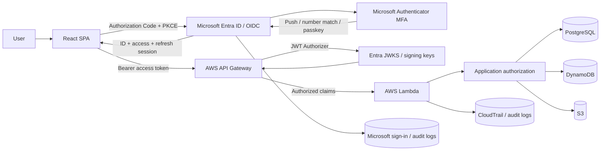
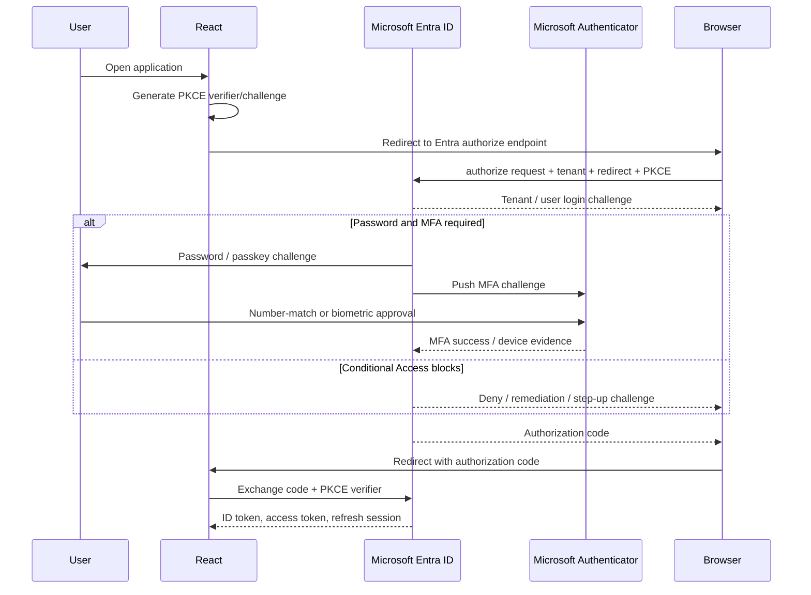
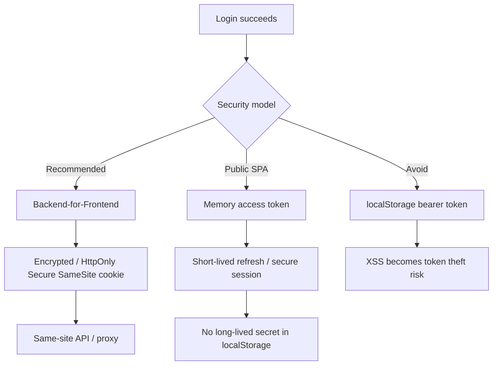
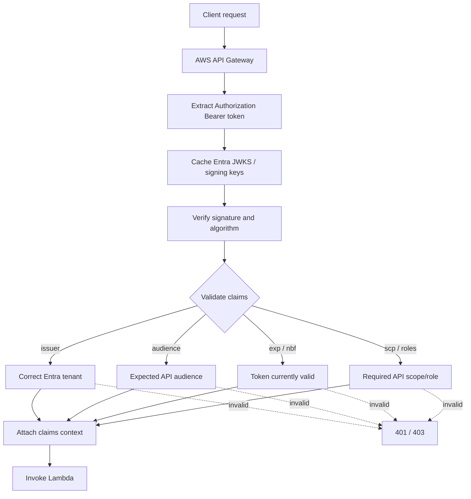
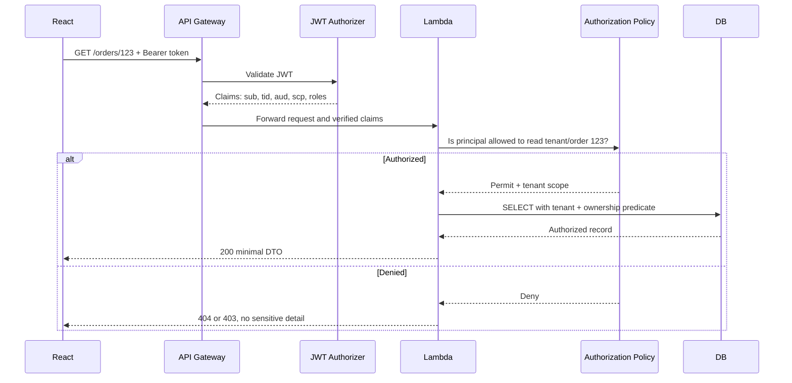
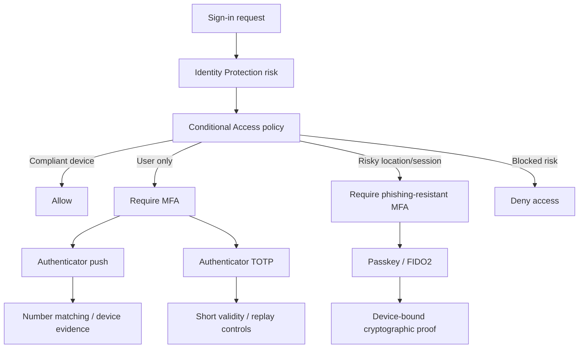
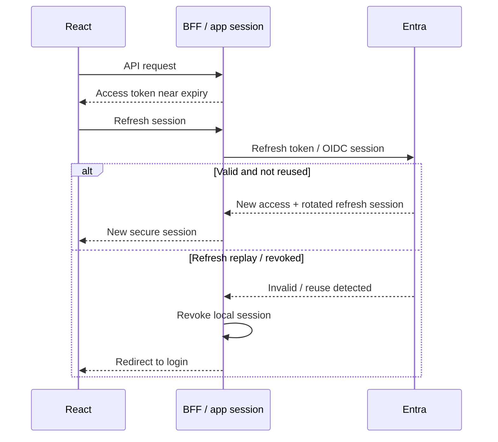
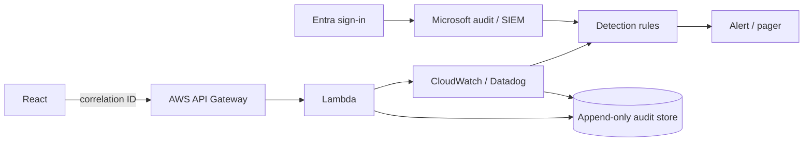
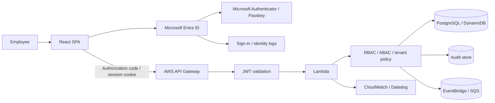

# Microsoft Entra / Microsoft Authenticator — React to AWS Complete Guide

ఈ డాక్యుమెంట్ React application నుండి Microsoft Entra ID/OIDC authentication, Microsoft Authenticator MFA, AWS API Gateway JWT authorization, Lambda, backend, session lifecycle, recovery, logout, మరియు security controls పూర్తి end-to-end architectureగా వివరిస్తుంది.

> **Important:** Microsoft Authenticator is an MFA authenticator application; Microsoft Entra ID is the identity provider. Authenticator alone does not authorize AWS API requests. Entra issues OIDC tokens, and the application/API validates those tokens.

## Recommended Architecture



## OIDC Trust Boundaries

| Layer | Trusted content | Validation required |
|---|---|---|
| React SPA | User-entered data and browser storage | PKCE, redirect URI, token type and expiry |
| Entra ID | Identity and MFA evidence | Tenant, issuer, audience, signing key and policy |
| API Gateway | Validated JWT claims | Signature, issuer, audience, expiry, algorithm and scope |
| Lambda | Application authorization request | Tenant, object/role/group, resource action and tenant scope |
| Backend database | Internal application data | Parameterized queries and tenant/ownership predicates |
| Authenticator | Device-held MFA proof | Secure registration, number matching, replay/risk policy |

## Authentication Flow



## SPA Token Storage Recommendation



- Public browser SPA should use Authorization Code with PKCE. Do not use Implicit flow.
- Prefer backend-for-frontend session cookies for high-risk applications; HttpOnly protects refresh credentials from JavaScript.
- Access tokens are short-lived. Do not store them in `localStorage` if a safer BFF/session architecture is available.
- Session refresh must enforce refresh-token rotation and reuse detection.
- Sign-out should revoke browser session and, where required, tenant refresh/conditional session state.

## JWT Validation at AWS API Gateway



API Gateway JWT authorizers can verify claims and invoke Lambda, but authorization must remain application-controlled:

- `iss` must match the exact Entra tenant authority.
- `aud` must match the API identifier, not a React client ID.
- `exp`, `nbf`, and `iat` must be current and consistent.
- Supported token algorithms and key ID must be strict; never accept `alg:none` or an attacker-selected algorithm.
- `scp` and `roles` are permissions, but application object-level authorization still checks tenant, resource owner and action.
- Token possession alone does not prove group membership for every sensitive resource; revalidate directory/group changes where required.

## API Authorization Flow



## Microsoft Authenticator and Conditional Access



- Push MFA is stronger when combined with number matching, device information and location context.
- Passkeys/FIDO2 or certificate-backed authentication provide phishing-resistant MFA.
- TOTP is replayable/shared-secret-style evidence; treat it as weaker than device-bound passkeys for high-risk users.
- Conditional Access should enforce MFA, compliant devices, tenant restrictions and location policies.
- Recovery methods, lost-device registration and helpdesk identity verification need separate strong processes.

## Token Refresh and Revocation



- Access token expiry is not an immediate indicator of account compromise; revocation propagation can be bounded.
- Refresh and sign-out flows must coordinate Entra revocation and application session revocation.
- Sensitive operations should use step-up authentication instead of relying only on a valid long-lived session.
- If an Entra refresh session is replayed, revoke the full session/token family and force re-authentication.

## AWS API Gateway CORS and Security

- Browser calls require explicit CORS origin, methods and headers; never use wildcard origin with credentials.
- Preflight, cache duration and credentials mode must match API Gateway and downstream behavior.
- Origin is not authentication. Server authorization still validates JWT, scope and resource ownership.
- Gateway security headers and application responses should avoid leaking internal claims or token details.
- Return generic `401` for invalid/expired authentication and `403` for authenticated but unauthorized actions.

## Observability and Audit



Log authentication, MFA failures, refresh rotation/replay, authorization denies, role/group changes and sensitive resource access. Do not log access/refresh tokens, password fields, authenticator secrets or full PII payloads.

Use structured fields: tenant ID, subject hash or internal user ID, application client ID, correlation ID, event time, IP region, device state, sign-in risk, policy/result and resource action.

## End-to-End Architecture



## Security Checklist

- Use Entra tenant allowlist and exact issuer/audience validation.
- Use Authorization Code + PKCE or BFF; never rely on password or MFA response handled only in React.
- Require MFA/Conditional Access for sensitive applications and step-up for high-risk actions.
- Implement JWT signature, claim, scope and application authorization validation.
- Use CORS allowlists, CSRF strategy and secure cookies if browser credentials are cookie-based.
- Add refresh-token rotation, session revocation and lost-device recovery procedures.
- Separate authentication logs from authorization/audit logs and correlate with request IDs.
- Test expired, replayed, wrong-audience, wrong-tenant, revoked and malformed tokens.

---

# మొత్తం Flow

```text
+---------------------+
| React UI            |
+----------+----------+
           |
           | 1. Login Button Click
           |
           v
+----------------------------+
| Microsoft Entra ID         |
| (Azure AD)                 |
+------------+---------------+
             |
             | 2. Username
             |
             | 3. Password
             |
             | 4. Microsoft Authenticator Approval
             |
             v
      JWT Token Generate
             |
             |
             v
+----------------------------+
| React Access Token Store   |
+------------+---------------+
             |
             | Authorization: Bearer <JWT>
             |
             v
+----------------------------+
| AWS API Gateway            |
+------------+---------------+
             |
             | JWT Validation
             |
             v
+----------------------------+
| Lambda                     |
+------------+---------------+
             |
             v
         Business Logic
```

---

# Step 1: User React Application Open చేస్తాడు

ఉదాహరణకు:

```
https://mycompany.com
```

- React Application Load అవుతుంది.
- User దగ్గర Token లేకపోతే,
- Protected Pages కి వెళ్లినప్పుడు Login Page కి Redirect అవుతుంది.

---

# Step 2: User Login Button Click చేస్తాడు

React లో

```javascript
login();
```

MSAL ఉపయోగిస్తే

```javascript
msalInstance.loginRedirect({
  scopes: ["openid", "profile", "email"],
});
```

అప్పుడు Browser Microsoft Login Page కి Redirect అవుతుంది.

```
https://login.microsoftonline.com/
```

---

# Step 3: User Username Enter చేస్తాడు

ఉదాహరణ

```
john@company.com
```

Microsoft Server ఏమి చేస్తుంది?

- ఈ User ఉందా?
- ఏ Organization కి చెందినవాడు?
- ఏ Tenant కి చెందినవాడు?

అన్నీ Verify చేస్తుంది.

---

# Step 4: Password Enter చేస్తాడు

ఉదాహరణ

```
Password123
```

Microsoft Password Correct గా ఉందో లేదో Verify చేస్తుంది.

---

# Step 5: Microsoft Authenticator Approval

Password సరైనదైతే,

Microsoft ఇలా అడుగుతుంది:

```
Approve Sign-in
```

అప్పుడు User Phone లో Notification వస్తుంది.

```
Microsoft Authenticator

Approve Sign-in?

YES
NO
```

కొన్ని సందర్భాల్లో Number Matching కూడా అడుగుతుంది.

ఉదాహరణ:

```
Enter Number

72
```

User తన Mobile లో

```
72
```

Enter చేస్తాడు.

Approval Complete అవుతుంది.

---

# Step 6: Azure Tokens Generate చేస్తుంది

Authentication Success అయిన తర్వాత Microsoft మూడు Tokens Generate చేస్తుంది.

### 1. ID Token

```
eyJhbGciOi...
```

ఇది User Information కోసం.

---

### 2. Access Token

```
eyJhbGc...
```

ఇదే API Calls కోసం ఉపయోగించే Token.

---

### 3. Refresh Token

Access Token Expire అయిన తర్వాత కొత్త Access Token తీసుకోవడానికి ఉపయోగిస్తారు.

---

# Step 7: React Tokens Receive చేస్తుంది

MSAL

```javascript
const response = await msalInstance.handleRedirectPromise();
```

ఇప్పుడు

```javascript
response.accessToken;
```

లో Access Token ఉంటుంది.

---

# Step 8: Token Store చేయబడుతుంది

సాధారణంగా

- Session Storage
- లేదా Memory

లో Store చేస్తారు.

> భద్రత కోసం (XSS దాడుల నుండి రక్షణ కోసం) Local Storage లో Long-lived Tokens Store చేయకుండా ఉండటం మంచిది.

---

# Step 9: User API Call చేస్తాడు

React

```javascript
fetch("/users", {
  headers: {
    Authorization: `Bearer ${accessToken}`,
  },
});
```

HTTP Request ఇలా ఉంటుంది.

```
GET /users

Authorization:
Bearer eyJhbGc...
```

---

# Step 10: API Gateway Request Receive చేస్తుంది

API Gateway

```
Authorization Header
```

లో ఉన్న

```
Bearer eyJhbGc...
```

Token ను తీసుకుంటుంది.

---

# Step 11: JWT Validation

API Gateway JWT Authorizer (లేదా అవసరమైతే Lambda Authorizer) ద్వారా Token Verify చేస్తుంది.

ఇవి Check చేస్తుంది:

- Token Signature సరైనదా?
- Expire అయిందా?
- Issuer ఎవరు?
- Audience సరైనదా?

ఉదాహరణకు

```
iss

https://login.microsoftonline.com/tenant-id
```

```
aud

api://my-api
```

```
exp

Expire కాలేదు
```

అన్నీ సరైతే

```
200 OK
```

లేకపోతే

```
401 Unauthorized
```

వస్తుంది.

---

# Step 12: Lambda User Details పొందుతుంది

Token Valid అయితే,

Lambda కి ఈ విధంగా User Claims వస్తాయి.

```json
{
  "requestContext": {
    "authorizer": {
      "claims": {
        "oid": "12345",
        "email": "john@company.com",
        "name": "John"
      }
    }
  }
}
```

ఇప్పుడు Lambda కి

- User ID
- Email
- Roles
- Groups

తెలిసిపోతాయి.

User ని గుర్తించడానికి Database Query అవసరం ఉండదు.

---

# Step 13: Lambda Business Logic Execute చేస్తుంది

ఉదాహరణ

```javascript
exports.handler = async (event) => {
  const email = event.requestContext.authorizer.claims.email;
};
```

ఇక్కడ Email ఆధారంగా Business Logic Execute చేయవచ్చు.

---

# Step 14: Response తిరిగి వస్తుంది

Lambda

```json
{
  "users": []
}
```

Response ఇస్తుంది.

API Gateway

```
200 OK
```

తో React కి పంపుతుంది.

React Screen పై Data చూపిస్తుంది.

---

# Microsoft Authenticator ఎక్కడ ఉపయోగపడుతుంది?

Microsoft Authenticator **Login సమయంలో మాత్రమే ఉపయోగపడుతుంది.**

Flow:

```
Login

↓

Username

↓

Password

↓

Microsoft Authenticator Approval

↓

JWT Token Generate

↓

Complete
```

ఆ తర్వాత ప్రతి API Call సమయంలో Microsoft Authenticator ని Contact చేయరు.

---

# ప్రతి API Request సమయంలో ఏమి జరుగుతుంది?

```
React

↓

Bearer Token

↓

API Gateway

↓

JWT Validation

↓

Lambda
```

Microsoft Authenticator ఇందులో పాల్గొనదు.

---

# JWT Token లో ఏముంటుంది?

ఉదాహరణ

```json
{
  "aud": "api://company-api",
  "iss": "https://login.microsoftonline.com/tenant",
  "exp": 1770000000,
  "name": "John",
  "preferred_username": "john@company.com",
  "oid": "ab12345",
  "roles": ["Admin", "User"]
}
```

API Gateway ఈ Claims అన్నింటినీ Verify చేసిన తర్వాత మాత్రమే Request ని Lambda కి పంపుతుంది.

---

# Token Expire అయితే?

ఉదాహరణకు

```
Access Token

1 గంట
```

తర్వాత

```
401 Unauthorized
```

వస్తుంది.

అప్పుడు MSAL Refresh Token ఉపయోగించి Microsoft నుండి కొత్త Access Token తీసుకుంటుంది.

```
MSAL

↓

Refresh Token

↓

Microsoft

↓

New Access Token
```

చాలా సందర్భాల్లో User కి మళ్లీ Login అవసరం ఉండదు.

---

# Complete Architecture

```text
                +----------------------+
                | React Application    |
                +----------+-----------+
                           |
                           | Login
                           |
                           v
         +--------------------------------------+
         | Microsoft Entra ID (Azure AD)        |
         | Username                             |
         | Password                             |
         | Microsoft Authenticator (MFA)        |
         +------------------+-------------------+
                            |
                Access Token (JWT)
                            |
                            v
                Authorization: Bearer <JWT>
                            |
                            v
                +--------------------------+
                | AWS API Gateway          |
                | JWT Authorizer           |
                +------------+-------------+
                             |
                       Valid Token
                             |
                             v
                +--------------------------+
                | AWS Lambda               |
                | User Claims Read         |
                | Business Logic Execute   |
                +------------+-------------+
                             |
                             v
                  PostgreSQL / DynamoDB
```

## ముఖ్యాంశాలు (Summary)

- **Microsoft Authenticator Login సమయంలో MFA కోసం మాత్రమే ఉపయోగించబడుతుంది.**
- **Microsoft Entra ID (Azure AD)** విజయవంతమైన Authentication తర్వాత **JWT Access Token** ను సృష్టిస్తుంది.
- **React Application** ఆ JWT Token ను `Authorization: Bearer <token>` Header ద్వారా ప్రతి API Request లో పంపుతుంది.
- **AWS API Gateway** ఆ JWT ను Verify చేసిన తర్వాత మాత్రమే Lambda ని Invoke చేస్తుంది.
- **Lambda** Token లో ఉన్న User Claims (Email, Roles, Groups మొదలైనవి) ఆధారంగా Authorization మరియు Business Logic ని Execute చేస్తుంది.
