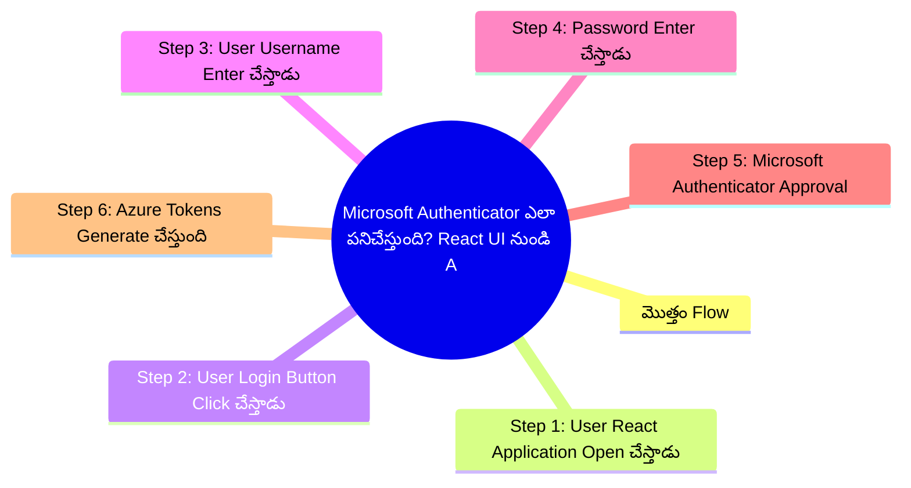

# Microsoft Authenticator ఎలా పనిచేస్తుంది? (React UI నుండి AWS API Gateway వరకు)



మీరు **React UI → AWS API Gateway → Lambda → Backend** అప్లికేషన్‌ను నిర్మిస్తున్నారని, అలాగే **Microsoft Authenticator** ఉపయోగిస్తున్నారని అనుకుందాం.

సాధారణంగా రెండు విధాలుగా Microsoft Authenticator ఉపయోగిస్తారు:

1. **Microsoft Entra ID (Azure AD) ద్వారా Login (OAuth2 / OpenID Connect)** ✅ _(ఇది ఎక్కువగా ఉపయోగించే విధానం)_
2. **Username + Password తర్వాత MFA (Multi-Factor Authentication) కోసం Microsoft Authenticator**

ఇక్కడ మొదటి విధానాన్ని (Entra ID Login Flow) వివరంగా చూద్దాం.

---

# మొత్తం Flow

```text
+---------------------+
| React UI            |
+----------+----------+
           |
           | 1. Login Button Click
           |
           v
+----------------------------+
| Microsoft Entra ID         |
| (Azure AD)                 |
+------------+---------------+
             |
             | 2. Username
             |
             | 3. Password
             |
             | 4. Microsoft Authenticator Approval
             |
             v
      JWT Token Generate
             |
             |
             v
+----------------------------+
| React Access Token Store   |
+------------+---------------+
             |
             | Authorization: Bearer <JWT>
             |
             v
+----------------------------+
| AWS API Gateway            |
+------------+---------------+
             |
             | JWT Validation
             |
             v
+----------------------------+
| Lambda                     |
+------------+---------------+
             |
             v
         Business Logic
```

---

# Step 1: User React Application Open చేస్తాడు

ఉదాహరణకు:

```
https://mycompany.com
```

- React Application Load అవుతుంది.
- User దగ్గర Token లేకపోతే,
- Protected Pages కి వెళ్లినప్పుడు Login Page కి Redirect అవుతుంది.

---

# Step 2: User Login Button Click చేస్తాడు

React లో

```javascript
login();
```

MSAL ఉపయోగిస్తే

```javascript
msalInstance.loginRedirect({
  scopes: ["openid", "profile", "email"],
});
```

అప్పుడు Browser Microsoft Login Page కి Redirect అవుతుంది.

```
https://login.microsoftonline.com/
```

---

# Step 3: User Username Enter చేస్తాడు

ఉదాహరణ

```
john@company.com
```

Microsoft Server ఏమి చేస్తుంది?

- ఈ User ఉందా?
- ఏ Organization కి చెందినవాడు?
- ఏ Tenant కి చెందినవాడు?

అన్నీ Verify చేస్తుంది.

---

# Step 4: Password Enter చేస్తాడు

ఉదాహరణ

```
Password123
```

Microsoft Password Correct గా ఉందో లేదో Verify చేస్తుంది.

---

# Step 5: Microsoft Authenticator Approval

Password సరైనదైతే,

Microsoft ఇలా అడుగుతుంది:

```
Approve Sign-in
```

అప్పుడు User Phone లో Notification వస్తుంది.

```
Microsoft Authenticator

Approve Sign-in?

YES
NO
```

కొన్ని సందర్భాల్లో Number Matching కూడా అడుగుతుంది.

ఉదాహరణ:

```
Enter Number

72
```

User తన Mobile లో

```
72
```

Enter చేస్తాడు.

Approval Complete అవుతుంది.

---

# Step 6: Azure Tokens Generate చేస్తుంది

Authentication Success అయిన తర్వాత Microsoft మూడు Tokens Generate చేస్తుంది.

### 1. ID Token

```
eyJhbGciOi...
```

ఇది User Information కోసం.

---

### 2. Access Token

```
eyJhbGc...
```

ఇదే API Calls కోసం ఉపయోగించే Token.

---

### 3. Refresh Token

Access Token Expire అయిన తర్వాత కొత్త Access Token తీసుకోవడానికి ఉపయోగిస్తారు.

---

# Step 7: React Tokens Receive చేస్తుంది

MSAL

```javascript
const response = await msalInstance.handleRedirectPromise();
```

ఇప్పుడు

```javascript
response.accessToken;
```

లో Access Token ఉంటుంది.

---

# Step 8: Token Store చేయబడుతుంది

సాధారణంగా

- Session Storage
- లేదా Memory

లో Store చేస్తారు.

> భద్రత కోసం (XSS దాడుల నుండి రక్షణ కోసం) Local Storage లో Long-lived Tokens Store చేయకుండా ఉండటం మంచిది.

---

# Step 9: User API Call చేస్తాడు

React

```javascript
fetch("/users", {
  headers: {
    Authorization: `Bearer ${accessToken}`,
  },
});
```

HTTP Request ఇలా ఉంటుంది.

```
GET /users

Authorization:
Bearer eyJhbGc...
```

---

# Step 10: API Gateway Request Receive చేస్తుంది

API Gateway

```
Authorization Header
```

లో ఉన్న

```
Bearer eyJhbGc...
```

Token ను తీసుకుంటుంది.

---

# Step 11: JWT Validation

API Gateway JWT Authorizer (లేదా అవసరమైతే Lambda Authorizer) ద్వారా Token Verify చేస్తుంది.

ఇవి Check చేస్తుంది:

- Token Signature సరైనదా?
- Expire అయిందా?
- Issuer ఎవరు?
- Audience సరైనదా?

ఉదాహరణకు

```
iss

https://login.microsoftonline.com/tenant-id
```

```
aud

api://my-api
```

```
exp

Expire కాలేదు
```

అన్నీ సరైతే

```
200 OK
```

లేకపోతే

```
401 Unauthorized
```

వస్తుంది.

---

# Step 12: Lambda User Details పొందుతుంది

Token Valid అయితే,

Lambda కి ఈ విధంగా User Claims వస్తాయి.

```json
{
  "requestContext": {
    "authorizer": {
      "claims": {
        "oid": "12345",
        "email": "john@company.com",
        "name": "John"
      }
    }
  }
}
```

ఇప్పుడు Lambda కి

- User ID
- Email
- Roles
- Groups

తెలిసిపోతాయి.

User ని గుర్తించడానికి Database Query అవసరం ఉండదు.

---

# Step 13: Lambda Business Logic Execute చేస్తుంది

ఉదాహరణ

```javascript
exports.handler = async (event) => {
  const email = event.requestContext.authorizer.claims.email;
};
```

ఇక్కడ Email ఆధారంగా Business Logic Execute చేయవచ్చు.

---

# Step 14: Response తిరిగి వస్తుంది

Lambda

```json
{
  "users": []
}
```

Response ఇస్తుంది.

API Gateway

```
200 OK
```

తో React కి పంపుతుంది.

React Screen పై Data చూపిస్తుంది.

---

# Microsoft Authenticator ఎక్కడ ఉపయోగపడుతుంది?

Microsoft Authenticator **Login సమయంలో మాత్రమే ఉపయోగపడుతుంది.**

Flow:

```
Login

↓

Username

↓

Password

↓

Microsoft Authenticator Approval

↓

JWT Token Generate

↓

Complete
```

ఆ తర్వాత ప్రతి API Call సమయంలో Microsoft Authenticator ని Contact చేయరు.

---

# ప్రతి API Request సమయంలో ఏమి జరుగుతుంది?

```
React

↓

Bearer Token

↓

API Gateway

↓

JWT Validation

↓

Lambda
```

Microsoft Authenticator ఇందులో పాల్గొనదు.

---

# JWT Token లో ఏముంటుంది?

ఉదాహరణ

```json
{
  "aud": "api://company-api",
  "iss": "https://login.microsoftonline.com/tenant",
  "exp": 1770000000,
  "name": "John",
  "preferred_username": "john@company.com",
  "oid": "ab12345",
  "roles": ["Admin", "User"]
}
```

API Gateway ఈ Claims అన్నింటినీ Verify చేసిన తర్వాత మాత్రమే Request ని Lambda కి పంపుతుంది.

---

# Token Expire అయితే?

ఉదాహరణకు

```
Access Token

1 గంట
```

తర్వాత

```
401 Unauthorized
```

వస్తుంది.

అప్పుడు MSAL Refresh Token ఉపయోగించి Microsoft నుండి కొత్త Access Token తీసుకుంటుంది.

```
MSAL

↓

Refresh Token

↓

Microsoft

↓

New Access Token
```

చాలా సందర్భాల్లో User కి మళ్లీ Login అవసరం ఉండదు.

---

# Complete Architecture

```text
                +----------------------+
                | React Application    |
                +----------+-----------+
                           |
                           | Login
                           |
                           v
         +--------------------------------------+
         | Microsoft Entra ID (Azure AD)        |
         | Username                             |
         | Password                             |
         | Microsoft Authenticator (MFA)        |
         +------------------+-------------------+
                            |
                Access Token (JWT)
                            |
                            v
                Authorization: Bearer <JWT>
                            |
                            v
                +--------------------------+
                | AWS API Gateway          |
                | JWT Authorizer           |
                +------------+-------------+
                             |
                       Valid Token
                             |
                             v
                +--------------------------+
                | AWS Lambda               |
                | User Claims Read         |
                | Business Logic Execute   |
                +------------+-------------+
                             |
                             v
                  PostgreSQL / DynamoDB
```

## ముఖ్యాంశాలు (Summary)

- **Microsoft Authenticator Login సమయంలో MFA కోసం మాత్రమే ఉపయోగించబడుతుంది.**
- **Microsoft Entra ID (Azure AD)** విజయవంతమైన Authentication తర్వాత **JWT Access Token** ను సృష్టిస్తుంది.
- **React Application** ఆ JWT Token ను `Authorization: Bearer <token>` Header ద్వారా ప్రతి API Request లో పంపుతుంది.
- **AWS API Gateway** ఆ JWT ను Verify చేసిన తర్వాత మాత్రమే Lambda ని Invoke చేస్తుంది.
- **Lambda** Token లో ఉన్న User Claims (Email, Roles, Groups మొదలైనవి) ఆధారంగా Authorization మరియు Business Logic ని Execute చేస్తుంది.
