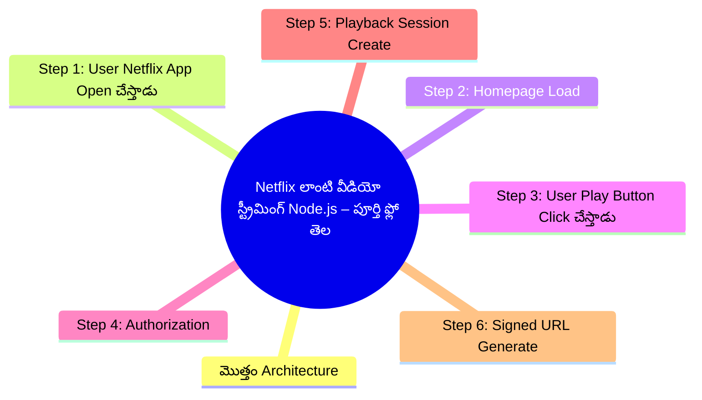

# Netflix లాంటి వీడియో స్ట్రీమింగ్ (Node.js) – పూర్తి ఫ్లో (తెలుగులో)



నేను ఇప్పుడు **Netflix App ఓపెన్ చేసిన దగ్గర నుండి 4K వీడియో ప్లే అయ్యే వరకు మొత్తం ఫ్లో** తెలుగులో వివరిస్తాను.

---

# మొత్తం Architecture

```text
                    User Netflix App Open
                             │
                             ▼
                    Authentication Service
                             │
                             ▼
                    API Gateway / BFF
                             │
        ┌──────────────┬───────────────┐
        ▼              ▼               ▼
 User Service   Recommendation   Catalog Service
                     Service
                             │
                             ▼
                    Video Metadata
                             │
                             ▼
                  User "Play" Button Click
                             │
                             ▼
                 Playback API (Node.js)
                             │
                             ▼
         Manifest File (.m3u8 / .mpd) Return
                             │
                             ▼
                    CDN (CloudFront)
                             │
                     Video Segments
                             │
                             ▼
                    Video Player Buffer
                             │
                             ▼
                     Video Start
```

---

# Step 1: User Netflix App Open చేస్తాడు

User

- Mobile App
- Smart TV
- Browser

లో Netflix App ఓపెన్ చేస్తాడు.

మొదట App

```http
POST /login
```

లేదా

```http
POST /refresh-token
```

API ని కాల్ చేస్తుంది.

Node.js Server ఏమి చేస్తుంది?

- Username/Password లేదా Refresh Token ను Verify చేస్తుంది.
- అన్నీ సరైందైతే

ఇవి Return చేస్తుంది.

```text
Access Token
Refresh Token
```

ఈ Access Token తరువాత వచ్చే ప్రతి API Call కి ఉపయోగిస్తారు.

---

# Step 2: Homepage Load

Login అయ్యాక Frontend

```http
GET /home
```

API ని కాల్ చేస్తుంది.

Node.js Backend

Database లేదా Cache నుండి

- Trending Movies
- Continue Watching
- Top Picks
- Genres
- New Releases

తీసుకొస్తుంది.

ఉదాహరణ Response

```json
[
  {
    "id": 101,
    "title": "Avatar",
    "poster": "..."
  }
]
```

### ముఖ్యమైన విషయం

ఇక్కడ Video Files రావు.

కేవలం

- Movie పేరు
- Poster
- Description

మాత్రమే వస్తాయి.

---

# Step 3: User Play Button Click చేస్తాడు

ఇప్పుడు User Movie మీద

**Play**

Click చేస్తాడు.

Frontend

```http
POST /play
```

Body

```json
{
  "movieId": 101
}
```

అని పంపుతుంది.

ఇక్కడి నుంచే అసలు Streaming Process మొదలవుతుంది.

---

# Step 4: Authorization

Playback API మొదట చెక్ చేస్తుంది.

ఈ User

✅ Subscription ఉందా?

✅ ఈ Country లో Movie Available ఉందా?

✅ Parental Control వల్ల Block అయిందా?

✅ Device Allowed ఆ?

✅ ఒకేసారి ఎంత Devices లో చూడొచ్చు?

ఉదాహరణ

Premium Plan అయితే

```
4K Allowed
```

Basic Plan అయితే

```
4K కాదు
720p మాత్రమే
```

---

# Step 5: Playback Session Create

అన్ని Valid అయితే

Playback Service

ఒక

```
Playback Session
```

Create చేస్తుంది.

ఉదాహరణ

```
Session ID

abc123xyz
```

దీనిలో Store అవుతాయి.

- User ID
- Movie ID
- Device
- Bitrate
- Country
- Expiry Time

ఇది సాధారణంగా

- Redis
- DynamoDB

లో Store చేస్తారు.

---

# Step 6: Signed URL Generate

Netflix అసలు Video Location ని User కి ఇవ్వదు.

దాని బదులు

ఒక

```
Signed URL
```

Generate చేస్తుంది.

ఉదాహరణ

```
https://cdn.netflix.com/movie/index.m3u8?token=abc123
```

ఈ Token

కొన్ని నిమిషాల తరువాత Expire అవుతుంది.

దాంతో Unauthorized Users Video Download చేయలేరు.

---

# Step 7: Manifest File

Netflix

MP4 File ఇవ్వదు.

దాని బదులు

```
index.m3u8
```

లేదా

```
manifest.mpd
```

ఇస్తుంది.

దీనిలో

```
240p

360p

480p

720p

1080p

4K
```

అన్ని Qualities ఉంటాయి.

ఉదాహరణ

```
240/

480/

720/

1080/

4k/
```

---

# Step 8: Node.js పని పూర్తవుతుంది

Node.js ఇలా Response ఇస్తుంది.

```json
{
  "manifest": "https://cdn.netflix.com/movie/index.m3u8",
  "license": "xxxxx",
  "subtitle": "..."
}
```

ఇక్కడ గమనించాలి.

Node.js

Video పంపడం లేదు.

కేవలం

Manifest URL మాత్రమే పంపుతోంది.

---

# Step 9: Player Manifest Download చేస్తుంది

Video Player

```
movie.m3u8
```

Download చేస్తుంది.

దాంట్లో ఇలా ఉంటుంది.

```
720/index.m3u8

1080/index.m3u8

4k/index.m3u8
```

---

# Step 10: ఏ Quality Play చేయాలి?

Video Player

మన Device ని Check చేస్తుంది.

- Internet Speed
- Screen Resolution
- CPU
- RAM

ఉదాహరణ

```
100 Mbps

↓

4K Play
```

మరొక User

```
2 Mbps

↓

480p
```

---

# Step 11: Video Segments Download

Netflix

ఒక పెద్ద MP4 File Store చేయదు.

దాని బదులు

```
segment1.ts

segment2.ts

segment3.ts

segment4.ts
```

లాగా వేల చిన్న Files గా ఉంచుతుంది.

ప్రతి Segment

```
2 నుండి 6 seconds
```

మాత్రమే ఉంటుంది.

Player

```
segment1

↓

segment2

↓

segment3

↓

segment4
```

అని వరుసగా Download చేస్తుంది.

---

# Step 12: CDN పని

ఇక్కడి నుండి

Node.js పూర్తిగా బయటకు వస్తుంది.

ఇప్పుడు Video Files

నేరుగా

```
CloudFront

Akamai

Netflix Open Connect
```

CDN నుండి వస్తాయి.

అందుకే

ఒకేసారి

Millions of Users

చూసినా Backend మీద Load ఉండదు.

---

# Step 13: Buffer

Player

మొదట

```
5 Segments
```

Download చేస్తుంది.

వాటిని

RAM లో Buffer చేస్తుంది.

ఉదాహరణ

```
15 seconds Buffer
```

అయిన తరువాతే

Video Start అవుతుంది.

---

# Step 14: Adaptive Bitrate

మొదట

```
100 Mbps
```

ఉంది.

కొద్దిసేపటి తరువాత

```
2 Mbps
```

మాత్రమే మిగిలింది.

Player వెంటనే

```
4K

↓

1080p

↓

720p

↓

480p
```

కి మార్చేస్తుంది.

User కి ఎక్కువగా తెలియకుండా Smooth గా Quality Change అవుతుంది.

---

# Step 15: Seeking

User

```
00:15
```

నుండి

```
01:45
```

కి Jump చేశాడు.

Player

మొదటి నుండి Download చేయదు.

నేరుగా

```
segment55.ts
```

ని Request చేస్తుంది.

అందుకే Seeking చాలా Fast గా ఉంటుంది.

---

# Step 16: Pause

User Pause చేస్తే

కొత్త Segments Download చేయడం ఆపేస్తుంది.

Buffer లో ఉన్నవి అలాగే ఉంటాయి.

---

# Step 17: Resume

Resume నొక్కగానే

ప్రస్తుత Position నుండి

కొత్త Segments Download అవుతాయి.

---

# Step 18: Video పూర్తయ్యాక

Playback API

క్రింది సమాచారాన్ని Update చేస్తుంది.

- Continue Watching
- Watch History
- Recommendations
- Analytics
- Viewing Statistics

---

# Node.js ఎక్కడ ఉపయోగపడుతుంది?

Node.js ద్వారా నిర్వహించే పనులు:

- Login
- Authentication
- User Profile
- Home APIs
- Movie Catalog
- Search
- Recommendation
- Playback API
- Subscription Check
- Watch History
- Analytics
- Payments

### ముఖ్యమైన విషయం

**Node.js అసలు Video Stream చేయదు.**

Video Streaming మొత్తం CDN ద్వారానే జరుగుతుంది.

---

# CDN ఎక్కడ ఉపయోగపడుతుంది?

CDN ద్వారా అందించేవి:

- Video Files
- Images
- Posters
- Trailers
- Subtitles
- Audio Tracks
- Thumbnails

---

# Backend Services

Netflix లాంటి Application లో సాధారణంగా ఉండే Services:

- User Service
- Authentication Service
- Catalog Service
- Playback Service
- Recommendation Service
- Search Service
- Watch History Service
- Analytics Service
- Notification Service
- Subscription Service

---

# AWS Architecture

```text
User
 │
 ▼
CloudFront
 │
 ▼
React App

        │
        ▼
API Gateway
        │
        ▼
Node.js Lambda / ECS
        │
 ┌──────┼───────────┐
 ▼      ▼           ▼
Redis  PostgreSQL Elasticsearch
        │
        ▼
Playback Service
        │
        ▼
Signed URL Generate
        │
        ▼
Amazon S3
        │
        ▼
CloudFront CDN
        │
        ▼
HLS Video Segments
        │
        ▼
Video Player
```

---

# మొత్తం ఫ్లో (సంక్షిప్తంగా)

```text
User Netflix App Open
        │
        ▼
Login API (Node.js)
        │
        ▼
JWT Token
        │
        ▼
Home API
        │
        ▼
Movies List
        │
        ▼
User Play Click
        │
        ▼
Playback API
        │
        ▼
Subscription Check
        │
        ▼
Playback Session Create
        │
        ▼
Signed Manifest URL Generate
        │
        ▼
Manifest URL Return
        │
        ▼
Video Player Manifest Download
        │
        ▼
Best Quality Select
        │
        ▼
CloudFront నుండి Video Segments Download
        │
        ▼
Buffer
        │
        ▼
Video Start
        │
        ▼
Quality Automatically Change (ABR)
        │
        ▼
Video Complete
        │
        ▼
Watch History & Analytics Update
```

## గుర్తుంచుకోవాల్సిన ముఖ్యమైన విషయాలు

1. **Node.js వీడియోను పంపదు** — అది Authentication, Authorization, Playback Session, Signed URL వంటి Business Logic మాత్రమే నిర్వహిస్తుంది.
2. **Video Player** (`hls.js`, `Shaka Player` లేదా Native Player) Manifest చదివి Video Segments ను Download చేస్తుంది.
3. **CloudFront/CDN** అసలు Video Files (`.ts` లేదా `.m4s` Segments) ను User కి అందిస్తుంది.
4. **Adaptive Bitrate (ABR)** వల్ల Internet Speed మారితే Video Quality ఆటోమేటిక్‌గా మారుతుంది.
5. **Video చిన్న చిన్న Segments గా ఉండటం వల్ల** Fast Seeking, Smooth Playback మరియు Millions of Users కి Scalability సాధ్యమవుతుంది.
