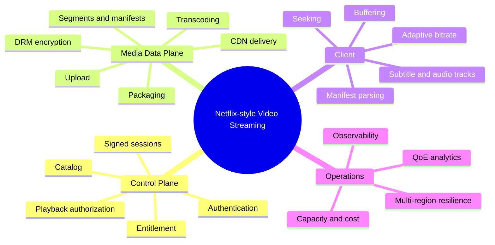
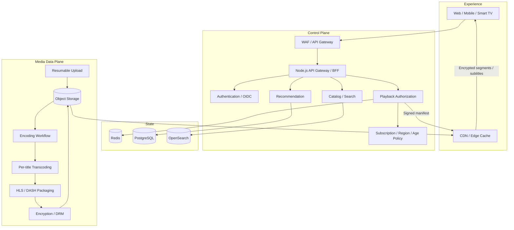
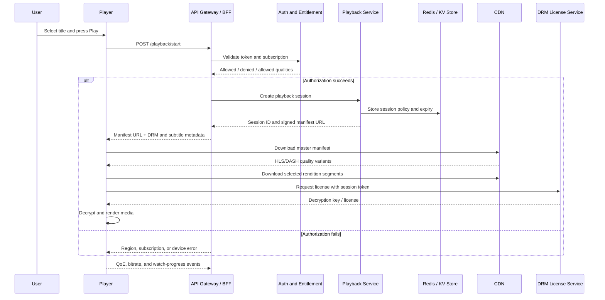
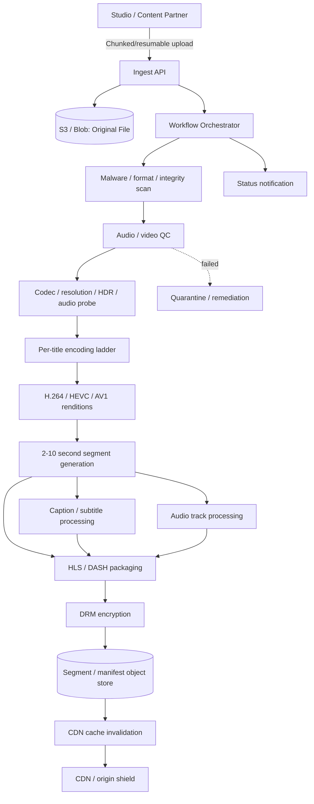
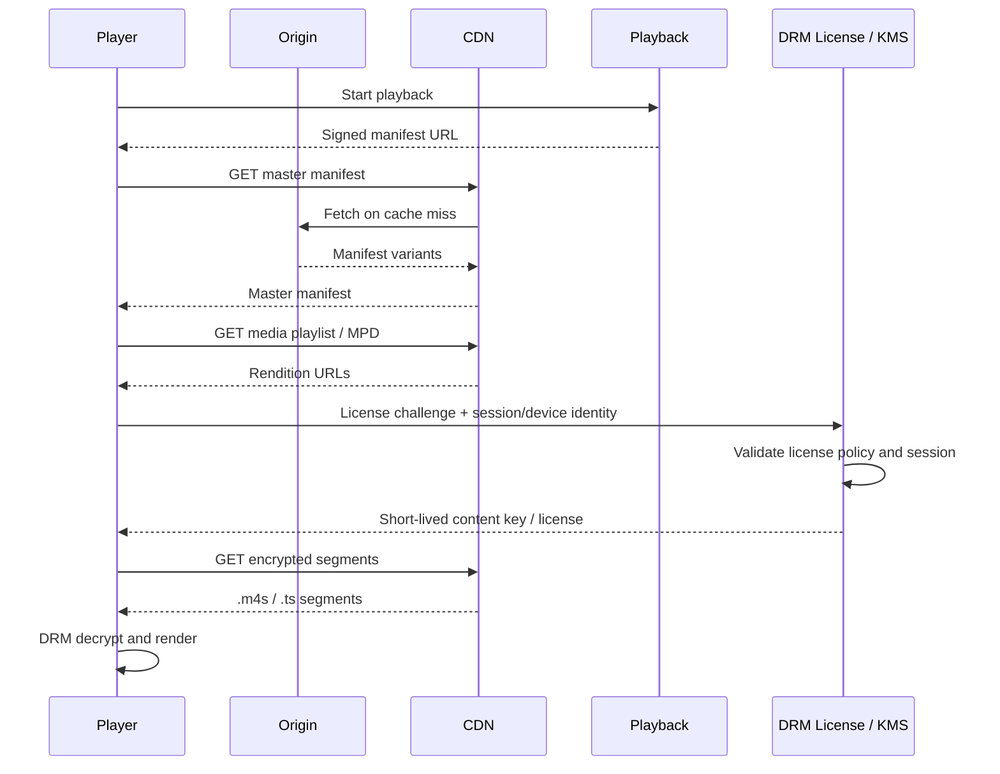
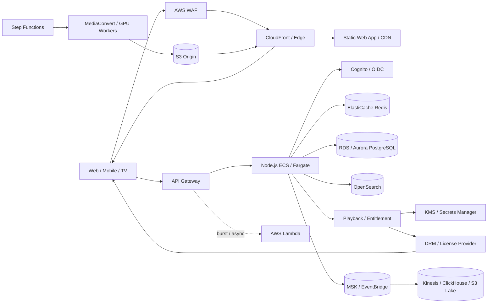
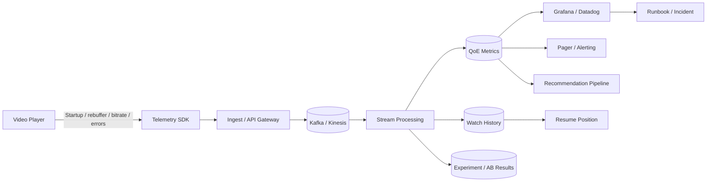

# Netflix లాంటి వీడియో స్ట్రీమింగ్ (Node.js) – పూర్తి ఫ్లో (తెలుగులో)



నేను ఇప్పుడు **Netflix App ఓపెన్ చేసిన దగ్గర నుండి 4K వీడియో ప్లే అయ్యే వరకు మొత్తం ఫ్లో** తెలుగులో వివరిస్తాను.

---

# మొత్తం Architecture



## Control Plane మరియు Data Plane Responsibilities

| Concern | Control Plane | Data Plane |
|---|---|---|
| Authentication | Identity provider, MFA, token refresh | No credentials embedded in media bytes |
| Authorization | Subscription, territory, device, age/rating | Signed short-lived manifest and DRM license |
| Catalog | Metadata, genres, search, recommendations | Posters, trailers, thumbnails, manifests |
| Upload | Workflow owner and resumable upload API | Object storage and chunk transfer |
| Encoding | Job definition, priority, quality gates | GPU/CPU transcoding workers |
| Playback | Session, entitlement, manifest | HLS/DASH segments, audio, subtitles |
| Security | Policy and key management | Segment encryption and DRM |
| Observability | Request traces and business events | CDN logs and player QoE events |

## Complete Playback Request Sequence



---

# Step 1: User Netflix App Open చేస్తాడు

User

- Mobile App
- Smart TV
- Browser

లో Netflix App ఓపెన్ చేస్తాడు.

మొదట App

```http
POST /login
```

లేదా

```http
POST /refresh-token
```

API ని కాల్ చేస్తుంది.

Node.js Server ఏమి చేస్తుంది?

- Username/Password లేదా Refresh Token ను Verify చేస్తుంది.
- అన్నీ సరైందైతే

ఇవి Return చేస్తుంది.

```text
Access Token
Refresh Token
```

ఈ Access Token తరువాత వచ్చే ప్రతి API Call కి ఉపయోగిస్తారు.

---

# Step 2: Homepage Load

Login అయ్యాక Frontend

```http
GET /home
```

API ని కాల్ చేస్తుంది.

Node.js Backend

Database లేదా Cache నుండి

- Trending Movies
- Continue Watching
- Top Picks
- Genres
- New Releases

తీసుకొస్తుంది.

ఉదాహరణ Response

```json
[
  {
    "id": 101,
    "title": "Avatar",
    "poster": "..."
  }
]
```

### ముఖ్యమైన విషయం

ఇక్కడ Video Files రావు.

కేవలం

- Movie పేరు
- Poster
- Description

మాత్రమే వస్తాయి.

---

# Step 3: User Play Button Click చేస్తాడు

ఇప్పుడు User Movie మీద

**Play**

Click చేస్తాడు.

Frontend

```http
POST /play
```

Body

```json
{
  "movieId": 101
}
```

అని పంపుతుంది.

ఇక్కడి నుంచే అసలు Streaming Process మొదలవుతుంది.

---

# Step 4: Authorization

Playback API మొదట చెక్ చేస్తుంది.

ఈ User

✅ Subscription ఉందా?

✅ ఈ Country లో Movie Available ఉందా?

✅ Parental Control వల్ల Block అయిందా?

✅ Device Allowed ఆ?

✅ ఒకేసారి ఎంత Devices లో చూడొచ్చు?

ఉదాహరణ

Premium Plan అయితే

```
4K Allowed
```

Basic Plan అయితే

```
4K కాదు
720p మాత్రమే
```

---

# Step 5: Playback Session Create

అన్ని Valid అయితే

Playback Service

ఒక

```
Playback Session
```

Create చేస్తుంది.

ఉదాహరణ

```
Session ID

abc123xyz
```

దీనిలో Store అవుతాయి.

- User ID
- Movie ID
- Device
- Bitrate
- Country
- Expiry Time

ఇది సాధారణంగా

- Redis
- DynamoDB

లో Store చేస్తారు.

---

# Step 6: Signed URL Generate

Netflix అసలు Video Location ని User కి ఇవ్వదు.

దాని బదులు

ఒక

```
Signed URL
```

Generate చేస్తుంది.

ఉదాహరణ

```
https://cdn.netflix.com/movie/index.m3u8?token=abc123
```

ఈ Token

కొన్ని నిమిషాల తరువాత Expire అవుతుంది.

దాంతో Unauthorized Users Video Download చేయలేరు.

---

# Step 7: Manifest File

Netflix

MP4 File ఇవ్వదు.

దాని బదులు

```
index.m3u8
```

లేదా

```
manifest.mpd
```

ఇస్తుంది.

దీనిలో

```
240p

360p

480p

720p

1080p

4K
```

అన్ని Qualities ఉంటాయి.

ఉదాహరణ

```
240/

480/

720/

1080/

4k/
```

---

# Step 8: Node.js పని పూర్తవుతుంది

Node.js ఇలా Response ఇస్తుంది.

```json
{
  "manifest": "https://cdn.netflix.com/movie/index.m3u8",
  "license": "xxxxx",
  "subtitle": "..."
}
```

ఇక్కడ గమనించాలి.

Node.js

Video పంపడం లేదు.

కేవలం

Manifest URL మాత్రమే పంపుతోంది.

---

# Step 9: Player Manifest Download చేస్తుంది

Video Player

```
movie.m3u8
```

Download చేస్తుంది.

దాంట్లో ఇలా ఉంటుంది.

```
720/index.m3u8

1080/index.m3u8

4k/index.m3u8
```

---

# Step 10: ఏ Quality Play చేయాలి?

Video Player

మన Device ని Check చేస్తుంది.

- Internet Speed
- Screen Resolution
- CPU
- RAM

ఉదాహరణ

```
100 Mbps

↓

4K Play
```

మరొక User

```
2 Mbps

↓

480p
```

---

# Step 11: Video Segments Download

Netflix

ఒక పెద్ద MP4 File Store చేయదు.

దాని బదులు

```
segment1.ts

segment2.ts

segment3.ts

segment4.ts
```

లాగా వేల చిన్న Files గా ఉంచుతుంది.

ప్రతి Segment

```
2 నుండి 6 seconds
```

మాత్రమే ఉంటుంది.

Player

```
segment1

↓

segment2

↓

segment3

↓

segment4
```

అని వరుసగా Download చేస్తుంది.

---

# Step 12: CDN పని

ఇక్కడి నుండి

Node.js పూర్తిగా బయటకు వస్తుంది.

ఇప్పుడు Video Files

నేరుగా

```
CloudFront

Akamai

Netflix Open Connect
```

CDN నుండి వస్తాయి.

అందుకే

ఒకేసారి

Millions of Users

చూసినా Backend మీద Load ఉండదు.

---

# Step 13: Buffer

Player

మొదట

```
5 Segments
```

Download చేస్తుంది.

వాటిని

RAM లో Buffer చేస్తుంది.

ఉదాహరణ

```
15 seconds Buffer
```

అయిన తరువాతే

Video Start అవుతుంది.

---

# Step 14: Adaptive Bitrate

మొదట

```
100 Mbps
```

ఉంది.

కొద్దిసేపటి తరువాత

```
2 Mbps
```

మాత్రమే మిగిలింది.

Player వెంటనే

```
4K

↓

1080p

↓

720p

↓

480p
```

కి మార్చేస్తుంది.

User కి ఎక్కువగా తెలియకుండా Smooth గా Quality Change అవుతుంది.

---

# Step 15: Seeking

User

```
00:15
```

నుండి

```
01:45
```

కి Jump చేశాడు.

Player

మొదటి నుండి Download చేయదు.

నేరుగా

```
segment55.ts
```

ని Request చేస్తుంది.

అందుకే Seeking చాలా Fast గా ఉంటుంది.

---

# Step 16: Pause

User Pause చేస్తే

కొత్త Segments Download చేయడం ఆపేస్తుంది.

Buffer లో ఉన్నవి అలాగే ఉంటాయి.

---

# Step 17: Resume

Resume నొక్కగానే

ప్రస్తుత Position నుండి

కొత్త Segments Download అవుతాయి.

---

# Step 18: Video పూర్తయ్యాక

Playback API

క్రింది సమాచారాన్ని Update చేస్తుంది.

- Continue Watching
- Watch History
- Recommendations
- Analytics
- Viewing Statistics

---

# Media Ingest, Encoding, Packaging Pipeline

Play-ready content backendలో ఒక సారి మాత్రమే తయారవుతుంది, ప్రతి playbackలో కాదు. Upload నుంచి CDN distribution వరకు workflow తప్పనిసరిగా resumable, retryable, మరియు auditableగా ఉండాలి.



## Encoding Design Topics

- **Mezzanine:** source master immutable storageలో preserve చేయాలి.
- **Per-title encoding:** ప్రతి title visual complexity ఆధారంగా resolution/bitrate ladderను optimise చేస్తుంది.
- **Codec strategy:** H.264 broad compatibility, HEVC and AV1 higher compression, and AV1/AVC fallback combinations.
- **HDR/SDR:** HDR10, Dolby Vision, or SDR రకాలకో separate rendition/master metadata ఉండాలి.
- **Audio:** stereo, 5.1, Atmos లేదా other multichannel tracks; language and accessibility metadata అవసరం.
- **Captures:** WebVTT, IMSC/TTML లేదా device-specific subtitle formats plus forced and descriptive tracks.
- **Segment length:** seek, startup, and CDN efficiency trade-off కింద 2-6 seconds సాధారణం.
- **Quality gate:** freeze, blackout, A/V sync, loudness, black-frame, and resolution validation తర్వాత publish.

## Manifest and DRM Flow



- HLS/HLS-FMP4 లేదా DASH/MPD player manifests‌ను one public URL behind CDN serve చేస్తాయి.
- Signed URL అంటే segment URL మాత్రమే కాదు: manifest expiry, IP/device/session binding, and strict cache key policies అవసరం.
- DRM license provider FairPlay, Widevine, లేదా PlayReady support platform-specific.
- Encryption key CDNకు unknownగా ఉండాలి; authorization మాత్రమే DRM serviceలో జరగాలి.
- Downloads కు hot-link prevention, short TTL, rate limits, token rotation, and forensic identifiers వాడాలి.

---

# Node.js ఎక్కడ ఉపయోగపడుతుంది?

Node.js ద్వారా నిర్వహించే పనులు:

- Login
- Authentication
- User Profile
- Home APIs
- Movie Catalog
- Search
- Recommendation
- Playback API
- Subscription Check
- Watch History
- Analytics
- Payments

### ముఖ్యమైన విషయం

**Node.js అసలు Video Stream చేయదు.**

Video Streaming మొత్తం CDN ద్వారానే జరుగుతుంది.

---

# CDN ఎక్కడ ఉపయోగపడుతుంది?

CDN ద్వారా అందించేవి:

- Video Files
- Images
- Posters
- Trailers
- Subtitles
- Audio Tracks
- Thumbnails

---

# Backend Services

Netflix లాంటి Application లో సాధారణంగా ఉండే Services:

- User Service
- Authentication Service
- Catalog Service
- Playback Service
- Recommendation Service
- Search Service
- Watch History Service
- Analytics Service
- Notification Service
- Subscription Service

---

# AWS Architecture



### AWS Deployment Topics

- API traffic and static assets‌ను separate public entry pointsగా deploy చేయాలి.
- Node.js application‌ను ECS/Fargate లేదా EKSలో run చేసి, stateless API pods‌ను HPA/KEDA scale చేయాలి.
- `Play`, `Catalog`, `Search`, మరియు `User` services‌కు separate databases/data ownership ఉండాలి.
- Media originగా S3, origin shieldingగా CloudFront cache hierarchy, and multi-region failover ఒక advanced setup.
- Encoding workers Spot/Fleet capacity లేదా managed media conversionను priority queueతో scale చేయాలి.
- DynamoDB లేదా Redis playback session state, and PostgreSQL subscription/catalog metadata split చేయాలి.
- Watch-history analytics కోసం Kinesis/MSK → stream processor → S3/ClickHouse pipeline వాడాలి.
- Secrets, signing keys, DRM credentials‌ను Secrets Manager/KMSలో maintain చేయాలి.

## QoE, Watch History and Analytics



Player telemetryలో least privacy-impacting fields మాత్రమే collect చేయాలి:

- Startup delay, rebuffer count and duration, average/peak bitrate, rendition switches, and manifest/segment errors.
- Device family, OS/player version, network type, CDN POP, and app version as coarse dimensions.
- Full IP, raw device identifiers, or exact location by default store చేయకండి; retention మరియు anonymisation apply చేయాలి.
- Watch history కోసం progress position plus content/version ID మాత్రమే persist చేయాలి; 5-10 second batching through client beacons reduces load.
- Resume, cross-device continue watching, and DRM state consistency కోసం idempotent event keys వాడాలి.

---

# మొత్తం ఫ్లో (సంక్షిప్తంగా)

```mermaid
flowchart LR
    Start[Open app] --> Login[Authenticate]
    Login --> Token[Access / refresh session]
    Token --> Home[Load personalized catalog]
    Home --> Click[Press Play]
    Click --> Policy[Check subscription / region / device]

    Policy -->|Allowed| Session[Create playback session]
    Policy -->|Denied| Error[Region / plan / device error]

    Session --> Manifest[Sign manifest URL]
    Manifest --> Master[Download master manifest]
    Master --> ABR[Select initial rendition]
    ABR --> License[Acquire DRM license]
    License --> Segments[Download encrypted segments]
    Segments --> Buffer[Buffer and decrypt]
    Buffer --> Play[Start playback]
    Play --> Adapt[Continuously adapt quality]
    Adapt --> Seek[Seek / pause / resume]
    Seek --> Complete[Video complete / progress event]
    Complete --> Analytics[Update watch history and QoE]
```



## Reliability and Capacity Topics

- **CDN multi-tier:** edge, regional edge, origin shield, and direct origin fallback capacities pre-plan చేయాలి.
- **Origin failover:** active-active or active-passive multi-region object storage/replication configuration with health-checked routing.
- **Manifest and segment cache:** segment URLs immutable/cacheable, but signed manifest URLs short-lived and request cache carefully.
- **Circuit breaking:** playback, recommendation, catalog, and DRM dependency failures‌కు bulkheads and fallback behavior ఉండాలి.
- **Graceful degradation:** entitlement or recommendations unavailable అయినా playback/session may still continue based on cached policy; invalidated sessions never become indefinite.
- **Thundering herd:** cache stampede protection, request coalescing, and CDN prewarming for launches/trending titles.
- **Encoding backpressure:** priority queue, retry policy, dead-letter queue, idempotency, and resume-from-checkpoint jobs.
- **SLO examples:** startup 95th percentile below 2 seconds, rebuffer ratio below 0.5%, manifest success above 99.95%, and segment availability above 99.99%.

## Security Checklist

- DRM keys and signing private keys hardware-backed KMS/HSMలో protect చేయాలి.
- Signed manifest/token claims device/session/content/expiry scopes మరియు minimum required policy మాత్రమే కలిగి ఉండాలి.
- DRM license responses device and account binding enforce చేయాలి.
- Hotlink prevention logs, CDN token abuse detection, and repeated session anomaly detection implement చేయాలి.
- Upload workflows malware/codec validation, tenant isolation, and write-only credentials వాడాలి.
- PII, watch history, and location retention policies compliance requirementsకు align చేయాలి.

## గుర్తుంచుకోవాల్సిన ముఖ్యమైన విషయాలు

1. **Node.js వీడియోను పంపదు** — అది Authentication, Authorization, Playback Session, Signed URL వంటి Business Logic మాత్రమే నిర్వహిస్తుంది.
2. **Video Player** (`hls.js`, `Shaka Player` లేదా Native Player) Manifest చదివి Video Segments ను Download చేస్తుంది.
3. **CloudFront/CDN** అసలు Video Files (`.ts` లేదా `.m4s` Segments) ను User కి అందిస్తుంది.
4. **Adaptive Bitrate (ABR)** వల్ల Internet Speed మారితే Video Quality ఆటోమేటిక్‌గా మారుతుంది.
5. **Video చిన్న చిన్న Segments గా ఉండటం వల్ల** Fast Seeking, Smooth Playback మరియు Millions of Users కి Scalability సాధ్యమవుతుంది.
