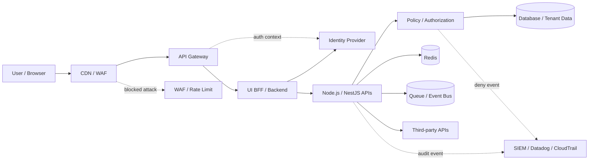
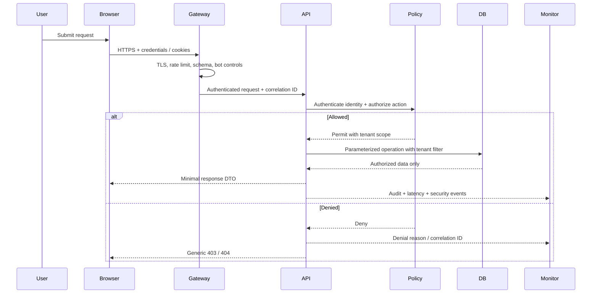
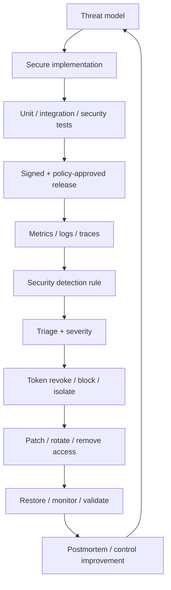
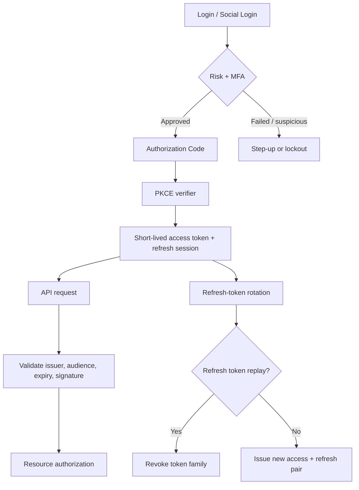
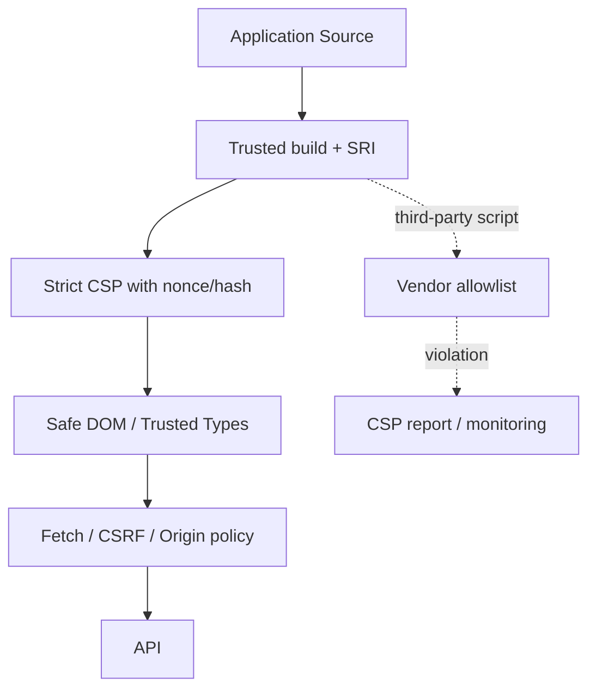
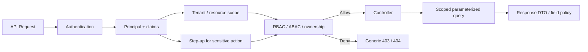
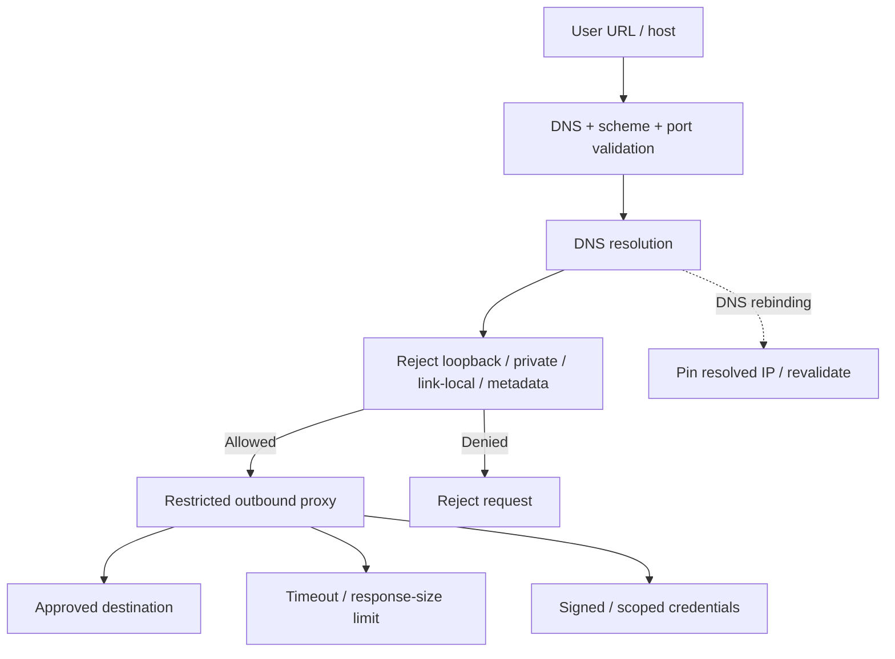
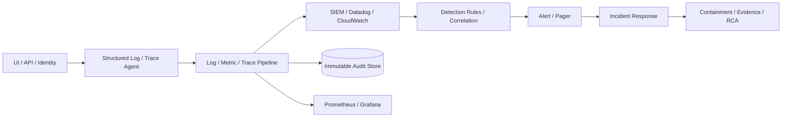

# 🔐 UI, API & Cloud Security Complete Guide

ఈ డాక్యుమెంట్ React / Next.js UI నుండి Node.js / NestJS API, Database, Cloud, మరియు Third-party integrations వరకు వెళ్తున్న మొత్తం security attack surfaceను advanced practical formలో coverage చేస్తుంది.

> **Study rule:** Prevent → Detect → Respond. ఒక్క prevention మాత్రమే success criterion కాదు; attacker actionను detect చేసి containment మరియు recovery చేయగల capability కూడా అవసరం.

## Document Map

1. Attack surface and trust boundaries
2. Browser, XSS, CSRF, clickjacking and security headers
3. Authentication, MFA, OAuth 2.0, OIDC and session security
4. Authorization: RBAC, ABAC, tenant isolation and object-level authorization
5. OWASP API Security Top 10
6. Injection, SSRF, file upload, path traversal and CORS
7. Data, secrets, third-party APIs and supply-chain security
8. Logging, detection, incident response and secure SDLC



## Core Security Data Flow



## Trust Boundaries and Response Rules

| Boundary | Trust assumption | Mandatory control |
|---|---|---|
| Browser → API | Untrusted | HTTPS, schema validation, authentication, CSRF strategy |
| Gateway → service | Moderately trusted | mTLS/IAM workload identity, payload limits, trace context |
| API → database | Restricted | Tenant/ownership predicate, parameterized queries, least privilege |
| API → third-party | Untrusted | TLS, response validation, timeout, retry budget, webhook signatures |
| API → browser | Untrusted response consumer | CSP, secure cookies, response DTO, no secrets |
| Build → deployment | Critical supply chain | Signed artifacts, SAST/SCA/container scan, SBOM, provenance |

## OWASP Coverage Map

| Area | Primary references | Main control |
|---|---|---|
| UI | OWASP Top 10:2025 web risks | Safe rendering, CSP, Trusted Types, CSRF and cookie controls |
| API | OWASP API Security Top 10:2023 | Object/function authorization, resource limits, SSRF controls |
| Identity | OIDC / OAuth 2.0 / OAuth 2.1 | Authorization Code + PKCE, MFA, secure refresh-token rotation |
| Supply chain | OWASP Dependency-Check / CycloneDX SBOM | Pinned dependencies, signed builds, vulnerability and provenance checks |
| Operations | OWASP ASVS / SAMM | Threat modeling, secure SDLC, logging, incident response |

## OWASP API Security Top 10:2023 — Complete Mapping

| Risk | Technical failure | Required control |
|---|---|---|
| API1 BOLA | Object access without ownership/tenant check | Server-side object, tenant, and ownership authorization |
| API2 Broken Authentication | Invalid token/session handling | Strong identity provider, MFA, expiry, rotation and replay protection |
| API3 Broken Object Property Authorization | Sensitive or writeable fields exposed | Field allowlists, response DTOs, mass-assignment protection |
| API4 Unrestricted Resource Consumption | No limits or timeout budget | Rate/concurrency/payload limits, pagination and circuit breakers |
| API5 Broken Function Authorization | Hidden UI actions called directly | Server-side role/action/resource policy checks |
| API6 Sensitive Business Flow Abuse | Valid API calls automate abuse | Risk scoring, velocity checks, CAPTCHA/step-up, idempotency and fraud detection |
| API7 SSRF | Server fetches attacker-controlled destinations | Egress allowlist, IP/DNS validation, redirects disabled and metadata isolation |
| API8 Security Misconfiguration | Default headers, debug, CORS, TLS or cloud policy | Secure baselines, IaC policy, secret-free errors, CSP/HSTS and least privilege |
| API9 Improper Inventory Management | Shadow/old/undocumented API versions exposed | Central API inventory, gateway discovery, lifecycle and deprecation policy |
| API10 Unsafe Consumption of Third-Party APIs | Third-party response/webhook/trust assumed safe | Schema/type/size validation, TLS, signatures, timeout and bounded retry |

```mermaid
flowchart LR
    API[API Gateway / Endpoint] --> Identity[API1-2: Identity + object access]
    Identity --> Properties[API3: Field-level authorization]
    Properties --> Resources[API4: Resource consumption limits]
    Resources --> Function[API5: Function authorization]
    Function --> Flow[API6: Business-flow abuse controls]
    Flow --> Network[API7: SSRF egress controls]
    Network --> Config[API8: Hardened configuration]
    Config --> Inventory[API9: API inventory and lifecycle]
    Inventory --> ThirdParty[API10: Verified third-party data]
```



## Secure Development and Incident Response



**Minimum incident runbook fields:** detection source, impacted accounts/resources/regions, correlation IDs, first/last seen time, containment owner, credential/session revocation, evidence preservation, user notification decision, rollback plan, root-cause owner, and verification criteria.

---

# 1. First understand the attack surface

```text
                    INTERNET
                        |
                  Attacker
                        |
                        v
              +----------------+
              |     Browser    |
              | React / Next.js|
              +----------------+
                        |
                  HTTPS Request
                        |
                        v
              +----------------+
              | API Gateway /  |
              | Load Balancer  |
              +----------------+
                        |
                        v
              +----------------+
              | Node/NestJS API|
              +----------------+
                 |     |     |
                 v     v     v
              Redis   DB   3rd Party APIs
```

మనం నేర్చుకోబోయే మొదటి టాపిక్ **"Understanding the Attack Surface"** (అటాక్ సర్ఫేస్ అంటే ఏమిటి మరియు అటాకర్స్ ఎలా అటాక్ చేస్తారు) గురించి తెలుగులో చాలా స్పష్టంగా చూద్దాం.

---

### 1. అటాక్ సర్ఫేస్ (Attack Surface) అంటే ఏమిటి?

ఒక వెబ్ అప్లికేషన్ లేదా సాఫ్ట్‌వేర్ సిస్టమ్‌లో హ్యాకర్లు (Attackers) దాడి చేయడానికి వీలుగా ఉండే ప్రతీ ఒక్క భాగాన్ని **"Attack Surface"** అంటారు. చాలామంది కేవలం వెబ్‌సైట్ డిజైన్ లేదా UI (User Interface) మీద మాత్రమే హ్యాకర్లు దాడి చేస్తారனு భావిస్తారు. కానీ అది అబద్ధం!

ఇచ్చిన ఫ్లో (Flow) ప్రకారం, ఒక మోడర్న్ వెబ్ అప్లికేషన్ (ఉదాహరణకు React/Next.js ఫ్రంట్‌ఎండ్, Node/NestJS బ్యాకెండ్, డేటాబేస్ ఉన్న సిస్టమ్) లో అటాకర్ ప్రతి లేయర్‌ను టార్గెట్ చేయగలడు. దాని గురించి విపులంగా క్రింద చూడండి:

---

### 2. ఫ్లో-బై-ఫ్లో అటాక్ లేయర్స్ (Layer-by-Layer Breakdown)

#### ఎ) ఇంటర్నెట్ & బ్రౌజర్ లేయర్ (Browser / React / Next.js)

- **ఇది ఎక్కడ ఉంటుంది?** యూజర్ తన బ్రౌజర్ (Chrome, Firefox మొదలైనవి) ద్వారా వెబ్‌సైట్‌ని ఓపెన్ చేసినప్పుడు కనిపించే ఫ్రంట్‌ఎండ్. (React లేదా Next.js తో తయారు చేసి ఉంటుంది).
- **అటాకర్ ఏం చేయగలడు?**
- యూజర్ బ్రౌజర్‌లోనే మాల్వేర్ స్క్రిప్ట్స్ రన్ చేయడం (**XSS - Cross-Site Scripting**).
- బ్రౌజర్‌లో సేవ్ అయిన సెషన్ టోకెన్స్ లేదా కుకీలను దొంగిలించడం (**Session Hijacking**).
- క్లయింట్-సైడ్ వ్యాలిడేషన్ బైపాస్ చేయడం (ఫ్రంట్‌ఎండ్‌లో రాసిన జావాస్క్రిప్ట్ చెకింగ్స్‌ని మార్చడం).

#### బి) ఏపీఐ గేట్‌వే & లోడ్ బ్యాలెన్సర్ లేయర్ (API Gateway / Load Balancer)

- **ఇది ఎక్కడ ఉంటుంది?** బ్రౌజర్ నుంచి వచ్చే రిక్వెస్ట్‌లను ముందుగా రిసీవ్ చేసుకుని, వాటిని సరైన బ్యాకెండ్ సర్వర్లకు పంపే ట్రాఫిక్ పోలీస్ లాంటిది.
- **అటాకర్ ఏం చేయగలడు?**
- **DDoS (Distributed Denial of Service) Attacks:** సర్వర్‌పైకి లక్షలకొద్దీ ఫేక్ రిక్వెస్ట్‌లను పంపి సర్వర్‌ను క్రాష్ చేయడం.
- రేట్ లిమిటింగ్ (Rate Limiting) లేకపోతే, ఒకేసారి వందలాది లాగిన్ ప్రయత్నాలు చేయడం (**Brute Force Attacks**).

#### సి) బ్యాకెండ్ ఏపీఐ లేయర్ (Node.js / NestJS API)

- **ఇది ఎక్కడ ఉంటుంది అసలు?** అసలైన లాజిక్ అంతా ఇక్కడే రన్ అవుతుంది. యూజర్ పంపిన డేటాను ప్రాసెస్ చేయడం, రూల్స్ చెక్ చేయడం ఇక్కడ జరుగుతుంది.
- **అటాకర్ ఏం చేయగలడు?**
- **IDOR (Insecure Direct Object References):** వేరే వాళ్ళ డేటా ఐడీని మాన్యువల్‌గా మార్చి చూసేయడం (ఉదాహరణకు మీ ప్రొఫైల్ ఐడీ `101` బదులు `102` పెట్టి వేరే వాళ్ళ డీటెయిల్స్ చూడటం).
- **Broken Object Level Authorization (BOLA):** పర్మిషన్స్ చెక్ చేయకపోవడం వల్ల ఇతరుల ఏపీఐలను యాక్సెస్ చేయడం.

#### డి) డేటాబేస్ & థర్డ్-పార్టీ ఏపీఐ లేయర్ (Redis, DB, 3rd Party APIs)

- **ఇది ఎక్కడ ఉంటుంది?** డేటా భద్రపరిచే చోటు (SQL/NoSQL Databases, Redis Cache) మరియు పేమెంట్ గేట్‌వేస్ (Stripe, Razorpay లాంటి థర్డ్-పార్టీ సర్వీసులు).
- **అటాకర్ ఏం చేయగలడు?**
- **SQL Injection (SQLi):** హానికరమైన ఎస్క్యూఎల్ క్వెరీలను పంపి డేటాబేస్‌లోని మొత్తం డేటాను తస్కరించడం లేదా డిలీట్ చేయడం.
- థర్డ్-పార్టీ ఏపీఐ కీలు (API Keys) లీక్ అయితే వాటి ద్వారా వేరే సర్వీసెస్ ని మిస్‌యూస్ చేయడం.

---

### ముగింపు (Summary)

> ఒక సైబర్ సెక్యూరిటీ ప్రొఫెషనల్ లేదా పెనెట్రేషన్ టెస్టర్‌గా, మనం కేవలం UI ని మాత్రమే టెస్ట్ చేయకూడదు. **Browser నుండి Database వరకు** ప్రతి లేయర్ లో ఉండే లోపాలను (Vulnerabilities) గుర్తించి వాటిని ఎలా ఫిక్స్ చేయాలో నేర్చుకోవాలి.

---

# 2. UI / Frontend Attacks

రెండో టాపిక్ అయిన **UI / Frontend Attacks** లో ముఖ్యమైన **A. XSS (Cross-Site Scripting)** గురించి తెలుగులో వివరంగా తెలుసుకుందాం.

---

### A. XSS (Cross-Site Scripting) అంటే ఏమిటి?

**XSS** అనేది ఒక ప్రమాదకరమైన వెబ్ అటాక్. ఇందులో అటాకర్, వెబ్ అప్లికేషన్ లోకి మాల్వేర్ లేదా హానికరమైన **JavaScript (జావాస్క్రిప్ట్) కోడ్‌ను** చొప్పిస్తాడు (Inject చేస్తాడు). ఆ అప్లికేషన్‌ను వాడే ఇతర యూజర్ల బ్రౌజర్‌లో ఆ కోడ్ ఆటోమేటిక్‌గా రన్ అవుతుంది.

దీని ద్వారా అటాకర్ యూజర్ల సెషన్ కుకీలు (Session Cookies), టోకెన్స్ దొంగిలించడం లేదా యూజర్ అకౌంట్‌ను పూర్తిగా తమ ఆధీనంలోకి తీసుకోవడం చేయగలరు.

---

### రియల్-వరల్డ్ ఉదాహరణ (Example)

మీ వెబ్‌సైట్‌లో ఒక కామెంట్ బాక్స్ లేదా ప్రొఫైల్ నేమ్ ఎడిట్ చేసే ఫీచర్ ఉందనుకోండి. ఒక యూజర్ (అటాకర్) తన పేరు లేదా కామెంట్ లో సాధారణ టెక్స్ట్ బదులుగా ఈ క్రింది కోడ్‌ను ఇస్తాడు:

```html
<script>
  stealSomething();
</script>
```

సరిగ్గా వ్యాలిడేషన్ (Validation) చేయకుండా, మీ రియాక్ట్ (React) అప్లికేషన్‌లో ఈ యూజర్ ఇన్‌పుట్‌ను నేరుగా రెండర్ చేస్తే సమస్య వస్తుంది:

```jsx
// ఇది చాలా ప్రమాదకరమైన కోడ్!
<div dangerouslySetInnerHTML={{ __html: userInput }} />
```

- **ఇక్కడ ఏం జరుగుతుంది?**
  React లో `dangerouslySetInnerHTML` వాడితే, బ్రౌజర్ ఆ ఇన్‌పుట్‌ను కేవలం సాధారణ టెక్స్ట్ లా కాకుండా ఒక హెచ్‌టిఎంఎల్ / జావాస్క్రిప్ట్ కోడ్‌లా భావిస్తుంది.
- అటాకర్ రాసిన `<script>` ట్యాగ్ లోపల ఉన్న కోడ్ (ఉదాహరణకు యూజర్ యొక్క కుకీలను వేరే సర్వర్‌కు పంపే కోడ్) ఆ వెబ్‌సైట్ ఓపెన్ చేసిన ప్రతి యూజర్ బ్రౌజర్‌లో సైలెంట్‌గా ఎగ్జిక్యూట్ (Run) అయిపోతుంది.

---

### దీన్ని ఎలా నివారించాలి? (How to Prevent XSS)

1. **dangerouslySetInnerHTML ని వీలైనంత వరకు దూరంగా పెట్టండి:** రియాక్ట్‌లో దీనిని అత్యవసరమైతే తప్ప వాడకూడదు.
2. **ఆటోమేటిక్ ఎస్కేపింగ్ (Automatic Escaping):** సాధారణంగా React లేదా Next.js వంటి ఫ్రేమ్‌వర్క్‌లు `{userInput}` అని కర్లీ బ్రేసెస్ లో డేటాను రెండర్ చేసినప్పుడు ఆటోమేటిక్‌గా HTML/JavaScript ట్యాగ్స్‌ని ఎస్కేప్ (Sanitize) చేస్తాయి. కాబట్టి అవి స్క్రిప్ట్‌లుగా రన్ కావు.
3. **సానిటైజేషన్ (Sanitization):** ఒకవేళ HTML కంటెంట్‌ను రెండర్ చేయడం తప్పనిసరి అయితే, `DOMPurify` లాంటి లైబ్రరీలను ఉపయోగించి యూజర్ ఇన్‌పుట్‌లోని హానికరమైన స్క్రిప్ట్‌లను తొలగించిన (Sanitize చేసిన) తర్వాతే పేజీలో చూపించాలి.

---

## Protection

XSS అటాక్స్ నుండి మన అప్లికేషన్‌ను ఎలా కాపాడుకోవాలో (Protection) ఇప్పుడు చాలా స్పష్టంగా తెలుగులో చూద్దాం.

---

### 1. సేఫ్ రెండరింగ్ (Safe Rendering)

మనం ముందు ఉదాహరణలో చూసినట్లుగా, రియాక్ట్‌లో `dangerouslySetInnerHTML` వాడటం వల్ల హ్యాకర్లు స్క్రిప్ట్స్ ఇంజెక్ట్ చేసే అవకాశం ఉంటుంది. కాబట్టి దానికి బదులుగా ఎప్పుడూ స్టాండర్డ్ వే లోనే టెక్స్ట్ రెండర్ చేయాలి:

- **తప్పు విధానం (Dangerous):**

```jsx
<div dangerouslySetInnerHTML={{ __html: userInput }} />
```

- **సరైన విధానం (Safe / Preferred):**

```jsx
<div>{userInput}</div>
```

_ఎందుకు?_ రియాక్ట్ కర్లీ బ్రేసెస్ `{ }` వాడినప్పుడు, యూజర్ ఇన్‌పుట్‌ను ఆటోమేటిక్‌గా స్ట్రింగ్‌లా ట్రీట్ చేస్తుంది తప్ప, వాటిని HTML ట్యాగ్స్‌గా రన్ చేయదు.

---

### 2. ఎక్స్ఎస్ఎస్ ప్రొటెక్షన్ టెక్నిక్స్ (XSS Defense Mechanisms)

అప్లికేషన్‌ను మరింత సురక్షితంగా ఉంచడానికి ఈ క్రింది 5 సెక్యూరిటీ కాన్సెప్ట్స్ తప్పనిసరిగా నేర్చుకోవాలి:

#### ఎ) అవుట్‌పుట్ ఎన్కోడింగ్ (Output Encoding)

యూజర్ ఇచ్చిన డేటాను బ్రౌజర్‌లో చూపించే ముందు, అందులో ఉండే స్పెషల్ క్యారెక్టర్లను (ఉదాహరణకు `<`, `>`, `&`, `"`) హానికరమైన కోడ్‌గా కాకుండా కేవలం సాధారణ అక్షరాలుగా మార్చడాన్ని **Output Encoding** అంటారు. దీనివల్ల బ్రౌజర్ వాటిని జావాస్క్రిప్ట్ లా రన్ చేయదు.

#### బి) హెచ్‌టీఎంఎల్ সానిటైజేషన్ (HTML Sanitization)

ఒకవేళ మీ వెబ్‌సైట్‌లో యూజర్లు రిచ్ టెక్స్ట్ (బోల్డ్, ఇటాలిక్ లాంటి ఫార్మాటింగ్ ఉన్న టెక్స్ట్) రాసేందుకు అనుమతిస్తే, ఆ డేటాను నేరుగా సేవ్ చేయకూడదు. `DOMPurify` లాంటి లైబ్రరీలను ఉపయోగించి, ఆ ఇన్‌పుట్‌లో ఉన్న హానికరమైన `<script>` ట్యాగ్స్‌ని లేదా డేంజర్ కోడ్‌ని ముందుగానే తొలగించడాన్ని **Sanitization** అంటారు.

#### సి) కంటెంట్ సెక్యూరిటీ పాలసీ (Content Security Policy - CSP)

CSP అనేది ఒక హెడర్ (HTTP Header). ఇది మన వెబ్‌సైట్ బ్రౌజర్‌కి కొన్ని రూల్స్ చెబుతుంది.

- _"మా వెబ్‌సైట్‌లో కేవలం మా డొమైన్ నుండి వచ్చే స్క్రిప్ట్స్ మాత్రమే రన్ కావాలి, బయటి నుండి ఎవరైనా స్క్రిప్ట్ పంపిస్తే అసలు రన్ చేయొద్దు"_ అని బ్రౌజర్‌ను కంట్రోల్ చేయడానికి CSP హెడర్ సహాయపడుతుంది.

#### డి) హెచ్‌టీటీపీ-ఓన్లీ కుకీస్ (HttpOnly Cookies)

యూజర్ లాగిన్ అయినప్పుడు వచ్చే సెషన్ టోకెన్స్ లేదా కుకీలను జావాస్క్రిప్ట్ యాక్సెస్ చేయకుండా లాక్ చేయడాన్ని **HttpOnly** అంటారు.

- ఒకవేళ మీ వెబ్‌సైట్‌లో XSS బగ్ ఉండి హ్యాకర్ జావాస్క్రిప్ట్ రన్ చేసినా, కుకీస్ `HttpOnly` మోడ్‌లో ఉంటే `document.cookie` ద్వారా హ్యాకర్ ఆ కుకీలను దొంగిలించలేడు.

#### ఇ) సెక్యూర్ అండ్ సేమ్‌సైట్ కుకీస్ (Secure & SameSite Cookies)

- **Secure Cookie:** ఈ కుకీస్ కేవలం HTTPS (Encrypted) కనెక్షన్ ద్వారా మాత్రమే ట్రావెల్ అవుతాయి. HTTP ద్వారా పంపితే బ్రౌజర్ కుకీని సెండ్ చేయదు.
- **SameSite Cookie:** ఇది క్రాస్-సైట్ రిక్వెస్ట్ ఫోర్జరీ (CSRF) అటాక్స్ నుండి రక్షణ ఇస్తుంది. కుకీలను వేరే వెబ్‌సైట్ల నుండి వచ్చే రిక్వెస్ట్‌లకు ఆటోమేటిక్‌గా అటాచ్ కాకుండా `Strict` లేదా `Lax` మోడ్స్ ద్వారా కంట్రోల్ చేయవచ్చు.

---

# 3. CSRF — Cross-Site Request Forgery

మూడో టాపిక్ అయిన **CSRF (Cross-Site Request Forgery)** గురించి ఇప్పుడు తెలుగులో చాలా సింపుల్‌గా మరియు రియల్-వరల్డ్ ఉదాహరణతో చూద్దాం.

---

### 3. CSRF (Cross-Site Request Forgery) అంటే ఏమిటి?

**CSRF** ని తెలుగులో **"క్రాస్-సైట్ రిక్వెస్ట్ ఫోర్జరీ"** అంటారు. దీన్ని సాధారణంగా **"Session Riding"** అని కూడా పిలుస్తారు.

ఈ అటాక్‌లో హ్యాకర్, యూజర్ కి తెలియకుండా లేదా యూజర్ ప్రమేయం లేకుండా, ఆ యూజర్ లాగిన్ అయి ఉన్న వేరే వెబ్‌సైట్‌కి ఫేక్ రిక్వెస్ట్‌లను పంపిస్తాడు. అంటే, హ్యాకర్ మీ తరఫున దొంగచాటుగా యాక్షన్సను (Transfers, Password Changes మొదలైనవి) పూర్తి చేయిస్తాడు.

---

### రియల్-వరల్డ్ ఉదాహరణ (Example)

1. **లాగిన్ స్టేట్:** మీరు మీ ఇంటర్నెట్ బ్యాంకింగ్ వెబ్‌సైట్ (`bank.com`) లో సక్సెస్‌ఫుల్‌గా లాగిన్ అయ్యారు. లాగిన్ అయినప్పుడు మీ బ్రౌజర్‌లో బ్యాంక్ సర్వర్ ఒక **कुकी (Cookie)** లేదా సెషన్ టోకెన్‌ను సేవ్ చేస్తుంది.
2. **ట్రాప్ (Trap):** అదే సమయంలో, మీరు వేరే ఏదో ఒక అనధికారిక లేదా హానికరమైన వెబ్‌సైట్‌ను (`attacker-website.com`) మీ బ్రౌజర్‌లో ఓపెన్ చేశారు.
3. **అటాక్ ఎలా జరుగుతుంది?** ఆ హ్యాకర్ వెబ్‌సైట్ బ్యాక్‌గ్రౌండ్‌లో ఒక ఆటోమేటిక్ స్క్రిప్ట్‌ను రన్ చేస్తుంది. ఆ స్క్రిప్ట్ మీ బ్రౌజర్‌ని బలవంతంగా `[bank.com/transfer](https://bank.com/transfer)` అనే ఏపీఐకి ఒక **POST Request** పంపేలా చేస్తుంది. ఉదాహరణకు, మీ అకౌంట్ నుండి హ్యాకర్ అకౌంట్‌కి డబ్బులు ట్రాన్స్‌ఫర్ చేసే రిక్వెస్ట్ అది.
4. **ప్రమాదం ఏమిటి?** మీ బ్రౌజర్‌లో ఆల్రెడీ `bank.com` కి సంబంధించిన వాలిడ్ కుకీ ఉంది కాబట్టి, బ్రౌజర్ ఆ రిక్వెస్ట్‌తో పాటు ఆటోమేటిక్‌గా ఆ కుకీని కూడా బ్యాంక్ సర్వర్‌కు పంపేస్తుంది. బ్యాంక్ సర్వర్ "ఇది ఆ యూజరే స్వయంగా పంపాడు" అని నమ్మి ఆ డబ్బులను ట్రాన్స్‌ఫర్ చేసేస్తుంది!

---

### ముగింపు

> యూజర్ బ్రౌజర్‌కి ఉండే **ఆటోమేటిక్ కుకీ అటాచ్మెంట్** (Automatic Cookie Attachment) బలహీనతను అటాకర్స్ ఈ CSRF అటాక్ ద్వారా తమకు అనుకూలంగా మార్చుకుంటారు.

---

## Protection

CSRF అటాక్స్ నుండి మన అప్లికేషన్‌ను ఎలా కాపాడుకోవాలో (Protection) మరియు XSS కి CSRF కి మధ్య ఉన్న తేడా ఏమిటో ఇప్పుడు తెలుగులో చాలా స్పష్టంగా చూద్దాం.

---

### CSRF ప్రొటెక్షన్ (How to Prevent CSRF)

CSRF అటాక్స్ జరగకుండా ఉండటానికి మనం ఈ క్రింది మూడు పద్ధతులను ఉపయోగిస్తాము:

#### 1. SameSite కుకీస్ (SameSite Cookies)

ఇది CSRF ని అడ్డుకోవడానికి అత్యంత ప్రభావవంతమైన మొదటి లైన్ ఆఫ్ డిఫెన్స్. కుకీ సెట్ చేసేటప్పుడు `SameSite` ఆట్రిబ్యూట్‌ను వాడాలి:

- `SameSite=Lax` లేదా `SameSite=Strict` అని సెట్ చేయడం ద్వారా, వేరే వెబ్‌సైట్ల నుండి మీ సైట్‌కి వచ్చే రిక్వెస్ట్‌లతో పాటు కుకీలు ఆటోమేటిక్‌గా వెళ్లకుండా బ్రౌజర్ ఆపేస్తుంది.
- ఉదాహరణ కోడ్:

```http
Set-Cookie: session=abc; HttpOnly; Secure; SameSite=Lax

```

#### 2. CSRF టోకెన్స్ (CSRF Tokens)

ఒకవేళ మీ అప్లికేషన్‌లో సున్నితమైన యాక్షన్స్ (డబ్బులు పంపడం, పాస్‌వర్డ్ మార్చడం లాంటివి) జరిగేటప్పుడు సర్వర్ ఒక యూనిక్, రాండమ్ **CSRF Token** ని జనరేట్ చేసి ఫ్రంట్‌ఎండ్‌కి ఇస్తుంది.

- యూజర్ ఫారమ్ సబ్మిట్ చేసినప్పుడు ఆ టోకెన్‌ను కూడా బ్యాకెండ్‌కి పంపాలి.
- హ్యాకర్ వెబ్‌సైట్‌కి ఈ టోకెన్ తెలీదు కాబట్టి, హ్యాకర్ పంపే ఫేక్ రిక్వెస్ట్ సర్వర్ వద్ద ఫెయిల్ అయిపోతుంది.

#### 3. ఆరిజిన్ / రెఫరర్ వ్యాలిడేషన్ (Origin / Referer Validation)

రిక్వెస్ట్ ఎక్కడి నుండి వస్తోంది అని చెక్ చేయడానికి సర్వర్‌లో `Origin` లేదా `Referer` హెడర్స్‌ని వెరిఫై చేయాలి. రిక్వెస్ట్ మన ఒరిజినల్ డొమైన్ నుండే వస్తోందా లేదా వేరే ఏదైనా థర్డ్-పార్టీ వెబ్‌సైట్ నుండి వస్తోందా అని చెక్ చేసి బ్లాక్ చేయవచ్చు.

---

### 💡 చాలా ముఖ్యమైన తేడా: XSS vs CSRF

ఇంటర్వ్యూలలో లేదా సెక్యూరిటీ టెస్టింగ్‌లో ఈ రెండింటి మధ్య తేడా చాలాసార్లు అడుగుతారు. దీన్ని సింపుల్‌గా గుర్తుంచుకోండి:

- **XSS (Cross-Site Scripting):**
  అటాకర్ మీ అప్లికేషన్ కోడ్ మధ్యలోనే తన స్వంత **జావాస్క్రిప్ట్ కోడ్‌ను ఎగ్జిక్యూట్** చేయిస్తాడు. (అంటే మీ యాప్ లోనే ప్రాబ్లం ఉంటుంది).
- **CSRF (Cross-Site Request Forgery):**
  అటాకర్ మీ జావాస్క్రిప్ట్ కోడ్‌ని ఏదీ రన్ చేయడు. బదులుగా, మీ బ్రౌజర్‌ను మోసం చేసి **దొంగచాటుగా మీ తరఫున సర్వర్‌కు రిక్వెస్ట్‌లు వెళ్లేలా** చేస్తాడు.

---

# 4. Clickjacking

నాలుగో టాపిక్ అయిన **Clickjacking (క్లిక్‌జాకింగ్)** గురించి మరియు దాని నుండి మన వెబ్‌సైట్‌ను ఎలా కాపాడుకోవాలో ఇప్పుడు తెలుగులో వివరంగా చూద్దాం.

---

### 4. Clickjacking (క్లిక్‌జాకింగ్) అంటే ఏమిటి?

**క్లిక్‌జాకింగ్** (దీనిని UI Redressing అని కూడా అంటారు) అనేది ఒక రకమైన మోసపూరిత అటాక్. ఇందులో అటాకర్ మీ ఒరిజినల్ వెబ్‌సైట్‌ను (`yourbank.com`) ఒక పారదర్శకమైన (Transparent / Invisible) లేయర్‌లాగా మార్చి, దానిని ఒక హానికరమైన థర్డ్-పార్టీ వెబ్‌సైట్‌లో `iframe` ద్వారా లోడ్ చేస్తాడు.

- **ఇది ఎలా జరుగుతుంది?**
  యూజర్ ఆ హానికరమైన వెబ్‌సైట్‌లో ఉన్న ఏదో ఒక ఆకర్షణీయమైన బటన్ (ఉదాహరణకు: "Win a Free iPhone" లేదా "Claim Prize") మీద క్లిక్ చేస్తాడని అనుకుంటాడు. కానీ నిజానికి, ఆ బటన్ కింద మీ వెబ్‌సైట్‌లోని ఒక ముఖ్యమైన బటన్ (ఉదాహరణకు: "Delete Account" లేదా "Transfer Money") కచ్చితంగా సరిపోయేలా అటాకర్ సెట్ చేసి ఉంటాడు. యూజర్ ఫ్రీ గిఫ్ట్ కోసం క్లిక్ చేస్తున్నానని నమ్మి, తెలియకుండానే మీ వెబ్‌సైట్‌లోని సున్నితమైన బటన్‌ను క్లిక్ చేసేలా మోసపోతాడు!

---

### ప్రొటెక్షన్ (How to Prevent Clickjacking)

మీ వెబ్‌సైట్‌ను వేరే ఎవరైనా ఇన్‌ఫ్రేమ్‌లలో (`iframe`) ఓపెన్ చేయకుండా బ్లాక్ చేయడానికి ఈ క్రింది రెండు హెడర్స్‌ను ఉపయోగించవచ్చు:

#### 1. Content-Security-Policy (CSP) - `frame-ancestors`

ఇది మోడర్న్ మరియు మోస్ట్ రికమండెడ్ పద్ధతి. సర్వర్ రెస్పాన్స్‌లో ఈ హెడర్‌ని సెట్ చేయాలి:

```http
Content-Security-Policy: frame-ancestors 'none';

```

- `'none'` అని రాస్తే, మీ వెబ్‌సైట్‌ను వేరే ఏ వెబ్‌సైట్ కూడా `iframe` లో లోడ్ చేయలేదు.
- ఒకవేళ మీ వెబ్‌సైట్‌ను వేరే నిర్దిష్ట డొమైన్‌లో మాత్రమే లోడ్ కావడానికి అనుమతించాలంటే `frame-ancestors 'self' trusted-site.com` అని కూడా ఇవ్వవచ్చు.

#### 2. X-Frame-Options (పాత పద్ధతి)

ఇది పాత బ్రౌజర్‌ల కోసం వాడే హెడర్. దీన్ని కూడా చాలా అప్లికేషన్లలో సెక్యూరిటీ కోసం వాడుతుంటారు:

```http
X-Frame-Options: DENY

```

లేదా

```http
X-Frame-Options: SAMEORIGIN

```

- **DENY:** మీ వెబ్‌సైట్ అసలు ఏ `iframe` లోనూ లోడ్ కాదు.
- **SAMEORIGIN:** కేవలం మీ సొంత డొమైన్‌లోని పేజీలలో మాత్రమే `iframe` ద్వారా లోడ్ కావడానికి అనుమతిస్తుంది.

---

# 5. UI Authentication Problems

ఐదవ టాపిక్ అయిన **UI Authentication Problems** (యూజర్ ఆథెంటికేషన్‌లో ఉండే సాధారణ సమస్యలు మరియు అటాక్స్) గురించి ఇప్పుడు తెలుగులో వివరంగా చూద్దాం.

---

### 5. UI Authentication Problems (ఆథెంటికేషన్ లోపాలు)

యూజర్లు లాగిన్ అయ్యేటప్పుడు లేదా సెషన్‌ను మేనేజ్ చేసేటప్పుడు డెవలపర్లు చేసే చిన్న చిన్న పొరపాట్ల వల్ల అటాకర్స్ ఈ క్రింది అటాక్స్ చేయడానికి అవకాశం దొరుకుతుంది:

#### 1. బ్రూట్ ఫోర్స్ (Brute Force)

- **ఇది ఏమిటి?** అటాకర్ ఒకే యూజర్ నేమ్‌కి వేలకొద్దీ డిఫరెంట్ పాస్‌వర్డ్‌లను ఆటోమేటిక్ స్క్రిప్ట్స్ ద్వారా ఒక్కొక్కటిగా ట్రై చేస్తూ సరైన పాస్‌వర్డ్‌ను కనిపెట్టే ప్రయత్నం చేస్తాడు.
- **ఎలా ఆపాలి?** రేట్ లిమిటింగ్ (Rate Limiting) పెట్టాలి, కాప్చా (CAPTCHA) వాడాలి మరియు కొన్ని తప్పు పాస్‌వర్డ్‌ల తర్వాత అకౌంట్‌ను తాత్కాలికంగా లాక్ చేయాలి.

#### 2. క్రెడెన్షియల్ స్టఫింగ్ (Credential Stuffing)

- **ఇది ఏమిటి?** వేరే ఏదో ఒక వెబ్‌సైట్‌లో లీకైన యూజర్ నేమ్ మరియు పాస్‌వర్డ్స్ లిస్ట్‌ను తీసుకొని, అటాకర్ అదే కాంబినేషన్‌ను మీ వెబ్‌సైట్‌లో ఆటోమేటిక్‌గా లాగిన్ చేయడానికి ట్రై చేస్తాడు (ఎందుకంటే చాలామంది అన్ని సైట్లకు ఒకే పాస్‌వర్డ్ వాడతారు కాబట్టి).
- **ఎలా ఆపాలి?** Multi-Factor Authentication (MFA / 2FA) ని ఉపయోగించడం.

#### 3. సెషన్ హైజాకింగ్ (Session Hijacking)

- **ఇది ఏమిటి?** యూజర్ లాగిన్ అయ్యాక అతని బ్రౌజర్‌లో జనరేట్ అయిన వాలిడ్ సెషన్ టోకెన్ లేదా కుకీని అటాకర్ దొంగిలించి, తను ఆ యూజర్‌లాగా యాప్ లో తిరుగుతాడు.
- **ఎలా ఆపాలి?** కుకీస్‌ని `HttpOnly` మరియు `Secure` ఫ్లాగ్స్‌తో సెట్ చేయడం, HTTPS ని మాత్రమే వాడటం.

#### 4. టోకెన్ థెఫ్ట్ (Token Theft)

- **ఇది ఏమిటి?** అప్లికేషన్ JWT (JSON Web Token) లేదా యాక్సెస్ టోకెన్స్‌ను బ్రౌజర్‌లోని `localStorage` లేదా `sessionStorage` లో సేవ్ చేస్తే, XSS బగ్ ద్వారా అటాకర్ ఆ టోకెన్‌ను ఈజీగా కాపీ చేసేస్తాడు.
- **ఎలా ఆపాలి?** సెన్సిటివ్ టోకెన్స్‌ను `localStorage` లో సేవ్ చేయకూడదు, బదులుగా `HttpOnly` కుకీస్‌లో స్టోర్ చేయాలి.

#### 5. వీక్ పాస్‌వర్డ్స్ (Weak Passwords)

- **ఇది ఏమిటి?** యూజర్లు "123456", "password", "admin" లాంటి చాలా సులభమైన పాస్‌వర్డ్‌లు పెట్టుకునేలా అప్లికేషన్ అనుమతించడం.
- **ఎలా ఆపాలి?** పాస్‌వర్డ్ పాలసీ స్ట్రిక్ట్‌గా ఉండాలి (కనీసం 8-12 క్యారెక్టర్లు, క్యాపిటల్ లెటర్స్, నంబర్స్, స్పెషల్ క్యారెక్టర్స్ ఉండేలా చూడాలి).

#### 6. సెషన్ ఫిక్సేషన్ (Session Fixation)

- **ఇది ఏమిటి?** యూజర్ లాగిన్ అవ్వకముందే అటాకర్ ఒక పాత సెషన్ ఐడీని క్రియేట్ చేసి యూజర్‌కి పంపిస్తాడు. యూజర్ ఆ లింక్ ద్వారా లాగిన్ అయ్యాక, అదే సెషన్ ఐడీతో అటాకర్ కూడా లాగిన్ అయిపోతాడు.
- **ఎలా ఆపాలి?** యూజర్ సక్సెస్‌ఫుల్‌గా లాగిన్ అయిన వెంటనే పాత సెషన్‌ను డిలీట్ చేసి, పూర్తిగా కొత్త సెషన్ ఐడీని (Session Regeneration) జనరేట్ చేయాలి.

#### 7. అకౌంట్ ఎన్యుమరేషన్ (Account Enumeration)

- **ఇది ఏమిటి?** లాగిన్ లేదా ఫర్గాట్ పాస్‌వర్డ్ పేజీలో ఒక ఈమెయిల్ ఎంటర్ చేసినప్పుడు — _"ఈ ఈమెయిల్ మా డేటాబేస్‌లో లేదు"_ లేదా _"పాస్‌వర్డ్ తప్పు"_ అని సిస్టమ్ స్పష్టంగా చెబితే, అటాకర్ ఏయే ఈమెయిల్స్ రిజిస్టర్ అయి ఉన్నాయో ఈజీగా కనిపెట్టేస్తాడు.
- **ఎలా ఆపాలి?** ఎర్రర్ మెసేజ్‌లు ఎప్పుడూ జనరిక్‌గా ఉండాలి (ఉదాహరణకు: _"Invalid email or password"_ అని రెండింటికీ ఒకేలా చూపించాలి).

---

## Protection

ఆథెంటికేషన్‌లో వచ్చే సమస్యల నుండి మన అప్లికేషన్‌ను కాపాడుకోవడానికి (Protection) మనం అమలు చేయాల్సిన అత్యంత ముఖ్యమైన సెక్యూరిటీ మెజర్స్ (Security Measures) గురించి ఇప్పుడు తెలుగులో వివరంగా చూద్దాం.

---

### ఆథెంటికేషన్ ప్రొటెక్షన్ మెకానిజమ్స్ (Authentication Protections)

#### 1. స్ట్రాంగ్ పాస్‌వర్డ్ పాలసీ (Strong Password Policy)

యూజర్లు చాలా సులభమైన పాస్‌వర్డ్‌లు (`123456`, `password` లాంటివి) పెట్టుకోకుండా అప్లికేషన్ లెవెల్‌లో రూల్స్ సెట్ చేయాలి.

- పాస్‌వర్డ్‌లో కనీసం 8 నుండి 12 క్యారెక్టర్లు ఉండాలి.
- అప్పర్ కేస్ (A-Z), లోయర్ కేస్ (a-z), నంబర్స్ (0-9), మరియు స్పెషల్ క్యారెక్టర్స్ (`@#$!`) కచ్చితంగా ఉండేలా వ్యాలిడేట్ చేయాలి.

#### 2. మల్టీ-ఫ్యాక్టర్ ఆథెంటికేషన్ (MFA / 2FA)

కేవలం పాస్‌వర్డ్ ఒక్కటే సరిపోదు. లాగిన్ అయ్యేటప్పుడు యూజర్ మొబైల్‌కు వచ్చే OTP, Google Authenticator (TOTP), లేదా Biometric (Fingerprint/Face ID) లాంటి అదనపు వెరిఫికేషన్‌ను తప్పనిసరి చేయాలి. దీనివల్ల పాస్‌వర్డ్ తెలిసినా హ్యాకర్లు లాగిన్ అవ్వలేరు.

#### 3. రేట్ లిమిటింగ్ (Rate Limiting)

ఒకరు లేదా ఒకే IP అడ్రస్ నుండి తక్కువ సమయంలో చాలాసార్లు లాగిన్ ప్రయత్నాలు (Login Attempts) జరిగితే ఆటోమేటిక్‌గా బ్లాక్ చేయాలి. దీనివల్ల **Brute Force** అటాక్స్ విజయవంతం కావు.

#### 4. అకౌంట్ లాకౌట్ / ప్రోగ్రెసివ్ డిలేస్ (Account Lockout / Progressive Delays)

- ఒక యూజర్ వరుసగా 3 లేదా 5 సార్లు తప్పు పాస్‌వర్డ్ ఎంటర్ చేస్తే, ఆ అకౌంట్‌ను కొద్దిసేపు (ఉదాహరణకు 15 నిమిషాలు) తాత్కాలికంగా లాక్ చేయాలి.
- లేదా ప్రతి తప్పు ప్రయత్నానికి లాగిన్ ప్రాసెస్‌ను కొద్ది సెకండ్లు లేట్ (Progressive Delay) చేయాలి.

#### 5. సెక్యూర్ సెషన్ మేనేజ్‌మెంట్ (Secure Session Management)

- యూజర్ లాగిన్ అయ్యాక వచ్చే సెషన్ కుకీస్‌కు తప్పకుండా `HttpOnly`, `Secure`, మరియు `SameSite` ఫ్లాగ్స్ సెట్ చేయాలి.
- యూజర్ లాగౌట్ అయిన వెంటనే సర్వర్ సైడ్ ఆ సెషన్‌ను పూర్తిగా డిలీట్ (Destroy) చేయాలి.

#### 6. షార్ట్-లివ్డ్ యాక్సెస్ టోకెన్స్ (Short-lived Access Tokens)

- JWT (JSON Web Tokens) లేదా యాక్సెస్ టోకెన్స్ వాడేటప్పుడు వాటి వాలిడిటీ టైమ్‌ను చాలా తక్కువగా (ఉదాహరణకు 5 నుండి 15 నిమిషాలు మాత్రమే) సెట్ చేయాలి.
- ఒకవేళ టోకెన్ దొంగిలించబడినా, అది త్వరలోనే ఎక్స్‌పైర్ అయిపోతుంది కాబట్టి ప్రమాదం తగ్గుతుంది.

#### 7. సెక్యూర్ రిఫ్రెష్-టోకెన్ హ్యాండ్లింగ్ (Secure Refresh-Token Handling)

- యాక్సెస్ టోకెన్ ఎక్స్‌పైర్ అయినప్పుడు కొత్త టోకెన్‌ను తెచ్చుకోవడానికి **Refresh Token** వాడతాము.
- రిఫ్రెష్ టోకెన్‌లను ఎప్పుడూ `localStorage` లో సేవ్ చేయకూడదు. వాటిని కచ్చితంగా ఎన్‌క్రిప్టెడ్, `HttpOnly` కుకీస్‌లోనే స్టోర్ చేయాలి. అలాగే రిఫ్రెష్ టోకెన్ రొటేషన్ (Refresh Token Rotation) పద్ధతిని పాటించాలి.

---

# 6. Don't Trust Frontend Authorization

ఆరవ టాపిక్ అయిన **"Don't Trust Frontend Authorization"** (ఫ్రంట్‌ఎండ్ ఆథరైజేషన్‌ను ఎప్పుడూ నమ్మకూడదు) గురించి మరియు రియల్-వరల్డ్ అప్లికేషన్లలో దీన్ని ఎలా సరిగ్గా డిజైన్ చేయాలో ఇప్పుడు తెలుగులో వివరంగా చూద్దాం.

---

### 6. డోంట్ ట్రస్ట్ ఫ్రంట్‌ఎండ్ ఆథరైజేషన్ (Don't Trust Frontend Authorization)

ఇది సైబర్ సెక్యూరిటీ పరంగా మరియు ఇంటర్వ్యూలలో చాలా ఇంపార్టెంట్ అయిన కాన్సెప్ట్. చాలా మంది డెవలపర్లు చేసే ఒక పెద్ద తప్పు ఏమిటంటే — యూజర్ రోల్ (Role) ఆధారంగా ఫ్రంట్‌ఎండ్‌లో (React / Next.js) బటన్లు దాచేస్తే సెక్యూరిటీ వచ్చేసిందని భావిస్తారు. కానీ అది చాలా పెద్ద తప్పు!

#### తప్పు విధానం (Bad Architecture)

మీ రియాక్ట్ కోడ్‌లో ఇలా రాశారనుకోండి:

```jsx
if (user.role === "admin") {
  showDeleteButton();
}
```

- **ఇక్కడ సమస్య ఏమిటి?**
  ఈ కోడ్ కేవలం యూజర్ స్క్రీన్‌పై ఆ **"Delete" బటన్‌ను మాత్రమే దాస్తుంది** (Hide చేస్తుంది). కానీ ఆ బటన్ వెనుక పనిచేసే ఏపీఐ (API) ఎండ్‌పాయింట్ మాత్రం అలాగే ఓపెన్‌గా ఉంటుంది.
- ఒక అటాకర్ బ్రౌజర్ DevTools ఓపెన్ చేసి, లేదా Postman, cURL లాంటి టూల్స్ ఉపయోగించి నేరుగా ఈ క్రింది రిక్వెస్ట్‌ను సర్వర్‌కి పంపిస్తాడు:

```http
DELETE /api/users/123

```

సర్వర్‌ వద్ద ప్రాపర్ ఆథరైజేషన్ చెకింగ్ లేకపోతే, అటాకర్ నాన్-అమిన్ (Non-admin) యూజర్ అయ్యి ఉండి కూడా సిస్టమ్‌లోని యూజర్లను డిలీట్ చేసేయగలడు!

---

#### సరైన ఆర్కిటెక్చర్ (Correct Architecture)

ఎప్పుడూ గుర్తుంచుకోండి: **ఫ్రంట్‌ఎండ్ కేవలం యూజర్ ఎక్స్పీరియన్స్ (UI/UX) కోసం మాత్రమే, సెక్యూరిటీ కోసం కాదు.** నిజమైన సెక్యూరిటీ అంతా బ్యాకెండ్ సర్వర్‌లోనే జరగాలి.

సరైన ఫ్లో ఇలా ఉండాలి:

1. **React (Frontend):** యూజర్ రోల్ బట్టి బటన్ చూపించవచ్చు లేదా దాచవచ్చు (ఇది కేవలం UX కోసం).
2. **Node/NestJS API (Backend):** యూజర్ నిజంగా ఆ యాక్షన్ చేయడానికి అర్హుడా లేదా అని సర్వర్‌లో స్ట్రిక్ట్‌గా చెక్ చేయాలి.

- యూజర్ లాగిన్ అయ్యాడా? (Is authenticated?)
- ఆ యూజర్‌కు ఆ పర్మిషన్ ఉందా? (Is user authorized?)
- అసలు ఆ యూజర్ కి ఆ రిసోర్స్‌ను డిలీట్ చేసే రైట్స్ ఉన్నాయా? (Can this user delete user 123?)

3. ఇవన్నీ సక్సెస్ అయితేనే డేటాబేస్ (Database) లెవెల్‌లో యాక్షన్ జరగాలి.

> **ముగింపు:**
> ఫ్రంట్‌ఎండ్ అనేది పబ్లిక్ ప్లేస్. ఎవరైనా సరే ఫ్రంట్‌ఎండ్ కోడ్‌ను మార్చగలరు లేదా ఏపీఐ రిక్వెస్ట్‌లను మాన్యువల్‌గా పంపగలరు. కాబట్టి **Authorization must ALWAYS be enforced on the server.**

---

# 7. API Security

ఏడవ టాపిక్ అయిన **API Security** మరియు ఇందులో అత్యంత కీలకమైన **API1 — Broken Object Level Authorization (BOLA)** గురించి తెలుగులో చాలా వివరంగా చూద్దాం.

---

### 7. API సెక్యూరిటీ & BOLA (Broken Object Level Authorization)

వెబ్ అప్లికేషన్ సెక్యూరిటీలో మనం అత్యధిక సమయం కేటాయించాల్సింది మరియు అత్యంత ప్రమాదకరమైన లోపాలు బయటపడేది ఏపీఐ (API) లేయర్‌లోనే. **OWASP API Top 10** ప్రకారం ఆథెంటికేషన్ లోపాలు, రిసోర్స్ కన్జంప్షన్, SSRF, మిస్ కాన్ఫిగరేషన్స్ వంటివి ఏపీఐలను చాలా ప్రమాదంలోకి నెడుతుంటాయి.

ఇందులో మొదటి మరియు అత్యంత ముఖ్యమైన రిస్క్ గురుంచి ఇప్పుడు చూద్దాం:

#### API1 — BOLA (Broken Object Level Authorization / ఇన్‌సిక్యూర్ డైరెక్ట్ ఆబ్జెక్ట్ రెఫరెన్సెస్ - IDOR)

- **ఇది ఏమిటి?**
  ఒక ఏపీఐ ఎండ్‌పాయింట్ ద్వారా మనం ఏదైనా ఒక నిర్దిష్ట డేటా (Object) లేదా యూజర్ ప్రొఫైల్‌ని రిక్వెస్ట్ చేసినప్పుడు, సర్వర్ ఆ యూజర్‌కు ఆ డేటాను చూసే పర్మిషన్ ఉందా లేదా అని చెక్ చేయకపోవడాన్ని **BOLA** అంటారు.
- **రియల్-వరల్డ్ ఉదాహరణ:**
- మీరు లాగిన్ అయిన యూజర్ ఐడీ: `id = 50`
- మీరు బ్రౌజర్‌లో లేదా Postman లో ఈ క్రింది గెట్ రిక్వెస్ట్ పంపిస్తున్నారు అనుకోండి:

```http
GET /api/users/100

```

- **సమస్య ఎక్కడ వస్తుంది?**
  బ్యాకెండ్‌లో డెవలపర్ కేవలం యూజర్ లాగిన్ అయ్యాడా లేదా (**Is user logged in?**) అని మాత్రమే చెక్ రాసి వదిలేస్తాడు. అంతే కానీ, ఆ లాగిన్ అయిన యూజర్ 50 కి యూజర్ 100 యొక్క డీటెయిల్స్ చూసే హక్కు ఉందా (**Does user 50 have access to user 100?**) అని చెక్ చేయడు!
- ఫలితంగా, సర్వర్ ఎలాంటి అడ్డుచెప్పకుండా యూజర్ 100 యొక్క పర్సనల్ డేటాను మీకు ఇచ్చేస్తుంది. ఇలా సిస్టమ్‌లోని వేరే వాళ్ళ డేటానంతటికీ ఒక సాధారణ యూజర్ యాక్సెస్ పొందడాన్నే **BOLA** అంటారు.

---

### BOLA ని ఎలా నివారించాలి? (How to Prevent BOLA)

1. **ఆబ్జెక్ట్ లెవెల్ ఆథరైజేషన్ చెక్స్ (Object-Level Authorization Checks):**
   ప్రతి ఏపీఐ రిక్వెస్ట్ వద్ద, సర్వర్ డేటాబేస్ నుండి డేటాను ఫెచ్ చేయడానికి ముందు ఒక స్ట్రింగ్ చెక్ పెట్టాలి:

   > _"ప్రస్తుతం రిక్వెస్ట్ చేస్తున్న యూజర్ (User 50) కి, తాను అడుగుతున్న రిసోర్స్ (User 100) పై యాక్సెస్ లేదా ఓనర్షిప్ ఉందా?"_ అని కచ్చితంగా వ్యాలిడేట్ చేయాలి.

2. **అప్రాప్రియేట్ పాలసీస్ (Access Control Policies):**
   యూజర్ రోల్స్ మరియు పర్మిషన్స్‌ను బ్యాకెండ్‌లో ప్రతి ఏపీఐ రూట్ వద్ద గట్టిగా అమలు చేయాలి.

---

BOLA (Broken Object Level Authorization) నుండి మన ఏపీఐలను ఎలా కాపాడుకోవాలో (Protection) మరియు ఆథరైజేషన్‌కు సంబంధించి మనం కచ్చితంగా నేర్చుకోవాల్సిన ముఖ్యమైన కాన్సెప్ట్స్ గురించి ఇప్పుడు తెలుగులో వివరంగా చూద్దాం.

---

### BOLA ప్రొటెక్షన్ (How to Prevent BOLA)

ప్రతి ఆబ్జెక్ట్ యాక్సెస్ (Object Access) జరిగేటప్పుడు సర్వర్ సైడ్ కచ్చితంగా ప్రాపర్ ఆథరైజేషన్ చెక్స్ ఉండాలి. కేవలం యూజర్ లాగిన్ అయ్యాడా అని చూస్తే సరిపోదు, ఆ యూజర్‌కు ఆ డేటాను చూసే హక్కు ఉందా లేదా అని క్వెరీ లెవెల్‌లోనే ఫిల్టర్ చేయాలి.

#### కోడ్ ఉదాహరణ (Code Example)

ఉదాహరణకు, డేటాబేస్ నుండి ఒక యూజర్ డీటెయిల్స్ ఫెచ్ చేసేటప్పుడు కేవలం `id` తో పాటు వారి ఆర్గనైజేషన్ లేదా ఓనర్షిప్‌ను కూడా ఇలా చెక్ చేయాలి:

```javascript
const user = await db.user.findFirst({
  where: {
    id: requestedUserId,
    organizationId: currentUser.organizationId, // ఇది చాలా ముఖ్యం!
  },
});
```

- **దీని అర్థం ఏమిటంటే:** యూజర్ ఐడీ సరిపోవడంతో పాటు, ఆ రిక్వెస్ట్ చేస్తున్న వ్యక్తి అదే ఆర్గనైజేషన్‌కు చెందినవాడైతేనే డేటా వస్తుంది. లేదంటే `null` వస్తుంది కాబట్టి వేరే వాళ్ళ డేటా లీక్ అయ్యే అవకాశమే ఉండదు.

---

### ఏపీఐ ఆథరైజేషన్‌లో నేర్చుకోవాల్సిన 5 ముఖ్యమైన కాన్సెప్ట్స్:

#### 1. RBAC (Role-Based Access Control)

- యూజర్ల **రోల్స్** (ఉదాహరణకు: Admin, Editor, Viewer, Customer) ఆధారంగా ఏపీఐ యాక్సెస్‌ను కంట్రోల్ చేయడాన్ని RBAC అంటారు.
- ఉదాహరణకు: కేవలం `Admin` రోల్ ఉన్నవాళ్లు మాత్రమే `/api/users` డిలీట్ చేసే ఏపీఐని యాక్సెస్ చేయగలరు.

#### 2. ABAC (Attribute-Based Access Control)

- ఇది RBAC కంటే కొంచెం అడ్వాన్స్‌డ్. కేవలం రోల్ మాత్రమే కాకుండా, కొన్ని **ఆట్రిబ్యూట్స్ లేదా కండిషన్స్** ఆధారంగా పర్మిషన్ ఇస్తారు.
- ఉదాహరణకు: _"యూజర్ రోల్ మేనేజర్ అయ్యి ఉండి, ఆ డాక్యుమెంట్ ఎవరి డిపార్ట్‌మెంట్‌కు చెందిందో అదే డిపార్ట్‌మెంట్‌కు చెందినవారైతేనే ఆ డాక్యుమెంట్‌ను ఎడిట్ చేయగలరు"_ లాంటి రూల్స్.

#### 3. రిసోర్స్ ఓనర్షిప్ (Resource Ownership)

- ఒక డేటా లేదా ఫైల్‌ని క్రియేట్ చేసిన లేదా దానికి ఓనర్ అయిన యూజర్ మాత్రమే దానిని ఎడిట్ లేదా డిలీట్ చేసేలా రూల్స్ రాయడం.
- ఉదాహరణకు: మీ ప్రొఫైల్ పోస్ట్ కేవలం మీరే ఎడిట్ చేయగలగాలి, వేరే యూజర్ ఆ ఐడీతో ట్రై చేస్తే సర్వర్ బ్లాక్ చేయాలి.

#### 4. టెనెంట్ ఐసోలేషన్ (Tenant Isolation - Multi-Tenancy)

- ఒకే అప్లికేషన్‌ను వేర్వేరు కంపెనీలు లేదా క్లయంట్స్ (Tenants) వాడుతున్నప్పుడు, ఒక కంపెనీకి చెందిన డేటా మరో కంపెనీకి ఎట్టి పరిస్థితుల్లోనూ కనిపించకూడదు.
- డేటాబేస్ క్వెరీలలో ప్రతీసారి `organizationId` లేదా `tenantId` ని తప్పనిసరిగా మ్యాప్ చేసి డేటాను ఐసోలేట్ చేయాలి.

#### 5. ఆబ్జెక్ట్-లెవెల్ ఆథరైజేషన్ (Object-Level Authorization)

- మనం ముందు చర్చించినట్లుగా, నిర్దిష్టమైన రికార్డ్ లేదా ఆబ్జెక్ట్‌ను యాక్సెస్ చేసే ప్రతిసారీ (ಉದಾಹరణకు `/posts/45`), ఆ పర్టిక్యులర్ ఆబ్జెక్ట్‌పై ఆ యూజర్‌కు పర్మిషన్ ఉందా లేదా అని ఎండ్‌పాయింట్ లెవెల్‌లో చెక్ చేయడాన్నే Object-level authorization అంటారు.

---

# 8. API2 — Broken Authentication

ఎనిమిదవ టాపిక్ అయిన **API2 — Broken Authentication** (ఏపీఐ ఆథెంటికేషన్‌లో ఉండే లోపాలు మరియు అటాక్స్) గురించి ఇప్పుడు తెలుగులో వివరంగా చూద్దాం.

---

### 8. API2 — Broken Authentication (ఆథెంటికేషన్ లోపాలు)

ఏపీఐలలో యూజర్లు లేదా సిస్టమ్స్ తమ గుర్తింపును (Identity) నిరూపించుకునే ప్రక్రియను (Authentication) సరిగ్గా డిజైన్ చేయకపోతే, హ్యాకర్లు సులభంగా అప్లికేషన్‌ను తమ ఆధీనంలోకి తీసుకుంటారు. **OWASP API Top 10** లో ఇది రెండవ అతిపెద్ద రిస్క్.

దీనికి సంబంధించిన ముఖ్యమైన అటాక్స్ వివరాలు ఇక్కడ ఉన్నాయి:

#### 1. JWT థెఫ్ట్ (JWT Theft) & వీక్ వాలిడేషన్ (Weak JWT Validation)

- **JWT (JSON Web Token)** అనేది ఏపీఐలలో యూజర్ లాగిన్ అయ్యాక వాడే టోకెన్.
- హ్యాకర్లు దీన్ని దొంగిలించడం (Theft) లేదా సర్వర్ సైడ్ ఆ టోకెన్ యొక్క సిగ్నేచర్ (Signature) సరిగ్గా చెక్ చేయకపోవడాన్ని అడ్వాంటేజ్‌గా తీసుకుంటారు. ఉదాహరణకు, టోకెన్‌లోని `alg: "none"` (అంటే ఏ ఆల్గోరిథమ్ వాడుతున్నామో చెక్ చేయకపోవడం) లేదా వీక్ సీక్రెట్ కీస్ (Weak Secret Keys) వాడితే హ్యాకర్లు తమంతట తాముగా అడ్మిన్ టోకెన్‌లను క్రియేట్ చేసుకుంటారు.

#### 2. బ్రూట్ ఫోర్స్ & క్రెడెన్షియల్ స్టఫింగ్ (Brute Force & Credential Stuffing)

- లాగిన్ ఏపీఐల వద్ద రేట్ లిమిటింగ్ (Rate Limiting) లేకపోతే, అటాకర్స్ ఆటోమేటిక్ స్క్రిప్ట్స్ ద్వారా వేలకొద్దీ పాస్‌వర్డ్‌లను ట్రై చేసి (Brute Force) లేదా వేరే సైట్లలో లీకైన పాస్‌వర్డ్‌లను వాడి (Credential Stuffing) అకౌంట్‌లను హ్యాక్ చేస్తారు.

#### 3. సెషన్ హైజాకింగ్ & టోకెన్ అబ్యూస్ (Session Hijacking & Token Abuse)

- ఎన్‌క్రిప్షన్ లేని కనెక్షన్‌ల ద్వారా లేదా సురక్షితం కాని స్టోరేజ్ (ఉదాహరణకు `localStorage`) లో టోకెన్లు సేవ్ చేయడం వల్ల వాటిని దొంగిలించి వేరే వాళ్ళు లాగిన్ అవుతారు.

#### 4. రిఫ్రెష్-టోకెన్ అబ్యూస్ (Refresh-Token Abuse)

- యాక్సెస్ టోకెన్ ఎక్స్‌పైర్ అయినప్పుడు కొత్త టోకెన్ తెచ్చుకునే **Refresh Token** ని సరిగ్గా మేనేజ్ చేయకపోతే (ఉదాహరణకు రిఫ్రెష్ టోకెన్ ఎక్స్‌పైర్ అవ్వకపోవడం లేదా దానికి రొటేషన్ లేకపోవడం), హ్యాకర్లు ఆ టోకెన్‌ను ఎప్పటికీ వాడుకుంటూనే ఉంటారు.

#### 5. ఓటీపీ బ్రూట్ ఫోర్స్ (OTP Brute Force)

- పాస్‌వర్డ్ రీసెట్ చేసేటప్పుడు లేదా టూ-ఫ్యాక్టర్ ఆథెంటికేషన్‌లో వచ్చే 4 లేదా 6 అంకెల **OTP (One-Time Password)** కోడ్‌ను చెక్ చేసే ఏపీఐ వద్ద లిమిట్స్ లేకపోతే, హ్యాకర్లు `0000` నుండి `9999` వరకు అన్ని కాంబినేషన్లను ట్రై చేసి ఓటీపీని క్రాక్ చేస్తారు.

---

### దీన్ని ఎలా నివారించాలి? (Protection)

- **స్ట్రాంగ్ JWT హ్యాండ్లింగ్:** బలమైన సిగ్నేచర్ అల్గోరిథమ్స్ (ఉదాహరణకు `HS256` లేదా `RS256`) వాడాలి, బలమైన సీక్రెట్ కీస్ పెట్టాలి మరియు ఎక్స్‌పైరీ టైమ్ తక్కువగా ఉండేలా చూడాలి.
- **రేట్ లిమిటింగ్:** లాగిన్, పాస్‌వర్డ్ రీసెట్ మరియు OTP వెరిఫికేషన్ ఏపీఐల వద్ద కచ్చితంగా రేట్ లిమిట్ మరియు క్యాప్చా (CAPTCHA) పెట్టాలి.
- **సురక్షిత టోకెన్ స్టోరేజ్:** టోకెన్లను ఎప్పుడూ `localStorage` లో పెట్టకుండా, `HttpOnly` కుకీస్‌లో మాత్రమే స్టోర్ చేయాలి.

---

API2 — Broken Authentication నుండి మన అప్లికేషన్‌ను పూర్తిగా రక్షించుకోవడానికి మరియు మోడర్న్ ఆథెంటికేషన్ సిస్టమ్స్‌ను బిల్డ్ చేయడానికి మనం నేర్చుకోవాల్సిన ముఖ్యమైన కాన్సెప్ట్స్ (Protection & Technologies) గురించి ఇప్పుడు తెలుగులో వివరంగా చూద్దాం.

---

### ఆథెంటికేషన్ ప్రొటెక్షన్ & ఇంపార్టెంట్ కాన్సెప్ట్స్

#### 1. OAuth 2.0 & OpenID Connect (OIDC)

- **OAuth 2.0:** ఇది ఒక ఆథరైజేషన్ ఫ్రేమ్‌వర్క్. ఉదాహరణకు, ఒక వెబ్‌సైట్‌లో "Login with Google" లేదా "Login with GitHub" అని ఉంటుంది చూశారా? అక్కడ మీ పాస్‌వర్డ్ ఆ థర్డ్-పార్టీ వెబ్‌సైట్‌కి ఇవ్వకుండానే, గూగుల్ ద్వారా పర్మిషన్ తెచ్చుకోవడానికి ఇది సహాయపడుతుంది.
- **OpenID Connect (OIDC):** ఇది OAuth 2.0 పై ఆధారపడి పనిచేసే ఒక **ఆథెంటికేషన్ లేయర్**. యూజర్ ఎవਡో నిర్ధారించడానికి (Identity Verification) మరియు యూజర్ ప్రొఫైల్ డీటెయిల్స్ సురక్షితంగా తెచ్చుకోవడానికి ఇది ఉపయోగపడుతుంది.

#### 2. JWT (JSON Web Tokens)

- యూజర్ సక్సెస్‌ఫుల్‌గా లాగిన్ అయ్యాక సర్వర్ ఒక డిజిటెల్లీ సైన్డ్ టోకెన్‌ను (JWT) ఇస్తుంది. భవిష్యత్తులో యూజర్ పంపే ప్రతీ ఏపీఐ రిక్వెస్ట్‌తో పాటు ఈ టోకెన్ వెళ్తుంది. సర్వర్ దీన్ని వెరిఫై చేసి యూజర్‌ను అనుమతిస్తుంది.
- టోకెన్ మూడు భాగాలుగా ఉంటుంది: Header, Payload, మరియు Signature.

#### 3. Sessions vs Access Tokens

- **Sessions:** సర్వర్ సైడ్ మెమరీలో (లేదా Redis లో) యూజర్ లాగిన్ డేటాను స్టోర్ చేయడం. ప్రతి రిక్వెస్ట్‌కి సర్వర్ డేటాబేస్ లేదా క్యాషింగ్ చెక్ చేయాల్సి ఉంటుంది.
- **Access Tokens (Stateless):** సర్వర్ ఎలాంటి డేటా స్టోర్ చేయాల్సిన అవసరం లేదు. టోకెన్ లోనే అన్ని వివరాలు ఎన్‌క్రిప్ట్ అయి ఉంటాయి. సర్వర్ కేవలం సిగ్నేచర్ మాత్రమే చెక్ చేస్తుంది.

#### 4. Refresh Tokens & Token Rotation

- **Access Token:** చాలా తక్కువ సమయం (ఉదాహరణకు 10-15 నిమిషాలు) మాత్రమే వాలిడిటీ ఉండేలా చూసుకోవాలి.
- **Refresh Token:** యాక్సెస్ టోకెన్ ఎక్స్‌పైర్ అయినప్పుడు కొత్త టోకెన్ తెచ్చుకోవడానికి ఇది వాడతారు.
- **Token Rotation:** యూజర్ ప్రతీసారి రిఫ్రెష్ టోకెన్ వాడినప్పుడు, పాత రిఫ్రెష్ టోకెన్ డిలీట్ అయిపోయి కొత్త రిఫ్రెష్ టోకెన్ జనరేట్ కావాలి. ఒకవేళ పాత టోకెన్‌తో ఎవరైనా రిక్వెస్ట్ చేస్తే, అదొక అటాక్‌గా గుర్తించి అన్ని సెషన్స్‌ని లాగౌట్ చేయాలి.

#### 5. MFA (Multi-Factor Authentication)

- లాగిన్ అయ్యేటప్పుడు కేవలం పాస్‌వర్డ్ ఒక్కటే కాకుండా, మొబైల్‌కు వచ్చే OTP లేదా Authenticator యాప్ (Google Authenticator / Authy) ద్వారా వచ్చే 6 అంకెల కోడ్ (TOTP) అడగడం ద్వారా భద్రతను రెట్టింపు చేయవచ్చు.

#### 6. Password Hashing (Argon2 / bcrypt)

- యూజర్లు టైప్ చేసిన పాస్‌వర్డ్‌లను డేటాబేస్‌లో ఎట్టి పరిస్థితుల్లోనూ ప్లెయిన్ టెక్స్ట్ రూపంలో (ఉదాహరణకు `mypassword123`) సేవ్ చేయకూడదు.
- వాటిని **Argon2** లేదా **bcrypt** లాంటి స్ట్రాంగ్ హ్యాషింగ్ అల్గోరిథమ్స్ ద్వారా హ్యాష్ చేసి (రాండమ్ కోడ్‌లా మార్చి) మాత్రమే స్టోర్ చేయాలి. డేటాబేస్ హ్యాక్ అయినా సరే అసలు పాస్‌వర్డ్స్ బయటపడవు.

#### 7. Token Expiration

- యాక్సెస్ టోకెన్లు ఎక్కువ కాలం బతికి ఉండకూడదు. వాటి ఎక్స్‌పైరీ టైమ్‌ను చాలా తక్కువగా సెట్ చేయడం ద్వారా, ఒకవేళ టోకెన్ దొంగిలించబడినా త్వరలోనే అది పనికిరాకుండా పోతుంది.

---

## Protection

API2 — Broken Authentication నుండి మన అప్లికేషన్‌ను పూర్తిగా రక్షించుకోవడానికి మరియు మోడర్న్ ఆథెంటికేషన్ సిస్టమ్స్‌ను బిల్డ్ చేయడానికి మనం నేర్చుకోవాల్సిన ముఖ్యమైన కాన్సెప్ట్స్ (Protection & Technologies) గురించి ఇప్పుడు తెలుగులో వివరంగా చూద్దాం.

---

### ఆథెంటికేషన్ ప్రొటెక్షన్ & ఇంపార్టెంట్ కాన్సెప్ట్స్

#### 1. OAuth 2.0 & OpenID Connect (OIDC)

- **OAuth 2.0:** ఇది ఒక ఆథరైజేషన్ ఫ్రేమ్‌వర్క్. ఉదాహరణకు, ఒక వెబ్‌సైట్‌లో "Login with Google" లేదా "Login with GitHub" అని ఉంటుంది చూశారా? అక్కడ మీ పాస్‌వర్డ్ ఆ థర్డ్-పార్టీ వెబ్‌సైట్‌కి ఇవ్వకుండానే, గూగుల్ ద్వారా పర్మిషన్ తెచ్చుకోవడానికి ఇది సహాయపడుతుంది.
- **OpenID Connect (OIDC):** ఇది OAuth 2.0 పై ఆధారపడి పనిచేసే ఒక **ఆథెంటికేషన్ లేయర్**. యూజర్ ఎవਡో నిర్ధారించడానికి (Identity Verification) మరియు యూజర్ ప్రొఫైల్ డీటెయిల్స్ సురక్షితంగా తెచ్చుకోవడానికి ఇది ఉపయోగపడుతుంది.

#### 2. JWT (JSON Web Tokens)

- యూజర్ సక్సెస్‌ఫుల్‌గా లాగిన్ అయ్యాక సర్వర్ ఒక డిజిటెల్లీ సైన్డ్ టోకెన్‌ను (JWT) ఇస్తుంది. భవిష్యత్తులో యూజర్ పంపే ప్రతీ ఏపీఐ రిక్వెస్ట్‌తో పాటు ఈ టోకెన్ వెళ్తుంది. సర్వర్ దీన్ని వెరిఫై చేసి యూజర్‌ను అనుమతిస్తుంది.
- టోకెన్ మూడు భాగాలుగా ఉంటుంది: Header, Payload, మరియు Signature.

#### 3. Sessions vs Access Tokens

- **Sessions:** సర్వర్ సైడ్ మెమరీలో (లేదా Redis లో) యూజర్ లాగిన్ డేటాను స్టోర్ చేయడం. ప్రతి రిక్వెస్ట్‌కి సర్వర్ డేటాబేస్ లేదా క్యాషింగ్ చెక్ చేయాల్సి ఉంటుంది.
- **Access Tokens (Stateless):** సర్వర్ ఎలాంటి డేటా స్టోర్ చేయాల్సిన అవసరం లేదు. టోకెన్ లోనే అన్ని వివరాలు ఎన్‌క్రిప్ట్ అయి ఉంటాయి. సర్వర్ కేవలం సిగ్నేచర్ మాత్రమే చెక్ చేస్తుంది.

#### 4. Refresh Tokens & Token Rotation

- **Access Token:** చాలా తక్కువ సమయం (ఉదాహరణకు 10-15 నిమిషాలు) మాత్రమే వాలిడిటీ ఉండేలా చూసుకోవాలి.
- **Refresh Token:** యాక్సెస్ టోకెన్ ఎక్స్‌పైర్ అయినప్పుడు కొత్త టోకెన్ తెచ్చుకోవడానికి ఇది వాడతారు.
- **Token Rotation:** యూజర్ ప్రతీసారి రిఫ్రెష్ టోకెన్ వాడినప్పుడు, పాత రిఫ్రెష్ టోకెన్ డిలీట్ అయిపోయి కొత్త రిఫ్రెష్ టోకెన్ జనరేట్ కావాలి. ఒకవేళ పాత టోకెన్‌తో ఎవరైనా రిక్వెస్ట్ చేస్తే, అదొక అటాక్‌గా గుర్తించి అన్ని సెషన్స్‌ని లాగౌట్ చేయాలి.

#### 5. MFA (Multi-Factor Authentication)

- లాగిన్ అయ్యేటప్పుడు కేవలం పాస్‌వర్డ్ ఒక్కటే కాకుండా, మొబైల్‌కు వచ్చే OTP లేదా Authenticator యాప్ (Google Authenticator / Authy) ద్వారా వచ్చే 6 అంకెల కోడ్ (TOTP) అడగడం ద్వారా భద్రతను రెట్టింపు చేయవచ్చు.

#### 6. Password Hashing (Argon2 / bcrypt)

- యూజర్లు టైప్ చేసిన పాస్‌వర్డ్‌లను డేటాబేస్‌లో ఎట్టి పరిస్థితుల్లోనూ ప్లెయిన్ టెక్స్ట్ రూపంలో (ఉదాహరణకు `mypassword123`) సేవ్ చేయకూడదు.
- వాటిని **Argon2** లేదా **bcrypt** లాంటి స్ట్రాంగ్ హ్యాషింగ్ అల్గోరిథమ్స్ ద్వారా హ్యాష్ చేసి (రాండమ్ కోడ్‌లా మార్చి) మాత్రమే స్టోర్ చేయాలి. డేటాబేస్ హ్యాక్ అయినా సరే అసలు పాస్‌వర్డ్స్ బయటపడవు.

#### 7. Token Expiration

- యాక్సెస్ టోకెన్లు ఎక్కువ కాలం బతికి ఉండకూడదు. వాటి ఎక్స్‌పైరీ టైమ్‌ను చాలా తక్కువగా సెట్ చేయడం ద్వారా, ఒకవేళ టోకెన్ దొంగిలించబడినా త్వరలోనే అది పనికిరాకుండా పోతుంది.

---

# 9. API3 — Broken Object Property Authorization

తొమ్మిదవ టాపిక్ అయిన **API3 — Broken Object Property Authorization** (దీనిని **Mass Assignment** అని కూడా అంటారు) గురించి ఇప్పుడు తెలుగులో స్పష్టంగా చూద్దాం. ఇది ఏపీఐ సెక్యూరిటీలో చాలా సాధారణంగా జరిగే పెద్ద పొరపాటు.

---

### 9. API3 — Broken Object Property Authorization (Mass Assignment)

ఒక యూజర్ తన ప్రొఫైల్‌లోని డేటాను అప్‌డేట్ చేయడానికి ఏపీఐకి రిక్వెస్ట్ పంపినప్పుడు, సర్వర్ ఆ యూజర్ పంపిన మొత్తం డేటాను గుడ్డిగా డేటాబేస్‌లో సేవ్ చేయడాన్ని **Mass Assignment** (మాస్ అసైన్‌మెంట్) అంటారు.

- **ఇది ఎందుకు జరుగుతుంది?**
  డెవలపర్లు కోడింగ్‌ను సులభతరం చేయడానికి యూజర్ పంపిన ఆబ్జెక్ట్‌ను (ఉదాహరణకు `req.body`) మొత్తంగా డేటాబేస్ అప్‌డేట్ ఫంక్షన్‌కి పాస్ చేస్తారు.
- **రియల్-వరల్డ్ ఉదాహరణ:**
  ఒక యూజర్ (`id=123`) తన పేరును మార్చుకోవాలనుకుని ఈ క్రింది రిక్వెస్ట్ పంపిస్తాడు అనుకోండి:

```http
PATCH /users/123

```

కానీ, ఒక అటాకర్ కావాలనే తన పేరుతో పాటు సిస్టమ్ కి సంబంధించిన సెన్సిటివ్ ఫీల్డ్స్‌ని కూడా జోడిస్తాడు:

```json
{
  "name": "John",
  "role": "ADMIN", // ఇది అటాకర్ జోడించినది
  "isVerified": true // ఇది కూడా అటాకర్ జోడించినది
}
```

సర్వర్‌లోని కోడ్ ఇలా ఉంటే:

```javascript
// డేంజరస్ కోడ్ (తప్పు విధానం)
user.update(req.body);
```

సర్వర్ ఎలాంటి వెరిఫికేషన్ లేకుండా అటాకర్ పంపిన డేటానంతటినీ డేటాబేస్‌లో అప్‌డేట్ చేస్తుంది. ఫలితంగా, ఒక సాధారణ యూజర్ తన రోల్‌ని తానే **ADMIN** గా మార్చుకుంటాడు మరియు తన అకౌంట్‌ని తానే వెరిఫై (`isVerified: true`) చేసుకుంటాడు!

---

### దీన్ని ఎలా నివారించాలి? (Protection)

ఈ మాస్ అసైన్‌మెంట్ లేదా బ్రోకెన్ ఆబ్జెక్ట్ ప్రాపర్టీ ఆథరైజేషన్‌ను ఆపడానికి ఎప్పుడూ యూజర్ పంపే ఇన్‌పుట్‌ను కచ్చితంగా ఫిల్టర్ చేయాలి.

#### 1. అలోలిస్ట్‌లు వాడటం (Allowlists) / ఖచ్చితమైన ప్రాపర్టీస్ మ్యాపింగ్

యూజర్ ఏయే ఫీల్డ్స్ అప్‌డేట్ చేయవచ్చో వాటిని మాత్రమే ఒక కొత్త ఆబ్జెక్ట్‌లోకి మ్యాప్ చేసుకోవాలి.

- **సరైన విధానం (Safe Code):**

```javascript
// కేవలం యూజర్ మార్చుకోవడానికి అనుమతి ఉన్న ఫీల్డ్స్ మాత్రమే ఇక్కడ తీసుకోవాలి
const updateUserDto = {
  name: req.body.name,
  email: req.body.email,
};

// ఇప్పుడు ఈ ఫిల్టర్ చేసిన ఆబ్జెక్ట్‌ను మాత్రమే అప్‌డేట్ చేయాలి
user.update(updateUserDto);
```

#### 2. DTOs (Data Transfer Objects) మరియు వాలిడేషన్ లైబ్రరీలు వాడటం

- Node.js మరియు NestJS లాంటి ఫ్రేమ్‌వర్క్స్‌లో **DTOs** (Data Transfer Objects) ని ఉపయోగించాలి.
- `Zod`, `Joi`, లేదా `class-validator` లాంటి వాలిడేషన్ లైబ్రరీలను ఉపయోగించి, కేవలం వైట్‌లిస్ట్ (Whitelist) చేసిన ప్రాపర్టీస్ మాత్రమే డేటాబేస్‌కి వెళ్లేలా కాన్ఫిగర్ చేయాలి.
- ఉదాహరణకు, మీరు `Zod` వాడితే, స్కీమాలో డిఫైన్ చేసిన ఫీల్డ్స్ తప్ప మిగతా ఏవి పంపినా సర్వర్ ఆటోమేటిక్‌గా ఇగ్నోర్ చేస్తుంది లేదా ఎర్రర్ ఇస్తుంది.

---

# 10. API4 — Unrestricted Resource Consumption

పదవ టాపిక్ అయిన **API4 — Unrestricted Resource Consumption** (అన్ రెస్ట్రిక్టెడ్ రిసోర్స్ కన్జంప్షన్ / రిసోర్సెస్ దుర్వినియోగం) గురించి ఇప్పుడు తెలుగులో వివరంగా చూద్దాం.

---

### 10. API4 — Unrestricted Resource Consumption (వనరుల దుర్వినియోగం)

ఏపీఐలలో సరైన లిమిట్స్ (Limits) లేకపోతే, అటాకర్స్ సిస్టమ్‌లోని సర్వర్ వనరులను (CPU, Memory, Database) పూర్తిగా ముంచెత్తగలరు. దీనివల్ల అసలు యూజర్లకు వెబ్‌సైట్ పనిచేయకుండా పోవడమే కాకుండా, కంపెనీకి క్లౌడ్ బిల్స్ భారీగా పెరిగిపోయే ప్రమాదం ఉంది.

#### అటాకర్స్ ఎలా దాడి చేస్తారు? (Common Attack Vectors)

1. **పెద్ద ఎత్తున లిమిట్స్ అడగడం (Excessive Query Parameters):**

- ఉదాహరణకు: `GET /users?limit=999999999` అని పంపిస్తే, డేటాబేస్ కోట్లాది రికార్డ్స్‌ని ఒకేసారి మెమరీలోకి లోడ్ చేయడానికి ప్రయత్నిస్తుంది. దీనివల్ల సర్వర్ క్రాష్ అవుతుంది.

2. **భారీ ఫైల్స్ అప్‌లోడ్ చేయడం (Large File Uploads):**

- ఎలాంటి సైజ్ లిమిట్ లేకుండా పెద్ద పెద్ద జిప్ ఫైల్స్ లేదా వీడియోలను `/upload` ఏపీఐ ద్వారా పంపి సర్వర్ స్టోరేజ్‌ని జామ్ చేయడం.

3. **హై ఫ్రీక్వెన్సీ రిక్వెస్ట్స్ (High Frequency Requests):**

- సెకనుకు 10,000 రిక్వెస్ట్‌లను పంపి సర్వర్‌ను ఓవర్‌లోడ్ చేయడం (Denial of Service - DoS).

4. **ఇతర ఖర్చులు పెంచే అటాక్స్ (Cost Exploitation):**

- ఉదాహరణకు, ఫర్గాట్ పాస్‌వర్డ్ లేదా ఓటీపీ ఏపీఐలకు లిమిట్ లేకపోతే, అటాకర్ ఆటోమేటిక్ స్క్రిప్ట్స్ ద్వారా లక్షల సంఖ్యలో SMS లేదా ఈమెయిళ్లు పంపేలా చేస్తాడు. దీనివల్ల కంపెనీకి థర్డ్-పార్టీ SMS/Email గేట్‌వే బిల్స్ వేలల్లో వస్తాయి!

---

### దీన్ని ఎలా నివారించాలి? (OWASP Recommendations & Protection)

OWASP ప్రకారం, సర్వర్ వనరులను కాపాడుకోవడానికి ప్రతి ఏపీఐ వద్ద ఈ క్రింది లిమిట్స్‌ను కచ్చితంగా సెట్ చేయాలి:

1. **పేలోడ్ సైజ్ లిమిట్స్ (Payload Size Limits):**

- ఏపీఐకి వచ్చే రిక్వెస్ట్ బాడీ (JSON/XML) ఎంత సైజ్ ఉండాలో ముందే లిమిట్ పెట్టాలి (ఉదాహరణకు Express.js లో `app.use(express.json({ limit: '1kb' }))`).

2. **అప్‌లోడ్ సైజ్ రెస్ట్రిక్షన్స్ (Upload Size Restrictions):**

- ఫైల్ అప్‌లోడ్ చేసేటప్పుడు కేవలం అనుమతించబడిన సైజ్ (ఉదాహరణకు 5MB) మాత్రమే అక్సెప్ట్ చేసేలా `Multer` లేదా ఇతర మిడిల్‌వేర్స్‌ని వాడాలి.

3. **రేట్ లిమిటింగ్ & కోటాస్ (Rate Limiting & Quotas):**

- ఒక IP లేదా యూజర్ నిమిషానికి లేదా గంటకు ఇన్ని రిక్వెస్ట్‌లు మాత్రమే పంపాలని **Rate Limiting** (ఉదాహరణకు `express-rate-limit`) కాన్ఫిగర్ చేయాలి.

4. **పేజినేషన్ (Pagination):**

- లిస్ట్ రూపంలో డేటా తెచ్చేటప్పుడు అటాకర్స్ ఇష్టానుసారం లిమిట్ పెట్టకుండా, మాక్సిమం ఇన్ని రికార్డ్స్ మాత్రమే రావాలని (`page` మరియు `limit` కి మాక్సిమం క్యాప్ పెట్టి) వాలిడేట్ చేయాలి.

5. **ఎగ్జిక్యూషన్ టైమ్‌అవుట్ (Execution Timeout):**

- డేటాబేస్ క్వెరీలు లేదా ఏపీఐ ప్రాసెసింగ్ ఎక్కువ సమయం తీసుకుంటే ఆటోమేటిక్‌గా కట్ అయ్యేలా **Timeout** సెట్ చేయాలి.

---

## Protection

API4 — Unrestricted Resource Consumption నుండి మన అప్లికేషన్‌ను పూర్తిగా రక్షించుకోవడానికి మనం కోడింగ్ మరియు ఆర్కిటెక్చర్ లెవెల్‌లో అమలు చేయాల్సిన ముఖ్యమైన ప్రొటెక్షన్ మెజర్స్ (Protection Measures) గురించి ఇప్పుడు తెలుగులో వివరంగా చూద్దాం.

---

### రిసోర్స్ కన్జంప్షన్ ప్రొటెక్షన్ (Protection Mechanisms)

సర్వర్ క్రాష్ అవ్వకుండా మరియు అనవసరమైన క్లౌడ్ లేదా ఎస్ఎంఎస్ బిల్స్ రాకుండా ఉండటానికి ఈ క్రింది 8 కంట్రోల్స్‌ను తప్పనిసరిగా ఇంప్లిమెంట్ చేయాలి:

#### 1. రేట్ లిమిటింగ్ (Rate Limiting)

ఒక నిర్దిష్ట IP లేదా యూజర్ తక్కువ సమయంలో చాలా ఎక్కువ రిక్వెస్ట్‌లు పంపకుండా కంట్రోల్ చేయడం.

- **ఉదాహరణ:** ఒక యూజర్ నిమిషానికి కేవలం 60 రిక్వెస్ట్‌లు మాత్రమే పంపేలా (Node.js లో `express-rate-limit` లాంటి ప్యాకేజీలు వాడి) రెస్ట్రిక్ట్ చేయాలి.

#### 2. రిక్వెస్ట్ సైజ్ లిమిట్స్ (Request Size Limits)

ఏపీఐకి వచ్చే JSON లేదా డేటా పేలోడ్ సైజ్ చాలా ఎక్కువగా లేకుండా కంట్రోల్ చేయడం.

- **ఉదాహరణ:** `app.use(express.json({ limit: '10kb' }))` అని సెట్ చేస్తే, ఎవరైనా పెద్ద సైజ్ డేటాను పంపిస్తే సర్వర్ వెంటనే రిజెక్ట్ చేస్తుంది.

#### 3. పేజినేషన్ లిమిట్స్ (Pagination Limits)

యూజర్లు లేదా అటాకర్స్ ఒకేసారి లక్షలకొద్దీ డేటాను అడగకుండా మాక్సిమం లిమిట్‌ను లాక్ చేయడం.

- **తప్పు:** `GET /users?limit=100000` (ఇది డేటాబేస్‌ను జామ్ చేస్తుంది).
- **సరైన విధానం (Protected):** సర్వర్ సైడ్ కోడ్‌లో మాక్సిమం లిమిట్‌ను 100 కి సెట్ చేయాలి:

```javascript
const limit = Math.min(parseInt(req.query.limit) || 10, 100); // మాక్సిమం 100 మాత్రమే!
```

#### 4. టైమ్‌అవుట్స్ (Timeouts)

ఏపీఐ రిక్వెస్ట్ లేదా డేటాబేస్ క్వెరీ ఎక్కువ సమయం (ఉదాహరణకు 5 సెకండ్లు దాటి) తీసుకుంటే ఆటోమేటిక్‌గా కట్ అయ్యేలా టైమ్‌అవుట్ సెట్ చేయాలి. దీనివల్ల సర్వర్ థ్రెడ్స్ బ్లాక్ కావు.

#### 5. అప్‌లోడ్ లిమిట్స్ (Upload Limits)

ఫైల్స్ అప్‌లోడ్ చేసే ఏపీఐల వద్ద కేవలం చిన్న సైజ్ ఫైల్స్ (ఉదాహరణకు ప్రొఫైల్ పిక్చర్స్ అయితే 2MB, డాక్యుమెంట్స్ అయితే 5MB) మాత్రమే అక్సెప్ట్ చేసేలా ఫిల్టర్స్ పెట్టాలి. పెద్ద ఫైల్స్ ద్వారా డిస్క్ స్పేస్ ఫుల్ అవ్వకుండా ఇది కాపాడుతుంది.

#### 6. క్వెరీ లిమిట్స్ (Query Limits)

డేటాబేస్ (MongoDB, PostgreSQL లాంటివి) లోకి రాసే క్వెరీలపై కాంప్లెక్సిటీ లిమిట్స్ పెట్టాలి. ముఖ్యంగా గ్రాఫ్‌క్యూఎల్ (GraphQL) లేదా కాంప్లెక్స్ ఫిల్టర్స్ ఉన్నప్పుడు ఎక్కువ డెప్త్ (Depth) ఉన్న క్వెరీలను బ్లాక్ చేయాలి.

#### 7. కాన్కరెన్సీ లిమిట్స్ (Concurrency Limits)

ఒకేసారి ఒక యూజర్ లేదా సిస్టమ్ సమాంతరంగా (Simultaneously) ఎన్ని రిక్వెస్ట్‌లు రన్ చేయవచ్చో పరిమితి విధించడం. దీనివల్ల సర్వర్ పై ఒక్కసారిగా ఓవర్‌లోడ్ పడదు.

#### 8. సర్క్యూట్ బ్రేకర్స్ (Circuit Breakers)

మీ అప్లికేషన్ ఏదైనా థర్డ్-పార్టీ ఏపీఐపై ఆధారపడి ఉండి, ఆ థర్డ్-పార్టీ సర్వర్ డౌన్ అయితే, మీ సర్వర్ పదే పదే రిక్వెస్ట్‌లు పంపి క్రాష్ అవ్వకుండా **Circuit Breaker** ప్యాటర్న్ సహాయపడుతుంది. ఇది సమస్యను గుర్తించి తాత్కాలికంగా రిక్వెస్ట్‌లను ఆపేస్తుంది.

---

# 11. API5 — Broken Function Level Authorization

పదిహేడవ టాపిక్ అయిన **API5 — Broken Function Level Authorization (BFLA)** గురించి ఇప్పుడు తెలుగులో వివరంగా చూద్దాం.

---

### 11. API5 — Broken Function Level Authorization (ఫంక్షన్ లెవెల్ ఆథరైజేషన్ లోపాలు)

ఈ అటాక్‌లో, సాధారణ యూజర్లు లేదా తక్కువ పర్మిషన్లు ఉన్న యూజర్లు (Low-privileged users), అడ్మినిస్ట్రేటర్లు లేదా ప్రత్యేక హక్కులు ఉన్నవారు మాత్రమే వాడవలసిన **అడ్మిన్ ఏపీఐలను (Admin APIs)** దొంగచాటుగా యాక్సెస్ చేస్తారు.

- **రియల్-వరల్డ్ ఉదాహరణ:**
  ఒక వెబ్‌సైట్‌లో యూజర్లను డిలీట్ చేయడానికి ఈ క్రింది ఏపీఐ ఎండ్‌పాయింట్ ఉందనుకోండి:

```http
POST /admin/delete-user

```

సాధారణ యూజర్ ఈ ఏపీఐని యాక్సెస్ చేయడానికి వీల్లేదు. కేవలం అడ్మిన్ మాత్రమే దీన్ని వాడాలి.

#### తప్పు విధానం (Bad Architecture)

డెవలపర్లు కొన్నిసార్లు కోడింగ్‌లో ఇలా రాస్తారు:

- సర్వర్ వద్ద యూజర్ లాగిన్ అయ్యాడా లేదా (**Authentication = YES**) అని మాత్రమే చెక్ చేసి, వెంటనే ఆ ఫంక్షన్‌ను రన్ చేసేస్తారు.
- ఆ యూజర్‌కు ఆ ఫంక్షన్ వాడే పర్మిషన్ ఉందా లేదా అని చెక్ చేయకపోవడమే ఇక్కడ జరిగే పెద్ద తప్పు. ఫలితంగా, లాగిన్ అయిన ఏ సాధారణ యూజరైనా Postman లేదా cURL ద్వారా ఈ అడ్మిన్ ఏపీఐని డైరెక్ట్‌గా కాల్ చేసి యూజర్లను డిలీట్ చేయగలరు.

---

### సరైన ఆర్కిటెక్చర్ & ప్రొటెక్షన్ (Correct Architecture & Code)

ప్రతి సున్నితమైన ఏపీఐ ఎండ్‌పాయింట్ లేదా ఫంక్షన్ వద్ద ఈ క్రింది క్రమంలో స్ట్రిక్ట్ చెక్స్ ఉండాలి:

1. **Authentication:** యూజర్ లాగిన్ అయ్యాడా?
2. **Authorization:** ఆ యూజర్‌కు పర్మిషన్స్ ఉన్నాయా?
3. **Role/Permission Check:** నిర్దిష్టమైన పర్మిషన్ (ఉదాహరణకు `"USER_DELETE"`) ఉందా లేదా?
4. **Execute:** ఇవన్నీ క్లియర్ అయితేనే ఫంక్షన్ ఎగ్జిక్యూట్ కావాలి.

#### కోడ్ ఉదాహరణ (Code Example)

NestJS లేదా Node.js బ్యాకెండ్‌లో ఈ విధంగా పర్మిషన్ చెక్ రాయాలి:

```javascript
// ఒకవేళ యూజర్‌కు డిలీట్ చేసే పర్మిషన్ లేకపోతే వెంటనే ఎర్రర్ త్రో చేయాలి
if (!user.permissions.includes("USER_DELETE")) {
  throw new ForbiddenException(
    "You do not have permission to perform this action.",
  );
}

// పర్మిషన్ ఉంటేనే అసలైన డిలీట్ లాజిక్ ఇక్కడ రన్ అవుతుంది
await deleteUser(targetUserId);
```

> **ముగింపు:**
> ప్రతి ఏపీఐ ఫంక్షన్ లేదా ఎండ్‌పాయింట్ దగ్గర **"Who is calling this and are they allowed to use THIS specific function?"** అని కచ్చితంగా సర్వర్ సైడ్ వెరిఫై చేయాలి.

---

# 12. API6 — Sensitive Business Flow Abuse

పన్నెండవ టాపిక్ అయిన **API6 — Sensitive Business Flow Abuse** (బిజినెస్ ప్రాసెస్ లేదా లాజిక్ దుర్వినియోగం) గురించి ఇప్పుడు తెలుగులో వివరంగా చూద్దాం.

---

### 12. API6 — Sensitive Business Flow Abuse (బిజినెస్ ఫ్లో అబ్యూస్)

ఇది కోడింగ్ పరంగా వచ్చే సాంకేతిక బగ్ (Technical Bug) కాదు. కానీ అప్లికేషన్‌లోని బిజినెస్ లాజిక్‌ను అటాకర్స్ తమకు అనుకూలంగా మార్చుకుని దుర్వినియోగం చేసే ఒక ప్రమాదకరమైన పరిస్థితి. **OWASP API Top 10** ప్రకారం, సెన్సిటివ్ బిజినెస్ ఫ్లోస్‌పై సరైన నియంత్రణ లేకపోవడం ఒక పెద్ద ఏపీఐ రిస్క్.

#### రియల్-వరల్డ్ ఉదాహరణలు (Real-World Examples)

1. **OTP ఏపీఐల దుర్వినియోగం (POST /send-otp):**

- ఒక అటాకర్ ఆటోమేటిక్ బాట్స్ (Bots) ద్వారా ఈ ఏపీఐని నిరంతరం వేలసార్లు కాల్ చేస్తూ ఉంటే, మీ సిస్టమ్ అమాయక యూజర్ల మొబైల్స్‌కు లేదా ఈమెయిళ్లకు వేల సంఖ్యలో ఓటీపీలను పంపిస్తుంది. దీనివల్ల థర్డ్-పార్టీ SMS గేట్‌వే కంపెనీ బిల్స్ భారీగా పెరిగిపోతాయి.

2. **కూపన్ కోడ్స్ అబ్యూస్ (POST /apply-coupon):**

- ఈకామర్స్ వెబ్‌సైట్లలో ఒక యూజర్ కేవలం ఒక్కసారి మాత్రమే వాడాల్సిన డిస్కౌంట్ కూపన్‌ను, బాట్స్ ద్వారా వేలసార్లు అప్లై చేసి ప్రొడక్ట్స్‌ను ఉచితంగా లేదా భారీ డిస్కౌంట్‌తో కొనుగోలు చేయడం.

3. **టికెట్ బుకింగ్ బాట్స్ (POST /buy-ticket):**

- సినిమా టికెట్లు లేదా రైలు/విమాన టికెట్లు బుక్ చేసేటప్పుడు, స్కామర్లు లేదా బాట్స్ సెకన్లలో వేల టెకెట్లను బ్లాక్ చేసి (Scalping), వాటిని బ్లాక్ మార్కెట్‌లో ఎక్కువ రేట్లకు అమ్ముకోవడం.

---

### దీన్ని ఎలా నివారించాలి? (Protection)

సాంకేతిక బగ్స్ లా కాకుండా బిజినెస్ లాజిక్ అబ్యూస్‌లను ఆపడానికి ఈ క్రింది పద్ధతులు వాడాలి:

1. **స్ట్రిక్ట్ రేట్ లిమిటింగ్ & కోటాస్ (Strict Rate Limiting):**

- ఓటీపీ పంపే ఏపీఐలపై లేదా కూపన్ అప్లై చేసే ఏపీఐలపై IP మరియు ఫోన్ నంబర్ ఆధారంగా కఠినమైన రేట్ లిమిట్స్ పెట్టాలి (ఉదాహరణకు: ఒక మొబైల్ నంబర్‌కు రోజుకి కేవలం 3 సార్లు మాత్రమే OTP వెళ్లేలా రూల్స్ రాయడం).

2. **బాట్ డిటెక్షన్ & క్యాప్చా (CAPTCHA / Bot Detection):**

- సున్నితమైన బిజినెస్ ఫ్లోస్ వద్ద (లాగిన్, సైన్-అప్, పేమెంట్, టికెట్ బుకింగ్) `Google reCAPTCHA` లేదా హ్యుమన్ వెరిఫికేషన్ టూల్స్‌ను వాడాలి.

3. **బిజినెస్ లాజిక్ వ్యాలిడేషన్ (Business Logic Validations):**

- _"ఒక యూజర్ ఈ కూపన్‌ను ఆల్రెడీ వాడేశాడా?"_ లేదా _"ఒక యూజర్ తక్కువ సమయంలో ఇన్ని టికెట్లు బుక్ చేయడానికి అర్హుడేనా?"_ అని బ్యాకెండ్‌లో బిజినెస్ రూల్స్‌ను కఠినంగా చెక్ చేయాలి.

---

## Protection

API6 — Sensitive Business Flow Abuse నుండి మన అప్లికేషన్‌ను మరియు బిజినెస్ లాజిక్‌ను కాపాడుకోవడానికి ఉపయోగపడే ముఖ్యమైన ప్రొటెక్షన్ మెజర్స్ (Protection Mechanisms) గురించి ఇప్పుడు తెలుగులో వివరంగా చూద్దాం.

---

### సెన్సిటివ్ బిజినెస్ ఫ్లో ప్రొటెక్షన్ (Protection Mechanisms)

బిజినెస్ ప్రాసెస్ లేదా లాజిక్ అబ్యూస్‌లను అడ్డుకోవడానికి మరియు బాట్స్ (Bots) దాడుల నుండి రక్షించుకోవడానికి ఈ క్రింది 9 సెక్యూరిటీ కంట్రోల్స్‌ను తప్పనిసరిగా ఇంప్లిమెంట్ చేయాలి:

#### 1. రేట్ లిమిట్స్ (Rate Limits)

మొత్తంగా ఏపీఐ ట్రాఫిక్‌ను కంట్రోల్ చేయడానికి సాధారణ రేట్ లిమిటింగ్ ఉపయోగపడుతుంది. ఒకే ఐపి లేదా యూజర్ తక్కువ సమయంలో ఎక్కువ రిక్వెస్ట్‌లు పంపకుండా ఇది ఆపుతుంది.

#### 2. పర్-యూజర్ లిమిట్స్ (Per-User Limits)

కేవలం IP అడ్రస్ కాకుండా, లాగిన్ అయిన నిర్దిష్ట యూజర్ ఐడీ ఆధారంగా లిమిట్స్ పెట్టడం. (ఉదాహరణకు: లాగిన్ అయిన ఒక యూజర్ రోజుకి కేవలం 3 సార్లు మాత్రమే పాస్‌వర్డ్ రీసెట్ రిక్వెస్ట్ పెట్టగలగాలి).

#### 3. పర్-ఐపీ లిమిట్స్ (Per-IP Limits)

ఒక నిర్దిష్ట ఇంటర్నెట్ ప్రొటోకాల్ (IP Address) నుండి వచ్చే రిక్వెస్ట్‌ల సంఖ్యను పరిమితం చేయడం. దీనివల్ల ఒకే నెట్‌వర్క్ నుండి జరిగే ఆటోమేటిక్ బాట్ అటాక్స్‌ను కంట్రోల్ చేయవచ్చు.

#### 4. తగిన చోట క్యాప్చా (CAPTCHA where appropriate)

ఓటీపీ సెండ్ చేసేటప్పుడు, సైన్-అప్ అయ్యేటప్పుడు లేదా టికెట్లు బుక్ చేసేటప్పుడు `Google reCAPTCHA` లేదా `hCaptcha` వంటి హ్యుమన్ వెరిఫికేషన్‌ను ఉంచాలి. దీనివల్ల ఆటోమేటిక్ బాట్స్ ఆటోమేటిగ్గా రిక్వెస్ట్‌లు పంపలేవు.

#### 5. ఫ్రాడ్ డిటెక్షన్ (Fraud Detection)

యూజర్ చేసే ట్రాన్సాక్షన్స్ లేదా యాక్షన్స్‌లో అనుమానాస్పద సరళి (Suspicious Patterns) ఉంటే వాటిని గుర్తించే సిస్టమ్స్‌ను వాడాలి. (ఉదాహరణకు: ఒకే క్రెడిట్ కార్డ్ నుండి వేర్వేరు లొకేషన్లలో నిమిషాల వ్యవధిలో కొనుగోళ్లు జరగడం).

#### 6. వెలాసిటీ చెక్స్ (Velocity Checks)

చాలా తక్కువ సమయంలో (Seconds లేదా Minutes) ఒకే యూజర్ లేదా IP నుండి వరుసగా పునరావృతమయ్యే యాక్షన్ల వేగాన్ని (Speed/Frequency) చెక్ చేయడం. (ఉదాహరణకు: సెకనుకు 5 సార్లు కూపన్ అప్లై చేయడానికి ట్రై చేస్తే వెంటనే బ్లాక్ చేయడం).

#### 7. ఐడెమ్‌పోటెన్సీ కీస్ (Idempotency Keys)

నెట్‌వర్క్ ప్రాబ్లమ్స్ వల్ల యూజర్ ఒక పేమెంట్ బటన్‌ను రెండు మూడు సార్లు క్లిక్ చేసినప్పుడు, డెబిట్ లేదా ఆర్డర్ రెండు సార్లు జరగకుండా **Idempotency Key** సహాయపడుతుంది. సర్వర్ ఆ కీ ని గుర్తుపెట్టుకుని కేవలం ఒక్కసారి మాత్రమే ఆ బిజినెస్ లాజిక్‌ను ఎగ్జిక్యూట్ చేస్తుంది.

#### 8. బిజినెస్ రూల్స్ (Business Rules)

బ్యాకెండ్‌లో కఠినమైన బిజినెస్ లాజిక్ రూల్స్ రాయాలి. (ఉదాహరణకు: _"ఈ డిస్కౌంట్ ఆఫర్ కొత్త యూజర్లకు మాత్రమే వర్తిస్తుంది"_, లేదా _"ఒక యూజర్ రోజుకి కేవలం 2 టికెట్లు మాత్రమే బుక్ చేయగలరు"_).

#### 9. బాట్ డిటెక్షన్ (Bot Detection)

ట్రాఫిక్ అసలైన మనుషుల నుండి వస్తోందా లేక స్క్రిప్ట్స్ / బాట్స్ నుండి వస్తోందా అని గుర్తించడానికి క్లౌడ్ ప్రొవైడర్స్ అందించే టూల్స్ (Cloudflare Bot Management, Akamai లాంటివి) లేదా బిహేవియరల్ అనాలిసిస్ టూల్స్‌ను ఉపయోగించాలి.

---

# 13. API7 — SSRF

పదమూడవ టాపిక్ అయిన **API7 — SSRF (Server-Side Request Forgery)** గురించి ఇప్పుడు తెలుగులో చాలా వివరంగా చూద్దాం. బ్యాకెండ్ డెవలపర్లకు ఇది అత్యంత ముఖ్యమైన మరియు ప్రమాదకరమైన సెక్యూరిటీ కాన్సెప్ట్.

---

### 13. API7 — SSRF (సర్గర్-సైడ్ రిక్వెస్ట్ ఫోర్జరీ)

**SSRF** అనేది బ్యాకెండ్ సర్వర్‌ను అటాకర్స్ తమ చేతిలోకి తీసుకునేలా చేసే ఒక ప్రమాదకరమైన వల్నరబిలిటీ.

- **ఇది ఎలా జరుగుతుంది?**
  మీ అప్లికేషన్ ఏదైనా ఒక ఫీచర్ కోసం (ఉదాహరణకు: యూజర్ ఇచ్చే లింక్ నుండి ఇమేజ్ డౌన్లోడ్ చేయడం, లేదా వెబ్‌సైట్ ప్రివ్యూ చూపించడం) యూజర్ పంపిన URL ను సర్వర్ ద్వారా ఫెచ్ చేసుకుంటుంది అనుకోండి.
  ఉదాహరణకు, యూజర్ ఈ రిక్వెస్ట్ పంపిస్తాడు:

```json
{
  "url": "https://example.com/image.jpg"
}
```

సర్వర్ బ్యాకెండ్‌లో ఇలా చేస్తుంది:

```javascript
// డేంజరస్ కోడ్ (తప్పు విధానం)
const response = await fetch(userProvidedUrl);
```

- **అటాకర్ దీన్ని ఎలా దుర్వినియోగం చేస్తాడు?**
  అటాకర్ ఆ `url` ప్లేస్‌లో పబ్లిక్ వెబ్‌సైట్ బదులుగా మీ **అంతర్గత నెట్‌వర్క్‌కు (Internal Network)** సంబంధించిన అడ్రస్‌లను ఇస్తాడు.
  అటాకర్ పంపే ఉదాహరణ URL లు:

1. `http://localhost:8080/admin` (మీ సర్వర్ లోపల రన్ అవుతున్న అడ్మిన్ డాష్‌బోర్డ్)
2. `[http://169.254.169.254/latest/meta-data/](http://169.254.169.254/latest/meta-data/)` (**క్లౌడ్ మెటాడేటా సర్వీస్** - AWS/GCP సర్వర్ల సెన్సిటివ్ క్రెడెన్షియల్స్ ఉండే చోటు)
3. `[http://10.0.0.5/internal-db](http://10.0.0.5/internal-db)` (మీ కంపెనీ ఇంటర్నల్ డేటాబేస్ లేదా మైక్రోసర్వీస్)

- **ఫలితం ఏమిటి?**
  మీ సర్వర్ లోపలి నుండి రిక్వెస్ట్ వెళ్తుంది కాబట్టి, ఫైర్‌వాల్ (Firewall) దాన్ని నమ్మి లోపలి సర్వీసుల యాక్సెస్‌ను ఇచ్చేస్తుంది. అటాకర్ ఆటోమేటిక్‌గా మీ ఇంటర్నల్ సిస్టమ్స్‌లోని సీక్రెట్ డేటాను లేదా క్లౌడ్ కీస్‌ను దొంగిలించగలడు.

---

## Protection

API7 — SSRF (Server-Side Request Forgery) నుండి మన బ్యాకెండ్ సర్వర్‌ను కాపాడుకోవడానికి మరియు అటాకర్స్ ఇంటర్నల్ నెట్‌వర్క్‌ను యాక్సెస్ చేయకుండా నిరోధించడానికి మనం పాటించాల్సిన ముఖ్యమైన ప్రొటెక్షన్ మెజర్స్ (Protection Mechanisms) గురించి ఇప్పుడు తెలుగులో వివరంగా చూద్దాం.

---

### SSRF ప్రొటెక్షన్ (How to Prevent SSRF)

యూజర్లు ఇచ్చే URL లను గుడ్డిగా ఫెచ్ చేయకుండా (Don't blindly fetch arbitrary URLs) బ్యాకెండ్ లెవెల్‌లో ఈ క్రింది 7 సెక్యూరిటీ కంట్రోల్స్‌ను కచ్చితంగా అమలు చేయాలి:

#### 1. అలోలిస్ట్ డొమైన్స్ (Allowlist Domains)

యూజర్ ఏయే వెబ్‌సైట్లు లేదా డొమైన్‌ల నుండి డేటాను తెచ్చుకోవడానికి అనుమతి ఉందో వాటిని మాత్రమే ఒక వైట్‌లిస్ట్ (Allowlist) రూపంలో స్టోర్ చేయాలి.

- ఉదాహరణకు: కేవలం `images.unsplash.com` లేదా `cloudinary.com` నుండి మాత్రమే ఇమేజ్‌లు ఫెచ్ కావాలని రూల్స్ రాయాలి. దీనివల్ల ఇష్టమైన లింక్స్ పెట్టడానికి కుదరదు.

#### 2. యూఆర్ఎల్ వ్యాలిడేషన్ (Validate URLs)

యూజర్ పంపిన ఇన్‌పుట్ నిజంగా ఒక వాలిడిటీ ఉన్న URL యేనా అని రెగ్యులర్ ఎక్స్‌ప్రెషన్స్ (Regex) లేదా ప్రాపర్ పార్సింగ్ లైబ్రరీల ద్వారా చెక్ చేయాలి.

#### 3. ప్రోటోకాల్స్ నియంత్రణ (Restrict Protocols)

కేవలం `https://` (లేదా అవసరమైతే `http://`) ప్రోటోకాల్స్‌ను మాత్రమే అనుమతించాలి.

- అటాకర్స్ వాడే ప్రమాదకరమైన ఇతర ప్రోటోకాల్స్ అయిన `file://`, `gopher://`, `ftp://`, లేదా `dict://` వంటి వాటిని పూర్తిగా బ్లాక్ చేయాలి.

#### 4. ఇంటర్నల్ / ప్రైవేట్ ఐపీ రేంజెస్ బ్లాక్ చేయడం (Block Internal/Private IP Ranges)

యూజర్ పంపిన URL యొక్క డొమైన్ నేమ్‌ను IP అడ్రస్‌గా రిజాల్వ్ చేసినప్పుడు, ఆ IP అడ్రస్ ప్రైవేట్ లేదా లూప్‌బ్యాక్ నెట్‌వర్క్‌కు చెందినదైతే వెంటనే రిక్వెస్ట్‌ను క్యాన్సిల్ చేయాలి.

- బ్లాక్ చేయాల్సిన ప్రైవేట్ IP రేంజెస్:
- `127.0.0.1` లేదా `localhost` (లూప్‌బ్యాక్)
- `10.0.0.0` నుండి `10.255.255.255`
- `192.168.0.0` నుండి `192.168.255.255`
- `169.254.169.254` (**క్లౌడ్ మెటాడేటా సర్వీస్** - దీన్ని ఎట్టి పరిస్థితుల్లోనూ అనుమతించకూడదు!)

#### 5. అనవసరమైన రీడైరెక్ట్స్ డిసేబుల్ చేయడం (Disable Unnecessary Redirects)

HTTP `fetch` లేదా `axios` లాంటి హెచ్‌టీటీపీ క్లయింట్‌లను వాడేటప్పుడు రీడైరెక్ట్స్ (Redirects - HTTP 302/301) ఆటోమేటిక్‌గా ఫాలో అయ్యే ఫీచర్‌ను డిసేబుల్ చేయాలి. (ఉదాహరణకు: అటాకర్ ఒక సేఫ్ URL ఇచ్చి, సర్వర్ దాన్ని ఫెచ్ చేసేటప్పుడు దాన్ని ఇంటర్నల్ IP కి రీడైరెక్ట్ అయ్యేలా మోసం చేయవచ్చు).

#### 6. నెట్‌వర్క్ ఎగ్రెస్ కంట్రోల్స్ (Network Egress Controls)

ఫైర్‌వాల్ (Firewall) లేదా క్లౌడ్ నెట్‌వర్కింగ్ లెవెల్‌లో మీ అప్లికేషన్ సర్వర్‌కు బయటి ప్రపంచంతో అవసరమైన కనెక్షన్‌లు మాత్రమే ఉండేలా సెట్ చేయాలి. ఇంటర్నల్ క్లౌడ్ మెటాడేటా సర్వీసెస్ లేదా ఇతర ప్రైవేట్ మైక్రోసర్వీసెస్‌కు ఈ సర్వర్ నుండి ఎలాంటి ట్రాఫిక్ వెళ్లకుండా నెట్‌వర్క్ లెవెల్‌లో బ్లాక్ చేయాలి.

#### 7. టైమ్‌అవుట్స్ (Timeouts)

రిమోట్ డెస్టినేషన్ నుండి రెస్పాన్స్ రావడానికి తక్కువ టైమ్‌అవుట్ (ఉదాహరణకు 3 నుండి 5 సెకండ్లు) సెట్ చేయాలి. దీనివల్ల స్లోగా రెస్పాండ్ అయ్యే ఇంటర్నల్ సర్వీసులను స్కాన్ చేయడానికి అటాకర్స్ ప్రయత్నించినప్పుడు కనెక్షన్ ఆటోమేటిక్‌గా క్లోజ్ అవుతుంది.

---

# 14. SQL Injection

పద్నాలుగో టాపిక్ అయిన **SQL Injection** మరియు ఇతర ఇంజెక్షన్ అటాక్స్ గురించి ఇప్పుడు తెలుగులో వివరంగా చూద్దాం.

---

### 14. SQL Injection (ఎస్క్యూఎల్ ఇంజెక్షన్)

ఇది వెబ్ అప్లికేషన్ చరిత్రలో అత్యంత పురాతనమైన మరియు ప్రమాదకరమైన వల్నరబిలిటీలలో ఒకటి. అటాకర్ యూజర్ ఇన్‌పుట్ ఫీల్డ్స్ (ఉదాహరణకు లాగిన్ ఈమెయిల్ లేదా సెర్చ్ బాక్స్) ద్వారా డేటాబేస్ క్వెరీలను తన చేతిలోకి తీసుకొని మానిప్యులేట్ చేస్తాడు.

#### తప్పు విధానం (Bad Code)

డెవలపర్లు యూజర్ ఇన్‌పుట్‌ను నేరుగా స్ట్రింగ్ ఇంటర్‌పోలేషన్ (String Interpolation) ద్వారా ఎస్‌క్యూఎల్ క్వెరీలో కలిపితే ఈ సమస్య వస్తుంది:

```javascript
// డేంజరస్ కోడ్ - ఎట్టి పరిస్థితుల్లోనూ ఇలా రాయకూడదు!
const query = `SELECT * FROM users WHERE email = '${email}'`;
```

- **ఇక్కడ ఏం జరుగుతుంది?**
  అటాకర్ `email` ఫీల్డ్ లో అసలు ఈమెయిల్‌కు బదులుగా ఎస్‌క్యూఎల్ కమాండ్స్ (ఉదాహరణకు `' OR '1'='1`) టైప్ చేసి పంపిస్తే, డేటాబేస్ ఆ క్వెరీని నిజమని నమ్మి టేబుల్‌లోని అందరి యూజర్ల డేటాను అటాకర్‌కు ఇచ్చేస్తుంది లేదా మొత్తం టేబుల్‌ని డిలీట్ చేసేస్తుంది.

#### సరైన విధానం (Secure Code)

యూజర్ ఇన్‌పుట్‌ను నేరుగా క్వెరీలో కలపకుండా, **Parameterized Queries** లేదా సేఫ్‌గా ఉండే **ORM (Object-Relational Mapping)** టూల్స్‌ను ఉపయోగించాలి:

```javascript
// ప్రొటెక్టెడ్ కోడ్ (Prisma ORM ఉదాహరణ)
await prisma.user.findFirst({
  where: {
    email, // ఇక్కడ Prisma ఆటోమేటిక్‌గా ఇన్‌పుట్‌ను సానిటైజ్ చేస్తుంది
  },
});
```

---

### 💡 మనం కచ్చితంగా నేర్చుకోవాల్సిన వివిధ రకాల ఇంజెక్షన్ అటాక్స్ (Injection Types):

1. **SQL Injection (SQLi):** రిలేషనల్ డేటాబేస్‌లలో (MySQL, PostgreSQL మొదలైనవి) మాలિషియస్ ఎస్‌క్యూఎల్ క్వెరీలను రన్ చేయడం.
2. **NoSQL Injection:** మోగోడీబీ (MongoDB) లాంటి నో-ఎ్‌స్క్యూఎల్ డేటాబేస్‌లలో జావాస్క్రిప్ట్ ఆబ్జెక్ట్స్ లేదా ఆపరేటర్లను (ఉదాహరణకు `{ $gt: "" }`) ఉపయోగించి డేటాను బైపాస్ చేయడం.
3. **ORM Injection:** ORM టూల్స్‌ను వాడేటప్పుడు ప్రాపర్ పరామీటర్స్ వాడకపోవడం వల్ల వచ్చే క్వెరీ లాజిక్ లోపాలు.
4. **Command Injection:** అప్లికేషన్ నేరుగా ఆపరేటింగ్ సిస్టమ్ కమాండ్లను (OS Commands) ఎగ్జిక్యూట్ చేసేటప్పుడు అటాకర్ తన సొంత కమాండ్లను ఇన్‌పుట్ ద్వారా రన్ చేయడం.
5. **LDAP Injection:** లైట్‌వెయిట్ డైరెక్టరీ యాక్సెస్ ప్రొటోకాల్ (LDAP) క్వెరీలను మానిప్యులేట్ చేయడం ద్వారా ఆథెంటికేషన్‌ను బైపాస్ చేయడం.
6. **Template Injection (SSTI):** సర్వర్-సైడ్ టెంప్లేట్ ఇంజిన్స్ (Jinja2, EJS మొదలైనవి) యూజర్ ఇన్‌పుట్‌ను సేఫ్‌గా రెండర్ చేయనప్పుడు, అటాకర్ సర్వర్ మీద ఆర్బిటరీ కోడ్‌ను ఎగ్జిక్యూట్ చేయడం.

---

# 15. NoSQL Injection

పదిహేనవ టాపిక్ అయిన **NoSQL Injection** (ముఖ్యంగా MongoDB వాడేటప్పుడు చాలా జాగ్రత్తగా ఉండాల్సిన అంశం) గురించి ఇప్పుడు తెలుగులో వివరంగా చూద్దాం.

---

### 15. NoSQL Injection (నో-ఎస్క్యూఎల్ ఇంజెక్షన్)

మీరు MongoDB లేదా Mongoose లాంటి NoSQL డేటాబేస్‌లను ఉపయోగిస్తుంటే, ట్రెడిషనల్ SQL Injection తో పాటు ఈ కొత్త రకమైన ఇంజెక్షన్ గురించి కచ్చితంగా తెలిసి ఉండాలి.

- **ఇది ఎలా జరుగుతుంది?**
  NoSQL డేటాబేస్‌లు డేటాను JSON/BSON ఆబ్జెక్ట్స్ రూపంలో స్టోర్ చేస్తాయి. డెవలపర్లు యూజర్ పంపిన రిక్వెస్ట్ ఆబ్జెక్ట్‌ను ఎలాంటి వెరిఫికేషన్ లేకుండా నేరుగా డేటాబేస్ ఫిల్టర్స్‌లో పాస్ చేస్తే ఈ సమస్య వస్తుంది.
- **రియల్-వరల్డ్ ఉదాహరణ:**
  ఉదాహరణకు, యూజర్ లాగిన్ అయ్యేటప్పుడు ఈమెయిల్ మరియు పాస్‌వర్డ్ చెక్ చేయడానికి ఈ కోడ్ రాశారనుకోండి:

```javascript
// డేంజరస్ కోడ్ (తప్పు విధానం)
const user = await db.collection("users").findOne({
  email: req.body.email,
  password: req.body.password,
});
```

సాధారణంగా యూజర్ `email` మరియు `password` లను స్ట్రింగ్ రూపంలో పంపిస్తాడు. కానీ ఒక అటాకర్ `password` ప్లేస్‌లో ఒక ఆబ్జెక్ట్‌ను (MongoDB ఆపరేటర్ అయిన `$gt` - Greater Than) పంపిస్తాడు:

```json
{
  "email": "admin@example.com",
  "password": { "$gt": "" }
}
```

- **ఫలితం ఏమిటి?**
  డేటాబేస్ ఈ క్వెరీని ఇలా చదువుతుంది: _"పాస్‌వర్డ్ ఖాళీ స్ట్రింగ్ కంటే పెద్దదిగా ఉన్న ఏ యూజరైనా పర్వాలేదు, లాగిన్ చేయి"_ అని. దీనివల్ల పాస్‌వర్డ్ అసలు ఏంటో తెలియకపోయినా, అటాకర్ ఈజీగా అడ్మిన్ అకౌంట్‌లోకి లాగిన్ అయిపోతాడు!

---

### దీన్ని ఎలా నివారించాలి? (Protection)

NoSQL ఇంజెక్షన్ నుండి మన డేటాబేస్‌ను కాపాడుకోవడానికి ఈ క్రింది 4 జాగ్రత్తలు తీసుకోవాలి:

1. **DTO వ్యాలిడేషన్ (DTO Validation):**
   యూజర్ పంపే ఇన్‌పుట్ డేటా అనుకున్న ఫార్మాట్‌లోనే ఉందా లేదా అని ఎంట్రీ పాయింట్ వద్దే చెక్ చేయాలి.
2. **స్కీమా వ్యాలిడేషన్ (Schema Validation):**
   Mongoose లేదా Joi/Zod లాంటి లైబ్రరీలను ఉపయోగించి డేటా స్ట్రక్చర్‌ను కచ్చితంగా డిఫైన్ చేయాలి. (ఉదాహరణకు: పాస్‌వర్డ్ అనేది కచ్చితంగా `string` అయి ఉండాలి కానీ `object` కాకూడదు).
3. **అలోలిస్టెడ్ ఫీల్డ్స్ (Allowlisted Fields):**
   డేటాబేస్ క్వెరీలోకి వెళ్లే ఫీల్డ్స్ అన్నీ ముందే డిఫైన్ చేసి ఉండాలి. అనవసరమైన ఆబ్జెక్ట్స్ లేదా ఆపరేటర్లను (అవుట్‌పుట్ ఆపరేటర్స్) ఎట్టి పరిస్థితుల్లోనూ అక్సెప్ట్ చేయకూడదు.
4. **టైప్ వ్యాలిడేషన్ (Type Validation):**
   యూజర్ పంపే ఇన్‌పుట్స్ (Strings, Numbers, Booleans) సరైన డేటా టైప్స్‌లోనే ఉన్నాయా అని బ్యాకెండ్‌లో ఎప్పుడూ టైప్ చెక్ (Type Checking) చేసుకోవాలి.

---

# 16. Command Injection

పదహారో టాపిక్ అయిన **Command Injection** (కమాండ్ ఇంజెక్షన్) గురించి ఇప్పుడు తెలుగులో వివరంగా చూద్దాం.

---

### 16. Command Injection (కమాండ్ ఇంజెక్షన్)

అప్లికేషన్ నేరుగా ఆపరేటింగ్ సిస్టమ్ (OS) లెవెల్‌లో షెల్ కమాండ్లను (Shell Commands) రన్ చేసేటప్పుడు, ఆ కమాండ్లలో యూజర్ ఇన్‌పుట్‌ను సరిగ్గా హ్యాండిల్ చేయకపోతే ఈ ప్రమాదకరమైన వల్నరబిలిటీ వస్తుంది.

- **ఇది ఎందుకు ప్రమాదకరం?**
  అటాకర్ ఇన్‌పుట్ ద్వారా కేవలం డేటాను మార్చడమే కాకుండా, సర్వర్ ఆపరేటింగ్ సిస్టమ్‌పై నేరుగా వేరే ప్రమాదకరమైన కమాండ్లను రన్ చేయగలడు (ఉదాహరణకు సర్వర్‌లోని ఫైల్స్‌ని డిలీట్ చేయడం లేదా హ్యాకర్ల వైరస్‌లను డౌన్‌లోడ్ చేయడం).
- **తప్పు విధానం (Dangerous Code):**
  ఉదాహరణకు, యూజర్ ఇచ్చిన IP అడ్రస్‌ను పింగ్ చేయడానికి బ్యాకెండ్‌లో ఇలా రాశారనుకోండి:

```javascript
// డేంజరస్ కోడ్ - ఎట్టి పరిస్థితుల్లోనూ ఇలా రాయకూడదు!
exec(`ping ${userInput}`);
```

- ఒకవేళ యూజర్ `8.8.8.8` అని కాకుండా, ఇన్‌పుట్‌లో ఇలా పంపిస్తే:
  `8.8.8.8 && rm -rf /`
  సర్వర్ ఆ షెల్ కమాండ్‌ను కలిపి ఇలా ఎగ్జిక్యూట్ చేస్తుంది: `ping 8.8.8.8 && rm -rf /`. దీనివల్ల సర్వర్‌లోని మొత్తం డేటా క్షణాల్లో తుడిచిపెట్టుకుపోతుంది!

---

### దీన్ని ఎలా నివారించాలి? (Protection)

1. **మొదటి మరియు ఉత్తమమైన మార్గం (Best Approach):**
   యూజర్ ఇన్‌పుట్‌తో ఆపరేటింగ్ సిస్టమ్ షెల్ కమాండ్లను ఎట్టి పరిస్థితుల్లోనూ రన్ చేయకండి. 99% కేసులలో దీనికి ప్రత్యామ్నాయంగా ఏవైనా లైబ్రరీలు లేదా ఇన్నర్‌ కోడింగ్ పద్ధతులు ఉంటాయి, వాటిని వాడాలి.
2. **తప్పనిసరి అయితే తీసుకోవాల్సిన జాగ్రత్తలు (If unavoidable):**

- **అలోలిస్ట్ (Allowlist):** యూజర్ పంపే ఇన్‌పుట్ ముందే డిఫైన్ చేసిన సేఫ్ లిస్ట్‌లో ఉందా అని చెక్ చేయాలి.
- **స్ట్రిక్ట్ ఆర్గ్యుమెంట్ వ్యాలిడేషన్ (Strict Argument Validation):** ఇన్‌పుట్ కేవలం నంబర్లు లేదా సరైన ఫార్మాట్‌లో మాత్రమే ఉందా అని కఠినంగా వ్యాలిడేట్ చేయాలి (ఉదాహరణకు రెగ్యులర్ ఎక్స్‌ప్రెషన్స్‌తో ఐపీ అడ్రస్‌ను మాత్రమే అక్సెప్ట్ చేయడం).
- **షెల్ ఇంటర్‌ప్రెటేషన్ నివారించడం (Avoid Shell Interpretation):** `exec()` కి బదులుగా `execFile()` లేదా `spawn()` వాడి ఆర్గ్యుమెంట్లను సెపరేట్ లిస్ట్‌గా పాస్ చేయాలి. దీనివల్ల షెల్ క్యారెక్టర్లు (`&&`, `;`, `|`) పని చేయవు.
- **లీస్ట్ ప్రివిలేజ్ (Least Privilege):** సర్వర్‌పై అప్లికేషన్ రన్ అయ్యే యూజర్ అకౌంట్‌కు రూట్ (Root) లేదా అడ్మిన్ పర్మిషన్స్ ఉండకూడదు. కేవలం పరిమిత హక్కులు మాత్రమే ఉండాలి.

---

# 17. File Upload Attacks

పదిహేడో టాపిక్ అయిన **File Upload Attacks** (ఫైల్ అప్‌లోడ్ వల్నరబిలిటీస్) గురించి ఇప్పుడు తెలుగులో వివరంగా చూద్దాం. వెబ్ అప్లికేషన్లలో ఇది అత్యంత ప్రమాదకరమైన మరియు సున్నితమైన ఏరియా.

---

### 17. File Upload Attacks (ఫైల్ అప్‌లోడ్ అటాక్స్)

యూజర్లు తమ ప్రొఫైల్ పిక్చర్స్, డాక్యుమెంట్లు లేదా రెజ్యూమ్‌లను అప్‌లోడ్ చేయడానికి అప్లికేషన్‌లో ఫైల్ అప్‌లోడ్ ఫీచర్ ఇస్తుంటాం. కానీ బ్యాకెండ్‌లో సరైన సెక్యూరిటీ చెక్స్ లేకపోతే, అటాకర్స్ ఈ ఫీచర్‌ను అడ్డం పెట్టుకుని సర్వర్‌ను పూర్తిగా తమ ఆధీనంలోకి తీసుకుంటారు.

#### అటాకర్స్ ఏమేమి అప్‌లోడ్ చేయడానికి ప్రయత్నిస్తారు? (Common Attack Vectors)

1. **మాలિషియస్ ఎగ్జిక్యూటబుల్స్ & వెబ్ షెల్స్ (malicious.exe / shell.php):**

- అటాకర్ ఒక ఫోటోకు బదులుగా బ్యాకెండ్‌లో రన్ అయ్యే స్క్రిప్ట్ (`shell.php` లేదా బేసిక్ రివర్స్ షెల్) అప్‌లోడ్ చేసి, ఆ తర్వాత బ్రౌజర్ ద్వారా ఆ లింక్‌ని ఓపెన్ చేసి సర్వర్ మీద ఫుల్ కంట్రోల్ తెచ్చుకుంటాడు.

2. **భారీ జిప్ ఫైల్స్ & జిప్ బాంబ్స్ (Huge.zip / Zip Bombs):**

- చూడటానికి కేవలం కొన్ని కిలోబైట్లు మాత్రమే ఉండే ఒక జిప్ ఫైల్, ఎక్స్‌ట్రాక్ట్ చేసినప్పుడు టెరాబైట్ల కొద్దీ డేటాగా మారుతుంది (Zip Bomb). దీనివల్ల సర్వర్ డిస్క్ స్పేస్ లేదా మెమరీ పూర్తిగా ఫుల్ అయిపోయి క్రాష్ అవుతుంది.

3. **మాలિషియస్ ఎస్‌వీజీ ఫైల్స్ (malicious.svg):**

- SVG ఫైల్స్ అసలు ఇమేజ్ లాగే కనిపించినప్పటికీ, వాటిలో జావాస్క్రిప్ట్ కోడ్ (Stored XSS) లేదా ఎక్స్‌ఎమ్ఎల్ ఎంటిటీ అటాక్స్ (XXE) దాగి ఉండవచ్చు. వాటిని బ్రౌజర్‌లో ఓపెన్ చేసినప్పుడు యూజర్ల సెషన్ కుకీస్ దొంగిలించబడతాయి.

4. **పాత్ ట్రావెర్సల్ (Path Traversal / Directory Traversal):**

- ఫైల్ పేరును `../../etc/passwd` లేదా సర్వర్ రూట్ డైరెక్టరీలో సేవ్ అయ్యేలా మార్చి, సిస్టమ్ యొక్క ఇంపార్టెంట్ ఫైల్స్‌ను ఓవర్‌రైట్ చేయడం.

5. **స్టోర్డ్ ఎక్స్ఎస్‌ఎస్ (Stored XSS):**

- హానికరమైన స్క్రిప్ట్స్ ఉన్న ఫైల్స్‌ను అప్‌లోడ్ చేసి, వాటిని వేరే యూజర్లు డౌన్‌లోడ్ చేసుకునేలా లేదా చూసేలా చేయడం ద్వారా వారి బ్రౌజర్‌లో స్క్రిప్ట్ రన్ అయ్యేలా చేయడం.

6. **వనరుల దుర్వినియోగం (Resource Exhaustion):**

- ఒకేసారి లక్షలాది పెద్ద ఫైల్స్‌ను అప్‌లోడ్ చేసి సర్వర్ బ్యాండ్‌విడ్త్ మరియు స్టోరేజ్‌ను జామ్ చేయడం.

---

## Protection

ఫైల్ అప్‌లోడ్ అటాక్స్ (File Upload Attacks) నుండి మన వెబ్ అప్లికేషన్‌ను మరియు సర్వర్‌ను సురక్షితంగా ఉంచుకోవడానికి ఇంప్లిమెంట్ చేయాల్సిన ముఖ్యమైన ప్రొటెక్షన్ మెజర్స్ (Protection Mechanisms) గురించి ఇప్పుడు తెలుగులో వివరంగా చూద్దాం.

---

### ఫైల్ అప్‌లోడ్ ప్రొటెక్షన్ (How to Secure File Uploads)

ఫైల్ అప్‌లోడ్ ఫీచర్‌ను డిజైన్ చేసేటప్పుడు ఎట్టి పరిస్థితుల్లోనూ కేవలం యూజర్ చెప్పిన మాటే నమ్మకూడదు. బ్యాకెండ్ లెవెల్‌లో ఈ క్రింది 9 సెక్యూరిటీ చెక్స్ కచ్చితంగా అమలు చేయాలి:

#### 1. ఫైల్ సైజ్ చెక్ (File Size)

అప్‌లోడ్ చేసే ఫైల్ ఎంత పరిమాణం ఉండాలో ముందే లిమిట్ పెట్టాలి (ఉదాహరణకు ప్రొఫైల్ పిక్చర్ అయితే 2MB, డాక్యుమెంట్ అయితే 5MB). దీనివల్ల 'Zip Bombs' లేదా హెవీ ఫైల్స్ ద్వారా సర్వర్ స్టోరేజ్ ఫుల్ అవ్వకుండా కాపాడుకోవచ్చు.

#### 2. ఫైల్ ఎక్స్‌టెన్షన్ చెక్ (File Extension)

యూజర్ అప్‌లోడ్ చేసిన ఫైల్ చివర ఉన్న ఎక్స్‌టెన్షన్‌ను (`.jpg`, `.png`, `.pdf`) ఒక వైట్‌లిస్ట్ (Allowlist) తో పోల్చి చెక్ చేయాలి. `.php`, `.exe`, `.js` వంటి ప్రమాదకరమైన ఎక్స్‌టెన్షన్లను వెంటనే తిరస్కరించాలి.

#### 3. MIME టైప్ వ్యాలిడేషన్ (MIME Type)

HTTP హెడర్ ద్వారా వచ్చే `Content-Type` (ఉదాహరణకు `image/jpeg`) సరిగ్గా ఉందో లేదో చెక్ చేయాలి. అయితే, అటాకర్స్ ఈ హెడర్‌ను ఈజీగా మార్చగలరు కాబట్టి దీని ఒక్కదానిపైనే పూర్తిగా ఆధారపడకూడదు.

#### 4. అసలు ఫైల్ సిగ్నేచర్ / మ్యాజిక్ బైట్స్ చెక్ (Actual File Signature / Magic Bytes)

ఇది చాలా ముఖ్యం! ఫైల్ ఎక్స్‌టెన్షన్ `.jpg` అని ఉన్నప్పటికీ, దాని అసలు కంటెంట్ లోపల PHP కోడ్ ఉండవచ్చు. దీన్ని గుర్తించడానికి ఫైల్ యొక్క మొదటి కొన్ని బైట్స్‌ను (Magic Bytes) రీడ్ చేసి, అది నిజంగా ఆ ఇమేజ్ లేదా డాక్యుమెంట్ తాలూకా ఫార్మాట్‌లోనే ఉందా లేదా అని చెక్ చేయాలి.

#### 5. ఫైల్‌నేమ్ శానిటైజేషన్ (Filename Sanitization)

యూజర్ పంపిన ఫైల్ పేరులో పాత్ ట్రావెర్సల్ క్యారెక్టర్లు (`../../` లేదా ప్రత్యేక చిహ్నాలు) ఉంటే వాటిని తొలగించాలి. లేదా `crypto` లైబ్రరీ వాడి ఫైల్ పేరును పూర్తిగా రాండమ్ యూనిక్ ఐడీగా (UUID) మార్చి సేవ్ చేయాలి.

#### 6. సురక్షిత స్టోరేజ్ లొకేషన్ (Storage Location)

అప్‌లోడ్ అయిన ఫైళ్లను నేరుగా వెబ్ సర్వర్ కోడ్ రన్ అయ్యే డైరెక్టరీలో సేవ్ చేయకూడదు. ఎందుకంటే అటాకర్ ఆ ఫైల్‌ని బ్రౌజర్ ద్వారా డైరెక్ట్‌గా యాక్సెస్ చేసి ఎగ్జిక్యూట్ చేసే ప్రమాదం ఉంది.

#### 7. ఎగ్జిక్యూటబుల్ డైరెక్టరీలకు వెలుపల స్టోర్ చేయడం (Store outside executable web directories)

అప్‌లోడ్ అయిన ఫైళ్లను క్లౌడ్ స్టోరేజ్ (ఉదాహరణకు **AWS S3** లేదా Google Cloud Storage) లో సేవ్ చేయడం ఉత్తమం. ఒకవేళ లోకల్ సర్వర్‌లోనే సేవ్ చేయాల్సి వస్తే, ఆ ఫోల్డర్‌పై ఎగ్జిక్యూట్ పర్మిషన్స్ (Execute Permissions) పూర్తిగా డిసేబుల్ చేయాలి.

#### 8. పర్మిషన్స్ నియంత్రణ (Permissions)

సర్వర్‌లో సేవ్ అయిన ఫైళ్లకు కేవలం రీడ్ (Read) పర్మిషన్స్ మాత్రమే ఉండాలి తప్ప, ఎట్టి పరిస్థితుల్లోనూ రైట్ (Write) లేదా ఎగ్జిక్యూట్ (Execute) పర్మిషన్స్ ఉండకూడదు.

#### 9. వైరస్ / మాల్వేర్ స్కానింగ్ (Virus / Malware Scanning)

యూజర్లు అప్‌లోడ్ చేసే ప్రతి ఫైల్‌ను బ్యాక్‌గ్రౌండ్‌లో యాంటీవైరస్ స్కానింగ్ టూల్స్ (ఉదాహరణకు ClamAV) లేదా క్లౌడ్ సెక్యూరిటీ సర్వీసెస్ ద్వారా స్కాన్ చేసిన తర్వాతే సిస్టమ్‌లో పర్మినెంట్‌గా సేవ్ చేయాలి.

---

# 18. Path Traversal

పద్దెనిమిదో టాపిక్ అయిన **Path Traversal** (దీనిని Directory Traversal అని కూడా అంటారు) గురించి ఇప్పుడు తెలుగులో వివరంగా చూద్దాం.

---

### 18. Path Traversal (పాత్ ట్రావెర్సల్)

ఈ వల్నరబిలిటీ ద్వారా అటాకర్స్ వెబ్ సర్వర్ యొక్క ఫైల్‌సిస్టమ్‌లో ఉన్న సున్నితమైన మరియు ప్రైవేట్ ఫైళ్లను (ఉదాహరణకు పాస్‌వర్డ్ ఫైల్స్, కాన్ఫిగరేషన్ ఫైల్స్, సోర్స్ కోడ్) యాక్సెస్ చేయడానికి ప్రయత్నిస్తారు.

- **ఇది ఎలా జరుగుతుంది?**
  మీ అప్లికేషన్ యూజర్ పంపిన ఫైల్ పేరును బట్టి సర్వర్ నుండి ఆ ఫైల్‌ను రీడ్ చేసి డిస్‌ప్లే చేస్తుంది అనుకోండి (ఉదాహరణకు: ఇమేజ్ లేదా డాక్యుమెంట్ డౌన్లోడ్ చేసే ఏపీఐ).
  అటాకర్ ఫైల్ పేరు స్థానంలో ఈ క్రింది విధంగా ప్రత్యేక క్యారెక్టర్లను పంపిస్తాడు:

```http
GET /download?file=../../../../etc/passwd

```

- ఇక్కడ ఉన్న `../` (Dot-Dot-Slash) అంటే సర్వర్ రూట్ డైరెక్టరీలో ఒక స్టెప్ వెనక్కి వెళ్లమని అర్థం. ఇలా ఐదుసార్లు వెనక్కి వెళ్లడం ద్వారా అటాకర్ సర్వర్ ఆపరేటింగ్ సిస్టమ్‌లోని అత్యంత సున్నితమైన `/etc/passwd` ఫైల్‌ను ఓపెన్ చేసి చదివేయగలడు.

---

### దీన్ని ఎలా నివారించాలి? (Protection)

యూజర్లు ఇచ్చే ఇన్‌పుట్ ద్వారా నేరుగా సర్వర్ ఫైల్‌సిస్టమ్‌ను యాక్సెస్ చేసే పద్ధతిని ఎట్టి పరిస్థితుల్లోనూ వాడకూడదు. ఈ క్రింది 4 సెక్యూరిటీ పద్ధతులు పాటించాలి:

1. **అలోలిస్టెడ్ ఫిల్టర్స్ వాడటం (Allowlisted filenames/IDs):**
   యూజర్ ఇష్టమొచ్చిన ఫైల్ పేరు టైప్ చేయడానికి అనుమతించకూడదు. డేటాబేస్‌లో సేవ్ చేసిన ఒక యూనిక్ ఐడీ (UUID) లేదా ముందే డిఫైన్ చేసిన సేఫ్ ఫైల్స్ లిస్ట్ నుండి మాత్రమే ఫైల్‌ను సెలెక్ట్ చేసుకునేలా చేయాలి.
2. **పాత్ నార్మలైజేషన్ (Path Normalization):**
   నోడ్‌జేఎస్‌లో ఉండే `path.resolve()` లేదా `path.normalize()` లాంటి ఫంక్షన్లను వాడి, యూజర్ పంపిన పాత్ అంతా ఒకే సురక్షితమైన ఫోల్డర్ లోపలే ఉందా లేదా అని చెక్ చేయాలి. (ఉదాహరణకు: ఆ పాత్ కచ్చితంగా మన అప్లికేషన్ యొక్క అప్‌లోడ్స్ ఫోల్డర్‌తోనే స్టార్ట్ అవుతుందా అని వ్యాలిడేట్ చేయడం).
3. **సేఫ్ స్టోరేజ్ అబ్స్ట్రాక్షన్ (Safe Storage Abstraction):**
   ఫైళ్లను లోకల్ హార్డ్ డిస్క్‌లో నేరుగా సేవ్ చేసి రీడ్ చేయడానికి బదులుగా, **AWS S3** లేదా Google Cloud Storage లాంటి క్లౌడ్ ఆబ్జెక్ట్ స్టోరేజ్ సర్వీసులను వాడాలి. క్లౌడ్ స్టోరేజ్‌లో పాత్ ట్రావెర్సల్ అటాక్స్ అసలు పనిచేయవు.
4. **డైరెక్ట్ ఫైల్‌సిస్టమ్ పాత్స్ నివారించడం (No direct filesystem paths from users):**
   యూజర్ పంపిన స్ట్రింగ్‌ను నేరుగా `fs.readFile()` లేదా `fs.readFileSync()` లో ఫైల్ పాత్ కింద ఎప్పుడూ పాస్ చేయకూడదు.

---

# 19. CORS Attacks / Misconfiguration

పంతొమ్మిదో టాపిక్ అయిన **CORS Attacks / Misconfiguration** (క్రాస్-ఆర్రిజిన్ రిసోర్స్ షేరింగ్ లోపాలు) గురించి ఇప్పుడు తెలుగులో వివరంగా చూద్దాం.

---

### 19. CORS Attacks / Misconfiguration (సీఓఆర్ఎస్ మిస్ కాన్ఫిగరేషన్)

**CORS (Cross-Origin Resource Sharing)** అనేది బ్రౌజర్ సెక్యూరిటీ మెకానిజమ్. ఒక డొమైన్ (ఉదాహరణకు `site.com`) లో నడుస్తున్న వెబ్‌సైట్, వేరొక డొమైన్ (`api.com`) లో ఉన్న ఏపీఐని యాక్సెస్ చేయకుండా బ్రౌజర్ డిఫాల్ట్‌గా ఆపుతుంది. అయితే డెవలపర్లు దీన్ని కాన్ఫిగర్ చేసేటప్పుడు చేసే పొరపాల వల్ల హ్యాకర్లు సులభంగా డేటాను దొంగిలించగలరు.

#### తప్పు విధానం (Bad Configuration)

చాలా మంది డెవలపర్లు ఈజీగా ఉంటుందని ఏపీఐ రెస్పాన్స్ హెడర్ లో ఇలా సెట్ చేస్తుంటారు:

```http
Access-Control-Allow-Origin: *

```

- **ఇది ఎందుకు ప్రమాదకం?**
  ఇలా స్టార్ (`*`) పెడితే ప్రపంచంలోని ఏ వెబ్‌సైట్ అయిన సరే మీ ఏపీఐని కాల్ చేసి డేటాను తెచ్చుకోవచ్చు. ముఖ్యంగా మీ ఏపీఐ యూజర్ల సెన్సిటివ్ డేటాను ఇస్తుంటే (ఉదాహరణకు బ్యాంక్ బ్యాలెన్స్ లేదా ప్రొఫైల్ డీటెయిల్స్), ఇది అత్యంత ప్రమాదకరం. అటాకర్ తన వెబ్‌సైట్‌లో ఒక మాలీషియస్ స్క్రిప్ట్ పెట్టి, మీ యూజర్లు ఆ సైట్‌ని విజిట్ చేసినప్పుడు వారి తరపున మీ ఏపీఐ నుండి డేటాను బ్యాక్‌గ్రౌండ్‌లో దొంగిలించగలడు.

---

### 💡 మనం కచ్చితంగా తెలుసుకోవాల్సిన ముఖ్యమైన CORS కాన్సెప్ట్స్:

1. **Origin (ఆర్జిన్):**
   ఒక వెబ్‌సైట్ యొక్క ప్రోటోకాల్, హోస్ట్ మరియు పోర్ట్ కలయికను (ఉదాహరణకు `[https://example.com:443](https://example.com:443)`) ఆర్జిన్ అంటారు.
2. **CORS (క్రాస్-ఆర్జిన్ రిసోర్స్ షేరింగ్):**
   వేర్వేరు ఆర్జిన్‌ల మధ్య సురక్షితంగా డేటాను పంచుకోవడానికి బ్రౌజర్ అనుమతించే ఒక హెడర్-బేస్డ్ మెకానిజమ్.
3. **Preflight & OPTIONS రిక్వెస్ట్:**
   సెన్సిటివ్ ఏపీఐ రిక్వెస్ట్స్ (ఉదాహరణకు `POST`, `PUT`, లేదా కస్టమ్ హెడర్స్ ఉన్నవి) పంపే ముందు, బ్రౌజర్ ఆటోమేటిక్‌గా సర్వర్‌కు ఒక **`OPTIONS`** మెథడ్ ద్వారా "ఈ ఆర్జిన్‌ను నేను నమ్మవచ్చా?" అని ముందే చెక్ చేస్తుంది. దీన్ని ప్రీఫ్లైట్ రిక్వెస్ట్ అంటారు.
4. **Credentials (క్రెడెన్షియల్స్):**
   కుకీస్ (Cookies), ఆథరైజేషన్ హెడర్స్ లేదా TLS క్లయింట్ సర్టిఫికెట్లతో కూడిన రిక్వెస్ట్‌లను క్రెడెన్షియల్ రిక్వెస్ట్స్ అంటారు.
5. **Access-Control-Allow-Origin:**
   ഏ ఏరియా లేదా డొమైన్ నుండి వచ్చే రిక్వెస్ట్‌లను సర్వర్ అక్సెప్ట్ చేయాలో ఈ హెడర్ చెబుతుంది. క్రెడెన్షియల్స్ వాడేటప్పుడు ఇక్కడ ఎట్టి పరిస్థితుల్లోనూ స్టార్ (`*`) వాడకూడదు, ఖచ్చితమైన డొమైన్ పేరును మాత్రమే ఇవ్వాలి.
6. **Access-Control-Allow-Credentials:**
   కుకీస్‌తో కూడిన క్రాస్-ఆర్జిన్ రిక్వెస్ట్‌లను అక్సెప్ట్ చేయాలా వద్దా అని చెప్పడానికి దీన్ని `true` లేదా `false` గా సెట్ చేస్తారు.
7. **CORS ఇస్ నాట్ ఆథెంటికేషన్ (CORS is not Authentication):**
   **ఇది చాలా ముఖ్యం!** CORS అనేది పూర్తిగా **బ్రౌజర్** అమలు చేసే సెక్యూరిటీ రూల్. పోస్ట్‌మ్యాన్ (Postman), cURL లేదా మొబైల్ యాప్‌ల ద్వారా రిక్వెస్ట్ పంపితే CORS హెడర్లతో సంబంధం లేకుండా సర్వర్ రెస్పాన్స్ ఇస్తుంది. కాబట్టి CORS ని ఆథెంటికేషన్‌గా ఎప్పుడూ భావించకూడదు. ఆథరైజేషన్ మరియు ఆథెంటికేషన్ సర్వర్ సైడ్ కోడింగ్‌లోనే కచ్చితంగా ఉండాలి.

---

# 20. Security Headers

బైసోవ టూ టాపిక్ అయిన **Security Headers** మరియు బ్రౌజర్ ప్రొటెక్షన్స్ గురించి ఇప్పుడు తెలుగులో వివరంగా చూద్దాం.

---

### 20. Security Headers (సెక్యూరిటీ హెడర్స్) & బ్రౌజర్ ప్రొటెక్షన్స్

వెబ్ అప్లికేషన్లను మరియు ఏపీఐలను హ్యాకర్ల బారిన పడకుండా కాపాడుకోవడానికి హెచ్‌టీటీపీ రెస్పాన్స్ హెడర్స్‌లో (HTTP Response Headers) కొన్ని ముఖ్యమైన సెక్యూరిటీ రూల్స్‌ను సెట్ చేయాలి.

#### మనం కచ్చితంగా నేర్చుకోవాల్సిన ముఖ్యమైన 6 సెక్యూరిటీ హెడర్స్:

1. **Content-Security-Policy (CSP):**
   వెబ్‌సైట్‌లో ఏయే సోర్సెస్ (JavaScript, Images, Stylesheets) నుండి కోడ్ లోడ్ కావచ్చో ఇది డిఫైన్ చేస్తుంది. దీనివల్ల క్రాస్-సైట్ స్క్రిప్టింగ్ (XSS) అటాక్స్ చాలావరకు నివారించవచ్చు.
2. **Strict-Transport-Security (HSTS):**
   బ్రౌజర్ ఎప్పుడూ సురక్షితమైన **HTTPS** ద్వారా మాత్రమే వెబ్‌సైట్‌తో కమ్యూనికేట్ చేయాలని ఇది బలవంతం చేస్తుంది. ఎవరైనా పొరపాటున `http://` అని టైప్ చేసినా, బ్రౌజరే ఆటోమేటిక్‌గా `https://` కి మారుస్తుంది.
3. **X-Content-Type-Options:**
   బ્રાউజర్ తనంతట తానుగా ఫైల్ టైప్‌ను గెస్ (MIME-sniff) చేయకుండా ఇది ఆపుతుంది. ఉదాహరణకు, టెక్స్ట్ ఫైల్‌ను జావాస్క్రిప్ట్‌గా భావించి బ్రౌజర్ రన్ చేయకుండా ఇది కాపాడుతుంది (`nosniff` వాల్యూ వాడాలి).
4. **Referrer-Policy:**
   యూజర్ ఒక పేజీ నుండి వేరొక వెబ్‌సైట్‌కి వెళ్ళినప్పుడు, మునుపటి URL తాలూకా వివరాలు (Referrer info) ఎంతవరకు షేర్ కావాలి అని ఇది కంట్రోల్ చేస్తుంది.
5. **Permissions-Policy:**
   వెబ్‌సైట్ లేదా థర్డ్-పార్టీ యాడ్స్ యూజర్ యొక్క కెమెరా, మైక్రోఫోన్, లొకేషన్ వంటి హార్డ్‌వేర్ ఫీచర్లను ఏయే సందర్భాల్లో వాడవచ్చో నియంత్రిస్తుంది.
6. **Cache-Control:**
   సెన్సిటివ్ డేటా ఉన్న ఏపీఐ రెస్పాన్సెస్ బ్రౌజర్‌లో లేదా ఇంటర్మీడియట్ ప్రాక్సీ సర్వర్లలో సేవ్ (Cache) కాకుండా `no-store`, `no-cache` లాంటి వాల్యూస్‌తో కంట్రోల్ చేయడానికి ఇది ఉపయోగపడుతుంది.

---

### ఆధునిక బ్రౌజర్ సెక్యూరిటీ ప్రొటెక్షన్స్ (Modern Browser Protections)

సెన్సిటివ్ కుకీస్ (Cookies) మరియు క్లయింట్-సైడ్ డేటాను కాపాడుకోవడానికి ఈ క్రింది ప్రొటెక్షన్స్ అత్యంత ముఖ్యం:

- **HttpOnly:** జావాస్క్రిప్ట్ (ఉదాహరణకు XSS స్క్రిప్ట్స్) ద్వారా కుకీలను రీడ్ చేయకుండా ఆపుతుంది. (కేవలం హెచ్‌టీటీపీ రిక్వెస్ట్ లతో మాత్రమే కుకీస్ సర్వర్‌కు వెళ్తాయి).
- **Secure:** ఈ ఫ్లాగ్ ఉన్న కుకీస్ కేవలం సురక్షితమైన **HTTPS** కనెక్షన్ల ద్వారా మాత్రమే ట్రాన్స్మిట్ అవుతాయి.
- **SameSite (Strict / Lax):** క్రాస్-సైట్ రిక్వెస్ట్ ఫోర్జరీ (CSRF) అటాక్స్ నుండి కాపాడటానికి, వేరే వెబ్‌సైట్ల నుండి వచ్చే రిక్వెస్ట్‌లతో కుకీస్ వెళ్లకుండా ఇది నిరోధిస్తుంది.
- **CORS & CSP:** బ్రౌజర్ లెవెల్‌లో రిసోర్స్ షేరింగ్ మరియు కంటెంట్ ఎగ్జిక్యూషన్‌ను నియంత్రించే అత్యంత కీలకమైన సెక్యూరిటీ లేయర్స్.

---

# 21. Sensitive Data Exposure

ఏఈ హ్రాండ్ టూ టాపిక్ అయిన **Sensitive Data Exposure** (సెన్సిటివ్ డేటా ఎక్స్పోజర్ / సున్నితమైన సమాచారం లీకవడం) గురించి ఇప్పుడు తెలుగులో వివరంగా చూద్దాం.

---

### 21. Sensitive Data Exposure (సెన్సిటివ్ డేటా లీక్ కావడం)

డేటాబేస్ టేబుల్‌లో ఉన్న ప్రతీ కాలమ్‌ను (Column) చూసి, ఏపీఐ రెస్పాన్స్‌లో యూజర్‌కు డైరెక్ట్‌గా పంపించేయడం డెవలపర్లు చేసే అత్యంత సాధారణ మరియు ప్రమాదకరమైన పొరపాటు.

- **తప్పు విధానం (Bad Practice):**
  డేటాబేస్ నుండి యూజర్ ఆబ్జెక్ట్‌ను ఫెచ్ చేసి, దాన్ని ఎలాంటి ఫిల్టరింగ్ లేకుండా నేరుగా రెస్పాన్స్‌లో పంపడం:

```json
{
  "passwordHash": "$2b$10$Eix...",
  "resetToken": "xyz123abc...",
  "refreshToken": "ref_987654...",
  "internalNotes": "VIP customer, complained twice about billing."
}
```

డేటాబేస్‌లో ఆ ఫీల్డ్స్ ఉన్నాయి కదా అని వాటిని ఏపీఐ రెస్పాన్స్‌లో పంపిస్తే, బ్రౌజర్ నెట్‌వర్క్ ట్యాబ్‌లో అటాకర్ ఆ పాస్‌వర్డ్ హాష్‌లు, టోకెన్లు మరియు ఇంటర్నల్ నోట్స్‌ను సులభంగా చూసేయగలడు!

- **సరైన విధానం (Secure Practice - Response DTOs):**
  యూజర్‌కు కేవలం ఏయే వివరాలు అవసరమో (ఉదాహరణకు ID, పేరు, ఈమెయిల్ మాత్రమే) వాటిని మాత్రమే ఫిల్టర్ చేసి పంపాలి. దీనికోసం **DTOs (Data Transfer Objects)** లేదా మాప్పింగ్ ఫంక్షన్లను వాడాలి:

```json
{
  "id": "123",
  "name": "John Doe",
  "email": "john@example.com"
}
```

---

### మనం ఏయే సెన్సిటివ్ డేటాను కచ్చితంగా కాపాడుకోవాలి? (What to Protect)

ఏపీఐ రెస్పాన్సెస్, లాగ్స్ (Logs) మరియు ఎర్రర్ మెసేజ్‌లలో ఈ క్రింది సమాచారం ఎప్పటికీ బయటకు రాకుండా చూసుకోవాలి:

1. **PII (Personally Identifiable Information):** ఆధార్ నంబర్లు, పాన్‌కార్డ్, ఫోన్ నంబర్లు, ఇంటి అడ్రస్ వంటి వ్యక్తిగత వివరాలు.
2. **Passwords & Password Hashes:** పాస్‌వర్డ్స్ లేదా వాటికి సంబంధించిన హాష్ వాల్యూస్.
3. **Tokens:** ఆథెంటికేషన్ టోకెన్లు, పాస్‌వర్డ్ రీసెట్ టోకెన్లు, రిఫ్రెష్ టోకెన్లు.
4. **API Keys & Secrets:** థర్డ్-పార్టీ సర్వీసులకు వాడే ఏపీఐ కీస్, సీక్రెట్స్ మరియు ప్రైవేట్ సర్టిఫికెట్స్.
5. **Financial Information:** క్రెడిట్/డెబిట్ కార్డ్ నంబర్లు, సీవీవీ (CVV), బ్యాంక్ అకౌంట్ వివరాలు.
6. **Internal System Information:** సర్వర్ స్టాక్ ట్రేసెస్ (Stack Traces), డేటాబేస్ ఎర్రర్ మెసేజ్‌లు, ఇంటర్నల్ ఐపీ అడ్రసెస్ మరియు కాన్ఫిగరేషన్ డీటెయిల్స్.

---

# 22. Secrets Management

ఇరవై రెండవ టాపిక్ అయిన **Secrets Management** (సీక్రెట్స్ మేనేజ్మెంట్ / రహస్య సమాచార నిల్వ నిర్వహణ) గురించి ఇప్పుడు తెలుగులో వివరంగా చూద్దాం.

---

### 22. Secrets Management (సీక్రెట్స్ మేనేజ్మెంట్)

అప్లికేషన్‌లో వాడే డేటాబేస్ పాస్‌వర్డ్‌లు, ఏపీఐ కీలు, థర్డ్-పార్టీ సీక్రెట్స్ మరియు ప్రైవేట్ కీలను ఎక్కడా పబ్లిక్ కాకుండా సురక్షితంగా మేనేజ్ చేయడమే సీక్రెట్స్ మేనేజ్మెంట్.

- **తప్పు విధానాలు (Never Do This):**

1. కోడింగ్‌లో నేరుగా హార్డ్‌కోడ్ చేయడం:

```javascript
// తప్పు విధానం - ఎట్టి పరిస్థితుల్లోనూ ఇలా రాయకూడదు!
const API_KEY = "abc123xyz789";
```

2. `.env` ఫైల్స్‌ను గిట్ (Git) రిపాజిటరీలో కమిట్ చేయడం. దీనివల్ల ఆ కోడ్ పబ్లిక్ లేదా ప్రైవేట్ గిట్‌హబ్ రిపోజిటరీకి వెళ్తే హ్యాకర్లు క్షణాల్లో ఆ కీలను దొంగిలించి దుర్వినియోగం చేస్తారు.

---

### మనం కచ్చితంగా నేర్చుకోవాల్సిన మరియు పాటించాల్సిన పద్ధతులు (Best Practices):

1. **ఎన్విరాన్మెంట్ వేరియబుల్స్ (Environment Variables):**
   సీక్రెట్ కీలను కోడ్‌లో రాయకుండా `.env` ఫైల్స్ ద్వారా లోడ్ చేయాలి. అలాగే `.env` ఫైల్స్ గిట్‌లోకి వెళ్లకుండా `.gitignore` లో తప్పనిసరిగా యాడ్ చేయాలి.
2. **క్లౌడ్ సీక్రెట్స్ మేనేజర్స్ (AWS Secrets Manager / Parameter Store):**
   ప్రొడక్షన్ ఎన్విరాన్మెంట్లలో సీక్రెట్స్ స్టੋਰ చేయడానికి అమెజాన్ వెబ్ సర్వీసెస్ (AWS) అందించే **AWS Secrets Manager** లేదా **AWS Systems Manager Parameter Store** వంటి ప్రొఫెషనల్ సర్వీసులను వాడాలి.
3. **సీక్రెట్ రొటేషన్ (Secret Rotation):**
   భద్రతను పెంచడానికి డేటాబేస్ పాస్‌వర్డ్‌లు లేదా ఏపీఐ కీలను నిర్దిష్ట కాల వ్యవధిలో (ఉదాహరణకు ప్రతి 30 రోజులకు ఒకసారి) ఆటోమేటిక్‌గా మార్చేలా (Rotate) సిస్టమ్‌ను డిజైన్ చేయాలి.
4. **KMS (Key Management Service):**
   సున్నితమైన డేటాను డేటాబేస్‌లో లేదా క్లౌడ్‌లో ఎన్‌క్రిప్ట్ (Encrypt) మరియు డిక్రిప్ట్ (Decrypt) చేయడానికి క్లౌడ్ ప్రొవైడర్స్ ఇచ్చే **KMS** టూల్స్‌ను ఉపయోగించాలి.
5. **IAM (Identity and Access Management):**
   క్లౌడ్ సర్వర్‌లు లేదా మైక్రోసర్వీస్‌లకు ఏయే సీక్రెట్స్ మరియు రిసోర్సెస్ యాక్సెస్ ఉండాలో కేవలం అవసరమైన హక్కులు మాత్రమే ఇచ్చేలా **IAM Roles & Policies** కంట్రోల్ చేయాలి.
6. **గిట్ సీక్రెట్ స్కానింగ్ (Git Secret Scanning):**
   పొరపాటున ఏవైనా సీక్రెట్ కీలు గిట్‌హబ్‌లోకి పుష్ కాకుండా ముందే గుర్తించడానికి గిట్‌హబ్ సెక్యూరిటీ లేదా `git-secrets`, `trufflehog` వంటి ఆటోమేటిక్ స్కానింగ్ టూల్స్‌ను వాడాలి.

---

# 23. API Enumeration

ఇరవై మూడవ టాపిక్ అయిన **API Enumeration / Improper Inventory Management** (ఏపీఐ ఎన్యుమరేషన్ మరియు ఇన్వెంటరీ మేనేజ్మెంట్ లోపాలు) గురించి ఇప్పుడు తెలుగులో వివరంగా చూద్దాం.

---

### 23. API Enumeration (ఏపీఐ ఎన్యుమరేషన్ / దాగి ఉన్న ఎండ్‌పాయింట్ల అన్వేషణ)

డెవలపర్లు టెస్టింగ్ కోసం లేదా పాత వెర్షన్ల కోసం సృష్టించిన కొన్ని ఏపీఐ ఎండ్‌పాయింట్లు ప్రొడక్షన్ సర్వర్‌లో అలాగే ఉండిపోతుంటాయి. అటాకర్స్ ఆటోమేటిక్ టూల్స్ (Directory Scanners, Fuzzers) ఉపయోగించి వెబ్‌సైట్‌లో ఏయే ఏపీఐ ఎండ్‌పాయింట్లు ఉన్నాయో ఒకదాని తర్వాత ఒకటిగా వెతికి కనిపెడతారు (Enumeration).

#### అటాకర్స్ సాధారణంగా వెతికే హిడెన్ ఎండ్‌పాయింట్లు (Common Hidden Paths):

- `/api/v1/users` లేదా పాత వెర్షన్ ఏపీఐలు
- `/api/v1/admin` (అడ్మిన్ ప్యానెల్స్)
- `/api/v2/users`
- `/api/debug` ( డీబగ్గింగ్ మోడ్ ఏపీఐలు)
- `/api/internal` (ఇంటర్నల్ సర్వీసెస్)
- `/api/test` లేదా `/api/old` (టెస్టింగ్ లేదా పాత కోడ్)

> **ప్రమాదం ఏమిటి?**
> పాత ఏపీఐలపై (Old APIs) పాత సెక్యూరిటీ బగ్స్ అలాగే ఉండిపోతాయి. కొత్త ఏపీఐలలో సెక్యూరిటీ స్ట్రిక్ట్ చేసినప్పటికీ, అటాకర్స్ పాత వెర్షన్ ఏపీఐలను (ఉదాహరణకు `v1` బదులుగా `v2` వాడకుండా పాత `v1` ని) వాడి డేటాను తస్కరించగలరు.

---

### దీన్ని ఎలా నివారించాలి? (OWASP Recommendations)

**OWASP API Top 10** ప్రకారం దీన్ని **Improper Inventory Management** అంటారు. దీనిని నివారించడానికి ఈ క్రింది జాగ్రత్తలు తీసుకోవాలి:

1. **సరికైన ఇన్వెంటరీ మెయింటైన్ చేయడం (Maintain Inventory):**
   కంపెనీలో ఏయే హోస్ట్‌లు, ఏపీఐ ఎండ్‌పాయింట్లు మరియు ఏపీఐ వెర్షన్లు (v1, v2) లైవ్‌లో ఉన్నాయి అనే దానిపై ఒక కచ్చితమైన లిస్ట్ (Inventory) మెయింటైన్ చేయాలి.
2. **పాత ఎండ్‌పాయింట్లను తొలగించడం / డిప్రికేట్ చేయడం (Remove / Deprecate):**
   అవసరం లేని పాత ఏపీఐలు, టెస్ట్ ఎండ్‌పాయింట్లు, లేదా డీబగ్ కోడ్‌ను ప్రొడక్షన్ సర్వర్ నుండి పూర్తిగా తొలగించాలి (Delete).
3. **డీబగ్ ఎండ్‌పాయింట్లను లాక్ చేయడం (Lockdown Debug Endpoints):**
   డెవలప్‌మెంట్ లేదా టెస్టింగ్ సమయంలో వాడే డీబగ్ టూల్స్ ప్రొడక్షన్‌లోకి వెళ్లకుండా ఎన్విరాన్మెంట్ చెక్స్ (Environment Checks - e.g., `NODE_ENV === 'production'`) ద్వారా కచ్చితంగా బ్లాక్ చేయాలి.

---

# 24. Third-Party API Attacks

ఇరవై నాల్గవ టాపిక్ అయిన **Third-Party API Attacks** (థర్డ్-పార్టీ ఏపీఐల నుండి వచ్చే రిస్కులు) గురించి ఇప్పుడు తెలుగులో వివరంగా చూద్దాం.

---

### 24. Third-Party API Attacks (థర్డ్-పార్టీ ఏపీఐ డేటాను నమ్మకపోవడం)

మన అప్లికేషన్‌లో పేమెంట్లు, లాగిన్‌లు లేదా ఇతర సర్వీసుల కోసం ప్రసిద్ధ థర్డ్-పార్టీ ఏపీఐలను (ఉదాహరణకు **Stripe, Google, GitHub**, పేమెంట్ గేట్‌వేలు, ఎస్ఎంఎస్ ఏపీఐలు లేదా ఇంటర్నల్ మైక్రోసర్వీసులు) వాడుతుంటాము. అయితే, ఆ పెద్ద కంపెనీల సర్వర్‌ల నుండి వచ్చే డేటాను లేదా రెస్పాన్స్‌ను గుడ్డిగా నమ్మడం చాలా పెద్ద ప్రమాదం.

- **సమస్య ఏమిటి?**
  థర్డ్-పార్టీ సర్వీస్ హ్యాక్ కావచ్చు, లేదా నెట్‌వర్క్ మధ్యలో ఎటాకర్ డేటాను మానిప్యులేట్ (Man-in-the-Middle) చేయవచ్చు. వారి రెస్పాన్స్‌ను ఎలాంటి వ్యాలిడేషన్ లేకుండా నేరుగా మన అప్లికేషన్‌లో వాడితే మన సిస్టమ్ కూడా క్రాస్ అయిపోతుంది లేదా హ్యాకవుతుంది.

---

### థర్డ్-పార్టీ డేటాను ఎలా వ్యాలిడేట్ చేయాలి? (Protection & Validation)

థర్డ్-పార్టీ ఏపీఐల నుండి వచ్చే ప్రతి రెస్పాన్స్‌ను అన్‌ట్రస్టెడ్ ఇన్‌పుట్ (Untrusted Input) లాగే భావించి, ఈ క్రింది 8 అంశాలను కచ్చితంగా చెక్ చేయాలి:

1. **స్కీమా వ్యాలిడేషన్ (Schema):**
   థర్డ్-పార్టీ నుండి వచ్చే JSON రెస్పాన్స్ మనం ఆశించిన స్ట్రక్చర్‌లోనే ఉందా లేదా అని Zod, Joi లాంటి లైబ్రరీలతో వ్యాలిడేట్ చేయాలి.
2. **టైప్ చెకింగ్ (Type):**
   వచ్చిన డేటాలో నంబర్లు, స్ట్రింగ్స్, బూలియన్లు సరైన డేటా టైప్స్‌లోనే ఉన్నాయా అని కన్ఫర్మ్ చేసుకోవాలి.
3. **సైజ్ లిమిట్స్ (Size):**
   థర్డ్-పార్టీ రెస్పాన్స్ అనూహ్యంగా చాలా పెద్ద సైజ్‌లో ఉంటే (మెమరీ ఓవర్‌లోడ్ చేయడానికి), దాన్ని రిజెక్ట్ చేయాలి.
4. **కంటెంట్ వ్యాలిడేషన్ (Content):**
   వచ్చిన డేటాలో ఏవైనా మాలిషియస్ స్క్రిప్ట్స్ లేదా అనవసరమైన ఎక్స్‌ట్రా డేటా ఉందా అని చెక్ చేయాలి.
5. **రీడైరెక్ట్స్ నియంత్రణ (Redirects):**
   థర్డ్-పార్టీ ఏపీఐ కాల్స్ చేసేటప్పుడు అవాంఛిత రీడైరెక్ట్‌లు కాకుండా సేఫ్‌గా ఉండేలా చూసుకోవాలి.
6. **టైమ్‌అవుట్స్ (Timeouts):**
   థర్డ్-పార్టీ సర్వర్ రెస్పాండ్ అవ్వడానికి ఎక్కువ సమయం తీసుకుంటే, మన సర్వర్ థ్రెడ్స్ బ్లాక్ కాకుండా తక్కువ టైమ్‌అవుట్ (ಉదాహరణకు 3-5 సెకండ్లు) సెట్ చేయాలి.
7. **TLS వ్యాలిడేషన్ (TLS/HTTPS):**
   కమ్యూనికేషన్ కచ్చితంగా సురక్షితమైన HTTPS ద్వారానే జరుగుతోందా మరియు సర్టిఫికెట్ వాలిడిటీ సరిగ్గా ఉందా అని ఎప్పుడూ వెరిఫై చేయాలి.
8. **ఆథెంటికేషన్ & వెరిఫికేషన్ (Authentication):**
   థర్డ్-పార్టీ నుండి మనకు వచ్చే వెబ్‌హుక్స్ (Webhooks - ఉదాహరణకు Stripe నుండి వచ్చే పేమెంట్ సక్సెస్ వెబ్‌హుక్స్) నిజంగా ఆ కంపెనీ నుండే వచ్చాయా అని వాటి డిజిటల్ సిగ్నేచర్లు (Signatures) లేదా టోకెన్లను కచ్చితంగా వెరిఫై చేయాలి.

---

# Advanced Authentication and Session Design

Password authentication మాత్రమే కాకుండా modern application ఒక identity lifecycle‌ను పూర్తి చేయాలి.



- Browser SPAలు కోసం high-security applicationsలో backend-for-frontend (BFF) + `HttpOnly`, `Secure`, `SameSite` session cookieలను ప్రాధాన్యం ఇవ్వాలి. Bearer access tokens local storageలో దాచకండి.
- Public clients OAuth Authorization Code Flow with PKCE వాడాలి; Implicit Flow వాడకండి.
- Validate JWT `iss`, `aud`, `exp`, `nbf`, token type, key ID, and signature algorithm explicitly.
- Refresh token rotation and reuse detection implement చేయాలి. Replay detect అయితే complete token family revoke చేయాలి.
- Logout session-wide revoke, MFA recovery, device/session inventory, and suspicious login alerting implement చేయాలి.
- Credential stuffing preventionకు breached-password checks, progressive delay, MFA, and risk-based challenge వాడాలి.
- High-risk operations కోసం step-up authentication; MFA alone authorization replacement కాదు.

# Modern Frontend Hardening



- Default `XSS` defense safe text rendering; DOMPurify/sanitizer only for explicitly supported rich HTML.
- CSPలో `unsafe-inline` మరియు `unsafe-eval` avoid చేయండి. `script-src 'nonce-...'` or hashes and strict-dynamic వాడండి.
- Trusted Types for DOM sinks and no string-to-HTML APIs without sanitization.
- `frame-ancestors 'none'`, `Permissions-Policy`, HSTS preload, `X-Content-Type-Options`, and strict Referrer-Policy.
- Third-party SDK supply-chain inventory maintain చేసి, version pinning, Subresource Integrity, and CSP vendor allowlists వాడాలి.
- Next.js Server Componentsలో secrets/server-only imports browser bundleకి accidentally export కాకూడదు.
- Browser storage classify: localStorage/message/PII secrets కోసం కాదు. Auth material BFF cookie or platform secure storage మాత్రమే.

# API Authorization Architecture



- Authentication identityను verify చేస్తుంది; authorization action, resource, tenant, ownership, lifecycle state, and policyను verify చేస్తుంది.
- Direct object reference endpointsలో database queryకు tenant and ownership filter mandatory.
- List APIs pagination, sorting allowlist, maximum page size, field allowlist, and consistent filtering enforce చేయాలి.
- Admin or batch function endpointsలో UI hiding మాత్రమే కాదు; server-side function-level check mandatory.
- GraphQLలో field-level authorization, depth/complexity limits, query cost, persisted operations, and introspection controls వాడాలి.
- WebSocketsలో handshake authentication, origin validation, topic authorization, message-level schema validation, and replay/connection limits వాడాలి.

# API Abuse and Reliability Controls

- Global, identity, tenant, IP, endpoint, and cost-based rate limits.
- Slow-request and concurrent-request limits, payload and decompression size caps, and request timeout budgets.
- Idempotency key for payment/order/transfer mutations, key scope by account/action, 24-hour or longer dedupe window, and replayed-response consistency.
- Batch operations for count/size limits and partial-failure behavior; asynchronous work with queue backpressure.
- Outbound API retries only on idempotent operations or with same idempotency key, exponential backoff, jitter, and circuit breaker.
- Replay-protected webhooks using signature, timestamp, key rotation, and event ID deduplication.
- API inventory and continuous discovery via gateway, logs, source, and schema registries; deprecate/shutdown undocumented endpoints.

# SSRF and Internal Network Hardening



- User-supplied URLs, webhooks, redirect targets, image fetchers, PDF generators, and import URLs SSRF scopesలో consider చేయాలి.
- HTTP/HTTPS మాత్రమే allow, DNS rebinding prevention, resolved IP revalidation, metadata/private ranges and cloud link-local address block.
- Egress allowlists, dedicated outbound proxy/NAT, no public instance metadata access, and workload IAM credentials.
- Disable redirects or validate every redirect hop; response type, size, timeout, decompression limit, and content policy enforce.

# Supply Chain and Secure SDLC

```mermaid
flowchart LR
    Threat[Threat modeling] --> Design[Secure design / abuse cases]
    Design --> Code[Peer review + standards]
    Code --> SAST[SAST / secret scan]
    SAST --> Build[Signed build / SBOM]
    Build --> SCA[SCA / dependency scan]
    SCA --> Image[Container / IaC scan]
    Image --> DAST[DAST / penetration testing]
    DAST --> Deploy[Policy / admission control]
    Deploy --> Runtime[Runtime detection]
    Runtime --> Response[Incident response]
    Response --> Threat
```



- Threat model STRIDE, attack trees, abuse cases, and data-flow trust boundaries before implementation.
- SAST for source, DAST for running apps, SCA for dependencies, container/IaC scanning, secret scanning, and SBOM/provenance.
- Lock dependency versions, verify package signatures/checksums, private registries, and minimum maintained package versions.
- CI runners least-privilege, short-lived credentials, isolated untrusted builds, and signed artifacts plus approval promotion.
- Security acceptance criteria: authentication, authorization, validation, error handling, audit, privacy, and rollback requirements.
- OWASP ASVS level selection and security test cases should become repeatable CI/CD quality gates.

# Zero Trust and Cloud Network Security

- Identity-aware service access and workload IAM instead of long-lived static credentials.
- mTLS or workload identity for service-to-service traffic; network policies isolate namespaces/environments.
- Secrets in managed secret stores, automatic rotation, envelope encryption/KMS, and no secrets in image/environment logs.
- Database, cache, object storage and queue private endpoints; public access deny by default.
- WAF for known abuse patterns, but application authorization and validation remain mandatory.
- CloudTrail/control-plane audit, immutable logs, configuration drift detection, and break-glass accounts with MFA and alerts.


# 25. Logging & Monitoring




ఇరవై ఐదవ టాపిక్ అయిన **Logging & Monitoring** (లాగింగ్ మరియు మానిటరింగ్ / అప్లికేషన్ భద్రతా పర్యవేక్షణ) గురించి ఇప్పుడు తెలుగులో వివరంగా చూద్దాం.

---

### 25. Logging & Monitoring (లాగింగ్ & మానిటరింగ్)

ఎంత మంచి సెక్యూరిటీ కోడ్ రాసినప్పటికీ, అప్లికేషన్‌పై ఎవరైనా ఎటాక్ చేయడానికి ప్రయత్నిస్తున్నారా లేదా అని గుర్తించడానికి **లాగింగ్ మరియు మానిటరింగ్** అత్యంత కీలకం. సెక్యూరిటీ అనేది కేవలం ప్రివెన్షన్ (నిరోధించడం) మాత్రమే కాదు, డిటెక్షన్ (గుర్తించడం) కూడా!

#### మనం ఏయే విషయాలను లాగ్ చేయాలి? (What to Log)

సెక్యూరిటీ పరంగా ఈవెంట్స్ అన్నీ రికార్డ్ అయి ఉండేలా చూసుకోవాలి:

1. **లాగిన్ వైఫల్యాలు (Login failures):** ఒకే యూజర్ నుండి పదే పదే ఫెయిల్ అయిన లాగిన్ ప్రయత్నాలు (Brute-force attack గుర్తింపు కోసం).
2. **సక్సెస్ ఫుల్ లాగిన్ (Successful login):** ఏ యూజర్ ఎప్పుడు లాగిన్ అయ్యారు.
3. **పాస్‌వర్డ్ మార్పులు (Password changes):** పాస్‌వర్డ్ రీసెట్ లేదా అప్‌డేట్ చేసిన ఈవెంట్స్.
4. **పర్మిషన్ మార్పులు (Permission changes):** యూజర్ రోల్స్ లేదా అడ్మిన్ హక్కుల్లో మార్పులు.
5. **అడ్మిన్ ఆపరేషన్స్ (Admin operations):** అడ్మిటర్లు చేసే ముఖ్యమైన సెట్టింగ్ మార్పులు లేదా డేటా డిలీట్ యాక్షన్స్.
6. **టోకెన్ వైఫల్యాలు (Token failures):** ఇన్వాలిడ్ లేదా ఎక్స్‌పైర్ అయిన JWT టోకెన్లతో యాక్సెస్ చేయడానికి ప్రయత్నించడం.
7. **రేట్-లిమిట్ వైఫల్యాలు (Rate-limit violations):** ఏపీఐ లిమిట్స్ దాటి రిక్వెస్ట్లు పంపిస్తున్న ఐపీ అడ్రసెస్.
8. **సందేహాస్పద రిక్వెస్ట్లు (Suspicious requests):** ఎస్‌క్యూఎల్ ఇంజెక్షన్ లేదా ఎక్స్ఎస్‌ఎస్ ప్యాటర్న్స్ ఉన్న రిక్వెస్ట్స్.

#### మనం ఏయే విషయాలను అసలు లాగ్ చేయకూడదు? (What NOT to Log)

లాగ్ ఫైల్స్‌లో ఎట్టి పరిస్థితుల్లోనూ సెన్సిటివ్ డేటా ప్రింట్ కాకూడదు:

- ❌ పాస్‌వర్డ్స్ (Passwords)
- ❌ యాక్సెస్ టోకెన్లు & రిఫ్రెష్ టోకెన్లు (Access / Refresh Tokens)
- ❌ ఏపీఐ సీక్రెట్స్ (API Secrets)
- ❌ సెన్సిటివ్ వ్యక్తిగత సమాచారం - PII (Credit cards, phone numbers, etc.)

---

### 💡 మనం కచ్చితంగా నేర్చుకోవాల్సిన టూల్స్ మరియు కాన్సెప్ట్స్:

1. **స్ట్రక్చर्ड లాగింగ్ (Structured Logging):** సాధారణ టెక్స్ట్ లాగ్‌లకు బదులుగా JSON ఫార్మాట్‌లో లాగ్స్‌ను రాయడం (ఉదాహరణకు Winston లేదా Pino లైబ్రరీలు వాడటం). దీనివల్ల సెర్చ్ చేయడం మరియు ఫిల్టర్ చేయడం ఈజీ అవుతుంది.
2. **ఆడిట్ లాగ్స్ (Audit Logs):** సిస్టమ్‌లో జరిగే ముఖ్యమైన యూజర్ మరియు అడ్మిన్ యాక్షన్లను ట్రేస్ చేయడానికి ప్రత్యేకంగా మెయింటైన్ చేసే లాగ్స్.
3. **కొరిలేషన్ ఐడీస్ (Correlation IDs / Request IDs):** ఒక యూజర్ రిక్వెస్ట్ మైక్రోసర్వీసెస్ మధ్యలో తిరిగేటప్పుడు, ప్రతీ సర్వర్ లాగ్‌లో ఒకే యూనిక్ ఐడీ ఉండేలా చేయడం. దీనివల్ల ఎర్రర్ ఎక్కడ వచ్చిందో ఈజీగా ట్రేస్ చేయవచ్చు.
4. **SIEM (Security Information and Event Management):** సెక్యూరిటీ ఈవెంట్లను రియల్ టైమ్‌లో అనలైజ్ చేసి అలర్ట్స్ ఇచ్చే సిస్టమ్స్.
5. **క్లౌడ్ మానిటరింగ్ టూల్స్ (Datadog, CloudWatch, AWS CloudTrail):** అప్లికేషన్ పెర్ఫార్మెన్స్, లాగ్స్ మరియు క్లౌడ్ ఇన్ఫ్రాస్ట్రక్చర్ సెక్యూరిటీని పర్యవేక్షించడానికి వాడే పాపులర్ టూల్స్.
6. **అలర్టింగ్ (Alerting):** ఏదైనా అనుమానాస్పద యాక్టివిటీ (ఉదాహరణకు ఎక్కువ లాగిన్ ఫెయిల్యూర్స్) జరిగినప్పుడు వెంటనే డెవలపర్ టీమ్‌కు లేదా సెక్యూరిటీ టీమ్‌కు ఈమెయిల్ లేదా స్లాక్ (Slack) ద్వారా అలర్ట్ వచ్చేలా సెటప్ చేయడం.

---
