# వీడియో మరియు ఆడియో ఫార్మాట్లు — తెలుగు అధ్యయన గైడ్

```mermaid
mindmap
  root((వీడియో మరియు ఆడియో ఫార్మాట్లు — తెలుగు అధ్యయన గైడ్))
    1. ప్రాథమిక పదాలు
    2. విడుదల మూలం ఆధారంగా కనిపించే పేర్లు
    3. Resolution, Aspect Ratio, Frame Rate
    4. వీడియో కోడెక్‌లు మరియు వాటి చరిత్ర
    5. HDR మరియు రంగు Color
    6. ఆడియో ప్రాథమికాలు
    7. ఆడియో కోడెక్‌లు మరియు వాటి చరిత్ర
```



ఈ గైడ్‌లో వీడియో/ఆడియో ఫైళ్ల పేర్లలో కనిపించే source labels, resolution,
codecs, containers, compression, audio tracks, HDR మరియు వాటి చరిత్రను
వివరిస్తుంది. సంవత్సరాలు ప్రమాణం ప్రకటించిన, ప్రచురించిన లేదా మొదట విడుదలైన
కాలాన్ని సూచిస్తాయి. సందర్భాన్ని బట్టి ఒకటి లేదా రెండు సంవత్సరాల తేడా ఉండవచ్చు.

ప్రధానంగా గుర్తుంచుకోండి:
  Source label ≠ Codec ≠ Container ≠ Quality

వీడియో/ఆడియోను అనుమతి లేకుండా రికార్డ్ చేయడం లేదా పంచుకోవడం చట్టవిరుద్ధం
కావచ్చు. CAMRip, screener వంటి పదాలు ఫైల్ లేబుళ్లను అర్థం చేసుకోవడానికి మాత్రమే.
చట్టబద్ధమైన డిస్క్‌లు, స్ట్రీమింగ్, ప్రసారాలు లేదా స్వంతంగా రూపొందించిన మీడియాను
ఉపయోగించండి.


## 1. ప్రాథమిక పదాలు

**Source (మూలం):**
  వీడియో ఎక్కడి నుంచి వచ్చింది? ఉదా: Blu-ray, DVD, OTT స్ట్రీమ్ లేదా TV ప్రసారం.

**Codec (ఎన్‌కోడింగ్/డీకోడింగ్ పద్ధతి):**
  వీడియో లేదా ఆడియో డేటాను encode చేసి నిల్వ చేయడం, తర్వాత decode చేసి ప్లే చేయడం
  కోసం ఉపయోగించే పద్ధతి. H.264/AVC ఒక వీడియో codec; AAC ఒక ఆడియో codec.

**Encoder (ఎన్‌కోడర్ సాఫ్ట్‌వేర్):**
  Codec ప్రకారం వీడియో/ఆడియోను encode చేసే సాఫ్ట్‌వేర్ లేదా hardware.
  ఉదా: x264 అనేది H.264 వీడియోను encode చేసే software; అది స్వతంత్ర codec కాదు.

**Container (కంటైనర్/ఫైల్ ఫార్మాట్):**
  వీడియో, ఆడియో, subtitles, chapters, metadata వంటి tracks ను ఒకే ఫైల్‌లో
  ఉంచే నిర్మాణం. ఉదా: MP4, MKV, MOV, WebM. ఒక container లో వివిధ codecs ఉండవచ్చు.

ఉదాహరణ:
```text
  movie.mkv
    Container : Matroska (MKV)
    Video     : H.265 / HEVC
    Audio     : E-AC-3
    Subtitles : SRT లేదా PGS
```

అందువల్ల ".mkv" అంటే వీడియో codec ఏదో తెలియదు; ".mp4" కూడా తప్పనిసరిగా
H.264 అని అర్థం కాదు. ఫైల్ extension కంటే దాని media information పరిశీలించాలి.

**Bitrate:**
  ప్రతి సెకనులో encode చేయడానికి ఉపయోగించే డేటా పరిమాణం. Mbps లేదా kbps లో
  కొలుస్తారు. ఒకే codec, resolution, content ఉన్నప్పుడు ఎక్కువ bitrate
  compression artifacts తగ్గించవచ్చు; కానీ bitrate ఒక్కటే నాణ్యతకు హామీ కాదు.

**Lossy / Lossless:**
  Lossy compression ఫైల్ పరిమాణం తగ్గించడానికి కొంత సమాచారం వదులుతుంది.
  Lossless compression డీకోడ్ చేసినప్పుడు అసలు డేటాను తిరిగి పొందగలదు.
  Delivery వీడియో codecs సాధారణంగా lossy; FLAC వంటి audio codec lossless.

**Transcode:**
  ఇప్పటికే encode అయిన media ను decode చేసి మరో codec/bitrate/resolution లో
  మళ్లీ encode చేయడం. Lossy వీడియోను మళ్లీ lossy గా encode చేస్తే నాణ్యత
  తగ్గే అవకాశం ఉంది.

**Remux:**
  Audio/video/subtitle streams ను decode/re-encode చేయకుండా ఒక container నుంచి
  మరొకదానికి మార్చడం. Remux వల్ల stream quality మారదు; container లేదా metadata
  మాత్రం మారవచ్చు.


## 2. విడుదల మూలం ఆధారంగా కనిపించే పేర్లు

గమనిక: ఈ పేర్లకు పరిశ్రమ అంతటా ఒకే విధమైన కచ్చితమైన ప్రమాణం లేదు. విడుదలకర్తను
బట్టి label అర్థం మారవచ్చు; పేరు చూసి source లేదా quality ను ఖచ్చితంగా ఊహించలేం.

CAM / CAMRip:
  సినిమా హాలులో స్క్రీన్‌ను కెమెరాతో చిత్రీకరించిన అనధికార కాపీకి వాడే label.
  కెమెరా కదలిక, కోణం, తెరపై ప్రతిబింబం, ప్రేక్షకుల శబ్దం వంటి సమస్యలు ఉండవచ్చు.
  అనుమతి లేని రికార్డింగ్ చట్టవిరుద్ధం కావచ్చు.

HDCAM / HDTS / TS:
  సాధారణంగా థియేటర్‌లోని అనధికార camera recording లేదా దానికి జతచేసిన వేరే
  audio ను సూచించే labels. "HD" అనే పదం ఉందని నిజమైన HD source అని అనుకోవద్దు.
  TS (Telesync) అని కొన్నిసార్లు వేరే audio source ఉపయోగించిన recording ను
  సూచిస్తారు. నిర్వచనం విడుదలకర్తను బట్టి మారుతుంది.

Pre-DVD:
  అధికారిక DVD విడుదలకు ముందున్నదని చెప్పే అనధికార label. నాణ్యత, మూలం
  నిర్ధారితంగా ఉండవు. ఇది సాంకేతిక ప్రమాణం కాదు.

DVDRip:
  DVD మూలం నుంచి తీసిన లేదా re-encode చేసిన కాపీకి వాడే సాధారణ label.
  DVD వీడియో సాధారణంగా MPEG-2 లేదా MPEG-1; రీ-ఎన్‌కోడ్ చేసిన ఫైల్ మాత్రం
  H.264 వంటి వేరే codec లో ఉండవచ్చు.

DVD Screener / DVDScr:
  సమీక్షకులు లేదా పరిశ్రమకు పంపే promotional screener కాపీకి వాడే label.
  వాటర్‌మార్క్‌లు లేదా ఇతర గుర్తులు ఉండవచ్చు. అనధికార పంపిణీ చట్టవిరుద్ధం కావచ్చు.

WEB-DL:
  సాధారణంగా online service నుంచి లభించిన digital stream ను మళ్లీ encode
  చేయకుండా remux చేసినదని సూచించే label. అయితే ఈ పేరు ఎల్లప్పుడూ ఒకే అర్థంలో
  వాడబడదు; source authenticity కు ఇది హామీ కాదు.

WEBRip:
  సాధారణంగా online source నుంచి capture లేదా re-encode చేసిన ఫైల్‌కు వాడే పేరు.
  WEB-DL తో పోలిస్తే నాణ్యత తప్పనిసరిగా తక్కువ అని చెప్పలేం; bitrate, codec,
  source మరియు re-encoding ఆధారంగా ఫలితం మారుతుంది.

BD / Blu-ray Remux:
  Blu-ray లేదా UHD Blu-ray నుంచి audio/video streams ను re-encode చేయకుండా
  container లోకి remux చేసిన ఫైల్‌కు వాడే label. ఫైల్ పెద్దదిగా ఉండవచ్చు;
  నాణ్యత అసలు disc/source నాణ్యతను మించదు.

BDRip:
  సాధారణంగా Blu-ray source నుంచి encode చేసిన compressed కాపీకి వాడే label.
  720p లేదా 1080p ఉండవచ్చు; codec H.264, HEVC లేదా వేరేదై ఉండవచ్చు.

BRRip:
  సాధారణంగా Blu-ray source లేదా encode నుంచి మళ్లీ compressed release ను
  సూచించే అనధికార label. BDRip/BRRip పేర్ల వాడకం స్థిరంగా లేదు.

TVRip / HDTV / HDTVRip / DTH:
  Television broadcast లేదా satellite/DTH source నుంచి రికార్డ్ చేసిన media
  labels. Resolution, frame rate, interlacing, commercials, bitrate అనేవి
  దేశం, channel మరియు ప్రసార విధానాన్ని బట్టి మారతాయి.

Workprint:
  పూర్తి కాలేని production version కు వాడే పేరు. దృశ్యాలు, సంగీతం, visual
  effects లేదా రంగుల సవరణలు లేకపోవచ్చు; timecode/watermark కనిపించవచ్చు.

Extended / Director's Cut / Remastered:
  ఇవి codec/source labels కావు; కంటెంట్ లేదా mastering సంస్కరణను సూచిస్తాయి.
  Extended edition లో తొలగించిన దృశ్యాలు తిరిగి ఉండవచ్చు. Remastered అంటే పాత
  చిత్రం/శబ్దాన్ని కొత్తగా శుభ్రపరిచి లేదా కొత్త format కు మాస్టర్ చేశారని అర్థం;
  ఇది తప్పనిసరిగా 4K లేదా అసలు కంటే మెరుగైన mastering అని హామీ కాదు.


## 3. Resolution, Aspect Ratio, Frame Rate

Resolution అంటే ప్రతి frame లోని pixel కొలతలు. "p" అంటే progressive scan;
ప్రతి frame మొత్తం ఒకేసారి చూపబడుతుంది. "i" అంటే interlaced scan; frame ను
రెండు fields గా చూపించే పాత ప్రసార విధానం. 480p/1080p లోని "p" ను pixels తో
గందరగోళం చేయకండి.

| పిక్సెల్ కొలతలు | పేరు | సాధారణ ఉపయోగం / గమనిక |
|---|---|---|
| 640 x 480 | VGA / 480p | పాత కంప్యూటర్/SD వీడియో; 4:3 కావచ్చు |
| 720 x 480 | 480p / SD | NTSC DVD frame పరిమాణం |
| 720 x 576 | 576p / SD | PAL DVD frame పరిమాణం |
| 1280 x 720 | 720p / HD | HD |
| 1920 x 1080 | 1080p / Full HD | Blu-ray, streaming, broadcast |
| 2560 x 1440 | 1440p / QHD | QHD / WQHD |
| 3840 x 2160 | 2160p / UHD | Consumer UHD; సాధారణంగా "4K" అంటారు |
| 4096 x 2160 | DCI 4K | Digital cinema raster; UHD 4Kతో ఒకటి కాదు |
| 7680 x 4320 | 4320p / 8K UHD | 8K consumer display/video |

గమనికలు:
  * DVD-లలో 720 x 480 లేదా 720 x 576 samples ఉన్నా, pixel aspect ratio కారణంగా
    చిత్రం 4:3 లేదా 16:9 గా కనిపించవచ్చు.
  * 3840 x 2160 అనేది UHD television ప్రమాణం. 4096 x 2160 అనేది DCI digital
    cinema raster; రెండింటినీ సాధారణంగా "4K" అంటారు, కానీ కొలతలు వేరు.
  * Resolution ఎక్కువైతే వివరాలు ఎక్కువగా ఉండే అవకాశం ఉంది; bitrate, source,
    focus, noise, compression మరియు display size కూడా ముఖ్యం.
  * తక్కువ resolution source ను 1080p కి upscale చేస్తే కొత్త detail సృష్టించబడదు.

Aspect ratio:
  చిత్రం వెడల్పు:ఎత్తు నిష్పత్తి. 4:3 పాత TVల్లో సాధారణం; 16:9 ఆధునిక TV/online
  వీడియోలో సాధారణం; సినిమాల్లో 1.85:1 లేదా 2.39:1 వంటి wide ratios ఉంటాయి.
  నల్ల bars ఉండటం తప్పనిసరిగా నాణ్యత లోపం కాదు—aspect ratio కాపాడే పద్ధతి కావచ్చు.

Frame rate (fps):
  ప్రతి సెకనులో చూపే frames సంఖ్య. సినిమా చరిత్రలో 24 fps సాధారణం; PAL వ్యవస్థలో
  25 fps, NTSC ప్రాంతాల్లో సుమారు 29.97 fps (interlaced 59.94 fields/s) సాధారణం.
  50/60 fps క్రీడలు, గేమింగ్ మరియు high-frame-rate వీడియోలో కనిపిస్తుంది.
  Frame rate మార్చడం వల్ల motion smoothness మారుతుంది; తప్పుగా మార్చితే judder
  లేదా motion artifacts రావచ్చు.


## 4. వీడియో కోడెక్‌లు మరియు వాటి చరిత్ర

సంవత్సరాలు ప్రమాణం ప్రకటించిన/ప్రచురించిన లేదా మొదటి విడుదలకు సుమారు సూచిక.
Codec విడుదల, ప్రమాణీకరణ, hardware support వేర్వేరు సంవత్సరాల్లో రావచ్చు.

MPEG-1 Video (1993):
  ప్రారంభ digital video standard. Video CD (VCD) లో ఉపయోగించారు; ఆ కాలపు
  తక్కువ resolution మరియు bitrate కు అనుకూలంగా రూపొందించబడింది.

MPEG-2 / H.262 (1995):
  DVD-Video, digital television మరియు ప్రారంభ HD broadcast లో విస్తృత వినియోగం.
  ప్రసారానికి ఉపయోగపడుతుంది; ఆధునిక codecs కంటే సాధారణంగా ఎక్కువ bitrate అవసరం.

MPEG-4 Part 2 (1999):
  DivX, Xvid వంటి implementations తో ప్రజాదరణ పొందింది. ఇది H.264 కాదు; రెండు
  వేర్వేరు MPEG-4 video standards.

VC-1 (2006):
  Microsoft అభివృద్ధి చేసిన video codec; SMPTE ప్రమాణంగా ప్రచురించింది.
  HD DVD, Blu-ray మరియు Windows media లో ఉపయోగించారు. H.264 తో పోలిస్తే నేడు
  తక్కువగా కనిపిస్తుంది.

H.264 / AVC (2003):
  Blu-ray, web streaming, phones, cameras మరియు video conferencing లో విస్తృతంగా
  ఉపయోగించే lossy codec. పరికర మద్దతు చాలా ఎక్కువ. x264 (2004 నుంచి) H.264/AVC
  encode చేసే software encoder; అది codec కాదు.

VP8 (2010):
  Web video కోసం Google అందించిన open codec. WebM తో తరచుగా కనిపిస్తుంది;
  తర్వాత VP9 మరియు AV1 వచ్చాయి.

VP9 (2013):
  Online video కోసం రూపొందిన open codec. VP8 కంటే మెరుగైన compression ఇవ్వగలదు;
  hardware support పరికరం/తరం ఆధారంగా మారుతుంది.

H.265 / HEVC (2013):
  H.264 తో పోలిస్తే సమానమైన subjective quality ను తక్కువ bitrate తో అందించే
  లక్ష్యంతో రూపొందింది. 4K/HDR లో సాధారణం. x265 (2013 నుంచి) HEVC encode చేసే
  software encoder. Licensing మరియు పరికర compatibility పరిగణించాలి.

AV1 (2018):
  AOMedia అభివృద్ధి చేసిన open, royalty-free codec. Streaming లో bandwidth
  ఆదా చేయగలదు; encoding ఖర్చు/సమయం ఎక్కువ కావచ్చు. కొత్త పరికరాల్లో hardware
  decoding పెరుగుతోంది; పాత పరికరాల్లో support లేకపోవచ్చు.

H.266 / VVC (2020):
  UHD, 4K/8K వంటి అధిక resolution కోసం H.265 తర్వాతి ప్రమాణంగా రూపొందింది.
  మెరుగైన compression ను లక్ష్యంగా పెట్టుకుంది; encoding complexity,
  patent/licensing మరియు device support దత్తత వేగాన్ని ప్రభావితం చేస్తాయి.

Editing మరియు production codecs:
  * Apple ProRes (2007): వీడియో ఎడిటింగ్ మరియు post-production కోసం రూపొందిన
    codec family. సాధారణంగా delivery codec ల కంటే bitrate/ఫైల్ పరిమాణం ఎక్కువగా
    ఉంటుంది; editing లో వేగం మరియు తరాల వారీగా నాణ్యత నిలుపుకోవడంపై దృష్టి.
  * Avid DNxHD (2004), తరువాత DNxHR (2014): post-production workflows లో
    వాడే codec family. DNxHR అధిక resolution workflows కోసం రూపొందింది.

ముఖ్యమైన తేడాలు:
  * H.264, H.265, AV1 అనేవి codec/standard పేర్లు.
  * x264, x265 అనేవి software encoder పేర్లు; ఇవి క్రమంగా H.264, H.265 ను encode చేస్తాయి.
  * "H.265 ఎప్పుడూ 50% చిన్న ఫైల్ ఇస్తుంది" అనే హామీ లేదు. ఫలితం source, preset,
    bitrate, encoder settings, film grain, motion మరియు లక్ష్య నాణ్యతపై ఆధారపడి ఉంటుంది.
  * ఒకే bitrate వద్ద newer codec నాణ్యత మెరుగ్గా ఉండవచ్చు; ఒకే visual quality
    లక్ష్యంగా encode చేస్తే bitrate/ఫైల్ పరిమాణం తగ్గవచ్చు. తేడా ప్రతి వీడియోకు మారుతుంది.
  * Codec నాణ్యత మరియు playback compatibility వేర్వేరు. పాత TV/phone కొత్త codec ను
    hardware ద్వారా decode చేయలేకపోవచ్చు.

Compression పద్ధతులు:
  * Intra-frame compression: ఒక్కో frame లోని సమాచారాన్ని కుదిస్తుంది.
  * Inter-frame compression: పక్కపక్కన ఉన్న frames ను పోల్చి మార్పులను నిల్వ
    చేస్తుంది. అందుకే seek, editing మరియు error recovery లో GOP నిర్మాణం ముఖ్యం.
  * Hardware encoder వేగంగా encode చేయవచ్చు; software encoder ఎక్కువ సమయం తీసుకున్నా
    quality/preset నియంత్రణలో ప్రయోజనం ఉండవచ్చు.


## 5. HDR మరియు రంగు (Color)

SDR (Standard Dynamic Range):
  సంప్రదాయ brightness మరియు color range. పాత/సాధారణ displays కు విస్తృత మద్దతు.

HDR (High Dynamic Range):
  ఎక్కువ brightness పరిధి, highlight detail మరియు విస్తృత రంగులను అందించగల
  delivery విధానం. Content, playback chain, display అన్నీ అనుకూలంగా ఉండాలి.

Dolby Vision (2014):
  Scene/frame స్థాయిలో మారే dynamic metadata ఉపయోగించగల HDR format. Proprietary;
  content, device మరియు licensing support అవసరం.

HDR10 (2015):
  విస్తృత మద్దతు ఉన్న HDR format; static metadata ఉపయోగిస్తుంది—సాధారణంగా
  మొత్తం program/film కోసం mastering సమాచారం.

HLG (Hybrid Log-Gamma, సుమారు 2016):
  ప్రసారానికి అనుకూలంగా రూపొందిన HDR విధానం; కొన్ని పరిస్థితుల్లో SDR displays
  తో backward compatibility లక్ష్యంగా ఉంచుతుంది.

HDR10+ (2017):
  HDR10 పై dynamic metadata జోడించిన format. మద్దతు device మరియు content ను బట్టి మారుతుంది.

Color వివరాలు:
  * Bit depth: 8-bit ఒక్కో color channel కు 256 స్థాయిలు; 10-bit కు 1024 స్థాయిలు.
    ఎక్కువ bit depth gradient banding తగ్గించవచ్చు; source కూడా high-bit-depth అయి ఉండాలి.
  * Chroma subsampling: 4:4:4 పూర్తి chroma సమాచారం; 4:2:2, 4:2:0 రంగు resolution
    తగ్గించి bandwidth ఆదా చేస్తాయి. 4:2:0 consumer video లో సాధారణం.
  * BT.2020 వంటి wide color gamut ఎక్కువ రంగులను సూచించగలదు. Metadata చూసి మాత్రమే
    display ఆ రంగులన్నీ చూపగలదని అనుకోకండి.
  * SDR ను HDR గా మార్చడం అసలు capture చేయని highlight/color వివరాలను సృష్టించదు.
    Tone mapping అనేది display సామర్థ్యానికి అనుగుణంగా మార్పు చేయడం.


## 6. ఆడియో ప్రాథమికాలు

Sample rate:
  ప్రతి సెకనులో తీసుకునే audio samples సంఖ్య; Hz/kHz లో కొలుస్తారు. CD audio
  సాధారణంగా 44.1 kHz; video production/distribution లో 48 kHz సాధారణం.

Bit depth:
  ప్రతి sample లో amplitude స్థాయిల ఖచ్చితత్వం. PCM audio లో 16-bit లేదా 24-bit
  సాధారణం. ఇది MP3 వంటి lossy codec bitrate తో సమానం కాదు.

Bitrate:
  Compressed audio లో ప్రతి సెకనుకు ఉపయోగించే డేటా. kbps లో చూపిస్తారు.
  ఒకే codec లో bitrate పెరిగితే artifacts తగ్గవచ్చు; codec, encoder, source,
  channel count కూడా ఫలితాన్ని ప్రభావితం చేస్తాయి.

Channels:
  1.0 = mono; 2.0 = stereo; 5.1 = సాధారణంగా ఐదు speakers + LFE; 7.1 = ఎనిమిది
  channels. Channel layout speaker అమరికను సూచిస్తుంది; ప్రతి headphone లో
  నిజమైన multi-speaker playback వస్తుందని కాదు.

PCM:
  Uncompressed audio samples. WAV, AIFF వంటి containers లో ఉండవచ్చు. PCM అనేది
  audio representation; WAV ఒక container/file format.


## 7. ఆడియో కోడెక్‌లు మరియు వాటి చరిత్ర

CD-DA / PCM (1982):
  Audio CD లో 16-bit, 44.1 kHz stereo PCM సాధారణీకరించబడింది. Lossless;
  compressed formats కంటే ఫైల్ పరిమాణం ఎక్కువ.

Dolby Digital / AC-3 (1990ల ప్రారంభం):
  Lossy surround codec. Cinema, DVD, broadcast మరియు home theater లో విస్తృతంగా
  వాడారు; 5.1 channel audio కు ప్రసిద్ధి.

MP3 / MPEG-1 Audio Layer III (1993; ".mp3" extension 1995లో ప్రాచుర్యం):
  Lossy audio codec; internet music sharing మరియు portable players లో విస్తృతంగా
  వాడారు. Compatibility ఎక్కువ; తక్కువ bitrate వద్ద artifacts వినిపించవచ్చు.

AAC (1997):
  MP3 తర్వాతి తరానికి చెందిన lossy codec. Streaming, phones, online video,
  MP4/M4A మరియు Apple పరికరాల్లో విస్తృతంగా ఉపయోగిస్తారు.

DTS (1993):
  Dolby Digital కు ప్రత్యామ్నాయంగా cinema/home theater లో వాడిన lossy surround
  codec family. DTS కుటుంబంలో పలు variants ఉన్నాయి.

WMA (1999):
  Microsoft అభివృద్ధి చేసిన Windows Media Audio family. Lossy మరియు lossless
  variants ఉన్నాయి; ఆధునిక streaming పరికరాల్లో MP3/AAC/Opus కంటే తక్కువగా కనిపిస్తుంది.

Vorbis (2000):
  Open lossy codec; Ogg container తో తరచుగా కనిపిస్తుంది. Games మరియు web లోనూ
  ఉపయోగించారు. Ogg అనేది container; Vorbis అనేది codec.

FLAC (2001):
  Lossless audio codec. Decode చేసినప్పుడు అసలు PCM samples పునరుద్ధరించవచ్చు.
  Music archives కోసం ఉపయోగిస్తారు; lossy codecs కంటే సాధారణంగా పెద్ద ఫైళ్లు.

ALAC (2004; Apple open-source విడుదల 2011):
  Apple Lossless Audio Codec. Lossless; సాధారణంగా M4A/MP4 container లో ఉంటుంది.

Opus (2012):
  Interactive communication మరియు internet streaming కోసం రూపొందిన open,
  lossy codec. Voice మరియు music రెండింటికీ తక్కువ latency వద్ద బాగా పనిచేస్తుంది;
  WebRTC లో విస్తృతంగా వాడతారు.

Dolby Digital Plus / E-AC-3 (2005):
  AC-3 ఆధారిత మెరుగైన lossy codec; streaming, HDTV మరియు surround audio లో వాడతారు.

Dolby TrueHD (2005):
  Blu-ray మరియు home theater లో వాడిన lossless surround audio codec. Atmos
  metadata తో కూడిన audio ను కూడా మోయగలదు; playback support అవసరం.

DTS-HD Master Audio (2004):
  Blu-ray/home theater లో వాడే lossless audio codec. అనుకూల receiver లేదా player
  అవసరం; DTS-HD లో lossy DTS core కూడా ఉండవచ్చు.

Dolby Atmos (2012):
  ఇది కేవలం ఒక codec కాదు; object-based spatial audio వ్యవస్థ/format. Audio objects
  ను స్థలం మరియు ఎత్తు సహా అమర్చవచ్చు; playback పరికరం వాటిని render చేస్తుంది.

DTS:X (2015):
  Object-based spatial audio వ్యవస్థ. అనుకూల content, receiver/soundbar మరియు
  playback configuration అవసరం.

MPEG-H 3D Audio (2015):
  Immersive/object-based audio మరియు వినియోగదారు నియంత్రణలతో రూపొందిన standard.
  వినియోగం ప్రాంతం మరియు ప్రసార వ్యవస్థపై ఆధారపడి ఉంటుంది.

Lossless vs Lossy:
  * FLAC/ALAC: అసలు PCM audio ను తిరిగి పొందగల lossless compression.
  * MP3/AAC/Opus/AC-3: చిన్న ఫైల్ కోసం సమాచారం తొలగించే lossy compression.
  * WAV/AIFF: తరచుగా PCM audio నిల్వ చేసే containers; ఇవి codec పేర్లు కావు.


## 8. Container / Extension ఉదాహరణలు

MP4 (.mp4, .m4v, .m4a):
  విస్తృత మద్దతు ఉన్న container. H.264/H.265 video, AAC audio వంటి streams
  ఉండవచ్చు; extension చూసి ఖచ్చితమైన codec తెలుసుకోలేం.

Matroska (.mkv):
  అనేక video/audio/subtitle tracks, chapters మరియు metadata కలిగి ఉండగల
  flexible container. MKV ఒక codec కాదు.

WebM (.webm):
  Web delivery కోసం ఉపయోగించే container; సాధారణంగా VP8/VP9 లేదా AV1 video,
  Opus/Vorbis audio ఉండవచ్చు.

MOV (.mov):
  Apple QuickTime container. Editing workflows లో కనిపిస్తుంది; అనేక codecs ఉండవచ్చు.

MPEG-TS (.ts, .m2ts):
  Broadcast/transport మరియు Blu-ray workflows లో ఉపయోగించే container/transport stream.

WAV (.wav), AIFF (.aiff):
  సాధారణంగా uncompressed PCM audio నిల్వ చేసే file/container formats.

MP3 (.mp3), FLAC (.flac), Ogg (.ogg), M4A (.m4a):
  కొన్ని extensions codec తో ముడిపడి ఉంటాయి; మరికొన్ని container ను సూచిస్తాయి.
  Media metadata తనిఖీ చేస్తే ఖచ్చితమైన stream format తెలుస్తుంది.


## 9. ఫైల్ నాణ్యతను అంచనా వేయడం

ఒకే resolution ఉన్న రెండు ఫైళ్ల నాణ్యత ఒకేలా ఉండదు. ఈ అంశాలు పరిశీలించండి:

  1. Source: అసలు mastering/ప్రసార నాణ్యత ఎంత?
  2. Codec మరియు encoder: సరైన profile/implementation ఉపయోగించారా?
  3. Bitrate లేదా quality setting: compression ఎంత బలంగా ఉంది?
  4. Resolution మరియు frame rate: source కు నిజంగా సరిపోతున్నాయా?
  5. Color: SDR/HDR, bit depth, color primaries, chroma subsampling.
  6. Audio: codec, bitrate, sample rate, channel layout మరియు source mix.
  7. Re-encoding: ఎన్నిసార్లు encode చేశారు? ప్రతి lossy transcode నాణ్యత తగ్గించవచ్చు.
  8. Compatibility: TV/phone కి codec, profile, HDR format మరియు audio channels
     మద్దతు ఉన్నాయా?

అధిక resolution లేదా file size మాత్రమే మంచి నాణ్యతకు ఆధారం కాదు. సరైన source,
అనుకూల codec, తగిన bitrate మరియు playback device మద్దతు అన్నీ కలిసి ముఖ్యం.


## 10. సంక్షిప్త కాలరేఖ

| సంవత్సరం | ప్రమాణం / సాంకేతికత |
|---|---|
| 1982 | Audio CD: PCM audio సాధారణీకరణ |
| 1992 | Dolby Digital / AC-3 |
| 1993 | DTS; MPEG-1 Video; MP3 standard |
| 1995 | MPEG-2 / H.262; ".mp3" extension ప్రాచుర్యం |
| 1997 | AAC |
| 1999 | MPEG-4 Part 2 |
| 2000 | Vorbis |
| 2001 | FLAC |
| 2003 | H.264 / AVC |
| 2004 | x264 encoder project; ALAC విడుదల |
| 2005 | Dolby Digital Plus / E-AC-3 |
| 2010 | VP8 |
| 2011 | Apple ALAC open-source విడుదల |
| 2012 | Opus; Dolby Atmos |
| 2013 | VP9; H.265 / HEVC; x265 encoder project |
| 2014 | Dolby Vision |
| 2015 | HDR10; MPEG-H 3D Audio; DTS:X |
| 2016 | HLG ప్రసార ప్రమాణీకరణ కాలం |
| 2017 | HDR10+ |
| 2018 | AV1 |
| 2020 | H.266 / VVC |

గమనిక: కొన్ని సంవత్సరాలు ప్రమాణం ప్రచురణ, మొదటి implementation లేదా commercial
వినియోగాన్ని సూచిస్తాయి. అందువల్ల చరిత్ర మూలాన్ని బట్టి ఒక సంవత్సరం తేడా ఉండవచ్చు.
